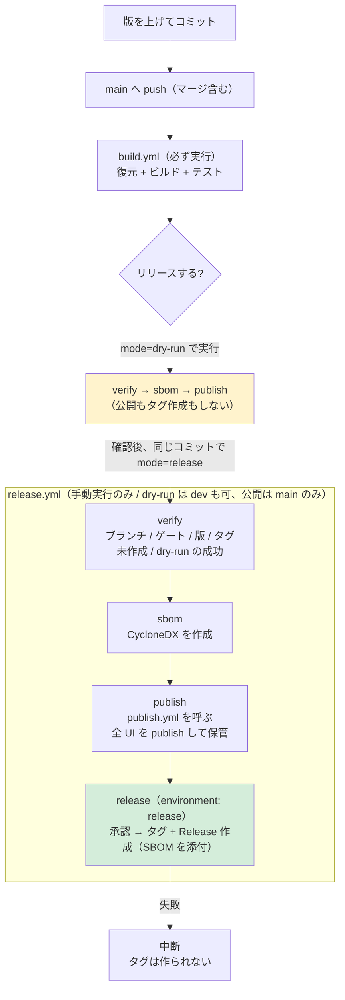
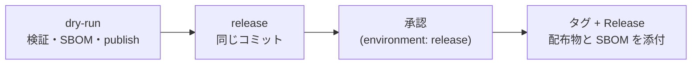

# リリース手順（GitHub Actions）

本ドキュメントは SaveEvidence の**リリース作業を行う開発者**向けの情報です。
他のリポジトリへの流用方法は [`REUSING.md`](REUSING.md)、
アプリの利用方法は [`../README.md`](../README.md) を参照してください。

リリースは **手動実行のみ**です。 バージョンの**自動インクリメントは行いません**。

## 構成

リリースの設定と処理は、次のファイルが持ちます。 **同じ知識を複数箇所に置かない**ことが設計方針です。

| ファイル | 内容 |
| --- | --- |
| [`release-config.json`](release-config.json) | プロダクト名、バージョンファイル、**ビルド対象のソリューションファイル**、ゲートのワークフロー、**リリースを許可するブランチ**、配布する UI の定義 |
| [`actions/read-config`](actions/read-config/action.yml) | `release-config.json` を読んで各ワークフローへ渡す共通アクション（読み取りの実装はここだけ） |
| [`../Directory.Build.props`](../Directory.Build.props) | リリースバージョン（`<Version>`）。 各 `.csproj` では指定しない |
| [`../global.json`](../global.json) | .NET SDK のバージョン。 ワークフローでは指定しない |
| [`workflows/publish.yml`](workflows/publish.yml) | 全 UI の publish・**配布物の起動検証**・アーティファクト保管の実装（`release.yml` が呼ぶ） |
| [`scripts/version.ps1`](scripts/version.ps1) | バージョンの規則（形式・比較・系列・プレリリース判定・タグの列挙） |

UI の追加・変更は **`release-config.json` の `uis[]` を編集します**（ワークフローとスクリプトの変更は不要です）。
**ビルド・テストの対象は `solutionFile` が持ちます**（ワークフローには書きません）。
**実行できるブランチはモードで変わります**（`dry-run` は `dryRunBranches`、公開は `releaseBranches`。 本リポジトリは dry-run が `["main", "dev"]`、公開が `["main"]`。
**開発から dry-run までの確認は `dev` で行い、公開は `main` で行います**）。

```text
<リポジトリルート>/
├── Directory.Build.props     # リリースバージョン（各 .csproj では指定しない）
├── global.json               # .NET SDK のバージョン（ワークフローでは指定しない）
├── buildScript/              # UI ごとの publish 手順（release-config.json の uis[].script が指す）
└── .github/
    ├── release-config.json        # リリース設定（リポジトリ固有の設定はこのファイルのみ）
    ├── actions/
    │   └── read-config/
    │       └── action.yml         # release-config.json を読む共通アクション
    ├── dependabot.yml             # GitHub Actions / NuGet の更新 PR
    ├── RELEASE.md                 # 本ドキュメント
    ├── REUSING.md                 # 他のリポジトリへの流用方法
    ├── rulesets/
    │   └── tag-version.json       # Tag ruleset の定義（Settings へインポートする）
    ├── scripts/
    │   ├── version.ps1            # バージョンの規則
    │   ├── set-version.ps1        # バージョンファイルの書き換え（冪等）
    │   ├── verify-release-version.ps1  # リリース可否の検証
    │   └── show-current-versions.ps1   # 現在のバージョン状況の表示
    └── workflows/
        ├── build.yml              # push / PR でビルド・テスト（配布物は作らない）
        ├── publish.yml            # 全 UI の publish と保管（release.yml から呼ばれる）
        └── release.yml            # 手動実行で検証・publish・タグ・Release 作成
```

**注意事項**:

- リリースバージョンは `Directory.Build.props` の `<Version>` に記載し、**各 `.csproj` には記載しないでください**。
  リリース時に `release.yml` がこの 1 行を入力値へ書き換えてコミットします。
- **.NET SDK のバージョンは `global.json` に記載し、ワークフローには記載しないでください**
  （`actions/setup-dotnet` が `global.json` を読むため、`dotnet-version` の指定は不要です）。
- **テストの実行基盤もリポジトリで 1 つに決め、`global.json` と `build.yml` のどちらか一方にだけ書いてください。**
  本リポジトリは xunit.v3 3 系 + `Microsoft.NET.Test.Sdk`（VSTest）のため `test.runner` は不要で、
  `dotnet test '<ソリューション>' -c Release --no-build` で全件を実行します
  （xunit.v3 4 系の Microsoft.Testing.Platform へ上げる場合は `test.runner` の指定と `--solution` への変更が必要です）。
- 同じ設定を複数箇所に置かないでください（例: UI の定義をワークフローへ直接書く、ソリューション名をワークフローへ書く、バージョンを `.csproj` にも書く、SDK のバージョンをワークフローにも書く）。
  変更時の注意事項は [`REUSING.md`](REUSING.md) にも記載しています。
- **`build.yml` / `publish.yml` / `release.yml` は Windows 固有のターゲットを含むため、ビルド系のジョブは
  `windows-latest` で実行します**（`release.yml` の検証のみ `ubuntu-latest`）。

## 依存関係の更新（Dependabot）

[`dependabot.yml`](dependabot.yml) が、GitHub Actions と NuGet パッケージの更新 Pull Request を作成します。

| 対象 | 間隔 | まとめ方 |
| --- | --- | --- |
| GitHub Actions（`uses:` で参照しているアクション） | 毎週月曜 09:00（Asia/Tokyo） | すべてを 1 つの Pull Request にまとめる |
| NuGet（`src/` と `test/` の各プロジェクト） | 毎月 | minor / patch を 1 つの Pull Request にまとめる |

**注意事項**:

- Dependabot の Pull Request は**読み取り専用トークン・シークレット無し**で実行されます。 `build.yml` はシークレットを使わないため、CI はそのまま動作します。
- **NuGet のメジャー更新は作成されません**（テストの書き方が変わるため、手動で判断します）。
- Dependabot は**指定したディレクトリ直下のみを走査します**（再帰しません）。 プロジェクトを増やした場合は
  `dependabot.yml` の `directories` にも追加してください。
- Pull Request の内容を確認して `main` へマージします（マージ方式は Squash merge を推奨）。 マージ後の `main` への push で `build.yml`（ゲート）が実行されます。
- 破壊的な変更（`actions/upload-artifact` のメジャー更新など）は、CI が失敗した内容を確認して修正します。

## リポジトリの設定（初回のみ）

次はワークフローでは設定できません。 リポジトリの **Settings** で有効化します。

### タグの保護（Tag ruleset）

タグ（すべてのタグ）の**更新と削除**を禁止します。 定義は
[`rulesets/tag-version.json`](rulesets/tag-version.json) にあります。

| 項目 | 値 |
| --- | --- |
| Ruleset name | `Protect version tags` |
| Target | **Tags** |
| Enforcement status | **Active** |
| Target tags | `refs/tags/**`（将来タグの形式を変えても保護される） |
| Tag protections | **Restrict updates** / **Restrict deletions** / **Block force pushes** |
| Bypass list | **Repository admin**（`RepositoryRole`） |

**設定手順**:

1. **Settings → Rules → Rulesets** を開く
2. **New ruleset** のドロップダウンから **Import a ruleset** を選び、`rulesets/tag-version.json` を指定する
   - インポートできない場合は **New tag ruleset** で上表のとおり手動設定する
3. 内容を確認して **Create** を押下する

**注意事項**:

- **作成は制限していません**。 リポジトリ単位の ruleset は **GitHub Actions を Bypass に指定できない**（API が `Actor GitHub Actions integration must be part of the ruleset source or owner organization` で拒否する。 実測 2026-10-26）。 作成まで止めると `release.yml` がタグを作れなくなるため、**更新と削除だけを保護**し、作成は「**タグを作るのはワークフローだけ**」という規律で守ります。
- ローカルからの `git push origin v0.2.0` や `git push --tags` は**作成としては通り得ます**が、行いません（タグは Release 実行時に作成します）。
- **更新・削除は管理者でも通常は拒否されます**（Bypass は管理者にのみ許されます）。
- 定義を変更した場合は、**同じ JSON の値と実際の ruleset を一致**させてください（ruleset はコードから自動適用されないため、変更時は手動で更新します）。

### ブランチの保護（Branch ruleset）

`main` への**直接 push を禁止**し、**PR 経由と `build` の成功をマージ条件**にします。 定義は
[`rulesets/protect-main.json`](rulesets/protect-main.json) にあります。

| 項目 | 値 |
| --- | --- |
| Ruleset name | `Protect main` |
| Target | **Branches** |
| Enforcement status | **Active** |
| Target branches | `~DEFAULT_BRANCH`（既定ブランチ＝`main`） |
| Rules | **Restrict deletions** / **Block force pushes** / **Require a pull request before merging** / **Require status checks to pass**（`build`） |
| Required approvals | **0**（承認者は不要。 「PR 経由」だけを強制する） |
| Bypass list | **なし**（管理者も迂回できない。 非常時は ruleset 自体を編集する） |

**設定手順**: `gh api -X POST repos/<owner>/<repo>/rulesets --input .github/rulesets/protect-main.json`
（既存は `-X PUT .../rulesets/<id>`）で適用します。 UI からは **Settings → Rules → Rulesets** で同じ値を設定します。

**注意事項**:

- **`dev` への push は制限しません**（作業ブランチのため）。 **`main` へは PR でのみ**反映します。
- 承認者を 0 にしているため、**CI が緑なら作成者自身がマージできます**。
- `strict_required_status_checks_policy` は `false`（毎回の rebase を強制しない）。

## ワークフロー

| ワークフロー | 実行契機 | 内容 |
| --- | --- | --- |
| [`workflows/build.yml`](workflows/build.yml) | `main` への push（マージ後）、`main` 向け PR（**必ず実行**）、`dev` への push、手動実行 | 復元・ビルド・テスト（**配布物は作らない**）。 PR では必須チェック `build` |
| [`workflows/publish.yml`](workflows/publish.yml) | `workflow_call` | 全 UI の publish・**配布物の起動検証**・保管の単一実装（`version` を受け取るとそのバージョンでビルドする） |
| [`workflows/release.yml`](workflows/release.yml) | **手動実行のみ。 実行ブランチは `mode` に従う**（`dry-run` は `dryRunBranches`、公開は `releaseBranches`）。 `mode` で 2 段階（`dry-run` / `release`） | 検証 → SBOM → 全 UI の publish →（release のみ）**承認** → タグ + GitHub Release 作成 |

`build.yml` の成功実行はリリースの**前提（ゲート）**です。 `release.yml` は、リリース対象コミットに対する `build.yml` の成功実行が存在することを確認してから Release を作成します。

**配布物を作る処理は重い（Native AOT を含む）ため、push では実行しません。** 配布物の作成はリリース時に 1 度だけ行います。

**各ジョブには `timeout-minutes` を設定しています**（停止した場合に既定の 6 時間待たないため）。
ビルド・テスト・検証・公開は 30 分、設定の読み取りは 10 分、配布物の作成（`publish.yml` の `publish`）は 60 分です。
なお、再利用ワークフローを呼ぶジョブ（`release.yml` の `publish`）には指定できないため、タイムアウトは呼び先の `publish.yml` が持ちます。



## リリース手順

リリースは **`dry-run` → `release` の 2 段階**で行います。 **版はリリース前にコミットしておきます**（自動採番しません）。

1. **版を上げてコミットする**（`Directory.Build.props` の `<Version>`）。 `dev` で上げ、`main` へマージする
2. `Actions` → **Build** が成功するまで待つ（`build.yml` の成功はリリースの**前提（ゲート）**です）
3. `Actions` → **Release** → `Run workflow` で、**モード `dry-run`** を選んで実行する
   - 配布物の作成（全 UI の publish）・起動検証・**SBOM の作成**まで行います（**公開もタグ作成もしません**）
   - `version` は省略できます（省略するとコミット済みの版を使います）
4. 実行サマリーと成果物（アーティファクト）を確認する
5. **同じコミットのまま**、**モード `release`** で実行する
   - `publish` ジョブまで進んだあと、**`release` 環境の承認待ち**で止まります
   - `Actions` → 実行 → **Review deployments** → `release` → **Approve** で承認する
   - 承認後に**タグと GitHub Release** が作られ、配布物と SBOM が添付されます
6. <https://github.com/tomokuni/SaveEvidence/releases> に配布物が添付されていることを確認する



**注意事項**:

- **実行できるブランチは `release-config.json` の `dryRunBranches`（dry-run）と `releaseBranches`（公開）が決まります**（本リポジトリは dry-run が `["main", "dev"]`、公開が `["main"]`）。 **開発から dry-run までの確認は `dev` で行い、公開は `main` で行います**。
  `verify` ジョブが最初に実行ブランチを検証し、含まれない場合は失敗します。
- **`release` は、同じコミットの `dry-run` が成功していることを要求します**（実行名 `DryRun …` の成功実行を確認します）。 満たさない場合は失敗します。
- **版は自動採番しません**。 入力 `version` は**確認用**であり、`Directory.Build.props` の `<Version>` と一致しなければ失敗します。
- **タグは公開が成功した後にだけ作ります**（作成に失敗しても、タグは消費されません）。
- **`release` ジョブは `environment: release` を持ちます**。 承認者（Required reviewers）の設定は [リポジトリの設定](#リポジトリの設定初回のみ) を参照してください。
- **ワークフローはバージョンをコミットしません**（`main` の版はリリース前に人が上げます）。
- **同じ系列の中で既存以下のバージョンは検証で失敗します**（同値の再リリースも不可）。
- **実行一覧（`Actions` → Release）の実行名は `DryRun <ブランチ> <SHA>` / `Release <ブランチ> <SHA>`** です（どのコミットを出したかを一判別できます）。
- サマリーを表示するステップが失敗しても、リリースは中止されません（情報の表示のみで、状態を変更しません）。

## バージョンの指定

semver 形式で入力します。 数値部分の**先頭 0 は使用できません**。

| 入力例 | 意味 |
| --- | --- |
| `0.2.0` | 通常のリリース |
| `1.0.0` | メジャーリリース |
| `1.2.3-rc.1` | プレリリース（GitHub 上もプレリリースとして登録される） |

プレリリース識別子は `-rc.1` のように**数値をドットで区切る形式を推奨**します。 `-rc1` のような形式は辞書順で比較されるため（semver 仕様）、`rc10` が `rc2` より小さくなります。

### FileVersion について

プレリリース部分は **`InformationalVersion`（エクスプローラーの「製品バージョン」）にのみ反映**されます。
`AssemblyVersion` / `FileVersion` は数値 4 桁しか許されないため、`1.2.3-rc.1` でも **`FileVersion` は `1.2.3.0`** になります。 rc と正式版をファイルのプロパティで区別する場合は「製品バージョン」を参照してください。

## 検証される条件

`release.yml` は次をすべて満たさない場合に失敗します。

| # | 条件 | 失敗する例 |
| --- | --- | --- |
| 1 | 実行ブランチがモードの許可ブランチに一致する（dry-run: `dryRunBranches` / 公開: `releaseBranches`） | 公開で `dev` を選んで実行（公開は不可） |
| 2 | `release/X.Y` の場合、入力バージョンの系列が `X.Y` に一致する | `release/0.1` に `0.2.0` を入力 |
| 3 | 対象コミットに対する `build.yml` の**成功実行がある** | push 直後（Build 実行中・失敗）に実行 |
| 4 | バージョンが semver 形式（先頭 0 不可） | `1.2`、`01.2.3` |
| 5 | **同じ系列のタグの最大より大きい** | `v0.1.1` があるのに `0.1.1` を入力 |
| 6 | タグ `v<version>` が**未作成** | 既存と同じバージョンを入力 |
| 7 | 入力 `version` が**コミット済みの `<Version>` と一致する** | 版を上げずに `0.2.0` を入力 |
| 8 | `release` モードでは、**同じコミットの `dry-run` が成功している** | `dry-run` を実行せずに `release` を実行 |

条件 5・6 により、**同値の入力も失敗**します（同じバージョンの再リリースはできません）。

## 古い系列のリリース

**本リポジトリは系列ブランチ（`release/<major>.<minor>`）を使いません**（公開は `main` からのみ）。 古い系列を保守する必要が出た場合は、次のいずれかを選びます。

- **`main` から旧系列のバージョンを公開する**: `main` の版を旧系列（例 `0.1.2`）にしてコミットし、`main` から dry-run → release を実行する。 この場合 `--latest=false` と `--notes-start-tag` が自動で付き、`Directory.Build.props` は**書き換えません**（新しい系列の版を旧系列へ戻さないため）。
- **系列ブランチを復活させる**: `release-config.json` の `releaseBranches` に `"release/**"` を戻す（そのときは本文書の旧版にあった系列ブランチの手順を復元する）。

| 実行ブランチ | 比較対象 | 例（タグ: v0.1.1 / v1.0.0） | バージョンファイル | Latest |
| --- | --- | --- | --- | --- |
| `main`（新しい系列） | 入力バージョンと**同じ系列**の最大 | `1.0.1` は OK / `1.0.0` は失敗（同値） | 書き換える | 更新する |
| `main`（旧系列を入力） | 同上 | `0.1.2` は OK（同じ系列の最大 `0.1.1` より大きい） / `0.1.1` は失敗（同値） | **書き換えない** | 更新しない |

## Release の添付ファイル

添付するファイルは `release-config.json` の `uis[].asset` が決めます。 `release.yml` は保管された成果物をそのまま添付するため、**UI を追加してもワークフローは変更不要**です。 **SBOM（`<製品名>.<版>.sbom.cdx.json`）も併せて添付します**。

**SBOM（CycloneDX）は `buildScript/generateSbom.ps1` が作ります**（ツールの版は [`.config/dotnet-tools.json`](../.config/dotnet-tools.json) が単一所有し、`dotnet tool restore` で揃います）。 何のために付けるか:

- 配布物（zip）からは「どの依存のどの版を使ったか」が分からない。 SBOM があれば、**公開済みの配布物から依存を辿れる**。
- **EsUtil の版も SBOM に載る**（`EsUtil.*` はパッケージ参照のため、exe のプロパティだけでは分からない）。 アプリ側の版と併せて追跡できる。
- SBOM は **`dry-run` でも作る**（作れない状態をリリース前に検出する）。

**発行方式は UI ごとに、Single AOT → Single（非 AOT）→ EXE（フォルダー）の優先順で「可能なもの」が選ばれます**（実装は [../buildScript/publish_ui.bat](../buildScript/publish_ui.bat)。 可否は UI とフレームワークが決めます）。

| UI | 添付ファイル | 方式（実測 2026-10-20） | zip の中身 |
| --- | --- | --- | --- |
| MewUI 版 | `SaveEvidence.MewUI.zip` | Single + AOT | exe 1 個 + ネイティブ DLL |
| Avalonia UI 版 | `SaveEvidence.zip` | Single + AOT | exe 1 個 + ネイティブ DLL |
| WinForms 版 | `SaveEvidence.WinForms.zip` | Single | exe 1 個（自己完結ランタイムを同梱） |
| WinUI 3 版 | `SaveEvidence.WinUI3.zip` | Single（AOT なし。 Windows App SDK は自己完結） | **exe 1 個**（自己完結ランタイムとネイティブ DLL を同梱。 **SkiaSharp を含まない**） |

- **方式が Single AOT でない UI は、その理由を本節が持ちます**（WinForms は SDK がトリミングを拒否する `NETSDK1175`）。
- **WinUI 3 版は「1 ファイル・事前インストール不要」です**（[../buildScript/publish_WinUI3.bat](../buildScript/publish_WinUI3.bat)）。 **Native AOT はこの形を作れません**（後述）ため、**WinUI 3 版は AOT を配布しません**（AOT の配布物は MewUI 版と Avalonia UI 版が担います）。
- **Native AOT はネイティブ DLL を exe へ内包できません**（実測 2026-10-20: `PublishAot` と同時に `PublishSingleFile` / `IncludeNativeLibrariesForSelfExtract` を指定しても、ネイティブ ライブラリは exe の隣へ出力されます。 最小構成の再現で確認）。 さらに Windows App SDK は**フレームワーク依存のまま `PublishSingleFile` を拒否**します。 よって **「1 ファイル」と「AOT」は両立しません**。 事前インストールを避けるには、①**AOT なしの自己完結 Single（1 ファイル）** か ②**自己完結 AOT（フォルダー配布）** のどちらかを選びます。 本リポジトリは①を採用し、②（自己完結 AOT のフォルダー配布）は MewUI 版と Avalonia UI 版が担います。
- **Windows App SDK をフレームワーク依存にすると配布物は小さくなりますが、配布先に Windows App SDK ランタイム（1.8 系）のインストールが必要**になります。 本リポジトリは**事前インストール不要を優先**するため、自己完結を既定にしています。
- **WinUI 3 の配布物は、exe へ入れられない非ネイティブのファイルを公開時に絞ります**（`src/App.WinUI3/src/App.WinUI3.csproj` の `TrimWinUI3PublishNoise`）。 残す必須のファイルは **アプリの `.pri`・`ja-JP` と `en-us` の `.mui`・`Microsoft.UI.Xaml\Assets`・`NpuDetect`** です（1 種類ずつ削除して起動・終了・設定の往復を実測。 **アプリの `.pri` を削除すると起動せず、`.mui` を削除すると終了時に `0xC000027B` で落ちます**）。 `.winmd`・他の言語の `.mui`・アプリ以外の `.pri`・`workloads*.json`・`App.xaml`・`app.manifest`・`WindowsAppRuntime.png`・WebView2 関連・`UniversalBGTask` は削除してよいことを実測済みです。
- **WinUI 3 版は SkiaSharp を含みません**（描画は Windows App SDK 標準）。 そのためトリミング・AOT 解析の警告（`IL2026` 等）を抑止していません。
- **Avalonia UI 版の AOT は、以前は `IL2070` / `IL3050` で失敗していました**（`EsUtil.Ui.AvaloniaUI.Loupe` が `Expression.Compile` と `Type.GetMethod` で表示アダプタの契約を解決していたため）。 反射を削除して方式 1 へ戻しています（方式 1 へ戻せなくなったら、まず EsUtil 側で反射が復活していないかを疑います）。
- **ネイティブ ライブラリ（OpenCvSharp と Avalonia の GL 実装）は exe へ同梱できない**ため、同じフォルダーへ並べて配布します（ファイル数とサイズはコードの変更で変わるため、文書へ書かず `buildScript/verifyPublish.ps1` が実測して表示します）。 MewUI 版は Native AOT で **exe 1 個 + ネイティブ DLL 1 個**まで縮みました（Skia を外したため）。
- **WinUI 3 版の本体プロジェクトは `EnableMsixTooling` を必要とします**（付けないと publish が `.pri` を発行せず、起動はしても終了時に `0xC000027B` / `0x80008083`（WinRT の stowed exception）で落ちます。 実測）。 Windows App SDK 自己完結（`WindowsAppSDKSelfContained`）+ アンパッケージ（`WindowsPackageType=None`）で配布します。
- **publish はリポジトリ外の一時領域（`%TEMP%`）へ発行し、必要なファイルだけを `publish/` へ配置します**（リポジトリ内へ直接発行すると、参照プロジェクト側のディレクトリにも `publish` が作られます）。
- **方式ごとの引数は環境変数で差し替えます**（`SE_AOT_ARGS` / `SE_SINGLE_ARGS`。 **空にする意図は `SE_SKIP_AOT_ARGS` / `SE_SKIP_SINGLE_ARGS`** で表します。 `cmd` では `set "VAR="` が変数を未定義へ戻すため、空文字では意図を表せません。 差し替えの例は WinUI 3 版です）。
- **UI ごとに試す方式は `SE_MODES` で絞れます**（既定は `aot single exe`）。 1 つの UI が複数の形を配布する場合は、形ごとに `publish_<UI>*.bat` を用意して `release-config.json` の `uis[]` へ 1 件ずつ登録します（**現在は 4 UI が 1 形ずつで、複数形を配布する UI はありません**）。
- **`SelfContained` は明示しません**（`-r` が暗黙に有効にします。 明示すると参照プロジェクトへ伝播し、WinUI 3 のライブラリが `EnableMsixTooling` と `WindowsAppSDKSelfContained` を要求して失敗します。 実測）。
- **publish スクリプト（`buildScript/*.bat`）は ASCII だけで書きます**（日本語を書くと `cmd.exe` の読み取りがずれ、出力が化けたうえにコメントの断片がコマンドとして実行されます。 根拠と検査は [`検証手順.md`](検証手順.md) §19）。
- **方式 1 へ戻すと出力フォルダー名（`-single` → `-aot`）が変わるため、`release-config.json` の `uis[].output` も更新してください**（検査が「出力フォルダーがありません」で気付きます）。
- **単一ファイル化（`PublishSingleFile`）は publish のコマンドライン引数で渡さず、アプリの `.csproj` に置きます**。 コマンドライン引数は**参照プロジェクトへ伝播**し、WinUI 3 のライブラリが `EnableMsixTooling` と `WindowsAppSDKSelfContained` を要求して失敗するためです（後者は RID を要求しますが、RID は参照プロジェクトへ伝播しません。 実測 2026-10-16）。 プロパティを差し替えたい UI は `buildScript/publish_ui.bat` の `SE_SKIP_SINGLE_ARGS` を使います。
- **WinUI 3 の単一ファイル化は「WinUI 3 のライブラリを RID 付きで直接ビルドする」手順を必要とします**（`buildScript/publish_WinUI3.bat` が実行）。 アプリの `.pri` 生成は参照プロジェクトの `<TFM>\<RID>\` の `.pri` を要求しますが、RID が伝播しないためアプリの publish ではそこへ出ません（`PRI175` / `PRI252`）。
- **配布物は exe 1 個であることを検査します**（`buildScript/verifyPublish.ps1`）。 Windows App SDK が再起動 API 用に同封する `RestartAgent.exe` は配置しません（本アプリは再起動 API を使わない。 除いても起動と終了が正常であることを実測済み）。
- **配布物から落としてよいのは `*.pdb` と `RestartAgent.exe`、および `TrimWinUI3PublishNoise`（WinUI 3）が外すファイルだけ**です。 それ以外は拡張子で選別せずにすべて配置します（WinUI 3 の配布物は `.pri` / `.mui` を必要とし、`.pri` を落とすと起動せず、`.mui` を落とすと終了時に `0xC000027B` で落ちます。 実測 2026-10-20）。
- **WinUI 3 版は自己完結の Windows App SDK から ML（ONNX Runtime・DirectML）・Windows AI・Widgets のネイティブ実体を除いてから同梱します**（43.8 MB 減。 実装は [`../Directory.Build.targets`](../Directory.Build.targets) の `ExcludeUnusedWindowsAppSdkPayload`、規則は [`ビルド設定規約.md`](ビルド設定規約.md) §5）。 本アプリはこれらの API を呼びません（ソース参照 0 件）。

**すべて zip で配布します。** `uis[].zip` が `true` の UI は、publish 後に配布物を zip 化してから保管します
（出力が単一ファイル（exe）でもフォルダでも同じ指定で扱えます）。

publish は `buildScript/` の `publish_<UI>.bat` をそのまま実行するため、ローカルでの配布用ビルドと同一の手順・出力になります。
スクリプトは `buildScript/` からリポジトリルートへ移動してから実行されるため、カレントディレクトリに依存しません。

**publish の直後に `buildScript/verifyPublish.ps1 -SkipPublish` を実行し、配布物が実際に起動して設定を全損しないことを確かめます**
（Native AOT のトリミングで設定が空（`{}`）になる不具合の回帰検出。 検査の内容と合否基準は [`検証手順.md`](検証手順.md) §18）。

## 失敗した場合の復旧

`release.yml` は **承認 → タグ作成 → Release 作成**の順に進みます。 そのため途中で失敗してもタグは作成されません。

| 失敗したジョブ | 状態 | 復旧方法 |
| --- | --- | --- |
| `verify` | 何も変更されていない | 条件を満たして再実行する |
| `sbom` | 何も変更されていない | 再実行する |
| `publish` | 何も変更されていない（タグ未作成） | **同じモードで再実行**する |
| `release`（承認後） | タグが未作成、または Release 作成のみ失敗 | **同じモードで再実行**する（タグは公開後に作るため、二重には作られない） |

- 失敗した実行を「Re-run」しても**その実行時のワークフロー定義**が使われるため、定義を修正した場合は再実行せず、新しく `Run workflow` してください。
- **`publish` の成果物を再利用したい場合は、`release` だけを再実行できません**（ジョブの依存関係により `publish` から再実行されます）。 時間はかかりますが、同じ入力から同じ成果物になります。

## ローカルでの確認

スクリプトはローカルでも実行できます。

```powershell
# 版を上げる（バージョンファイルを更新。 冪等）。 コミットは人が行う
& .github/scripts/set-version.ps1 -Version 0.2.0

# リリース可否を事前確認する（形式・ブランチ・系列・単調性・タグ未作成）
$info = & .github/scripts/verify-release-version.ps1 -Version 0.2.0 -Branch main | ConvertFrom-Json
$info.tag           # -> v0.2.0
$info.notesStartTag # -> v0.1.1
$info.prerelease    # -> False

# 現在のバージョン状況を確認する（読み取りのみ。ネットワークを使わない場合は -NoNetwork）
& .github/scripts/show-current-versions.ps1 -Branch main
```

バージョンの規則（形式・比較）だけを確認する場合は、ライブラリを直接使えます。

```powershell
. .github/scripts/version.ps1
ConvertTo-SemanticVersion -Version '1.2.3-rc.1'   # 不正なら例外
Get-VersionSeries -Version '1.2.3'                # -> 1.2
Get-MaxVersion -Versions @('1.0.0', '1.2.0')      # -> 1.2.0
```

## 注意点

- **ワークフローは `main` へ push しません**（版はリリース前に人がコミットするため、push 権限は不要です）。 `contents: write` はタグと Release の作成だけに使います。
- `release.yml` は `actions: read`（ゲートと dry-run の参照）と `contents: write`（タグと Release）を使用します。
- **`build.yml` は配布物を作成しません。** ゲートはビルドとテストの成功であり、**配布物が作成できることは `dry-run` で確かめます**（そのために 2 段階にしています）。
- `dev` への push でも `build.yml` を実行します（作業ブランチの壊れを早く見つけるため）。
- 配布物（アーティファクト）の保持期間は `release-config.json` の `artifactRetentionDays`（既定 30 日）です。
  **`release` は `dry-run` とは別の実行**であるため、成果物は `release` 実行の中で作り直します（`dry-run` の成果物には依存しません）。
