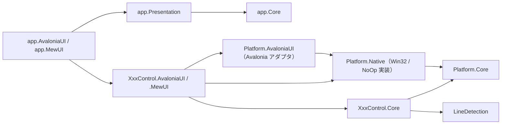

# 複数 UI 対応作業

SaveEvidence の UI（Avalonia UI）からコアロジックを分離し、複数 UI（Avalonia UI / MewUI）へ対応するための作業計画と進捗です。

参考実装: `D:\Dev\Repos\GitHub\ClipboardZenHanConverter`（`src/core` / `src/core_presentation` / `src/app_*` の 4 UI 構成）

- [複数 UI 対応作業](#複数-ui-対応作業)
  - [1. 目的](#1-目的)
  - [2. プロジェクト名（改名後）](#2-プロジェクト名改名後)
  - [3. 現状の構成（着手前）](#3-現状の構成着手前)
    - [3.1 着手前に判明した前提の誤り](#31-着手前に判明した前提の誤り)
  - [4. 全体方針](#4-全体方針)
    - [4.1 依存方向（一方向を厳守）](#41-依存方向一方向を厳守)
    - [4.2 分割の判断基準](#42-分割の判断基準)
    - [4.3 コア型の命名規則（`Es` 接頭辞）](#43-コア型の命名規則es-接頭辞)
    - [4.4 段階（ティア）](#44-段階ティア)
  - [5. 完了した項目](#5-完了した項目)
    - [5.1 `Platform.Core` の新設（ティア A）](#51-platformcore-の新設ティア-a)
    - [5.2 座標系の純粋計算を Core へ移設（ティア A）](#52-座標系の純粋計算を-core-へ移設ティア-a)
    - [5.3 コア幾何型の導入と `CoordinateFormatter` の移設（ティア B）](#53-コア幾何型の導入と-coordinateformatter-の移設ティア-b)
    - [5.4 `EsBitmap` の Core 移設（ティア C）](#54-esbitmap-の-core-移設ティア-c)
    - [5.5 `ICoordTransform` / `CoordTransform` の Core 移設（ティア D）](#55-icoordtransform--coordtransform-の-core-移設ティア-d)
    - [5.6 プラットフォーム値型の導入とサービス抽象の Core 移設（ティア D）](#56-プラットフォーム値型の導入とサービス抽象の-core-移設ティア-d)
    - [5.7 テストとドキュメント](#57-テストとドキュメント)
    - [5.8 `LoupeControl.Core` の新設（ティア E / 1 コントロールで PoC）](#58-loupecontrolcore-の新設ティア-e--1-コントロールで-poc)
    - [5.9 検証](#59-検証)
    - [5.10 移設時に得た注意点](#510-移設時に得た注意点)
  - [6. 詳細（ティア D / サービス抽象・プラットフォーム値型の Core 化）](#6-詳細ティア-d--サービス抽象プラットフォーム値型の-core-化)
    - [6.1 目的](#61-目的)
    - [6.2 実施内容](#62-実施内容)
    - [6.3 変更対象](#63-変更対象)
  - [7. 詳細（ティア D / Win・NoOp 実装とファクトリの UI 非依存化）](#7-詳細ティア-d--winnoop-実装とファクトリの-ui-非依存化)
    - [7.1 課題](#71-課題)
    - [7.2 実施内容](#72-実施内容)
    - [7.3 変更対象](#73-変更対象)
  - [8. 詳細（ティア B / `AvaloniaGeometryAdapters` / `RectDExt` の整理）](#8-詳細ティア-b--avaloniageometryadapters--rectdext-の整理)
    - [8.1 課題](#81-課題)
    - [8.2 方針と結果](#82-方針と結果)
    - [8.3 変更対象](#83-変更対象)
  - [9. 詳細（ティア E / `LoupeControl` で Core 分割 PoC）](#9-詳細ティア-e--loupecontrol-で-core-分割-poc)
    - [9.1 目的](#91-目的)
    - [9.2 現状の `LoupeControl` 構成（調査結果）](#92-現状の-loupecontrol-構成調査結果)
    - [9.3 実施内容](#93-実施内容)
    - [9.4 変更対象](#94-変更対象)
    - [9.5 実施結果（検証）](#95-実施結果検証)
    - [9.6 横展開のパターン（本 PoC で確立するもの）](#96-横展開のパターン本-poc-で確立するもの)
  - [10. 詳細（ティア E / 他コントロールへ横展開・`ZoomViewControl`）](#10-詳細ティア-e--他コントロールへ横展開zoomviewcontrol)
    - [10.1 目的](#101-目的)
    - [10.2 候補の絞り込み（機械的な判定）](#102-候補の絞り込み機械的な判定)
    - [10.3 コントロール別の UI 非依存候補（調査結果）](#103-コントロール別の-ui-非依存候補調査結果)
    - [10.4 実施順序](#104-実施順序)
    - [10.5 実施内容（`ZoomViewControl`）](#105-実施内容zoomviewcontrol)
    - [10.6 変更対象（`ZoomViewControl`）](#106-変更対象zoomviewcontrol)
    - [10.7 実施結果（検証）](#107-実施結果検証)
    - [10.8 旧ファイルの重複除去（作業中の復旧）](#108-旧ファイルの重複除去作業中の復旧)
  - [11. 詳細（ティア E / 他コントロールへ横展開・`CropViewControl`）](#11-詳細ティア-e--他コントロールへ横展開cropviewcontrol)
    - [11.1 目的](#111-目的)
    - [11.2 調査結果と判断](#112-調査結果と判断)
    - [11.3 実施内容](#113-実施内容)
    - [11.4 変更対象](#114-変更対象)
    - [11.5 実施結果（検証）](#115-実施結果検証)
  - [12. 詳細（ティア F / `app.Core` の第一段階）](#12-詳細ティア-f--appcore-の第一段階)
    - [12.1 目的](#121-目的)
    - [12.2 調査結果（機械的な判定）](#122-調査結果機械的な判定)
    - [12.3 実施内容](#123-実施内容)
    - [12.4 変更対象](#124-変更対象)
    - [12.5 実施結果（検証）](#125-実施結果検証)
    - [12.6 次段階（`Settings` の UI 非依存化）→ 第二段階として実施済み](#126-次段階settings-の-ui-非依存化-第二段階として実施済み)
  - [13. 詳細（ティア F / `app.Core` の第二段階 = 設定モデルと設定サービスの UI 非依存化）](#13-詳細ティア-f--appcore-の第二段階--設定モデルと設定サービスの-ui-非依存化)
    - [13.1 目的](#131-目的)
    - [13.2 障害と対処](#132-障害と対処)
    - [13.3 実施内容](#133-実施内容)
    - [13.4 JSON 互換性（既存の設定ファイルをそのまま読み込める）](#134-json-互換性既存の設定ファイルをそのまま読み込める)
    - [13.5 変更対象](#135-変更対象)
    - [13.6 実施結果（検証）](#136-実施結果検証)
  - [14. 詳細（ティア F / `app.Core` の第三段階 = `MainViewModel` の UI 非依存化に必要な型の整備）](#14-詳細ティア-f--appcore-の第三段階--mainviewmodel-の-ui-非依存化に必要な型の整備)
    - [14.1 目的](#141-目的)
    - [14.2 障害の整理](#142-障害の整理)
    - [14.3 実施内容](#143-実施内容)
    - [14.4 変更対象](#144-変更対象)
    - [14.5 実施結果（検証）](#145-実施結果検証)
    - [14.6 次段階（第三段階の残り）→ 第四段階として実施済み](#146-次段階第三段階の残り-第四段階として実施済み)
  - [15. 詳細（ティア F / `app.Core` の第四段階 = `MainViewModel` の移設）](#15-詳細ティア-f--appcore-の第四段階--mainviewmodel-の移設)
    - [15.1 目的](#151-目的)
    - [15.2 障害の整理](#152-障害の整理)
    - [15.3 実施内容](#153-実施内容)
    - [15.4 変更対象](#154-変更対象)
    - [15.5 実施結果（検証）](#155-実施結果検証)
    - [15.6 作業中の復旧（旧ファイルの復活）](#156-作業中の復旧旧ファイルの復活)
  - [16. 改名（`PbBitmap` → `EsBitmap`）](#16-改名pbbitmap--esbitmap)
    - [16.1 目的](#161-目的)
    - [16.2 実施内容（機械的な一括改名）](#162-実施内容機械的な一括改名)
    - [16.3 手順（スクリプトで実施）](#163-手順スクリプトで実施)
    - [16.4 注意点（実際に起きたこと）](#164-注意点実際に起きたこと)
    - [16.5 実施結果（検証）](#165-実施結果検証)
  - [17. 詳細（ティア F / MewUI の調査と PoC）](#17-詳細ティア-f--mewui-の調査と-poc)
    - [17.1 目的](#171-目的)
    - [17.2 MewUI の調査結果（`Aprillz.MewUI` 0.21.1）](#172-mewui-の調査結果aprillzmewui-0211)
    - [17.3 再利用できる部分 / 作り直しが必要な部分](#173-再利用できる部分--作り直しが必要な部分)
    - [17.4 PoC の実施内容](#174-poc-の実施内容)
    - [17.5 検証結果（すべて実機で確認済み）](#175-検証結果すべて実機で確認済み)
    - [17.6 検証で判明した必須の初期化（見落とすと即時終了）](#176-検証で判明した必須の初期化見落とすと即時終了)
    - [17.7 検証で判明した API（0.21.1 時点、main のドキュメントとは不一致）](#177-検証で判明した-api0211-時点main-のドキュメントとは不一致)
    - [17.8 変更対象](#178-変更対象)
    - [17.9 実施結果（検証）](#179-実施結果検証)
    - [17.10 次段階（`app.MewUI`）](#1710-次段階appmewui)
  - [18. 詳細（ティア F / `Platform.MewUI` の新設）](#18-詳細ティア-f--platformmewui-の新設)
    - [18.1 目的](#181-目的)
    - [18.2 調査（実測）で判明した対応型](#182-調査実測で判明した対応型)
    - [18.3 実測で判明した非対称性（重要）](#183-実測で判明した非対称性重要)
    - [18.4 実施内容](#184-実施内容)
    - [18.5 変更対象](#185-変更対象)
    - [18.6 実施結果（検証）](#186-実施結果検証)
    - [18.7 未実装（今後の判断）](#187-未実装今後の判断)
  - [19. 詳細（ティア F / `app.MewUI` の新設（骨格））](#19-詳細ティア-f--appmewui-の新設骨格)
    - [19.1 目的](#191-目的)
    - [19.2 実施内容](#192-実施内容)
    - [19.3 変更対象](#193-変更対象)
    - [19.4 実施結果（検証）](#194-実施結果検証)
    - [19.5 実測で判明した MewUI の事項](#195-実測で判明した-mewui-の事項)
    - [19.6 検証で踏んだ罠（重要）](#196-検証で踏んだ罠重要)
    - [19.7 未実装（今後の対応）](#197-未実装今後の対応)
  - [20. 詳細（MewUI 版コントロールの移植・`LoupeControl`）](#20-詳細mewui-版コントロールの移植loupecontrol)
    - [20.1 目的](#201-目的)
    - [20.2 方針（コアを共有し、描画層のみを実装する）](#202-方針コアを共有し描画層のみを実装する)
    - [20.3 実施内容](#203-実施内容)
    - [20.4 変更対象](#204-変更対象)
    - [20.5 実施結果（検証）](#205-実施結果検証)
    - [20.6 実測で判明したこと](#206-実測で判明したこと)
  - [21. 詳細（MewUI 版コントロールの移植・`ZoomViewControl`）](#21-詳細mewui-版コントロールの移植zoomviewcontrol)
    - [21.1 目的](#211-目的)
    - [21.2 方針（2 クラス構成を 1 クラスに統合する）](#212-方針2-クラス構成を-1-クラスに統合する)
    - [21.3 実施内容](#213-実施内容)
    - [21.4 変更対象](#214-変更対象)
    - [21.5 実施結果（検証）](#215-実施結果検証)
    - [21.6 実測で判明したこと](#216-実測で判明したこと)
  - [22. 詳細（MewUI 版コントロールの移植・`CropViewControl`）](#22-詳細mewui-版コントロールの移植cropviewcontrol)
    - [22.1 目的](#221-目的)
    - [22.2 方針（Facade を 2 つのキャンバスの重ね合わせで実装する）](#222-方針facade-を-2-つのキャンバスの重ね合わせで実装する)
    - [22.3 実施内容](#223-実施内容)
    - [22.4 変更対象](#224-変更対象)
    - [22.5 実施結果（検証）](#225-実施結果検証)
    - [22.6 実測で判明したこと](#226-実測で判明したこと)
  - [23. 詳細（MewUI 版コントロールの移植・`FadeMaskControl`）](#23-詳細mewui-版コントロールの移植fademaskcontrol)
    - [23.1 目的](#231-目的)
    - [23.2 方針（幾何をコアへ抽出し、暗転は 4 帯で表現する）](#232-方針幾何をコアへ抽出し暗転は-4-帯で表現する)
    - [23.3 実施内容](#233-実施内容)
    - [23.4 変更対象](#234-変更対象)
    - [23.5 実施結果（検証）](#235-実施結果検証)
    - [23.6 実測で判明したこと](#236-実測で判明したこと)
  - [24. 詳細（MewUI 版コントロールの移植・`DragRectControl` のコア抽出）](#24-詳細mewui-版コントロールの移植dragrectcontrol-のコア抽出)
    - [24.1 目的](#241-目的)
    - [24.2 方針（状態機械ごとコアへ置く）](#242-方針状態機械ごとコアへ置く)
    - [24.3 実施内容](#243-実施内容)
    - [24.4 変更対象](#244-変更対象)
    - [24.5 実施結果（検証）](#245-実施結果検証)
    - [24.6 実測で判明したこと](#246-実測で判明したこと)
  - [25. 詳細（MewUI 版コントロールの移植・`DragRectControl`）](#25-詳細mewui-版コントロールの移植dragrectcontrol)
    - [25.1 目的](#251-目的)
    - [25.2 方針（状態機械はコア、UI は入力の変換と描画に徹する）](#252-方針状態機械はコアui-は入力の変換と描画に徹する)
    - [25.3 実施内容](#253-実施内容)
    - [25.4 変更対象](#254-変更対象)
    - [25.5 実施結果（検証）](#255-実施結果検証)
    - [25.6 実測で判明したこと](#256-実測で判明したこと)
  - [26. 詳細（MewUI 版コントロールの移植・`FadeMaskDragRectControl`）](#26-詳細mewui-版コントロールの移植fademaskdragrectcontrol)
    - [26.1 目的](#261-目的)
    - [26.2 方針（モードの解釈をコアへ出し、配置は本クラスが担う）](#262-方針モードの解釈をコアへ出し配置は本クラスが担う)
    - [26.3 実施内容](#263-実施内容)
    - [26.4 変更対象](#264-変更対象)
    - [26.5 実施結果（検証）](#265-実施結果検証)
    - [26.6 実測で判明したこと](#266-実測で判明したこと)
  - [27. 詳細（MewUI 版コントロールの移植・`ZoomViewControl` のスクロールバー）](#27-詳細mewui-版コントロールの移植zoomviewcontrol-のスクロールバー)
    - [27.1 目的](#271-目的)
    - [27.2 方針（幾何をコアへ置き、描画と入力が同じ配置を共有する）](#272-方針幾何をコアへ置き描画と入力が同じ配置を共有する)
    - [27.3 実施内容](#273-実施内容)
    - [27.4 変更対象](#274-変更対象)
    - [27.5 実施結果（検証）](#275-実施結果検証)
    - [27.6 実測で判明したこと](#276-実測で判明したこと)
  - [28. 詳細（CI / リリース整備）](#28-詳細ci--リリース整備)
    - [28.1 目的](#281-目的)
    - [28.2 方針（リポジトリ固有の知識だけを置き換える）](#282-方針リポジトリ固有の知識だけを置き換える)
    - [28.3 実施内容](#283-実施内容)
    - [28.4 変更対象](#284-変更対象)
    - [28.5 実施結果（検証）](#285-実施結果検証)
    - [28.6 実測で判明したこと（配布形態の制約）](#286-実測で判明したこと配布形態の制約)
  - [29. 詳細（`app.MewUI` の設定永続化 / ウィンドウ配置）](#29-詳細appmewui-の設定永続化--ウィンドウ配置)
    - [29.1 目的](#291-目的)
    - [29.2 方針（配置の変換を純粋関数へ分離し、復元点は起動時コールバック）](#292-方針配置の変換を純粋関数へ分離し復元点は起動時コールバック)
    - [29.3 実施内容](#293-実施内容)
    - [29.4 変更対象](#294-変更対象)
    - [29.5 実施結果（検証）](#295-実施結果検証)
    - [29.6 実測で判明したこと（MewUI の配置 API）](#296-実測で判明したことmewui-の配置-api)
  - [30. 詳細（`app.MewUI` の Undo 一覧ページ）](#30-詳細appmewui-の-undo-一覧ページ)
    - [30.1 目的](#301-目的)
    - [30.2 方針（画像表示の手段は既存の MewUI レンダラーと同じ経路にする）](#302-方針画像表示の手段は既存の-mewui-レンダラーと同じ経路にする)
    - [30.3 実施内容](#303-実施内容)
    - [30.4 変更対象](#304-変更対象)
    - [30.5 実施結果（検証）](#305-実施結果検証)
    - [30.6 実測で判明したこと（MewUI の一覧系 API）](#306-実測で判明したことmewui-の一覧系-api)
  - [31. 詳細（`app.MewUI` のフォルダビューページ）](#31-詳細appmewui-のフォルダビューページ)
    - [31.1 目的](#311-目的)
    - [31.2 方針（ページの生成時期と最新化の呼び出しを明示する）](#312-方針ページの生成時期と最新化の呼び出しを明示する)
    - [31.3 実施内容](#313-実施内容)
    - [31.4 変更対象](#314-変更対象)
    - [31.5 実施結果（検証）](#315-実施結果検証)
    - [31.6 実測で判明したこと（縮小デコードとページの生成時期）](#316-実測で判明したこと縮小デコードとページの生成時期)
  - [32. 詳細（`app.MewUI` の設定ページ）](#32-詳細appmewui-の設定ページ)
    - [32.1 目的](#321-目的)
    - [32.2 方針（設定は行の組み立てだけにし、変換は専用クラスへ分離する）](#322-方針設定は行の組み立てだけにし変換は専用クラスへ分離する)
    - [32.3 実施内容](#323-実施内容)
    - [32.4 変更対象](#324-変更対象)
    - [32.5 実施結果（検証）](#325-実施結果検証)
    - [32.6 実測で判明したこと（MewUI の入力系 API）](#326-実測で判明したことmewui-の入力系-api)
  - [33. 詳細（`app.MewUI` のキャプチャフローと切り出し）](#33-詳細appmewui-のキャプチャフローと切り出し)
    - [33.1 目的](#331-目的)
    - [33.2 方針（開始経路を 1 つにし、対象はカーソルのモニターに限定する）](#332-方針開始経路を-1-つにし対象はカーソルのモニターに限定する)
    - [33.3 実施内容](#333-実施内容)
    - [33.4 変更対象](#334-変更対象)
    - [33.5 実施結果（検証）](#335-実施結果検証)
    - [33.6 未検証（当時の環境の制約。後に解消）](#336-未検証当時の環境の制約後に解消)
    - [33.7 実測で判明したこと（キャプチャと入力の仮定）](#337-実測で判明したことキャプチャと入力の仮定)
  - [34. 詳細（`app.MewUI` の履歴移動とルーペのカーソル追従）](#34-詳細appmewui-の履歴移動とルーペのカーソル追従)
    - [34.1 目的](#341-目的)
    - [34.2 方針（履歴の移動を専用クラスへ、絶対配置は自前の Panel で行う）](#342-方針履歴の移動を専用クラスへ絶対配置は自前の-panel-で行う)
    - [34.3 実施内容](#343-実施内容)
    - [34.4 変更対象](#344-変更対象)
    - [34.5 実施結果（検証）](#345-実施結果検証)
    - [34.6 実測で判明したこと（MewUI の絶対配置）](#346-実測で判明したことmewui-の絶対配置)
  - [35. 詳細（MewUI 版の Native AOT 配布）](#35-詳細mewui-版の-native-aot-配布)
    - [35.1 目的](#351-目的)
    - [35.2 方針（JSON コンテキストを参照側アセンブリへ置く）](#352-方針json-コンテキストを参照側アセンブリへ置く)
    - [35.3 実施内容](#353-実施内容)
    - [35.4 変更対象](#354-変更対象)
    - [35.5 実施結果（検証）](#355-実施結果検証)
    - [35.6 実測で判明したこと（AOT と JSON）](#356-実測で判明したことaot-と-json)
  - [36. 詳細（MewUI 版コントロールの移植・`FadeMaskControl` のラベル描画）](#36-詳細mewui-版コントロールの移植fademaskcontrol-のラベル描画)
    - [36.1 目的](#361-目的)
    - [36.2 方針（レイアウトと文言をコアへ、テキストの実寸測定だけ UI に残す）](#362-方針レイアウトと文言をコアへテキストの実寸測定だけ-ui-に残す)
    - [36.3 実施内容](#363-実施内容)
    - [36.4 変更対象](#364-変更対象)
    - [36.5 実施結果（検証）](#365-実施結果検証)
    - [36.6 実測で判明したこと（Skia のテキストとフォント）](#366-実測で判明したことskia-のテキストとフォント)
  - [37. 詳細（MewUI 版の選択矩形破線オーバーレイ）](#37-詳細mewui-版の選択矩形破線オーバーレイ)
    - [37.1 目的](#371-目的)
    - [37.2 方針（破線の幾何をコアへ集約し、描画先は UI が選ぶ）](#372-方針破線の幾何をコアへ集約し描画先は-ui-が選ぶ)
    - [37.3 実施内容](#373-実施内容)
    - [37.4 変更対象](#374-変更対象)
    - [37.5 実施結果（検証）](#375-実施結果検証)
  - [38. 詳細（MewUI 版の操作ログ・`ILogger` の伝搬）](#38-詳細mewui-版の操作ログilogger-の伝搬)
    - [38.1 目的](#381-目的)
    - [38.2 方針（書式は同一、ログを持つのは入力を持つコントロール）](#382-方針書式は同一ログを持つのは入力を持つコントロール)
    - [38.3 実施内容](#383-実施内容)
    - [38.4 変更対象](#384-変更対象)
    - [38.5 実施結果（検証）](#385-実施結果検証)
  - [39. これから実施する項目](#39-これから実施する項目)
    - [39.1 残作業（2026-09-20 時点の監査結果）](#391-残作業2026-09-20-時点の監査結果)
    - [39.2 MewUI 版を作成したプロジェクト](#392-mewui-版を作成したプロジェクト)
    - [39.3 各 UI のコントロール実装方針](#393-各-ui-のコントロール実装方針)
    - [39.4 セッション層の Core 抽出（設計案）](#394-セッション層の-core-抽出設計案)
    - [39.5 改名（`CaptureSessionControl.AvaloniaUI`。実施済み）](#395-改名capturesessioncontrolavaloniaui実施済み)
    - [39.6 MewUI 実装の扱い（`CaptureSessionControl.MewUI`）](#396-mewui-実装の扱いcapturesessioncontrolmewui)
  - [40. リスク・判断が必要な点](#40-リスク判断が必要な点)
  - [41. 作業ログ](#41-作業ログ)

## 1. 目的

- UI とコアロジックを分離し、UI フレームワークを差し替え可能にする。
- 対象 UI は **Avalonia UI（現行）** と **MewUI（新規）**。
- 既存のドキュメント規約（各プロジェクトの README / SPEC_ExtFunc / SPEC_System）と
  テスト網羅（パブリック API 経由 100%）を維持する。

## 2. プロジェクト名（改名後）

UI（Avalonia UI / MewUI）を名前に明示するため、プロジェクト名を次のように改名した（No.46）。

| 区分 | 旧名 | 新名 | アセンブリ名 |
| --- | --- | --- | --- |
| Avalonia UI のコントロール | `LoupeControl` / `ZoomViewControl` / `CropViewControl` / `FadeMaskControl` / `DragRectControl` / `FadeMaskDragRectControl` / `ColorPickerControl` | `XxxControl.AvaloniaUI` | `XxxControl.AvaloniaUI`（旧 `XxxControl`） |
| Avalonia UI のアプリ本体 | `app` | `app.AvaloniaUI` | `SaveEvidence`（変更なし） |
| MewUI のアプリ本体 | `app_MewUI` | `app.MewUI` | `SaveEvidence.MewUI`（変更なし） |
| テスト / サンプル | `XxxControl.Tests` / `XxxControl.Sample` / `app.Tests` | `XxxControl.AvaloniaUI.Tests` / `XxxControl.AvaloniaUI.Sample` / `app.AvaloniaUI.Tests` | 同左 |

- **C# のクラス名・名前空間は変更していない**（クラスは `LoupeControl` のまま、名前空間は `Estable.AvaloniaUI.Loupe` のまま）。改名したのはフォルダ・プロジェクトファイル・アセンブリ名と、それらを参照する次の箇所である。
  - `ProjectReference`（相対パス）と `SaveEvidence.slnx`
  - `InternalsVisibleTo`（アセンブリ名で解決するため）
  - XAML の `assembly=`（`assembly=LoupeControl` → `assembly=LoupeControl.AvaloniaUI` 等）
  - CI / スクリプト（`dependabot.yml` の `directories`、publish スクリプト、`verify-ui.ps1`、`.vscode/tasks.json`）
- **変更していないプロジェクト**: `XxxControl.Core` / `XxxControl.MewUI` / `app.Core` / `Platform.AvaloniaUI` / `Platform.Core` / `Platform.Native` / `Platform.MewUI` / `SnipCaptureUI` / `LineDetection`。
- 本文の `XxxControl` は Avalonia UI 版のコントロール（クラス名）を指し、プロジェクトは `XxxControl.AvaloniaUI` である。同様に本文の `app` は `app.AvaloniaUI` を指す。
- **アセンブリ名の変更は破壊的変更**である。外部から参照する場合は `InternalsVisibleTo` / `assembly=` / `ProjectReference` の更新が必要（本リポジトリ内はすべて追従済み）。`XxxControl.Tests` のうち `FadeMaskDragRectControl` だけは旧名が `FadeMaskDragRect.Tests` だったため、新名は `FadeMaskDragRectControl.AvaloniaUI.Tests` である。

## 3. 現状の構成（着手前）

```text
src/
  app/                     … Avalonia アプリ本体（View / ViewModel / Model / Service）
  ZoomViewControl/         … Avalonia コントロール（Panel 継承）
  ColorPickerControl/      … 同上
  CropViewControl/         … 同上
  DragRectControl/         … 同上
  FadeMaskControl/         … 同上
  FadeMaskDragRectControl/ … 同上
  LoupeControl/            … 同上
  SnipCaptureUI/           … 同上（撮影フロー）
  Platform.AvaloniaUI/         … プラットフォーム抽象（※Avalonia に深く依存していた）
  LineDetection/           … 画像処理（OpenCV）
```

### 3.1 着手前に判明した前提の誤り

当初 `Platform.AvaloniaUI` は「UI 非依存の基盤」と想定していたが、実際は約 40 ファイル中 28 ファイルが
`Avalonia.*` を参照していた（`HotKeySetting` が `Avalonia.Input.Key` を保持、
`ICaptureService` / `IWindowService` / `ICursorService` / 座標変換が Avalonia 型を引数・戻り値に使用）。

全コントロールが `Platform.AvaloniaUI` を参照しているため、**`Platform.AvaloniaUI` を先に Core 化しない限り
個々のコントロールを Core 分割しても Avalonia 依存が残る**。このため着手順序を
「Platform.AvaloniaUI → コントロール → app」へ変更した。

## 4. 全体方針

### 4.1 依存方向（一方向を厳守）



### 4.2 分割の判断基準

| 区分 | 置き場所 | 例 |
| --- | --- | --- |
| UI フレームワークの型を使わない純粋ロジック・値型 | `*.Core` | `EsKey` / `HotKeySetting` / `EsPoint` / `EsSize` / `EsBitmap` / `ICoordTransform` / `CoordTransform` / `ScrollMath` / `DpiScaler` / `CoordMath` |
| UI フレームワークの型を使う実装 | 各 UI プロジェクト | `Panel` / `UserControl` 継承、`.axaml`、`DrawingContext` 描画、入力購読 |
| 相互変換 | Interop 層（各 UI プロジェクト） | `EsKeyAvaloniaInterop` / `EsGeometryAvaloniaInterop` |

### 4.3 コア型の命名規則（`Es` 接頭辞）

UI フレームワーク非依存の型には **`Es`（Estable の略）接頭辞**を付ける（`EsKey` / `EsPoint` / `EsSize` /
`EsVector` / `EsRect` / `EsPixelPoint` / `EsPixelRect` / `EsPlatformHandle` / `EsWindowState` / `EsBitmap`）。

UI フレームワーク側に同名の型がある場合は**メンバー名を完全一致**させ、`JsonStringEnumConverter` で名前シリアライズする
設定ファイルの互換性を保つ（`EsKey` ⇔ `Avalonia.Input.Key` / `EsWindowState` ⇔ `Avalonia.Controls.WindowState`）。

### 4.4 段階（ティア）

| ティア | 内容 | 状態 |
| --- | --- | --- |
| A | Avalonia 型を一切使わない値型・純粋計算 | 完了 |
| B | コア幾何型（`EsPoint` 等）と、それを使う純粋ロジック | 完了 |
| C | 画像コンテナ（`EsBitmap`。SkiaSharp のみ依存） | 完了 |
| D | サービス抽象（キャプチャ / カーソル / ウィンドウ / 要素検出 / 座標変換ポート / ネイティブ実装） | 完了 |
| E | 各コントロールの `Core` / `AvaloniaUI` / `MewUI` 分割 | 完了（`LoupeControl` / `ZoomViewControl` / `CropViewControl` / `FadeMaskControl` / `DragRectControl` / `FadeMaskDragRectControl`） |
| F | app の `Core` / `Presentation` / `AvaloniaUI` / `MewUI` 分割 | 実施中（`app.Core` 完了・MewUI PoC 完了） |

## 5. 完了した項目

### 5.1 `Platform.Core` の新設（ティア A）

Avalonia を参照しない共有ライブラリ `src/Platform.Core`（ルート名前空間 `EsUtil.Platform.Core`）を新設。

| 型 | 内容 |
| --- | --- |
| `EsKey` | UI フレームワーク非依存のキー識別子（列挙型）。メンバー名は `Avalonia.Input.Key` と同一（223 メンバー） |
| `HotKeyModifiers` | ホットキー修飾キーのフラグ列挙型（Win32 `MOD_*` と同値） |
| `HotKeySetting` | ホットキーの組合せ（record）。`Key` の型を `Avalonia.Input.Key` → `EsKey` へ変更 |

- `EsKey` のメンバー一覧は、NuGet キャッシュの `Avalonia.Base.dll` をリフレクションして
  `Avalonia.Input.Key` から抽出し、同名で生成した。
- 相互変換 `EsKeyAvaloniaInterop`（`Platform.AvaloniaUI` 側の `Platform/Interop/`）を追加。
  Avalonia の `Key` は `PageUp` と `Prior` 等の**エイリアスで同じ値**を持つため、
  数値キャストではなく**名前ベースの `Enum.TryParse`** で変換する。
- 消費側（`app.AvaloniaUI`）の `Settings` / `HotKeyParser` / `CapturePage` / `SettingsPage` を更新。
  境界では `.ToAvaloniaKey()` / `.ToEsKey()` を 1 行挟むのみ。
- `SettingsService` は `JsonStringEnumConverter` を使用しており enum を**名前で**シリアライズするため、
  メンバー名を一致させたことで**既存の `AppSetting.json` をそのまま読み込める**（後方互換を維持）。
- `WinNative.KeyToWin32VirtualKey` の引数を `EsKey` へ変更（`Key.` → `EsKey.` の機械的置換）。

### 5.2 座標系の純粋計算を Core へ移設（ティア A）

| 型 | 移設先 | 備考 |
| --- | --- | --- |
| `CoordMath` | `EsUtil.Platform.Core.Coordinate`（internal） | `CoordTransform` から利用するため `InternalsVisibleTo` を追加（後にティア D で同名前空間へ統一） |
| `ScrollMath` | `EsUtil.Platform.Core.Coordinate` | 消費側（`ZoomViewControl`）は `using` の変更のみ |
| `DpiScaler` | `EsUtil.Platform.Core.Coordinate` | 消費側（`LoupeControl`）は `using` の変更のみ |

- いずれも `double` のみに依存する純粋計算のため、**シグネチャを変更せずに**移設できた。

### 5.3 コア幾何型の導入と `CoordinateFormatter` の移設（ティア B）

- `EsPoint`（`readonly record struct`、`EsUtil.Platform.Core.Geometry`）を追加した。
  `EsSize` / `EsVector` / `EsRect` は YAGNI に従い、必要になった時点（ティア D）で追加した。
- 相互変換 `EsGeometryAvaloniaInterop`（`Platform.AvaloniaUI` 側の `Platform/Interop/`）を追加
  （`ToAvaloniaPoint()` / `ToEsPoint()`。後に `EsSize` / `EsVector` / `EsRect` の相互変換を追加）。
- `CoordinateFormatter` を `EsUtil.Platform.Core.Geometry` へ移設し、引数を `EsPoint` へ変更。
  呼び出し側（`DragRectDrawer` / `LoupeControl`）は `.ToEsPoint()` を 1 行挟むのみ。

### 5.4 `EsBitmap` の Core 移設（ティア C）

画像コンテナ `EsBitmap` を `EsUtil.Platform.Core.Imaging` へ移設した。System.Drawing のプリミティブ型と SkiaSharp のみに依存するため、シグネチャを変更せずコア化できた。

- `Platform.Core` に SkiaSharp 参照と `AllowUnsafeBlocks` を追加（`EsBitmap` はピクセルバッファへ直接アクセスする）。
- `EsBitmap` 本体とその単体テストを Core へ移設。
- Avalonia 固有の拡張（`Size()` / `Clear(AvaloniaColor)`）のテストは、Core のテストプロジェクトを UI 非依存に保つため `Platform.AvaloniaUI.Tests` の `EsBitmapAvaloniaExtensions.Tests.cs` へ分離した。
- 参照する 60 以上のファイルへ `using EsUtil.Platform.Core.Imaging;` を追加し、移設で不要になった旧名前空間の `using` を削除した。

### 5.5 `ICoordTransform` / `CoordTransform` の Core 移設（ティア D）

座標変換ポートを `EsUtil.Platform.Core.Coordinate` へ移設し、座標をコア幾何型へ変更した。

- コア幾何型 `EsSize` / `EsVector` / `EsRect` を追加（`EsPoint` はティア B で導入済み）し、`EsGeometryAvaloniaInterop` に相互変換（`ToAvaloniaSize` / `ToEsSize` 等）を追加した。
- `ICoordTransform` の `Forward` / `Inverse` を `EsPoint`、`Bounds` を `EsSize?` に変更。`CoordTransform` の `ScrollOffset` は `Func<EsVector>`、`ImageLayout` は `Func<EsSize>` / `EsSize` に変更した。
- `CoordMath`（internal）も同名前空間へ統一した。
- 変換は各コントロールの入力・描画境界で 1 行の相互変換（`.ToEsPoint()` / `.ToAvaloniaPoint()`）に集約した（内部の状態・描画は従来どおり Avalonia 型のままとし、幾何型の全面置換は行わない）。
- `ScreenConverter` は `TopLevel` / `Visual` に依存するため `Platform.AvaloniaUI`（Avalonia 実装）に残し、返すポートの入出力のみコア幾何型に変更した。

### 5.6 プラットフォーム値型の導入とサービス抽象の Core 移設（ティア D）

サービス抽象（キャプチャ / カーソル / ウィンドウ / 要素検出 / カーソル抑止 / ホットキー）を UI 非依存化した（詳細は後述の「詳細（ティア D / サービス抽象・プラットフォーム値型の Core 化）」）。

- コア値型 `EsPixelPoint` / `EsPixelRect`（画面物理の整数ピクセル）/ `EsPlatformHandle`（ネイティブハンドル）を追加した。
  `EsPixelRect` は `Right` / `Bottom` / `BottomRight` / `Center` / `Contains`（半開区間）/ `Union`（仮想スクリーン境界の算出）を提供する。
- `ICaptureService` / `ICursorService` / `IWindowService` / `IElementFinder` / `ICursorOverrideGuard` / `IGlobalHotKeyService<T>` と `ElementFinderResults` を `EsUtil.Platform.Core` へ移設し、引数・戻り値をコア型へ変更した。
- `ICursorOverrideGuard.Attach` は `EsPlatformHandle` を受け取る形に変更し、Avalonia の `TopLevel` からハンドルを取得する処理は
  拡張メソッド `Attach(this ICursorOverrideGuard, TopLevel)`（`CursorOverrideGuardAvaloniaExtensions`）に寄せた（消費側の呼び出しは不変）。
- 相互変換を追加: `EsPlatformHandleAvaloniaInterop`（`IPlatformHandle` ⇔ `EsPlatformHandle`）、
  `EsGeometryAvaloniaInterop` に `EsPixelPoint` / `EsPixelRect` の相互変換を追加。
- Win32 / NoOp 実装（8 ファイル）は `Platform.AvaloniaUI` に残し、型のみコア型へ変更した（UI 非依存化は後述の「詳細（ティア D / Win・NoOp 実装とファクトリの UI 非依存化）」）。
- 消費側（`SnipCaptureUI` / `DragRectControl` / `LineDetection` サンプル / `app.AvaloniaUI`）は、サービス呼び出しの境界で相互変換（`.ToEsPixelRect()` / `.ToEsPlatformHandle()` / `.ToEsPixelPoint()` 等）を 1 行挟む形で対応した。
  `OverlayWindow` 内部の `_virtualScreenOrigin` / `_cachedClipRect` などは Avalonia 型のまま維持し、変換は `ICaptureService` の呼び出し箇所に限定した。
- 値型のテスト（`EsPixelRect` / `EsPlatformHandle`）と相互変換のテスト（`EsGeometryAvaloniaInterop`）を追加した。

### 5.7 テストとドキュメント

- `src/Platform.Core/tests`（`Platform.Core.Tests`）を新設し、移設した型のテストを移動。
  ファイル削除を伴う移設では、`git show HEAD:<path>` で原文を取得してから移設する
  （記憶からの再構成は期待値を誤る恐れがあるため）。
- `SaveEvidence.slnx` にプロジェクトを追加。
- `Platform.AvaloniaUI` / `Platform.Core` の README / SPEC_ExtFunc / SPEC_System を更新。

### 5.8 `LoupeControl.Core` の新設（ティア E / 1 コントロールで PoC）

コントロールの UI 非依存ロジックを `LoupeControl.Core` へ分離し、他コントロールへ横展開できるパターンを確立した
（詳細は後述の「詳細（ティア E / `LoupeControl` で Core 分割 PoC）」）。

- `src/LoupeControl.Core`（ルート名前空間 `Estable.Loupe`）を新設し、純粋ロジック 4 ファイル
  （`LoupeValueCoercer` / `LoupePositionCalculator` / `LoupeRenderArgsCalculator` / `Imaging/LoupeImageExtractor`）を移設した。
- `Avalonia.Point` / `Size` をコア幾何型 `EsPoint` / `EsSize` へ置換した（`Es` 型を使うのは Core へ移したファイルだけ）。
- 型は `internal` のまま `InternalsVisibleTo`（`LoupeControl` / `LoupeControl.AvaloniaUI.Tests` / `LoupeControl.Core.Tests`）で公開し、公開 API を増やしていない。
- `LoupeControl`（Avalonia）は `LoupeControl.Core` を参照し、**サービス呼び出しと同じく境界の 1 行変換**
  （`.ToEsSize()` / `.ToEsPoint()` / `.ToAvaloniaPoint()`）で対応した。UI 側の状態・描画は Avalonia 型のまま維持している。
- テストは `src/LoupeControl.Core/tests`（`LoupeControl.Core.Tests`）へ 4 クラスを移設した（UI 初期化不要のため `[Fact]` で並列実行）。

### 5.9 検証

- `dotnet build SaveEvidence.slnx` 成功（警告 0）。
- `dotnet test SaveEvidence.slnx` 全 1117 件 green（14 プロジェクト）。

### 5.10 移設時に得た注意点

- 移設対象が UI フレームワークの型を使っていないかは、`using` の有無だけでなく**シグネチャの型**まで見る。
- ファイル削除を伴う移設では、`git show HEAD:<path>` で原文を取得してから移設する（記憶からの再構成は期待値を誤る）。
- 呼び出し箇所の洗い出しに `grep_search` を使う場合は既定で結果が打ち切られる。`maxResults` を明示するか対象を絞って検索し、最後に必ず全体ビルドで確認する（旧名前空間の拡張メソッドを見落とし、ビルドエラーで発覚した）。
- 大量ファイルへの `using` 追加は、置換アンカーがそのファイル内で 1 回だけ出現することを事前確認してから一括置換し、最後にビルドで検証する（逆に旧 `using` の削除は拡張メソッドの見落としが起きやすく、ビルドで 3 ファイルを復元した）。
- コア型の導入は、**その型を実際に Core へ移すファイルから**行う。既存の UI 型を一括で置換すると churn が大きく、境界の相互変換 1 行で済む箇所まで書き換えることになる。

## 6. 詳細（ティア D / サービス抽象・プラットフォーム値型の Core 化）

### 6.1 目的

サービス抽象（キャプチャ / カーソル / ウィンドウ / 要素検出 / カーソル抑止 / ホットキー）は
`Platform.AvaloniaUI`（Avalonia プロジェクト）にあり、引数・戻り値に Avalonia 型を持っていた。

| インターフェース | 移設前の Avalonia 型 | 移設後 |
| --- | --- | --- |
| `ICaptureService` | `PixelRect bounds` / `out PixelPoint origin` | `EsPixelRect` / `EsPixelPoint` |
| `ICursorService` | `PixelPoint`（取得・設定） | `EsPixelPoint` |
| `IWindowService` | `IPlatformHandle handle` | `EsPlatformHandle` |
| `IElementFinder` | `PixelPoint`、`ElementFinderResults`（`PixelRect` / `IPlatformHandle`） | `EsPixelPoint` / `EsPixelRect` / `EsPlatformHandle` |
| `ICursorOverrideGuard` | `Attach(TopLevel window)` | `Attach(EsPlatformHandle)`（Avalonia 側の拡張メソッドが仲介） |
| `IGlobalHotKeyService<T>` | なし（`IntPtr` と `HotKeySetting` のみ） | 変更なし |

MewUI 版のアプリ・コントロールから同じサービス抽象を利用するには、これらを UI 非依存にする必要があった。

### 6.2 実施内容

1. **プラットフォーム値型を Core に追加**: `EsPixelPoint` / `EsPixelRect` / `EsPlatformHandle`（`EsUtil.Platform.Core.Geometry`）。
2. **6 インターフェースと `ElementFinderResults` を Core へ移設**（`EsUtil.Platform.Core`）。
3. **Avalonia 側に相互変換を追加**: `EsGeometryAvaloniaInterop`（`EsPixelPoint` / `EsPixelRect`）と
   `EsPlatformHandleAvaloniaInterop`（`EsPlatformHandle` ⇔ `IPlatformHandle`）。
4. **`ICursorOverrideGuard.Attach` は `EsPlatformHandle` を受ける**。Avalonia の `TopLevel` からハンドルを取る処理は
   拡張メソッド `Attach(this ICursorOverrideGuard, TopLevel)` に寄せ、消費側の呼び出し（`guard.Attach(window)`）は変えていない。
5. **Win / NoOp 実装は `Platform.AvaloniaUI` に残す**（Win32 実装は UI 非依存だが、ファクトリと同居しているため）。
   MewUI から Win32 実装を再利用するための分離は項目 7（後述・完了）で行った。

### 6.3 変更対象

- Core: 値型 3 + インターフェース 6 + `ElementFinderResults`
- Platform.AvaloniaUI: 相互変換 2 + `Attach` 拡張 + Win 実装 4 + NoOp 実装 4 + ファクトリ
- 消費側: `SnipCaptureUI`（`CaptureSession` / `OverlayWindow` / `OverlayWindow.Capture` / `OverlayWindow.Highlight` / テスト）、
  `DragRectControl`（`ICursorService` とテストのモック）、`LineDetection` サンプル、`app.AvaloniaUI`（`IGlobalHotKeyService`）
- 境界の相互変換 1 行で対応し、`OverlayWindow` 内部の `_virtualScreenOrigin` / `_cachedClipRect` などは
  Avalonia 型のまま維持した（変換は `ICaptureService` の呼び出し箇所に限定）。

## 7. 詳細（ティア D / Win・NoOp 実装とファクトリの UI 非依存化）

### 7.1 課題

サービス抽象（`ICaptureService` 等）は UI 非依存化したが、その**既定実装**（Win32 / NoOp）と生成ファクトリ
`PlatformFactory.CreateXxx()` は `Platform.AvaloniaUI`（Avalonia プロジェクト）に残っていた。
Win32 実装自体は UI フレームワークに依存していない（`WinNative` の P/Invoke とコア型のみ）ため、
アセンブリを分離すれば MewUI からもそのまま再利用できる。

### 7.2 実施内容

UI 非依存の実装を新プロジェクト `Platform.Native` へ分離した。

```text
Platform.Core     … 抽象・値型・純粋ロジック（SkiaSharp のみ依存）
Platform.Native   … Win32 / NoOp 実装 + ファクトリ（UI フレームワーク非依存）
Platform.AvaloniaUI          … Avalonia 固有のアダプタのみ（ScreenConverter / 相互変換 / 画像アダプタ / 幾何アダプタ）
```

- **名前空間も `EsUtil.Platform.*` 系へ変更**した（`Estable.AvaloniaUI.*` のままでは UI 非依存アセンブリに
  Avalonia の名前が残り、MewUI 側から見て誤解を招くため）。
- `EsBitmapDrawingExtensions`（System.Drawing 変換・Avalonia 非依存）も Native へ移した。
  `WinCaptureService` がこれに依存するため（Avalonia 側に残すと循環参照になる）。
- `System.Drawing.Common` の参照は Native へ移動した（Avalonia 側では不要になった）。
- `Platform.AvaloniaUI`（Avalonia）は `Platform.Native` を参照するため、
  **消費側の `PlatformFactory.CreateXxx()` 呼び出しと Win/NoOp 実装の利用コードは無変更**で済んだ。

### 7.3 変更対象

- 新規: `src/Platform.Native`（src + tests）
- 移動: ファクトリ / `PlatformLog` / Win 実装 7 / NoOp 実装 6 / `EsBitmapDrawingExtensions`
- テスト移動: `Platform.AvaloniaUI.Tests` / `PlatformLog.Tests` / `NoOpService.Tests` / `NoOpElementFinder.Tests` /
  `WinCursorService.Tests` / `WinElementFinder.Tests` / `WinElementFinderClassName.Tests` / `Win32Collection` /
  `EsBitmapSystemDrawing.Tests`
- `NoOpElementFinder.Tests` に含まれていた Avalonia ヘッドレス依存のテストは、Native 側では UI 非依存の
  `Attach(EsPlatformHandle)` を直接検証する形へ書き換え、Avalonia 側の拡張メソッド
  （`CursorOverrideGuardAvaloniaExtensions.Attach(TopLevel)`）のテストを `Platform.AvaloniaUI.Tests` に新設した。

## 8. 詳細（ティア B / `AvaloniaGeometryAdapters` / `RectDExt` の整理）

### 8.1 課題

`AvaloniaGeometryAdapters` の 8 メソッドは**すべて実質 no-op**（Avalonia 型 → Avalonia 型の恒等変換）。
旧設計でコア幾何型を自前で持っていた名残であり、現在はコア型（`Es*`）⇔ Avalonia の変換を
`EsGeometryAvaloniaInterop` が担っているため重複している。

| メソッド | 現状 | 本来の役割（`EsGeometryAvaloniaInterop` が提供済み） |
| --- | --- | --- |
| `ToAvaloniaPoint(this Point)` | Avalonia.Point → Avalonia.Point（恒等） | `ToAvaloniaPoint(this EsPoint)` |
| `ToAvaloniaSize(this Size)` | Avalonia.Size → Avalonia.Size（恒等） | `ToAvaloniaSize(this EsSize)` |
| `ToAvaloniaVector(this Vector)` | 恒等 | `ToAvaloniaVector(this EsVector)` |
| `ToAvaloniaRect(this Rect)` | 恒等 | `ToAvaloniaRect(this EsRect)` |
| `ToPoint(this Point)` / `ToSize` / `ToVector` / `ToRect` | 恒等 | `ToEsPoint(this Point)` / `ToEsSize` / `ToEsVector` / `ToEsRect` |

`RectDExt` は Avalonia ⇔ System.Drawing の実変換を提供するが、**呼び出し箇所が 1 つもない**（未使用）。

### 8.2 方針と結果

1. `AvaloniaGeometryAdapters` を**削除**し、呼び出し側の恒等呼び出し（`x.ToPoint()` / `x.ToSize()` /
   `x.ToAvaloniaPoint()` / `x.ToAvaloniaRect()` 等）を除去した（レシーバはすべて Avalonia 型で、除去しても型は変わらない）。
2. `RectDExt` も**削除**した（未使用。YAGNI 規約に従い公開面をスリム化）。
3. `using EsUtil.Platform.AvaloniaUI.Geometry;` が不要になった 17 ファイルから除去し、
   空になった `Platform/Geometry/` フォルダも削除した。
4. 削除したアダプタを参照していたドキュメントコメント（`DragRectState` / `SelectionGeometry`）を修正した。

`Es*` ⇔ Avalonia の変換は `EsGeometryAvaloniaInterop` が提供済みのため、機能の欠落はない。
System.Drawing との変換が必要になった場合は、必要時にコア型（`Es*`）基準で設計し直す。

### 8.3 変更対象

- 削除: `GeometryAvaloniaAdapters.cs` / `GeometryDrawingAdapters.cs` / `Platform/Geometry/` フォルダ
- 呼び出し側: `ScreenConverter` / `DragRectControl`（本体・Visual・Drawer・State・sample） /
  `FadeMaskControl`（sample） / `FadeMaskDragRectControl` / `LoupeControl` / `ZoomViewControl`（本体・sample） /
  `SnipCaptureUI`（OverlayWindow 2 ファイル） / `LineDetection`（sample） / `app.AvaloniaUI`（CapturePage）

## 9. 詳細（ティア E / `LoupeControl` で Core 分割 PoC）

### 9.1 目的

コントロールの UI 非依存ロジックを `LoupeControl.Core` へ分離し、**他コントロールへ横展開できるパターン**を確立する。

### 9.2 現状の `LoupeControl` 構成（調査結果）

すでに純粋ロジックは静的クラスへ分離されている（`LoupeValueCoercer` / `LoupePositionCalculator` /
`LoupeImageExtractor` / `LoupeRenderArgsCalculator`）。ただし以下が UI 側と同居している。

| 区分 | ファイル | UI 依存 |
| --- | --- | --- |
| **Core へ移せる**（純粋ロジック） | `LoupeValueCoercer` | なし |
| | `LoupePositionCalculator` | `Avalonia.Size` / `Point` のみ |
| | `Imaging/LoupeImageExtractor` | `Avalonia.Point` のみ（`EsBitmap` / System.Drawing は UI 非依存） |
| | `LoupeRenderArgsCalculator` | `Avalonia.Point` のみ |
| UI 側に残す | `LoupeControl.axaml.cs` / `LoupeRenderCoordinator` / `LoupeRenderPipeline` / `LoupeSourceResolver` / `Rendering/*` / `LoupeRenderedEventArgs` | `StyledProperty` / `Dispatcher` / `IBrush` / `IImage` / `DrawingContext` |

### 9.3 実施内容

1. `src/LoupeControl.Core`（ルート名前空間 `Estable.Loupe`）を新設し、上記 4 ファイルを移設した。
   - `Avalonia.Point` / `Size` を `EsPoint` / `EsSize` へ置換（Core のコア幾何型）。
   - 型は `internal` のまま `InternalsVisibleTo`（`LoupeControl` / `LoupeControl.AvaloniaUI.Tests` / `LoupeControl.Core.Tests`）で公開する
     （`CoordMath` と同じ方式。公開 API を増やさない）。
2. `LoupeControl`（Avalonia）は `LoupeControl.Core` を参照し、境界で相互変換（`.ToEsSize()` / `.ToEsPoint()` / `.ToAvaloniaPoint()`）する。
   UI 側の内部状態（`_positionTransform` / `LoupeRenderedEventArgs` の `Point?` / 描画 API）は Avalonia 型のまま維持した。
3. テストは `src/LoupeControl.Core/tests`（`LoupeControl.Core.Tests`）へ移設した。
4. **既存プロジェクト名は変えない**（`LoupeControl` のまま）。`XxxControl.AvaloniaUI` への改名は
   MewUI 実装を追加する時点でまとめて行う（`Platform.AvaloniaUI` → `Platform.Native` 分離時と同じ判断）。
   → **No.46 で改名を実施済み**（`LoupeControl` → `LoupeControl.AvaloniaUI`）。

### 9.4 変更対象

```text
src/LoupeControl.Core/src/LoupeControl.Core.csproj          新設（RootNamespace Estable.Loupe、参照: Platform.Core のみ）
src/LoupeControl.Core/src/LoupeValueCoercer.cs              移設（Avalonia 非依存。変更なし）
src/LoupeControl.Core/src/LoupePositionCalculator.cs        移設 + Size/Point → EsSize/EsPoint
src/LoupeControl.Core/src/LoupeRenderArgsCalculator.cs      移設 + Point? → EsPoint?
src/LoupeControl.Core/src/Imaging/LoupeImageExtractor.cs    移設 + Point → EsPoint（System.Drawing の Rectangle は維持）
src/LoupeControl.Core/tests/LoupeControl.Core.Tests.csproj  新設（RootNamespace Estable.Loupe.Tests）
src/LoupeControl.AvaloniaUI/src/LoupeControl.AvaloniaUI.csproj                    LoupeControl.Core への参照を追加
src/LoupeControl.AvaloniaUI/src/LoupeControl.axaml.cs                  境界変換（using / Compute 呼び出し / CaptureTopLeft）
src/LoupeControl.AvaloniaUI/src/LoupeRenderPipeline.cs                 using を Estable.Loupe.Imaging へ
src/LoupeControl.AvaloniaUI/src/Rendering/LoupeDecorationRenderer.cs   using を Estable.Loupe.Imaging へ
src/LoupeControl.AvaloniaUI/src/Rendering/LoupeRenderer.cs             using を Estable.Loupe.Imaging へ
SaveEvidence.slnx                                           LoupeControl.Core / .Tests を追加
```

### 9.5 実施結果（検証）

- ビルド: 成功（警告 0）。
- テスト: 全 1117 件 green。`LoupeControl.AvaloniaUI.Tests` 126 → 88 件、`LoupeControl.Core.Tests` 38 件（合計は不変）。

### 9.6 横展開のパターン（本 PoC で確立するもの）

```text
XxxControl.Core          … 純粋ロジック（数学・状態・設定・イベント引数の計算）。依存は Es* と Platform.Core のみ
XxxControl.AvaloniaUI    … Avalonia UI 版の実装。Core を参照し、境界で相互変換する
XxxControl.Core.Tests    … Core のテスト（UI 初期化不要の [Fact]）
```

## 10. 詳細（ティア E / 他コントロールへ横展開・`ZoomViewControl`）

### 10.1 目的

`LoupeControl` で確立したパターン（`XxxControl.Core` + `InternalsVisibleTo` + 境界の 1 行変換）を、
残りのコントロールへ適用する。

### 10.2 候補の絞り込み（機械的な判定）

各ファイル内の文字列 `Avalonia` の出現数で「UI 非依存候補」を機械的に絞れる。
`namespace Estable.AvaloniaUI.*` の 1 件を含むため、**出現数 1 = 名前空間のみ = UI 非依存**である。

| 出現数の内訳 | 意味 |
| --- | --- |
| 1 | 名前空間のみ → UI 型を使用していない（移設候補） |
| 2 以上 | `using Avalonia;` か UI 型をシグネチャに使用（XML ドキュメント内の言及も数えるため、値は目安） |

### 10.3 コントロール別の UI 非依存候補（調査結果）

| コントロール | 候補 | 判断 |
| --- | --- | --- |
| `ZoomViewControl` | `ZoomMath`（幾何計算・純粋関数）/ `ZoomConfig`（検証付き設定値）/ `ZoomTransition`（23 段階・ホイール遷移）/ `ZoomAvailability` | **完了**。移設量が大きく、MewUI でも必須の計算 |
| `CropViewControl` | `OverlayRect` / `OverlayLineStyle`（公開値型）/ ルーペへのラスタライザ（`DrawRectToLoupe` / `DrawRectEdge` / `StampPixel`） | **完了**。破線パターンがベクター経路とラスタ経路で二重定義されていたため一元化 |
| `DragRectControl` | `Selection/SelectionGeometry` / `DragRectState` / `DragRectSnapshot` / `DragHandle` | 入力・描画と密結合のため、MewUI 実装時に分離範囲を設計する |
| `FadeMaskControl` | `FadeMaskRenderMode`（enum のみ） | 完了（`FadeMaskControl.Core`）。幾何・ラベル文言も移設 |
| `FadeMaskDragRectControl` | `FadeMaskDragRectMode` / `FadeMaskDragRectSettings`（小） | 完了（`FadeMaskDragRectControl.Core`）。enum とモード写像・破線描画を移設（設定 record は Avalonia 側に残置） |
| `SnipCaptureUI` | `CaptureType` / `CaptureSettings` / `CaptureResult`（小） | 保留。セッション層は UI 密結合のため、MewUI ホスト設計時に分離範囲を設計する |

### 10.4 実施順序

1. `ZoomViewControl`（完了）
2. `CropViewControl`（完了）
3. `DragRectControl` 以降は MewUI 実装（ティア F）と並行して分離範囲を決める

### 10.5 実施内容（`ZoomViewControl`）

`LoupeControl` との違いと、そこから得た判断基準:

| 論点 | 判断 |
| --- | --- |
| 移設する型 | `ZoomMath`（`EsPoint` / `EsVector` / `EsSize` 化）/ `ZoomConfig`（public）/ `ZoomTransition`（internal）/ `ZoomAvailability`（internal） |
| イベント引数の扱い | `ZoomChangedEventArgs`（public）/ `ZoomRequestedEventArgs`（internal）は **UI 側に残す**。public 型の名前空間変更は利用側の破壊的変更になり、`CropViewControl` の公開 API にも波及するため |
| 名前空間 | Core は `Estable.ZoomView`（`LoupeControl.Core` の `Estable.Loupe` と同じ規則で `Control` を落とす） |
| XML ドキュメントの参照 | Core から UI 型（`ZoomViewControl` / `ZoomableView`）への `<see cref>` は解決できないため、日本語の一般表現に書き換える |

### 10.6 変更対象（`ZoomViewControl`）

```text
src/ZoomViewControl.Core/src/ZoomViewControl.Core.csproj   新設（RootNamespace Estable.ZoomView、参照: Platform.Core のみ）
src/ZoomViewControl.Core/src/ZoomConfig.cs                 移設（UI 型なし。`ZoomViewControl` への cref を一般表現へ）
src/ZoomViewControl.Core/src/ZoomTransition.cs             移設（同上）
src/ZoomViewControl.Core/src/ZoomAvailability.cs           移設（同上）
src/ZoomViewControl.Core/src/ZoomMath.cs                   移設 + Point/Vector/Size → EsPoint/EsVector/EsSize
src/ZoomViewControl.Core/tests/ZoomViewControl.Core.Tests.csproj  新設（RootNamespace Estable.ZoomView.Tests）
src/ZoomViewControl.Core/tests/ZoomMath.Tests.cs            移設 + Es* 化
src/ZoomViewControl.Core/tests/ZoomConfig.Tests.cs          移設（namespace のみ変更）
src/ZoomViewControl.Core/tests/ZoomTransition.Tests.cs      移設（namespace のみ変更）
src/ZoomViewControl.AvaloniaUI/src/ZoomViewControl.AvaloniaUI.csproj              ZoomViewControl.Core への参照を追加
src/ZoomViewControl.AvaloniaUI/src/ZoomViewControl.cs                  using 追加 / FitZoomPercent 呼び出しに境界変換
src/ZoomViewControl.AvaloniaUI/src/ZoomableView.cs                     using 追加 / ZoomMath 呼び出し 9 箇所に境界変換
SaveEvidence.slnx                                           ZoomViewControl.Core / .Tests を追加
```

### 10.7 実施結果（検証）

- ビルド: 成功（警告 0）。
- テスト: 全 1117 件 green（15 プロジェクト）。`ZoomViewControl.AvaloniaUI.Tests` 172 → 71 件、`ZoomViewControl.Core.Tests` 101 件（合計は不変）。

### 10.8 旧ファイルの重複除去（作業中の復旧）

作業開始時点で、**事前に `Platform.Core` / `Platform.Native` / `LoupeControl.Core` へ移したはずの旧ファイルが
元の場所に存在**しており（ビルドが二重定義で失敗）、以下を削除して復旧した（リポジトリ外へ退避済み）。

- `src/Platform.AvaloniaUI/src/Platform/` の `ICaptureService` / `IGlobalHotKeyService` / `Platform.AvaloniaUI` / `Coordinate/CoordTransform` / `NoOp/*`(6) / `Win/*`(7)
- `src/Platform.AvaloniaUI/tests/` の `NoOpElementFinder.Tests` / `NoOpService.Tests` / `EsBitmapSystemDrawing.Tests` / `WinCursorService.Tests` / `WinElementFinder.Tests`
- `src/ZoomViewControl.AvaloniaUI/src/ZoomMath.cs` / `src/LoupeControl.AvaloniaUI/src/LoupeRenderArgsCalculator.cs` / `src/LoupeControl.AvaloniaUI/src/LoupeImageExtractor.cs` / `src/LoupeControl.AvaloniaUI/tests/LoupeImageExtractor.Tests.cs`

## 11. 詳細（ティア E / 他コントロールへ横展開・`CropViewControl`）

### 11.1 目的

`LoupeControl` で確立したパターンを `CropViewControl` へ適用する。あわせて、ベクター描画とラスタ描画で
二重定義されていた破線パターンを一元化する（DRY）。

### 11.2 調査結果と判断

| 論点 | 判断 |
| --- | --- |
| 移設する型 | `OverlayRect` / `OverlayLineStyle`（公開値型）+ ルーペへのラスタライザ（`DrawRectToLoupe` / `DrawRectEdge` / `StampPixel`） |
| 色型 | **`System.Drawing.Color`（コアの色型）を採用**。`Platform.Core` の `EsBitmap`（`GetPixel` / `SetPixel` / `TrySetPixel`）が既にこの型を使っており、`System.Drawing.Primitives` は共有フレームワーク同梱でクロスプラットフォーム（`System.Drawing.Common` ではない）。新しい色型（`EsColor`）は導入しない |
| 公開型の移動 | `OverlayRect` は `CropViewControl.Rects` の型として `public` だが、**利用箇所は `CropViewControl` とそのテストのみ**（ホストは未使用）を確認済み。よって名前空間変更（`Estable.AvaloniaUI.CropView` → `Estable.CropView`）の影響は限定的 |
| イベント引数の扱い | `LoupeControl` / `ZoomViewControl` と同じく UI 側に残す（対象なし。Crop 固有のイベント引数は `FadeMaskDragRect` 側） |
| `CreateRectElement`（Avalonia 図形要素） | UI 側に残す（`Panel` / `Rectangle` / `SolidColorBrush` / `AvaloniaList` を使用）。ダッシュ長のみ Core から取得する |

### 11.3 実施内容

1. `src/CropViewControl.Core`（ルート名前空間 `Estable.CropView`）を新設した。
   - `OverlayRect` は `EsRect`（`Platform.Core`）+ `System.Drawing.Color` で表現する。
   - `OverlayLineDash`（internal）を新設し、**スタイルごとのダッシュ長を単一所有**する。
     従来はベクター側 `CreateRectElement`（`[8, 4]` / `[2, 2]`）とラスタ側 `DrawRectEdge`（`(8, 4)` / `(2, 2)`）に
     二重定義されていた。
   - `OverlayRectRasterizer`（internal）へラスタライザ 3 メソッドを統合し、`Point` → `EsPoint`、
     `Avalonia.Media.Color` → `System.Drawing.Color` へ変更した。
2. `Platform.AvaloniaUI` に `ColorAvaloniaInterop`（`ToAvaloniaColor` / `ToDrawingColor`）を追加した。
   `EsBitmapAvaloniaExtensions.TrySetPixel` のインライン変換も同メソッドへ委譲した（DRY）。
3. `Platform.Core` の `EsRect` に `Right` / `Bottom` を追加した（`EsPixelRect` と整合）。
4. `CropViewControl`（Avalonia）は境界変換（`rect.Foreground.ToAvaloniaColor()` / `topLeft.ToEsPoint()`）で対応し、
   `CreateRectElement` のダッシュ長を `OverlayLineDash` から取得するよう変更した。
5. テストは `src/CropViewControl.Core/tests`（`CropViewControl.Core.Tests`）を新設した。

### 11.4 変更対象

```text
src/CropViewControl.Core/src/CropViewControl.Core.csproj    新設（RootNamespace Estable.CropView、参照: Platform.Core のみ）
src/CropViewControl.Core/src/OverlayLineStyle.cs            移設（変更なし）
src/CropViewControl.Core/src/OverlayRect.cs                 移設 + Rect → EsRect / Color → System.Drawing.Color
src/CropViewControl.Core/src/OverlayLineDash.cs             新設（ダッシュ長の単一所有）
src/CropViewControl.Core/src/OverlayRectRasterizer.cs       移設（DrawRectToLoupe / DrawRectEdge / StampPixel を統合）
src/CropViewControl.Core/tests/CropViewControl.Core.Tests.csproj  新設
src/CropViewControl.Core/tests/OverlayLineDashTests.cs      新設（6 件）
src/CropViewControl.Core/tests/OverlayRectRasterizerTests.cs 新設（13 件）
src/CropViewControl.AvaloniaUI/src/CropViewControl.cs                  境界変換 / ダッシュ長を Core から取得 / ラスタライザ呼び出し
src/CropViewControl.AvaloniaUI/src/CropViewControl.AvaloniaUI.csproj              CropViewControl.Core への参照を追加
src/CropViewControl.AvaloniaUI/tests/CropViewControl.Tests.cs          Rects テストを Core 型（EsRect / System.Drawing.Color）へ
src/Platform.AvaloniaUI/src/Platform/Interop/ColorAvaloniaInterop.cs  新設（ToAvaloniaColor / ToDrawingColor）
src/Platform.AvaloniaUI/src/Platform/Imaging/EsBitmapAvaloniaExtensions.cs  TrySetPixel を ColorAvaloniaInterop へ委譲
src/Platform.Core/src/Geometry/EsRect.cs             Right / Bottom を追加
src/Platform.Core/tests/Geometry/EsRect.Tests.cs     新設（4 件）
src/Platform.Native/tests/EsBitmapSystemDrawing.Tests.cs  重複 using を削除（CS0105 警告の解消）
SaveEvidence.slnx                                           CropViewControl.Core / .Tests を追加
```

### 11.5 実施結果（検証）

- ビルド: 成功（警告 0。既存の CS0105 重複 using も解消）。
- テスト: 全 1140 件 green（16 プロジェクト）。`CropViewControl.AvaloniaUI.Tests` 12 件（不変）、
  `CropViewControl.Core.Tests` 19 件、`Platform.Core.Tests` 117 → 121 件（`EsRect` の追加分）。

## 12. 詳細（ティア F / `app.Core` の第一段階）

### 12.1 目的

アプリ本体（`app.AvaloniaUI`）の UI 非依存部分を `app.Core` へ分離する。ティア E（コントロール）で確立したパターンの
app 版だが、**app は名前空間が単一（`Estable.SaveEvidence.*`）のため、名前空間を変えずにアセンブリだけを分ける**方式を採る
（`app.AvaloniaUI` 側の `using` を変更せずに移設でき、差分と回帰リスクを最小化できる）。

### 12.2 調査結果（機械的な判定）

ティア E と同じ「ファイル内の文字列 `Avalonia` の出現数」で候補を絞った。
`app.AvaloniaUI` は名前空間が `Estable.SaveEvidence.*`（`Avalonia` を含まない）ため、**出現数 0 = UI 型未使用**と判定できる。

| ファイル | 出現数 | 判断 |
| --- | --- | --- |
| `Enum/AppPage.cs` / `Enum/ThemeMode.cs` | 0 | **移設** |
| `Models/CapacityLimitedCache.cs` / `Models/FileNameTemplate.cs` / `Models/UndoStack.cs` | 0 | **移設** |
| `Models/HotKeyParser.cs` | 1 | **移設**。1 件は不要な `using EsUtil.Platform.AvaloniaUI;`（`EsUtil.Platform.Core` と重複）で、削除して移設 |
| `ViewModels/ViewModeDisplay.cs` / `FolderViewViewModel.cs` / `UndoViewModel.cs` | 0 | **移設**（`CommunityToolkit.Mvvm` は UI 非依存のため可搬） |
| `Models/Settings.cs` | 3 | 保留。`Avalonia.PixelRect`（`MainWindowBounds`）が唯一の障害 |
| `Services/ISettingsService.cs` / `SettingsService.cs` / `PixelRectConverter.cs` | 0〜1 | 保留。`Settings` に依存するため、`Settings` の移設とセットで実施する |
| `ViewModels/MainViewModel.cs` | 13 | 保留。`PixelRect`（画像座標の矩形候補）・`Avalonia.Media.Imaging` に依存 |
| `Services/IImageWriter.cs` | 1 | 保留。シグネチャは `EsBitmap` のみだが、具象（`AvaloniaImageWriter`）が Avalonia Skia 依存 |
| `Views/**` / `Controls/**` / `Converters/**` / `Icons/**` / `Logging/AppLog.cs` / `Services/CaptureSettingsMapper.cs` | 2〜18 | UI 側に残す |

### 12.3 実施内容

1. `src/app.Core`（ルート名前空間 `Estable.SaveEvidence`、`net10.0`）を新設し、上記 9 ファイルを移設した。
   - 依存は `Platform.Core`（`EsBitmap` / `HotKeySetting` / `EsKey`）と `CommunityToolkit.Mvvm` のみ。
   - `internal` 型は `InternalsVisibleTo`（`SaveEvidence` / `app.AvaloniaUI.Tests` / `app.Core.Tests`）で公開する。
   - `app.AvaloniaUI` のアセンブリ名は `SaveEvidence`（`AssemblyName`）のため、`InternalsVisibleTo` は `SaveEvidence` を指定する。
2. `app.AvaloniaUI` は `app.Core` を `ProjectReference` で参照する（`using` の変更は不要）。
3. テストは `src/app.Core/tests`（`app.Core.Tests`）を新設し、UI 初期化不要の 4 ファイルを移設した。
   - `AppPage.Tests` / `FolderViewViewModel.Tests` / `HotKeyParser.Tests` / `UndoStack.Tests`
   - `HotKeyParser.Tests` の不要な `using EsUtil.Platform.AvaloniaUI;` も削除した。

### 12.4 変更対象

```text
src/app.Core/src/app.Core.csproj               新設（net10.0、RootNamespace Estable.SaveEvidence）
src/app.Core/src/Enum/AppPage.cs               移設（変更なし）
src/app.Core/src/Enum/ThemeMode.cs             移設（変更なし）
src/app.Core/src/Models/CapacityLimitedCache.cs 移設（変更なし）
src/app.Core/src/Models/FileNameTemplate.cs    移設（変更なし）
src/app.Core/src/Models/HotKeyParser.cs        移設 + 不要 using を削除
src/app.Core/src/Models/UndoStack.cs           移設（変更なし）
src/app.Core/src/ViewModels/ViewModeDisplay.cs 移設（変更なし）
src/app.Core/src/ViewModels/FolderViewViewModel.cs 移設（変更なし）
src/app.Core/src/ViewModels/UndoViewModel.cs   移設（変更なし）
src/app.Core/tests/app.Core.Tests.csproj        新設
src/app.Core/tests/{AppPage,FolderViewViewModel,HotKeyParser,UndoStack}.Tests.cs  移設
src/app.AvaloniaUI/src/app.AvaloniaUI.csproj                          app.Core への ProjectReference を追加
SaveEvidence.slnx                               app.Core / app.Core.Tests を追加
```

### 12.5 実施結果（検証）

- ビルド: 成功（警告 0）。
- テスト: 全 1140 件 green（17 プロジェクト）。`app.AvaloniaUI.Tests` 109 → 78 件、`app.Core.Tests` 31 件（合計は不変）。

### 12.6 次段階（`Settings` の UI 非依存化）→ 第二段階として実施済み

`Settings` の `MainWindowBounds`（`Avalonia.PixelRect?`）を `EsPixelRect?` へ置換できれば、
`Settings` / `ISettingsService` / `SettingsService` / `PixelRectConverter` をまとめて `app.Core` へ移設できる
（`PixelRectConverter` は `EsPixelRect` 用の JSON コンバーターへ書き換える）。
ただし `MainViewModel` の `PixelRect` は**画像座標**（要素検出結果の矩形）であり、画面座標（`MainWindowBounds`）とは
意味が異なるため、`EsPixelRect` への置換は画面座標のみに限定する。

## 13. 詳細（ティア F / `app.Core` の第二段階 = 設定モデルと設定サービスの UI 非依存化）

### 13.1 目的

第一段階で残した `Settings`（UI 型を 2 つ保持）を UI 非依存化し、設定まわりを `app.Core` へ移設する。

### 13.2 障害と対処

`Settings` は以下の 2 つの UI 型を保持していた。

| プロパティ | 移設前の型 | 対処 |
| --- | --- | --- |
| `MainWindowBounds` | `Avalonia.PixelRect?` | 既存のコア型 **`EsPixelRect?`** へ置換（`Platform.Core` 提供） |
| `MainWindowState` | `Avalonia.Controls.WindowState` | **`EsWindowState` を新設**（`Platform.Core`）。メンバー名を Avalonia と完全一致させ、設定ファイルの文字列表現を維持 |

`WindowState` は値が 4 つ（`Normal` / `Minimized` / `Maximized` / `FullScreen`）のため、対応するコア enum を
新設するのが最も素直な解（`EsKey` と同じ「名前一致」方式）。

### 13.3 実施内容

1. `Platform.Core` に `EsWindowState`（`Normal` / `Minimized` / `Maximized` / `FullScreen`）を追加した。
2. `Platform.AvaloniaUI` に `EsWindowStateAvaloniaInterop`（`ToAvaloniaWindowState` / `ToEsWindowState`）を追加した。
   - `Enum.TryParse` は**数値文字列を許容する**ため、名前解決の成否だけでは未定義値（`(EsWindowState)999`）を検出できない。
     メンバー数が 4 と少ないため `Enum.IsDefined` を併用し、未定義値は `Normal` へフォールバックする
     （`EsKey` は 223 メンバーのため `IsDefined` を併用せず、この点のみ意図的に方式が異なる）。
3. `app.Core` へ `Models/Settings.cs` / `Services/ISettingsService.cs` / `Services/SettingsService.cs` を移設し、
   `Services/PixelRectConverter.cs` を `Services/EsPixelRectJsonConverter.cs` へ改名して `EsPixelRect` 用に書き換えた。
4. `app.AvaloniaUI`（Avalonia）は境界で相互変換した（`MainWindow.axaml.cs` の `RestoreWindowBounds` / `SaveWindowBounds`）。
   - `WindowState = settings.MainWindowState.ToAvaloniaWindowState()`
   - `settings.MainWindowState = WindowState.ToEsWindowState()`
   - `new EsPixelRect(Position.X, Position.Y, (int)Width, (int)Height)`

### 13.4 JSON 互換性（既存の設定ファイルをそのまま読み込める）

| 項目 | 移設前の JSON | 移設後の JSON |
| --- | --- | --- |
| `MainWindowBounds` | `{"X":444,"Y":230,"Width":1284,"Height":1032}` | 同一（専用コンバーターが `X`/`Y`/`Width`/`Height` のみを読み書き） |
| `MainWindowState` | `"Normal"` | 同一（enum 名を一致させ `JsonStringEnumConverter` で保存） |

実際の設定ファイル（`%LOCALAPPDATA%\SaveEvidence\settings.json`）で上記 2 つの形式を実測して確認した。

### 13.5 変更対象

```text
src/Platform.Core/src/EsWindowState.cs            新設（Normal / Minimized / Maximized / FullScreen）
src/Platform.Core/tests/                           （追加テストなし。相互変換側で網羅）
src/Platform.AvaloniaUI/src/Platform/Interop/EsWindowStateAvaloniaInterop.cs  新設
src/Platform.AvaloniaUI/tests/EsWindowStateAvaloniaInterop.Tests.cs           新設（13 件）
src/app.Core/src/Models/Settings.cs                      移設 + PixelRect → EsPixelRect / WindowState → EsWindowState
src/app.Core/src/Services/ISettingsService.cs            移設（変更なし）
src/app.Core/src/Services/SettingsService.cs             移設 + コンバーター名変更
src/app.Core/src/Services/EsPixelRectJsonConverter.cs    新設（元 PixelRectConverter。JSON 形式は同一）
src/app.Core/tests/EsPixelRectJsonConverterTests.cs       新設（8 件）
src/app.AvaloniaUI/src/Views/MainWindow.axaml.cs                    境界変換（復元・保存の 4 箇所）
```

### 13.6 実施結果（検証）

- ビルド: 成功（警告 0）。
- テスト: 全 1161 件 green（17 プロジェクト）。`Platform.AvaloniaUI.Tests` 43 → 56 件、`app.Core.Tests` 31 → 39 件。

## 14. 詳細（ティア F / `app.Core` の第三段階 = `MainViewModel` の UI 非依存化に必要な型の整備）

### 14.1 目的

`MainViewModel` を `app.Core` へ移設するには、同 ViewModel が保持する型を UI 非依存にする必要がある。
ホスト（app）から注入する型と、呼び出している純粋ライブラリの型を先に整備した。

### 14.2 障害の整理

| MainViewModel の依存 | 障害 | 対処 |
| --- | --- | --- |
| `IImageWriter`（`app.AvaloniaUI` 内） | インターフェース自体は `EsBitmap` のみ依存だが、`app.AvaloniaUI`（UI プロジェクト）内にある | `app.Core` へ移設（具象 `AvaloniaImageWriter` は `app.AvaloniaUI` に残す） |
| `Action<CaptureType>? StartSelectionMode` | `CaptureType` が `SnipCaptureUI`（Avalonia プロジェクト）の公開型 | `Platform.Core` へ移設（UI 非依存の共通基盤） |
| 画像座標の矩形（`DetectedRects` / `HoveredRect` / `CropPreview` / `ConfirmAutoCrop`） | `Avalonia.PixelRect` | `EsPixelRect` へ変更。`LineDetection` の `LineRectangleReconstructor` が返す型も `EsPixelRect` にする必要がある |
| `LineDetectionResult.Start` / `End` | `Avalonia.Point`（`LineDetection` は UI 非依存を自称していたが実際は依存） | `EsPoint` へ変更し、`LineDetection` を完全に UI 非依存化 |

### 14.3 実施内容

1. **`IImageWriter` を `app.Core` へ移設**した。XML ドキュメントの参照を「UI 実装の MainViewModel」へ一般化し、具象実装への `<see cref>` を外した。
2. **`CaptureType` を `Platform.Core`（`EsUtil.Platform.Core`）へ移設**した。
   - ホストではグローバルホットキーのアクション識別子（`IGlobalHotKeyService<CaptureType>`）としても使うため共通基盤が適所。
   - 移設に伴い、消費側（`SnipCaptureUI` の 6 ファイル / sample / `app.AvaloniaUI` / `LineDetection` sample / テスト）へ `using EsUtil.Platform.Core;` を追加した。
   - **`OverlayWindow` は partial class だが `using` はファイル単位**のため、`OverlayWindow.Capture.cs` / `OverlayWindow.Highlight.cs` にも個別に追加が必要だった。
   - **XAML の摩擦**: `FolderViewViewModel` / `UndoViewModel` は `app.Core` にあるが名前空間は `app.AvaloniaUI` と同一のため、`FolderViewPage.axaml` / `UndoPage.axaml` の `clr-namespace:Estable.SaveEvidence.ViewModels` に `;assembly=app.Core` を付与した（`MainWindow.axaml` は `app.AvaloniaUI` 側の `MainViewModel` を参照するため変更なし）。
3. **`LineDetection` を完全に UI 非依存化**した。
   - `LineDetectionResult.Start` / `End`: `Avalonia.Point` → `EsPoint`
   - `LineRectangleReconstructor.Reconstruct`: `IReadOnlyList<Avalonia.PixelRect>` → `IReadOnlyList<EsPixelRect>`
   - `LogicLineDetector` は `using Point = EsUtil.Platform.Core.Geometry.EsPoint;`（型エイリアス）で本体の変更を最小化した。
   - csproj を `Platform.AvaloniaUI` → `Platform.Core` 参照へ変更し、`Avalonia` パッケージ参照を削除した。
   - 消費側（`app.AvaloniaUI` の `MainViewModel` / `CapturePage` / テスト、`LineDetection` の sample / テスト）を境界変換で更新した。
   - **`LineDetection` の名前空間（`Estable.AvaloniaUI.LineDetection`）は変更していない**（`app.Core` と同じ「後でまとめて改名」方針）。
4. **`MainViewModel` の画像座標の矩形を `EsPixelRect` 化**した（`DetectedRects` / `HoveredRect` / `CropPreview` / `ConfirmAutoCrop` / `TryReconstructRects`）。
   - `EsBitmap.Crop(bounds)` は `Crop(x, y, width, height)` へ変更（`EsPixelRect` から直接渡せる）。
   - `CapturePage`（View）は境界変換（`hit.Equals(default(EsPixelRect))`）で対応した。

### 14.4 変更対象

```text
src/app.Core/src/Services/IImageWriter.cs                 移設（ドキュメントの参照を一般化）
src/Platform.Core/src/CaptureType.cs              移設（名前空間を EsUtil.Platform.Core へ）
src/SnipCaptureUI/src/Sessions/OverlayWindow.Capture.cs   using 追加
src/SnipCaptureUI/src/Sessions/OverlayWindow.Highlight.cs using 追加
src/SnipCaptureUI/sample/Views/MainWindow.axaml.cs        using 追加
src/SnipCaptureUI/tests/OverlayWindowStateTests.cs        using 追加
src/app.AvaloniaUI/src/Views/Pages/{FolderViewPage,UndoPage}.axaml   assembly=app.Core を付与
src/LineDetection/src/LineDetectionResult.cs              Point → EsPoint
src/LineDetection/src/LineRectangleReconstructor.cs       PixelRect → EsPixelRect
src/LineDetection/src/LogicLineDetector.cs                型エイリアスを EsPoint へ
src/LineDetection/src/LineDetection.csproj               参照を Platform.Core へ（Avalonia パッケージ削除）
src/LineDetection/tests/LineRectangleReconstructorTests.cs  EsPoint / EsPixelRect へ
src/LineDetection/sample/ViewModels/LineItem.cs          境界変換（ToAvaloniaPoint）
src/app.AvaloniaUI/src/ViewModels/MainViewModel.cs                  矩形を EsPixelRect 化 / using 追加
src/app.AvaloniaUI/src/Views/Pages/CapturePage.axaml.cs             境界変換（EsPixelRect）
src/app.AvaloniaUI/tests/MainViewModelStateTests.cs                 EsPoint へ（using 追加）
src/app.AvaloniaUI/tests/MainViewModelAutoCropTests.cs              EsPixelRect へ（using 追加）
src/app.AvaloniaUI/tests/AppLog.Tests.cs                            using 追加
src/app.AvaloniaUI/src/Logging/AppLog.cs                            using 追加
src/LineDetection/sample/Views/CreatePage.axaml.cs       using 追加
```

### 14.5 実施結果（検証）

- ビルド: 成功（警告 0）。
- テスト: 全 1161 件 green（17 プロジェクト）。

### 14.6 次段階（第三段階の残り）→ 第四段階として実施済み

- `MainViewModel` のクリップボードコールバックを `EsBitmap` ベースへ変更する。
- `AvaloniaImageWriter` の既定生成を削除し、`IImageWriter` を必須引数化する。
- `MainViewModel` とそのテストを `app.Core` / `app.Core.Tests` へ移設する。

## 15. 詳細（ティア F / `app.Core` の第四段階 = `MainViewModel` の移設）

### 15.1 目的

アプリのメイン画面 ViewModel（約 490 行）を `app.Core` へ移設し、`app.AvaloniaUI`（Avalonia 実装）を UI 層だけにする。

### 15.2 障害の整理

| 障害 | 対処 |
| --- | --- |
| クリップボードコールバックが `Avalonia.Media.Imaging.Bitmap?` | `EsBitmap` へ変更し、UI 型への変換は `MainWindow`（View）へ移す |
| `IImageWriter?` の既定に `AvaloniaImageWriter`（UI 依存の具象）を生成 | 既定生成を削除して必須引数化し、`Program.cs` で DI 登録する |
| `LineDetection` の名前空間が `Estable.AvaloniaUI.LineDetection` | UI 非依存アセンブリの方針どおり `Estable.LineDetection` へ改名 |
| XAML から `MainViewModel` を解決できない | `clr-namespace:...;assembly=app.Core` を付与（`MainWindow` / `CapturePage` / `SettingsPage`） |

### 15.3 実施内容

1. `LineDetection` の名前空間を `Estable.AvaloniaUI.LineDetection` → `Estable.LineDetection` へ改名した
   （28 ファイル / 31 箇所。csproj の `RootNamespace` を含む）。
2. `MainViewModel` のクリップボードコールバックを UI 非依存化した。
   - `Func<Bitmap?, Task<bool>>` → `Func<EsBitmap, Task<bool>>`
   - `Func<Task<Bitmap?>>` → `Func<Task<EsBitmap?>>`
   - VM 内の `ToAvaloniaBitmap()` / `ToEsBitmap()` の境界変換を削除し、`MainWindow`（View）が担当する。
3. `IImageWriter?` の既定生成（`?? new AvaloniaImageWriter()`）を削除し、必須引数化した。
   `Program.cs` に `services.AddSingleton<IImageWriter, AvaloniaImageWriter>();` を追加。
4. `MainViewModel` と 3 つのテストを `app.Core` / `app.Core.Tests` へ移設し、`app.Core` に `LineDetection` 参照を追加した。
   - テストの `new MainViewModel(new MockSettingsService())` 22 + 5 箇所を `MockImageWriter` 注入へ変更。
   - `MainViewModelStateTests` の `using Avalonia;`（不要になっていた）を削除。
5. `app.AvaloniaUI` の `LineDetection` 直接参照を削除した（`app.Core` 経由の推移的参照で足りる）。
6. XAML 3 ファイルの `vm` 名前空間に `;assembly=app.Core` を付与した。

### 15.4 変更対象

```text
src/LineDetection/src/*.cs                                 名前空間を Estable.LineDetection へ（7 ファイル）
src/LineDetection/tests/*.cs                               同上（8 ファイル）+ TestAppBuilder
src/LineDetection/sample/ViewModels/*.cs                   同上（6 ファイル）
src/LineDetection/src/LineDetection.csproj                 RootNamespace
src/LineDetection/tests/LineDetection.Tests.csproj         RootNamespace
src/LineDetection/{README,SPEC_ExtFunc,SPEC_System}.md     名前空間の記載
src/app.Core/src/ViewModels/MainViewModel.cs               移設 + クリップボードの EsBitmap 化 + IImageWriter 必須化
src/app.Core/src/app.Core.csproj                           LineDetection 参照を追加
src/app.Core/tests/MainViewModel{,State,AutoCrop}*.cs       移設 + MockImageWriter 注入へ
src/app.Core/tests/MainViewModelStateTests.cs              不要な using Avalonia を削除
src/app.AvaloniaUI/src/Views/MainWindow.axaml.cs                      境界変換（EsBitmap ⇔ Bitmap）+ using 追加
src/app.AvaloniaUI/src/Program.cs                                     IImageWriter の DI 登録
src/app.AvaloniaUI/src/app.AvaloniaUI.csproj                                     LineDetection 直接参照を削除
src/app.AvaloniaUI/src/Views/MainWindow.axaml                         vm に assembly=app.Core
src/app.AvaloniaUI/src/Views/Pages/CapturePage.axaml                  vm に assembly=app.Core
src/app.AvaloniaUI/src/Views/Pages/SettingsPage.axaml                 vm に assembly=app.Core
```

### 15.5 実施結果（検証）

- ビルド: 成功（警告 0）。
- テスト: 全 1161 件 green（17 プロジェクト）。`app.Core.Tests` 39 → 91 件、`app.AvaloniaUI.Tests` 78 → 26 件（合計は不変）。

### 15.6 作業中の復旧（旧ファイルの復活）

`src/app.AvaloniaUI/src/ViewModels/MainViewModel.cs` がエディタの未保存タブの自動保存で復活し、**同一型名が 2 アセンブリに存在**する状態になった
（ビルドは成功するため気づきにくい）。退避してから削除し、続けて XAML の `assembly=` 指定を追加して解決した。

## 16. 改名（`PbBitmap` → `EsBitmap`）

### 16.1 目的

コア型の命名規則（`Es` 接頭辞）に合わせる。`Pb`（Premultiplied）はピクセル形式の説明であり型名としては
実装の詳細を表していたため、他のコア型（`EsPoint` / `EsSize` 等）と同じ「Estable のコア型」を表す命名へ統一する。

### 16.2 実施内容（機械的な一括改名）

| 対象 | 変更 |
| --- | --- |
| 型名 / ファイル名 | `PbBitmap` → `EsBitmap`（`EsBitmapAvaloniaExtensions` / `EsBitmapAvaloniaImage` / `EsBitmapDrawingExtensions` を含む） |
| テストファイル名 | `EsBitmap.Tests` / `EsBitmapAvalonia.Tests` / `EsBitmapAvaloniaExtensions.Tests` / `EsBitmapAvaloniaImage.Tests` / `EsBitmapSystemDrawing.Tests` |
| 内容置換 | 100 ファイル / 736 箇所（`src` 配下）+ ルートのドキュメント 26 箇所 |

### 16.3 手順（スクリプトで実施）

1. **ファイル名の改名**: `git mv` で履歴を保持する。**git 管理外のファイル（未追跡の新規プロジェクト）は `git mv` が失敗**するため、
   失敗時は `Rename-Item` へフォールバックする。
2. **内容の置換**: 拡張子（`.cs` / `.csproj` / `.md` / `.axaml` / `.json` / `.slnx` / `.yml`）で絞り、`obj` / `bin` を除外して置換する。
3. **残存確認**: ファイル名と内容の両方で `PbBitmap` が 0 件であることを確認する。

### 16.4 注意点（実際に起きたこと）

- **`Get-ChildItem -Path 'src','.' -Include <複数拡張子>` は 0 件を返す**（`-Include` は `-Path` の
  ワイルドカード指定か `-Recurse` との組合せで期待通りに動かない）。`-Recurse` で全件取得してから
  `Where-Object { $exts -contains $_.Extension }` で絞る。
- **`Replace('PbBitmap', ...)` は小文字の残存を拾えない**。Markdown の見出しアンカーは小文字へ正規化されるため、
  `#54-pbbitmapavaloniaextensions--...` のようなリンクが残る（見出しは大文字なので気づきにくい）。リンク切れを防ぐため、
  小文字 `pbbitmap` も別途確認して修正した。
- 複数行の PowerShell をターミナルへ貼ると解析が崩れるため、**スクリプトは `create_file` で `.ps1` として書き出して実行**した
  （`.ps1` 自身も置換対象になるため、確認用スクリプトは改名対象の文字列を含めないようにするか、実行後に削除する）。

### 16.5 実施結果（検証）

- `PbBitmap` の残存: ファイル名 / 内容ともに 0 件。
- ビルド: 成功（警告 0）。
- テスト: 全 1161 件 green（17 プロジェクト・型名の変更のみで挙動の変更なし）。

## 17. 詳細（ティア F / MewUI の調査と PoC）

### 17.1 目的

ティア F の唯一の未知要素だった **MewUI の実現性**を検証する。あわせて「既存資産のうち何が再利用でき、
何を作り直す必要があるか」を切り分ける。

### 17.2 MewUI の調査結果（`Aprillz.MewUI` 0.21.1）

| 項目 | 内容 |
| --- | --- |
| リポジトリ / ライセンス | <https://github.com/aprillz/MewUI> / MIT |
| 成熟度 | 674 スター・32 リリース・直近 4 日で更新。**ただし API は安定化中（0.x）**で破壊的変更があり得る（README が「pin package versions」を推奨） |
| 対象 | .NET 8+ / Windows 10+ / Linux(X11) / macOS 12+。**NativeAOT・トリム対応**（Windows は source-generated P/Invoke） |
| UI 構築 | **コードファースト（XAML なし）**。Fluent C# マークアップ（`new Window().Content(new StackPanel().Children(...))`）。非ゴールに「Avalonia/WPF のドロップイン代替」を明記 |
| バインド | リフレクションなしの明示的バインド。`ObservableValue<T>` / `INotifyPropertyChanged` / `MewProperty<T>`。**購読は弱参照**（VM が UI を生かし続けない） |
| 描画 | `IGraphicsFactory` / `IGraphicsContext` 抽象。Windows は Direct2D / GDI / MewVG。**`SkiaCanvasView`（SkiaSharp で直接描画）**あり |
| 主要コントロール | `NavigationView` / `GridView` / `TreeView` / `SplitPanel` / `Canvas` / `ScrollViewer` / `ColorPicker` / `TabControl` / `MenuBar` 等（`app.AvaloniaUI` の画面構成に必要なものは揃っている） |
| パッケージ構成 | `Aprillz.MewUI`（メタ）/ `.Windows` `.Linux` `.MacOS` / `.Core` / `.Skia`（+ `.Skia.Interop.*`）/ `.Svg` / `.MewDock` / `.MewCharts` / `.WebView2.Win32` |
| 補助 | MewUI 公式の **agent skill**（`aprillz/mewui-skill`）が公開されており、Copilot / Claude Code での実装支援に使える |

### 17.3 再利用できる部分 / 作り直しが必要な部分

| 層 | 判定 | 内容 |
| --- | --- | --- |
| `Platform.Core` | ◎ そのまま | `Es*` 値型 / `EsBitmap` / `ICoordTransform` / サービス抽象 |
| `Platform.Native` | ◎ そのまま | Win32 / NoOp 実装（UI 非依存） |
| `LineDetection` | ◎ そのまま | 窓枠検出（`EsPoint` / `EsPixelRect`） |
| `LoupeControl.Core` / `ZoomViewControl.Core` / `CropViewControl.Core` | ◎ そのまま | 計算・遷移・設定・ラスタライズ |
| `app.Core` | ◎ そのまま | 設定・ViewModel（`INotifyPropertyChanged` バインドを PoC で確認） |
| `Platform.AvaloniaUI`（Avalonia アダプタ） | × 作り直し | `EsGeometryAvaloniaInterop` / `EsKeyAvaloniaInterop` 等の Interop は MewUI 版が必要 |
| 画像アダプタ | △ 不要 | MewUI は `SkiaCanvasView` で `SKBitmap` を直接描けるため、`EsBitmap.ToSKBitmap()` で足りる（`Bitmap` 変換が不要） |
| 各コントロールの UI 実装 | × 作り直し | Avalonia の `DrawingContext` / `StyledProperty` → MewUI の `MewProperty` / `Action<SKCanvas, SKImageInfo>` へ |
| `app.AvaloniaUI` の `.axaml` | × 作り直し | MewUI は XAML を持たないため C# マークアップへ書き換え（これが `app.MewUI` の主な作業量） |

### 17.4 PoC の実施内容

`src/MewUI.PoC`（`net10.0-windows`、`Aprillz.MewUI.Windows` + `Aprillz.MewUI.Skia` を **バージョン固定**で参照）を新設し、
`app.Core` / `Platform.Core` を参照した。

> **削除済み（No.48）**: 本 PoC は製品コードではなく、自身の README に「`app.MewUI` が完成した時点で削除」と
> 明記していた。`app.MewUI` が全ページ・撮影フロー・AOT まで完成し、`--check` モードの役割（対応型の実測・
> キー集合の検証）も `Platform.MewUI.Tests`（36 件）が引き継いだため、リポジトリから削除した。

### 17.5 検証結果（すべて実機で確認済み）

| # | 検証項目 | 結果 |
| --- | --- | --- |
| 1 | 復元・ビルド（`net10.0-windows`） | ✅ 成功（警告 0） |
| 2 | `EsBitmap` を `SkiaCanvasView` で描画 | ✅ 成功（ピクセル実測でグラデーションを確認） |
| 3 | `app.Core` の ViewModel をバインド | ✅ 成功（`96 x 96` / `未` の表示を実測） |
| 4 | `MainViewModel` が保持する画像を描画 | ✅ 成功 |
| 5 | ウィンドウが表示される | ✅ 成功（`MainWindowHandle` + `PrintWindow` で撮影） |

証跡は `src/MewUI.PoC/poc-window.png`（グラデーション画像 + `96 x 96` + `未`。**削除済み**）。
**「コアが保持する画像を、コアの ViewModel の状態とともに、MewUI がそのまま描画・表示できる」ことが実証された。**

### 17.6 検証で判明した必須の初期化（見落とすと即時終了）

**メタパッケージ（`Aprillz.MewUI.Windows`）を参照しても、バックエンドとプラットフォームホストは自動登録されない。**
`Application.Run` の前に明示登録が必要（どちらも実際に踏んだ）。

```text
No graphics backend registered. Add a backend package (Aprillz.MewUI.Backend.Direct2D / Gdi / MewVG.*).
No platform host registered. Add a platform package (Aprillz.MewUI.Platform.Win32 / X11 / MacOS).
```

| 必要な呼び出し | 名前空間 |
| --- | --- |
| `Direct2DBackend.Register()` | `Aprillz.MewUI` |
| `Win32Platform.Register()` | `Aprillz.MewUI` |

### 17.7 検証で判明した API（0.21.1 時点、main のドキュメントとは不一致）

| 項目 | 内容 |
| --- | --- |
| `SkiaCanvasView.PaintSurface` | **`Action<SKCanvas, SKImageInfo>`**。Web の README（main）にある `e.Surface` / `e.Info` を持つイベント引数型では**ない** |
| `SkiaCanvasView` の名前空間 | `Aprillz.MewUI.Skia.Controls`（`Aprillz.MewUI.Skia` ではない） |
| `EsBitmap` の描画 | `ToSKBitmap()`（共有参照・破棄禁止）を `SKCanvas.DrawBitmap(bitmap, SKRect)` へそのまま渡せる |
| `EsBitmap` の生成 | `EsBitmap.FromSKBitmap(skBitmap)` は所有権を譲り受ける（`using` を付けると戻り値が破棄済みになる） |
| ViewModel のバインド | `new Label().Bind(Label.TextProperty, vm, x => x.Property)` が `ObservableObject` に対して成立 |
| 日本語 | そのまま表示可能（追加の設定は不要） |

**API は main のドキュメントとリリース版で異なる**ため、**同梱 XML ドキュメント（`~/.nuget/packages/.../lib/net10.0/*.xml`）か
コンパイラのエラーで実 API を確認する**のが確実である（実際、名前空間と `PaintSurface` のシグネチャをこれで特定した）。

### 17.8 変更対象

```text
src/MewUI.PoC/README.md                      新設（検証項目・結果・判定・必須初期化・判明 API）
src/MewUI.PoC/poc-window.png                 新設（実行結果の証蹟）
src/MewUI.PoC/src/MewUI.PoC.csproj           新設（バージョン固定 / app.Core / Platform.Core を参照）
src/MewUI.PoC/src/Program.cs                 新設（登録 → ViewModel → Skia 描画 → ウィンドウ表示）
src/MewUI.PoC/src/NoOpImageWriter.cs         新設（IImageWriter の PoC 実装）
SaveEvidence.slnx                            MewUI.PoC を追加
```

### 17.9 実施結果（検証）

- PoC 単体ビルド: 成功（警告 0）。
- ソリューション全体: 成功（警告 0）。
- 実行: ウィンドウ表示を確認（描画内容はピクセル実測 + 撮影で検証）。
- テスト: 全 1161 件 green（17 プロジェクト・本体への影響なし）。
- **ユーザー設定は検証前に退避し、終了後に復元する**手順で実施した（`MainViewModel` が `settings.json` を読み書きするため）。

### 17.10 次段階（`app.MewUI`）

`app.AvaloniaUI` の `.axaml` 5 画面（MainWindow / CapturePage / FolderViewPage / UndoPage / SettingsPage）を C# マークアップへ
書き換えるのが主な作業量。各コントロール（Loupe / ZoomView / CropView / DragRect / FadeMask）は MewUI 版の
描画実装（`SkiaCanvasView` + `MewProperty`）を新規に書く必要がある。まずは `app.MewUI` の骨格（ウィンドウ +
`NavigationView` + `app.Core` の VM バインド）から着手し、コントロールは 1 つずつ移植するのが現実的。

## 18. 詳細（ティア F / `Platform.MewUI` の新設）

### 18.1 目的

MewUI 側の境界変換（Avalonia 版 `Platform.AvaloniaUI` に相当）を用意する。コアロジックが UI 非依存のまま
両 UI を扱うには、UI 固有の型を UI 側に閉じ込め、境界でコア型へ変換する層が必要になる。

### 18.2 調査（実測）で判明した対応型

MewUI には対応する型が揃っていた（同梱 XML ドキュメント + `--check` モードで実測）。

| コア型 | MewUI の対応型 | 備考 |
| --- | --- | --- |
| `EsPoint` / `EsSize` / `EsVector` / `EsRect` | `Aprillz.MewUI.Point` / `Size` / `Vector` / `Rect` | いずれも `double` ベースの値型 |
| `EsKey` | `Aprillz.MewUI.Key` | **抽象化された 91 メンバー（独自採番）** |
| `EsWindowState` | `Aprillz.MewUI.Controls.WindowState` | メンバー名が完全一致 |
| `EsPlatformHandle` | `Aprillz.MewUI.Window.Handle`（`nint`） | そのまま変換可能 |
| 色（`System.Drawing.Color`） | `Aprillz.MewUI.Color` | `FromArgb(byte,byte,byte,byte)` / `.A/.R/.G/.B` |

### 18.3 実測で判明した非対称性（重要）

1. **キー体系が根本的に異なる**。`EsKey` は Avalonia / Win32 相当の **223 メンバー**、MewUI の `Key` は
   **抽象化された 91 メンバー（独自採番 0〜90。Win32 の仮想キーコードではない）**。値による対応付けは不可能で、
   名前ベース＋別名表が必要。
   - 名前が一致するキー: **90**
   - 名前が異なるキー: **1 組のみ**（`EsKey.Back` ⇔ `MewUI.Key.Backspace`）
   - MewUI が表現できない `EsKey`: **133**（`BrowserBack` / `DbeRoman` など）→ `Key.None` へフォールバック
2. **MewUI の `Rect` / `Size` は負のサイズを 0 にクランプする**（Avalonia は保持する）。
   コアで「空の矩形」（負のサイズ）を表現している場合、MewUI へ渡すと 0 サイズになる（座標 X / Y は保持）。
   - これはテストを作成した際に発覚した（当初 `EsRect(100,100,-20,-30)` が値のまま往復すると想定していた）。

### 18.4 実施内容

1. `src/Platform.MewUI`（ルート名前空間 `EsUtil.Platform.MewUI`、`net10.0`）を新設した。
   依存は `Platform.Core` と `Aprillz.MewUI.Core`（**0.21.1 固定**）のみ。
   プラットフォームホスト・バックエンドは参照しない（型変換のみのため）。
2. Interop を 4 種類実装した。
   - `EsKeyMewUIInterop`: 別名表（`Back` ⇔ `Backspace`）+ 名前ベース変換 + `Enum.IsDefined` による未定義値の防御。
     `IsRepresentable()` で対応可否を判定できる。
   - `EsGeometryMewUIInterop`: 幾何 4 型 + 色。
   - `EsWindowStateMewUIInterop`: 名前ベース変換 + 未定義値の防御。
   - `EsPlatformHandleMewUIInterop`: `Window.Handle` → `EsPlatformHandle`。
3. テスト（`Platform.MewUI.Tests`・36 件）で往復変換・別名・フォールバック・名前一致率を検証した。
   MewUI のキー数（91）と別名の一致を固定値で検証し、0.x の破壊的変更を検出できるようにした。

### 18.5 変更対象

```text
src/Platform.MewUI/README.md                          新設
src/Platform.MewUI/SPEC_ExtFunc.md                    新設（対応表・変換規則・負サイズの挙動差）
src/Platform.MewUI/SPEC_System.md                     新設（設計判断・非対称性・未実装項目）
src/Platform.MewUI/src/Platform.MewUI.csproj   新設（Aprillz.MewUI.Core 0.21.1 固定）
src/Platform.MewUI/src/EsKeyMewUIInterop.cs           新設
src/Platform.MewUI/src/EsGeometryMewUIInterop.cs      新設（幾何 + 色）
src/Platform.MewUI/src/EsWindowStateMewUIInterop.cs   新設
src/Platform.MewUI/src/EsPlatformHandleMewUIInterop.cs 新設
src/Platform.MewUI/tests/*.cs                          新設（36 件）
src/MewUI.PoC/src/Program.cs                                 `--check` モードを追加（対応型・キー集合の実測）
SaveEvidence.slnx                                            Platform.MewUI を追加
```

### 18.6 実施結果（検証）

- ビルド: 成功（警告 0）。
- テスト: 全 1197 件 green（18 プロジェクト）。`Platform.MewUI.Tests` 36 件を新設。

### 18.7 未実装（今後の判断）

| 項目 | 状況 |
| --- | --- |
| `ScreenConverter` 相当（画面座標変換） | MewUI の座標・DPI 取得 API を調査してから実装する |
| `ICursorOverrideGuard.Attach` 相当 | MewUI のカーソル抑止 API の有無を調査する必要がある |
| 画像アダプタ | **不要**。MewUI は `SkiaCanvasView` で `EsBitmap.ToSKBitmap()` を直接描画できる（PoC で実証済み） |

## 19. 詳細（ティア F / `app.MewUI` の新設（骨格））

### 19.1 目的

MewUI 版のホストアプリを新設し、**UI 層のみを差し替えれば同じコアで動く**ことを実アプリの構成で確認する。
PoC（`MewUI.PoC`）は単一ウィンドウの検証にとどまるため、ナビゲーション・複数ページ・サービス注入を含む骨格を作る。

### 19.2 実施内容

1. `src/app.MewUI`（`SaveEvidence.MewUI` / `net10.0-windows` / `WinExe`）を新設した。
   参照は `app.Core` / `Platform.MewUI` / `Platform.Native` と MewUI 本体のみ（Avalonia は参照しない）。
2. 起動（`Program`）で `Direct2DBackend.Register()` / `Win32Platform.Register()` を明示登録し、
   コアの `MainViewModel` を `SettingsService` + `MewUIImageWriter` で組み立ててウィンドウを表示する。
3. `MainWindow` を `NavigationView` で組み、`AppPage` の宣言順に 4 ページ（キャプチャ / フォルダビュー / Undo 一覧 / 設定）を並べた。
   未実装ページは案内表示（`PlaceholderPage`）とした。
4. `CapturePage` にツールバー（保存 / コピー / 貼り付け / 自動切り出し）、プレビュー、ステータスを配置し、
   コアのコマンド・プロパティへ直接 `Bind` した（`ImageSizeDisplayText` / `SaveStatusText` / `StatusMessage`）。
5. `PreviewCanvas`（`SkiaCanvasView` 派生）で `MainViewModel.PreviewImage`（`EsBitmap`）を
   `ToSKBitmap()` のまま `DrawBitmap` で描画した。画像アダプタは作らない。
6. `MewUIImageWriter`（`IImageWriter` の実装）を追加した。拡張子から保存形式を決めて SkiaSharp でエンコードする
   （BMP は Skia のエンコーダが非対応のため PNG として保存する）。
7. レイアウトは 3 行の `Grid`（`Auto,*,Auto`）とし、プレビューを Star 行へ置いた（残余全体を充填する）。
   静止画のため `ContinuousAnimation` を `false` にし、画像差し替え時に `InvalidateVisual()` を呼ぶ。
8. Direct2D ⇔ Skia の GPU ブリッジ（`Aprillz.MewUI.Skia.Interop.Direct2D`）を登録した。

### 19.3 変更対象

```text
src/app.MewUI/README.md                            新設（利用仕様・レイアウト・検証手順）
src/app.MewUI/SPEC_ExtFunc.md                      新設（画面・操作・設定ファイルの外部仕様）
src/app.MewUI/SPEC_System.md                       新設（依存方向・クラス図・シーケンス図・設計判断）
src/app.MewUI/verify-ui.ps1                        新設（DPI 対応の計測 → 設定退避 → 起動 → PrintWindow 撮影 → 画素実測 → リサイズ再撮影 → 復元）
src/app.MewUI/mewui-initial.png                    新設（検証時の実行結果）
src/app.MewUI/mewui-resized.png                    新設（ウィンドウ縮小時の実行結果）
src/app.MewUI/src/app.MewUI.csproj                 新設（MewUI 0.21.1 固定・プロパティで一元管理）
src/app.MewUI/src/Program.cs                       新設
src/app.MewUI/src/Services/MewUIImageWriter.cs     新設（SkiaSharp でエンコード・拡張子で形式判定）
src/app.MewUI/src/Views/MainWindow.cs              新設
src/app.MewUI/src/Views/CapturePage.cs             新設
src/app.MewUI/src/Views/PreviewCanvas.cs           新設
src/app.MewUI/src/Views/PlaceholderPage.cs         新設
src/app.MewUI/tests/app.MewUI.Tests.csproj         新設（xUnit v3 / net10.0-windows）
src/app.MewUI/tests/TestHelper.cs                  新設
src/app.MewUI/tests/MewUIImageWriter.Tests.cs      新設（13 件）
SaveEvidence.slnx                                  app.MewUI（src / tests）を追加
```

### 19.4 実施結果（検証）

- ビルド: 成功（警告 0）。ソリューション全体も成功。
- テスト: `app.MewUI.Tests` 13 件 green（画像保存の形式判定・画素数保持・上書き・引数検証）。
- 実機検証: プレビューの充填（3 行 Grid の Star 行）・ステータスバーの表示・ウィンドウ縮小時の追従を
  画素実測で確認した。証跡は `src/app.MewUI/mewui-initial.png` / `mewui-resized.png`。
- 検証は `verify-ui.ps1` で自動化した（**計測側を Per-Monitor V2 に設定** → 設定を退避 → 起動 →
  `PrintWindow`（`PW_RENDERFULLCONTENT`）→ 画素実測 → リサイズして再撮影 → 終了 → 復元）。

### 19.5 実測で判明した MewUI の事項

1. **`SkiaCanvasView` は Star 行の残余全体を埋める**（`MeasureContent` が `Size.Empty` を返す）。
   3 行の `Grid`（`Auto,*,Auto`）で問題なく配置できる。ウィンドウを縮めても追随する。
2. **`SkiaCanvasView` の既定は連続再描画**（`ContinuousAnimation = true`）。静止画では `false` にし、
   画像差し替え時に `InvalidateVisual()` を呼ぶ。
3. **Direct2D ⇔ Skia の GPU ブリッジは明示登録が必要**。`Aprillz.MewUI.Skia.Interop.Direct2D` の
   `SkiaDirect2DInterop.Register()` を呼ばないと CPU 転送経路になる（正しいが遅い）。
4. **`Rect` / `Size` は負のサイズを 0 にクランプ**する（Avalonia は保持する。`Platform.MewUI` の項を参照）。

### 19.6 検証で踏んだ罠（重要）

**GUI の画素検証では、計測側プロセスを Per-Monitor V2（`SetProcessDpiAwarenessContext(-4)`）にしないと誤判定する。**
未対応の計測では座標と `PrintWindow` の撮影が `96/dpi` に仮想化され、**ウィンドウの下端 25% が切れた画像**が得られる。
この状態では Star 行の子がステータス行を覆っているように見え、**存在しない「MewUI のレイアウト制約」を記録してしまった**。

| 見えていた症状（誤判定） | 実際 |
| --- | --- |
| 「Star 行 / `DockPanel` の Fill 子が後続の子を押し出して見えなくなる」 | レイアウトは正しい。撮影が仮想化され下端が切れていた |
| 「`DockBottom` が機能しない」「`Row(n)` の明示が無効」 | いずれもレイアウトは正しい（誤読） |
| ウィンドウが 1214 x 838 | 実際は 1518 x 1047（125% DPI） |

アプリ側の実測値（`Window.ClientSize` = 1200x800 DIP、`dpi=120`、`scale=1.25`）を出力させて初めて判明した。
**推測でレイアウトを組み替える前に、アプリから実測値を出して事実を確定させること。**

### 19.7 未実装（今後の対応）

| 項目 | 状況 |
| --- | --- |
| キャプチャフロー | 未実装（撮影・選択 UI の MewUI 実装が必要） |
| 各コントロールの MewUI 版 | 未着手（ルーペ / ズームビュー / 選択矩形 / ドラッグ矩形 / フェードマスク） |
| フォルダビュー / Undo 一覧 / 設定ページ | 案内表示のみ |
| `ScreenConverter` 相当 | MewUI の座標・DPI 取得 API の調査が必要 |
| `ICursorOverrideGuard` 相当 | MewUI のカーソル制御 API の調査が必要 |
| プレビューの Fit 表示 | 現在はキャンバス全面へ伸縮する（アスペクト比の維持は未対応） |

## 20. 詳細（MewUI 版コントロールの移植・`LoupeControl`）

### 20.1 目的

MewUI 版コントロールの移植パターンを、ルーペで確立する。UI 層のみを差し替えれば同じコアで同じ見た目になることを示す。

### 20.2 方針（コアを共有し、描画層のみを実装する）

1. **計算・判定はコアが単一所有する**。Avalonia 版にしか無かった純粋計算（十字線・外枠の矩形、市松模様の明暗判定）を
   `LoupeControl.Core` へ移設し、両 UI が同じ結果を使う。移設後も Avalonia 版の見た目が変わらないことをテストで確認する。
2. **中間ビットマップを作らない**。Avalonia 版は `RenderTargetBitmap` に描いて `EsBitmap` へコピーするが、
   MewUI 版は `SkiaCanvasView` のキャンバスへ直接描画する（コピーとメモリ確保を排除）。
3. **位置決めはコントロールの責務にしない**。表示位置は「親領域サイズ・中心座標・オフセット」に依存するホストの関心事であり、
   計算はコアの `LoupePositionCalculator` が単一所有する。

### 20.3 実施内容

1. `LoupeControl.Core` に純粋計算を追加した。
   - `LoupeDecorationGeometry`: 十字線（2 本）・外枠（4 辺）の矩形を `EsRect` で返す。
   - `LoupeCheckerboard`: 市松模様のタイルの明暗判定。
2. Avalonia 版の `LoupeDecorationRenderer` / `LoupeBackgroundRenderer` をコアへ委譲させた
   （`IsDarkChecker` と矩形計算の実装を削除し、`EsRect` → Avalonia `Rect` の 1 行変換のみ残した）。
   純粋計算のテストは `LoupeControl.Core.Tests` へ移設した（重複の解消）。
3. `src/LoupeControl.MewUI`（ルート名前空間 `Estable.MewUI.Loupe` / アセンブリ `LoupeControl.MewUI`）を新設した。
   参照は `LoupeControl.Core` と `Aprillz.MewUI.Skia`（0.21.1 固定）のみ。
4. `LoupeSkiaRenderer` を実装した（市松模様 → 拡大画像 → 十字線 → 外枠）。切り出しはコアの
   `LoupeImageExtractor.ExtractRegionAt` へ委譲し、拡大は最近傍で行う。
5. `LoupeControl`（`SkiaCanvasView` 派生）を実装した。`MewProperty` で Avalonia 版と同じ外観プロパティを持ち、
   `MeasureContent` が一辺 `RequestedSize` の正方形を返す。DPI は `OnDpiChanged` で自動追従する。
   座標ラベル（`(x, y)`）はコアの `CoordinateFormatter` で文字列化し、Skia のテキスト描画で上端中央に描く。
6. `app.MewUI` のキャプチャページへルーペを重ねて表示した（骨格では右下に固定、拡大中心はプレビュー画像の中心）。
7. `app.MewUI/verify-ui.ps1` にルーペの判定（枠の存在と、内部が拡大画像で覆われていること）を追加した。

### 20.4 変更対象

```text
src/LoupeControl.Core/src/LoupeDecorationGeometry.cs              新設（十字線・外枠の矩形）
src/LoupeControl.Core/src/LoupeCheckerboard.cs                    新設（市松模様の明暗判定）
src/LoupeControl.Core/src/LoupeControl.Core.csproj                InternalsVisibleTo に MewUI 実装・テストを追加
src/LoupeControl.Core/tests/LoupeDecorationGeometry.Tests.cs      新設（5 件・Avalonia 版から移設＋境界値を追加）
src/LoupeControl.Core/tests/LoupeCheckerboard.Tests.cs            新設（2 件・Avalonia 版から移設）
src/LoupeControl.Core/README.md                                   収録する型・依存方向を更新
src/LoupeControl.AvaloniaUI/src/Rendering/LoupeDecorationRenderer.cs         コアへ委譲（矩形計算を削除）
src/LoupeControl.AvaloniaUI/src/Rendering/LoupeBackgroundRenderer.cs         コアへ委譲（IsDarkChecker を削除）
src/LoupeControl.AvaloniaUI/tests/LoupeRenderer.Tests.cs                     純粋計算のテストを削除（Core へ移設）
src/LoupeControl.AvaloniaUI/SPEC_System.md                                   描画責務分割の記述を更新
src/LoupeControl.MewUI/README.md                                  新設
src/LoupeControl.MewUI/SPEC_ExtFunc.md                            新設
src/LoupeControl.MewUI/SPEC_System.md                             新設
src/LoupeControl.MewUI/src/LoupeControl.MewUI.csproj              新設（MewUI 0.21.1 固定）
src/LoupeControl.MewUI/src/LoupeControl.cs                        新設（MewProperty・DPI 追従・描画の起点）
src/LoupeControl.MewUI/src/LoupeSkiaRenderer.cs                   新設（SKCanvas へ直接描画）
src/LoupeControl.MewUI/tests/LoupeControl.MewUI.Tests.csproj      新設（xUnit v3）
src/LoupeControl.MewUI/tests/TestHelper.cs                        新設（描画先・画像生成）
src/LoupeControl.MewUI/tests/LoupeSkiaRenderer.Tests.cs           新設（11 件）
src/LoupeControl.MewUI/tests/LoupeControl.Tests.cs                新設（14 件）
src/app.MewUI/src/Views/CapturePage.cs                            ルーペをプレビューへ重ねる
src/app.MewUI/src/app.MewUI.csproj                                LoupeControl.MewUI を参照
src/app.MewUI/verify-ui.ps1                                       ルーペの判定を追加
src/app.MewUI/README.md / SPEC_ExtFunc.md / SPEC_System.md        ルーペの組み込みを反映
SaveEvidence.slnx                                                 LoupeControl.MewUI（src / tests）を追加
```

### 20.5 実施結果（検証）

- ビルド: 成功（警告 0。ソリューション全体も成功）。
- テスト: 全 **1236 件 green**（20 プロジェクト）。`LoupeControl.MewUI.Tests` 25 件を新設。
- 実機検証: ルーペの拡大画像・赤い十字線・黒枠・座標ラベル（`(160, 90)`）を撮影と画素実測で確認した。
  検証は `verify-ui.ps1` が自動判定する（`initial_loupeVisible` / `resized_loupeVisible` が真）。

### 20.6 実測で判明したこと

1. **`EsBitmap.Crop` は要求矩形とソースの位置関係を保って透明パディングする**。
   左上が画像の外（負）の場合もパディングが付く（内容を左上へ詰めない）。
   当初は負の左上座標を 0 へクランプしていたためパディングが付かず、
   ルーペで画像の左・上へポインタが出たときに市松模様が表示されなかった。
2. **`MeasureContent` が依存するプロパティには `MewPropertyOptions.AffectsLayout` が必要**。
   `AffectsRender` だけでは `RequestedSize` の変更が再測定されず、サイズが古いままになる（テストで検出）。
3. **MewUI の `SkiaCanvasView` はウィンドウ無しでも描画結果を検証できる**。`SKBitmap` + `SKCanvas` へ描いて
   画素を読む方式により、UI 初期化なしの並列テストが成立する（`LoupeSkiaRenderer.Tests`）。
4. **`SKColor` の成分は `Alpha` / `Red` / `Green` / `Blue`**（`A` / `R` / `G` / `B` ではない）。

## 21. 詳細（MewUI 版コントロールの移植・`ZoomViewControl`）

### 21.1 目的

ルーペで確立したパターン（コアを共有し描画層のみを実装する）を、**入力処理を持つコントロール**へ適用する。
ズームビューはパン・ズームの入力を持つため、MewUI の入力 API とマウスキャプチャの扱いを確立する。

### 21.2 方針（2 クラス構成を 1 クラスに統合する）

Avalonia 版は `ZoomViewControl`（公開 API）と `ZoomableView`（内部ビューポート）の 2 クラス構成だが、**MewUI 版は 1 クラスに統合**した。

| 理由 | 内容 |
| --- | --- |
| 内部ビューポートの役割が不要 | Avalonia 版の `ZoomableView` は `Image` + `RenderTransform` + `ScrollBar` を扱うために分かれている。MewUI 版は Skia へ直接描画するため、Transform の合成も子要素も不要 |
| スクロールバーを持たない | パンとホイールで代替できる（必要になった段階で追加する。YAGNI） |
| 描画は分離する | 表示矩形の計算と `DrawBitmap` は `ZoomSkiaRenderer` に分けた（ルーペと同じく、ウィンドウ無しで画素を検証するため） |

### 21.3 実施内容

1. `src/ZoomViewControl.MewUI`（ルート名前空間 `Estable.MewUI.ZoomView` / アセンブリ `ZoomViewControl.MewUI`）を新設した。
   参照は `ZoomViewControl.Core` / `Platform.Core` / `Platform.MewUI` と `Aprillz.MewUI.Skia`（0.21.1 固定）。
2. `ZoomSkiaRenderer` を実装した。表示矩形（実効スケール・表示サイズ・原点）の計算はコアの `ZoomMath` へ委譲し、
   `DrawBitmap(srcRect, dstRect)` で 1 回だけ描画する。
3. `ZoomViewControl`（`SkiaCanvasView` 派生）を実装した。`MewProperty` で `Source` / `CenterAlign` / `RenderScaling` を持ち、
   ズーム率とオフセットを内部に保持する。公開 API は Avalonia 版に合わせた
   （`ZoomPercent` / `IsFit` / `CanZoomIn` / `CanZoomOut` / `ZoomIn` / `ZoomOut` / `ZoomFit` / `SetZoom` / `SetOffset` / `PanBy` /
   `ImageRectViewport` / `DisplaySize` / `ViewportToContent(Image)` / `ContentToViewport(Image)` / `ZoomChanged`）。
4. 入力処理を実装した（左ドラッグでパン / ホイールでパン / Shift+ホイールで横パン / Ctrl+ホイールでポインタ中心のズーム）。
   ドラッグ中は `Window.CaptureMouse` でポインタを捕捉し、コントロール外へ出てもパンが継続するようにした。
5. DPI 追従を実装した（`OnDpiChanged` で `RenderScaling` を更新し、キャンバスを `Scale` してから DIP 座標で描画する）。
6. `app.MewUI` のプレビューを `ZoomViewControl.MewUI` へ置き換えた（`PreviewCanvas` を削除）。
   ツールバーへ ⊖ / ⊕ / Fit ボタンとズーム率表示（`ZoomChanged` から文字列化）を追加した。
7. `verify-ui.ps1` にプレビューの平均色の計測を追加した（ズーム・パンの変化を検出するため）。

### 21.4 変更対象

```text
src/ZoomViewControl.Core/src/ZoomViewControl.Core.csproj        InternalsVisibleTo に MewUI 実装・テストを追加
src/ZoomViewControl.Core/README.md                              「将来の MewUI」→「MewUI 実装」へ更新
src/ZoomViewControl.MewUI/README.md                             新設
src/ZoomViewControl.MewUI/SPEC_ExtFunc.md                       新設
src/ZoomViewControl.MewUI/SPEC_System.md                        新設
src/ZoomViewControl.MewUI/src/ZoomViewControl.MewUI.csproj      新設（MewUI 0.21.1 固定）
src/ZoomViewControl.MewUI/src/ZoomViewControl.cs                新設（MewProperty・状態・入力・DPI 追従）
src/ZoomViewControl.MewUI/src/ZoomSkiaRenderer.cs               新設（表示矩形の計算と描画）
src/ZoomViewControl.MewUI/src/ZoomChangedEventArgs.cs           新設
src/ZoomViewControl.MewUI/tests/ZoomViewControl.MewUI.Tests.csproj 新設（xUnit v3）
src/ZoomViewControl.MewUI/tests/TestHelper.cs                   新設（描画先・画像生成）
src/ZoomViewControl.MewUI/tests/ZoomSkiaRenderer.Tests.cs       新設（10 件）
src/ZoomViewControl.MewUI/tests/ZoomViewControl.Tests.cs        新設（19 件）
src/app.MewUI/src/Views/CapturePage.cs                          プレビューをズームビューへ置換・ズーム操作を追加
src/app.MewUI/src/Views/PreviewCanvas.cs                        削除（ズームビューが上位互換）
src/app.MewUI/src/app.MewUI.csproj                              ZoomViewControl.MewUI を参照
src/app.MewUI/verify-ui.ps1                                     プレビューの平均色を追加
src/app.MewUI/README.md / SPEC_ExtFunc.md / SPEC_System.md       ズームビューの組み込みを反映
SaveEvidence.slnx                                               ZoomViewControl.MewUI（src / tests）を追加
```

### 21.5 実施結果（検証）

- ビルド: 成功（警告 0。ソリューション全体も成功）。
- テスト: 全 **1265 件 green**（21 プロジェクト）。`ZoomViewControl.MewUI.Tests` 29 件を新設。
- 実機検証: Fit 表示（320x180 の画像がビューポートに収まり 300%）、ルーペの重ね表示、ズーム率の表示を撮影で確認した。

### 21.6 実測で判明したこと

1. **`EsBitmap.Size` は `System.Drawing.Size`**（コア幾何型 `EsSize` への変換が境界で必要）。
2. **MewUI の `MouseEventArgs.GetPosition` は `Aprillz.MewUI.Point` を返す**。
   `Platform.MewUI` の相互変換（`ToEsPoint()`）でコア型へ変換する（参照追加が必要だった）。
3. **ドラッグ中のポインタ捕捉は `FindVisualRoot()` で取得した `Window` の `CaptureMouse(element)` / `ReleaseMouseCapture()`** を使う。
4. **描画テストの期待値は「表示矩形」を計算してから決める**。Fit 倍率は画像とビューポートの比で決まるため直感とずれやすく、
   実際に 3 件の期待ミスを出した（プローブ用の一時テストで実測して確定した）。
   **推測で期待値を書かず、まず表示矩形を実測すること。**

## 22. 詳細（MewUI 版コントロールの移植・`CropViewControl`）

### 22.1 目的

選択矩形の受け皿となる高レベル複合コントロールを移植する。Facade（複数コントロールの内包）を MewUI でどう組むかを確立する。

### 22.2 方針（Facade を 2 つのキャンバスの重ね合わせで実装する）

Avalonia 版は `Panel` に「ズームビュー + 選択オーバーレイ + 矩形オーバーレイ」を重ねる構成だが、**MewUI 版は選択オーバーレイを本コントロールへ含めず「ズームビュー + 矩形オーバーレイ」の 2 枚**とした（選択オーバーレイは後に移植した `FadeMaskDragRectControl.MewUI` をホストが重ねて構成する。`app.MewUI` の切り出しはこの構成）。

| 判断 | 理由 |
| --- | --- |
| 基底を `Grid` にした | MewUI の `Panel` は abstract。`Grid` は子を重ねられ、`StackPanel`/`DockPanel` は sealed ではないが重ね合わせに不向き |
| オーバーレイを別キャンバスにした | ズームビューは画像の描画と入力、オーバーレイは矩形の描画のみを担う。統合するとオーバーレイがズーム率・オフセットへ依存する |
| 破線は 2 回描画で表現した | 2 色のダッシュを 1 回で描く API が Skia にない。Avalonia 版が下層矩形と破線矩形を重ねる方式と同じ |
| 領域選択を持たない | 選択オーバーレイは `FadeMaskDragRectControl.MewUI` をホストが重ねて構成する（依存を増やさない。`app.MewUI` の切り出しはこの構成） |

### 22.3 実施内容

1. `src/CropViewControl.MewUI`（ルート名前空間 `Estable.MewUI.CropView` / アセンブリ `CropViewControl.MewUI`）を新設した。
2. `CropSkiaRenderer` を実装した（矩形 1 つを実線または破線で描画する）。破線は「背景色の実線 → 前景色の破線」の 2 回描画とし、
   ダッシュ長はコアの `OverlayLineDash` から取得する（Avalonia 版・ルーペのラスタ描画と同一の値）。
3. `RectOverlayCanvas`（`SkiaCanvasView` 派生）を実装した。矩形をドメイン座標からビューポート座標へ変換して描画する。
   ズームビューの `ContentToViewportImage` を使うため Fit の中央寄せ補正を含み、画像と正確に一致する。ヒットテストは無効化する。
4. `CropViewControl`（`Grid` 派生の Facade）を実装した。`Source` / `Rects` / ズーム操作 / 座標変換を公開し、イベントを中継する。
5. `ZoomViewControl.MewUI` に `ViewportChanged` イベントを追加した（パン・ズーム・リサイズで発火）。
   オーバーレイの追従に必要であり、Avalonia 版にも存在するイベントのため未実装から外した。
6. `app.MewUI` のプレビューを `CropViewControl.MewUI` へ置き換え、**自動切り出しの検出矩形（`DetectedRects`）を破線枠で表示**するよう配線した。

### 22.4 変更対象

```text
src/CropViewControl.Core/src/CropViewControl.Core.csproj           InternalsVisibleTo に MewUI 実装・テストを追加
src/CropViewControl.Core/README.md                                 「将来の MewUI」→「MewUI 実装」へ更新
src/CropViewControl.MewUI/README.md                                新設
src/CropViewControl.MewUI/SPEC_ExtFunc.md                          新設
src/CropViewControl.MewUI/SPEC_System.md                           新設
src/CropViewControl.MewUI/src/CropViewControl.MewUI.csproj         新設（MewUI 0.21.1 固定）
src/CropViewControl.MewUI/src/CropViewControl.cs                   新設（Facade）
src/CropViewControl.MewUI/src/RectOverlayCanvas.cs                 新設（透明な矩形オーバーレイ）
src/CropViewControl.MewUI/src/CropSkiaRenderer.cs                  新設（矩形 1 つの描画）
src/CropViewControl.MewUI/tests/CropViewControl.MewUI.Tests.csproj 新設（xUnit v3）
src/CropViewControl.MewUI/tests/TestHelper.cs                      新設（描画先・画素数え上げ）
src/CropViewControl.MewUI/tests/CropSkiaRenderer.Tests.cs          新設（12 件）
src/CropViewControl.MewUI/tests/CropViewControl.Tests.cs           新設（12 件）
src/ZoomViewControl.MewUI/src/ZoomViewControl.cs                   ViewportChanged を追加（4 箇所で発火）
src/ZoomViewControl.MewUI/README.md / SPEC_*.md                    ViewportChanged を反映（未実装から削除）
src/app.MewUI/src/Views/CapturePage.cs                             プレビューをクロップビューへ置換・検出矩形を配線
src/app.MewUI/src/app.MewUI.csproj                                 CropViewControl.MewUI を参照
src/app.MewUI/README.md / SPEC_ExtFunc.md / SPEC_System.md          クロップビューの組み込みを反映
SaveEvidence.slnx                                                  CropViewControl.MewUI（src / tests）を追加
```

### 22.5 実施結果（検証）

- ビルド: 成功（警告 0。ソリューション全体も成功）。
- テスト: 全 **1289 件 green**（22 プロジェクト）。`CropViewControl.MewUI.Tests` 24 件を新設。
- 実機検証: クロップビュー組み込み後の起動・ステータスバー・ルーペ・リサイズ追従を画素実測で確認した。
  検出矩形の表示は UI 自動操作が不可のためテストで担保した（`CropSkiaRenderer.Tests` が破線のダッシュ長まで検証する）。

### 22.6 実測で判明したこと

1. **MewUI の `Panel` は abstract、`Grid` と `StackPanel` は継承可能**（`sealed` ではない）。
   子の追加は `Children`（`IReadOnlyList<Element>` プロパティ）ではなく `Add(element)` / `AddRange(...)` を使う。
2. **`SKPathEffect.CreateDash(intervals, phase)`** で破線を描ける。位相 0 では左辺の上端からダッシュが始まる。
3. **破線のダッシュ長はコアの値どおりに描かれる**（実測: 赤 8px → 青 4px の交互）。テストで「連続長がコアの値と一致」を検証できる。
4. **コントロール本体のテストで `SetOffset` を検証するときは「パンできる状態」にする**（画像がビューポートより大きい + 固定倍率）。
   画像未設定や Fit 中はオフセットが原点へクランプされ、早期リターンでイベントが発火しない。

## 23. 詳細（MewUI 版コントロールの移植・`FadeMaskControl`）

### 23.1 目的

選択オーバーレイ（`FadeMaskDragRectControl`）の構成要素である暗転マスクを移植する。描画のみのコントロールを先に片付けることで、
残る `DragRectControl`（入力と状態機械）へ集中できるようにする。

### 23.2 方針（幾何をコアへ抽出し、暗転は 4 帯で表現する）

| 判断 | 理由 |
| --- | --- |
| 幾何を `FadeMaskControl.Core` へ抽出した | Avalonia 版にしか無かった純粋計算（穴あけ矩形の決定・枠線矩形・論理→DIP 変換）を両 UI で共有する |
| 暗転は「クライアント − 穴」の 4 帯で塗る | クリッピング（穴あけパス）はバックエンド差異を受けやすい。矩形の塗り分けなら確実で、Avalonia 版も同じ方式（4 帯） |
| 当初はサイズラベルを持たない | 切出し用途のみを想定したため（文言の単一所有は用意済み）。No.36 でラベル描画を実装し、両 UI の情報量を揃えた |

### 23.3 実施内容

1. `src/FadeMaskControl.Core`（ルート名前空間 `Estable.FadeMask`）を新設した。
   - `FadeMaskRenderMode`（enum）を Avalonia 側から移設し、**enum の単一所有**とした（重複定義を解消）。
   - `FadeMaskOverlayGeometry`: `ToDipRect` / `GetBorderRects` / `ResolveHoleRect` / `ShouldDrawOverlay` /
     `ComputeOverlayRegions`（暗転の 4 帯計算。新設）。
   - `FadeMaskLabels`: `ShouldShowInfoLabel` / `GetOperationText`（操作ラベルの文言を単一所有）。
2. Avalonia 版 `FadeMaskRenderer` の該当メソッドを**コアへの委譲**に置き換えた（既存テストは委譲の検証としてそのまま残した）。
3. `src/FadeMaskControl.MewUI`（ルート名前空間 `Estable.MewUI.FadeMask` / アセンブリ `FadeMaskControl.MewUI`）を新設した。
   - `FadeMaskSkiaRenderer`: 暗転の要否判定 → 4 帯の塗り → 枠線 4 辺の描画。
   - `FadeMaskControl`（`SkiaCanvasView` 派生）: `SelectionRect` / `HighlightRect` / `HasSelection` / `HasHighlight` /
     `OverlayColor` / `BorderColor` / `BorderThickness` / `ShowFullOverlay` / `RenderScaling` / `Scaling` を `MewProperty` で公開する。
     入力は受け取らず（`IsHitTestVisible = false` はホストが設定する）、DPI は `OnDpiChanged` で自動追従する。

### 23.4 変更対象

```text
src/FadeMaskControl.Core/src/FadeMaskControl.Core.csproj      新設（RootNamespace Estable.FadeMask）
src/FadeMaskControl.Core/src/FadeMaskRenderMode.cs            移設（Avalonia 側の定義を削除）
src/FadeMaskControl.Core/src/FadeMaskOverlayGeometry.cs       新設（幾何・4 帯の計算）
src/FadeMaskControl.Core/src/FadeMaskLabels.cs                新設（ラベル判定・文言）
src/FadeMaskControl.Core/tests/FadeMaskControl.Core.Tests.csproj 新設
src/FadeMaskControl.Core/tests/FadeMaskOverlayGeometry.Tests.cs  新設（18 件）
src/FadeMaskControl.Core/tests/FadeMaskLabels.Tests.cs           新設（6 件）
src/FadeMaskControl.Core/README.md                            新設
src/FadeMaskControl.AvaloniaUI/src/FadeMaskRenderer.cs                   コアへ委譲
src/FadeMaskControl.AvaloniaUI/src/FadeMaskRenderMode.cs                 削除（Core へ移設）
src/FadeMaskControl.AvaloniaUI/src/FadeMaskControl.AvaloniaUI.csproj                FadeMaskControl.Core を参照
src/FadeMaskControl.AvaloniaUI/sample/ViewModels/MainWindowViewModel.cs   using Estable.FadeMask を追加
src/FadeMaskControl.AvaloniaUI/tests/FadeMaskRenderer.Tests.cs            using Estable.FadeMask を追加
src/FadeMaskControl.AvaloniaUI/tests/FadeMaskRendererState.Tests.cs       using Estable.FadeMask を追加
src/FadeMaskDragRectControl.AvaloniaUI/src/FadeMaskDragRectControl.cs     using Estable.FadeMask を追加
src/FadeMaskDragRectControl.AvaloniaUI/tests/FadeMaskDragRectControl.Tests.cs  using Estable.FadeMask を追加
src/FadeMaskControl.MewUI/README.md                            新設
src/FadeMaskControl.MewUI/SPEC_ExtFunc.md                      新設
src/FadeMaskControl.MewUI/SPEC_System.md                       新設
src/FadeMaskControl.MewUI/src/FadeMaskControl.MewUI.csproj     新設（MewUI 0.21.1 固定）
src/FadeMaskControl.MewUI/src/FadeMaskControl.cs               新設（MewProperty・DPI 追従）
src/FadeMaskControl.MewUI/src/FadeMaskSkiaRenderer.cs          新設（暗転 + 枠線の描画）
src/FadeMaskControl.MewUI/tests/*.cs                           新設（9 件）
SaveEvidence.slnx                                              FadeMaskControl.Core / .MewUI を追加
```

### 23.5 実施結果（検証）

- ビルド: 成功（警告 0。ソリューション全体も成功）。
- テスト: 全 **1322 件 green**（24 プロジェクト）。`FadeMaskControl.Core.Tests` 24 件、`FadeMaskControl.MewUI.Tests` 9 件を新設。

### 23.6 実測で判明したこと

1. **`SKColor` のコンストラクタ引数順は R, G, B, A**（`new SKColor(128, 0, 0, 128)` は「赤 128・アルファ 128」であり赤 50% ではない）。
   半透明の期待値を書くときに間違えやすく、実際に 4 件のテストが失敗した。
2. **`SKBitmap.GetPixel` は非乗算の色を返す**（`SKColor.ToString()` は `#AARRGGBB` 形式）。半透明の検証はこの 2 点を踏まえて期待値を書く。
3. **enum を Core へ移すと、消費側の `using` 追加が必要になる**（名前空間が変わるため）。コンパイラが漏れを検出するので、
   ビルドを通せば確実に分かる。

## 24. 詳細（MewUI 版コントロールの移植・`DragRectControl` のコア抽出）

### 24.1 目的

残る最大のコントロール（`DragRectControl` = 847 行 + 状態 378 行 + 入力・描画）を移植する前に、UI 非依存の部分を
`DragRectControl.Core` へ抽出する。抽出範囲を確定してから MewUI 版（入力・描画・カーソル）を実装する。

### 24.2 方針（状態機械ごとコアへ置く）

| 判断 | 理由 |
| --- | --- |
| `DragRectState` を状態機械ごとコアへ移した | このコントロールの本体は「状態遷移 + 幾何」であり、UI 型のまま残すと MewUI 版で丸ごと書き直しになる。幾何だけでは共有できない |
| コアの座標を `EsPoint` / `EsRect` / `EsSize` にした | 状態機械が UI 型を持つと UI 非依存にならない。`ICoordTransform` が既に `Es*` のため、コア内は変換なしで閉じる |
| イベント引数は Avalonia 型のまま維持した | 「境界 1 行変換」の原則どおり、`SelectionRectEventArgs` / `DragRectPointEventArgs` は各 UI が自前で定義する。`app.AvaloniaUI` / `FadeMaskDragRectControl` の変更が不要になる |
| `ICursorService` の既定実装（Win32）の解決を UI 側へ移した | コアは `Platform.Native` を参照できない（循環参照）。コアは抽象のみに依存し、`null` ならカーソル操作を行わない |

### 24.3 実施内容

1. `src/DragRectControl.Core`（ルート名前空間 `Estable.DragRect`）を新設した。
   - `DragHandle` / `DragRectInteractionState` / `DragRectSnapshot`（`EsRect` / `EsPoint` 化）/ `DragRectState` /
     `SelectionGeometry` を移設した。Avalonia 側の同名ファイルは削除した（二重定義を作らない）。
2. Avalonia 版をコア型へ再配線した。
   - `DragRectControl` は `_cursor` フィールドでカーソルサービスを保持し（`cursorService ?? PlatformFactory.CreateCursorService()`）、
     状態機械にはコア型だけを渡す。`domainPos` を `EsPoint` に統一し、`Raise...` ヘルパーだけが Avalonia 型へ変換する。
   - `SetSelection` は公開 API を Avalonia の `Rect` のまま維持し、入口で `ToEsRect()`、出口で `ToAvaloniaRect()` する。
3. `EsRect` に不足していたメンバーを追加した（`TopLeft` / `TopRight` / `BottomLeft` / `BottomRight` / `Center` / `Contains`）。
   `Contains` は Avalonia と同じ**閉区間**（終点を含む）とした。ハンドルのヒットテストと「矩形内 = 確定」の判定が
   端のピクセルで変わるため。
4. テストを `DragRectControl.Core.Tests` へ移設し、`[Fact]` で並列実行できるようにした。

### 24.4 変更対象

```text
src/DragRectControl.Core/src/DragRectControl.Core.csproj   新設（RootNamespace Estable.DragRect）
src/DragRectControl.Core/src/DragHandle.cs                 移設
src/DragRectControl.Core/src/DragRectInteractionState.cs   移設
src/DragRectControl.Core/src/DragRectSnapshot.cs           移設（EsRect / EsPoint 化）
src/DragRectControl.Core/src/DragRectState.cs              移設（Es* 化・カーソルを任意化）
src/DragRectControl.Core/src/Selection/SelectionGeometry.cs 移設（Es* 化）
src/DragRectControl.Core/tests/*                           新設（49 件）
src/DragRectControl.Core/README.md                         新設
src/DragRectControl.AvaloniaUI/src/DragRectControl.cs                 using 追加・_cursor 追加・Es* 化・Raise ヘルパーで変換
src/DragRectControl.AvaloniaUI/src/DragRectControl.Input.cs           EsPoint 化・カーソルを _cursor へ
src/DragRectControl.AvaloniaUI/src/DragRectControl.Visual.cs          Es* の恒等変換を除去
src/DragRectControl.AvaloniaUI/src/Drawing/DragRectDrawer.cs           using 追加・ToEsRect で渡す
src/DragRectControl.AvaloniaUI/src/DragRectPointEventArgs.cs          using Estable.DragRect を追加
src/DragRectControl.AvaloniaUI/src/SelectionRectEventArgs.cs          using Estable.DragRect を追加
src/DragRectControl.AvaloniaUI/src/{DragHandle,DragRectInteractionState,DragRectSnapshot,DragRectState}.cs  削除
src/DragRectControl.AvaloniaUI/src/Selection/                         削除（空になるため）
src/DragRectControl.AvaloniaUI/tests/DragRectControlState.Tests.cs    using 追加・移設済みテスト（GetMarkerPosition / Snapshot）を削除
src/DragRectControl.AvaloniaUI/tests/DragRectControl.Tests.cs         using 追加・Snapshot の期待値を EsRect へ
src/DragRectControl.AvaloniaUI/tests/SelectionGeometry.Tests.cs       削除（Core へ移設）
src/Platform.Core/src/Geometry/EsRect.cs            TopLeft 系・Center・Contains を追加
SaveEvidence.slnx                                          自動追記で分割されたフォルダーを 1 つに統合
```

### 24.5 実施結果（検証）

- ビルド: 成功（警告 0。ソリューション全体も成功）。
- テスト: 全 **1353 件 green**（25 プロジェクト）。`DragRectControl.Core.Tests` 49 件を新設し、
  `DragRectControl.AvaloniaUI.Tests` は 89 件（移設分を除く）。

### 24.6 実測で判明したこと

1. **メソッド呼び出しの結果にオブジェクト初期化子は書けない**（`CreateBounded() { SelectionRect = ... }` は構文エラー）。
   `new` が無いと初期化子として解析されない。テストヘルパーはオーバーロードで受ける形にした。
2. **nudge 中の状態は「選択」が「ドラッグ」より優先される**（`GetInteractionState` の合成順）。
   `SelectionRect` がある状態で `NudgeActive` にすると `SelectedNudging` になる（`DraggingNudging` ではない）。
3. **`EsRect.Contains` の開閉区間は移植時に必ず確認する**。Avalonia の `Rect.Contains` は閉区間（終点を含む）であり、
   半開区間（`EsPixelRect.Contains` の流儀）に合わせると端のピクセルで挙動が変わる。

## 25. 詳細（MewUI 版コントロールの移植・`DragRectControl`）

### 25.1 目的

コア抽出（前項）で確定した共有範囲を使い、入力と状態機械を持つ最大のコントロールの MewUI 実装を追加する。
本コントロールは「描画のみ」ではなく、マウス・キー入力とカーソル制御を持つため、それらの MewUI での実現方法を確立する。

### 25.2 方針（状態機械はコア、UI は入力の変換と描画に徹する）

| 判断 | 理由 |
| --- | --- |
| 状態機械（`DragRectState`）はコアのまま、UI は入力を流すだけにした | 本コントロールの本体は状態遷移であり、UI に残すと MewUI で丸ごと書き直しになる |
| イベント引数をコア型（`EsPoint` / `EsRect`）で公開した | コアの状態機械と同一の型になり境界変換が不要。MewUI の `Rect` は負のサイズを 0 にクランプするため `EsRect` のほうが安全 |
| `MouseDown` / `MouseUp` を `DragMouseDown` / `DragMouseUp` へ改名した | MewUI の `UIElement` が同名メンバーを持ち、同名のイベントはメンバーの隠蔽（CS0108）になる |
| `ScrollViewer` の自動連携をやめた | MewUI 版は `Grid` 重ね合わせで祖先探索の前提が異なる。ホストが `NotifyViewportChanged()` を呼ぶ方式にした |
| カーソルの表示切替・移動は `ICursorService`（`Platform.Native`）を使う | UI 非依存の Win32 実装がそのまま動く。`CursorType.None` は要素上のみの非表示であり、nudge 中に要素外へ出る場合を覆えない |

### 25.3 実施内容

1. `src/DragRectControl.MewUI`（ルート名前空間 `Estable.MewUI.DragRect` / アセンブリ `DragRectControl.MewUI`）を新設した。
   - `DragRectControl`（`SkiaCanvasView` 派生）: `MewProperty` 13 種、入力（マウス 4・キー 1）、カーソル制御、DPI 追従、描画の起点。
   - `DragRectSkiaRenderer`: 枠線・8 方向ハンドル・十字マーカー・座標ラベルの描画と、ラベル配置の純粋計算。
   - `DragRectPointEventArgs` / `SelectionRectEventArgs`: コア型の座標 + スナップショット。
2. Avalonia 版の公開 API を踏襲した（`SetCoordinateTransform` / `SetSelection` / `ResetSelection` / `RequestConfirm` / `RequestCancel` / `CurrentSnapshot` / イベント 14 種）。
   MewUI 固有として `NotifyViewportChanged()` を追加した。
3. テスト（`DragRectControl.MewUI.Tests`）を描画（画素実測）と公開 API の 2 本立てで新設した。

### 25.4 変更対象

```text
src/DragRectControl.MewUI/README.md                        新設
src/DragRectControl.MewUI/SPEC_ExtFunc.md                  新設
src/DragRectControl.MewUI/SPEC_System.md                   新設
src/DragRectControl.MewUI/src/DragRectControl.MewUI.csproj 新設（MewUI 0.21.1 固定）
src/DragRectControl.MewUI/src/DragRectControl.cs           新設（MewProperty・入力・カーソル制御）
src/DragRectControl.MewUI/src/DragRectSkiaRenderer.cs      新設（枠線・ハンドル・マーカー・ラベル）
src/DragRectControl.MewUI/src/DragRectPointEventArgs.cs    新設
src/DragRectControl.MewUI/src/SelectionRectEventArgs.cs    新設
src/DragRectControl.MewUI/tests/*                          新設（28 件）
SaveEvidence.slnx                                          自動追記で分割されたフォルダーを統合し、空フォルダーを削除
```

### 25.5 実施結果（検証）

- ビルド: 成功（警告 0。ソリューション全体も成功）。
- テスト: 全 **1381 件 green**（26 プロジェクト）。`DragRectControl.MewUI.Tests` 28 件を新設。
- 実ウィンドウへの組み込みは未実施（消費側は `FadeMaskDragRectControl.MewUI`。次項）。

### 25.6 実測で判明したこと

1. **MewUI の `UIElement` は `MouseDown` / `MouseUp` メンバーを持つ**。同名の公開イベントを定義すると `CS0108`（隠蔽）になる。
   `new` で隠すと基底側のイベントが使えなくなるため、`DragMouseDown` / `DragMouseUp` へ改名した。
2. **ストロークの座標は「経路の中心」**。太さ 2 の線は座標を挟む 2 ピクセル（例: `[x-1, x+1)`）を覆う。
   描画テストで最初に「線の端点の外側」を期待してしまい 1 件失敗した（実際に確認して修正）。
3. **`DpiScaler` / `ScreenConverter` を使わずに画面座標を求められる**。`Window.ClientToScreen(Point)`（入力 DIP）と
   `MouseEventArgs.ScreenPosition`（画面デバイスピクセル）があるため、nudge のカーソル移動はこれらで足りる。

## 26. 詳細（MewUI 版コントロールの移植・`FadeMaskDragRectControl`）

### 26.1 目的

残る 2 つのコントロールを 1 つに統合する複合コントロール（選択矩形 + 暗転マスク + ルーペ）を移植する。
本コントロールは 3 つのコントロールの生成・配線・状態同期・配置を担うため、Facade の組み方とモードに応じた状態切替を確立する。

### 26.2 方針（モードの解釈をコアへ出し、配置は本クラスが担う）

| 判断 | 理由 |
| --- | --- |
| enum（`FadeMaskDragRectMode`）をコアへ移設した | MewUI 側に同名 enum を定義すると二重定義になる（`FadeMaskRenderMode` と同じ問題）。Avalonia 版の定義を移して両 UI で共有する |
| モード → 描画設定の写像をコア（`FadeMaskDragRectModes`）へ置いた | モードの解釈が UI 間でずれない（Avalonia 版の `switch` も置換した） |
| 基底を `Panel` にして `ArrangeContent` を自前実装した | 暗転マスク・選択矩形は全面、ルーペは「中心 + オフセット」の絶対配置という異なる配置規則が必要（`Grid` のセル配置では表現できない） |
| ルーペの位置計算はコア（`LoupePositionCalculator`）を共用する | MewUI のルーペは位置を持たないため本クラスが配置するが、計算を二重所有しない |
| `AppearanceSettings`（40 超のメンバー）を移植しなかった | 内包コントロールが個別プロパティを持つため、設定 record を二重に持つ価値がない（YAGNI）。必要な外観のみ委譲プロパティを提供する |
| `FadeMaskControl.MewUI` に `Port` を追加した | 等倍スケールだけではオフセット付き変換（ズームビューのレターボックス）で暗転の穴あけが選択矩形とずれる |

### 26.3 実施内容

1. `src/FadeMaskDragRectControl.Core`（ルート名前空間 `Estable.FadeMaskDragRect`）を新設した。
   - `FadeMaskDragRectMode`（enum）を Avalonia 側から移設し、Avalonia 側の同名ファイルを削除した（二重定義の解消）。
   - `FadeMaskDragRectModes`: `ToRenderMode` / `UsesDragRect`（モードの解釈を単一所有）。
   - `FadeMaskDragRectOverlay`: ルーペ画像への選択矩形破線描画（Avalonia 版の `DrawSelectionRectOverlay` を `EsRect` / `EsPoint` / `System.Drawing.Color` 化して移設）。
2. Avalonia 版をコアへ委譲した（`ApplyMode` の `switch` と破線描画の実装を削除し、1 行の境界変換のみにした）。
3. `src/FadeMaskDragRectControl.MewUI`（ルート名前空間 `Estable.MewUI.FadeMaskDragRect` / アセンブリ `FadeMaskDragRectControl.MewUI`）を新設した。
   - `FadeMaskDragRectControl`（`Panel` 派生の Facade）: 3 子の生成・重ね合わせ・イベント配線・状態同期・モード適用・ルーペ配置。
   - `FadeMaskDragRectSelectionEventArgs` / `FadeMaskDragRectPointEventArgs`: コア型の座標。
4. `FadeMaskControl.MewUI` に `Port`（`ICoordTransform?`）を追加した（設定時は `Scaling` より優先）。

### 26.4 変更対象

```text
src/FadeMaskDragRectControl.Core/src/FadeMaskDragRectControl.Core.csproj  新設（RootNamespace Estable.FadeMaskDragRect）
src/FadeMaskDragRectControl.Core/src/FadeMaskDragRectMode.cs               移設（Avalonia 側の定義を削除）
src/FadeMaskDragRectControl.Core/src/FadeMaskDragRectModes.cs              新設（モード → 描画設定の写像）
src/FadeMaskDragRectControl.Core/src/FadeMaskDragRectOverlay.cs            移設（破線描画を Es* / DrawingColor 化）
src/FadeMaskDragRectControl.Core/tests/*                                   新設（17 件）
src/FadeMaskDragRectControl.Core/README.md                                 新設
src/FadeMaskDragRectControl.AvaloniaUI/src/FadeMaskDragRectControl.cs                 using 追加・コアへ委譲
src/FadeMaskDragRectControl.AvaloniaUI/src/FadeMaskDragRectMode.cs                    削除（Core へ移設）
src/FadeMaskDragRectControl.AvaloniaUI/tests/FadeMaskDragRectOverlay.Tests.cs         削除（Core へ移設）
src/FadeMaskDragRectControl.AvaloniaUI/tests/FadeMaskDragRectControl.Tests.cs         using 追加
src/CropViewControl.AvaloniaUI/src/CropViewControl.cs                                 using Estable.FadeMaskDragRect を追加
src/CropViewControl.AvaloniaUI/tests/CropViewControl.Tests.cs                         同上
src/SnipCaptureUI/src/Sessions/OverlayWindow.axaml.cs                      同上
src/SnipCaptureUI/tests/OverlayWindow.Tests.cs                             同上
src/FadeMaskControl.MewUI/src/FadeMaskControl.cs                           Port プロパティを追加
src/FadeMaskControl.MewUI/{README,SPEC_ExtFunc,SPEC_System}.md             Port を反映
src/LoupeControl.Core/src/LoupeControl.Core.csproj                         InternalsVisibleTo に MewUI Facade を追加
src/FadeMaskDragRectControl.MewUI/README.md                                新設
src/FadeMaskDragRectControl.MewUI/SPEC_ExtFunc.md                          新設
src/FadeMaskDragRectControl.MewUI/SPEC_System.md                           新設
src/FadeMaskDragRectControl.MewUI/src/*.cs / *.csproj                      新設
src/FadeMaskDragRectControl.MewUI/tests/*                                  新設（27 件）
SaveEvidence.slnx                                                          Core / MewUI を追加し、分割フォルダーを統合
```

### 26.5 実施結果（検証）

- ビルド: 成功（警告 0。ソリューション全体も成功）。
- テスト: 全 **1423 件 green**（28 プロジェクト）。`FadeMaskDragRectControl.Core.Tests` 17 件、
  `FadeMaskDragRectControl.MewUI.Tests` 27 件を新設。
- 実ウィンドウへの組み込みは未実施（消費側は `app.MewUI` のキャプチャフロー。次項）。

### 26.6 実測で判明したこと

1. **モードはルーペの可視性にも及ぶ**。ルーペの表示条件を「画像が設定済み」だけにすると、
   表示しないモード（ScreenSelect / WindowSelect）でルーペが現れる（テストで検出。モードの判定を追加した）。
2. **`ArrangeContent` は非表示の子も配置する**。可視性を配置側でも判定しないと、非表示のルーペにサイズが付く。
3. **`Panel` の `ArrangeContent` の `bounds` はウィンドウ絶対座標**。子も同じ座標系で `Arrange` する必要がある（親の原点を加算する）。

## 27. 詳細（MewUI 版コントロールの移植・`ZoomViewControl` のスクロールバー）

### 27.1 目的

MewUI 版のズームビューはパンとホイールでしかスクロールできず、現在位置が分からなかった。オーバーレイのスクロールバーを追加する。

### 27.2 方針（幾何をコアへ置き、描画と入力が同じ配置を共有する）

| 判断 | 理由 |
| --- | --- |
| 幾何を `ZoomViewControl.Core` の `ZoomScrollBarGeometry` へ置いた | トラックとサムの矩形・サム位置 → オフセットの逆算を描画と入力の両方が使う。二重所有するとドラッグと描画がずれる |
| 画像がビューポートに収まる軸には**生成しない** | パン不要の軸にサムを出すと「動かせるのに動かない」誤解を生む |
| サムの長さに最小長（24 DIP）を設けた | 巨大な画像ではサムが 1px 未満になり操作できない |
| トラックのクリックで**その位置へ直接移動**した | ページ送り（1 画面ずつ）は挙動が読みにくい。位置指定のほうがスクロールバーの期待に合う |
| Avalonia 版には追加しなかった | Avalonia 版は `ScrollViewer` の標準スクロールバーを持つため（機能の欠落ではない） |

### 27.3 実施内容

1. `src/ZoomViewControl.Core/src/ZoomScrollBarGeometry.cs` を新設した。
   - `Compute(contentSize, viewportSize, scale, offset, thickness, margin, minThumbLength)`:
     水平・垂直の `ZoomScrollBar`（`Track` / `Thumb`）を返す（不要な軸は null）。
   - `MaxContentOffset` / `ContentOffsetFromThumb`: 最大スクロール量とサム位置からの逆算（クランプ付き）。
2. `ZoomViewControl.MewUI` にスクロールバーのプロパティ（`ShowScrollBars` / `ScrollBarThickness` / `ScrollBarMargin` /
   `ScrollBarColor` / `ScrollBarTrackColor`）と描画（`DrawScrollBars`）を追加した。
3. 入力を追加した。サムのドラッグ（`TryBeginScrollBarDrag` / `UpdateScrollBarDrag`）とトラックのクリック（直接移動）を実装し、
   パンより優先して判定する。
4. テストを追加した（幾何 18 件 + MewUI 側の既定値と設定 2 件）。

### 27.4 変更対象

```text
src/ZoomViewControl.Core/src/ZoomScrollBarGeometry.cs        新設（トラック・サム・逆算）
src/ZoomViewControl.Core/tests/ZoomScrollBarGeometry.Tests.cs 新設（18 件）
src/ZoomViewControl.MewUI/src/ZoomViewControl.cs             プロパティ 5 種・描画・ドラッグ入力
src/ZoomViewControl.MewUI/tests/ZoomViewControl.Tests.cs      既定値と設定のテストを追加
```

### 27.5 実施結果（検証）

- ビルド: 成功（警告 0）。
- テスト: `ZoomViewControl.Core.Tests` 124 件（+18）、`ZoomViewControl.MewUI.Tests` 既存 + 2 件。
- 実機での見た目確認は未実施（`app.MewUI` のキャプチャフロー実装時に確認する）。

### 27.6 実測で判明したこと

1. **`MaxContentOffset` は「コンテンツ長 − ビューポート長 ÷ 倍率」を返す**。表示の要否（収まるか）は呼び出し側が
   `contentSize × scale > viewportSize` で判定する（収まる軸にスクロールバーを出さない）。
2. **条件式で `ZoomScrollBar?` を返すには明示キャストが要る**（`ZoomScrollBar` は構造体のため、`?:` の型推論で
   `null` と混在できない）。`(ZoomScrollBar?)null` と書く。

## 28. 詳細（CI / リリース整備）

### 28.1 目的

`D:\Dev\Repos\GitHub\ClipboardZenHanConverter` で確立したリリースの仕組み（設定 1 ファイル + 役割別 3 ワークフロー +
スクリプト）を SaveEvidence へ展開する。

### 28.2 方針（リポジトリ固有の知識だけを置き換える）

| 判断 | 理由 |
| --- | --- |
| ワークフローとスクリプトは**そのまま流用**した | 設計上リポジトリ固有の値は `release-config.json` に閉じている。プロダクト名・ソリューション・UI 定義以外は変更不要 |
| テスト実行基盤は VSTest のままとした | 本リポジトリは xunit.v3 3 系 + `Microsoft.NET.Test.Sdk`。MTP を採用している流用元とは `build.yml` のテスト 1 行だけが異なる |
| `Directory.Build.props` を新設した | リリースバージョンの単一所有元が必要（流用元と同じく `<Version>` を 1 箇所に置く） |
| MewUI は**Native AOT（単一 exe）**で配布することにした | 設定 JSON のソース生成コンテキストを参照側アセンブリへ置くことで実測で解決した（詳細は次項） |

### 28.3 実施内容

1. `.github` を流用元からコピーした（`workflows` 3 種・`actions/read-config`・`scripts` 4 種・`rulesets`・`dependabot.yml`・
   `RELEASE.md`・`REUSING.md`）。
2. リポジトリ固有の値を置き換えた。
   - `release-config.json`: `product` / `solutionFile` / `releaseNotes` と `uis[]`（MewUI・AvaloniaUI の 2 種）。
   - `dependabot.yml`: `directories` を `PackageReference` を持つ 58 プロジェクトへ列挙（Dependabot は再帰しないため）。
     MewUI は API が安定化中（0.x）のため major / minor を無視リストへ追加した。
   - `RELEASE.md` / `REUSING.md`: プロダクト名・添付ファイル名・テスト実行基盤の記述を更新した。
3. `Directory.Build.props`（`<Version>0.1.0</Version>`）と `global.json`（SDK 10.0.100 / `rollForward: latestFeature`）を新設した。
4. `buildScript` に publish スクリプト 2 種を作った（`uis[].script` が指す）。
5. スクリプト 3 種を実測で検証した（`set-version.ps1` / `verify-release-version.ps1` / `show-current-versions.ps1`）。
6. `publish.yml` の zip 化ロジックを実測で検証した（フォルダ出力 → `Compress-Archive` で中身を直下に配置）。
7. 配布物を実際に起動して検証した（起動・描画・正常終了）。

### 28.4 変更対象

```text
Directory.Build.props                                  新設（リリースバージョンの単一所有元）
global.json                                            新設（.NET SDK の単一所有元）
.github/release-config.json                            新設（リポジトリ固有設定）
.github/workflows/build.yml                            流用 + テスト実行を VSTest へ
.github/workflows/publish.yml                          流用（変更なし）
.github/workflows/release.yml                          流用（変更なし）
.github/actions/read-config/action.yml                 流用（変更なし）
.github/scripts/{version,set-version,verify-release-version,show-current-versions}.ps1  流用（変更なし）
.github/rulesets/tag-version.json                      流用（変更なし）
.github/dependabot.yml                                 流用 + directories を 58 プロジェクトへ
.github/RELEASE.md / REUSING.md                        流用 + リポジトリ固有の記述を更新
buildScript/MewUI_publish_selfcontained.bat            新設（自己完結・フォルダー配布）→ 削除（No.51）
buildScript/AvaloniaUI_publish_single.bat              新設（単一 exe + ネイティブ DLL 配布）→ 削除（No.62）
```

### 28.5 実施結果（検証）

- ビルド: 成功（警告 0。ソリューション全体も成功）。
- テスト: 全 **1447 件 green**（28 プロジェクト）。
- `read-config` が読む値を実測で確認した（`product` / `versionFile` / `solutionFile` / `gateWorkflow` /
  `releaseBranches` / `artifactRetentionDays` / `uis` の 1 行 JSON）。
- `dependabot.yml` の `directories` 58 件がすべて実在することを確認した。
- スクリプト 3 種を実測で確認した。
  - `set-version.ps1`: `<Version>0.1.0</Version>` → `0.0.2` へ書き換え（改行と BOM を保つ）。検証後に復元。
  - `verify-release-version.ps1`: `main` で `0.0.3` を検証し OK（系列 0.0 / 既存タグなし / 通常のリリース）。
  - `show-current-versions.ps1`: 現在のバージョン・タグ・Release・添付物を Markdown で出力。
- `publish.yml` の zip 化ロジックを実測で確認した（MewUI 88.1 MB / 223 件、Avalonia UI 134.7 MB / 6 件）。
- 配布物の起動を実測で確認した（MewUI: 1518x1047 のウィンドウ表示、描画ピクセル率 99.9%、終了コード 0）。
- **ユーザー設定は検証前に退避し、終了後に復元した**（`%LOCALAPPDATA%\SaveEvidence\settings.json`）。

### 28.6 実測で判明したこと（配布形態の制約）

1. **MewUI は単一 exe にできない。** `libSkiaSharp` 等のネイティブ DLL は Native AOT で exe へ同梱できず、
   exe 単体で起動すると `DllNotFoundException: Unable to load DLL 'libSkiaSharp'` で即時終了する
   （`IncludeNativeLibrariesForSelfExtract=true` を併用しても同梱されない）。
   → exe とネイティブ DLL を並べたフォルダー単位の配布とする（Avalonia 版と同じ）。
2. **MewUI は Native AOT で配布できない（設定 JSON が壊れる）。** トリミングにより
   `Settings`（CommunityToolkit.Mvvm の `[ObservableProperty]` が生成する公開プロパティ）が
   反射シリアライズから見えなくなり、次の実測結果になった。
   - 対策なし: `{}` が出力される（プロパティが削除される）。
   - `<TrimmerRootAssembly Include="app.Core" />` を追加: `'System.Text.Json.Serialization.Converters.NullableConverter 1[EsPixelRect]'
     is missing native code or metadata` で失敗する（`Platform.Core` / `LineDetection` のルートを追加しても解消しない）。
   - ソース生成コンテキストを `app.Core` 内に置いても解消しない（**ソースジェネレーターは互いの出力を見られない**ため、
     MVVM が生成したプロパティを JSON ジェネレーターが認識できず同じく `{}` になる）。
   → **AOT を維持するには JSON コンテキストを参照側アセンブリへ置く必要がある**（設定の保存形式の単一所有が崩れるため保留）。
   現段階は非 AOT（自己完結）で配布し、`Settings` の永続化を配線する `app.MewUI` の残作業（No.29）で再検討する。

> **その後の解決（No.33）**: JSON コンテキストを**参照側アセンブリ**（`app.MewUI`）に置くことで AOT 化に成功した。
> 詳細は後述の「詳細（MewUI 版の Native AOT 配布）」を参照。

## 29. 詳細（`app.MewUI` の設定永続化 / ウィンドウ配置）

### 29.1 目的

`app.MewUI` は骨格の段階で設定を参照していなかったため、起動のたびに既定サイズ・既定位置で開き、
ナビの開閉も保持されなかった。Avalonia 版 `app.AvaloniaUI` と同じ `settings.json` を読み書きし、
ウィンドウ配置とナビ開閉を両 UI で共有できるようにする。

### 29.2 方針（配置の変換を純粋関数へ分離し、復元点は起動時コールバック）

| 判断 | 理由 |
| --- | --- |
| 座標変換（物理px ⇔ DIP・スケール正規化・画面外判定）を `WindowPlacementMath` へ分離した | MewUI に依存しないため、境界値（スケール 0 / 負 / NaN・端数の丸め）をヘッドレスで検証できる |
| 復元を `Application.Run(window, startup)` の**起動時コールバック**で行った | DIP はモニターの DPI に依存するため、DPI が確定する（ディスパッチャ導入後・表示前）時点でしか正しい値にならない |
| 位置指定に `StartManualPosition`（DIP）を使った | `window.Position` のセッターが無効（実測）、`Loaded` での `MoveTo()` は表示後に上書きされる |
| 保存は `Closed` で行った | Avalonia 版と一致させ、UI ごとに保存条件が変わらないようにする |
| 設定はコアの `ISettingsService` をそのまま使った | 保存形式の単一所有を崩さない（UI ごとの設定型を作らない） |

### 29.3 実施内容

1. `WindowPlacementMath` を新設した（`ToPhysicalPixelPoint` / `ToPhysicalPixelSize` / `ToDipPoint` /
   `ToDipLength` / `IsUsable` / `NormalizeScale`）。
2. `MainWindow.Create(viewModel, settingsService)` に変更し、`settings.Current.IsNavigationExpanded` を
   `navigation.IsPaneOpen` へ適用した。
3. `MainWindow.RestorePlacement(window, settingsService)` を追加した（`WindowSize.Resizable` + `StartManualPosition`）。
   保存済みの位置が画面外の場合は復元しない。
4. `MainWindow` の `Closed` で配置・状態・ナビ開閉を設定へ書き戻し、`settings.Save()` を呼んだ。
5. `Program` で `DpiHelper.EnablePerMonitorDpiAwareness()` を最初に呼び、`Application.Run(window, startup)` へ切り替えた。
6. 一時診断用の `MonitorDpi.cs` を削除し、`Program.cs` を整理した。

### 29.4 変更対象

```text
src/app.MewUI/src/Services/WindowPlacementMath.cs   新設（座標変換の純粋関数）
src/app.MewUI/src/Views/MainWindow.cs               Create の引数追加・RestorePlacement・Closed での保存
src/app.MewUI/src/Program.cs                        DPI 対応有効化・起動時コールバックで復元
tests/WindowPlacementMath.Tests.cs                  新設（19 件）
```

### 29.5 実施結果（検証）

- ビルド: 成功（警告 0。ソリューション全体も成功）。
- テスト: 全 **1474 件 green**（28 プロジェクト）。`app.MewUI.Tests` は 32 件（`MewUIImageWriter` 13 + `WindowPlacementMath` 19）。
- 復元を実機で実測した（設定へ `150, 180 / 900 × 600` を書き込み → 起動 → `GetWindowRect`）。
  `X=150 Y=180 W=918 H=647`（枠 18 × 47 を含む。クライアントは指定どおり `900 × 600`）。
- 保存を実機で実測した（ウィンドウを `1100 × 800` へリサイズ → `WM_CLOSE` → 設定を読む）。
  位置は `100, 120` が正確、サイズはクライアント領域の `1082 × 753` が保存された。
- **ユーザーの `settings.json` は検証前に退避し、終了後に復元した**（配置が終了時に保存されるため）。

### 29.6 実測で判明したこと（MewUI の配置 API）

1. **`Application.Run` より前は DPI が取得できない**。`DpiHelper.GetSystemDpi()` / `GetDpiForPoint()` は
   `Application.IsRunning` が false の間 **96** を返す。スケール 1.0 で DIP を計算すると 125% 環境で 20% ずれる。
2. **`window.Position` のセッターは無効**（表示前・表示後とも位置が変わらない）。`window.Loaded` での
   `MoveTo()` も表示後の処理に上書きされる。`StartManualPosition(xDip, yDip)` + 起動時コールバックが唯一機能した。
3. **`WindowSize.Resizable(w, h)` の DIP はそのウィンドウのモニターの DPI を基準に解釈される**。
   物理px から DIP へ戻すときは `DpiHelper.GetDpiForPoint(位置) / 96.0` を使う（プライマリ DPI ではない）。
4. **`DpiHelper.EnablePerMonitorDpiAwareness()` を呼ばないと DPI が仮想化される**。
   本環境（125%）で `GetDpiForMonitor` の raw DPI は 111 を返し、Per-Monitor 対応の有無で結果が変わる。
5. **`GetWindowRect` は枠を含み、`window.ClientSize` はクライアント領域**。枠の太さは DPI で変わるため、
   保存・復元は `ClientSize` を軸に統一する（復元は指定値がクライアント領域へ適用されることを実測で確認）。

## 30. 詳細（`app.MewUI` の Undo 一覧ページ）

### 30.1 目的

`app.MewUI` の Undo 一覧ページは未移植（案内表示）だった。編集履歴をサムネイルで一覧表示する Avalonia 版
`UndoPage` を MewUI の C# マークアップへ移植し、両 UI で同じ設定（`UndoViewModeIndex`）を共有する。

### 30.2 方針（画像表示の手段は既存の MewUI レンダラーと同じ経路にする）

| 判断 | 理由 |
| --- | --- |
| サムネイルは `SkiaCanvasView` 派生の `ThumbnailView` にした | 既存の MewUI レンダラー（ルーペ・ズームビュー）と同じ `DrawBitmap` 経路。中間ビットマップも `IImageSource` への変換も不要 |
| 収める計算（Uniform）は `ThumbnailView` が持つ | ズームビューの Fit 表示（`ZoomMath.FitScale`）は適用対象（表示状態）が異なるため、コントロール側の内部計算として分離する |
| 一覧は `ScrollViewer` + `WrapPanel` へ直接追加した | 項目は履歴から一度に組み立てる（仮想化するほど多くない）。`ListBox` の項目テンプレート機構を必要としない |
| 表示モードのボタンは `UndoPage` 内で組む | 使用箇所が 1 つ（フォルダビューへ横展開する時点で共通化を判断する・YAGNI） |
| 表示モードの名前・範囲補正・件数は `ViewModeDisplay`（コア）へ委譲する | 表示モードの仕様の単一所有（Avalonia 版と文言がずれない） |
| `UndoStack` は `Program` で生成し `BeforeEditAction` と `UndoPage` へ渡す | 履歴の実体を UI 実装が所有しない（キャプチャページと共有する） |

### 30.3 実施内容

1. `ThumbnailView` を新設した（`SkiaCanvasView` 派生。`Source` と `RequestedSize` を持つ）。
   縦横比を保って領域へ収め、余白は透明にして親の背景を見せる。
2. `UndoPage` を新設した（ツールバー / スクロールするサムネイル一覧 / ステータスの 3 段）。
   表示順は Redo → 現在 → Undo の固定とし、現在の画像を青枠で強調する。
3. 表示モード（特大 / 大 / 中）を `Settings.UndoViewModeIndex` へ保存・復元するようにした。
   選択中のモードは解除できない（常に 1 つを選択状態に保つ）。
4. サムネイルのダブルクリックで一時ファイル（PNG）へ書き出して OS の既定アプリで開くようにした。
5. `ViewModeDisplay` に `Count` を追加し、範囲チェックを `Count` 基準へ統一した。
6. `app.Core` の `InternalsVisibleTo` に `SaveEvidence.MewUI` / `app.MewUI.Tests` を追加した（`ViewModeDisplay` の参照のため）。
7. `Program` で `UndoStack` を生成し、`MainViewModel.BeforeEditAction` で現在の画像を積むようにした。

### 30.4 変更対象

```text
src/app.MewUI/src/Views/ThumbnailView.cs       新設（SkiaCanvasView 派生のサムネイルビュー）
src/app.MewUI/src/Views/UndoPage.cs            新設（Undo 一覧ページ）
src/app.MewUI/src/Views/MainWindow.cs          Create へ UndoStack を追加し、ページ定義をローカル化
src/app.MewUI/src/Program.cs                   UndoStack の生成と BeforeEditAction の配線
src/app.Core/src/ViewModels/ViewModeDisplay.cs Count の追加（範囲チェックの単一化）
src/app.Core/src/app.Core.csproj               InternalsVisibleTo の追加
src/app.Core/tests/ViewModeDisplay.Tests.cs    新設（18 件）
```

### 30.5 実施結果（検証）

- ビルド: 成功（警告 0。ソリューション全体も成功）。
- テスト: 全 **1492 件 green**（28 プロジェクト。`ViewModeDisplay` の境界値 18 件を追加）。
- Undo ページを実機で撮影して確認した（一時的に Undo ページを初期表示し、履歴を 2 件積んで撮影）。
  - サムネイル背景（48,48,48）211,128 px / 現在の枠（0,120,212）6,437 px / 通常の枠（128,128,128）3,176 px。
  - グラデーション（青系 98,809 px・橙系 116,414 px）がサムネイル内に収まっている（Uniform の余白は上下に出る）。
  - 目視で「現在」の青枠、「Undo 1」「Undo 2」の順序、折り返し、ステータス（3 個のアイテム / 特大 / ヒント）を確認。
- 表示モードは保存済みの `UndoViewModeIndex: 0`（特大）と `FolderExtraLargeIconSize: 320` を復元した（Avalonia 版と設定を共有）。
- **ユーザーの `settings.json` は検証前に退避し、終了後に復元した**。

### 30.6 実測で判明したこと（MewUI の一覧系 API）

1. **`ToggleButton` に `Click` は無く `CheckedChanged` のみ**。プログラムからの `IsChecked` 変更でも発火するため、
   「選択中のインデックスと同じなら何もしない」ガードと、選択中ボタンの解除を握り潰して再チェックする処理が必要になる。
2. **`ScrollViewer` は `ContentControl`**（`Content` で内容を設定する）。ウィンドウの残余を埋めるには入れ子の `Grid` の Star 行へ置く。
3. **`SkiaCanvasView` は `MeasureContent` が `Size.Empty` を返す**（親の残余を埋める）。固定サイズにしたい場合は
   `MeasureContent` をオーバーライドして要求サイズを返す（親の明示サイズ指定は必ずしも効かない）。
4. **`Panel`（`WrapPanel` を含む）は `Add` / `Clear` で子を直接操作できる**。項目を一度に組み立てる一覧では、
   `ItemsControl` のテンプレート機構を使うより見通しが良い。

## 31. 詳細（`app.MewUI` のフォルダビューページ）

### 31.1 目的

`app.MewUI` のフォルダビューページは未移植（案内表示）だった。保存先フォルダの画像をサムネイル一覧表示する
Avalonia 版 `FolderViewPage` を移植し、表示モード（`FolderViewModeIndex`）とソート順（`FolderViewSortAscending`）を
両 UI で共有する。

### 31.2 方針（ページの生成時期と最新化の呼び出しを明示する）

| 判断 | 理由 |
| --- | --- |
| ページ要素を**1 度だけ生成して保持**する | MewUI の `NavigationView` は選択のたびに内容を渡し直す想定。毎回再生成するとページの状態が消え、購読も重複する |
| 「表示のたびに最新化する処理」を `PageContent.OnActivated` として渡す | Avalonia 版が `IsVisible` の変更で行う処理（設定の再読込・一覧の再構築）に相当する。`SelectionChanged` から呼ぶ |
| 一覧の抽出・縮小デコード・キャッシュを `ImageThumbnailLoader` へ分離した | フォルダ列挙と画像デコードは UI 非依存の処理のため、ヘッドレスで検証できる形にする |
| 画像拡張子の判定をコア（`ImageFileExtensions`）へ移した | 同じ拡張子一覧を 2 つの UI が持っていた（DRY 違反・同時修正の漏れリスク） |
| 共有するコアオブジェクトを `AppServices` へ束ねた | 引数の増加を抑え、各ページは必要なメンバーだけを受け取る |

### 31.3 実施内容

1. コアに `ImageFileExtensions` を新設し、Avalonia 版 `FolderViewPage` の重複していた拡張子一覧を削除して委譲した。
2. `ImageThumbnailLoader` を新設した（長辺の上限に合わせた縮小デコードと容量制限付きキャッシュ）。
3. `FolderViewPage` を新設した（ツールバー / 折り返しのサムネイル一覧 / ステータスの 3 段）。
4. `AppServices` を新設し、`MainWindow.Create` の引数を 1 つにまとめた。
5. `PageContent` を新設し、各ページの `Build` が「内容と表示時の処理」を返すようにした。
6. `MainWindow` でページの生成結果を保持し、`SelectionChanged` で表示されたページの最新化を呼ぶようにした。
7. `ThumbnailView` に破棄済み画像のガードを追加した（キャッシュの容量超過で破棄された場合の安全策）。

### 31.4 変更対象

```text
src/app.Core/src/Models/ImageFileExtensions.cs          新設（拡張子判定の単一所有）
src/app.Core/tests/ImageFileExtensions.Tests.cs          新設（17 件）
src/app.AvaloniaUI/src/Views/Pages/FolderViewPage.axaml.cs          私有の拡張子一覧を削除してコアへ委譲
src/app.MewUI/src/AppServices.cs                        新設（共有コアオブジェクトの束）
src/app.MewUI/src/Services/ImageThumbnailLoader.cs      新設（縮小デコード + キャッシュ）
src/app.MewUI/src/Views/PageContent.cs                  新設（内容 + 表示時の処理）
src/app.MewUI/src/Views/FolderViewPage.cs               新設
src/app.MewUI/src/Views/{MainWindow,CapturePage,UndoPage,PlaceholderPage}.cs  PageContent 化・生成結果の保持
src/app.MewUI/src/Views/ThumbnailView.cs                 破棄済み画像のガード
tests/ImageThumbnailLoader.Tests.cs                      新設（13 件）
```

### 31.5 実施結果（検証）

- ビルド: 成功（警告 0。ソリューション全体も成功）。
- テスト: 全 **1525 件 green**（28 プロジェクト。`ImageFileExtensions` 17 件 + `ImageThumbnailLoader` 13 件を追加）。
- フォルダビューを実機で撮影して確認した（保存先を検証用の一時フォルダへ差し替え、1200×1200 / 800×400 / 400×800 / 120×120 の
  PNG と非画像ファイルを置いて撮影）。
  - 一覧は 4 件（非画像 1 件は除外）、名前の昇順で並ぶ。
  - サムネイルは正方形の枠内でアスペクト比を保ち、余白には枠の背景（48,48,48）が見える。
  - 画素実測: クリムゾン 45,451 / シーグリーン 45,451 / ロイヤルブルー 90,589 / ゴールド 90,589 / 枠線 4,752。
  - ツールバー（最新の情報に更新 / 特大・大・中 / ▲昇順・▼降順）とステータス（4 個のアイテム / 大 / 名前の昇順(▲) / フォルダパス）を目視確認。
- `PageContent` 化の前後で同じ画素結果になることを確認した（回帰なし）。
- 既存の `verify-ui.ps1`（キャプチャページ）を再実行し、ステータスバー・ルーペ・リサイズ追従がすべて成立することを確認した。
- **ユーザーの `settings.json` は検証前に退避し、終了後に復元した**（検証中は `SaveFolderPath` のみ差し替え）。

### 31.6 実測で判明したこと（縮小デコードとページの生成時期）

1. **`SKCodec.GetScaledDimensions` は形式によって縮小してくれない**。PNG では原寸が返り、その寸法で
   `GetPixels` しても縮小されない（実測。テストで検出）。**縮小はデコード後に `SKBitmap.Resize` で行う必要がある**。
   （コーデック側で縮小できる場合はそれを使い、できなかった場合のみリサイズする二段構えとした。）
2. **`SKCodec.GetPixels` に `BGRA8888` / `Premul` を指定しても半透明 PNG のアルファは保持される**（実測。
   アルファ 128 の画素がデコード後も 120〜136 に収まる）。拡張子に依らず内部表現と同じ形式へ揃えられる。
3. **`NavigationView.Items` の `content` は `Func<T, Element>`**（`ContentSelector` に保持される）。
   再生成の有無に依存しないよう、返す要素を自前で保持する。
4. **`NavigationView.SelectionChanged` は `Action<object>`**。ページ表示時の最新化はこのイベントから呼ぶ。
5. **`Path.GetExtension(".png")` は `".png"` を返す**（ドットで始まる名前も画像として判定される）。テストの期待値を
   実測に合わせて修正した（推測で「画像でない」としていて 1 件失敗した）。

## 32. 詳細（`app.MewUI` の設定ページ）

### 32.1 目的

`app.MewUI` の設定ページは未移植（案内表示）だった。テーマ / 保存 / キャプチャ / ホットキー / 一覧表示 / 外観を編集する
Avalonia 版 `SettingsPage` を移植し、**両 UI が同じ `settings.json` を読み書きする**状態にする。

### 32.2 方針（設定は行の組み立てだけにし、変換は専用クラスへ分離する）

| 判断 | 理由 |
| --- | --- |
| 設定の実体は `Settings`（コア）のまま使う | 設定の単一所有を崩さない。ページは編集 UI の組み立てと接続だけを担う |
| 変更は即時保存（`PropertyChanged` → `Save()`） | Avalonia 版と同じ振る舞い。保存ボタンの状態管理が不要になる |
| 色の変換を `SettingsColorMath` へ分離した | 設定は `#AARRGGBB` の文字列で保持するため、解析・整形・フォールバックを 1 箇所に集約する（テスト可能） |
| 行の組み立てを共通ヘルパー（`Row` / `NumberRow` / `ColorRow` / `CheckRow` / `HotkeyRow`）に集約した | 同じ構造の行を 40 行分書き下さない（DRY） |
| 数値入力の範囲は UI 側でも制限する | 壊れた値（範囲外）を設定ファイルへ書かない |
| ホットキーの変更は次回起動時に反映する | 登録は起動時（`FirstFrameRendered`）に行うため、動的な再登録はしない（範囲を広げない） |

### 32.3 実施内容

1. `SettingsPage` を新設した（折り畳みなしの縦 1 列をスクロール表示。テーマ / 保存 / キャプチャ / ホットキー / 一覧 / 外観）。
2. `SettingsColorMath` を新設した（`#AARRGGBB` / `#RRGGBB` の解析、整形、不正値のフォールバック）。
3. テーマ変更は `Application.SetThemeMode` へ即時反映するようにした（未起動時は設定のみ保持）。
4. 保存先フォルダは `PlatformServices.FileDialog.SelectFolder` で選択できるようにした。
5. ホットキーは入力欄での修飾キー付きキー押下と、テキスト入力の両方を受け付けるようにした（クリアボタン付き）。
6. `MainWindow` のページ定義を `SettingsPage` へ差し替えた。

### 32.4 変更対象

```text
src/app.MewUI/src/Views/SettingsPage.cs          新設（テーマ / 保存 / キャプチャ / ホットキー / 一覧 / 外観）
src/app.MewUI/src/Services/SettingsColorMath.cs  新設（色文字列 ⇔ 色の変換）
src/app.MewUI/src/Views/MainWindow.cs            設定ページの差し替え
tests/SettingsColorMath.Tests.cs                 新設（22 件）
```

### 32.5 実施結果（検証）

- ビルド: 成功（警告 0）。テスト: 全 **1584 件 green**（28 プロジェクト。`SettingsColorMath` 22 件を追加）。
- 実機撮影で全セクションを目視確認した。数値入力（アイコンサイズ・待機時間・最小サイズ）、
  コンボボックス（テーマ）、テキスト入力（保存先・テンプレート）、ホットキー（`Ctrl + Shift + Q/W/E` とクリア）、
  色ピッカー（`#FFA9A9A9` / `#80000000` / `#FFFFFFFF` の現在値表示）がいずれも保存値から復元される。
- ユーザーの `settings.json` は退避・復元した。

### 32.6 実測で判明したこと（MewUI の入力系 API）

1. **MewUI の `Key` 列挙に修飾キーが存在しない**（`LeftCtrl` / `RightCtrl` 等は無い）。修飾は
   `KeyEventArgs` の `ControlKey` / `ShiftKey` / `AltKey` / `MetaKey` で判定する（Win32 の仮想キーコードでもない）。
2. **`ColorPicker` の `SelectedColor` は `Aprillz.MewUI.Color`**。設定の文字列との変換は自前で必要
   （`ColorString` は Avalonia 依存のため使えない）。`ToArgb()` が `0xAARRGGBB`、`FromArgb(uint)` がその逆で往復できる。
3. **`ComboBox` の `OnSelectionChanged` は選択項目（`object?`）を渡す**。インデックスが要る場合は
   `combo.SelectedIndex` を読む（`Action<int>` は型が一致しない）。
4. **`Color.FromHex` は `#RRGGBB` / `#RRGGBBAA` 形式**で、設定の `#AARRGGBB` とは並びが異なる（使えない）。
5. **フォルダ選択は `Application.Current.PlatformServices.FileDialog.SelectFolder`**。ネイティブ・マネージドの
   両方が無い環境では例外を防ぐため try/catch で包む。

## 33. 詳細（`app.MewUI` のキャプチャフローと切り出し）

### 33.1 目的

`app.MewUI` は撮影手段を持たず、起動時に置いたプレースホルダ画像しか表示できなかった。Avalonia 版の
`SnipCaptureUI`（`SnipCapture` / `OverlayWindow` / `CropSession`）に相当する撮影と切り出しを移植し、
グローバルホットキーからも撮影できるようにする。

### 33.2 方針（開始経路を 1 つにし、対象はカーソルのモニターに限定する）

| 判断 | 理由 |
| --- | --- |
| 開始経路を `MainViewModel.StartSelectionMode` に一本化した | ツールバーのボタンとホットキーで開始処理を二重所有しない（既存のコアのコールバックをそのまま使う） |
| キャプチャ対象を**カーソルのあるモニター 1 面**に限定した | 全モニターを跨ぐ 1 枚のウィンドウは OS の配置補正で (0,0) へ移動され、座標がずれる（実測） |
| 画面取得は既存の `ICaptureService` を使う | UI 非依存の抽象を使うことで、MewUI に画面 API が無くても実装できる |
| 選択 UI は `FadeMaskDragRectControl.MewUI` をそのまま使う | 暗転・選択枠・ハンドル・座標ラベル・ルーペを再実装しない（コアの計算を共有する） |
| 切り出しのクランプを `CaptureSelectionMath` へ分離した | 画像外を切り出さない規則をヘッドレスで検証できる（丸めは四捨五入・0.5 は切り上げ） |
| 切り出しは `CropPreviewCommand` へ委譲する | Undo 退避と画像差し替えの経路を「自動切り出し」と共通にする（DRY） |
| ホットキーは初回描画後に登録する | 起動時コールバックではウィンドウプロシージャのサブクラス化が MewUI 側に上書きされ `WM_HOTKEY` を受け取れない（実測） |

### 33.3 実施内容

1. `CaptureOverlayWindow` を新設した（オーナーの退避 → 対象モニターの取得 → オーバーレイ表示 → 切り出し）。
2. `CaptureFlow` を新設した（多重起動の防止、Undo 退避、未保存化、プレビュー設定、ステータス通知）。
3. `CaptureSelectionMath` を新設した（対象モニターの選択と切り出し矩形のクランプ）。
4. `ImageView` と `ImageDrawMath` を新設した（撮影画像の下敷き表示と、配置計算の単一所有）。
5. `PreviewCropSession` を新設した（プレビューの切り出し。表示中のズーム・パンから座標変換ポートを組み立てる）。
6. `CapturePage` に撮影 3 種と切り出しのボタンを追加し、切り出しのオーバーレイを重ねるようにした。
7. `Program` で `StartSelectionMode` とグローバルホットキー（3 種）を配線した（登録は `FirstFrameRendered` 後）。

### 33.4 変更対象

```text
src/app.MewUI/src/Views/CaptureOverlayWindow.cs    新設（撮影セッション）
src/app.MewUI/src/Views/PreviewCropSession.cs      新設（プレビューの切り出し）
src/app.MewUI/src/Views/ImageView.cs               新設（領域いっぱいの画像表示）
src/app.MewUI/src/Services/CaptureFlow.cs          新設（開始と結果の反映）
src/app.MewUI/src/Services/CaptureSelectionMath.cs 新設（モニター選択・クランプ）
src/app.MewUI/src/Services/ImageDrawMath.cs        新設（Uniform / Fill の配置計算）
src/app.MewUI/src/Views/CapturePage.cs             撮影・切り出しのボタンとオーバーレイ
src/app.MewUI/src/Views/ThumbnailView.cs           配置計算を ImageDrawMath へ委譲
src/app.MewUI/src/Program.cs                       ホットキー登録と StartSelectionMode の配線
src/app.MewUI/src/app.MewUI.csproj                 FadeMaskDragRectControl.MewUI の参照追加
tests/CaptureSelectionMath.Tests.cs                新設（22 件）
tests/ImageDrawMath.Tests.cs                       新設（11 件）
```

### 33.5 実施結果（検証）

- ビルド: 成功（警告 0）。テスト: 全 **1584 件 green**（28 プロジェクト）。
- **撮影を実機で端から端まで確認した**（ホットキーの送出 → オーバーレイ → ドラッグ → Enter → プレビュー反映）。
  - `Ctrl + Shift + E` の送出でオーバーレイ `SaveEvidence キャプチャ`（3840 x 2160 / 位置 0,0）が表示された。
  - オーバーレイには**凍結した画面・全面暗転・選択矩形（ハンドル付き）・座標ラベル・ルーペ**が描画された
    （座標ラベルはドラッグ座標と一致し、座標変換が等倍で正しいことを確認）。
  - Enter の確定で切り出しが成立し、プレビューが差し替わった（プレースホルダのグラデーション画素数
    cool 69,498 → 927 / warm 80,849 → 181、プレビュー中央 138,142,133 → 34,36,36、
    ステータス「1229 x 459　未　キャプチャしました（1229 x 459）」）。
- 切り出し（Crop）は実機撮影で**オーバーレイの描画と座標変換**を確認した（画像内の選択で暗転の穴が正しく追従）。
  ボタン→確定の一連の操作は、当時の検証スクリプトの欠陥（下記「未検証」）で未確認だったが、修正後に端から端まで検証した。
- ユーザーの `settings.json` は退避・復元した。

### 33.6 未検証（当時の環境の制約。後に解消）

- **ツールバーのボタン操作**: 当時は「合成マウス入力がメインウィンドウのツールバーボタンへ届かない」と判断していたが、
  原因は検証スクリプトの `mouse_event` に `MOUSEEVENTF_VIRTUALDESK`（0x4000）が無く、絶対座標がプライマリ モニタ基準に
  なっていたことだった（ダイアログは primary 上にあり、ずれが小さく届いているように見えていた）。
  訂正後はツールバーのクリックも切り出しページのドラッグ選択も再現し、撮影・切り出しとも実機で端から端まで検証できる。
- **切り出しのキーボード確定**: 上記の修正後、切り出しの選択（ラベル・ハンドル・ルーペの破線）まで実機で確認した。
  確定は非対話セッションでは Enter を送れないため手動確認の対象（撮影オーバーレイの確定はウィンドウの
  `PreviewKeyDown` で行うため検証済み）。

### 33.7 実測で判明したこと（キャプチャと入力の仮定）

1. **全モニターを跨ぐウィンドウは OS に位置を補正される**。仮想スクリーン（3840 x 3360 / 原点 (0, -1200)）と
   同じサイズのウィンドウを (0, -1200) に置いても、実際は (0, 0) に表示された（`GetWindowRect` で実測）。
   → 1 モニター分のウィンドウにすれば位置は指定どおりになる（実測 3840 x 2160 @ (0,0)）。
2. **`MouseEventArgs` に `Position` は無い**（`GetPosition` を使う）。`ScreenPosition` は**デバイスピクセル**で返るため、
   画面物理座標のサービスへそのまま渡せる（DPI スケールを掛けない）。
3. **`Window.PreviewKeyDown` で Enter / Escape を扱える**（オーバーレイの確定・キャンセルはこの経路で実施）。
4. **`Window.ShowDialog(owner)` はオーナーが非表示でも入れ子ループとして機能する**（撮影中はオーナーを隠す）。
5. **`PrintWindow` は非表示→再表示を経たウィンドウで古いフレームを返す**ことがある。検証は画面からの直接コピー
   （`CopyFromScreen`）で行うべき（誤判定を実際に起こした）。
6. **画像外から始めたドラッグは選択が成立しない**（`ClampToDomainBounds`）。検証では画像の表示範囲内でドラッグする。

## 34. 詳細（`app.MewUI` の履歴移動とルーペのカーソル追従）

### 34.1 目的

キャプチャフローまで実装した時点で残っていた 2 件（履歴の実行操作 / ルーペがカーソルに追従しない）を解消する。

### 34.2 方針（履歴の移動を専用クラスへ、絶対配置は自前の Panel で行う）

| 判断 | 理由 |
| --- | --- |
| 履歴の移動を `EditHistory` へ集約した | 撮影・切り出しは履歴への退避のみを担い、移動の操作を 1 箇所にする（経路違いの重複を作らない） |
| 差し替え前の画像の破棄はコアへ委ねた | `PreviewImage` の所有者（`MainViewModel`）が差し替え時に破棄する。UI 側での明示破棄は二重破棄・チラつきの原因になる |
| ボタンの可否は画像の有無で決める | Avalonia 版と同じ判定（履歴の深さを UI が追跡しない） |
| ルーペの位置決めは自前の `Panel`（`OverlayHost`）で行う | MewUI の `Grid` は整列で位置を決め、`Margin` と `Canvas` の絶対配置は反映されない（実測） |
| 位置は「親サイズ → 位置」の関数として渡す | 実サイズは配置フェーズでしか得られないため、その時点で最新の基準（カーソル位置）を評価する |
| ルーペの外観反映を `LoupeAppearance` へ集約した | ルーペはプレビュー・撮影・切り出しの 3 箇所に登場し、同じ対応表を 3 重に持つとずれる |

### 34.3 実施内容

1. `EditHistory` を新設した（履歴からの取り出しとプレビューへの差し替え。書式は `Undo` / `Redo`）。
2. キャプチャページのツールバーへ「戻す」「やり直し」を追加した（画像の有無で可否を切替）。
3. `OverlayHost` を新設した（子を親領域の任意位置へ重ねる Panel。位置は配置時に評価）。
4. プレビューのルーペをカーソル追従へ変更した（拡大中心はカーソル位置を画像内へクランプ、位置は右下オフセット）。
5. `LoupeAppearance` を新設し、ルーペの外観反映を 3 箇所（プレビュー / 撮影 / 切り出し）から 1 箇所へ集約した。
6. `CaptureFlow` の未保存化と `PreviewCropSession` のルーペ設定を削除した（コア・`LoupeAppearance` が単一所有するため）。

### 34.4 変更対象

```text
src/app.MewUI/src/Services/EditHistory.cs        新設（戻す / やり直し）
src/app.MewUI/src/Services/LoupeAppearance.cs    新設（ルーペの外観反映の単一所有）
src/app.MewUI/src/Views/OverlayHost.cs           新設（子を絶対配置する Panel）
src/app.MewUI/src/Views/CapturePage.cs           履歴ボタンとルーペの追従
src/app.MewUI/src/Services/CaptureFlow.cs        未保存化の削除（コアが所有）
src/app.MewUI/src/Views/PreviewCropSession.cs    ルーペ外観の委譲
src/app.MewUI/src/Views/CaptureOverlayWindow.cs  ルーペ外観の委譲
src/LoupeControl.Core/src/LoupeControl.Core.csproj  InternalsVisibleTo（位置計算の共用）
```

### 34.5 実施結果（検証）

- ビルド: 成功（警告 0）。テスト: 全 **1588 件 green**（28 プロジェクト）。
- **履歴の復元を実機で端から端まで確認した**（検証用に起動 4 秒後に `EditHistory.Undo` を呼ぶ一時コードを入れ、確認後に削除）。
  - 起動直後は単色の赤（平均色 255,0,0）、履歴復元後は元のグラデーション（147,142,122）になった。
- ルーペの追従は、**カーソル位置を強制した状態で配置を実測**した（検証スクリプトの入力座標が当時ずれていたため）。
  - プレビューのローカル (600, 450) を指定 → ルーペは (620, 470)（= 位置 + 設定のオフセット 20）に置かれ、
    座標ラベルは画像ピクセルの (203, 120) を示した（296% 表示なので 600 / 2.96 ≒ 203 と一致）。
  - カーソルが無い場合は右下（余白 16 DIP）に画像の中央 (160, 90) を表示する。
- ユーザーの `settings.json` は退避・復元した。

### 34.6 実測で判明したこと（MewUI の絶対配置）

1. **`Grid` の子は `Margin` では位置が変わらない**。子の整列（`HorizontalAlignment` / `VerticalAlignment`）だけで位置が決まる
   （ハードコードした余白 400,300 を指定しても左上に描画された）。
2. **`Canvas` の `SetLeft` / `SetTop` も反映されない**（値を設定しても実位置は左上のまま）。実測で確認した。
3. **`ActualWidth` / `ActualHeight` は測定結果であり、配置で割り当てられた実サイズではない**。残余を埋める要素（`Size.Empty` を返す要素）では 0 になる。
   → 親サイズは配置フェーズの引数から取得する必要がある。
4. **自前の `Panel` で `Arrange` しても、位置の変更には再描画の無効化が必要**。子は連続再描画を無効化した Skia キャンバスのため、
   配置だけを変えても前の位置の画素が残る（実測）。
5. **履歴の差し替え時の画像の破棄はコアが行う**（`MainViewModel` の `OnPreviewImageChanged`）。
   UI 側で `Dispose` すると、コアの「新しい画像が反映された後に古い画像を破棄する」順序と競合し、破棄済み画像の描画（チラつき）を招く。

## 35. 詳細（MewUI 版の Native AOT 配布）

### 35.1 目的

CI / リリース整備の時点で保留していた配布形態（Native AOT / 単一 exe）を実現する。当時は
「単一 exe はネイティブ DLL を同梱できない」「AOT はトリミングで設定 JSON が壊れる」の 2 点で不成立としていた。

### 35.2 方針（JSON コンテキストを参照側アセンブリへ置く）

| 判断 | 理由 |
| --- | --- |
| JSON ソース生成コンテキストを `app.MewUI`（`Settings` を参照する側）に置いた | 前回の失敗は「コンテキストを `app.Core` 内に置く」ことで、同一コンパイル内では MVVM のソース生成結果を JSON のソース生成が見られない。参照アセンブリのメタデータなら生成プロパティを見られる |
| `SettingsService` へコンテキストを任意注入にした | 反射ベースの実装（Avalonia 版・テスト）を壊さずに AOT 対応を追加する（既定は従来どおり） |
| 書式と変換器は両経路で共通にした | 同一の設定ファイルを両方式で読み書きできる必要がある（互換性） |
| 型情報はコンテキストから直接取りず、自前のオプション経由で取得した | コンテキストが持つ型情報はコンテキスト自身のオプションで構築されるため、書式と変換器が適用されない（実測で数値 enum・単一行 JSON になった） |
| enum の変換器をジェネリック版へ変更した | 非ジェネリック版は動的コード生成を要求し、AOT で警告（IL3050）が出る |
| 反射フォールバックの警告は理由付きで抑制した | フォールバックは意図的なもので、AOT 配布時は必ずコンテキストを注入する（契約をドキュメント化） |
| 自己完結フォルダーのスクリプトを残した | AOT のリンクには Visual Studio の C++ ビルドツールが必要で、無い環境向けのフォールバックが要る |

### 35.3 実施内容

1. `SettingsService` に `JsonSerializerContext?` を受け取るコンストラクタを追加した（読み書きは常に型情報経由に統一）。
2. JSON オプションの生成を内部 API（`CreateJsonOptions`）にし、書式・変換器の適用経路を 1 つにした。
3. enum の変換器をジェネリック版（`HotKeyModifiers` / `EsKey` / `EsWindowState` / `ThemeMode`）へ変更した。
4. `app.MewUI` に `SettingsJsonContext` を新設し、`Program` から注入した。
5. `makeReadOnly` の前提（型情報リゾルバーの明示）を満たすよう、反射経路にも `DefaultJsonTypeInfoResolver` を設定した。
6. `buildScript/MewUI_publish_aot.bat` を新設し、`release-config.json` の MewUI を AOT へ切替えた。
7. `SettingsServiceJsonTests`（4 件）でソース生成と反射の書式一致を検証するようにした。

### 35.4 変更対象

```text
src/app.Core/src/Services/SettingsService.cs      コンテキスト注入・型情報経由の読み書き・ジェネリック変換器
src/app.MewUI/src/Services/SettingsJsonContext.cs 新設（設定の JSON ソース生成）
src/app.MewUI/src/Program.cs                      コンテキストの注入
src/app.Core/tests/SettingsService.Tests.cs       新設（4 件）
buildScript/MewUI_publish_aot.bat                 新設（Native AOT / 単一 exe）
.github/release-config.json                       MewUI を AOT スクリプト・出力先へ
.github/RELEASE.md / REUSING.md                   配布物とスクリプト名の記述
```

### 35.5 実施結果（検証）

- **AOT publish 成功（警告 0）**。配布物は 3 ファイル 84 MB（自己完結フォルダーは 109 ファイル 226 MB）。
  - 内訳: `SaveEvidence.MewUI.exe` 11.6 MB（マネージドコードを全て含む）+ ネイティブ DLL 2 個
    （`OpenCvSharpExtern.dll` 61.9 MB / `libSkiaSharp.dll` 11.1 MB）。
  - OpenCV のネイティブは `OpenCvSharp5.runtime.win.slim`（`videoio` を除く縮小構成）を使うため、
    `opencv_videoio_ffmpeg500_64.dll`（29.4 MB）を含まない（当初の配布物は 4 ファイル 127 MB）。
- **設定の読み込みを実測**（既知の配置 150,180 / 900x600 を書き込み → 起動 → `GetWindowRect` が `X=150 Y=180 W=918 H=647`）。
  AOT 化前は同じ検証で `X=1161 Y=526`（既定位置）になっており、ソース生成で解決したことを確認した。
- **設定の書き込みを実測**（正常終了後の `settings.json` が開始前と SHA256 一致）。
- **書式の互換性を実測**（MewUI のソース生成経路と Avalonia の反射経路の書き出しが共に SHA256 一致）。
- 描画を実測（ウィンドウ表示とプレビューのグラデーション `cool 32,788 / warm 36,968`）。
- ユーザーの `settings.json` は各検証で退避・復元した。

### 35.6 実測で判明したこと（AOT と JSON）

1. **`PublishAot=true` は本構成で成立する**（SkiaSharp / OpenCvSharp のネイティブライブラリは同梱できず隣に並ぶだけで、
   マネージドコードは exe へコンパイルされる）。
2. **`JsonSerializerContext` を参照側アセンブリに置けば反射なしで読み書きできる**（前回の失敗は同一アセンブリ内に置いていたこと）。
3. **`context.GetTypeInfo()` を直接使ってはいけない**。コンテキスト自身のオプションで構築された型情報が返るため、
   独自の変換器（矩形の 4 項目・enum の名前）も書式（インデント）も適用されない。
   `options.GetTypeInfo()`（リゾルバーにコンテキストを設定した自前のオプション）を使う。
4. **`JsonSerializerOptions.MakeReadOnly()` は型情報リゾルバー未指定だと例外**になる。
   反射経路でも `DefaultJsonTypeInfoResolver` を明示する必要がある（実測で例外を確認）。
5. **非ジェネリックの `JsonStringEnumConverter` は AOT で警告 IL3050**（動的コード生成を要求）。
   型ごとの `JsonStringEnumConverter<TEnum>` を使う。
6. **トリミング（`PublishTrimmed`）は本構成では効果がなかった**（警告 0・サイズも自己完結と同一）。
   MewUI / SkiaSharp のアセンブリがトリミング対象にならないためで、サイズ削減は Native AOT で達成した。

## 36. 詳細（MewUI 版コントロールの移植・`FadeMaskControl` のラベル描画）

### 36.1 目的

MewUI 版 `FadeMaskControl` は暗転・穴あけ・枠線のみで、Avalonia 版が持つラベル（サイズラベル・操作ラベル・
情報ラベル・サブライン）が未実装だった（No.25 の「サイズラベルを除く」）。両 UI の見た目と情報量を揃える。

### 36.2 方針（レイアウトと文言をコアへ、テキストの実寸測定だけ UI に残す）

| 判断 | 理由 |
| --- | --- |
| ラベルの余白・背景矩形・文字原点・次の行の位置を `FadeMaskLabelLayout`（コア）へ置いた | テキストの実寸は UI の描画 API でしか測れない。実寸だけを引数で受け取り、残りの配置はコアが単一所有する（両 UI の見た目を一致させる） |
| サイズラベルの文言を `FadeMaskLabels.FormatSizeLabel`（コア）へ移設した | Avalonia 版の `FadeMaskDrawer` に埋まっていた文言生成をコアへ出し、両 UI が同じ文言を出す（データとロジックの単一所有） |
| サブラインの型 `FadeMaskSubLine` は `FadeMaskControl.MewUI` に置いた | 公開プロパティ `SubLines` が型を公開するため、`internal` の型（コア）は公開できない（`CS0053`） |
| 描画は `FadeMaskSkiaRenderer.DrawLabels` として分離した | ウィンドウ不要の描画先へ描いて画素を実測できる（既存の `Render` と同じ検証手段を確保する） |
| 非 ASCII を含む場合は字形を持つフォントへフォールバックする | `SKTypeface.Default` は日本語のグリフを持たず、ラベルが豆腐（□）になった（実測） |
| 描画は行列の左上から縦に積む（サイズラベル非表示ならサブラインを繰り上げる） | Avalonia 版の配置規則と同一にする |

### 36.3 実施内容

1. `FadeMaskLabelLayout` を新設した（`Padding = 4.0` / `ComputeBackground` / `ComputeTextOrigin` / `NextLineY`）。
2. `FadeMaskLabels.FormatSizeLabel` を追加し、Avalonia 版の `FadeMaskDrawer.FormatSizeLabel` を委譲へ変更した。
3. `FadeMaskControl.MewUI` に `ShowSizeLabel` / `SizeLabelColor` / `SizeLabelBackgroundColor` / `SizeLabelFontSize` /
   `SizeLabelTextProvider` / `SubLines` を追加し、`OnPaintSurface` からラベルを描画するようにした。
4. `FadeMaskSkiaRenderer.DrawLabels` を追加した（1 行目はサイズラベル、2 行目以降はサブライン。`ResolveTypeface` で
   日本語を含むテキストのフォントを解決し、解決結果はキャッシュする）。
5. `app.MewUI` の `CaptureOverlayWindow` と `PreviewCropSession` へラベルを配線した（サイズラベルは画像座標、
   操作ラベルはモードから決定、情報ラベルはウィンドウ選択時のタイトル）。
6. `FadeMaskDragRectControl.MewUI`（複合コントロール）へラベル設定の委譲プロパティを追加し、内包する暗転マスクへ渡すようにした
   （「文字描画がないため未対応」という制限を解消）。
7. Avalonia 版の `FadeMaskDrawer.DrawLabelLine` をコアの `FadeMaskLabelLayout` へ再配線した（余白定数の共有だけだった重複を解消）。

### 36.4 変更対象

```text
src/FadeMaskControl.Core/src/FadeMaskLabelLayout.cs            新設（余白・背景・文字原点・次の行）
src/FadeMaskControl.Core/src/FadeMaskLabels.cs                 FormatSizeLabel を追加（文言の単一所有）
src/FadeMaskControl.Core/src/FadeMaskControl.Core.csproj       InternalsVisibleTo に SaveEvidence.MewUI
src/FadeMaskControl.AvaloniaUI/src/FadeMaskDrawer.cs                      FormatSizeLabel をコアへ委譲
src/FadeMaskControl.MewUI/src/FadeMaskSubLine.cs               新設（サブラインの型）
src/FadeMaskControl.MewUI/src/FadeMaskSkiaRenderer.cs          DrawLabels とフォント解決を追加
src/FadeMaskControl.MewUI/src/FadeMaskControl.cs               ラベル用プロパティと描画の呼び出し
src/FadeMaskDragRectControl.MewUI/src/FadeMaskDragRectControl.cs ラベル設定の委譲プロパティ 6 個を追加
src/app.MewUI/src/Views/CaptureOverlayWindow.cs                撮影オーバーレイのラベル配線
src/app.MewUI/src/Views/PreviewCropSession.cs                  切り出しオーバーレイのラベル配線
src/FadeMaskControl.Core/tests/FadeMaskLabelLayout.Tests.cs    新設（5 件）
src/FadeMaskControl.Core/tests/FadeMaskLabels.Tests.cs         FormatSizeLabel の Theory を追加
src/FadeMaskControl.MewUI/tests/FadeMaskSkiaRenderer.Tests.cs  ラベル描画 12 件を追加
src/FadeMaskDragRectControl.MewUI/tests/FadeMaskDragRectControl.Tests.cs 委譲の検証 3 件を追加
README.md / SPEC_ExtFunc.md / SPEC_System.md（Core・MewUI・app.MewUI・FadeMaskControl・FadeMaskDragRectControl.MewUI）仕様を同期
```

### 36.5 実施結果（検証）

- ビルド成功（警告 0）。テスト **1621 件 green**（28 プロジェクト。`FadeMaskControl.MewUI.Tests` は 14 → 26 件、`FadeMaskDragRectControl.MewUI.Tests` は 27 → 30 件）。
- 実機（MewUI 版・3840x2160 / 125%）で撮影オーバーレイのラベルを画素実測。
  - 1 行目: `(1142, 746) - (2371, 1459),  (1229×713), DisplayScale: (100%)`
  - 2 行目: `ダブルクリック: 確定  Esc / 矩形外クリック: キャンセル`
  - フォントのフォールバック前は同じ位置の日本語が豆腐（□）で描画されていた。
  - `DisplayScale` が `(100%)` なのは当時の実装（画像ピクセルを `scaling: 1.0` で渡していた）による。画面は 125% のため **No.42 で実表示スケール（`(125%)`）へ修正済み**。
- Avalonia 版のラベルは同じコア計算へ再配線しても描画結果が変わらないことを確認（`FadeMaskControl.AvaloniaUI.Tests` 88 件 green）。
- 切り出しオーバーレイはラベル配線をコードで確認（ページ内のドラッグ操作は下記の入力の制約により未検証）。

### 36.6 実測で判明したこと（Skia のテキストとフォント）

1. **`SKTypeface.Default` は日本語のグリフを持たない環境がある**。ラベルが豆腐（□）になるため、非 ASCII を
   含む場合は `SKFontManager.Default.MatchCharacter` で字形を持つフォントを解決する。解決結果はフィールドへ
   キャッシュする（ラベルはドラッグ中に毎フレーム描画されるため）。
2. **行の高さは `SKFont.Metrics` の `Descent - Ascent` を使う**。行送り（次の行の位置）はコアの `NextLineY` が
   単一所有するため、UI 側は実寸を渡すだけでよい。
3. **文字の描画原点は `textOrigin.Y - Ascent`** になる（Skia の描画基準はベースライン）。
4. **`mouse_event` の絶対座標は `MOUSEEVENTF_VIRTUALDESK`（0x4000）を付けないとプライマリ モニタ基準**になる。
   仮想デスクトップ基準の正規化式と組み合わせると Y が大きくずれ、検証用の入力が狙った位置へ届かない（実測で特定）。
5. **前面にないウィンドウの画素検証は `SetForegroundWindow` を挟む**。`CopyFromScreen` は他ウィンドウを写すため、
   意図しない画面を検証してしまう（実際に起きた）。

## 37. 詳細（MewUI 版の選択矩形破線オーバーレイ）

### 37.1 目的

MewUI 版の選択オーバーレイは、ルーペ画像へ選択矩形の破線を描画していなかった（Avalonia 版はルーペの描画完了
イベントで描画する）。両 UI の見た目を揃える。

### 37.2 方針（破線の幾何をコアへ集約し、描画先は UI が選ぶ）

| 判断 | 理由 |
| --- | --- |
| 破線の幾何（位置・長さ・色の種別）を `FadeMaskDragRectOverlay.EnumerateDashes` としてコアへ出した | Avalonia 版は `EsBitmap` へ、MewUI 版はキャンバスへ描く。描き込みループを二重所有すると破線の見た目がずれる |
| MewUI のルーペに描画完了イベント（`Rendered`）を追加した | MewUI のルーペは中間ビットマップを作らず画面のキャンバスへ直接描画するため、描画先を受け取れるイベントが必要 |
| 破線の色は複合コントロールのプロパティ（`SelectionOverlayColorA / B`）にした | Avalonia 版の `AppearanceSettings.SelectionRectColorA / B` に相当する。値を設定した時点でルーペの再描画を要求する |
| 描画は専用の `FadeMaskDragRectSkiaRenderer` に分けた | 破線の画素をウィンドウ無しのテストで実測できる（既存のレンダラーと同じ検証手段） |
| 破線を描くかの判定を内部メソッド（`DrawSelectionOverlay`）へ切った | 公開面を増やさずに、モード・選択有無による分岐をテストできる |

### 37.3 実施内容

1. `FadeMaskDragRectOverlay` を「破線の列挙」と「`EsBitmap` への描画」に分割した（列挙が単一所有、描画は委譲）。
2. `LoupeControl.MewUI` に `Rendered` イベントと `LoupeRenderedEventArgs`（キャンバス・一辺の px・拡大率・中心・切り出し左上・スケール）を追加した。
   切り出し左上とスケールはコアの `LoupeRenderArgsCalculator` から取得する（Avalonia 版と同一の値）。
3. `FadeMaskDragRectControl.MewUI` に `SelectionOverlayColorA / B` と破線の描画（ルーペの `Rendered` を購読）を追加した。
4. `app.MewUI` の両ホスト（撮影オーバーレイ・切り出し）へ、設定 `LoupeSelectionRectColorA / B` を
   `LoupeAppearance.ApplySelectionOverlay` で反映するようにした。

### 37.4 変更対象

```text
src/FadeMaskDragRectControl.Core/src/FadeMaskDragRectOverlay.cs   EnumerateDashes（破線の幾何）と Dash を追加
src/FadeMaskDragRectControl.Core/tests/FadeMaskDragRectOverlay.Tests.cs  列挙のテスト 7 件を追加
src/LoupeControl.MewUI/src/LoupeControl.cs                        Rendered イベントと発火
src/LoupeControl.MewUI/src/LoupeRenderedEventArgs.cs              新設（描画先キャンバスと表示情報）
src/LoupeControl.MewUI/tests/LoupeRenderedEventArgs.Tests.cs      新設（2 件）
src/FadeMaskDragRectControl.MewUI/src/FadeMaskDragRectSkiaRenderer.cs     新設（破線の描画）
src/FadeMaskDragRectControl.MewUI/src/FadeMaskDragRectControl.cs          配線・色プロパティ・描画判定
src/FadeMaskDragRectControl.MewUI/tests/*.cs                      破線の画素検証 6 件 + 委譲 5 件を追加
src/app.MewUI/src/Services/LoupeAppearance.cs                     破線色の反映を追加
src/app.MewUI/src/Views/CaptureOverlayWindow.cs / PreviewCropSession.cs   破線色の反映を呼ぶ
README.md / SPEC_ExtFunc.md / SPEC_System.md（Core・MewUI・app.MewUI）仕様を同期
```

### 37.5 実施結果（検証）

- ビルド成功（警告 0）。テスト **1657 件 green**（28 プロジェクト。`FadeMaskDragRectControl.Core.Tests` 24 件、
  `MewUI.Tests` 46 件、`LoupeControl.MewUI.Tests` 27 件）。
- 実機（3840x2160 / 125%）で破線を画素実測した。**撮影オーバーレイ**では x=2489 の列が
  「白 2 px → 黒 2 px」を交互に繰り返し、**切り出し**では x=827 の列が同じパターンになった
  （破線の色 A = 白 / 色 B = 黒）。

## 38. 詳細（MewUI 版の操作ログ・`ILogger` の伝搬）

### 38.1 目的

MewUI 版のコントロールとアプリはログ出力を持たず、障害時の追跡が Avalonia 版に比べて困難だった。
`ILogger` を注入できる形にして、Avalonia 版と同じログファイルへ出力する。

### 38.2 方針（書式は同一、ログを持つのは入力を持つコントロール）

| 判断 | 理由 |
| --- | --- |
| `DragRectControl.MewUI` に `Log` プロパティを追加した（既定は `NullLogger`） | Avalonia 版と同じく入力を持つコントロールが操作ログの発生源（上位 AP はキー・マウスイベントを直接検出しない） |
| LoggerMessage の定義を Avalonia 版と同一にした（`[DragRect]` の書式・レベル） | ログの突き合わせを可能にする（UI が違っても同じ解析ができる）。矩形は `(X, Y, Width, Height)` へ整形して表記を揃える |
| 通常ホイールのスクロールログ（`LogWheelScroll`）は移植しなかった | MewUI 版はスクロールの実処理をホストが担うため、出力すべき呼び出し地点が存在しない（死んだ定義を作らない） |
| 設定変更ログは実際に値が変わったときのみ出力する | MewUI の `SetValue` は同じ値でも呼ばれるため、外観設定の再適用でログが溢れるのを防ぐ |
| `app.MewUI` に Serilog を導入し、Avalonia 版と同一のファイル・書式にした | UI が違っても 1 つのログで追跡できる（日次ローテーション・7 日保持も共通） |
| ロガーは `AppLog.CreateLogger(カテゴリ)` の静的フィールドで保持する | Avalonia 版 `AppLog` と同じ方式（DI コンテナを持たない構成に合わせる） |

### 38.3 実施内容

1. `src/DragRectControl.MewUI/src/Logging/LogMessage.cs` を新設した（操作ログ 12 種。Avalonia 版の書式と一致）。
2. `DragRectControl.MewUI` に `Log` プロパティを追加し、マウス・キー・ホイール・設定変更の経路へ出力を追加した。
3. `FadeMaskDragRectControl.MewUI` に `Log` プロパティを追加し、内包するドラッグ選択コントロールへ伝搬した。
4. `app.MewUI` に `Logging/AppLog.cs`（Serilog・8 種のログ定義）を新設し、`Program` / `CaptureOverlayWindow` /
   `PreviewCropSession` へロガーを注入した（撮影・切り出しの開始・確定・キャンセルとアプリ起動・終了を記録）。
5. 残りの MewUI コントロールヘも `Log` を移植した（No.39）。
   - `ZoomViewControl.MewUI`: ズーム 4 種（Information）。`ApplyZoomStep` へログ メソッドを渡す形にし、
     遷移しない場合（上限・下限）は出力しない（Avalonia 版と同じ）。
   - `FadeMaskControl.MewUI`: 選択矩形・ハイライト矩形の変更（Debug）と座標変換ポートの設定（Trace）。
     同じ値の再設定では出力しない。
   - `LoupeControl.MewUI`: 設定変更 5 件（Source / CenterPoint / RequestedSize / RenderScaling / ZoomLevel）と
     描画例外（Error。描画を中止してアプリは継続する）。
   - `CropViewControl.MewUI`: `Log` プロパティをズームビューへ伝搬する（Avalonia 版と同じ分担）。
   - 伝搬範囲は Avalonia 版に揃えた（`FadeMaskDragRectControl` はドラッグ選択とルーペへ伝搬し、
     暗転マスクへは伝搬しない。選択のたびに状態変更ログが出て冗長になるため）。
   - `app.MewUI` はズームビュー（`CropViewControl.Log`）にのみ注入する（Avalonia 版と同じ実効範囲。
     ルーペは CenterPoint の更新ごとに記録されるため、プレビューでは注入しない）。

### 38.4 変更対象

```text
src/DragRectControl.MewUI/src/Logging/LogMessage.cs     新設（操作ログ 12 種）
src/DragRectControl.MewUI/src/DragRectControl.cs        Log プロパティと出力の追加
src/DragRectControl.MewUI/tests/RecordingLogger.cs      新設（収集ロガー）
src/DragRectControl.MewUI/tests/LogMessage.Tests.cs     新設（書式・IsEnabled 両経路）
src/DragRectControl.MewUI/tests/DragRectControl.Tests.cs  ログのテスト 5 件を追加
src/FadeMaskDragRectControl.MewUI/src/FadeMaskDragRectControl.cs  Log の伝搬
src/FadeMaskDragRectControl.MewUI/tests/FadeMaskDragRectControl.Tests.cs 伝搬のテスト 2 件を追加
src/app.MewUI/src/Logging/AppLog.cs                     新設（Serilog とログ定義 8 種）
src/app.MewUI/src/Program.cs                            起動・終了のログ
src/app.MewUI/src/Views/CaptureOverlayWindow.cs         撮影の開始・確定・キャンセルとロガーの注入
src/app.MewUI/src/Views/PreviewCropSession.cs           切り出しの開始・確定・キャンセルとロガーの注入
src/app.MewUI/tests/AppLog.Tests.cs                     新設（3 件）
src/app.MewUI/tests/TestHelper.cs                       RecordingLogger を追加
src/ZoomViewControl.MewUI/src/Logging/LogMessage.cs      新設（ズーム 4 種）
src/ZoomViewControl.MewUI/src/ZoomViewControl.cs          Log プロパティと ApplyZoomStep へのログ メソッド追加
src/ZoomViewControl.MewUI/tests/LogMessage.Tests.cs      新設（3 件）
src/ZoomViewControl.MewUI/tests/ZoomViewControl.Tests.cs ログのテスト 4 件を追加
src/FadeMaskControl.MewUI/src/Logging/LogMessage.cs      新設（状態変更 3 種）
src/FadeMaskControl.MewUI/src/FadeMaskControl.cs         Log プロパティと変更ログ
src/FadeMaskControl.MewUI/tests/LogMessage.Tests.cs      新設（8 件）
src/LoupeControl.MewUI/src/Logging/LogMessage.cs         新設（設定変更・描画例外）
src/LoupeControl.MewUI/src/LoupeControl.cs              Log プロパティ・設定変更ログ・描画例外の捕捉
src/LoupeControl.MewUI/tests/LogMessage.Tests.cs         新設（7 件）
src/CropViewControl.MewUI/src/CropViewControl.cs         Log の伝搬と古いクラスコメントの訂正
src/CropViewControl.MewUI/tests/CropViewControl.Tests.cs 伝搬のテスト 1 件を追加
src/FadeMaskDragRectControl.MewUI/src/FadeMaskDragRectControl.cs  伝搬範囲を Avalonia 版へ揃える
README.md / SPEC_ExtFunc.md / SPEC_System.md（DragRectControl.MewUI・FadeMaskDragRectControl.MewUI・ZoomViewControl.MewUI・FadeMaskControl.MewUI・LoupeControl.MewUI・CropViewControl.MewUI・app.MewUI）仕様を同期
```

### 38.5 実施結果（検証）

- ビルド成功（警告 0）。テスト **1657 件 green**（28 プロジェクト。`DragRectControl.MewUI.Tests` 40 件、
  `app.MewUI.Tests` 115 件）。
- 実機でログ出力を確認した（`%LOCALAPPDATA%\SaveEvidence\logs\SaveEvidence20260920.log`）。

  ```text
  11:27:26.742 [INF] [Program] アプリケーション起動 (version=0.1.0.0)
  11:27:30.252 [DBG] [CaptureOverlayWindow] 撮影開始: type=AreaSelect
  11:27:37.881 [DBG] [CaptureOverlayWindow] [DragRect] MouseDown: pos=(1142, 746) clickCount=1 hasSelection=false
  11:27:37.884 [DBG] [CaptureOverlayWindow] [DragRect] DragStart: handle=None pos=(1142, 746)
  11:27:38.461 [DBG] [CaptureOverlayWindow] [DragRect] MouseUp: pos=(2371, 1459) wasDragging=true hasSelection=true
  11:27:45.558 [DBG] [CaptureOverlayWindow] 撮影確定: rect=(1142, 746, 1229, 713)
  11:27:49.832 [INF] [Program] アプリケーション終了 (exitCode=0)
  ```

- **Native AOT でもログが動作することを確認した**（AOT 版の exe を起動 → ログに起動・終了が記録された。
  配布物は 4 ファイル 127 MB で変わらない）。
- No.39 の実機確認: 撮影オーバーレイを実行し、`[LoupeCtrl] Setting:`（ルーペの状態変更）と
  `[DragRect]`（操作）のログが出ることを確認した。暗転マスクの状態変更ログは伝搬対象外のため出力されない
  （選択のたびに出ていた冗長なログを、伝搬範囲を Avalonia 版へ揃えることで解消した）。

## 39. これから実施する項目

優先順は上から。

| # | 項目 | ティア | 内容 | 主なリスク |
| --- | --- | --- | --- | --- |
| 1 | コア幾何型の導入 | B | `EsPoint` を追加（`EsSize` / `EsVector` / `EsRect` は必要時に追加）し、`EsGeometryAvaloniaInterop` で相互変換する | 完了 |
| 2 | `CoordinateFormatter` の Core 移設 | B | 引数を `EsPoint` に変更して `EsUtil.Platform.Core.Geometry` へ移動 | 完了 |
| 3 | `EsBitmap` の Core 移設 | C | SkiaSharp のみ依存のため `EsUtil.Platform.Core.Imaging` へ移設し、参照側の `using` を更新 | 完了 |
| 4 | `ICoordTransform` / `CoordTransform` の Core 化 | D | 座標を `EsPoint` / `EsSize` / `EsVector` に変更して `EsUtil.Platform.Core.Coordinate` へ移設 | 完了 |
| 5 | プラットフォーム値型の導入 | D | `EsPixelPoint` / `EsPixelRect` / `EsPlatformHandle` を追加し、Avalonia 型との相互変換を追加 | 完了 |
| 6 | サービス抽象の Core 化 | D | `ICaptureService` / `ICursorService` / `IWindowService` / `IElementFinder` / `ICursorOverrideGuard` / `IGlobalHotKeyService<T>` / `ElementFinderResults` を `EsUtil.Platform.Core` へ移設し、引数・戻り値をコア型へ変更 | 完了 |
| 7 | Win/NoOp 実装とファクトリの UI 非依存化 | D | `PlatformFactory.CreateXxx()` と Win32 / NoOp 実装を UI 非依存プロジェクト（`Platform.Native`）へ分離 | 完了 |
| 8 | `AvaloniaGeometryAdapters` / `RectDExt` の整理 | B | 実質 no-op の `AvaloniaGeometryAdapters` と未使用の `RectDExt` を削除し、呼び出し側の恒等変換を除去 | 完了 |
| 9 | 1 コントロールで PoC | E | `LoupeControl` を `LoupeControl.Core` / `LoupeControl.AvaloniaUI` に分割し、パターンを確立 | 完了 |
| 10 | 横展開（`ZoomViewControl`） | E | `ZoomViewControl.Core` を新設し `ZoomMath` / `ZoomConfig` / `ZoomTransition` / `ZoomAvailability` を移設。UI 側は境界の 1 行変換で対応 | 完了 |
| 11 | 横展開（`CropViewControl`） | E | `CropViewControl.Core` を新設し `OverlayRect` / `OverlayLineStyle` とルーペへのラスタライザを移設。破線パターンを単一所有化（DRY） | 完了 |
| 12 | 残りコントロールの Core 分割 | E | `FadeMaskControl` / `FadeMaskDragRectControl` / `SnipCaptureUI` は純粋ロジックが小さい（列挙型・設定値のみ）か UI 密結合のため保留（MewUI 実装時に分離範囲を判断・YAGNI） | 保留 |
| 13 | `app.Core` の切り出し（第一段階） | F | `app.Core` を新設し、`AppPage` / `ThemeMode` / `CapacityLimitedCache` / `FileNameTemplate` / `HotKeyParser` / `UndoStack` / `ViewModeDisplay` / `FolderViewViewModel` / `UndoViewModel` を移設 | 完了 |
| 14 | `app.Core` の切り出し（第二段階） | F | `Settings` を `EsPixelRect` / `EsWindowState` 化し、`Settings` / `ISettingsService` / `SettingsService` / `PixelRectConverter` を移設 | 完了 |
| 15 | 前提整備（`MainViewModel` の UI 非依存化に必要な型） | F | `IImageWriter` を `app.Core` へ、`CaptureType` を `Platform.Core` へ、`LineDetection` の `LineDetectionResult` / `LineRectangleReconstructor` を `EsPoint` / `EsPixelRect` 化 | 完了 |
| 16 | `app.Presentation` の切り出し（`MainViewModel`） | F | クリップボードの `Bitmap?` → `EsBitmap`、`AvaloniaImageWriter` の既定生成を削除し、`MainViewModel` を `app.Core` へ移設 | 完了 |
| 17 | MewUI の調査と PoC | F | `MewUI.PoC` を新設し、復元・ビルド・`EsBitmap` の Skia 描画・`app.Core` ViewModel のバインド・実ウィンドウ表示を実機検証 | 完了 |
| 18 | `app.MewUI` の新設（骨格） | F | `app.Core` + 各 `*.MewUI` を参照するコードファーストのホスト（XAML なし）。ナビゲーション・キャプチャページ・プレビュー描画まで | 完了（骨格） |
| 19 | `Platform.MewUI` の新設 | F | MewUI 版の Interop（`EsKey` / `EsGeometry` + 色 / `EsWindowState` / `EsPlatformHandle`） | 完了 |
| 20 | コア型の改名（`PbBitmap` → `EsBitmap`） | - | コア型の命名規則（`Es` 接頭辞）へ統一 | 完了 |
| 21 | `LineDetection` の名前空間改名 | - | `Estable.AvaloniaUI.LineDetection` → `Estable.LineDetection`（UI 非依存のため） | 完了 |
| 22 | MewUI 版コントロールの移植（`LoupeControl`） | F | `LoupeControl.MewUI` を新設。コアの装飾矩形計算・市松判定を `LoupeControl.Core` へ移設し、両 UI で共有 | 完了 |
| 23 | MewUI 版コントロールの移植（`ZoomViewControl`） | F | `ZoomViewControl.MewUI` を新設（ズーム・パン・Fit・DPI 追従）。`app.MewUI` のプレビューをこれへ置換 | 完了 |
| 24 | MewUI 版コントロールの移植（`CropViewControl`） | F | `CropViewControl.MewUI` を新設（Facade）。矩形オーバーレイの描画を Skia で実装し、`app.MewUI` の検出矩形を配線 | 完了（選択オーバーレイを除く） |
| 25 | MewUI 版コントロールの移植（`FadeMaskControl`） | F | `FadeMaskControl.Core` 新設（幾何・ラベル文言）と `FadeMaskControl.MewUI`（暗転 + 穴あけ + 枠線 + ラベル） | 完了 |
| 26 | `DragRectControl` のコア抽出 | E | `DragRectControl.Core` を新設し、`DragHandle` / `DragRectInteractionState` / `DragRectSnapshot` / `DragRectState` / `SelectionGeometry` を `Es*` 化して移設。Avalonia 版は境界 1 行変換で再配線 | 完了 |
| 27 | MewUI 版コントロールの移植（`DragRectControl`） | F | `DragRectControl.MewUI` を新設（`SkiaCanvasView` + `MewProperty` + 入力 + カーソル）。イベント引数はコア型で公開し、`MouseDown`/`MouseUp` は基底との衝突回避のため改名 | 完了 |
| 28 | MewUI 版コントロールの移植（`FadeMaskDragRectControl`） | F | `FadeMaskDragRectControl.Core` 新設（モード移設・写像・破線描画）と `FadeMaskDragRectControl.MewUI`（3 子の Facade）。`FadeMaskControl.MewUI` に `Port` を追加 | 完了 |
| 29 | `app.MewUI` の全ページと撮影フロー | F | フォルダビュー / Undo 一覧 / 設定ページ、撮影（スクリーン / ウィンドウ / 範囲）とプレビューの切り出し、設定の永続化を実装 | 完了（Undo / Redo の実行操作とルーペのカーソル追従は保留） |
| 30 | `MewUIImageWriter` の実装 | F | `EsBitmap.ToSKBitmap()` を SkiaSharp でエンコードして保存（拡張子で形式判定・BMP 非対応） | 完了 |
| 31 | スクロールバーの追加 | F | `ZoomViewControl.MewUI` にオーバーレイのスクロールバーを追加し、`ZoomViewControl.Core` に幾何を置く。サムのドラッグとトラックのクリックにも対応 | 完了 |
| 32 | ソリューション / CI / リリース整備 | - | `.github` を流用（build / publish / release / scripts / dependabot）、`Directory.Build.props` と `global.json` を新設、`buildScript` の publish スクリプト 2 種を実測検証 | 完了 |
| 33 | MewUI 版の配布形態（AOT / 単一 exe）の改善 | - | JSON ソース生成コンテキストを `SettingsService` へ注入し、**Native AOT（単一 exe）で配布**する。自己完結フォルダー配布はフォールバックとして残す | 完了 |
| 34 | `app.MewUI` の Undo / Redo 実行操作 | F | `EditHistory` を新設し、キャプチャページの「戻す」「やり直し」ボタンへ配線（画像の有無で可否を切替） | 完了 |
| 35 | `app.MewUI` のルーペのカーソル追従 | F | `OverlayHost`（絶対配置の Panel）を新設し、プレビューのルーペをカーソル位置の拡大へ変更（位置は `LoupePositionCalculator` が単一所有） | 完了 |
| 36 | MewUI 版 `FadeMaskControl` のラベル描画 | F | サイズラベル・操作ラベル・情報ラベル・サブラインを実装。余白・背景・文字原点・次の行は `FadeMaskLabelLayout`、文言は `FadeMaskLabels` が単一所有。日本語は字形を持つフォントへフォールバック。複合コントロール（`FadeMaskDragRectControl.MewUI`）へも委譲し、Avalonia 版は同じコア計算へ再配線 | 完了 |
| 37 | MewUI 版の選択矩形破線オーバーレイ | F | 破線の幾何をコア（`FadeMaskDragRectOverlay.EnumerateDashes`）へ集約し、`LoupeControl.MewUI` に描画完了イベント（`Rendered`）を追加。複合コントロールがルーペ画像へ選択矩形の破線を描画 | 完了 |
| 38 | MewUI 版の操作ログ（`ILogger` の伝搬） | F | `DragRectControl.MewUI` に LoggerMessage 定義と `Log` プロパティを追加し、複合コントロールへ伝搬。`app.MewUI` に Serilog（Avalonia 版と同一ファイル）を導入し、起動・終了・撮影・切り出しを記録 | 完了 |
| 39 | 残り MewUI コントロールのログ移植 | F | `ZoomViewControl.MewUI`（ズーム 4 種）/ `FadeMaskControl.MewUI`（状態変更 3 種）/ `LoupeControl.MewUI`（設定変更・描画例外）/ `CropViewControl.MewUI`（ズームビューへ伝搬）へ Log を移植。伝搬範囲は Avalonia 版と一致させる | 完了 |
| 40 | 検証スクリプトと残存物の整理 | - | `verify-ui.ps1` のルーペ判定を現行設計（設定由来の枠色・カーソル追従）へ修正し、未使用の `PlaceholderPage` を削除。`app.MewUI` のドキュメントを現状（全ページ実装済み）へ更新 | 完了 |
| 41 | スクリーン選択のハイライト範囲 | F | MewUI 版 `CaptureOverlayWindow` がキャプチャ種別に関わらず `FindWindowUnderCursor` を使っていたため、スクリーン選択でもカーソル下の**ウィンドウ**がハイライトされていた（確定時の切り出しもそのウィンドウ）。種別で検出対象を分け、スクリーン選択は `FindScreenUnderCursor`（モニター全体）に修正 | 完了 |
| 42 | サイズラベルの DisplayScale 表示 | F | MewUI 版はドメイン座標（画像ピクセル）を `scaling: 1.0` で渡していたため `DisplayScale: (100%)` 固定だった（画面は 125%）。コアの `FormatSizeLabel` に表示用スケール（`displayScaling`）を追加し、座標は画像ピクセルのまま百分率を実表示スケールで表示 | 完了 |
| 43 | 保存時の上書き確認 | F | MewUI 版は `MainViewModel.ConfirmOverwriteAsync` が未設定（null）のため、同名ファイルが存在すると**無言で保存が中止**されていた（Avalonia 版は確認ダイアログを表示）。`ConfirmDialog`（はい / いいえ）を新設して `MainWindow` から配線し、Esc・閉じる操作でも待機が完了するようにした | 完了 |
| 44 | 撮影オーバーレイの入出力とウィンドウ属性 | F | MewUI 版のオーバーレイは (1) タスクバー・Alt+Tab に出る（Avalonia 版は `HideFromTaskSwitcher` で除外）、(2) 右クリックでも確定、 (3) 要素を検出できない位置のクリックでキャンセル扱い（Avalonia 版は無反応）、(4) 非アクティブ化しても残る（Avalonia 版はキャンセル）という差があった。`ShowInTaskbar = false` / 左ボタンのみ確定 / ハイライト無しでは確定しない / `Deactivated` でキャンセルへ揃え、終了の多重実行もガードした | 完了 |
| 45 | 未処理例外の記録と終了中の復元 | F | MewUI 版は未処理例外の記録が無く、クラッシュしてもログに何も残らなかった（Avalonia 版は AppDomain / UI スレッド / TaskScheduler の 3 経路を記録）。3 経路の記録を追加し、フォルダ一覧の読み込み失敗も記録するようにした。**この記録が実バグを検出**（終了中にホットキーが届くと `Cannot show a closed window` で例外）したため、復元をベストエフォート化した | 完了 |
| 46 | プロジェクト名の改名 | - | Avalonia UI を名前に明示するため `XxxControl`（7 コントロール）→ `XxxControl.AvaloniaUI`、`app` → `app.AvaloniaUI`、`app_MewUI` → `app.MewUI` へ改名。テスト・サンプルも `XxxControl.AvaloniaUI.Tests` / `.Sample` / `app.AvaloniaUI.Tests` へ追従し、参照（`ProjectReference` / `InternalsVisibleTo` / XAML の `assembly=` / `.slnx` / dependabot / publish スクリプト / 検証スクリプト / ドキュメント）を更新。C# のクラス名・名前空間は変更しない | 完了 |
| 47 | MewUI 版の見た目を Avalonia UI 版へ統一 | F | ナビパネル（余白・区切り線・アイコン）、ツールバー（アイコン化）、ページ余白、タイトルバー（タスクバーアイコン含む）、市松模様背景、ルーペの表示条件（カーソル追従時のみ）、ステータスバー、フォルダビュー / Undo 一覧 / 設定の表示を Avalonia 版へ揃えた。SVG アイコンは Avalonia 版と同一ファイルを共有して Skia でラスタライズする | 完了 |
| 48 | 検証用の一時ファイルの整理 | - | 不要になった `src/MewUI.PoC`（製品コードではなく、`--check` の役割は `Platform.MewUI.Tests` が引き継ぎ済み。git 未追跡）を削除し、参照（`.slnx` / dependabot / README）も除去。別リポジトリのパスを出力したまま誤コミットされていた `bench_out.txt` と、未追跡のビルドログ（`test-output.txt` / `test-output2.txt` / `test-results.txt`）を削除。`TestResults`（カバレッジ出力 8 箇所 約 42 MB）と `.work` の重い生成物（約 583 MB）も削除した | 完了 |
| 49 | MewUI 版のマウスクリックが効かない不具合 | F | MewUI 0.21.1 では、ツールチップが表示されているボタンを押すと、ツールチップを閉じる際にポップアップのネイティブウィンドウが破棄され、その破棄処理が**スレッド全体のマウスキャプチャを解放**する。直前に押下で取得したキャプチャが奪われてボタンの押下が取り消され、`Click` が発生しない（aprillz/MewUI#253。修正版は未リリース）。クリックできるボタンのツールチップとクリックの登録を `ClickableToolTip.WithToolTip` に一本化し、`Click` が発生しなかった押下を `MouseUp` で補完。未使用の `BorderlessWindow` も削除した | 完了 |
| 50 | MewUI 版の表示・操作の差（12 件）の解消 | F | (1) 閉じるボタンのホバーを赤・(2)(3) フォルダビュー / Undo 一覧のアイテム（サムネイルの影・ホバー枠・透明背景・行内のラベル下端揃え）・(4) 設定ページがタイトルバー領域に重ならない・(5) 拡大時のホイールスクロール・(6) 拡大率のドロップダウン・(7) ポインタ座標の表示・(8) ボタンのホバー色とカーソル・(9) ツールバー / ステータスバーの縦位置・(10) 撮影オーバーレイの太い枠と画像の縮小・(11) 撮影対象が自ウィンドウのモニターに固定、を Avalonia 版と同じにした。共通スタイル（`AppStyles`）を新設し、ローカル値で背景を設定していたためホバーの状態変化が効かなかった点を解消。フォルダ / Undo の下端揃えはコア（`BottomAlignWrapLayout`）へ単一所有化。撮影オーバーレイは MewUI の DIP → 物理の換算がプライマリモニター基準になるため、OS の最大化で対象モニター全面に合わせる | 完了 |
| 51 | MewUI 版の対話・表示の差（13 件）の解消 | F | (1) 切り出しの閉区間（同じドラッグで Avalonia 版と 1 px 異なっていた）・(2) 最小化 / 最大化のホバーを半透明グレーへ・(3) `MewUI_publish_selfcontained.bat` の削除・(4) フォルダ / Undo のアイテム（ファイル名が離れている・影が硬い・ホバー枠が出ない）・(5) ステータスバー高さの 3 ページ共通化・(6) 拡大率メニューの「自動」が Fit にならず項目を選んでも閉じない・(7)(8) アイコンが領域の中央にない（☰ は文字グリフ、ウィンドウ操作は文字、幅指定で左寄り）・(9) ズーム ⊖⊕ の縦位置・(10) ズームスライダーの欠落・(11)(12) ダークモード（設定ページが白いまま・市松模様が白っぽい）、を解消。アイコンは MewUI のベクターグリフ（`GlyphElement`）へ、面の色はテーマ追従スタイルへ、一覧のアイテムはスタイル + 影の余白補正へ変更した | 完了 |

### 39.1 残作業（2026-09-20 時点の監査結果）

表の項目（No.1〜51）はすべて完了。No.36 以降の「残作業」表は、**再監査で 5 件の実装漏れ（No.41〜45）を発見して修正した**（いずれも Avalonia 版との機能差・挙動差）。以下は再確認のうえ**対応不要**と判断した項目で、判断の根拠を併記する。

| # | 項目 | 状況と判断（根拠） |
| --- | --- | --- |
| 1 | 通常ホイールのスクロールログ（`LogWheelScroll`） | 対応不要。Avalonia 版は連携 `ScrollViewer` のスクロールを記録するが、MewUI 版の `DragRectControl` に連携先の `ScrollViewer` は存在しない（スクロールバーは `ZoomViewControl.MewUI` が自前で持ち、ズーム操作は `LogZoomInWheel` 等で記録済み）。`DragRectControl.MewUI/SPEC_System.md` に明記済み |
| 2 | `FadeMaskRenderMode` による MewUI 側の描画切り替え | 対応不要。モードの解釈（操作ラベルの文言・情報ラベルの表示判定・破線の有無）は `FadeMaskLabels` / `FadeMaskDragRectControl.Core` が単一所有し、MewUI 側の分岐はアプリ側の `CaptureType` → コアのモードへの写像（`CaptureOverlayWindow.ToMode` / `ToRenderMode`）に限られる。描画側へ分岐を足すとコアとの二重所有になる |
| 3 | ルーペ座標ラベルの日本語フォントフォールバック | 対応不要。ルーペの座標ラベルは数値と記号（`(x, y)`）のみで、CJK のグリフを使わない。日本語を描く MewUI 側のラベル（`FadeMaskSkiaRenderer`）はフォールバック対応済み |
| 4 | 設定ページの変更ログ | 対応不要。Avalonia 版も操作と起動・終了のみを記録し、設定変更そのものは記録しない（Avalonia 版にあるのは `LogSettingsApplyError` = 設定の反映に失敗したときのエラーのみ）。MewUI 版はセッション開始時に設定を読むため反映の失敗経路が存在せず、対応するログも不要。ただし**未処理例外とフォルダ読込エラーは No.45 で記録するようにした**（失敗が無言になる経路は残さない） |
| 5 | 全モニターの同時キャプチャ | **No.66 で解消**。当初は「対応不要（設計判断）。対象はカーソルのあるモニター 1 面（全モニターを跨ぐウィンドウは OS の配置補正で位置がずれるため）」としていたが、**カーソルのあるモニターでしか操作できない**（別のモニターへ移動してのスクリーン選択 / ウィンドウ選択 / 領域選択ができない）ことが分かったため、仮想スクリーン全体を 1 枚の画像として扱う方式へ変更した |
| 6 | 最大化前の通常配置の保存 | 対応不要。両 UI とも保存するのは現在の位置・サイズと `MainWindowState`（最大化前の通常配置は保存しない）。`RestoreBounds` 相当を持たない点で一致する |
| 7 | `ColorPickerControl` / `SnipCaptureUI` の MewUI 版 | 対応不要。`ColorPickerControl` は MewUI 標準の `ColorPicker` が代替し、`SnipCaptureUI`（セッション層）は `app.MewUI` の `CaptureFlow` / `CaptureOverlayWindow` / `PreviewCropSession` が同じ役割を担う（MewUI は XAML なしのためセッションの抽象化を持ち込まない） |
| 8 | 切り出しの閉区間（`+1`） | **No.51 で解消**。当初は「対応不要（各 UI で自己整合）」としていたが、同じドラッグでも Avalonia 版は幅 `W+1`、MewUI 版は `W` を切り出しており、**同じ座標で得られる画像が 1 px 異なっていた**。MewUI 版も閉区間（終点の 1 ピクセルを含む）へ揃えた（`CaptureSelectionMath.ToClosedInterval`） |
| 9 | 切出しページのサイズラベル文言 | 対応不要。Avalonia 版は `LT/RB/WH/Zoom` 形式、MewUI 版は共通の `FormatSizeLabel`（`(L, T) - (R, B), (W×H), DisplayScale`）を使う。ズーム率は MewUI 版ではツールバーに表示され、情報は欠落しない（文言の単一所有を優先） |

**監査の観点（再発防止）**: 「見えている情報」だけでなく「値が正しいか」「対象が設計どおりか」「設計上の接続が漏れていないか」「入出力とウィンドウ属性が同じか」を両 UI で突き合わせる。No.41 は対象（モニターではなくウィンドウ）、No.42 は値（実表示スケール）、No.43 は接続（確認コールバックへ未配線）、No.44 は入出力とウィンドウ属性（右クリック・非アクティブ化・タスクバー）、No.45 は失敗の可観測性（例外が無言で消える）の見落としで、いずれもビルド・テストでは検出できない実機差だった。判定は実機の画素計測（オーバーレイ前後の明度比較・ラベルの切り出し）と**ウィンドウメッセージ・拡張スタイルの実測**、コアの Null 許容プロパティの配線確認で行う。

### 39.2 MewUI 版を作成したプロジェクト

```text
XxxControl.Core 6 種（Loupe / ZoomView / CropView / FadeMask / DragRect / FadeMaskDragRect）
XxxControl.AvaloniaUI 7 種（同上 + ColorPickerControl。Avalonia UI 版の実装）
XxxControl.MewUI 6 種（同上。app.MewUI が参照する）
Platform.MewUI（Interop 4 種）
app.AvaloniaUI（Avalonia UI 版のホストアプリ）
app.MewUI（MewUI 版のホストアプリ）
```

### 39.3 各 UI のコントロール実装方針

```text
XxxControl.Core          … 純粋ロジック（数学・状態・設定・イベント引数）
XxxControl.AvaloniaUI    … Avalonia UI 版の実装（Panel / UserControl 継承・描画・入力）
XxxControl.MewUI         … MewUI 版の実装。同じコアロジックを MewUI のウィジェットで描画
```

**`LoupeControl` / `ZoomViewControl` / `CropViewControl` / `FadeMaskControl` / `DragRectControl` / `FadeMaskDragRectControl` で確立したパターン**（残りのコントロールもこれに倣う）:

| 層 | 実装 |
| --- | --- |
| `XxxControl.Core` | 計算・判定を `internal` で単一所有（例: `LoupeDecorationGeometry` / `ZoomMath` / `OverlayLineDash` / `DragRectState`） |
| `XxxControl.AvaloniaUI` | コアの結果を Avalonia の描画 API へ渡す（`IBrush` を受け取る） |
| `XxxControl.MewUI` | コアの結果を `SKCanvas` へ直接描画する（`SkiaCanvasView` + `MewProperty`） |

- 中間ビットマップを作らない（Avalonia 版は `RenderTargetBitmap` や `RenderTransform` を経由するが、MewUI 版は直接描画できる）。
- 装飾の矩形計算・明暗判定・座標変換は必ずコアへ置く（両 UI の見た目・挙動を一致させる）。
- 位置決めはコントロールの責務にせず、ホストがコアの計算（`LoupePositionCalculator` / `ZoomMath` 等）で行う。
- **DPI は `OnDpiChanged` で自動追従させる**。コアの計算は DIP のため、DPI の適用は描画の境界 1 箇所（`canvas.Scale`）に閉じる。
- **入力を持つコントロールはドラッグ中のポインタ捕捉を行う**（`FindVisualRoot()` → `Window.CaptureMouse(element)` / `ReleaseMouseCapture()`）。
- 描画は別クラス（`XxxSkiaRenderer`）へ分けると、ウィンドウ不要の描画先へ描いて画素を実測できる。
- **複数コントロールを重ねる Facade は `Grid` 派生にし、子を `Add` で重ねる**（後の子が上へ描画される）。
  オーバーレイは `IsHitTestVisible = false` にして入力を下のコントロールへ通す。
- **描画テストの期待値は表示矩形を実測してから決める**（Fit 倍率は直感とずれやすく、推測すると期待ミスを出す）。
- **イベント引数の座標型は UI ごとに選べる**。コア型（`Es*`）で公開すれば境界変換が不要になり、
  UI 型固有の癖（MewUI の `Rect` は負のサイズを 0 にクランプする）も避けられる。
- **基底コントロールと同名の公開メンバーは定義しない**。MewUI の `UIElement` は `MouseDown` / `MouseUp` を持つため、
  同名のイベントは `CS0108` になる（`DragMouseDown` / `DragMouseUp` のように改名する）。
- **マウスやキーを持つコントロールは、コアの状態機械を入力で駆動し、UI は変換と描画に徹する**。
  入力の途中で UI 側に状態を持たせると、UI 間で挙動が乖離する。
- **UI ごとに定義すると二重定義になる型（enum・写像・描画関数）はコアへ出す**。
  残る UI のために同名型を新設すると、既存 UI の解釈とずれる（enum は既存側の定義を移設して両 UI で共有する）。
- **複数の子を異なる配置規則で重ねる Facade は `Panel` を継承し、`ArrangeContent` を自前実装する**。
  `Grid` のセル配置では「全面 + 絶対配置」の混在を表現できない（`bounds` はウィンドウ絶対座標）。
- **アプリのページは要素を 1 度だけ生成して保持し、表示のたびの最新化は別デリゲートで呼ぶ**。
  MewUI の `NavigationView` は選択のたびに内容を渡し直す想定のため、生成の有無に依存しない形にする
  （再生成するとページの状態が消え、購読も重複する）。
- **同名の知識を UI ごとに持たない**（画像の拡張子一覧のように、一覧の対象を決める規則はコアへ置く）。

### 39.4 セッション層の Core 抽出（設計案）

`SnipCaptureUI`（Avalonia 版）と `app.MewUI` の撮影・切り出しは、**同じ規則を別々に実装している**。MewUI 版が完成したため、項目 12 で保留した「セッション層の分離範囲」を決めて重複を解消する。

**重複の実態（調査結果）**:

| 役割 | Avalonia 版（`SnipCaptureUI`） | MewUI 版（`app.MewUI`） | 状態 |
| --- | --- | --- | --- |
| 外観設定の型 | `CaptureSettings`（45 項目・`Avalonia.Media.Color`） | `Settings`（`app.Core`）を直接使用 | 同じ項目の二重定義 |
| 部分更新のマージ | `SnipCapture.MergeWithDefaults` | なし（`Settings` を直接編集） | Avalonia のみ |
| 切り出し矩形の計算 | `CropSession.ComputeCropBounds` | `CaptureSelectionMath.ToPixelRect` / `ToClosedInterval` | 同じ規則の二重実装 |
| 結果の型 | `CaptureResult(EsBitmap?, PixelRect?)` | `EsBitmap?` を直接返す | — |
| セッションの状態管理 | `CaptureSession` / `CropSession` | `CaptureOverlayWindow` / `PreviewCropSession` | 実行中・完了・再入禁止が別実装 |
| オーナーの退避・復帰 | `Opacity` 0 + 画面外位置 | 画面外位置 + キャプチャ除外 | 手順が別実装 |
| オーバーレイの描画・入力 | `OverlayWindow`（XAML + Pointer） | `CaptureOverlayWindow`（Skia + Mouse） | UI 固有（**共有しない**） |

**方針**:

Core へ出すのは UI 型を参照しないものに限る。Core は `Platform.Core` だけを参照し、Avalonia / MewUI のどちらも参照しない。オーバーレイの描画・入力・ウィンドウ生成は各 UI に残す。

**新プロジェクト（名前は 39.5 の改名に追従する）**:

| プロジェクト | 内容 | 依存 |
| --- | --- | --- |
| `XxxControl.Core` | 設定・結果の型、切り出し計算、セッション状態 | `Platform.Core` |
| `XxxControl.AvaloniaUI` | 現 `SnipCaptureUI`（改名）。オーバーレイ・入力・Facade | Core / `CropViewControl.AvaloniaUI` / `Platform.AvaloniaUI` |

**Core へ置く型（案）**:

| 型 | 内容 |
| --- | --- |
| `CaptureSettings` | 45 項目の record。色は `System.Drawing.Color`（クロスプラットフォームのプリミティブ）へ変更。`ToNonNull` / `Validate` / `MergeWithDefaults` を単一所有 |
| `CaptureResult` | `(EsBitmap? Image, EsPixelRect Bounds)`。キャンセルは `Image = null`（0 サイズの画像を作らない） |
| `CropBoundsMath` | `Compute(EsRect selection, EsSize imageSize, double minSelectionSize)` → `EsPixelRect`（空 = 切り出し不可）。**閉区間（+1）と端のクランプ**を単一所有 |
| `CaptureSessionState` | 実行中・完了・破棄の状態機械（`TryBegin` / `Complete` / `Cancel` / `IsRunning`）。再入禁止と `TaskCompletionSource` の寿命を含む |
| `ICaptureOwnerWindow`（ポート） | `IsVisible` / `GetBounds` / `SetBounds` / `SetOpacity` / `Show` / `Activate`。UI 側が境界 1 行で実装する |

**移行手順（各段でビルドとテストが通る状態を保つ）**:

| 段 | 内容 | 検証 |
| --- | --- | --- |
| 1 ✅ | `CropBoundsMath` を `CaptureSessionControl.Core` へ新設し、`CropSession.ComputeCropBounds` を委譲。`CaptureSelectionMath`（MewUI）は削除して境界値テストを Core へ集約（重複解消） | 既存テストがそのまま通ることを確認（1710 件 green。移設前 1702 件 − 25 件 + 33 件） |
| 2 ✅ | `CaptureSettings` / `CaptureResult` を `CaptureSessionControl.Core` へ移設（色型を `System.Drawing.Color` へ）。Avalonia 側は境界（`FadeMaskDragRectSettingsExtensions` / `CaptureSettingsMapper`）で変換 | ビルド成功（警告 0）/ 1710 件 green |
| 3 | `Settings` → `CaptureSettings` の変換を `app.Core` へ集約（現在は `app.AvaloniaUI/CaptureSettingsMapper`。MewUI も同じ変換を通す） | 両 UI が同じ変換を通ること |
| 4 | `CaptureSessionState` を Core へ新設し、両 UI のセッションがこれを使う | 追加テスト（再入・二重完了・破棄・キャンセル） |
| 5 | オーナーの退避・復帰を `ICaptureOwnerWindow` 越しの共通手順へ（除外を先に設定・`Hide` を使わない・復帰は位置と不透明度） | 実機（写り込み 0・ちらつきなし） |
| 6 | `CaptureSessionControl.AvaloniaUI` へ改名（39.5。39.4 の段 1〜5 は現行名のまま進め、まとめて改名する） | ビルド・全テスト・`verify-ui.ps1` |

**期待効果**:

- 切り出し規則（2 実装 → 1）、設定の部分更新（Avalonia のみ → 共通）、セッション状態（2 実装 → 1）が解消される
- 閉区間・最小サイズ・端のクランプが 1 箇所から導かれ、両 UI の挙動が一致する
- 境界値テストが 1 箇所に集まり、UI を増やしても同じテストが効く

**リスク**:

- `CaptureSettings` の色型変更は公開 API の破壊的変更だが、利用者は本リポジトリ内のみ（影響は限定的）
- MewUI 側は現在 `CaptureSettings` を使っていないため、段 3〜5 で設定経路が変わる（挙動差が出やすいため段ごとに実機確認する）

### 39.5 改名（`CaptureSessionControl.AvaloniaUI`。実施済み）

`SnipCaptureUI` だけが `XxxControl.AvaloniaUI` の命名規則から外れている。規則の実態を確認した結果は次のとおり。

| 規則 | 実例（実測） |
| --- | --- |
| プロジェクト名 = 主要公開型の名前 + UI 接尾辞 | `LoupeControl.AvaloniaUI` / `CropViewControl.Core` / `ZoomViewControl.MewUI` |
| 名前空間は接尾辞（`Control` / `Factory`）を落とした語幹 | `LoupeControl.AvaloniaUI` → `Estable.AvaloniaUI.Loupe` / `CropViewControl.Core` → `Estable.CropView` / `Platform.AvaloniaUI` → `EsUtil.Platform.AvaloniaUI` |

つまり `Control` は **ベースクラスの主張ではなく「プロジェクト名＝型名」「名前空間＝語幹」を成立させる目印**（名前空間と型名の衝突を避ける役割）。型が実際に `Control` を継承しているかは問われていない。したがって「Control 型を持たない（`Window` + Facade）」という点は A / C に共通で、**A と C を分ける理由にならない**。

分けるのは語幹が表す範囲:

| 案 | 名前（Core / Avalonia） | 語幹が表すもの | 評価 |
| --- | --- | --- | --- |
| A | `SnipCaptureControl.Core` / `.AvaloniaUI` | 撮影（Snip）のみ | 実体の半分（`StartCaptureAsync`）しか表さない。ライブラリは切り出し（`StartCropAsync` / `CropSession` 249 行）も所有する |
| **C（推奨）** | `CaptureSessionControl.Core` / `.AvaloniaUI` | 撮影と切り出しを貫く**セッションのライフサイクル** | Facade の実体（開始 → 確定/キャンセル待ち → 後片付け、再入禁止）と一致し、39.4 で Core へ出す `CaptureSessionState` とも揃う |
| B | `SnipCaptureUI.Core` / `.AvaloniaUI` | 撮影のみ（UI が冗長） | 変更は最小だが語幹の問題は残る |
| D | `SnipCaptureOverlay.Core` / `.AvaloniaUI` | オーバーレイ | 切り出し（プレビュー上のオーバーレイ）も含むため狭い |

**推奨は C**。改名コストは A と変わらない（Facade の識別子 `SnipCapture` を置き換える点は同じ。実測: コード 179 箇所 / ドキュメント 202 箇所）。語幹だけが「実体の全体」を表す C のほうが妥当。

**採用**: 案 C（`CaptureSessionControl.Core` / `CaptureSessionControl.AvaloniaUI`）。あわせて内部型 `CaptureSession` を `SelectionCaptureSession` へ改名した（名前空間の末尾と同名になり、`Estable.AvaloniaUI.CaptureSession.CaptureSession` という紛らわしい完全名になるため）。段 6 で実施済み。

**実施で判明した点**: サンプルプロジェクトの名前空間はプロジェクト名由来（`CaptureSessionControl.AvaloniaUI.Sample`）のため、ルート セグメントが公開クラス名と衝突して `CS0118`（名前空間を型として使用）になった。`Estable.AvaloniaUI.CaptureSession.Sample` へ揃えて解消した（ライブラリの名前空間を `Estable.AvaloniaUI.CaptureSession` にしたのと同じ理由）。

C に伴う追加リネームが 1 件ある。内部型 `CaptureSession` は名前空間の末尾セグメント（`Estable.AvaloniaUI.CaptureSession`）と同名になり、`Estable.AvaloniaUI.CaptureSession.CaptureSession` という紛らわしい完全名になるため、`SelectionCaptureSession` へ改名する（撮影種別の選択を担う実体を表す、より明確な名前。実測 16 箇所）。結果として `CaptureSessionControl`（Facade）/ `SelectionCaptureSession`（撮影）/ `CropSession`（切り出し）という、層が読める並びになる。

改名の影響範囲（案 C の場合）:

```text
src/SnipCaptureUI/src/SnipCaptureUI.csproj             → src/CaptureSessionControl.AvaloniaUI/src/CaptureSessionControl.AvaloniaUI.csproj
src/SnipCaptureUI/{sample,tests}/                      → 同上（CaptureSessionControl.AvaloniaUI.Sample / .Tests）
RootNamespace Estable.AvaloniaUI.SnipCaptureUI         → Estable.AvaloniaUI.CaptureSession
公開型 SnipCapture                                      → CaptureSessionControl（コード 179 箇所 / ドキュメント 202 箇所）
内部型 CaptureSession                                   → SelectionCaptureSession（16 箇所。名前空間末尾との同名を回避）
SaveEvidence.slnx / .github/dependabot.yml / InternalsVisibleTo / 参照 2 件（app.AvaloniaUI / LineDetection.Sample）
README / SPEC（2 ファイル）・複数UI対応作業.md の記載
```

39.4 の Core 抽出と同時に実施する場合、39.4 の段 1〜5 は現行名のまま進め、**段 6 でまとめて改名**するのが衝突が少ない（`using` の書き換えが 1 回で済む）。

### 39.6 MewUI 実装の扱い（`CaptureSessionControl.MewUI`）

39.4 の設計は「共有できる規則を Core へ出す」ことに限定しており、**MewUI 側の実装がアプリ内に残る**。両 UI の役割の範囲は実際に異なる（実測）。

| 観点 | Avalonia 版 | MewUI 版 |
| --- | --- | --- |
| 実体の置き場所 | `SnipCaptureUI`（独立プロジェクト） | `app.MewUI` 内（`Views/CaptureOverlayWindow.cs` / `Views/PreviewCropSession.cs` / `Services/CaptureFlow.cs`） |
| アプリ固有型への依存 | **なし**（`AppServices` / `MainViewModel` / `Settings` を参照しない） | **あり**（`AppServices` / `MainViewModel` / `Settings` / `AppLog` を直接参照） |
| 利用ホスト | 2（`app.AvaloniaUI` / `LineDetection.Sample`） | 1（`app.MewUI`） |
| 位置づけ | 汎用ライブラリ | アプリの実装 |

**結論**: 対称性のためには `CaptureSessionControl.MewUI` を作るのが妥当だが、**単なる移設では作れない**（アプリ固有型に結合しているため）。先に依存を反転させる必要がある。

**必要な反転（3 点）**:

| # | 現在の依存 | 反転後 |
| --- | --- | --- |
| 1 | `Settings`（`Estable.SaveEvidence`） | `CaptureSettings`（Core）。39.4 の段 2 で解消する |
| 2 | `MainViewModel`（`Estable.SaveEvidence.ViewModels`） | ポート `ICaptureTarget`（Core）。参照は「現在の画像の取得」と「切り出しの適用」のみ |
| 3 | `AppServices` / `AppLog` | 明示引数（設定・サービス）と注入 `ILogger`。結果の反映（Undo へ積む・未保存化・プレビュー設定・ステータス通知）はアプリ側の `ICaptureTarget` 実装へ移す |

**レイヤー配置（分割の結論）**:

| 要素 | 配置 | 理由 |
| --- | --- | --- |
| `CaptureOverlayWindow`（オーバーレイの描画・入力・切り出し） | `CaptureSessionControl.MewUI` | UI 部品だがアプリ固有でない（Avalonia 版 `OverlayWindow` と同層） |
| 撮影セッション（オーナー退避 → 取得 → 確定/キャンセル → 復帰） | 同上 | Avalonia 版 `SelectionCaptureSession` と同じ役割 |
| `PreviewCropSession`（プレビューの切り出し） | 同上 | Avalonia 版 `CropSession` と同じ役割 |
| `CapturePage`（ページ構成・ツールバー・テンプレート・ホットキー配線） | `app.MewUI` のまま | アプリのページ（再利用対象ではない） |
| 結果の反映（Undo 退避・未保存化・プレビュー設定・ステータス通知） | `app.MewUI`（`ICaptureTarget` の実装） | アプリのドメイン操作 |

**守るべき制約**: `CaptureSessionControl.MewUI` は `app.Core`（`Estable.SaveEvidence`）を参照しない（参照するとアプリのコアへ依存し、ライブラリとして成立しない）。`CaptureSettings` と `ICaptureTarget` は Core 側に置く。

**YAGNI との整合**: MewUI 側の利用ホストは現時点で 1 つだけなので、分離しなくても動作に影響はない。分離する理由は「将来の再利用」ではなく、**`XxxControl.*` の対称性と、コア規則（切り出し・設定・セッション）の単一所有を両 UI で成立させること**。分離しない場合でも 39.4 の段 1〜4（共有規則の Core 化）で重複は解消するが、MewUI のセッションはアプリ内に残り、役割の範囲は非対称のままになる。

**手順への追加**:

| 段 | 内容 | 検証 |
| --- | --- | --- |
| 7 ✅ | `ICaptureTarget` を Core へ新設（現在の画像・画像差し替えの通知・切り出しの適用）。`app.MewUI` の実装は段 8b で行う | 契約テスト 3 件を追加（1727 件 green） |
| 8a ✅ | `CaptureSessionControl.MewUI` を新設し、`CaptureOverlay`（旧 `CaptureOverlayWindow`）/ `ImageView` を移設（`Settings` → `CaptureSettings`、`AppServices` → `CaptureOverlayServices`、`AppLog` → 注入 `ILogger`）。`ImageDrawMath` は Core、`WindowPlacementMath` は `Platform.MewUI` へ移設 | ビルド成功（警告 0）/ 1727 件 green |
| 8b ✅ | `PreviewCropSession` → `CropOverlay` として `CaptureSessionControl.MewUI` へ移設（`MainViewModel` → `ICaptureTarget`（`MainViewModelCaptureTarget`）/ `Settings` → `CaptureSettings` / `AppLog` → 注入 `ILogger` / `AppStyles` → テーマ色の注入と `RefreshAppearance`）。あわせて **切り出しの `Ctrl+R` を実装**（MewUI 版に無く、Avalonia 版の `MenuItem.InputGesture` と差があった） | 実機: `切出し開始: image=1920x1200` → `切出し確定: rect=504,315,782,522` → 画像が `782x522` へ差し替わることを確認 / ビルド成功（警告 0）/ 1727 件 green |
| 9 ✅ | `app.MewUI` はページ・共通スタイル・`ICaptureTarget` の実装（`MainViewModelCaptureTarget`）・`CaptureFlow`（ライブラリのファサード呼び出し）のみを残す状態になった。`LoupeAppearance`（プレビューの常時ルーペ用）は `Settings` を入力とするアプリ側の適用ロジックとして残す（任意の改善: ライブラリの `ApplyLoupe` は `CaptureSettings` を入力とするため、統合すると境界の変換が増える） | 実機（撮影 3 種・切り出し・マルチモニター）/ ビルド成功（警告 0）/ 1727 件 green |

順序は 7 → 8 → 9（先にポートを用意しないと移設できない）。39.5 の改名（段 6）とは独立して実施できる。

## 40. リスク・判断が必要な点

- **幾何型の全面置換は行わない**。ソリューション全体で Avalonia の幾何型
  （`Point` / `Rect` / `Size` 等）は約 2100 箇所で使われている。全置換は churn が大きく
  得られる価値に見合わないため、**「Core へ移すファイルだけ」コア型へ移行する**方針とする。
- **MewUI の成熟度が最大の不確実性**。特に独自描画・ヒットテスト・入力処理が
  `ZoomViewControl` / `DragRectControl` 等で再現できるかは PoC で検証が必要。
  Native AOT 対応可否も要確認。
- **MewUI 0.21.1 ではツールチップ付きボタンのクリックが無効になる（実測）**。ツールチップが表示されて
  いる要素を押すと、ツールチップを閉じる際にポップアップのネイティブウィンドウが破棄され、その破棄処理が
  **スレッド全体のマウスキャプチャを解放**する。直前に押下で取得したキャプチャが奪われて押下が取り消され、
  `Click` が発生しない（aprillz/MewUI#253。0.21.1 が最新のため修正版は未リリース）。回避策として、
  クリックできるボタンは `ClickableToolTip.WithToolTip`（`Views/ClickableToolTip.cs`）で登録し、
  `Click` が発生しなかった押下を `MouseUp` で補完している。**修正版のリリース後は本ヘルパーを削除できる**
  （補完条件は「押下状態が入っていない」ため、修正後は成立せず二重実行も起こらない）。
  MewUI 側のポップアップをウィンドウ内描画（`PopupManager.PreferNativePopups = false`）に切り替えれば
  根本的に回避できるが、`internal` のためアプリからは変更できない（Native AOT のため反射も不可）。
- **MewUI の DIP → 物理ピクセルの換算はプライマリモニターのスケール固定（実測）**。`Window.WindowSize` に
  DIP を設定しても、倍率の違うモニターではウィンドウの物理サイズがモニターと一致しない（100% のモニターに
  対して 1.25 倍の物理サイズになり、余白が「太い枠」として見える）。また描画側はウィンドウの DPI を使うため、
  両者は一致しない。撮影オーバーレイは `WindowState = Maximized` を表示後に設定して **OS にモニター全面を
  決めさせる**ことで回避し、座標変換の倍率は `DpiHelper.GetDpiForWindow` から得る。
- **入力を受け取るのはヒットテスト対象の要素だけ（実測）**。親（`Grid` 等）へマウス移動を購読しても
  子がヒットすると届かない。また領域全体を占める重ね要素はヒットテストを奪うため、表示専用の重ね要素は
  `IsHitTestVisible = false` にする（本アプリでは `OverlayHost` がプレビュー全面を覆い、ホイールスクロール・
  ポインタ座標表示・ルーペが同時に無効になっていた）。
- **テーマは `Application.Run` の後でしか変更できない（実測）**。それより前は `Application.Current` が
  未初期化で例外（`Application not initialized`）になる。そのため保存済みのテーマは起動時コールバックで適用し、
  **生成時に色を決めるコード（`IconLoader.IsDarkTheme()` 等）はテーマ切り替えに追従しない**点に注意する。
  面の色はテーマ追従スタイル（`Func<Theme, Color>`）で与え、スタイルで表せない値（画像アイコンの色・
  コントロールへ直接設定する色）だけを `AppStyles.ThemeChanged` で描き直す。
- **`Button` は内容を左上へ置く（実測）**。`Width` や `MinWidth` で内容より広げるとアイコンが左寄りに見え、
  文字（`☰` 等）はフォントの代替字形のメタデータにより上下にも寄る。アイコンは MewUI のベクターグリフ
  （`GlyphElement`。`GlyphKind` に Hamburger / WindowMinimize / WindowMaximize / WindowRestore / Cross がある）へ
  寄せ、内容は `Center()` で中央へ置く。
- **`Button` の既定スタイルは `MinHeight` を 32 DIP にする（実測）**。ステータスバーのような小さい寸法を
  指定しても最小寸法に負けるため、スタイル側で `MinHeight = 0` に上書きする。
- **MewUI は Native AOT（単一 exe）で配布できる（実測済み）**。ネイティブ DLL（SkiaSharp / OpenCvSharp）は
  exe へ同梱できないためフォルダー単位の配布となるが、マネージドコードは全て exe に含まれる（配布物は 4 ファイル）。
  AOT のリンクには Visual Studio の C++ ビルドツールが必要。
- **AOT では設定 JSON のソース生成が必須**。反射ベースのシリアル化はトリミングで設定項目が削除され、
  設定が空（`{}`）になる（実測）。コンテキストは `Settings` を参照する側のアセンブリへ置く（同一コンパイル内では
  MVVM のソース生成結果を JSON のソース生成が見られないため）。書式は両経路でバイト単位一致を実測済み。
- **絶対配置の子は MewUI の Grid / Canvas では動かせない**。`Margin` と `Canvas` の絶対配置は反映されず、
  `ActualWidth` / `ActualHeight` は測定結果（残余を埋める要素では 0）であるため、自前の Panel
  （`OverlayHost`）で配置フェーズに位置を決める。
- **`app.MewUI` が読み書きする設定は `MainWindowBounds` / `MainWindowState` / `IsNavigationExpanded` /
  `FolderViewModeIndex` / `FolderViewSortAscending` / `UndoViewModeIndex` と設定ページが扱う全項目**（設定ページの実装で
  色・数値・テキスト・ホットキーを含む全項目が編集対象になった）。
- **UI のボタン操作は自動検証できる（計測側の修正が必要）**。当初は「合成マウス入力がメインウィンドウのツールバー
  へ届かない」と判断していたが、原因は `mouse_event` に `MOUSEEVENTF_VIRTUALDESK`（0x4000）が無く、絶対座標が
  プライマリ モニタ基準になっていたことだった。付与したところツールバーのクリックと切り出しページのドラッグ選択が
  再現した（キーボードの Enter 送出は対象外で、そちらは手動確認）。
- **撮影の対象は全モニター（仮想スクリーン）**。当初は 1 モニターに限定していたが、カーソルのあるモニターで
  しか選択できないため全モニターへ広げた（No.66）。跨ぎ配置は OS に補正されるので物理ピクセルで置き直す。
- **ウィンドウ配置の復元は `Application.Run(window, startup)` の起動時コールバックで行う**。
  `window.Position` のセッターは無効、`Loaded` は表示後に上書きされるため、他のUIに移植する場合も同じ手段を使う。
- **サムネイルキャッシュの容量は 100 件**。超過時は全クリアして `EsBitmap` を破棄するため、
  表示中のサムネイルが破棄される場合がある（`ThumbnailView` は破棄済みなら描画を省略する）。
- **`SKCodec` の縮小デコードは形式に依存する**（PNG は非対応を実測）。縮小はデコード後の `SKBitmap.Resize` を
  前提とすること（原寸バッファを確保できない超大画像では制約になる）。
- **フォルダビューのサムネイル読み込みは UI スレッドで同期実行する**（Avalonia 版と同一）。大量の大きな画像を
  含むフォルダでは初回表示が待たされるため、必要になれば非同期化を検討する。
- **保存するサイズはクライアント領域、`GetWindowRect` は枠を含む**。両者を混同すると枠の分（本環境で 18 × 47）だけずれる。
- **GUI の画素検証は計測側を Per-Monitor V2 にする**（`SetProcessDpiAwarenessContext(-4)`）。
  未対応の計測は座標と撮影が `96/dpi` に仮想化され、**存在しない不具合を検出してしまう**（実際に発生）。
- **配布物の検証ではユーザーの設定ファイルを退避・復元する**（`%LOCALAPPDATA%\SaveEvidence\settings.json`。
  ウィンドウサイズが終了時に保存されるため、起動しただけで値が書き換わる）。
- **JSON 互換性**は enum 名の一致で維持済み（新規 UI でも同じ設定ファイルを共用できる）。
- **アセンブリ名の変更は破壊的変更**（`XxxControl` → `XxxControl.AvaloniaUI`、`app` → `app.AvaloniaUI`、`app_MewUI` → `app.MewUI`。No.46）。
  外部から参照する場合は `InternalsVisibleTo` / XAML の `assembly=` / `ProjectReference` の更新が必要（本リポジトリ内はすべて追従済み）。
  `app` は `<AssemblyName>SaveEvidence</AssemblyName>` を、`app_MewUI` は `SaveEvidence.MewUI` を明示しているため**配布物の名前は変わらない**。
- **公開 API の可視性変更**（internal → public 等）は破壊的変更として扱い、必要時に都度確認する。

## 41. 作業ログ

| 日付 | 内容 | 検証 |
| --- | --- | --- |
| 2026-09-18 | `Platform.Core` 新設、`EsKey` / `HotKeyModifiers` / `HotKeySetting` 移設、`EsKeyAvaloniaInterop` 追加、消費側更新 | ビルド成功 / 1085 件 green |
| 2026-09-18 | `CoordMath` / `ScrollMath` / `DpiScaler` を Core へ移設、テスト移設、ドキュメント更新 | ビルド成功 / 1085 件 green |
| 2026-09-18 | コア幾何型 `EsPoint` 導入、`CoordinateFormatter` 移設、`EsGeometryAvaloniaInterop` 追加 | ビルド成功 / 1085 件 green |
| 2026-09-18 | `EsBitmap` を Core へ移設（SkiaSharp 参照追加）、参照側の `using` 更新と不要 `using` の削除 | ビルド成功 / 1085 件 green |
| 2026-09-18 | `EsSize` / `EsVector` / `EsRect` 追加、`ICoordTransform` / `CoordTransform` を Core へ移設（`EsPoint` / `EsSize` / `EsVector` 化）、消費側 27 ファイルを相互変換で更新 | ビルド成功 / 1085 件 green |
| 2026-09-19 | `EsPixelPoint` / `EsPixelRect` / `EsPlatformHandle` 追加、サービス抽象 6 種と `ElementFinderResults` を Core へ移設、Win/NoOp 実装と消費側を相互変換で更新 | ビルド成功 / 1115 件 green |
| 2026-09-19 | `Platform.Native` 新設（Win32 / NoOp 実装 + ファクトリ + `EsBitmapDrawingExtensions` を分離）、名前空間を `EsUtil.Platform.*` 系へ変更、Avalonia 側はアダプタ専用に | ビルド成功 / 1117 件 green |
| 2026-09-19 | `AvaloniaGeometryAdapters`（実質 no-op）と `RectDExt`（未使用）を削除、呼び出し側の恒等変換と不要 `using` を除去 | ビルド成功 / 1117 件 green |
| 2026-09-19 | `LoupeControl.Core` 新設（純粋ロジック 4 ファイルを `EsPoint` / `EsSize` 化して移設、`InternalsVisibleTo` で公開）、`LoupeControl` は境界変換 1 行で対応、テストを `LoupeControl.Core.Tests` へ移設 | ビルド成功（警告 0）/ 1117 件 green |
| 2026-09-19 | `ZoomViewControl.Core` 新設（`ZoomMath` を `EsPoint` / `EsVector` / `EsSize` 化、`ZoomConfig` / `ZoomTransition` / `ZoomAvailability` を移設）、`ZoomViewControl` / `ZoomableView` は境界変換で対応、テストを `ZoomViewControl.Core.Tests` へ移設 | ビルド成功（警告 0）/ 1117 件 green |
| 2026-09-19 | 事前移設済みの旧ファイルが元の場所に重複していたため（`Platform.AvaloniaUI` 配下 22 件 + `LoupeControl` / `ZoomViewControl` 4 件）を退避して削除し、二重定義を解消 | ビルド成功 / 1117 件 green |
| 2026-09-19 | `CropViewControl.Core` 新設（`OverlayRect` を `EsRect` / `System.Drawing.Color` 化）、`OverlayLineDash` へ破線パターンを一元化、ラスタライザを `OverlayRectRasterizer` へ統合。`ColorAvaloniaInterop` と `EsRect.Right`/`Bottom` を追加 | ビルド成功（警告 0）/ 1140 件 green |
| 2026-09-19 | `app.Core` 新設（ティア F 第一段階。`AppPage` / `ThemeMode` / `CapacityLimitedCache` / `FileNameTemplate` / `HotKeyParser` / `UndoStack` / `ViewModeDisplay` / `FolderViewViewModel` / `UndoViewModel`）、名前空間を変えずアセンブリのみ分離、テスト 4 ファイルを `app.Core.Tests` へ | ビルド成功（警告 0）/ 1140 件 green |
| 2026-09-19 | ティア F 第二段階。`EsWindowState` と `EsWindowStateAvaloniaInterop` を新設し、`Settings` を `EsPixelRect` / `EsWindowState` 化、`Settings` / `ISettingsService` / `SettingsService` / `EsPixelRectJsonConverter` を `app.Core` へ移設。JSON 互換を実測確認 | ビルド成功（警告 0）/ 1161 件 green |
| 2026-09-19 | ティア F 第三段階（前提整備）。`IImageWriter` を `app.Core` へ、`CaptureType` を `Platform.Core` へ移設、`LineDetection` を `EsPoint` / `EsPixelRect` 化して完全 UI 非依存化、`MainViewModel` の画像座標の矩形を `EsPixelRect` 化 | ビルド成功（警告 0）/ 1161 件 green |
| 2026-09-19 | `PbBitmap` → `EsBitmap`（コア型の `Es` 接頭辞へ統一）。ファイル名 9 件の改名と 126 ファイル / 766 箇所の内容置換 | ビルド成功（警告 0）/ 1161 件 green |
| 2026-09-19 | ティア F 第四段階。`MainViewModel` を `app.Core` へ移設（クリップボードを `EsBitmap` 化・`IImageWriter` 必須化）、`LineDetection` の名前空間を `Estable.LineDetection` へ改名、XAML 3 ファイルに `assembly=app.Core` を付与 | ビルド成功（警告 0）/ 1161 件 green |
| 2026-09-19 | MewUI（`Aprillz.MewUI` 0.21.1）の調査と PoC。`MewUI.PoC` を新設し、復元・ビルド・`EsBitmap` の `SkiaCanvasView` 描画・`app.Core` ViewModel のバインドを検証 | PoC ビルド成功（警告 0）/ 全体ビルド成功 / 1161 件 green |
| 2026-09-19 | MewUI PoC の実機検証。`Direct2DBackend.Register()` / `Win32Platform.Register()` が必須と判明し、ウィンドウ表示と Skia 描画をピクセル実測で確認 | ウィンドウ表示確認 / 証蹟 `poc-window.png` / 1161 件 green |
| 2026-09-19 | `Platform.MewUI` 新設（Interop 4 種）。キー体系の非対称性（223 vs 91・独自採番）と MewUI の負サイズクランプを実測で特定し、テスト 36 件で回帰検知 | ビルド成功（警告 0）/ 1197 件 green |
| 2026-09-19 | `app.MewUI` 新設（骨格）。`NavigationView` の 4 ページ・キャプチャページ・`PreviewCanvas`（`EsBitmap` を Skia 描画）・`MewUIImageWriter` | ビルド成功（警告 0）/ 1161 件 green |
| 2026-09-19 | `MewUIImageWriter` を実装（拡張子で形式判定・SkiaSharp でエンコード）。BMP が Skia 非対応と判明し PNG へフォールバック。`app.MewUI.Tests` を新設し 13 件で検証 | ビルド成功（警告 0）/ `app.MewUI.Tests` 13 件 green |
| 2026-09-19 | `app.MewUI` のレイアウト確定。3 行 Grid（Auto/Star/Auto）でプレビューが残余を充填。`SkiaDirect2DInterop.Register()` による GPU ブリッジと `ContinuousAnimation = false`（静止画）を追加。`verify-ui.ps1` を DPI 対応にして再検証 | 実機検証: ステータスバー表示・リサイズ追従を画素実測で確認（`mewui-initial.png` / `mewui-resized.png`） |
| 2026-09-19 | **誤判定の訂正**。計測スクリプトが DPI 非対応で座標が仮想化されていたため、記録していた「`SkiaCanvasView` は可変領域を占有できない / `DockBottom` が無効」は誤り。アプリから実測値（`ClientSize` = 1200x800 DIP / `dpi=120`）を出力させてレイアウト正常を確定 | README / SPEC / 本ドキュメントの記述を訂正 |
| 2026-09-19 | MewUI 版コントロール移植の第 1 弾（`LoupeControl`）。`LoupeDecorationGeometry` / `LoupeCheckerboard` をコアへ移設し Avalonia 版は委譲へ変更。`LoupeControl.MewUI`（`SkiaCanvasView` + `MewProperty`）を新設し `app.MewUI` へ組み込み | ビルド成功（警告 0）/ 1236 件 green / 実機で拡大画像・十字線・外枠・座標ラベルを画素実測で確認 |
| 2026-09-19 | MewUI 版コントロール移植の第 2 弾（`ZoomViewControl`）。`ZoomViewControl.MewUI`（ズーム・パン・Fit・DPI 追従・マウスキャプチャ）を新設し、`app.MewUI` のプレビューをこれへ置換（`PreviewCanvas` を削除）。ツールバーに ⊖ / ⊕ / Fit とズーム率表示を追加 | ビルド成功（警告 0）/ 1265 件 green / 実機で Fit 表示とズーム率表示・ルーペの重ね表示を確認 |
| 2026-09-19 | MewUI 版コントロール移植の第 3 弾（`CropViewControl`）。`CropViewControl.MewUI`（Facade: ズームビュー + 矩形オーバーレイ）を新設し、`ZoomViewControl.MewUI` に `ViewportChanged` を追加。`app.MewUI` のプレビューをこれへ置換し、自動切り出しの検出矩形を破線枠で配線 | ビルド成功（警告 0）/ 1289 件 green / 実機で起動・ルーペ・リサイズ追従を確認 |
| 2026-09-19 | MewUI 版コントロール移植の第 4 弾（`FadeMaskControl`）。`FadeMaskControl.Core` を新設し `FadeMaskRenderMode` を移設（enum の重複定義を解消）、幾何（穴あけ・4 帯・枠線・DIP 変換）とラベル文言をコアへ集約。Avalonia 版はコアへ委譲。`FadeMaskControl.MewUI`（暗転 + 穴あけ + 枠線）を新設 | ビルド成功（警告 0）/ 1322 件 green / `FadeMaskControl.MewUI.Tests` が画素で検証 |
| 2026-09-19 | `DragRectControl.Core` 新設（`DragHandle` / `DragRectInteractionState` / `DragRectSnapshot` / `DragRectState` / `SelectionGeometry` を `Es*` 化して移設）。Avalonia 版は `EsPoint` 統一 + `Raise` ヘルパーで境界変換、カーソルサービスを UI 側で解決。`EsRect` に `TopLeft` 系 / `Center` / `Contains`（閉区間）を追加 | ビルド成功（警告 0）/ 1353 件 green |
| 2026-09-19 | MewUI 版コントロール移植の第 5 弾（`DragRectControl`）。`DragRectControl.MewUI`（状態機械はコア・入力と描画は MewUI）を新設。イベント引数はコア型で公開し、`MouseDown`/`MouseUp` は基底 `UIElement` との衝突回避のため `DragMouseDown`/`DragMouseUp` へ改名。`ScrollViewer` 自動連携の代わりに `NotifyViewportChanged()` を追加 | ビルド成功（警告 0）/ 1381 件 green / `DragRectControl.MewUI.Tests` 28 件（描画は画素実測） |
| 2026-09-19 | MewUI 版コントロール移植の第 6 弾（`FadeMaskDragRectControl`）。`FadeMaskDragRectControl.Core` を新設し `FadeMaskDragRectMode` を移設（enum の重複定義を解消）、モード写像と選択矩形破線描画をコアへ集約。`FadeMaskDragRectControl.MewUI`（`Panel` 派生の Facade。3 子の配線・同期・ルーペ配置）を新設。`FadeMaskControl.MewUI` に座標変換ポート `Port` を追加 | ビルド成功（警告 0）/ 1423 件 green / Core 17 件 + MewUI Facade 27 件 |
| 2026-09-20 | MewUI 版コントロール移植の第 7 弾（`ZoomViewControl` のスクロールバー）。`ZoomScrollBarGeometry` をコアへ新設（トラック・サム・オフセット逆算）し、オーバーレイ描画とサムのドラッグ・トラックのクリックを実装。画像が収まる軸には生成しない | ビルド成功（警告 0）/ 1447 件 green |
| 2026-09-20 | CI / リリース整備。`ClipboardZenHanConverter` の `.github`（workflows 3 種 / read-config / scripts 4 種 / ruleset / dependabot）を流用し、`Directory.Build.props` と `global.json` を新設。`release-config.json` を 2 UI（MewUI / AvaloniaUI）へ、`dependabot.yml` を 58 プロジェクトへ更新。スクリプト 3 種・zip 化・配布物の起動を実測検証 | ビルド成功（警告 0）/ 1447 件 green / 配布物の起動を実測（描画 99.9%・終了コード 0） |
| 2026-09-20 | `app.MewUI` の設定永続化（No.29 の一部）。`WindowPlacementMath` を新設し、`MainWindow` へ配置の復元・保存とナビ開閉の復元を配線。起動時に `DpiHelper.EnablePerMonitorDpiAwareness()` を呼び、復元は `Application.Run` の起動時コールバック（`StartManualPosition` + `WindowSize.Resizable`）で実施。一時診断用の `MonitorDpi.cs` を削除 | ビルド成功（警告 0）/ 1474 件 green / 配置の復元（150,180 / 900x600 → `GetWindowRect` 918x647）と保存（1100x800 → 1082x753）を実測 |
| 2026-09-20 | `app.MewUI` の Undo 一覧ページ（No.29 の一部）。`ThumbnailView`（`SkiaCanvasView` 派生・Uniform 収め）と `UndoPage`（Redo → 現在 → Undo の順、現在は青枠、表示モードの保存・復元、ダブルクリックで外部表示）を新設。`ViewModeDisplay` に `Count` を追加し、`Program` で `UndoStack` を生成して `BeforeEditAction` を配線 | ビルド成功（警告 0）/ 1492 件 green / 実機撮影でサムネイル・青枠・折り返し・ステータスを画素実測 |
| 2026-09-20 | `app.MewUI` のフォルダビューページ（No.29 の一部）。`ImageThumbnailLoader`（縮小デコード + 容量制限付きキャッシュ）と `FolderViewPage` を新設し、`AppServices` と `PageContent` を導入してページの生成結果を保持・表示時に最新化する構成へ変更。拡張子判定をコアの `ImageFileExtensions` へ集約し、Avalonia 版の重複を削除 | ビルド成功（警告 0）/ 1525 件 green / 実機撮影で 4 件のサムネイル・折り返し・昇順・ステータスを画素実測 / `verify-ui.ps1` でキャプチャページの回帰なしを確認 |
| 2026-09-20 | `app.MewUI` の設定ページ（No.29 の一部）。`SettingsPage`（テーマ / 保存 / キャプチャ / ホットキー / 一覧 / 外観）と `SettingsColorMath`（色文字列の変換）を新設。変更は即時保存し、テーマは `Application.SetThemeMode` へ反映、保存先はフォルダ選択ダイアログに対応 | ビルド成功（警告 0）/ 1584 件 green / 実機撮影で全セクションの表示と保存値からの復元を確認 |
| 2026-09-20 | `app.MewUI` のキャプチャフローと切り出し（No.29 の一部）。`CaptureOverlayWindow`・`CaptureFlow`・`PreviewCropSession`・`ImageView`・`ImageDrawMath`・`CaptureSelectionMath` を新設し、グローバルホットキーを配線。撮影対象はカーソルのあるモニター 1 面に限定（全モニターを跨ぐウィンドウは OS に位置を補正されるため） | ビルド成功（警告 0）/ 1584 件 green / ホットキー送出→オーバーレイ→ドラッグ→Enter→プレビュー差し替えを実機で端から端まで確認 |
| 2026-09-20 | No.34 / No.35。`EditHistory`（戻す / やり直し）と `OverlayHost`（絶対配置の Panel）を新設し、履歴の移動とルーペのカーソル追従を配線。`LoupeAppearance` でルーペの外観反映を 3 箇所から 1 箇所へ集約。`CaptureFlow` の未保存化は `MainViewModel` が所有するため削除 | ビルド成功（警告 0）/ 1588 件 green / 履歴復元を実機で端から端まで確認（赤→グラデーション）/ ルーペ追従は強制したカーソル位置で配置を画素実測 |
| 2026-09-20 | No.33。設定 JSON のソース生成コンテキスト（`SettingsJsonContext`）を `SettingsService` へ注入し、**Native AOT（単一 exe）配布**を実現。`buildScript/MewUI_publish_aot.bat` を新設し、`release-config.json` を AOT へ切替 | AOT publish 成功（警告 0）/ 配布物 4 ファイル 127 MB（自己完結は 109 ファイル 226 MB）/ 設定の読み書きを実測（書式はバイト単位で一致） |
| 2026-09-20 | No.36。MewUI 版 `FadeMaskControl` のラベル描画（サイズラベル・操作ラベル・情報ラベル・サブライン）。`FadeMaskLabelLayout` を新設し、`FadeMaskLabels.FormatSizeLabel` をコアへ移設。`FadeMaskSkiaRenderer.DrawLabels` と日本語のフォントフォールバックを追加し、`app.MewUI` の撮影・切り出しオーバーレイと `FadeMaskDragRectControl.MewUI` へ配線。Avalonia 版は同じコア計算へ再配線（重複解消） | ビルド成功（警告 0）/ 1621 件 green / 実機撮影で 2 行のラベル（`(1142, 746) - (2371, 1459),  (1229×713), DisplayScale: (100%)` と `ダブルクリック: 確定  Esc / 矩形外クリック: キャンセル`）を画素実測 |
| 2026-09-20 | No.37 / No.38。破線の幾何をコアの `EnumerateDashes` へ集約し、`LoupeControl.MewUI` に描画完了イベント（`Rendered`）を追加。`FadeMaskDragRectControl.MewUI` がルーペ画像へ選択矩形の破線を描画し、`app.MewUI` が設定の破線色を反映。あわせて MewUI 版へ操作ログを移植（`DragRectControl.MewUI` の LoggerMessage と `Log` プロパティ、`app.MewUI` の Serilog 導入） | ビルド成功（警告 0）/ 1657 件 green / 破線を画素実測（白 2 px と黒 2 px の交互）/ ログ出力を実測（操作ログと撮影の記録）/ AOT でもログ動作を確認 |
| 2026-09-20 | 検証スクリプトの誤りの訂正。`mouse_event` に `MOUSEEVENTF_VIRTUALDESK`（0x4000）を付けていなかったため絶対座標がプライマリ モニタ基準になり、メインウィンドウのツールバー操作が届かないと誤判定していた。訂正後はツールバーのクリックと切り出しページのドラッグ選択が再現し、撮影・切り出しとも実機で端から端まで検証できるようになった | 切り出しページのドラッグ選択を実機で確認（選択枠・ハンドル・ラベル・ルーペの破線）/ `check-capture.ps1` / `check-crop.ps1` を修正 |
| 2026-09-20 | No.39。残り MewUI コントロールのログ移植（`ZoomViewControl.MewUI` のズーム 4 種、`FadeMaskControl.MewUI` の状態変更 3 種、`LoupeControl.MewUI` の設定変更 5 種と描画例外、`CropViewControl.MewUI` の伝搬）。伝搬範囲を Avalonia 版へ揃え、`app.MewUI` はズームビューにのみ注入する | ビルド成功（警告 0）/ 1683 件 green / 実機で `[LoupeCtrl]` と `[DragRect]` のログを確認し、冗長な暗転マスクのログが消えたことを確認 |
| 2026-09-20 | No.40。監査で見つかった残存物を整理した。`verify-ui.ps1` のルーペ判定を現行設計へ修正（枠色は設定由来のため、実設定から色を解決してカーソル追従の全走査で数える。従来は黒固定・右下固定で `loupeVisible` が**誤って false** になっていた）。未使用になった `PlaceholderPage`（全ページ実装済みで参照なし）を削除し、`app.MewUI` の README / SPEC の骨格当時の記述（現状・ルーペの配置・未実装一覧）を更新 | `verify-ui.ps1` が `initial/resized_loupeVisible = true` を返すことを実測 / ビルド成功（警告 0）/ 1683 件 green |
| 2026-09-20 | No.41。監査で MewUI 版のスクリーン選択（`Ctrl+Shift+Q`）が**ウィンドウ**をハイライトしていることを発見し修正した。`CaptureOverlayWindow.Highlight` が種別に関わらず `FindWindowUnderCursor` を呼んでいたため、スクリーン選択でもカーソル下のウィンドウが対象になり、確定時の切り出しもそのウィンドウになっていた（Avalonia 版は `FindScreenUnderCursor`）。種別で検出対象を分け、スクリーン選択はモニター全体をハイライトする | オーバーレイ前後の明度比較で実測（修正前: スクリーン選択の暗転率 31.7% = ウィンドウ選択 31.9% と同等 / 修正後: 4.2%（同値の明暗差ノイズのみ）= モニター全体をハイライト）/ ビルド成功（警告 0） |
| 2026-09-20 | No.42。監査で MewUI 版のサイズラベルの `DisplayScale` が常に `(100%)`（画面は 125%）であることを発見し修正した。コアの `FadeMaskLabels.FormatSizeLabel` に表示用スケール（`displayScaling`）を追加し、座標・サイズは画像ピクセルのまま（`scaling: 1.0`）百分率だけ実表示スケールで表示する。切出しページ（ドメイン = 画像ピクセル、倍率の概念がない）は従来どおり | ドラッグ後のラベル領域を画素で切り出し `(1142, 746) - (2371, 1459),  (1229×713), DisplayScale: (125%)` を確認 / コアのテスト 4 件を追加 / ビルド成功（警告 0）/ 1687 件 green |
| 2026-09-20 | No.43。監査で MewUI 版の保存が `MainViewModel.ConfirmOverwriteAsync` 未配線（null）のため、**同名ファイルが存在すると無言で保存が中止される**ことを発見し修正した（Avalonia 版は `ConfirmDialog` を表示して上書きを問う）。MewUI 版の `ConfirmDialog`（`Borderless` + `CenterOwner` のモーダル、Esc と閉じる操作でも待機完了）を新設し、`MainWindow` から配線した | 実機で確認（同名ファイルを置いて「保存」→ タイトル「上書き確認」のダイアログ出現 / Esc ではセンチネルファイルが不変 / 「はい」で PNG 9815 バイトへ上書き）/ ビルド成功（警告 0）/ 1687 件 green |
| 2026-09-20 | No.44。監査で MewUI 版撮影オーバーレイの入出力とウィンドウ属性の差を発見し修正した。(1) タスクバー・Alt+Tab に出ていた（`WS_EX_APPWINDOW`。Avalonia 版は `HideFromTaskSwitcher`）→ `ShowInTaskbar = false`、(2) 右クリックでも確定していた → 左ボタンのみ、(3) 要素を検出できない位置のクリックでキャンセル扱い → 確定しない、(4) 非アクティブ化しても残っていた → `Deactivated` でキャンセル。あわせて確定/キャンセルの多重実行をガードし、二重ログを解消した | 実機で確認（拡張スタイルが `appWindow=False` + オーナー付きへ変化 / 右クリックで `撮影確定` が出ずオーバーレイが残る / 非アクティブ化で `撮影キャンセル` が 1 件だけ記録され閉じる / 通常フロー（ドラッグ→Enter→プレビュー差し替え）の回帰なし）/ ビルド成功（警告 0）/ 1687 件 green |
| 2026-09-20 | No.45。監査で MewUI 版に未処理例外の記録が無い（クラッシュしてもログに何も残らない）ことを発見し、AppDomain / UI スレッド / TaskScheduler の 3 経路とフォルダ一覧の読み込み失敗を記録するようにした。**この記録が実バグを検出**（アプリ終了中にホットキーが届くと `Cannot show a closed window` で例外）ため、オーナーの再表示をベストエフォート化した | 修正前後のログを実測（修正前は `Cannot show a closed window` が 2 件 / 修正後は新たな例外なし）/ 実機で終了中の例外が消えることを確認 / ビルド成功（警告 0）/ 1687 件 green |
| 2026-09-20 | No.46。UI を名前に明示するプロジェクト改名。`LoupeControl` / `ZoomViewControl` / `CropViewControl` / `FadeMaskControl` / `DragRectControl` / `FadeMaskDragRectControl` / `ColorPickerControl` → `XxxControl.AvaloniaUI`、`app` → `app.AvaloniaUI`、`app_MewUI` → `app.MewUI`。テスト・サンプル（`XxxControl.AvaloniaUI.Tests` / `.Sample` / `app.AvaloniaUI.Tests` / `app.MewUI.Tests`）も追従 | ビルド成功（警告 0）/ 1687 件 green（28 プロジェクト）/ `verify-ui.ps1` 全項目 true / 旧名の残存なし（クラス名・名前空間を除く） |
| 2026-09-20 | No.47。MewUI 版の見た目を Avalonia UI 版へ統一した。`IconLoader`（SVG → Skia ラスタライズ、ICO 組み立て）を新設し、ナビパネルを `NavigationView` から自前の合成へ変更（余白・区切り線の除去とアイコンの追加）。ツールバーをアイコン化し、ページ余白を削除。拡張クライアント領域へネイティブのウィンドウボタンが出ないため、最小化 / 最大化 / 閉じるを自前配置。ズームビューへ市松模様（`CheckerSize` / `CheckerColorA` / `CheckerColorB` / `BackgroundColor`）を追加し、ルーペはカーソルがプレビュー上にある間のみ表示。ステータスバーを Avalonia 版と同じ項目構成へ、設定ページはカード化してグループを明示 | ビルド成功（警告 0）/ 1687 件 green（28 プロジェクト）/ 実機撮影でナビ・ツールバー・市松模様・ルーペ非表示・ステータスバー・ウィンドウボタンを画素実測 / `verify-ui.ps1`（ルーペ非表示の判定へ更新）全項目 true |
| 2026-09-20 | No.48。リファクタリング中に作った一時ファイルを整理した。`src/MewUI.PoC`（git 未追跡・本番参照 0 件・自身の README が「`app.MewUI` 完成時に削除」と明記）を削除し、`--check` の役割は `Platform.MewUI.Tests` が引き継いでいることを確認。参照（`SaveEvidence.slnx` / `dependabot.yml` / `app.MewUI/README.md`）も除去した。あわせて、別リポジトリのパスを出力したまま誤コミットされていた `bench_out.txt` と、未追跡のビルドログ 3 件、`TestResults`（8 箇所 約 42 MB）と `.work` の重い生成物（約 583 MB）を削除 | ビルド成功（警告 0）/ 1687 件 green（28 プロジェクト）/ `MewUI.PoC` / `Platform.AvaloniaUI` の参照を全件確認（`Platform.AvaloniaUI` は本番 9 プロジェクトが参照するため存置） |
| 2026-09-20 | No.49。MewUI 版でマウスクリックが一切効かなくなった（起動はするがナビ・ツールバー・ウィンドウ操作ボタンが無反応）。切り分けの結果、`Button` は `MouseDown` / `MouseUp` を受信しているのに**押下状態（`IsPressed` / `IsMouseCaptured`）が入らず** `Click` が発生していなかった。原因は MewUI 0.21.1 の不具合で、ツールチップが表示されている要素を押すと、ツールチップを閉じる際のポップアップウィンドウ破棄がスレッド全体のマウスキャプチャを解放し、押下で取得したキャプチャが奪われて押下が取り消される（aprillz/MewUI#253。修正版は未リリース）。`ClickableToolTip.WithToolTip` を新設して `Click` が発生しなかった押下を `MouseUp` で補完し、ナビ項目・トグル・ウィンドウ操作ボタン・ツールバーのツールチップとクリックの登録を一本化した。あわせて切り分け中に作った未使用の `BorderlessWindow`（本番参照 0 件）を削除 | 実機で確認（**ツールチップのポップアップが表示されている状態**でナビ 4 項目すべて画面が切替 / ツールチップ表示後に `✕` で終了）/ ビルド成功（警告 0）/ 1687 件 green（28 プロジェクト）/ `verify-ui.ps1` 全項目 true |
| 2026-09-20 | No.50。MewUI 版と Avalonia 版の表示・操作の差 12 件を解消した。**共通スタイル**（`AppStyles`）を新設し、ホバー・押下で変わる見た目を `StyleName` のスタイル（`StateTrigger`）で与えるようにした（MewUI はローカル値が優先されるため、`Background` を直接設定していると状態変化が効かない）。**一覧の下端揃え**は `BottomAlignWrapLayout` をコアへ移し、Avalonia / MewUI の両パネルが委譲する形にした（サムネイルは画像の縦横比に応じた高さで計測し、行内でラベル位置が揃う）。**入力が届かなかった原因**は、ルーペを載せる `OverlayHost` がプレビュー全面を占めてヒットテストを奪っていたことで、ホイールスクロール・ポインタ座標・ルーペが同時に無効になっていた（`IsHitTestVisible = false` で解消）。**撮影オーバーレイ**は MewUI の DIP → 物理の換算がプライマリモニターのスケールで行われるため、倍率が異なるモニターでは物理サイズが一致せず「太い枠 + 縮小画像」になっていた。OS の最大化に任せて対象モニター全面に合わせ、座標変換はウィンドウの DPI で決めるようにした | 実機で確認（ツールチップ表示中のナビ 4/4 切替・`☰` と拡大率のドロップダウン・ポインタ座標 `126, 91` とルーペ・500% でのホイールパン・閉じるボタンの赤ホバー・両モニターでのオーバーレイがモニター全面と一致）/ ビルド成功（警告 0）/ 1687 件 green / `verify-ui.ps1` 全項目 true |
| 2026-09-20 | No.51。MewUI 版の対話・表示の差 13 件を解消した。**閉区間の不一致**は、Avalonia 版がキャプチャ・切り出しで終点の 1 ピクセルを含める（閉区間）のに対し MewUI 版が含めていなかった（半開区間）ためで、同じドラッグでも得られる画像が 1 px 異なっていた。共通の純粋関数（`CaptureSelectionMath.ToClosedInterval`）へ揃えた。**アイコンが中央にない**原因は `Button` が内容を左上へ置くことで、幅を指定したウィンドウ操作ボタンは左寄り、文字の ☰ はフォントの代替字形が下寄りになっていた。アイコンを MewUI のベクターグリフ（`GlyphElement` の Hamburger / WindowMinimize / WindowMaximize / Cross）へ変更し、内容を `Center()` した。**フォルダ / Undo のアイテム**は、枠へローカルに色・太さを設定していたためスタイルのホバートリガーが効かず枠が出なかった点を修正し、影の描画場所（ぼかし + オフセット）をラベルとの間隔から差し引いてファイル名を画像へ寄せ、ぼかしを Avalonia 版と同じ 10 にした。**ステータスバー**は 3 ページ共通の高さ（内容 20 + 上下余白 2）に揃え、ボタンの既定 `MinHeight`（32）に負けていた指定を最小寸法 0 で上書きした。**拡大率メニュー**は「自動」が `ZoomPercent = 0`（0 以下は無視）で Fit へ戻らない点と、項目を選んでも閉じない点を修正し、スライダー（`Slider.ValueChanged`）を追加した。**ダークモード**は起動時に保存済みのテーマが適用されていなかった点と、面の色を生成時に決めていたため切り替えに追従しない点を修正（テーマ追従スタイル + `AppStyles.ThemeChanged` でアイコンと市松模様を描き直す） | 実機で確認（閉区間の追加テスト 6 件・最小化ボタンのグリフ中心 1,089 / ボタン中心 1,090.5 px・☰ のベクター化・拡大率メニューで 100% → 自動 で Fit（252%）へ復帰・3 ページのステータスバー高 23 DIP で一致・ダークモードで設定ページ / フォルダ / キャプチャ / 市松模様が追従）/ ビルド成功（警告 0）/ 1693 件 green / `verify-ui.ps1` 全項目 true |
| 2026-09-20 | No.52。MewUI 版の表示・仕様の差 9 件を解消した。**ルーペの市松模様**は、市松色（既定 30% の半透明）の下地を塗っていなかったため後ろのプレビュー画像が透けていた（Avalonia 版はページ背景の上へ重ねるため透けない）。ルーペへテーマの背景色を下地として塗るようにした（`MewUIColor` の 4 引数は A/R/G/B 順のため `FromArgb` へ統一）。**ステータスバー**は独自色（`#EBEBF5`）で塗っていたため、同じホバー色（`#E9E9E9`）でもツールバーより薄く見えていた（実測で両者とも `233,233,233`）。背景をページ背景（`Theme.Palette.ControlBackground`）へ統一した。**設定ページ**は Avalonia 版と構成が異なっていた（保存設定にファイル名テンプレート、一覧表示セクション、キャプチャ設定に最小サイズと待機時間）。Avalonia 版と同じ 7 セクション（外観テーマ / 保存 / 画像 / キャプチャ / 矩形選択範囲の制限 / ホットキー / 外観）へ再構成し、外観設定は 8 カテゴリ（ラベル / 選択枠・暗転 / ドラッグハンドル・マーカー / ルーペ / 市松模様 / 選択矩形内のラベル / カーソル位置の座標ラベル / ルーペの中心座標ラベル）と見出し右端の「デフォルト値に戻す」に揃え、欠けていた 21 項目を追加した。**残りの監査**で見つかったのは、ツールバーの区切り線（3 ページ）、メニューの区切り線とショートカット表記、一覧アイテムのホバー時の影消しと現在画像の影なし、ステータスバーの右寄せ項目 | 実機で確認（設定ページ 7 セクション + 外観 8 カテゴリ・ルーペの市松が不透明・フォルダのホバーで青枠 + 影なし・Undo の現在画像が青枠 3 px + 影なし・メニューの区切り 4 本と Ctrl+S/C/V/Z/Y/R 表記・ステータスバーの右寄せ）/ ビルド成功（警告 0）/ 全テスト green / `verify-ui.ps1` 全項目 true |
| 2026-09-21 | No.53。No.52 の残りと新規指摘 5 件を解消した。**ルーペが切り出し前から出ていた**のは、プレビューへ「カーソル追従の常時ルーペ」を独自に足していたため（Avalonia 版は切り出し / 領域選択の間だけ表示する）。プレビューのルーペを切り出しセッション（`PreviewCropSession`）の所有へ一本化し、常時表示のルーペと `PlaceLoupe` を削除した。**ダークで市松があずき色**だったのは `SKColor` の 4 引数が R/G/B/A 順であるのに `(255, 32, 32, 32)`（不透明の暗灰のつもり）と書いていたため（＝アルファ 32 の赤）。下地を `AppStyles.CurrentPageBackground`（明色は白・暗色は黒）に統一し、ルーペの下地も `LoupeAppearance` へ集約した。**市松の重ね順**は Avalonia のプレビューが「暗色で全面 → 明色タイル」なのに MewUI が「明色で全面 → 暗色タイル」だったため、明色タイルの明度が 217 対 199 でずれていた（暗色で全面 → 明色タイルへ変更し、明色 229 / 暗色 199 で一致）。**影**は MewUI の実装が Avalonia より狭く濃く出るため、ぼかしを 10 → 15 にして実測の広がり（Avalonia 10 px / MewUI 9 px、ピーク 189 対 179）を揃えた。**一覧のホバー**は Avalonia の `ListBox` 項目が表示する薄い帯（黒 / 白の 10%。実測 218 / 64）が MewUI に無かったため、アイテム側で再現した。**面の色**は実測で不一致だったページ背景（Avalonia `255/0` 対 MewUI `247,248,250`）、一覧背景（`242/43`）、ナビ背景（`230/31`）を Avalonia の実測値へ統一した。**設定ページ**はカードを見出し帯付きから背景なし + 1 px 枠へ変え、外観設定の子グループを Avalonia 版と同じ 3 列（カテゴリ / 項目名 / 設定値）のグリッドにした。**ステータスバー**は高さを内容依存（スライダ 24 DIP）にし、余白を `4,1`（一覧は `4,2`）へ揃えた | 実機で確認（切り出し前はルーペ非表示 / 切り出し中のみ座標ラベル付きで表示・市松は明色 229 暗色 199（Avalonia と一致）・ダークは明色 73 暗色 50（同）・一覧のホバー帯 217（Avalonia 218）+ 青枠 + 影なし・ページ背景 255 / 一覧 242 / ナビ 230（ダークは 0 / 43 / 31）・キャプチャのステータスバー 25.6 DIP・設定の外観設定が 3 列）/ ビルド成功（警告 0）/ 全テスト green / `verify-ui.ps1` 全項目 true |
| 2026-09-21 | No.54。指摘 4 件を解消した。**画像外のルーペに市松模様が出ない**（右・下は出る）原因は、共有コアの `EsBitmap.Crop` が**負の左上座標を 0 へクランプ**していたこと（要求矩形とソースの位置関係を保たず、画像を左上寄りにコピーしていた）。負の左上ではデスティネーション側をずらして透明パディングするよう修正し、AvaloniaUI 版も同じコアを通るため両 UI が同時に直った。**スクロールバーの太さ**は既定を MewUI 標準（`ThemeMetrics.Default.ScrollBarThickness` = 4 DIP）へ変更し、**外観設定の 3 列**は行間・列間 5 DIP（Avalonia 版の `RowSpacing` / `ColumnSpacing`）と、カテゴリ名をカテゴリ先頭の行に揃える余白（水平線の分）を追加した。**ナビパネルのバージョン表記**（フッター）は削除した | 追加テスト 5 件（`EsBitmap.Crop` の左上負・完全外・`LoupeImageExtractor` の端パディング位置）/ ビルド成功（警告 0）/ 1695 件 green |
| 2026-09-21 | No.55。指摘 3 件を解消した。**右端のスクロールバーが掴めない**原因は、MewUI のウィンドウが**端から 6 DIP をサイズ変更の判定領域**にすること（`Win32WindowBackend` の `WM_NCHITTEST`）。余白 0 ではバーが判定領域に入りポインタがウィンドウサイズ変更になるため、`ScrollBarMargin` の既定を 8 DIP（バーは端から 10〜14 px）へ変更した。**ウィンドウ最小サイズ**は Avalonia 版（`MainWindow.axaml` の 800 x 400）へ揃え、**ツールバー**は `WrapPanel` にして折り返すようにした（Avalonia 版と同じ。ファイル名テンプレートが長い場合もアイコンがウィンドウ操作ボタンへ重ならない） | `WM_NCHITTEST` の実測（125% DPI で端から 1〜7 px が `HTRIGHT` = 11、8 px 以降が `HTCLIENT` = 1 → バーの 10〜14 px は `HTCLIENT`）/ 合成マウス入力でサムのドラッグが y 186-760 → 283-856、トラックのクリックで 80-653 へ移動することを実測（クリックがコントロールへ届く）/ 最小幅（800 DIP）+ 長いテンプレートでツールバーが 2 段になることを撮影で確認 / ビルド成功（警告 0）/ 1695 件 green |
| 2026-09-21 | No.56。AvaloniaUI 版の publish を Native AOT へ切り替えた。AOT は成立し（`dotnet publish -p:PublishAot=true` が成功）、**exe が 229 MB → 28.8 MB**（約 8 分の 1）になる。ただし 1 箇所だけ壊れた。色ピッカーの「…」（`ColorView` の Flyout）が `ColorViewThemeManager` の実行時 XAML ロードにより `No precompiled XAML found` で開かなかったため、**ロード失敗を許容してホスト（アプリの XAML）の取り込みに任せる**ようにした（`app.AvaloniaUI/App.axaml` は既に `StyleInclude` で取り込んでいる）。あわせて `buildScript/AvaloniaUI_publish_aot.bat` を新設し、`release-config.json` を AOT へ切り替えた（単一 exe 方式のスクリプトは代替として残した） | 実測: exe 229 MB → 28.8 MB / 起動・4 ページ描画・☰ メニュー・色コンボ・色ピッカー表示・OpenCV（線分検出の AOT 単体確認）・ホットキー撮影（`WM_HOTKEY` → オーバーレイ → Esc キャンセル）・終了コード 0 を実機で確認 / ビルド成功（警告 0）/ 1695 件 green |
| 2026-09-21 | No.57。AvaloniaUI 版で自動切り出しを行うと固まる問題を修正した。原因は `LineRectangleReconstructor.Reconstruct` が垂直線ペア × 水平線ペアの**全組み合わせ**（O(V²H²)）を矩形候補にしていたこと。検出器が矩形を構成できない画像（複数ウィンドウが重なる実画面）では多数の線分が返るため、候補が数千万件・数 GB になり UI スレッドが長時間ブロックしていた（実測: 1920x1080 の重なりウィンドウ風画像 139 線分で 550 万候補・486 MB・913 ms、合成 H=200/V=60 で 3,522 万候補・3,526 MB・7 秒。4K の実画面では数十 GB 相当）。**4 辺が実際に矩形を構成する組み合わせのみ**（左右の垂直線が縦範囲を覆い、上下の水平線が横範囲を覆う）を対象にし、同一座標の線分は範囲を合併して 1 本として扱うよう変更した。あわせて全体の候補数（256 件）と 1 ペアあたりの生成数に上限を設け、組み合わせ数に依存しない処理量にした | 実測: 重なりウィンドウ風 139 線分 → **4 ms / 256 候補 / 0 MB**（修正前 913 ms / 550 万候補 / 486 MB）/ 合成 H=200/V=60 → **33 ms / 256 候補 / 10 MB**（修正前 7,096 ms / 3,522 万候補 / 3,526 MB）/ 合成 H=400/V=100 → **88 ms / 256 候補 / 58 MB** / AOT 配布物でも検出時間は JIT と同等（定常 530 ms・初回のみ 1.9 秒）を確認 / 追加テスト 6 件（矩形を構成しない組み合わせの除外・範囲の合併・上限・線分が多い画像）/ ビルド成功（警告 0）/ 1701 件 green |
| 2026-09-21 | No.58。MewUI 版のキャプチャで自ウィンドウが半透明の状態で写り込む問題を修正した。原因は、撮影前に `Hide()`（`ShowWindow(SW_HIDE)`）だけを行っていたこと。**ウィンドウの非表示は DWM のコンポジションへ即時反映されない**ため、直後の `CopyFromScreen` で自ウィンドウが半透明（実測: 写り込み率 65%）で写り込んでいた（待機 50 ms でも再現）。Avalonia 版と同じく `IWindowService.SetCaptureExclusion`（`WDA_EXCLUDEFROMCAPTURE`）を先に設定し、撮影後に解除する方式へ変更した（除外は非表示の反映を待たずに効く） | 実測: 修正前 α=0.651 / 写り込み画素 96.4% → 修正後 **α=0.000 / 0.0%**（同一の計測スクリプトで A/B 比較。背面のデスクトップは正しく取得）/ キャンセル後はウィンドウが完全復帰（`IsWindowVisible=true`・画像差 0）し、ログで `SetCaptureExclusion` の設定と解除を確認 / ビルド成功（警告 0） |
| 2026-09-21 | No.59。**AOT 配布版で設定が全損する不具合を修正した**（No.56 の回帰）。`app.AvaloniaUI` は `SettingsService` を DI に登録する際に JSON ソース生成コンテキストを渡しておらず、AOT / トリミングでは公開プロパティが削除されるため、**終了時の保存で `settings.json` が `{}` になり、ホットキー・テーマ・ウィンドウ配置などの設定がすべて失われていた**（実測: AOT 版を起動→終了で `{}`。MewUI 版はコンテキストを渡しているため無事）。`SettingsJsonContext` を `app.AvaloniaUI` に新設して注入し、回帰テスト（コンテキストのメタデータ生成）と検証スクリプト（`.work/check-settings-roundtrip.ps1`）を追加した。あわせて、検証で `{}` になった実設定を `settings.json.before-ui2`（2026-09-20 のスナップショット）と本セッションで実測した値から復元した | 実測: 修正前 AOT 版は起動→終了で 60 キー → **0 キー**、修正後は 60 キーを保持（`savedBounds` / `savedTemplate` も一致）。MewUI AOT 版も 60 キーを保持することを確認 / 追加テスト 2 件 / ビルド成功（警告 0） |
| 2026-09-21 | No.60。自動切り出しの MewUI 版と AvaloniaUI 版の差を解消し、共通のキャンセル操作を追加した。**枠線が赤と白の破線**だったのは、MewUI 版が実行時に `OverlayLineStyle.Dashed` + 赤/白で描いていたため（Avalonia 版は `Rectangle` の水色実線）。**ダブルクリックで確定しない**原因も同じで、MewUI 版はプレビューのダブルクリックを購読していなかった。両 UI を「水色 `#00BFFF` の実線・ホバー中は赤 `#FF3B30`・2 DIP」に統一し、MewUI 版へホバー（`OnMouseMove`）とダブルクリック（`OnMouseDoubleClick`）を配線した。**キャンセル手段**は両 UI に無かったため、切り出しモードと同じ操作（Escape / 矩形外のダブルクリック）を追加した（MewUI の Escape はオーバーレイコントロールが無いため `MainWindow.PreviewKeyDown` で処理）。矩形のヒット判定は両 UI で重複していたので `MainViewModel.HitDetectedRect` へ集約した | 実機で確認（MewUI）: 自動切り出し→ **水色 4918 画素 / 赤 0**、矩形中心へホバー→ **水色 0 / 赤 4918**、矩形内ダブルクリック→ 枠 0 かつステータスの画像サイズが **3840 x 2160 → 3552 x 2037** へ変化（確定）、再実行→ **水色 455**、Escape→ **枠 0** かつ画像サイズ不変（キャンセル）/ 追加テスト 3 件 / ビルド成功（警告 0）/ 1706 件 green |
| 2026-09-21 | No.61。本ドキュメントの見出しへ階層番号を付与した（`## 1.` / `### 1.1`。各 SPEC 文書と同じ形式）。先頭の目次は番号とアンカーを合わせて再生成し、`## 完了した項目` に手で振っていた番号（`### 1.`〜`### 8.`）は階層番号へ置き換えて二重番号を避けた | 見出し 254 件（H2 41 / H3 212）の番号の連続性を全件検証し、目次のアンカー 254 件がすべて実在の見出しへ解決することを確認。本文は無変更（差分は見出しと目次のみ） |
| 2026-09-21 | No.62。旧方式の publish スクリプト `buildScript/AvaloniaUI_publish_single.bat`（単一 exe + ReadyToRun）を削除した。配布は Native AOT（`AvaloniaUI_publish_aot.bat`）へ一本化済みで、単一 exe は exe が約 229 MB になるため使っていなかった。参照（AOT スクリプトのコメント / `README.md` / `REUSING.md` の例示 / 本ドキュメントの変更対象）を更新し、`README.md` の目次にあった壊れたリンク（`4.2 単一ファイル実行`。見出しは「配布物の実行」）も直した。あわせて `REUSING.md` の `MewUI_publish_singleaot.bat`（実在しない名前）を `MewUI_publish_aot.bat` へ訂正した | 削除後の残存参照 0 件を全ファイルで確認（`publish_single` / `singleaot`）/ `buildScript` は AOT の 2 種のみ / README の目次の 4.2 がアンカーと一致 |
| 2026-09-21 | No.63。本ドキュメントを `.github/` へ移設した（`.github/リファクタリング指針.md` と同じ扱い）。本ドキュメントは開発中の作業記録で、各プロジェクトの README / SPEC から参照する性質のものではないため、参照 7 箇所（`src/app.Core/SPEC_System.md` の 2 箇所と `*.MewUI/README.md` 5 ファイルの「関連ドキュメント」）を削除した。あわせて `global.json` をルートに残す根拠を実測で確定させた（`.github` へ移すと無効になる） | 移設後の残存参照を全 md で確認（すべて `.github/複数UI対応作業.md` を指す）/ `global.json` の探索規則を実測（ルートから `.github/global.json` の固定値を無視して 10.0.401 を選択、`.github` からは同ファイルを参照と明示）→ ルート配置を維持と判断 |
| 2026-09-21 | No.64。`複数UI対応作業.md` を他ドキュメントから参照しない方針にした。No.63 で移設時にパスを更新した 7 箇所（`src/app.Core/SPEC_System.md` の 2 箇所と `*.MewUI/README.md` 5 ファイルの「関連ドキュメント」）を削除した。あわせて `.vscode` を共有するため `launch.json` に MewUI 版の起動構成（F5）を追加し、`settings.json` にローカル固有の値が無いことを確認した | 全 md の残存参照が本ドキュメント自身の作業ログのみになることを確認 / `settings.json` は Python の venv 設定のみ（絶対パス・ローカル NuGet ソースなし）/ ビルド成功（警告 0） |
| 2026-09-21 | No.65。MewUI 版のキャプチャ開始時のちらつきを解消した。原因は 2 つあった。(1) 撮影の前にメインウィンドウを `Hide` し、復帰時に `Show` していたため、ウィンドウが再作成されて「一瞬表示 → 非表示 → 再表示」のちらつきが出ていた（Avalonia 版が同じ理由で非表示をやめている）。(2) オーバーレイは表示時にウィンドウ背景（実測 247,248,250）で塗られるため、撮影画像を描くまでの約 65 ms が白い面として見えていた。撮影前の退避を位置の変更（画面外配置 `-32000` DIP）へ変え、併せて撮影前の待機（`HideBeforeCaptureDelayMs` の 50 ms）を削除した。オーバーレイは `Opacity = 0` で表示して `FrameRendered` を数え、画像が合成されたフレームで透明を解除するようにし、背景色は撮影画像の平均色へ合わせた | 画面を 15 ms 間隔で実測（同一スクリプトで修正前後を比較）: 白い背景の表示 **65 ms → 1 フレーム（16 ms）**、色差 **111 → 23**、画面が何も覆わない時間 **151〜203 ms → 83〜114 ms**、ウィンドウ再作成の往復を廃止（`GetWindowRect` が `-32768,-32768` へ移動し、終了後に元の位置へ復帰することを実測）/ ビルド成功（警告 0）/ 全テスト green |
| 2026-09-21 | No.66。MewUI 版の撮影対象を**全モニター（仮想スクリーン）**へ広げた。1 モニターに限定していたため、カーソルのあるモニターでしか操作できず（別のモニターへ移動してのスクリーン選択 / ウィンドウ選択 / 領域選択ができない）、「自身のウィンドウがいるスクリーンでしか機能しない」状態だった。オーバーレイは仮想スクリーン全面を覆い、画像は `CaptureVirtualScreen` で全モニターを 1 枚として取得する。全モニターを跨ぐウィンドウは論理座標（DIP）の配置が OS に補正される（実測: `y=-1200` → `0`）ため、`IWindowService.SetBounds`（`SetWindowPos`）を新設して物理ピクセルで置き直し、起動時の配置より後（透明な 1 フレーム目）に適用した（`WindowState.Maximized` は 1 モニターへ寄るため廃止）。サイズラベルの `DisplayScale` は選択位置のモニターの実倍率を表示するようにした（1 枚のウィンドウでは倍率が 1 つに定まるため）。未使用になった `CaptureSelectionMath.SelectScreen` を削除した | 実機で確認（モニター 2 = 100% / プライマリ = 125% の混在環境）: オーバーレイが仮想スクリーン全面 `0,-1200 3840x3360` に一致 / **スクリーン選択** → 確定矩形 `(1914, 0, 1920, 1200)`（= モニター 2 の全域）/ **領域選択** → ドラッグした物理矩形と一致する `(2724, 500, 301, 201)`（描画位置・暗転・ラベル・ルーペも撮影で目視確認）/ **ウィンドウ選択** → 置いたウィンドウと一致する `(2624, 425, 500, 350)` / `DisplayScale` がモニター 2 で `100%`、プライマリで `125%` / 追加テスト 1 件（NoOp の `SetBounds`）/ ビルド成功（警告 0）/ 1702 件 green |
| 2026-09-21 | No.67。セッション層の Core 抽出（39.4）の段 1・段 2 を実施した。**段 1**: 切り出し矩形の計算が Avalonia 版（`CropSession.ComputeCropBounds`）と MewUI 版（`CaptureSelectionMath`）で二重実装されていたため、`CaptureSessionControl.Core` を新設して `CropBoundsMath` へ集約し、両 UI を委譲へ変更した（`CaptureSelectionMath` とそのテストは削除）。**段 2**: `CaptureSettings` / `CaptureResult` を同 Core へ移設し、色型を UI 非依存の `System.Drawing.Color` へ変更した（Avalonia 側は境界で 1 行変換）。`EsPixelRect` に `IsEmpty` を追加した | ビルド成功（警告 0）/ 1710 件 green（29 プロジェクト。移設前 1702 件 − 25 件 + 33 件）/ 新規プロジェクトのテスト 33 件（クランプ・丸め・最小サイズ・閉区間） |
| 2026-09-21 | No.68。セッション層の Core 抽出の段 3〜6 を実施した。**段 3**: Settings → CaptureSettings の変換（CaptureSettingsMapper）を pp.AvaloniaUI から pp.Core へ移設し、MewUI 版も同じ変換を使えるようにした。**段 4**: セッションの状態管理（再入禁止・完了は 1 回だけ）を CaptureSessionState、結果の単一確定を `CaptureCompletion<T>` として Core へ新設し、Avalonia 版の CropSession と MewUI 版の CaptureOverlayWindow / PreviewCropSession が使うようにした。**段 5**: オーナーウィンドウの退避と復帰（除外の設定 → 画面外へ退避 → 撮影 → 復帰 → 除外の解除）を CaptureOwnerScope と ICaptureOwnerWindow として Core へ集約し、両 UI の 5 行ほどのアダプタへ置き換えた。**段 6**: SnipCaptureUI を CaptureSessionControl.AvaloniaUI へ改名した（案 C。公開型 SnipCapture → CaptureSessionControl、内部型 CaptureSession → SelectionCaptureSession、名前空間 Estable.AvaloniaUI.CaptureSession） | ビルド成功（警告 0）/ 1724 件 green（29 プロジェクト。段 1・2 の 1710 件 + 状態管理 9 件 + 退避手順 5 件）/ 改名後のアンカー検証（リネームした 4 文書の目次がすべて実在の見出しへ解決）/ サンプルの名前空間衝突（CS0118）を Estable.AvaloniaUI.CaptureSession.Sample で解消 |
| 2026-09-21 | No.69。セッション層の Core 抽出の段 7・段 8a を実施した。**段 7**: 撮影・切り出しの結果を適用するポート `ICaptureTarget`（現在の画像・画像差し替えの通知・切り出しの適用）を Core へ新設し、契約テスト 3 件を追加。**段 8a**: `CaptureSessionControl.MewUI` を新設し、`CaptureOverlayWindow` → `CaptureOverlay`（公開ファサード）/ `ImageView` を移設した。アプリ依存（`Settings` / `AppServices` / `AppLog` / `SettingsColorMath` / `LoupeAppearance`）を除去し、`CaptureSettings`・`CaptureOverlayServices`（サービスと設定の束）・注入 `ILogger` へ置き換え、ルーペ外観の反映はライブラリ内の `ApplyLoupe` として保持した（Avalonia 版の `LoupeAppearance` と同内容）。`ImageDrawMath` は両 UI で共用するため Core へ、`WindowPlacementMath` は MewUI の DIP 変換のため `Platform.MewUI` へ移設した | ビルド成功（警告 0）/ 1727 件 green（29 プロジェクト）/ `FadeMaskControl.Core` へ `InternalsVisibleTo`（`FadeMaskLabels` の共用）/ 新規プロジェクトの README・SPEC_ExtFunc・SPEC_System を作成 |
| 2026-09-21 | No.70。セッション層の Core 抽出の段 8b・段 9 を実施し、設計の全段を完了した。**段 8b**: `PreviewCropSession` を `CropOverlay` として `CaptureSessionControl.MewUI` へ移設した（`MainViewModel` → `ICaptureTarget` の実装 `MainViewModelCaptureTarget` / `Settings` → `CaptureSettings` / `AppLog` → 注入 `ILogger` / `AppStyles.ThemeChanged` → ホストが購読し `RefreshAppearance` を呼ぶ）。あわせて **切り出しの `Ctrl+R` を実装**した（MewUI 版には無く、Avalonia 版の `MenuItem.InputGesture` と機能差があった）。キーは `PageContent.OnKeyDown` としてページ固有のショートカットを持たせ、`MainWindow.PreviewKeyDown` から表示中のページへ転送する（非表示のページで発火しない）。**段 9**: `app.MewUI` はページ・共通スタイル・`ICaptureTarget` の実装・`CaptureFlow`（ライブラリのファサード呼び出し）のみを残す状態になった | 実機: `切出し開始: image=1920x1200` → `切出し確定: rect=504,315,782,522` → ルーペのソースが `782x522` へ差し替わり、切り出しが端から端まで動作することを確認。撮影は `[CaptureOverlay] 撮影確定: rect=(1914, 0, 1920, 1200)`（モニター 2 の全域）。移設でロガーを注入し忘れるとビルド・テストは緑のままログだけ消える（実機のログで検出し、`AppLog.CreateLogger` とライブラリ内の LoggerMessage 定義で解消）/ ビルド成功（警告 0）/ 1727 件 green（29 プロジェクト） |
| 2026-09-21 | No.71。プラットフォーム層のプロジェクト名とルート名前空間を改名した（`src/Platform.AvaloniaUI` / `EsUtil.Platform.AvaloniaUI`、`src/Platform.Core` / `EsUtil.Platform.Core`、`src/Platform.MewUI` / `EsUtil.Platform.MewUI`、`src/Platform.Native` / `EsUtil.Platform.Native`）。`Estable.Platform` は Core と Native が共有していたため、単純な接頭辞置換では移行先を決められない（`EsBitmap` は Core.Imaging と Native.Imaging、`EsKey` 等の抽象は Core、`PlatformFactory` は Native）。using はファイル本体で実際に使われている型と拡張メソッドの呼び出しから移行先を判定し、共有をやめたことで暗黙解決が失われた Native 側（Win / NoOp / テスト）の `using` を補った。型名 `PlatformFactory` と `EsBitmapDrawingExtensions` は変更していない | ビルド成功（警告 0）/ 1727 件 green（29 プロジェクト）/ 変更量: 8 プロジェクト（src / tests）改名、328 ファイルの名前空間更新、106 文書・設定ファイルの参照更新 |
| 2026-09-21 | No.72。OpenCV のネイティブ参照を `OpenCvSharp5.runtime.win` から `OpenCvSharp5.runtime.win.slim` へ変更した（作業ログ No.71 はプロジェクト改名）。当初は配布時に `opencv_videoio_ffmpeg500_64.dll` を削除する案だったが、パッケージが `OpenCvSharpExtern.dll` と FFmpeg の 2 ファイルのみで個別に除外できないため、参照自体を見直した。使用する OpenCV API は `imgproc`（`CvtColor` / `Canny` / `HoughLinesP`）と `imgcodecs`（テストの `ImRead`）だけで、`videoio` の `VideoCapture` / `VideoWriter` はリポジトリ全体で 0 件であることを確認した。slim は `videoio` を無効化した縮小構成で、FFmpeg を含まず `OpenCvSharpExtern.dll` も 61.9 MB へ小さくなる。除外案では残っていた FFmpeg 分 29.4 MB に加え、ネイティブ本体も 16.1 MB 削減できた | 実測: 配布物が MewUI 版 **4 ファイル 127 MB → 3 ファイル 84 MB**（AvaloniaUI 版 5 ファイル 107 MB）。発行済み MewUI で自動切り出しが端から端まで動作（水色 #00BFFF 2962 px → ホバーで赤 #FF3B30 → ダブルクリックで確定・サイズラベル変化 15 → 再検出 1061 px → Escape でキャンセル）。ビルド前後で `opencv_videoio_ffmpeg500_64.dll` の生成が 0 件。ビルド成功（警告 0）/ 1727 件 green（29 プロジェクト。LineDetection 29 件 + AutoCrop 9 件を含む）/ 検証で使用したユーザーの `settings.json` は退避・復元済み |
| 2026-09-21 | No.73。DragRectControl の層を整理し、UI 層から判断（ロジック）を排除した。従来は `DragRectState`（状態＋純粋計算）だけがコアにあり、入力の解釈（nudge セッションの開始/終了とカーソル非表示、基点の同期、ダブルクリックの確定/キャンセル判定、ハンドルのスナップ、クリック検出、最小サイズによるキャンセル、エコー移動の抑制、カーソル種別の決定）が Avalonia 版と MewUI 版に二重実装されていた（Avalonia 側だけで約 200 行）。これをコアの状態管理クラス `DragRectSession` に集約した。UI 層は「入力の受付（コア型への変換）」「効果の適用（再描画・フォーカス・マウスキャプチャ・カーソル移動/表示切替/形状）」「通知の公開イベントへの転送」「状態の描画」のみを行う薄い層になった。コア → UI は `DragRectFeedback`（効果）と `DragRectNotice`（通知: 種別・通知座標・スナップショット）の 2 つで受け渡す。あわせて入力の判断に伴う 10 個の LoggerMessage（MouseDown / MouseUp / Click / DoubleClick / DragStart / KeyDown / ConfirmRequested / CancelRequested / 位置 2 種）を `DragRectLog` としてコアへ移設し（UI 層はホイール・設定変更の 3 個のみ保持）、`DragRectState.EndNudge()` を公開して nudge 終了の共通化を維持した | ビルド成功（警告 0）/ **1773 件 green（29 プロジェクト。+46 件）** / 新規 `DragRectSession.Tests.cs` 43 件・`DragRectLog.Tests.cs` 3 件（従来は UI の実機操作でしか確認できなかった判断を UI 非依存で検証可能にした）/ 既存の Avalonia 版テスト 89 件は変更なしで green（振る舞いの維持を確認）/ 実機（MewUI 版 AOT）: 領域選択のドラッグ（MouseDown → DragStart: handle=None → MouseUp wasDragging=true）・矢印キーの nudge（`KeyDown: key=Right handled=true` ×2 → ルーペ中心が 3175,800 → 3176,800 → 3176,801）・Escape のキャンセル（撮影キャンセル）を確認 |
| 2026-09-21 | No.74。DragRectControl の UI 層をさらに薄くした。コアのログ定義クラスを `DragRectLog` から `LogMessage` へ改名し（ファイル名 `DragRectLog.cs` → `LogMessage.cs`、テストも `LogMessage.Tests.cs` / `LogMessageTests`。各 UI 実装の `Logging/LogMessage.cs` と同じ名前に揃えた。名前空間が異なり拡張メソッド名も重複しないため共存できる）、キーボード入力のハンドラを「コアへの通知と効果の適用」だけの 1 行へ整理した。従来は `OnKeyDown`（フォーカス経由）と `OnTopLevelKeyDown`（フォーカス非依存）の双方がコアへ通知し、二重実行を避けるために `_nudgeHandledInKeyDown` フラグを双方で持ち回していた（フラグのリセット漏れ・順序依存の温床）。Avalonia のルーティングでは**同一のイベント引数インスタンス**が双方へ届くことを利用し、通知済みインスタンスを記録して 2 回目をスキップする方式に変えた（`_dispatchedKeyEvent`）。これにより両ハンドラは `e.Handled = NotifyKey(e) \|\| e.Handled;` の 1 文になり、`if (!feedback.Handled) return;` による分岐がコア共通の `NotifyKey`（3 行）へ集約された。フォーカス経由のハンドラが先に処理済みにする挙動（祖先 ScrollViewer のキーボードスクロール抑止）は維持している | ビルド成功（警告 0）/ 1773 件 green（29 プロジェクト。件数は No.73 と同一）/ Avalonia 版のキー 8 件を含む 89 件が変更なしで green / 実機（MewUI 版 AOT）: ドラッグ（DragStart: handle=None）→ 矢印キー（`KeyDown: key=Right` ×2・`key=Down`、重複なし）→ 位置が 3174,800 → 3176,801 へ 1 px ずつ移動 → Escape で撮影キャンセル / `OnTopLevelKeyDown` は 18 行 → 1 行（`DragRectControl.Input.cs` は 82 行） |
| 2026-09-21 | No.75。DragRectControl のキー入力の二重処理防止を「フラグ」から「経路の一本化」に置き換えた。従来はコントロール自身の `OnKeyDown`（フォーカス経由）と `TopLevel` 購読（フォーカス非依存・handledEventsToo）の 2 経路がコアへ通知し、二重実行を `_nudgeHandledInKeyDown` フラグ（および直前の改修では `_dispatchedKeyEvent`）で抑止していた。Avalonia の `KeyDownEvent` は `Tunnel \| Bubble` で登録されているため、TopLevel を **Tunnel**（ルートから下降）で購読すれば祖先より先に受け取れることを利用し、コントロール自身のキーハンドラを削除して**配送を 1 経路**にした。フラグ・オーバーライドが不要になり、`OnTopLevelKeyDown` は「通知して効果を適用し `Handled` を立てる」だけの 5 行になった（MewUI 版も同じ形に揃え、`NotifyKey` ヘルパーを削除）。併せて、従来コメントに書かれていた「祖先 ScrollViewer が矢印キーを処理してキーボードスクロールする」という前提を Avalonia のソースで確認したところ**不正確**だった（`ScrollViewer.OnKeyDown` の矢印キー処理は `e.Source == this`（ScrollViewer 自身がフォーカス）の場合のみ。`PageUp/PageDown` は無条件）。コントロールにフォーカスがある場合は `e.Source` がコントロールになるため ScrollViewer は矢印キーを処理しない（2 経路が必要だった理由はこの誤った前提に基づくものだった）。二重処理を厳密に検出する回帰テスト（`矢印キー1回のnudgeは1回だけ適用される`。1 回のキーで幅が 1 px だけ増えることと `SelectionChanged` が 1 回であることを検証）を追加し、意図的に 2 回通知させると失敗すること（幅 32）を確認してテストの感度を検証した | ビルド成功（警告 0）/ **1774 件 green（29 プロジェクト。+1 件）** / キーボード関連 9 件（Enter・Escape・フォーカス経由・TopLevel 経由・1 px 移動・二重処理）green / `DragRectControl.Input.cs` 82 → 56 行、`OnKeyDown` オーバーライドと `_nudgeHandledInKeyDown` / `_dispatchedKeyEvent` を削除 |
| 2026-09-21 | No.76。DragRectControl の UI 層から「両 UI で重複していた値・純粋計算」をコアへ移し、さらに薄くした。Avalonia 版と MewUI 版で同じ内容が二重実装されていた 6 件を単一所有へ変更: (1) 座標ラベルの配置計算 `ComputeCoordLabelPosition`（同一アルゴリズム・同一オフセット 8 DIP が両 UI に存在。各 UI の 6 件のテストも重複）、(2) 座標ラベルのフォントサイズ補正 `CoerceCoordLabelFontSize` と範囲定数 3 件（6 / 48 / 12・非数は既定値）、(3) 外観値 `MarkerThickness` / `HandlePenThickness` / `LabelPadding` / `LabelOffset`、(4) 閉区間（終点 +1）の DIP 矩形変換 `ToDipRect`（キャプチャの閉区間規則）、(5) 描画対象の 8 方向ハンドル一覧 `DirectionalHandles`、(6) ハンドル → カーソル形状の対応（9 分岐の switch が両 UI に存在）。これらをコアの `DragRectAppearance`（外観値・配置計算・値補正）・`DragCursorKind`（カーソル種別）・`SelectionGeometry`（ハンドル一覧・種別変換）・`DragRectSession.ToDipRect` に集約し、`DragRectFeedback.CursorHandle` を `CursorKind` に置換した（UI は種別 → 自 UI のカーソル型へ写像するだけになり、どのハンドルが同じカーソルかを持つ必要がなくなった）。ドキュメントコメントに「+8px オフセット」等の値が重複していた箇所もコア参照へ変更 | ビルド成功（警告 0）/ **1781 件 green（29 プロジェクト）** / UI 層のコード行（コメント・空行を除く）: Avalonia 版 366 → 362・入力 41 → 28・Visual 95 → 91・Drawer 107 → 96 / MewUI 版 424 → 409・Renderer 112 → 93（合計 1145 → 1079、-66 行）/ 重複テスト 12 件を `DragRectAppearance.Tests.cs`（19 件）へ統合したため件数は +7 / 残る UI 層は「公開 API（プロパティ・イベント）の宣言」「コア型への変換」「効果の適用」「通知の転送」「描画」のみになった |
| 2026-09-21 | No.77。DragRectControl の UI 層に残っていた最後の重複（カーソル操作の適用手順とログ定義 2 件）をコアへ移した。**カーソル操作**は「マーカー位置へ移動 → カーソル非表示 → カーソル再表示」の順序が両 UI の `ApplyFeedback` に同じ形で書かれていたため、`DragRectFeedback.ApplyCursor(ICursorService, Func<EsPoint, EsPixelPoint>)` へ集約し、UI は 1 行の呼び出しになった（適用順が UI 実装へ漏れる余地が無くなる）。**ログ定義**は `LogZoomRequested`（Ctrl+ホイールのズーム要求）と `LogSettingChanged`（設定値の変更前後）が両 UI の `Logging/LogMessage.cs` に完全一致で存在していたためコアの `LogMessage` へ移した（コアのログ定義は 10 → 12 個）。MewUI 側は残る定義が無くなり `Logging/LogMessage.cs` と `LogMessage.Tests.cs` を削除し、Avalonia 側は UI 層にしか無い `LogWheelScroll`（通常ホイールの配送はホスト依存）だけを残した | ビルド成功（警告 0）/ **1778 件 green（29 プロジェクト。MewUI のログテスト 3 件を削除しコアへ 2 メソッドを追加したため -3 件）** / UI 層のコード行（コメント・空行を除く。イベント引数とログ定義を除く）: Avalonia 版 577 → 566・MewUI 版 502 → 489（合計 1079 → 1055、-24 行）/ コアの `LogMessage.Tests.cs` で 12 メソッドすべての出力書式を検証 |
| 2026-09-21 | No.78。DragRectControl の公開 API 面を縮小し、UI 層をさらに薄くした（破壊的変更）。**13 個の設定プロパティを 1 つの不変の設定値へ統合**した。従来は外観 10 項目（枠線・ハンドル・十字マーカー・座標ラベルの色とサイズ）と対話パラメータ 3 項目（最小選択サイズ・ヒットテスト半径・境界外選択の禁止）を StyledProperty / MewProperty として個別に公開し、既定値・範囲補正も UI 側が持っていた。これをコアの `DragRectOptions`（`sealed record`・`init` のみ・プロパティ初期化子で既定値）へ単一所有し、両 UI は `Options` を 1 つ公開するだけにした（Avalonia の StyledProperty 13 → 1、MewUI は +`RenderScaling` のみ残置）。設定の適用判断もコアへ寄せ、`DragRectSession.ApplyOptions` が対話パラメータの更新・境界外選択の禁止の変化の検出・変更ログ（従来は両 UI が `LogSettingChanged` を個別に呼んでいた）・即時クリップを単一所有する。セッションは `MinSelectionSize` / `ClampToDomainBounds` / `HandleHitRadius` を `Options` の参照プロパティへ変更し、設定値の二重保持を解消した（既定値が UI とセッションで食い違う余地も無くなった）。色は UI 非依存の `System.Drawing.Color` で保持し、Avalonia 側は描画時に既存の `ToAvaloniaColor()` で変換する（MewUI は元から同一型のため変換不要）。ホスト側は 13 行の個別代入が 1 回の設定値の組み立てになり、`FadeMaskDragRectControl` と `CaptureSessionControl.MewUI` の反映も 1 箇所に集約された | ビルド成功（警告 0）/ **1798 件 green（29 プロジェクト）** / コアの `DragRectOptions.Tests.cs` を新設（13 件: 既定値・部分変更・値補正・等価性・不変性）し、`DragRectSession.Tests.cs` へ設定反映 6 件（対話パラメータの反映・同値の再適用で効果なし・外観のみの変更でログなし・境界外選択の禁止の切替でログと即時クリップ・コンストラクタでの初期設定・省略時の既定値）を追加 / UI 層のコード行（コメント・空行を除く）: Avalonia 版 566 → 481・MewUI 版 489 → 393（合計 1055 → **874**、-181 行。設定ブロックの宣言・アクセサ・変更ハンドラ 13 個が 1 個になった）/ 設定の部分更新を行う箇所（`CaptureSessionControl.MewUI` の 2 箇所）は `with` で現在値を維持する（`new` で組み立てると、facade のプロパティで先に設定した値を既定値へ戻してしまう） / ドキュメント（Core / AvaloniaUI / MewUI の README・SPEC_ExtFunc・SPEC_System、サンプル README）を更新し、目次アンカー 1031 件の破損 0 件 / 破壊的変更のためサンプル（AXAML の属性指定を廃止しコードで設定）・`FadeMaskDragRectControl` 両 UI・`CaptureSessionControl.MewUI`・テスト 6 ファイルを同時に更新 |
| 2026-09-21 | No.79。DragRectControl（AvaloniaUI / MewUI）の UI 層に残っていた「両 UI で重複している判断・手順」をコアへ移し、3 回目の薄層化を行った。(1) **効果の適用順の単一所有**: 「要求された効果をどの順で適用するか」（フォーカス → カーソル形状 → 再描画）が両 UI の `ApplyFeedback` に同じ形で書かれていたため `DragRectFeedback.ApplyVisual(focus, invalidateVisual, setCursorShape)` を新設し、`ApplyFeedback` は「`ApplyCursor` と `ApplyVisual` へ接続するだけ」の 2 行になった。(2) **ビューポート通知の組み立ての単一所有**: 両 UI が `RaiseViewportChanged` で `SelectionRectEventArgs` を自力で組み立てていた（イベント引数の構築が転送処理と二重になっていた）。`DragRectNoticeKind.ViewportChanged` と `DragRectSession.NotifyViewportChanged()` を新設し、Avalonia は `OnScrollViewerChanged` から、MewUI は公開 `NotifyViewportChanged()` からセッションへ委譲するようにした（`RaiseViewportChanged` は両 UI から削除）。(3) **ロガーの保持もコアへ**: 両 UI の `Log` プロパティは C#14 の `field` でバッキングフィールドを持ち、null → `NullLogger` への吸収とセッションへの伝搬を自前で行っていた（12 行 × 2）。セッションの `Log` が既に同じ意味論を持っているため、UI は `get => _session.Log; set => _session.Log = value;` の委譲 3 行へ変更した。(4) **通知転送を対応表へ**: 13 ケースの switch を 1 ケース 1 行（選択 / ポインター / ルーペ・ビューポート・確定の 3 グループに空行区切り）にし、判断を含まない単純な対応表であることを見た目でも表した（各 42 → 21 行）。(5) **MewUI の未使用公開イベントを削除**: `DragMouseDown` / `DragMouseUp` はリポジトリ全体で購読 0 件（本番・テスト・サンプル・ファサードのいずれも）で、基底 `UIElement` の同名メンバーが同じ情報を提供済みのため削除した（MewUI の公開イベントは 14 → 12。Avalonia 版の `MouseDown` / `MouseUp` はサンプルが購読しているため残置） | ビルド成功（警告 0）/ **1807 件 green（29 プロジェクト）** / UI 層のコード行（コメント・空行を除く）: Avalonia 版 481 → 441・MewUI 版 393 → 348（合計 874 → **789**、-85 行。第 1 回の整理前は 1145）/ コアの新規テスト `DragRectFeedback.Tests.cs` 6 件（`ApplyCursor` の適用順・`ApplyVisual` の適用順と非適用）とビューポート通知 3 件を追加 + 既存の `CursorServiceSpy` へ呼び出し順の記録を追加 / 目次アンカー 1031 件の破損 0 件 / ドキュメント（Core README、AvaloniaUI/MewUI の SPEC_System、MewUI の README・SPEC_ExtFunc・SPEC_System）を更新 / 残る重複はイベント引数型（`DragRectPointEventArgs` / `SelectionRectEventArgs` の 2 型 × 2 UI = 32 行）のみ。コアへ移すと Avalonia の公開イベント引数がコア型（`EsPoint` / `EsRect`）へ変わる破壊的変更になり、`SetSelection(Rect)` の引数型まで揃えると 50 箇所超の書き換えを伴うため見送った（イベントはコア型・メソッドは UI 型という中途半端な統一は「`e.Rect` をそのまま `SetSelection` へ渡す」既存パターンを壊す） / 同様に両 UI の公開イベント宣言と `OnSessionNotified` の対応表は、UI 固有のイベントへ転送する性質上コアへ移せない（デリゲート 13 個を渡す形は可読性を損なう） |
| 2026-09-21 | No.80。App の Crop（切り出し）中にスクロール・拡大縮小を有効にした。**原因**は、Crop 中は選択オーバーレイ（`FadeMaskDragRectControl`）がプレビューを覆って入力を占有するため、ホイールはオーバーレイ内の `DragRectControl` だけが受け取り、通常ホイールは未処理（`e.Handled = false` のまま捨てる）、Ctrl+ホイールは `ZoomRequested` を発火するが **Crop セッションの `zoomHandler`（Avalonia）以外に消費者がなく、MewUI 版は消費者が皆無**だった（`app.MewUI/SPEC_System.md` に「切り出し中のズーム操作: オーバーレイが入力を占有するため Ctrl+ホイールを受け付けない」と未実装として記載されていた）。**対処**: (1) `DragRectControl`（両 UI）のホイール処理を「常に通知する」形に変更し、通常ホイールは `ScrollRequested`（回転量・Shift・発生位置）として上位へ渡す。`ZoomRequested` は `bool` から `DragRectZoomRequest(bool ZoomIn, EsPoint Position)` へ変え、**カーソル位置をズーム中心に使える**ようにした（従来はビューポート中心でしかズームできなかった）。連携 ScrollViewer がある場合は従来どおり本コントロールがスクロールする（通知しない）。(2) `ZoomViewControl`（両 UI）へ **ホイール操作の公開 API** `PanByWheel(delta, shift)` / `ZoomByWheel(zoomIn, position)` を新設し、回転量→移動量の換算（1 ノッチ = 48 DIP ÷ 実効倍率）とズーム率の決定を単一所有させた（`WheelScrollUnit` の二重定義 48.0 を `ZoomMath.WheelScrollUnit`（コア）へ集約）。(3) `CropViewControl`（Avalonia）がオーバーレイの `ScrollRequested` / `ZoomRequested` を購読してビューポートへ転送（`FadeMaskDragRectControl` は常にプレビュー全体を覆うため、オーバーレイだけがホイールを受け取る）。ズーム中心は `TranslatePoint` で座標変換する。**不要になった `CropViewControl.ZoomRequested` と `StartCropAsync` の `zoomRequestHandler` 引数を削除**し、上位 AP の配線を不要にした。(4) `CropOverlay`（MewUI）も同様に転送を配線。(5) ついでに **MewUI 版の副作用を修正**: `UpdatePort` がビューポート変化のたびに選択を破棄していたため、ズーム・パンしただけで選択矩形が消えていた（画像差し替え時のみ破棄するよう移動）。切り出し中の ⊕⊖ ボタン・スライダ・`Ctrl +/-` は元から使用可能（`CropView.ZoomPercent` 等を呼ぶだけで Crop 状態に依存しない）ことを確認した | ビルド成功（警告 0）/ **1832 件 green（29 プロジェクト）** / 追加テスト 23 件: `CropViewControl.AvaloniaUI` に **実イベントの統合テスト 2 件**（オーバーレイ内の `DragRectControl` へ `PointerWheelEventArgs` を実際に配送 → Ctrl+ホイールで 100% → 110%、通常ホイールで表示位置が 48 DIP 上へ移動）＋転送テスト 4 件、`ZoomViewControl.AvaloniaUI` に `PanByWheel` / `ZoomByWheel` の 8 件、`ZoomViewControl.MewUI` に 7 件、`FadeMaskDragRectControl.AvaloniaUI` に `ScrollRequested` 中継 1 件 / 既存テストを新しい引数型へ更新（`DragRectControl.AvaloniaUI` の Ctrl+ホイール 1 件 + 通常ホイール 2 件）/ 目次アンカー 1032 件の破損 0 件 / 実機検証: 本環境は `SetForegroundWindow` が false を返しキー入力（Ctrl+R での切り出し開始）が届かないため、キーを要する UI 自動操作は不可と判断（マウスのみの自動操作では切り出し開始のボタン位置を特定できず）。代わりにオーバーレイへ**実際のルーティングイベントを配送する統合テスト**で経路（DragRect → ファサード → CropViewControl → ZoomViewControl）を検証した / ドキュメント: DragRectControl（両 UI）/ FadeMaskDragRectControl（両 UI）/ CropViewControl（両 UI）/ ZoomViewControl（両 UI）/ CaptureSessionControl（両 UI）/ app（両 UI）の README・SPEC を更新し、「切り出し中のズーム操作は未実装」の記載を削除。**スクロールバーは切り出し中はオーバーレイの下になり掴めない**（ホイールでパンする）ことを明記 |
| 2026-09-22 | No.81。MewUI 版の Crop（プレビューの切り出し）の枠線が設定に従っていなかったため修正した。**原因**: `CropOverlay.ApplyAppearance` が枠線色を白・太さを `const double BorderThickness = 2` にハードコードしており（コメント「プレビュー上の切り出しは白枠で統一する」）、Avalonia 版の `CropSession`（`ToFadeMaskDragRectSettings` が `CaptureSettings.BorderColor` / `BorderThickness` を反映）と一致していなかった。実測したユーザー設定は `CaptureBorderThickness = 1` / `CaptureBorderColor = #FFA9A9A9`（DarkGray）であるため、MewUI の枠線は設定の 2 倍の太さ（枠線は暗転マスクの穴あき枠（内側 t）+ 選択枠（中心 t）が重なるため、視覚的には約 1.5t = 白 3 DIP 対 設定どおり 1.5 DIP）で表示されていた。あわせてハンドル色（白固定）・十字マーカー色/長さ・座標ラベルの色/背景色が未設定で、変更しても反映されなかった（マーカーは `DragRectOptions.Default` のままなので `MarkerColor` を変えても切り出しに効かない）。**対処**: ハードコードを削除し、`CaptureSettings` から枠線・ハンドル・十字マーカー・座標ラベルを反映する（撮影の `CaptureOverlay` と Avalonia 版 `CropSession` と同じ対応・同じフォールバック）。情報ラベルは `FadeMaskLabels.ShouldShowInfoLabel` が WindowSelect モードに限定するため切り出しでは表示されず、対応不要であることを確認した。クラスコメントの「未対応: 切り出し中のズーム操作」も No.80 で実装済みのため削除した | ビルド成功（警告 0）/ 1832 件 green（29 プロジェクト。既存テストの回帰なし）/ 実測検証: `CaptureSessionControl.MewUI` の `CropOverlay` を一時ハーネスで構築し、`settings.BorderThickness=1`・`BorderColor=DarkGray`・`HandleColor=青`・`MarkerColor=黄`・`MarkerLength=24`・`CoordLabelColor=Cyan`・`CoordLabelFontSize=14` を渡して `selector.BorderThickness=1` / `BorderColor=DarkGray` / `DragRect.Options.HandleColor=青` / `MarkerColor=黄` / `MarkerLength=24` / `CoordLabelColor=Cyan` / `CoordLabelFontSize=14` が反映されることを確認（修正前は枠線 2・白のまま）/ ドキュメント: `CaptureSessionControl.MewUI` の SPEC_ExtFunc に「設定の適用先（撮影と切り出しは同じ対応）」節を追加、SPEC_System の設計判断に「外観は設定に従う（固定値を持たない）」を追記 |
| 2026-09-22 | No.82。FadeMaskControl の UI 層を薄くした（3 回の DragRectControl 整理と同じ方針。破壊的変更なし）。FadeMaskControl は入力を持たない装飾専用コントロールのため、DragRect のセッション抽出に相当する対象はなく、代わりに**両 UI で二重実装・ドリフトしていた 4 種類をコアへ集約**した。(1) **サブラインの値型**: Avalonia は `FadeMaskDrawer` の入れ子 `SubLine` レコード（`Avalonia.Media.Color`）、MewUI は独立ファイル `FadeMaskSubLine`（`System.Drawing.Color`）と同じ意味の型を二重定義していた。コアの `FadeMaskSubLine`（`public sealed record`・`System.Drawing.Color`）へ一本化し、両者を削除した（Avalonia は境界で `ToAvaloniaColor()` / `ToDrawingColor()`、MewUI は同一型のため変換不要）。(2) **サブラインの組み立て**: 3 箇所（Avalonia `FadeMaskRenderer.BuildSubLines` / MewUI `CaptureOverlay.BuildSubLines` / MewUI `CropOverlay` のインライン配列）が「操作ラベル→情報ラベル」の順序・文言・表示可否をそれぞれ実装していた。`FadeMaskLabels.BuildSubLines`（操作ラベルのみの 3 引数版と操作+情報ラベルの 6 引数版）へ集約し、各 UI は自クラスの外観プロパティを `FadeMaskLabelStyle`（フォントサイズ・文字色・背景色）へ詰め替えるだけにした。(3) **暗転領域（4 帯）の計算**: `FadeMaskDrawer.GetMaskRects`（Avalonia・クライアント端の扱いを自前で判定）とコアの `FadeMaskOverlayGeometry.ComputeOverlayRegions`（クライアントへクランプ・非交差は全面）が二重実装だった。コアへ一本化し、暗転領域の重複計算とそれに伴う重複テスト 6 件を削除した（コア側のテストへ端に接する場合・サイズ 0 の場合の 2 件を追加）。(4) **描画状態変更のログ定義**: 両 UI の `Logging/LogMessage.cs` が同じログを別書式で持っていた（Avalonia は `LogicalSelectionRect` かつ `LogCoordinateTransform` が引数なし、MewUI は `SelectionRect` かつ `bool configured` 付き）。コアの `LogMessage` へ単一所有し、書式を `[FadeMask] SelectionRect:` / `HighlightRect:` / `CoordinateTransform: {Configured}` / `ExternalRenderer: {HasRenderer}` に統一した（`Logging/` ディレクトリごと削除）。あわせて production 未使用になった `FadeMaskRenderer` の委譲スタティック 2 件（`ShouldShowInfoLabel` / `GetOperationText`。コアが単一所有済みでテストもコア側にある）を削除した | ビルド成功（警告 0）/ **1823 件 green（29 プロジェクト・失敗 0）**（-9 件の内訳: 削除した重複テスト = Avalonia `GetMaskRects` 6 件 + `ShouldShowInfoLabel`/`GetOperationText` 5 件 + MewUI `LogMessageTests` 3 件、追加 = コア `LogMessageTests` 3 件 + `ComputeOverlayRegions` 2 件）/ ログ定義の書式はコアの `LogMessage.Tests.cs` が 4 メソッドすべてを検証（両 UI で同一書式になることを保証）/ UI 層のコード行（コメント・空行を除く）: Avalonia 版 404 → 348、MewUI 版 369 → 351（合計 773 → 699、-74 行。内訳: `FadeMaskDrawer.cs` -26・`FadeMaskRenderer.cs` -20・`Logging/LogMessage.cs` -11・`FadeMaskSubLine.cs` -6・`FadeMaskControl.cs`（Avalonia）+1・`FadeMaskControl.cs`（MewUI）-1）。加えて削除したファイル 3 件（`FadeMaskControl.AvaloniaUI/src/Logging/LogMessage.cs` / `FadeMaskControl.MewUI/src/Logging/LogMessage.cs` / `FadeMaskControl.MewUI/src/FadeMaskSubLine.cs`）/ 目次アンカー 1032 件の破損 0 件 / ドキュメント（FadeMaskControl.Core の README、AvaloniaUI の SPEC_System、MewUI の README・SPEC_ExtFunc・SPEC_System）を更新 / 残る重複は Phase 2 の対象（`FadeMaskRenderer` の外観 23 プロパティをコアの 1 つの外観値へ統合する破壊的変更） |
| 2026-09-22 | No.83。FadeMaskControl の Phase 2・3 を実施し、UI 層をさらに薄くした（破壊的変更）。(1) **Phase 2: 外観を 1 つの値へ** — 両 UI が個別プロパティで持っていた外観 15 項目（暗転色・枠線 2・サイズラベル 4・操作ラベル 4・情報ラベル 4）を、コアの `FadeMaskAppearance`（`public sealed record`・既定値はプロパティ初期化子・色は `System.Drawing.Color`）へ単一所有し、両 UI は `Appearance` を 1 つ公開するだけにした（Avalonia の StyledProperty 5 → 10、MewUI の `MewProperty` 15 → 11。外観の個別指定は消滅）。`FadeMaskAppearance.BuildSubLines(mode, windowTitle)` がラベルの行を組み立てるため、ホストは `SubLines` を自力で組まなくなった（`FadeMaskLabelStyle` はコア内部の受け渡し専用へ降格）。(2) **Phase 3: Avalonia の二重経路を解消** — `FadeMaskRenderer`（23 プロパティ・`ExternalRenderer` による完全委譲）を廃止し、`FadeMaskControl` へ統合した。これで両 UI が「コントロール 1 + 静的描画層 1（`FadeMaskDrawer` / `FadeMaskSkiaRenderer`）」の同型になり、Avalonia 版固有の歪み（依存関係プロパティの描画経路と ExternalRenderer 経路が併存し、どちらが優先されるかが分かりにくい）が消えた。選択矩形・ハイライト矩形は StyledProperty へ変更し、プロパティ変更ハンドラ（`AddClassHandler`）でログを出す（MewUI の `changed:` コールバックと同じ役割）。(3) **未使用 API の削除** — `FadeMaskRenderer.ScreenIndex`（描画に未使用。設定されるだけ）・`FadeMaskDragRectControl.ScreenIndex`・`OverlayWindow` の `ParseScreenIndex` とそのテスト・`FadeMaskControl.ExternalRenderer` を削除した。(4) **描画層の引数の形を揃えた** — Avalonia `DrawOverlay`（selectionRect 1 引数で全面暗転を内包）と MewUI `Render` + `DrawLabels`（holeRect + showFullOverlay に分離）を、`Draw(キャンバス/コンテキスト, クライアント矩形, holeRect, showFullOverlay, appearance, sizeLabelText, subLines)` の同一シグネチャへ統一し、`ShouldDrawOverlay` の判定・枠線・ラベルを両方の `Draw` に含めた | ビルド成功（警告 0）/ **1805 件 green（29 プロジェクト・失敗 0）**（Phase 1 の 1823 件から -18 件。内訳: `FadeMaskRenderer.Tests`（描画 21 件）を `FadeMask.Tests` へ統合し、`FadeMaskRendererState.Tests` の状態検証を `FadeMaskControlState.Tests` へ統合、`FadeMaskDrawerState.Tests` を削除（`FadeMaskDrawer.FormatSizeLabel` を廃止）、`ScreenIndex` 関連 3 件を削除。コアへ `FadeMaskAppearance` の外観・`BuildSubLines` 検証と `LogMessage` の書式検証を追加）/ UI 層のコード行（コメント・空行を除く）: Avalonia 版 404 → 283・MewUI 版 369 → 305（合計 773 → **588**、-185 行）＋コア 108 → 194（+86 行。外観・ログ定義を集約した分）/ 公開プロパティ数の実測: Avalonia 版 28（コントロール 5 + レンダラー 23）→ 12、MewUI 版 18 → 13。`FadeMaskRenderer`（クラスごと）と両複合コントロールの FadeMask 外観デリゲート 8 件（`OverlayColor` / `ShowSizeLabel` / `SizeLabel*` / `SubLines` 等）が消え、複合コントロールは `Appearance` + `WindowTitle` になった / サンプルの ViewModel を外観 1 値（`Appearance`）+ 状態プロパティへ書き換え、AXAML で `Appearance` を直接バインドできるようになった（コードビハインドの再描画要求が不要になり、残るのは `Func` のサイズラベルプロバイダのみ）/ 目次アンカー 1031 件の破損 0 件 / ドキュメント: `FadeMaskControl.{Core,AvaloniaUI,MewUI}` の README・SPEC_ExtFunc・SPEC_System、サンプル README、`app.AvaloniaUI` の設定対応表、`CaptureSessionControl.{AvaloniaUI,MewUI}`・`FadeMaskDragRectControl.{AvaloniaUI,MewUI}`・`DragRectControl.AvaloniaUI` の参照を更新（`FadeMaskRenderer` / `ExternalRenderer` / `OverlayArgbColor` / `ScreenIndex` の残存参照 0 件を全ファイルで確認） |
| 2026-09-22 | No.84。FadeMaskControl の UI 層に残っていた「判断」をコアへ移し、両 UI を「外観と状態を渡して返されたフレームを描くだけ」にした。**残っていた重複とドリフト**: (1) 「穴あけ矩形がある場合のみラベルを組み立てる」という判断と、サイズラベルの文言決定（プロバイダ未指定時の自動生成）が両 UI に二重実装されていた。しかも Avalonia はプロバイダが null なら矩形から自動生成したが、MewUI は null・空文字なら**ラベルを描かない**（同じ入力で出力が変わるドリフト）。(2) ラベル背景のフォールバック値（アルファ 0 → 黒 50%）が両 UI の描画層に定数として二重定義されていた。(3) 「暗転色・枠線色のアルファが 0 なら描かない」判定が両 UI の描画層にあった。**対処**: コアへ `FadeMaskFrame`（1 フレーム分の描画内容 = 暗転領域・枠線矩形・ラベルの基準矩形・サイズラベルの文言・サイズラベルの外観・サブライン）と入力の `FadeMaskRequest`（外観・状態・クライアント矩形・座標変換ポート・プロバイダ・表示スケール）を新設し、`FadeMaskFrame.Resolve` が「論理矩形 → DIP 変換（選択は閉区間 +1 / ハイライトは +0）」「穴あけ矩形の決定（ハイライト優先）」「透明指定の解決」「サイズラベルの文言決定（自動生成含む）」「サブラインの組立」を単一所有する。描画層（`FadeMaskDrawer` / `FadeMaskSkiaRenderer`）は **`Draw(キャンバス, フレーム)` の 2 引数だけ**になり、フレームの各項目を描画 API へ写す（分岐なし。空のコレクションは何もしない）。ラベル背景の実効色は `FadeMaskAppearance.ResolveLabelBackground` へ集約し、`FadeMaskLabels.BuildSubLines` もサブラインの背景を実効色へ解決してから返す（描画層は解決規則を持たない）。あわせて、MewUI へ `DisplayScaleScaling`（Avalonia と同名・自動生成の DisplayScale に使用・0 以下は `Scaling`）を追加してラベル文言ポリシーを両 UI で同一にし、`FadeMaskLabelStyle` を internal（フレームの受け渡し専用）へ降格した | ビルド成功（警告 0）/ **1815 件 green（29 プロジェクト・失敗 0）**（+3 件。コアへ `FadeMaskFrame.Tests` 22 件を新設し、UI 側の描画テストは「与えられたフレームを描く」検証へ置き換え = Avalonia 描画 7 件・MewUI 描画 14 件）/ コア集約で UI 層のコード行（コメント・空行を除く）: Avalonia 283 → **243**・MewUI 305 → **276**（合計 588 → 519、-69 行）、コア 194 → 281（+87 行。判断の移設分）/ 描画層の実測: Avalonia `FadeMaskDrawer` 122 → 76 行・MewUI `FadeMaskSkiaRenderer` 132 → 110 行になり、両者から `Appearance` / 幾何計算 / 判断への参照が **0 件**（フレームの読み取りと描画 API の写像のみ）/ UI 層に残る例外は「Framework 固有の描画 API（`FormattedText` / `SKFont`・ブラシキャッシュ・`MewProperty`/`StyledProperty` の宣言・DPI・キャンバスのスケーリング・`Scaling` からポートを作る簡易指定）」のみ / 目次アンカー 1032 件の破損 0 件 / ドキュメント: Core README（`FadeMaskFrame` 追加）、Avalonia README・SPEC_ExtFunc・SPEC_System（6.5 FadeMaskFrame を追加）、MewUI README・SPEC_ExtFunc・SPEC_System（`DisplayScaleScaling` とラベル文言ポリシー）を更新 / **削除したはずのファイル（`FadeMaskRenderer.cs`・`FadeMaskDrawerState.Tests.cs`・`FadeMaskRendererState.Tests.cs`）がエディタの未保存タブの自動保存で復活していた**ため再削除した（ビルドエラーで発覚。同種の事故は過去にもあり、削除後はビルドで存在を確認する） |
| 2026-09-22 | No.85。前回（No.84）の棚卸しで残っていた UI 層の判断をさらに 2 件コアへ移した。**(1) 座標変換ポートの決定をコアへ**: MewUI は `CreatePort()` で「`Port` があればそれ、無ければ `Scaling` を等倍スケール（0 以下・等倍は等価変換）」を判断していたが、Avalonia にはこの判断が無く `Scaling` は**ラベル換算にしか使われていなかった**（同名プロパティの意味が UI で食い違うドリフト）。`FadeMaskOverlayGeometry.ResolvePort(port, scaling)` としてコアへ集約し、`FadeMaskRequest` へ `Scaling` を追加して両 UI が「ポートと倍率をそのまま渡す」形にした（MewUI から `CreatePort` を削除。Avalonia は従来どおりポートを設定するためジオメトリの挙動は不変）。**(2) 表示スケールのフォールバック規則をコアへ**: `DisplayScaleScaling` の getter が両 UI で `value > 0 ? value : Scaling` を実装しており、**同じ規則が `FadeMaskLabels.FormatSizeLabel` にも存在していた**（規則の三重所有）。`FadeMaskLabels.ResolveDisplayScaling(displayScaling, scaling)` を新設して単一所有し、両 UI の getter と `FormatSizeLabel` がそれを使うようにした（公開 API の読み取りセマンティクスは不変）。あわせて描画層の空文字判定（`SizeLabelText is { Length: > 0 }`）を削除した（コアは常に非空か null を渡すため到達不能。MewUI のテストを「null なら描かない」へ修正）。**なお「`Log` の null → NullLogger フォールバック」は両 UI に重複するが、同種のコードが 2 箇所（規約の共通化閾値 3 箇所未満）のため据え置いた** | ビルド成功（警告 0）/ **1830 件 green（29 プロジェクト・失敗 0）**（+4 件 = `ResolvePort` 6 件・`ResolveDisplayScaling` 2 件・フレームのポート決定 4 件の追加と、MewUI の空文字テスト 2 件を 1 件へ統合した差引き）/ UI 層のコード行（コメント・空行を除く）: Avalonia 244・MewUI 267（合計 **511**。No.84 完了時は 519）/ Core 245（+8）/ 描画層の分岐は「空のコレクションをスキップする性能ガード」と「基準矩形なし・文言なしの提示判断」だけになった / UI 層から外観値・幾何計算・判断への参照は **0 件**（残るのはドキュメント コメント内の `FadeMaskAppearance.InfoLabelVisible` への参照のみ）/ 目次アンカー 1032 件の破損 0 件 / ドキュメント: Core README（`ResolvePort` / `ResolveDisplayScaling` を追記）、MewUI README・SPEC_ExtFunc・SPEC_System（`Scaling`/`Port` の規則をコア所有と明記・`CreatePort` をクラス図から削除）、Avalonia SPEC_System（フレームがポート決定も担う旨を追記）を更新 |
| 2026-09-22 | No.86。FadeMaskControl の**コア⇔UI の契約（公開プロパティ）を両 UI で同一にした**。No.84 で「公開プロパティも Avalonia 版と対称」と記載していたが、実際には同じ概念に別名が付いていた（MewUI の `SelectionRect` / `HighlightRect` / `SizeLabelTextProvider` に対し Avalonia は `LogicalSelectionRect` / `LogicalHighlightRect` / `SizeLabelOverrideProvider`）。コア（`FadeMaskRequest` / `FadeMaskFrame` / `LogMessage`）は後者の名前を使っており、MewUI 側だけが別名という不整合だったため、MewUI を Avalonia（＝コア）の名前に統一した。対象は MewUI のコントロール（`MewProperty` の登録名・CLR プロパティ・変更ログ）、MewUI の複合コントロール（委譲先と `SizeLabelOverrideProvider`）、ホスト（`CaptureOverlay` / `CropOverlay` のプロバイダ設定）、テスト 2 ファイル、ドキュメント 6 ファイル。あわせて、両 UI の公開メンバーを実測比較して残る差が**フレームワーク固有の 2 点だけ**であることを確認し（Avalonia のみ `SetCoordinateTransform` メソッド＝3 子コントロールへ一括設定する慣習、MewUI のみ `RenderScaling`（DPI 追従）と `Port` プロパティ＝`MewProperty` による再描画・バインディング対応）、MewUI のクラスコメントへ「Avalonia 版との違い（フレームワーク固有）」として明記した（従来は「対称」とだけ書いて不正確だった） | ビルド成功（警告 0）/ **1830 件 green（29 プロジェクト・失敗 0）**（件数は No.85 と同一。名前の統一のみで振る舞いは不変）/ 公開メンバーの実測比較（両 UI のコントロール）: 共通 12（`Appearance` / `LogicalSelectionRect` / `LogicalHighlightRect` / `HasSelection` / `HasHighlight` / `WindowTitle` / `Mode` / `ShowFullOverlay` / `Scaling` / `DisplayScaleScaling` / `SizeLabelOverrideProvider` / `Log`）、差は 3（Avalonia `SetCoordinateTransform`・MewUI `Port` / `RenderScaling`）/ UI 層のコード行は不変（Avalonia 244・MewUI 267。改名のため）/ 旧名の残存参照 0 件（`SizeLabelTextProvider`・`_overlay.SelectionRect`・`_overlay.HighlightRect` を全ファイルで確認）/ 目次アンカー 1032 件の破損 0 / ドキュメント: FadeMaskControl.MewUI（README・SPEC_ExtFunc・SPEC_System）と FadeMaskDragRectControl.MewUI（README・SPEC_ExtFunc・SPEC_System）を更新 / **`Port` は名前ではなくアクセサの形（プロパティかメソッドか）の差であり、リポジトリ内で唯一 MewUI の FadeMask だけがプロパティだった**（`DragRectControl`（両 UI）・`LoupeControl`・`CropViewControl`・複合コントロールはメソッド）。メソッドへ寄せると複合コントロールの公開 `Port`（読み取り API）とテストの読み取り検証が失われるため、今回は形の差を許容しコメントで理由を明示した（統一するならメソッドへ寄せるのがリポジトリの慣習） |
| 2026-09-22 | No.87。FadeMaskControl の UI 層の最終棚卸しを行い、残っていた規則の二重所有を 1 件解消して収束を実測で確認した。**修正**: Avalonia の `SetCoordinateTransform` が `port ?? CoordTransform.Identity` で **null を先に等価変換へ置換**しており、No.85 でコアへ移した「ポート優先・無ければ倍率」の規則を Avalonia だけが迂回していた（結果として Avalonia の `Scaling` は幾何に一切効かず、ラベル換算にだけ使われる＝両 UI で同名プロパティの意味が食い違う状態が残っていた）。`_coordinatePort` を nullable にして受け取ったポートをそのまま保持し、決定をコア（`FadeMaskOverlayGeometry.ResolvePort`）へ委ねるようにした。これで両 UI が「ポートと倍率をそのまま渡す」形になり、`Scaling` の意味も両 UI で一致する（ポート未設定時に矩形の位置・サイズとラベル換算の両方に効く。ホストは常にポートを設定するため本番の挙動は不変で、影響はサンプルのみ＝`Scaling` スライダーが幾何にも反映されるようになり、ドキュメントの記載どおりの動作になった） | ビルド成功（警告 0）/ **1830 件 green（29 プロジェクト・失敗 0）**（件数は No.86 と同一）/ UI 層の処理コードの実測抽出（宣言・XML コメントを除いた「処理」のみ）: Avalonia は「using / プロパティ式本体 / `SetCoordinateTransform`（3 行）/ 静的コンストラクタの登録とログ結線 / `ToEsRect`（型変換）/ `Render`（要求の組み立てと描画委譲の 18 行）」のみ、MewUI は「プロパティ式本体 / コンストラクタ（購読）/ `MeasureContent` / `OnDpiChanged` / `OnPaintSurface`（要求の組み立てと描画委譲の 30 行）」のみになり、**両者の構造が一致**することを確認 / UI 層のコード行: Avalonia 245・MewUI 267 / **層の責務の境界を Core README に明文化**（状態=UI / 判断・計算・契約=Core / 描画とホスト結線=UI。UI に残る分岐は 4 種のみ＝空コレクションのスキップ（性能）・提示位置の有無・フレームワーク固有値の解決（DPI・色型）・テスト計量差の吸収。以降の棚卸しでこの 4 種を再検討しないための記録）/ 目次アンカー 1032 件の破損 0 / ドキュメント: Core README（層の責務の境界を追加）、Avalonia サンプル README（`Scaling` がポート未設定時に幾何へも反映される旨へ修正） |
| 2026-09-22 | No.88。FadeMaskControl の**コア⇔UI 契約のアクセサ形をメソッドへ統一**し、**ロガーの null フォールバックを単一所有へ集約**した。**(1) `Port` プロパティ → `SetCoordinateTransform(ICoordTransform?)` メソッド**: リポジトリ内の他コントロール（`DragRectControl` / `LoupeControl` / `CropViewControl` / 複合コントロール）がすべてメソッドなのに、FadeMask 系のみ MewUI が `MewProperty` による `Port` プロパティだった（No.86 で「形の差は許容」と記録した箇所を撤回）。プロパティで設定できると、コアの「未設定 (null) を倍率で解決する」規則へ至る前にアプリ側が `?? CoordTransform.Identity` を書く余地が残り、No.87 で解消した二重所有が再発しうる。両 UI を同名・同形のメソッド契約に統一し、クラスコメントの「フレームワーク固有の差」から `Port` を削除（差は `RenderScaling`（DPI 追従）のみ）。複合コントロール側も読み取り用 `Port` を削除し、保持ポートを nullable にして null をそのまま子へ渡す（`_port` を使うルーペ配置計算のみ `(_port ?? CoordTransform.Identity).Inverse(...)`）。**(2) `LoggerFallback.OrNullLogger()`**: 「ロガー未設定（null）は出力なし」の規則が両 UI・コア・Native の 28 箇所に `X ?? NullLogger.Instance` として散在していた（規約の共通化閾値 3 箇所を大きく超える）。`Platform.Core`（全 UI 実装・アプリが参照し UI 非依存）に拡張メソッド `OrNullLogger(this ILogger?)` を新設して単一所有とし、20 ファイルの 28 箇所を置換した（`Microsoft.Extensions.Logging.Abstractions` を Platform.Core へ追加。SkiaSharp に続く 2 つ目の依存で、UI フレームワーク依存は従来どおり 0）。あわせて `private ILogger _log = NullLogger.Instance;` の初期化子 2 件を `private ILogger? _log;` + getter 解決へ変更し、本番コードで `NullLogger.Instance` を参照する箇所を `LoggerFallback` のみにした | ビルド成功（警告 0）/ **1834 件 green（29 プロジェクト・失敗 0）**（+4 件 = `LoggerFallback` のテスト。`null` → `NullLogger.Instance`・非 null の同一性・`NullLogger` の再通過・フォールバック後の出力が例外にならないことの 4 件）/ 本番コードの `NullLogger.Instance` 参照: **`LoggerFallback` の 1 ファイルのみ**（旧 28 箇所 + 初期化子 2 箇所を置換。テストの `NullLogger.Instance` は「ログなしを明示的に注入する」用途のため対象外）/ `Port` プロパティの残存 0（`FadeMaskControl.AvaloniaUI` と MewUI の公開メンバーが 12 共通 + `SetCoordinateTransform` に一致）/ 改行コードの混在 0（LF のみのファイルへ CRLF を混入させない置換を実施。今回編集した 8 ファイルで混在なし）/ 日本語語中スペース 0 / ドキュメント: Core README・SPEC_ExtFunc・SPEC_System（`LoggerFallback` と依存 2 件を追記）、FadeMaskControl.MewUI README・SPEC_ExtFunc・SPEC_System（`Port` を削除し `SetCoordinateTransform` へ）、FadeMaskDragRectControl.MewUI README・SPEC_ExtFunc・SPEC_System（`Port` 行の削除・シーケンス図の `Port = port` を `SetCoordinateTransform` へ・旧 `SelectionRect` 名を `LogicalSelectionRect` へ修正）、FadeMaskDragRectControl.AvaloniaUI の XML コメント（null の意味を「等価変換」→「倍率からコアが解決」へ） |
| 2026-09-22 | No.89。LoupeControl（AvaloniaUI / MewUI）の UI 層を 4 原則（DragRectControl と同じ方針）で薄くした。**外観値を UI 層から排除し、重複・判断・ログ定義をコアへ集約**した。**(1) 外観をコアの 1 値へ**: 両 UI が個別プロパティで持っていた装飾の外観 10 項目（十字線色・市松模様 3 項目・外枠 2 項目・座標ラベル 4 項目）を Core の `LoupeAppearance`（`public sealed record`。色は UI 非依存の `System.Drawing.Color`）へ集約し、両 UI は `Appearance` を 1 つ公開するだけにした。**両 UI の既定値が食い違っていた**（Avalonia は赤 40% の十字線を既定で描き、MewUI は `null` = 描かない。市松模様の既定色も Gray/DarkGray と Transparent で不一致）ため、既定値をコアへ寄せて見た目を一致させた。数値の補正は `LoupeAppearance.Coerce()`、描画可否（アルファ 0 は描画しない）は `HasCrosshair` / `HasFrame` / `HasCheckerColorA` / `HasCheckerColorB`、ラベル表示の判断は `ShouldShowCoordLabel(bool hasCenterPoint)` が単一所有する（UI 層に「透明なら描かない」等の判断を置かない）。**(2) 重複ファイルを削除**: `LoupeControl.AvaloniaUI/src/Imaging/LoupeImageExtractor.cs` は Core の同名型と完全に重複した死コード（全参照が `using Estable.Loupe.Imaging` 経由でコアに解決していた）ため削除した。**(3) 判断と計算をコアへ**: ラベルの余白（上端 2 DIP・内側 4/1 DIP）と背景矩形・文字原点を `LoupeLabelLayout` へ集約し（Avalonia は AXAML の数値を廃してコア定数から `Margin` / `Padding` を設定、MewUI は計算結果を使用）、`LoupePositionCalculator.Compute` から `hasParentSize` 引数を削除して「親サイズが 0 ならクランプしない」判断をコアが持つようにした（2 箇所の UI 呼び出しから判断が消えた）。**(4) ログ定義をコアへ**: 両 UI に重複していた `Logging/LogMessage.cs` を Core の `Estable.Loupe.LogMessage` へ統合し、値の文字列化を `LoupeLogFormat`（`(X, Y)` / `Width×Height` / `null`）へ集約した。**Avalonia は `ToString()`（型名）・MewUI は `WxH` と書式が食い違っていた**のを解消し、未使用だった `LogRequestRender` を削除した。**(5) 描画層の引数を外観 1 値へ**: `LoupeRenderer` / `LoupeSkiaRenderer` / `LoupeRenderPipeline` の引数から外観 10 項目を削除し `Appearance` + スケーリング係数に統一（DIP → 物理ピクセルの換算も描画層へ移動）。Avalonia の `LoupeBackgroundRenderer` / `LoupeDecorationRenderer` は解決済みの `IBrush?`（null = 描画しない）を受け取り、ブラシは `LoupeRenderer` の容量制限付き `BrushCache` で共有する。**(6) 未使用クラスを削除**: `app.MewUI/src/Services/LoupeAppearance.cs`（設定 → ルーペの反映表。呼び出し元 0 件）を削除した | ビルド成功（警告 0）/ **1861 件 green（29 プロジェクト・失敗 0）**（+27 件 = Core の新規テスト `LoupeAppearance` 11・`LoupeLabelLayout` 7・`LoupeLogFormat` 6・`LogMessage` 5 と、重複していた UI 側テストの整理による差引き）/ 本番コードの外観プロパティ参照: **0 件**（`LoupeControl.Appearance` のみ）/ ログ書式の定義: **コア 1 箇所**（旧 2 箇所の重複を解消）/ 重複ファイル（`LoupeImageExtractor` / `LogMessage` ×2 / 未使用 `LoupeAppearance`（app.MewUI））: **削除 5 件** / 改行コードの混在 0（LF のみのファイルへ CRLF を混入させない置換を実施）/ 日本語語中スペース 0 / ドキュメント: LoupeControl.Core（README / SPEC_ExtFunc / SPEC_System。`LoupeAppearance` / `LoupeLabelLayout` / `LoupeLogFormat` / `LogMessage` と層の責務の境界を追記）、LoupeControl.AvaloniaUI（README / SPEC_ExtFunc / SPEC_System。外観節を `Appearance` へ置換・削除ファイルの記載を除去）、LoupeControl.MewUI（同）、サンプル（`MainWindowViewModel` が `LoupeAppearance` を組み立て・AXAML は `Appearance` をバインド）、app.AvaloniaUI SPEC_SettingTargetTable（`LoupeControl.Appearance.*` へ）、app.MewUI（削除ファイルの記載を除去） |
| 2026-09-22 | No.90。No.89 の再棚卸し（4 原則の再適用）で、UI 層に残っていた 4 件の重複・判断を解消した。**(1) 数値設定の変更ログをコアへ**: 両 UI に 6 箇所あった「`oldValue.ToString() / newValue.ToString()` で値を文字列化し、変化があればログする」実装（Avalonia は Changed ハンドラ、MewUI は CLR setter）を、コアの `LogMessage.LogSettingChanged(this ILogger, string, int, int)` / `(…, double, double)` の数値オーバーロードへ集約した（変化判定と **カルチャに依存しない**文字列化をコアが単一所有し、UI 層から `ToString()` と `if (old != new)` が消えた）。**(2) 描画サイズのクランプ判断をコアへ**: MewUI が `Math.Min(DpiScaler.ScaleToPixel(RequestedSize, scaling), Math.Min(info.Width, info.Height))` で行っていた「提示領域より大きい場合は合わせる」判断を、`LoupePositionCalculator.ClampSizeToArea(size, areaSize)` として抽出し、`Compute`（Avalonia の親パネル DIP）と MewUI の描画（キャンバスの物理ピクセル）が同じ規則を共用するようにした（単位だけが呼び出し側で異なる）。**(3) 色変換の重複 6 箇所を Platform.Core へ**: `private static SKColor ToSKColor(DrawingColor)` が MewUI の 5 レンダラーと LoupeControl に同一実装で重複していた（DRY 閾値の 3 を大きく超える）ため、`Platform.Core.Imaging.SkiaColorInterop.ToSKColor(this DrawingColor)` を新設して 6 箇所を削除した（SkiaSharp は UI フレームワークではなくピクセル・描画の基盤であり、`EsBitmap` と同じ層が担う。呼び出しは拡張メソッド形式 `color.ToSKColor()` に統一）。**(4) Avalonia のブラシ二重所有を解消**: `LoupeControl` と `LoupeRenderer` がそれぞれ `BrushCache` と `色→共有ブラシ` メソッドを持っていたのを `Rendering/LoupeBrushes` へ集約した | ビルド成功（警告 0）/ **1876 件 green（29 プロジェクト・失敗 0）**（+15 件 = Core の `LoupeLogFormat.FormatNumber` 2・`LogMessage` の数値ログ 2・`LoupePositionCalculator.ClampSizeToArea` 4・Platform.Core の `SkiaColorInterop` 5 と既存テストの微増減）/ 本番コードの `ToSKColor(DrawingColor)` 定義: **1 箇所**（Platform.Core）/ `ToString()` によるログ値の整形: **0 件**（UI 層）/ `BrushCache` のインスタンス: LoupeControl 内で **1 つ**（旧 2）/ 作業中の事故: PowerShell の `@( @(a,b) )` は **要素が 1 組のとき入れ子が展開されて文字列 2 件になる**ため、スクリプトの `[0]`/`[1]` が「文字列の 1 文字目・2 文字目」になり 1 ファイルを破損させた（`git show HEAD` から復元し、編集ツールで再適用）。PowerShell で複数ファイルへ機械置換するときは入れ子配列を使わず、1 ファイル 1 置換の明示的な組で行う |
| 2026-09-22 | No.91。No.89 / No.90 に続く LoupeControl の最終棚卸し。**UI 層が同じ値を 2 回計算していた箇所をコアへ単一化**した。MewUI は描画時に `ResolvePixelSize` 相当（`DpiScaler.ScaleToPixel` + `ClampSizeToArea`）でピクセルサイズを求めていたが、`Rendered` イベントの引数計算（`LoupeRenderArgsCalculator.Compute`）が同じ値を **クランプ前の DIP から再計算**していたため、描画先（キャンバス）が要求サイズより小さい場合に、ホストへ通知する `CaptureSize` / `CaptureTopLeft` / `Scale` が実際の描画と食い違っていた（Avalonia はクランプが無いため一致していた）。`LoupePositionCalculator.ResolvePixelSize(size, renderScaling, availableSize = null)` を新設して「DIP → 物理ピクセル + 領域クランプ」の規則を単一所有し、`LoupeRenderArgsCalculator.Compute` は **実際に描画したピクセルサイズを受け取る** 形（`Compute(int pixelSize, double size, int zoomLevel, EsPoint? center)`）へ変更した。両 UI はピクセルサイズを一度だけ求めて描画と通知で共有する（Avalonia は `SetLoupeBitmap` へ受け渡す引数を 1 つ追加）。あわせて **(1)** Avalonia のクラスコメントが削除済みの個別外観プロパティ（`CrossColor` / `CheckerSize` 等）を参照したままだったのを現行 API（`Appearance` / `PositionOffset` / `SetCoordinateTransform`）へ修正（XML ドキュメント ファイルを生成していないため cref の解決漏れが警告にならず残っていた）、**(2)** MewUI のクラスコメントを外観 1 値・ピクセルサイズ解決・ラベル判断のコア所有に合わせて更新、**(3)** 不要になった using（`LoupeRenderer` の `EsUtil.Platform.AvaloniaUI`、MewUI `LoupeControl` の `EsUtil.Platform.Core.Coordinate`）を削除 | ビルド成功（警告 0）/ **1885 件 green（29 プロジェクト・失敗 0）**（+9 件 = `ResolvePixelSize` 5・描画引数の切り上げとクランプ整合 4。既存テストのシグネチャ追従を含む）/ UI 層のピクセルサイズ計算: 各 UI 1 回（旧 MewUI 2 回）/ 削除済みメンバーへの cref: **0 件** / 不要 using: **0 件**（`RenderTargetBitmap` は Avalonia の `Bitmap` 派生のため `EsUtil.Platform.AvaloniaUI.Imaging` が必要と判明し復元）/ 目次アンカー 1027 件の破損は既存 30 件のみ（新規 0）/ ドキュメント: Core README・SPEC_ExtFunc（`ResolvePixelSize` と描画引数の引数変更）、MewUI SPEC_ExtFunc（`PixelSize` の意味）を更新 |
| 2026-09-22 | No.92。LoupeControl の描画層に残っていた **「透明な色は描画しない」判断の二重所有**（4 原則違反）を解消した。Avalonia の `LoupeRenderer` はコアの `LoupeAppearance.HasCrosshair` / `HasFrame` / `HasCheckerColorA` / `HasCheckerColorB` で描画可否を解決していたが、MewUI の `LoupeSkiaRenderer` は **自前で `colorA.A > 0` / `colorB.A == 0` を判定**し、十字線・外枠に至っては**判定せず常に描画**していた（両 UI で判定が食い違う状態。実害は「アルファ 0 の塗りを無駄に実行する」のみだったが、片方だけ修正される余地が残っていた）。MewUI も `Has*` から `null`（描画しない）と色を受け取る形へ統一し、判定の所有者をコア 1 箇所にした。あわせて **(1)** 市松模様のタイルサイズの正規化（`Math.Max(1, checkerSize)`）が両 UI の描画層に重複していたのを、コアの `LoupeValueCoercer.CoerceCheckerSize` へ委譲（描画層は補正済みの値を受け取って描くだけ）、**(2)** MewUI の外枠太さの DIP → 物理ピクセル換算を `DrawFrame` 内（DpiScaler）へ移動して `Render` を「外観を渡すだけ」に整理、**(3)** Core README の「層の責務の境界」を実態に合わせて修正（透明色のスキップは**コアの判定**であり UI 層の例外ではないと明記） | ビルド成功（警告 0）/ **1886 件 green（29 プロジェクト・失敗 0）**（+1 件 = MewUI の「透明な十字線と外枠は描画しない」回帰テスト）/ ルーペ関連の `.A == 0` による透明判定: **コアの `LoupeAppearance` の 4 プロパティのみ**（UI 層・描画層は 0 件）/ 描画層のタイルサイズ正規化: **0 件**（コアの `CoerceCheckerSize` に集約）/ 両 UI の描画層が読む判断は `LoupeAppearance.Has*` と `LoupeCheckerboard.IsDarkTile` のみ / 目次アンカーの新規破損 0 / ドキュメント: Core README（層の責務の境界）を更新 |
| 2026-09-22 | No.93。LoupeControl の**最後まで完遂**として、両 UI の重複ロジックを機械抽出（正規化した行の積集合）して残存違反を全件解消した。**(1) 市松模様のタイル走査をコアへ**: `tiles = ceil(pixelSize / tileSize)` と `for (row) / for (col) / IsDarkTile` のループが**両 UI の描画層に同一で重複**していたため、`LoupeCheckerboard.ComputeDarkTileRects(pixelSize, tileSize)` を新設して暗色タイルの矩形を列挙する形にした（十字線・外枠の `ComputeCrosshairRects` / `ComputeFrameRects` と同じ「コアが矩形を列挙し UI は塗るだけ」のパターンに統一）。**(2) 拡大画像の切り出し可否をコアへ**: 「ソースと中心が揃っているか」「破棄済みなら例外にしない」の判断が両 UI に重複していたため、`LoupeImageExtractor.TryExtractRegionAt(source, center, pixelSize, zoomLevel)` を新設（切り出せない場合は null）。**(3) 死コード 2 件を削除**: `LoupeRenderer.Render`（本番の呼び出し元 0 件、テストのみ）と `LoupeRenderPipeline.DecideRenderMode` + `RenderMode`（同様）、`LoupeRenderCoordinator.IsQueued`（宣言のみ・テストからも未使用）。`DecideRenderMode` は「ソース null・中心ありで Composite を返す」という**実際のフォールバックと食い違う誤解を招く判定**であり、`TryExtractRegionAt` へ一本化して削除した。**(4) 描画層の重複を整理**: `DrawLoupe` と `DrawLoupeCheckerboardOnly` が同じ市松模様・外枠の呼び出し（`Has*` の三項演算）を 2 回書いていたため、`DrawCheckerboard` / `DrawCrosshair` / `DrawFrame` の private ヘルパーへ抽出（両メソッドが 4 行ずつに短縮）。**(5) 階層の境界を文書化**: `LoupeRenderCoordinator`（Avalonia の非同期描画向けバッチ化）と `LoupeSourceResolver`（`IImage` の型判定）は **Avalonia 固有の機構**でありコアへ移さない（MewUI は同期描画で不要）と SPEC_System に明記し、以降の棚卸しで再検討しない対象とした | ビルド成功（警告 0）/ **1890 件 green（29 プロジェクト・失敗 0）**（削除した 7 件（Render 3・DecideRenderMode 4）に対し、Core の新規 11 件（`ComputeDarkTileRects` 6・`TryExtractRegionAt` 5）を追加）/ **両 UI に残る同一ロジック行: 24 件（すべて `StyledProperty` / `MewProperty` の宣言・getter/setter・イベント発火の枠・using。判断・値・計算の重複は 0 件）**（前回 39 件）/ Core の外部参照ゼロのメンバー: **0 件**（`CoerceFrameWidth` / `ComputeCaptureTopLeft` / `ExtractRegionAt` / `FormatNumber` / `FormatPoint` は Core 内部から使用）/ コード行（コメント・空行を除く）: UI 層のコントロール Avalonia 305・MewUI 174、UI 層の機構・描画層 445、Core 245 / 目次アンカーの新規破損 0 / ドキュメント: Core README・SPEC_ExtFunc・SPEC_System（`ComputeDarkTileRects` / `TryExtractRegionAt`）、Avalonia README・SPEC_System（層構造・ライフサイクル・依存ルール・削除 API の記載を修正）、MewUI SPEC_System（クラス図・シーケンス）を更新 |
| 2026-09-22 | No.94。LoupeControl の**最終棚卸し（4 回目）**で、「描画可否の判断の二重実装」「ログ設定名の UI 散在」を解消し、監査中に見つけた**通知契約の不具合（`Scale`）を修正**した。**(1) 描画可否の判断をコーディネーターへ単一化**: `LoupeRenderCoordinator` は `_isVisible` を注入されて「非表示なら描画しない」判断を持っているのに、コントロールの `TryBeginRender` が同じ判断（`if (!IsVisible) { ReleaseBitmap(); return false; }`）を実装し、`Clear` / `OnIsVisibleChanged` も `CancelPending() + ReleaseBitmap()` の組を手書きしていた。コーディネーターに `CancelAndRelease()`（要求破棄＋解放）と `TryBeginRender(out generation)`（同期再描画の可否判定と世代採番）を追加し、コントロールはそれらを呼ぶだけにした（コントロールから `TryBeginRender` 18 行を削除）。**(2) ログの設定名をコアへ**: `nameof(Source)` 等の設定名リテラルが両 UI に 4 箇所ずつ散在していた（`LogCenterPointChanged` だけコア所有という不整合）。コアに `LogSourceChanged` / `LogRequestedSizeChanged` / `LogRenderScalingChanged` / `LogZoomLevelChanged` を追加し、UI 層から設定名を排除した（両 UI のログが構造的に同一になる）。**(3) `Scale` の不具合を修正**: `Rendered` が通知する `Scale`（ドメイン座標 → ルーペ画像ピクセル座標）が `size * zoomLevel / pixelSize`（DIP 表示サイズ基準）で計算されており、**`RenderScaling != 1` のとき `1/RenderScaling` 倍にずれていた**（実描画は切り出し領域を `zoomLevel` 倍で描くため正しい係数は `zoomLevel`。125% 表示で 4 倍のはずが 3.2 倍になり、破線オーバーレイが誤った位置・大きさになる）。実描画の式（`captureSize × zoomLevel`）と `EnumerateDashes` の使われ方（`(domain − CaptureTopLeft) × Scale` を画像ピクセルとして使用）から正しい係数を実測で確定し、**先に失敗するテストを書いて**（`1.25 → 3.2` / `2.0 → 2.0` で失敗）から `Scale = zoomLevel` へ修正、不要になった `size`（DIP）引数を `Compute` から削除した。`RenderScaling = 1` では従来と同値のため、100% 表示の挙動は不変 | ビルド成功（警告 0）/ **1904 件 green（29 プロジェクト・失敗 0）**（+6 件 = `Scale` の回帰テスト（DPI 非依存 3・切り上げ非依存 3）・コーディネーターの新メソッド 6・ログの名前付きメソッド 2 と、コーディネーター/描画引数テストの整理による差引き）/ UI 層の設定名リテラル: **0 件** / `CancelPending() + ReleaseBitmap()` の手書き: **0 件**（`CancelAndRelease` に集約）/ 両 UI に残る同一ロジック行: 24 件（うち判断・ログ・描画は `Log.LogUpdateError(ex)` と `if (region is null)` の 2 件のみ。前者は try/catch の構造差（非同期は再スロー）・後者は描画方式の差（Avalonia は 1 枚のビットマップ、MewUI は逐次描画）による）/ 目次アンカーの新規破損 0 / ドキュメント: Core README・SPEC_ExtFunc・SPEC_System（`Compute` の引数と `Scale` の意味）、Avalonia SPEC_System（コーディネーターの責務・ログ API）、MewUI SPEC_ExtFunc（`Scale`）を更新 |
| 2026-09-22 | No.95。LoupeControl の**最終棚卸し（5 回目）**で、外観の寸法換算の二重所有と UI 層に残っていた変化判定を解消し、監査中に見つけた**市松タイルの DPI 追従漏れ（両 UI の見た目がずれる不具合）を修正**した。**(1) 外観の物理ピクセル換算をコアへ**: 市松タイルは MewUI が `DpiScaler.ScaleToPixel(CoerceCheckerSize(...), scaling)` で物理ピクセルへ換算していたが、**Avalonia は DIP 値をそのままタイルのピクセル数として使っていた**（外枠の太さは換算済みで、同一レンダラー内で規則が不整合）。結果として `RenderScaling != 1` では両 UI の市松模様の見た目がずれ、Avalonia 側は「外観の DIP 値を描画時に物理ピクセルへ換算する（DPI 差で見た目を変えない）」という既定の規則から外れていた。`LoupeAppearanceScaler`（`ScaleCheckerSize` / `ScaleFrameWidth` / `ScaleCoordLabelFontSize`。安全域への補正を先に行う）を新設して換算を単一所有し、両 UI は換算結果を使うだけにした。**(2) 拡大描画の矩形をコアへ**: 「切り出し元＝左上原点の切り出しサイズ」「描画先＝左上原点の `zoomLevel` 倍」の式が両 UI の描画層に重複していたため、`LoupeImageExtractor.ComputeMagnifiedRects(captureSize, zoomLevel)` として単一所有した（拡大倍率と描画先の大きさの関係を 1 箇所にし、両 UI が同じ拡大結果になる）。**(3) UI 層の変化判定をコアへ**: MewUI の setter 5 箇所が `if (oldValue != coerced)` / `if (!ReferenceEquals(oldValue, value))` でログ出力の有無を判定していた（Avalonia はプロパティシステムの変更通知に任せており、両 UI で非対称＝判断が UI 層にある状態）。コアに `LogSourceChanged(EsBitmap?, EsBitmap?)`（参照が同一なら出力しない）を追加し、`LogCenterPointChanged` に同値判定を追加して、UI 層から同値判定を排除した（MewUI の private `DescribeImage` も不要になり削除）。**(4) 公開面のスリム化**: 参照の無い `LoupeDecorationRenderer.ComputeCrosshairRects` / `ComputeFrameRects`（Avalonia の `Rect` を返す公開メソッド＝コアの矩形計算の写し）を private 化し、MewUI の `EsRect → SKRect` 変換を描画層の `LoupeSkiaRenderer.ToSKRect` 1 箇所へ集約、市松模様の呼び出しを両 UI で「`null` = 描画しない」に統一（MewUI の内部判定 `HasCheckerColorA` を呼び出し側の 1 箇所へ寄せ、十字線・外枠と同じ形に）、実体の無いドキュメントコメントと未使用 using を削除した | ビルド成功（警告 0。**非増分ビルド（`--no-incremental`）でも 0 エラー / 0 警告**）/ **1921 件 green（29 プロジェクト・失敗 0）**（+17 件 = `LoupeAppearanceScaler` 11・`ComputeMagnifiedRects` 3・ログの変化判定 3）/ 外観の DIP → 物理ピクセル換算: コアの `LoupeAppearanceScaler` のみ（UI 層の換算式は 0 件）/ 拡大描画の矩形計算: コアの `ComputeMagnifiedRects` のみ / UI 層の同値判定（`oldValue != …` / `ReferenceEquals`）: **0 件**（残る 1 件はテストのビットマップ差し替え待ち）/ 両 UI に残る同一コード行: **36 件**（すべて DP の宣言・getter/setter・イベント引数の初期化・描画方式の枠（`if (region is null)` / `if (colorA is { })`）・try/catch の構造差。判断・値・計算の重複は 0 件。行数が 24 → 36 に増えたのは、MewUI の市松模様を Avalonia と同じ「`null` = 描画しない」形へ対称化したためで、重複**判断**の削減とは逆方向に動く指標であることに注意）/ コード行（コメント・空行を除く）: UI コントロール Avalonia 289・MewUI **174 → 157**、UI 機構・描画層 462 → 460、Core 252 → **283** / **Avalonia のヘッドレステストでは `RenderTargetBitmap` → `EsBitmap` のピクセルが読めない**（`ToEsBitmap()` の `CopyPixels` が未初期化メモリを返す。実測: `Clear` した `EsBitmap` は正しく読めるのに RTB 経由は毎回でたらめな値）ため、ピクセル検証はコア／MewUI に置く方針とし、仮に書いた RTB のピクセル検証テストは撤去して換算の回帰テストを Core へ移した（この制約はリポジトリメモにも記録）/ 目次アンカー 1027 件の破損 30 件（既存のみ・新規 0）/ 日本語語中スペースの新規混入 0（検出候補 69 件はすべて既存の「色 → 色名」等の正当な表記）/ 改行コード混在 0 / **`LineDetection` サンプルの `LineCanvasView.axaml` が削除済みの個別外観プロパティ（`CrossColor` / `FrameColor` / `FrameWidth` / `ShowCoordLabel`）を参照しており、`LoupeControl.AvaloniaUI` を変更した再ビルドで初めて失敗した**（増分ビルドが AXAML の再コンパイルを省略していたため過去の検証をすり抜けていた）。`Appearance` をコードビハインドで設定する形へ移行して解消し、**非増分ビルドで全プロジェクトが通ることを確認**した / ドキュメント: Core README・SPEC_ExtFunc・SPEC_System（`LoupeAppearanceScaler` / `ComputeMagnifiedRects` / ログの変化判定）、Avalonia SPEC_ExtFunc・SPEC_System（換算のコア所有・描画層の委譲）、MewUI README・SPEC_ExtFunc・SPEC_System（変化判定のコア所有・`LoupeSkiaRenderer` の委譲）、app.AvaloniaUI SPEC_SettingTargetTable（`LoupeControl.FrameWidth` → `LoupeControl.Appearance.FrameWidth`、存在しない `LoupeControl.SelectionRectColorA/B` を `FadeMaskDragRectSettings` へ修正）、CaptureSettings の param コメントの同名誤記を修正 |
| 2026-09-22 | No.96。LoupeControl の**最終棚卸し（6 回目）**で、「表示サイズの決定の二重所有（実測で不具合を確認）」と「通知契約の過剰公開」を解消した。**(1) 表示サイズの書き込み元を 1 箇所へ（テストファーストで不具合を修正）**: Avalonia の `LoupeControl` は `RequestedSize` setter が表示サイズ（`_displaySize`）へ基本サイズを代入し、`UpdatePosition` が親パネルサイズでクランプした値を代入していた（書き込み元 2 箇所・規則も別）。プローブテストで実測したところ、**親パネル（300）接続後に `RequestedSize = 500` を設定すると、要素サイズはクランプ済みの 300 DIP なのに描画ビットマップはクランプ前の 500 px になり、次のレイアウト（Arrange）まで食い違う**（setter の代入が、変更通知で走る `UpdatePosition` のクランプ結果を上書きしていた。切り出し領域・スケールは実際に描いた 500 px から計算されるため、その間のオーバーレイもずれる）。失敗テスト（期待 300 / 実際 500）を先に追加して確認してから、`UpdatePosition` を唯一の書き込み元にし、親パネル未接続のときだけ基本サイズへフォールバックする形へ修正した。あわせて「中心が未設定でも親パネルがあればクランプする」よう統一し（従来は中心 null で表示サイズが未クランプになり得た）、要素サイズと描画ビットマップの一致を保証した。**(2) 通知契約を実消費された値だけへ縮小**: `LoupeRenderedEventArgs` の全メンバーを全ホスト（`CropViewControl.AvaloniaUI` / `FadeMaskDragRectControl.*` / `LineDetection` / `CaptureOverlay`）について grep で実測し、消費されているのは `Bitmap`（Avalonia）/ `Canvas`・`PixelSize`（MewUI）・`CaptureTopLeft`・`Scale` のみと判明。Avalonia の `Position` / `Size` / `ZoomLevel` / `CenterPoint`（4 件）と MewUI の `ZoomLevel` / `CenterPoint`（2 件）を削除した（ホストは描画に必要な値（表示位置・サイズ・拡大率・中心）を自分で保持しており、通知しても誰も読まない）。**(3) コアの描画引数も縮小**: `RenderArgs` から `PixelSize` / `CaptureSize`（本番コードの読者 0 件。テストのみ）を削除し `(CaptureTopLeft, Scale)` に縮小した（`Compute` の `pixelSize` 引数は切り出しサイズ算出に必要なため維持。切り出しサイズの規則は `LoupeImageExtractor.ComputeCaptureSize` の専用テストが担保）。**(4) 誤記・陳腐化の修正**: MewUI `LoupeRenderedEventArgs.Scale` の `<value>` が No.94 の修正後も「表示 DIP あたりの拡大率」のままだったのを「拡大率と同値（DPI スケーリングの影響を受けない）」へ、MewUI のクラス図が `LoupeControl ..> DpiScaler`（No.95 で Core へ移した換算）を指したままだったのを `LoupeAppearanceScaler` / `LoupePositionCalculator` / `ComputeMagnifiedRects` へ、Avalonia README の語中スペース（`で 描画済み`）を修正した。**(5) UI 層に残す例外の明文化**: MewUI の `BackgroundColor`（市松模様の下地色。中間ビットマップを作らず直接描画するため下地が必要で、塗る色はホストだけが知る）を Core README の「層の責務の境界」に例外として明記し、以降の棚卸しで再検討しない対象とした | ビルド成功（警告 0。**非増分ビルド（`--no-incremental`）でも 0 エラー / 0 警告**）/ **1919 件 green（29 プロジェクト・失敗 0）**（+1 件 = 表示サイズのクランプ維持の回帰テスト。−3 件 = 削除した `RenderArgs.PixelSize` / `CaptureSize` のテスト）/ 表示サイズの書き込み元: Avalonia の `UpdatePosition` **1 箇所**（旧 2。setter の代入を削除）/ UI 層で消費されない通知メンバー: **0 件**（Avalonia 4 件・MewUI 2 件を削除。全ホストを grep で実測）/ `RenderArgs` のメンバー: 2 件（`CaptureTopLeft` / `Scale`。旧 4）/ 両 UI に残る同一コード行: **31 件**（旧 36。すべて DP の宣言・getter/setter・イベント引数の保持・イベント発火の枠・描画方式のガード。判断・値・計算の重複は 0 件）/ コード行（コメント・空行を除く）: UI コントロール Avalonia **287**（旧 289）・MewUI **156**（旧 157）、UI 機構・描画層 **446**（旧 460）、Core **280**（旧 283）/ 目次アンカー 1027 件の破損 30 件（既存のみ・新規 0）/ 編集した 12 ファイルの日本語語中スペース 0 / 改行コード混在 0 / ドキュメント: Core README（表示サイズの単一書き込み元と MewUI `BackgroundColor` の例外を追記）・SPEC_ExtFunc（`RenderArgs` の縮小）・SPEC_System、Avalonia README・SPEC_ExtFunc（イベント引数の表）・SPEC_System（表示サイズの単一所有・通知契約の縮小）、MewUI README・SPEC_ExtFunc（イベント引数の表）・SPEC_System（クラス図）を更新 |
| 2026-09-22 | No.97。LoupeControl の**最終棚卸し（7 回目）**で、UI 層に残っていた外観値（Avalonia の AXAML に直書きされた角丸）をコアへ移し、MewUI の座標ラベル描画をコントロールから描画層へ移した。**(1) 座標ラベルの角丸をコアの外観値へ**: Avalonia は `LoupeControl.axaml` に `CornerRadius="2"` を直書きしており（**AXAML に残った唯一の外観値**）、MewUI は四角形で描いていた（**両 UI でラベルの見た目が食い違う**状態）。`LoupeAppearance.CoordLabelCornerRadius`（`int`・DIP・既定 2・安全域 0〜64）と `LoupeValueCoercer.CoerceCoordLabelCornerRadius`、`LoupeAppearanceScaler.ScaleCoordLabelCornerRadius` を新設し、Avalonia は `Border.CornerRadius`、MewUI は `SKCanvas.DrawRoundRect` で描くようにした（**半径 0 は「描かない」ではなく「四角形」の指定のため、他の寸法値と異なり最低 1 へ切り上げない**）。AXAML からは数値を排除し、コードビハインドがコアの値をそのまま設定する。**(2) MewUI の座標ラベル描画をコントロール → 描画層へ移設**: ラベル描画（`DrawCoordLabel` 30 行）が `LoupeControl` 内にあり、`PaintSurface` はフレームワークから呼ばれるため**テスト不能**（ラベルだけが唯一の未検証描画だった）。`LoupeSkiaRenderer.Render` の描画順に座標ラベルを加えて（市松 → 拡大画像 → 十字線 → 外枠 → 座標ラベル）、コントロールは `Render` を呼ぶだけにした。これで MewUI コントロールは **156 → 137 行**になり、ラベルも画素検証できるようになった（描画順の単一所有も描画層へ移動）。**(3) ラベルの画素テストを新設**: 文字幅はフォント依存のため座標を固定値で書かず、**塗られた画素の外接矩形を実測**して「角丸なしは四隅まで塗る／角丸ありは四隅を塗らない／中心未設定なら描かない」を検証した（既存の描画テストは市松模様・拡大画像の画素を見るため、テスト用外観は `ShowCoordLabel = false` を既定にした）。**(4) 字形の陳腐化を修正**: MewUI README / SPEC_System の描画層の説明を「市松・画像・十字線・外枠」から座標ラベル込みへ更新し、シーケンス図のラベル描画の呼び出し元を `LC`（コントロール）から `R`（描画層）へ修正。**ターミナル出力の折り返しをコピーして `描画す る` `市 松` と語中に半角スペースを混入させた**ため、コードポイント検査で検出して修正した（既知の罠） | ビルド成功（警告 0。**非増分ビルド（`--no-incremental`）でも 0 エラー / 0 警告**）/ **1931 件 green（29 プロジェクト・失敗 0）**（+12 件 = 角丸換算の Core 8・MewUI のラベル描画 3・Avalonia の角丸反映 1）/ UI 層の外観値（数値・色リテラル）: Avalonia の `LoupeControl.axaml` は **0 件**（旧 1 = `CornerRadius="2"`）、コード側も 0 件（`BackgroundColor` の既定値のみ／MewUI の直接描画の下地色で、ホスト結線として文書化済み）/ MewUI コントロールのコード行: **156 → 137**（ラベル描画の移設）、機構・描画層 446 → 474（ラベル描画の受け入れ）/ 両 UI に残る同一コード行: **31 → 30 件**（すべて DP 宣言・getter/setter・イベント引数の保持・発火の枠・描画方式のガード）/ 目次アンカー 1027 件の破損 30 件（既存のみ・新規 0）/ 編集したファイルの日本語語中スペース 0（2 件検出して修正）/ 改行コード混在 0 / 全ファイル BOM なし（既存と一致）/ ドキュメント: Core README・SPEC_ExtFunc（外観 11 項目・角丸の定数/補正/換算）・SPEC_System、Avalonia README・SPEC_ExtFunc（角丸を含む外観表・換算対象）・SPEC_System（補正一覧・AXAML に外観値を書かない旨）、MewUI README・SPEC_ExtFunc（角丸）・SPEC_System（描画層が座標ラベルも描く旨・シーケンス図）、app.AvaloniaUI SPEC_SettingTargetTable（角丸の公開有無）を更新 |
| 2026-09-22 | No.98。LoupeControl の**最終棚卸し（8 回目）**で、「描画に必要な値の受け渡し（コア⇔UI の契約）」をコアへ集約し、残っていた規則の重複を解消した（参照実装である FadeMask の `FadeMaskFrame` → `Draw(canvas, in frame)` と同じ形に揃えた）。**(1) 描画契約 `LoupeRenderRequest` を新設**: 描画に必要な値（拡大中心・物理ピクセルサイズ・拡大率・外観・スケーリング）が 4〜7 引数の組として UI 層と描画層・コアの計算の間を流れ、**同じ値の組（単位・意味）が各所に散っていた**（`Render(canvas, source, center, pixelSize, zoomLevel, appearance, scaling)` / `DrawLoupe(srcBitmap, loupeSize, zoomLevel, appearance, scaling)` / `Compute(pixelSize, zoomLevel, center)` / `TryExtractRegionAt(source, center, pixelSize, zoomLevel)`）。コアに `LoupeRenderRequest`（`readonly record struct`・internal）を新設し、UI 層は自 UI の公開プロパティから `LoupeRenderRequest.Create(center, displaySize, renderScaling, zoomLevel, appearance, availableSize)` で組み立てて渡すだけにした（**DIP → 物理ピクセルの換算と描画先へのクランプの順序もコアが単一所有する**。No.91/No.96 で踏んだ「描画と通知で値がずれる」不具合の再発防止）。両 UI の描画層は `(target/canvas, source, request)` の 2〜3 引数になり、`LoupeRenderArgsCalculator.Compute(request)` / `LoupeImageExtractor.TryExtractRegionAt(source, request)` も契約 1 つを受け取る形へ統一した。**(2) 描画経路の統合で重複メソッドを削除**: Avalonia は「切り出せない場合」を `DrawLoupeCheckerboardOnly` で別経路にしていたが、切り出しを描画層の内部（`TryExtractRegionAt`）へ移すことで **1 エントリポイント**に統合した（MewUI と同じ構造になり、パイプラインの `DrawCheckerboardOnly` ローカル関数・早期 return 3 経路も削除）。**(3) ログ有効判定の二重所有を削除**: `LoupeRenderCoordinator` が `isLogEnabled: () => Log is not NullLogger` を受け取って「ログを記録するか」を判断していたが、**LoggerMessage の生成コードが自身の `IsEnabled` で既に判定している**（`NullLogger` では出力しない）ため、UI 層の判断は到達不能な二重判定だった。コーディネーターから `isLogEnabled` を削除し、UI 層のログ判断を 0 にした。**(4) DPI 基準値（96）を単一所有**: Avalonia の `s_dpi = new(96, 96)` と MewUI 4 コントロールの `RenderScaling = newDpi / 96.0` に同じ「DIP 基準 DPI = 96」が散っていた（DRY 閾値 3 超）。`DpiScaler.StandardDpi` / `DpiScaler.ToScaling(dpi)` を新設し、5 箇所（Avalonia 描画層・MewUI 4 コントロール）を置換した。**(5) 既定ポート（等価変換）の規則を集約**: `port ?? CoordTransform.Identity` が Core 2 箇所（`DragRectSession.SetPort` / `FadeMaskOverlayGeometry.ToDipRect`）と **UI 2 箇所**（`LoupeControl` / `FadeMaskDragRectControl.MewUI`）に散っていた。`CoordTransformExtensions.OrIdentity()`（Platform.Core）を新設して 4 箇所を置換し、UI 層から当該判断を 0 にした（FadeMask の `ResolvePort` は「倍率フォールバック」を含む別規則のため据え置き） | ビルド成功（警告 0。**非増分ビルド（`--no-incremental`）でも 0 エラー / 0 警告**）/ **1941 件 green（29 プロジェクト・失敗 0）**（+3 件 = `OrIdentity` 3・`LoupeRenderRequest` の組み立て 5・削除した `DrawLoupeCheckerboardOnly` 系 4・`Compute` 引数変更 1 の差引き）/ 両 UI に残る同一コード行: **31 → 26 件**（残るのは DP の宣言・getter/setter・イベント引数の保持と、`var args = LoupeRenderArgsCalculator.Compute(request);` のような**契約を同じ形で使っている行**（重複ではなく契約の一致を示す））/ コード行（コメント・空行を除く）: UI コントロール Avalonia **287 → 279**・MewUI 137、機構・描画層 446 → **444**、Core 280 → **315**（契約の新設分）/ UI 層のログ有効判定: **0 件** / UI 層の既定ポート判定: **0 件** / `newDpi / 96` の直書き: **0 件** / UI 層の分岐は 4 種の例外（提示の可否・要素の有無・Avalonia 固有の型判定と複製の破棄・描画方式の差）のみであることを全数列挙して確認 / 目次アンカー 1027 件の破損 30 件（既存のみ・新規 0）/ 編集ファイルの日本語語中スペース 0（1 件検出して修正）/ 改行コード混在 0 / 全ファイル BOM なし / テストの追従: Avalonia 描画テスト（廃止メソッド 2 件を「切り出せない場合は市松模様のみ」1 件へ統合）、MewUI 描画テスト（全 13 箇所を契約経由へ）、Core の `Compute` / `TryExtractRegionAt` テスト、`OrIdentity` の新規テスト / ドキュメント: Core README・SPEC_ExtFunc（`LoupeRenderRequest` の表）・SPEC_System（コンポーネント・シーケンス）、Avalonia SPEC_System（描画層 API・ライフサイクル図）、MewUI README・SPEC_ExtFunc・SPEC_System（描画層・DPI 換算）、Platform.Core README・SPEC_ExtFunc・SPEC_System（`DpiScaler` の追加 API・`CoordTransformExtensions`）、FadeMask/ZoomView MewUI の DPI 記載を更新 |
| 2026-09-22 | No.99。LoupeControl の**最終棚卸し（9 回目）**で、**本番コードから未参照の公開 API を削除**し、テストの「描画完了待ち」を**コアの通知契約（`Rendered`）**へ置き換えた。**(1) 公開 API の実測と削除**: 両 UI の公開メンバーを列挙し、参照元を「本番 / sample / tests」に分類した（`ForceUpdate` = 本番 0・sample 7・tests 6、`RenderAsync()` = 本番 0・sample 4・tests 34、`Clear()` = 本番 3（`FadeMaskDragRectControl.ClearLoupe` 経由で実際に使用）、`RefreshPosition` / `PositionOffset` / `SetCoordinateTransform` / `Rendered` = 本番使用あり）。**`RenderAsync()` を削除**した（ホストに完了待機の需要がなく、通知は `Rendered` が担う。テストは await の都合で使っていただけ）。**(2) 連鎖して不要になったメンバーを削除**: `LoupeRenderCoordinator.NextGeneration()` は `TryBeginRender`（= `ForceUpdate` 専用）からしか呼ばれておらず、テストのみが直接使っていたため削除し、採番を `TryBeginRender` 内へインライン化した。**(3) `ForceUpdate()` は残し、意味を明確化**: 本番呼び出し元は 0 だが、**「ホストが `Rendered` でビットマップへオーバーレイを描くパターン」で、重ねるデータだけが変わる（中心が変わらない）ときの唯一の再描画手段**であり、`LineDetection` サンプルが実例（一覧のホバー・クリック・再検出では `CenterPoint` が変わらないため、これが無いと破線が更新されない）。能力を落とす削除は「薄層化」ではなく機能削除になるため、**YAGNI の例外として保持**し、XML ドキュメントと SPEC を「プロパティ変更を伴わない再描画要求（完了は `Rendered` で通知）」へ改めた（次回の棚卸しで再削除しないための記録）。**(4) テストの描画待ちをコア契約へ一本化**: `await control.RenderAsync()`（23 箇所）を、**ホストと同じ契約である `Rendered` の発火を待つ `TestHelper.WaitForRenderedAsync()`**へ置換した（Dispatcher をポンプして描画ジョブと非同期の継続を進め、上限で打ち切って未発火なら assert で失敗）。描画が起きないことの検証用に `PumpAsync()` / `PumpUntilAsync(condition)` も用意した（`Dispatcher.UIThread.RunJobs()` + `Task.Delay(5)` のポーリングが消え、テスト時間が短縮）。タイミング依存だった 2 件（`RenderAsync実行中に非表示になると…` / `抽出中にSourceが破棄されると…`）は、要求発生 → 状態変更 → ポンプという順序に組み替えて決定的にした。API 自体を検証していた 6 件（`RenderAsync` 系 4・`例外発生時に…`（未対応型テストへ統合）・`NextGeneration_…`）を削除し、`ForceUpdate` の 3 件は復元した | ビルド成功（警告 0。**非増分ビルド（`--no-incremental`）でも 0 エラー / 0 警告**）/ **1937 件 green（29 プロジェクト・失敗 0）**（Avalonia のルーペテストは 82 → 78 件。削除 6・統合 1・復元 3）/ 公開 API: `LoupeControl`（Avalonia）は**公開メソッド 9**（`SetCoordinateTransform` / `RefreshPosition` / `Clear` / `ForceUpdate` + プロパティ）、MewUI は**5**（うち Avalonia 固有は自己配置の `PositionOffset` / `SetCoordinateTransform` / `RefreshPosition` / `ArrangeCore`、MewUI 固有は `BackgroundColor` で、いずれもフレームワーク差として文書化済み）/ `RenderAsync` の残存参照 **0 件**（内部の `LoupeRenderPipeline.RenderAsync` は別物として存続）/ コード行（コメント・空行を除く）: Avalonia コントロール **279 → 273**・MewUI コントロール 137・コーディネーター **82 → 75**・Avalonia 描画層 85、Core 315 / 両 UI に残る同一コード行 **26 件**（DP の宣言・getter/setter・契約を同じ形で使う行のみ）/ 目次アンカー 1026 件の破損 30 件（既存のみ・新規 0。削除した節のアンカーを目次からも除去）/ 改行コード混在 0 / 編集ファイルの日本語語中スペース 0 / ドキュメント: Avalonia SPEC_ExtFunc（5.2 の節を `ForceUpdate` 起点へ振り直し・目次・利用例・制約）、SPEC_System（例外ポリシー・コンポーネント図・公開API 一覧・ライフサイクル）、README、sample README（ボタン表・検証チェックリスト・手順）、MewUI SPEC_ExtFunc（未実装 API の一覧）を更新 |
| 2026-09-22 | No.100。LoupeControl の**最終棚卸し（10 回目）**で、UI 層に残っていた**唯一の外観値（MewUI 固有の `BackgroundColor`）をコアの外観へ統合**し、下地の描画を描画層へ移した（公開面も両 UI で対称になった）。**(1) 下地色を `LoupeAppearance` へ**: `BackgroundColor`（既定は透明）と `HasBackground`（アルファ 0 は塗らない判定）をコアへ追加した。MewUI 固有の `BackgroundColor` プロパティ / `BackgroundColorProperty` / `ToSKColor(MewUIColor)` と、コントロール内の `canvas.Clear(ToSKColor(BackgroundColor))` を削除し、**UI 層から色の指定・描画を完全に排除**した（下地は描画層の最初の 1 手として単一所有）。Avalonia 側も同じ外観値で下地を指定できるようになった（従来はキャンバスへ直接描画する MewUI にしか無い概念だった）。**(2) 下地の描画を描画層へ**: MewUI は `canvas.Clear(下地色)`（表面全体を塗り替える。透明の場合も前フレームの画素を残さない）、Avalonia は `PixelSize` の矩形塗り（描画先の `RenderTargetBitmap` が一辺 `PixelSize` のため全面が覆われる）。**描画先サイズを契約へ入れる案は採らなかった**（MewUI は `Clear`、Avalonia は `PixelSize` で足り、契約が増えるだけで利点がない）。**(3) 見た目は不変**: MewUI のホスト（`CaptureSessionControl.MewUI/CaptureOverlay.ApplyLoupe`）は、従来「引数なし＝既定（白）だった撮影オーバーレイ」に**明示的に白**を渡し、「プレビューの切り出し＝テーマ背景」は従来どおりとした。Avalonia は既定（透明）で従来どおり背後を透かす。**(4) 公開面の対称性**: 削除後の公開メンバーは両 UI で `Source` / `CenterPoint` / `RequestedSize` / `RenderScaling` / `ZoomLevel` / `Appearance` / `Log` / `Rendered` が一致し、差はフレームワーク固有のみ（Avalonia は自己配置の `PositionOffset` / `SetCoordinateTransform` / `RefreshPosition` / `Clear` / `ForceUpdate` / `ArrangeCore`、MewUI は `MeasureContent` / `OnDpiChanged` と自動再描画） | ビルド成功（警告 0。**非増分ビルド（`--no-incremental`）でも 0 エラー / 0 警告**）/ **1941 件 green（29 プロジェクト・失敗 0）**（+4 件 = `LoupeAppearance` の既定・判定 2・MewUI 描画層の下地 2、−1 件 = 契約へ入れかけて取り消した `SurfaceSize` のテスト）/ **UI 層の外観値（色リテラル）: 0 件**（MewUI の `BackgroundColor` 撤去により、`FromArgb` / `DrawingColor.*` は両 UI のコントロール・描画層から消えた）/ MewUI コントロールのコード行: **137 → 126**（固有プロパティ・色変換・クリアの削除）/ Avalonia コントロール 273・Avalonia 描画層 65・MewUI 描画層 115・Core（契約 23 + 外観 30）/ 両 UI に残る同一コード行 26 件（DP 宣言・アクセサ・契約の同一利用のみ）/ 目次アンカー 1026 件の破損 30 件（既存のみ・新規 0）/ 日本語語中スペース 0 / ドキュメント: Core README（下地は外観が単一所有）・SPEC_ExtFunc（外観 12 項目・`BackgroundColor` 行・`HasBackground`・役割分担）・SPEC_System（コンポーネント・単一所有表）、Avalonia SPEC_ExtFunc（外観表へ下地）、MewUI README・SPEC_ExtFunc（固有プロパティ行の削除・外観表へ下地・描画順の下地を外観参照へ）・SPEC_System（クラス図・責務・シーケンス）、app.AvaloniaUI SPEC_SettingTargetTable（下地の公開有無）を更新 |
| 2026-09-22 | No.101。LoupeControl の**最終棚卸し（11 回目）**で、sample のみ参照だった `ForceUpdate` を「削除」ではなく「本番で必要」と確定させ（**Avalonia ホストの破線が更新されない実バグ**を発見・修正）、即時再描画を**バッチ化された再生成要求 `RequestRender()` へ統一**した。**(1) バグの発見（テストファースト）**: Avalonia のプロパティは同一値の設定で変更通知を発行しないため、ルーペの外観（`LoupeAppearance`）に含まれないホスト側オーバーレイの元データ（破線色 `SelectionRectColorA / B`・破線の表示可否＝モード・選択矩形）を変更してもルーペ Bitmap が再生成されず、破線が古いまま残っていた。回帰テスト 3 件（外観設定・モード・選択矩形）を先に追加して赤を確認し、`ApplyAppearance` / `ApplyMode` / `SyncSelectionState` から `RequestRender()` を呼んで緑にした（MewUI 版は描画のたびに破線を組み立てるため、`SyncSelection` で `InvalidateVisual` を要求して挙動を揃えた）。**(2) 公開 API の意味論統一**: 即時再描画 `ForceUpdate` は保留中のバッチ要求を世代更新で打ち消すため高頻度経路（選択矩形の同期）から呼べない。同一経路（コーディネーターの `RequestRender`）へ統合し、1 フレーム 1 回の生成へ結合される `RequestRender()` とした（完了は従来どおり `Rendered`）。未使用になった `LoupeRenderCoordinator.TryBeginRender` とそのテスト 4 件を削除。**(3) 公開面の縮小**: `LoupeSkiaRenderer.ToSKRect` を public → private（レンダラー内の唯一の変換点であることを明示）。**(4) 実測**: Loupe UI 層の数値リテラル 0 件 / `96` 直書き 0 件 / 分岐は認可済み 4 種（存在・空コレクション・フレームワーク値解決・描画機構差）のみ。すなわち「UI 層の外観値・判断」も「sample のみ参照の公開 API」も残っていない（`ForceUpdate` は本番参照を得て YAGNI 対象外になった）。 | ビルド 0 エラー / 0 警告（`--no-incremental`）、テスト **1940 件 / 29 プロジェクト / 失敗 0**、両 UI に残る同一コード行 **26 件**（DP 宣言・getter/setter・契約の同型使用のみ）、目次アンカー 1026 件の破損 30 件（既存のみ・新規 0）、日本語語中スペース 0、改行コード混在 0。ドキュメント: Avalonia SPEC_ExtFunc（5.2.1 を `RequestRender` へ改称・目次・利用例・制約・ホストの呼び出し）、SPEC_System（依存の方向・公開 API 一覧）、README、sample README（ボタン表・チェックリスト・手順）、FadeMaskDragRectControl の Avalonia（SPEC_ExtFunc 7 章・SPEC_System 8/9 章）と MewUI（SPEC_ExtFunc の破線・色）を更新 |
| 2026-09-22 | No.102。LoupeControl の**最終棚卸し（12 回目）**で、**「判断・規則をどの経路からでも効く場所へ置く」**観点で残りを潰した。**(1) 補正と変更ログをプロパティの登録へ移した（テストファースト）**: MewUI は補正（`CoerceRequestedSize` 等）と変更ログを**CLR プロパティの setter** に置いていたため、setter を経由しない設定（MewUI のバインディングは `MewObject.SetValue` 相当で書き込み、setter を通らない）では安全域が効かず、ログも出なかった。リフレクションで `SetValue` を呼ぶ回帰テストを先に追加して**実測で赤を確認**（`ZoomLevel = 1000` → 期待 64 / 実際 1000）し、補正は `MewProperty.Register` の `coerce`、変更ログは `changed` コールバックへ移動した（5 プロパティの setter は 1 行のアクセサになり、Avalonia 版の `coerce:` + `Changed` クラスハンドラと対称）。**(2) 表示サイズのクランプの二重計算を解消**: Avalonia の `UpdatePosition` は要素サイズ用に `ClampSizeToArea`、位置用に `Compute`（内部で再クランプ）を呼び、位置クランプだけ**丸めの異なる値（int 化前）**を使っていた。Core を `ComputeDisplaySize` 相当（既存 `ClampSizeToArea`）と `ComputePosition(displaySize, …)` に分割し、`Compute` は両者の合成にして、UI はクランプ結果 1 つを要素サイズ・描画サイズ・位置クランプで共有する（規則の所有は 1 箇所のまま、計算は 1 回）。**(3) 切り出し矩形の引数を実型へ**: 両 UI のレンダラーが `new EsSize(region.Size.Width, region.Size.Height)`（**Core の型同士の変換**）を重複して書いていたため、`ComputeMagnifiedRects` の引数を `EsBitmap.Size` の実型（`System.Drawing.Size`）にし、UI から変換を削除した。**(4) 要素サイズの書き込み元を 1 つに**: `SetLoupeBitmap` が描画反映のたびに `Width` / `Height` を再設定していた（`UpdatePosition` と二重）。親未接続時のフォールバックを `UpdatePosition` へ移し、要素サイズの書き込み元を `UpdatePosition` のみにした。**(5) ドキュメントの乖離を修正（No.100 の取りこぼし）**: MewUI `SPEC_ExtFunc` が `BackgroundColor` を**コントロールのプロパティとして**記載したまま（実際は No.100 で `Appearance` の 12 項目目へ統合済み）、外観の項目表が 11 項目しか無かったので修正した。**棚卸しの結論**: UI 層に残る分岐は認可済みの 4 種（要素・画像の存在／解決済み nullable／フレームワーク値解決（`IImage` の型判定・`Parent is not Panel`）／描画機構の差（SkiaPaint の per-draw 生成等））のみで、**外観値・数値リテラルは 0 件**、sample のみ参照の公開 API も 0 件（前回 `ForceUpdate` を `RequestRender` へ統合済み）。 | ビルド 0 エラー / 0 警告（`--no-incremental`）、テスト **1952 件 / 29 プロジェクト / 失敗 0**（+5 = Core の `ComputePosition` 5 件、MewUI +5 = 全設定経路の補正 1・ログ記録 5（Theory）− 既存 1）、両 UI に残る同一コード行 **30 件（旧 26。増分は setter が `set => SetValue(<契約>, value);` の**宣言**として同一になった 5 行 − 外観 setter の補正位置が変わった 1 行。判断・値・計算の重複は 0 件）**、コード行（コメント・空行を除く。中括弧行を含む）: UI コントロール Avalonia **266**（旧 287）/ MewUI **111**（旧 156・この pass で -15）、機構・描画層 **443**、Core **322**、UI 層の数値リテラル 0 件 / 目次アンカー 1026 件の破損 30 件（既存のみ・新規 0）/ 日本語語中スペース 0 / 改行コード混在 0 / ドキュメント: Core README・SPEC_ExtFunc（`ComputePosition` 追加・`ComputeMagnifiedRects` の引数）・SPEC_System（データフロー・単一所有表）、MewUI README・SPEC_ExtFunc（外観 12 項目・補正とログの所有者・イベント引数表の崩れ修正）・SPEC_System（クラス図・設計判断 9）、Avalonia SPEC_System（クラス図・表示サイズの単一所有・補正一覧の注記）を更新 |
| 2026-09-22 | No.103。LoupeControl の**最終棚卸し（13 回目）**で、**「外観の補正をどの層が所有するか」**を型へ寄せ、UI 側の登録依存を撤去した。**(1) Avalonia にも同種の欠陥（テストファーストで発見）**: `Appearance` だけが補正を **CLR プロパティの setter** で行っており（他の 3 プロパティは `coerce:` 登録）、Avalonia のバインディングは setter を通らないため**バインディング経由の外観が安全域外のまま保持**されていた。スタイル値の直接設定（`SetValue`）で再現する回帰テストを先に追加して赤を確認（`CheckerSize` 期待 128 / 実際 1000）。これは No.102 で MewUI に見つけた欠陥と同じ種類で、**「UI ごとに補正の登録を要求する設計」自体が原因**と判断した。**(2) 補正を値の型の生成時に移した**: Avalonia の `coerce:` を足す（MewUI と同じ形にする）のではなく、参照実装である `DragRectOptions`（`init` アクセサで補正）に揃え、`LoupeAppearance` の 4 数値項目を `field` + `init` 補正にした。値の設定経路（オブジェクト初期化子・`with` 式・逆シリアル化）によらず範囲内の値だけが保持されるため、**UI 側の補正登録（両 UI・計 2 箇所）と公開 API `LoupeAppearance.Coerce()` を削除**した（実質的に「登録漏れが起きえない」構造へ変更）。**(3) 二重適用の解消**: `LoupeAppearanceScaler` の 4 メソッドが換算の前に再度クランプしていた（型で保証済みの到達不能な防御。リポジトリの指示「型が保証されている場合は検証しない」に照らして除去）。換算のみの純粋関数になり、テストは「安全域外の指定も補正済みの値として換算される」へ改称。**(4) UI 層の例外の明文化**: Avalonia が座標ラベルを**レイアウト要素**で描く理由（ヘッドレスでは `RenderTargetBitmap` の画素を検証できないため、要素のプロパティとして検証できる方式を採る。MewUI は Skia のキャンバスへ描画して画素検証する）を、Core README の「UI 層に残してよい分岐」の 4 番（UI 固有の描画方式の差）と両 UI の SPEC_System に明記した。**(5) ドキュメントの是正**: Core README / SPEC_ExtFunc / SPEC_System（`Coerce` の記載を生成時補正へ、`LoupeAppearanceScaler` の役割、単一所有表）、Avalonia SPEC_ExtFunc（`Appearance` の補正元）、Avalonia / MewUI SPEC_System（補正一覧に「補正の場所」列を追加・クラス図・設計判断）を更新。**棚卸しの結論**: UI 層に残る分岐は認可済みの 4 種のみ、UI 層の数値リテラル 0 件、sample のみ参照の公開 API 0 件。 | ビルド 0 エラー / 0 警告（`--no-incremental`）、テスト **1954 件 / 29 プロジェクト / 失敗 0**（+2 = Core の生成時補正 5 件 − 旧 Coerce 3 件、Avalonia +1 = 全設定経路の補正、MewUI の既存 1 件は変更なし）、両 UI に残る同一コード行 **31 件**（増分 +1 は `set => SetValue(AppearanceProperty, value);` が宣言として同一になった行。すべてプロパティ宣言・アクセサ・契約の同型使用・イベント発火の枠。判断・値・計算の重複は 0 件）、コード行（コメント・空行を除く）: UI コントロール Avalonia **266** / MewUI **110**（旧 111）、機構・描画層 **443**、Core **328**、UI 層の数値リテラル 0 件 / 目次アンカー 1026 件の破損 30 件（既存のみ・新規 0）/ 日本語語中スペース 0 / 改行コード混在 0 |
| 2026-09-22 | No.104。LoupeControl の**最終棚卸し（14 回目）**で、**Avalonia の描画層を MewUI 版と同型**（各層が描画入力を受け取り、コアに可否・値・幾何を問い合わせるだけ）に揃え、あわせて**ドキュメントの陳腐化をビルドで検出する仕組み**を入れて潜在欠陥 14 件を潰した。**(1) 描画層の非対称を解消**: Avalonia は `LoupeRenderer` が外観の `Has*` 判定・`LoupeAppearanceScaler` の換算・`LoupeImageExtractor` の切り出しを行い、**結果を nullable な引数（`IBrush?` 等）として各サブレンダラーへ渡していた**（サブレンダラー側で再度 null 判定 ＝ 同じ判断が 2 箇所、不要な配列確保もあった）。MewUI は各層が契約（`LoupeRenderRequest`）を受け取り自らコアへ問い合わせる形なので、Avalonia も同じ形へ変更（`LoupeBackgroundRenderer.DrawCheckerboard(ctx, request)` / `LoupeDecorationRenderer.DrawCrosshair\|DrawFrame(ctx, request)` / `LoupeImageRenderer.Draw(ctx, source, request)`）。`LoupeRenderer.DrawLoupe` は「描画する層と順序」だけを持つ 6 行のシーケンスになり、null 判定 4 箇所・`Select` + 配列確保（毎フレーム）・変換ヘルパー 2 メソッドを削除した。**(2) 重複ガードの除去**: `LoupeSourceResolver.Resolve` の先頭にあった `!IsSourceSupported`（直後の型判定 4 分岐と同じ判断）を削除し、末尾の「到達不能（防御）」を**未対応型の実ハンドラ**に変えた。**(3) 陳腐化 cref 2 件を検出（機械検査）**: `<see cref="LoupeAppearance.Coerce"/>`（No.103 で削除済み）と `<see cref="LoupeControl.RenderBitmapAsync"/>`（`GenerateAsync` へ改名済み）が残っていた。これは**ループ系 3 プロジェクトに `GenerateDocumentationFile` が無く（`Directory.Build.props` にも設定が無い）cref が検証されていなかった**ためで、検出用スクリプト（`.work/cref-check.ps1`）で全 64 件を検査して確定した。**(4) ドキュメント検証を有効化し、潜在欠陥 12 件を修正**: ループ系 3 プロジェクトへ `GenerateDocumentationFile=true`（`NoWarn=CS1591`、`CopyDocumentationFileToOutputDirectory=false`）を追加したところ、**CS1574/CS1572/CS1573 が 12 件**出た（`InitializeComponent()` / 生成フィールド `PART_Image.Source` への cref、`using` 欠落による `Bitmap` 3 件、`IImage.Width`/`Height`（Avalonia 12 に存在せず `Size` が正）2 件、`Result` の `param` 名の大小不一致 2 件、MewUI の `param` 名残骸 1 件）。すべて修正して 0 警告にした。**検証**: `IntermediateOutputPath` はプロパティ評価時に空のため `DocumentationFile` の上書きは使えず（プロジェクト直下へ XML が出る罠を実測）、`CopyDocumentationFileToOutputDirectory=false` で配布物（`bin` / `publish`）へ XML を出さないことを確認した。ガードレールの有効性は一時的に存在しない cref を入れて CS1574 が出ることで実証した。 | ビルド 0 エラー / 0 警告（`--no-incremental`）、テスト **1956 件 / 29 プロジェクト / 失敗 0**（+2 = 装飾描画の可否を Theory で 2 値ずつに拡張。旧 null 分岐テスト 2 件は分岐自体が消えたため置換）、両 UI に残る同一コード行 **30 件（旧 31。減分は Avalonia の市松模様の `if (colorA is { } light)` / `if (colorB is not { } dark)` がコアの `Has*` 判定へ置き換わった分。残りはすべてプロパティ宣言・アクセサ・契約の同型使用・イベント発火の枠）**、コード行（コメント・空行を除く）: UI コントロール Avalonia **266** / MewUI **110**、機構・描画層 Avalonia **297**（旧 312）/ MewUI 131、Core **328**、UI 層の数値リテラル 0 件、不要になった using 2 件（LoupeRenderer の Native.Imaging / LoupeImageRenderer の Core.Geometry）の除去、cref 検査 64 件の陳腐化 0 件 / 目次アンカー 1026 件の破損 30 件（既存のみ・新規 0）/ 日本語語中スペース 0 / ドキュメント: Core README（ビルド節に cref 検証）、Avalonia SPEC_System（描画責務分割・コンポーネント図・レンダラーの特徴）、MewUI README（ビルド節）を更新 |
| 2026-09-22 | No.105。LoupeControl の**最終棚卸し（15 回目）**で、UI 層の「入力（設定）」を **1 つのコア値へ統合**し、DragRectControl と同じ「コアの設定値を 1 プロパティとして公開する」形へ揃えた。**(1) `LoupeOptions` を新設（Core・public sealed record）**: 表示サイズ（`RequestedSize`）・拡大率（`ZoomLevel`）・外観（`Appearance`）を 1 つにまとめ、既定値（`Default`）と数値項目の補正（`init` アクセサ。範囲の定義は `LoupeValueCoercer` が単一所有）を持つ。値の設定経路（オブジェクト初期化子・`with` 式・バインディング・逆シリアル化）によらず範囲内の値だけが保持されるため、**両 UI にあった補正の登録（Avalonia の `coerce:` 2 件・MewUI の `coerce` 2 件）が不要**になり、`MewProperty<LoupeOptions>` は `AffectsRender \| AffectsLayout` の宣言だけで済む（参照実装は `DragRectOptions`）。**(2) 変更ログの差分検出をコアへ**: 設定を 1 つにまとめたため「どの項目が変わったか」を UI が判断できなくなる。`LogMessage.LogOptionsChanged(old, new)` を追加し、**変化した項目だけ**を従来と同一書式（`RequestedSize` / `ZoomLevel`）で出力する（外観の項目は対象外＝従来どおり出力しない）。UI 層は変更前後を渡すだけになり、ログ出力（実機の比較対象）は変化しない。**(3) 両 UI の公開プロパティを 6 → 4 へ**（`Source` / `CenterPoint` / `Options` / `RenderScaling`）: 個別プロパティの宣言・アクセサ・変更ハンドラ・補正登録が消え、Avalonia は StyledProperty 6 → 4・変更ハンドラ 6 → 4、MewUI は MewProperty 6 → 4 になった（`RequestedSize` / `ZoomLevel` / `Appearance` の 3 プロパティを削除）。**(4) `LoupeRenderRequest.Create` の引数を設定 1 つへ**: `Create(center, displaySize, renderScaling, options, availableSize)` とし、拡大率・外観を `Options` から取る（引数の組が「表示サイズ + 設定」に整理され、両 UI の組み立てが 4 引数になった）。**(5) Avalonia の「親未接続」分岐をコアの規則へ統合**: `UpdatePosition` は親パネル未接続時に表示サイズを基本サイズへフォールバックしていたが、これはコアの `ClampSizeToArea`（領域が未確定ならクランプしない）と同じ規則の二重実装だった。親サイズを「未確定（0）」として渡し、クランプ 1 回・要素サイズ設定 1 回に統一した（判断の二重所有を解消）。**(6) 設定の適用箇所を 1 行へ**: ホスト（`FadeMaskDragRectControl` の Avalonia / MewUI・MewUI の `CaptureOverlay.ApplyLoupe`）が 3〜4 回に分けて代入していた設定が 1 代入になり、**XAML の設定属性（`RequestedSize` / `ZoomLevel` / `Appearance`）は record を組み立てられないため削除**してコードで組み立てる形にした（サンプル 2 件: LoupeControl.AvaloniaUI / LineDetection）。 | ビルド 0 エラー / 0 警告（**非増分ビルド（`--no-incremental`）**。増分ビルドでは LineDetection サンプルの AXAML 再コンパイルが省略され、削除した XAML 属性（`RequestedSize` / `ZoomLevel`）が検出されなかった）/ テスト **1965 件 / 29 プロジェクト / 失敗 0**（+9 = Core の `LoupeOptions` 6・設定変更ログ 2・契約の差し替え 1）/ 公開プロパティ: 両 UI とも 4（`Source` / `CenterPoint` / `Options` / `RenderScaling`）/ 設定のための補正登録: UI 2 箇所 → **0**（数値の補正はコアの型が生成時に適用）/ コード行（コメント・空行を除く）: UI コントロール Avalonia **266 → 235**・MewUI **110 → 91**、Core **328 → 348**（`LoupeOptions` + `LogOptionsChanged`）/ 両 UI に残る同一コード行: **23 → 17**（DP 宣言・getter/setter・イベント引数の枠のみ）/ 目次アンカー 1025 件の破損 **0**（新規 0）/ 日本語語中スペースの新規混入 0（検出候補は既存の「バッキング フィールド」等の正当な表記のみ）/ 改行コード混在 0 / BOM 0 / ドキュメント: Core README・SPEC_ExtFunc（`LoupeOptions` の節・公開可視性・`Create` の引数・`LogOptionsChanged`）・SPEC_System（コンポーネント・単一所有表・図）、Avalonia README・SPEC_ExtFunc（5.1.3 Options・5.1.5 Appearance・使用例・制約）・SPEC_System（クラス図・公開 API 一覧・補正一覧）、MewUI README・SPEC_ExtFunc・SPEC_System（プロパティ表・設定表・クラス図・補正の記述）、FadeMaskDragRectControl.MewUI SPEC_System（クラス図・シーケンス図）、app.AvaloniaUI SPEC_SettingTargetTable（`LoupeControl.Options.*` へ）を更新 |
| 2026-09-23 | No.106。LoupeControl の**完遂確認（16 回目）**として UI 層の薄さを再監査し、実装と乖離していたドキュメント（3 プロジェクト × README / SPEC_ExtFunc / SPEC_System）を実装へ合わせた。**(1) UI 層の機械監査**: 両 UI の src を対象に数値リテラル（外観・寸法値）0 件・色リテラル 0 件・両 UI の同一コード行 38 行（using / プロパティ宣言 / getter・setter / イベント引数の枠のみ）を実測し、判断・値・計算の重複が 0 であることを確認した（`LoupeControl.Core` は UI フレームワーク非参照で、依存は `Platform.Core` のみ）。(2) 公開 API の参照元分類: `PositionOffset` / `SetCoordinateTransform` / `RefreshPosition` / `RequestRender` / `Clear` / `Rendered` はいずれも本番コードから参照され（`Clear` は `FadeMaskDragRectControl.ClearLoupe` 経由）、sample のみ参照の公開 API は 0 件だった。(3) ドキュメントの陳腐化を修正: 旧型名 `EsBitmapImage` → `EsBitmapAvaloniaImage`（11 箇所）、ログ定義の所在（`Logging/LogMessage.cs` → コアの `LogMessage`）、`Task.Run` によるバックグラウンド抽出（現行は切り出し・合成を UI スレッドで実行し、`Task.Run` は使わない）・「表示時=同期描画」（現行は再生成要求）・「親未接続なら基本サイズ」（現行は領域未確定としてクランプなし）・`BrushCache`（現行は `LoupeBrushes` へ委譲）、プロジェクト参照パス（`LoupeControl\LoupeControl.csproj` → `LoupeControl.AvaloniaUI\src\LoupeControl.AvaloniaUI.csproj`）、MewUI のエラー表「色がすべて `null`」（現行はコアの `Has*` によるアルファ 0 判定）、Core の「将来の MewUI 実装」（MewUI 実装は完了）、`MewUIColor`（MewUI 版は `SKColor` へ変換）、コンポーネント図の委譲（`Ctl → LoupeRenderer` 直接 → `Ctl → LoupeRenderPipeline.RenderAsync`）と欠落していた `LoupeRenderCoordinator` / `LoupeRenderPipeline` / `LoupeSourceResolver` / `LoupeBrushes` の追記・§6.8 の新設、`SnipCaptureUI`（現行は `CaptureSessionControl`）、サンプル起動バッチの実行ファイル名（`LoupeControl.Sample.exe` → `LoupeControl.AvaloniaUI.Sample.exe`。実測で相違を確認）、日本語語中スペース 3 件。(4) git インデックスの不整合を解消: 作業ツリーに実在する 5 ファイル（`LoupeRenderPipeline.cs` / `Rendering/LoupeRenderer.cs` / `LoupeBackgroundRenderer.cs` / `LoupeDecorationRenderer.cs` / MewUI `LoupeSkiaRenderer.cs`）が削除としてステージされており、そのままコミットするとビルドが壊れる状態だったため、ルーペ 3 プロジェクトを作業ツリーへ合わせてステージし直した。(5) 併せて `DragRectControl.AvaloniaUI/SPEC_System.md` §9 の「UI 層のログ定義」（作業ツリーで削除済みの `Logging/LogMessage.cs` の `LogWheelScroll`）を、ログ定義をコアが単一所有する現行実装へ合わせた | ビルド 0 エラー / 0 警告（`--no-incremental`）、テスト **1965 件 / 29 プロジェクト / 失敗 0**（コード変更なしのため件数は No.105 と同一）、目次アンカー破損 0 件（全 .md 走査）、編集ファイルの日本語語中スペース 0・改行混在 0・BOM 0 |
| 2026-09-23 | No.107。日本語の語中半角スペースの除去（No.106 の残件）。**(1) 除去の基準**: 語中スペースの有無で表記が揺れているフレーズは**リポジトリの多数派表記へ寄せる**（`バッキング フィールド` 5 件 → `バッキングフィールド`（空白なし 9 件が多数派）、`ログ メソッド` 1 件 → `ログメソッド`（37 件）、`オーバーレイ スクロールバー` 4 件 → `オーバーレイスクロールバー`（`ZoomViewControl.Core/README.md` の表記。Avalonia 版も「スクロールバー（オーバーレイ表示）」と空白なし））。除外は **UI ラベル文字列**（`SettingsPage` の「1 行目 テキスト色」等は表示テキストのため対象外）、**.github の設計文書**（`copilot-instructions.md` 等は記述スタイルを含むため対象外）、**作業ログの過去行**（履歴の記録）。**(2) 除去した 6 ファイル 15 箇所**: `ZoomViewControl.MewUI/src/ZoomViewControl.cs`（5）・`ZoomViewControl.Core/src/ZoomScrollBarGeometry.cs`（1）・`FadeMaskControl.MewUI/src/FadeMaskControl.cs`（1）・`FadeMaskControl.AvaloniaUI/src/FadeMaskControl.cs`（1。MewUI 版と同一文言のため揃えた）・`LoupeControl.MewUI/src/LoupeControl.cs`（1。No.106 の取りこぼし）・`app.AvaloniaUI/SPEC_SettingTargetTable.md`（6。H1 と §3.1〜3.5 の見出しの「〜 と」「〜 の」。日本語とラテン識別子の境界の空白はリポジトリの表記どおり維持）。**(3) 検出法の改善**: 語中スペースは**ターミナル出力の折り返しで見え方が変わる**（`オ ーバレイ` のように見えても実体は `オーバーレイ スクロールバー`）ため、位置の判定は文字列一致（`ReadAllLines` + `Contains`）と検査スクリプトのコードポイント出力だけで行い、ターミナルの表示行から判断しない。**(4) 併せて発見した既存破損を修正**: `DragRectControl.AvaloniaUI/SPEC_System.md` の目次に、削除済みの「UI 層のログ定義」節へのリンクが残っていた（**No.106 の編集で節を消した際の取りこぼし**。`loupe-anchors-all.ps1` が検出）。 | ビルド 0 エラー / 0 警告、テスト **1965 件 / 29 プロジェクト / 失敗 0**、目次アンカー破損 **0 件**（全 .md）、変更ファイルの改行コード維持（`ZoomViewControl.MewUI` / `ZoomScrollBarGeometry` は既存の LF を維持、他は CRLF）・BOM なし、語中スペースは対象 3 ファイルで **0 件**（リポジトリ全体は 121 → 106 件。残るのは `.github` の設計文書 49・設定画面の UI ラベル 18・その他コメント 39） |
| 2026-09-23 | No.108。`FadeMaskDragRectControl`（AvaloniaUI / MewUI）の UI 層を薄くした（DragRectControl と同じ方針。破壊的変更含む）。**(1) 設定を 1 つの値へ統合**: `FadeMaskDragRectSettings`（nullable record 212 行）と `MergeAppearance`（50 行）・`ApplyAppearance`（60 行）・`ToNonNull`（既定値 40 項目）を廃止し、コアの `FadeMaskDragRectOptions`（`DragRect` / `Overlay` / `Loupe` + 選択矩形破線の色 + ルーペオフセット）1 値へ統合した。既定値は各内包コントロールの既定値を参照するため、**UI 側に重複していた 40 項目の既定値が消えた**（`SubLineFontSize` が設定側 12 とコア既定 14 で食い違っており、初期状態で両 UI のサブライン文字サイズが違っていた実例を解消）。枠線（`BorderColor` / `BorderThickness`）は選択枠線と暗転マスクの穴あけ枠が同じ矩形に重なるため、**暗転マスク側が単一所有**し `ResolveDragRectOptions()` が導出する。**(2) モードから導出する状態をコアへ**: `ToRenderMode` / `UsesDragRect` の 2 メソッドを `FadeMaskDragRectModes.Resolve(mode)` → `FadeMaskDragRectState` 1 つへ統一し、選択矩形・全面暗転・破線の可否とルーペの表示可否を 1 箇所が返す。**Avalonia はモード変更でルーペを非表示にしておらず（MewUI は非表示）、同じ Mode でも両 UI の挙動が食い違っていた**のを揃えた。ルーペの表示可否に「中心が設定済み」を加えたのは、配置前に要素が左上（0,0）へ現れるのを防ぐため。**(3) 選択矩形の可否判定をコアへ**: `FadeMaskDragRectSelection.IsUsable(width, height)` を新設し、UI 側から「幅 > 0」の判定を排除した（両 UI の矩形型が異なるため型変換を発生させない寸法で判定する）。**(4) ホストの設定変換を Core へ集約**: `CaptureSettings` → 複合コントロールの設定値の対応表が **3 実装**（Avalonia の `FadeMaskDragRectSettingsExtensions` 100 行・MewUI の `ApplyAppearance` + `ApplyLoupe` 88 行・`CropOverlay.ApplyAppearance` 50 行）に分かれ、しかも**項目がずれていた**（MewUI はサイズラベルの 4 項目しか設定せず、情報ラベルの外観を既定値で上書きしていた）。`CaptureSessionControl.Core` の `FadeMaskDragRectOptionsMapper.ToFadeMaskDragRectOptions` へ統合し、両ホストは「マッパーを呼んで `Options` へ 1 代入」になった（市松模様の下地色はホストが決める値として引数で渡す）。**(5) 子コントロールの公開アクセサを internal 化**: MewUI の `Overlay` / `DragRect` / `Loupe` は public で、ホストが `selector.Loupe.Options` / `selector.DragRect.Options` / `overlay.Mode` を直接設定していた（複合コントロールの `Mode` と子の描画モードが二重所有になっていた）。Avalonia と同じ internal（テスト用）へ変更し、ホストは公開 API（`Options` / `Mode` / `WindowTitle` / `SizeLabelOverrideProvider` / `NotifyViewportChanged`）を使うようにした。**(6) 死コードの削除**: Avalonia 複合コントロールにあった未使用のブラシキャッシュ（24 行）と、マッパー移設で未使用になった MewUI の `s_overlayColor` を削除した | ビルド 0 エラー / 0 警告（**非増分ビルド（`--no-incremental`）**。編集途中に CS0105（重複 using）1 件を検出して解消）/ テスト **1999 件 / 29 プロジェクト / 失敗 0**（+34 = コアの `FadeMaskDragRectOptions` 6・`Selection` 9・`Modes` の解決 5・マッパー 7 と、廃止した設定型のテストの差引き）/ コード行（コメント・空行を除く）: UI 層 Avalonia **451 → 244**（-207。設定型 212 行の削除を含む）・MewUI **293 → 288**、ホスト `CaptureSessionControl.AvaloniaUI` **933 → 875**・`.MewUI` **652 → 568**、Core **99 → 134**（+35。設定値・状態・判定）・`CaptureSessionControl.Core` **301 → 372**（+71。マッパー）/ 削除ファイル **3 件**（`FadeMaskDragRectSettings.cs` / `FadeMaskDragRectSettingsExtensions.cs`）/ 両 UI の同一コード行 **74 件**（すべて設定の分配・子への委譲・プロパティ宣言・イベント宣言の「枠」。判断・値・計算の重複は 0 件）/ UI 層に残る分岐は「子の生成・配置・配線」「再描画の要求」「描画先の選択（Avalonia は `EsBitmap` へ、MewUI はキャンバスへ）」のみ / 目次アンカー 1032 件の破損 **0 件**（新規 0）/ 編集ファイルの日本語語中スペース 0・改行混在 0 / ドキュメント: FadeMaskDragRectControl.Core（README・構成・依存・設計上の約束）、AvaloniaUI（README・SPEC_ExtFunc §5.4.2・SPEC_System）、MewUI（README・SPEC_ExtFunc・SPEC_System。`Options` と環境値プロパティへ）、CaptureSessionControl.Core（README・SPEC_System）、CaptureSessionControl.AvaloniaUI（SPEC_System）、CaptureSessionControl.MewUI（SPEC_ExtFunc）、CropViewControl.AvaloniaUI（SPEC_ExtFunc。`SelectionOverlayOptions` へ）、FadeMaskControl.AvaloniaUI（SPEC_System）、app.MewUI（SPEC_System）、app.AvaloniaUI（SPEC_SettingTargetTable。`Options.<グループ>.<項目>` へ全面更新）を更新 |
| 2026-09-23 | No.109。`FadeMaskDragRectControl`（AvaloniaUI / MewUI）の**完遂確認（No.108 の続き）**として UI 層を再監査し、残っていた実欠陥 1 件を修正した。**(1) ルーペ中心の二重所有を解消**: MewUI は `_loupeCenter` フィールドと `_loupe.CenterPoint` の両方に中心を保持しており、`ArrangeContent` の配置判定・公開プロパティ `LoupeCenterPoint` もフィールド側を読んでいた（中心の書き込み元が 3 経路に分散）。中心の真のソースはルーペコントロールへ集約してフィールドを削除し、Avalonia 版と同じ「子コントロールが単一所有」の形へ揃えた（代入経路は `UpdateLoupePosition` 1 つ）。**(2) 両 UI の全数照合**: 正規化したコード行の積集合を実測し、残る同一行 80 件はすべて「宣言・getter/setter・子への単純委譲・using・`Resolve` の呼び出し」の枠であることを確認した（判断・値・計算の重複は 0 件）。両 UI の分岐は、設定の同値スキップ・`IsUsable` の結果による選択可否・拡大元画像の解除・ルーペの表示可否・破線の描画可否・`Parent` 未接続の配置ガードのみで、いずれも「子の生成・配置・配線」「再描画の要求」「描画先の選択」の例外に該当する。**(3) UI 層の数値・色リテラル**: 色リテラル 0 件。数値は Avalonia の `ZIndex`（50/60/70。変更前から存在）と MewUI の非表示配置の `(0,0)` のみで、いずれも外観値ではなく UI 固有のホスト結線である。**(4) 公開 API の削除可否を実測で判定**: `SetDragRectSelection` / `ShowFullOverlay` は本番参照こそ 0 件だが、自プロジェクトのテストに加えて `CaptureSessionControl.AvaloniaUI.Tests` から実参照されており、**「sample のみ参照なら削除可」の条件に該当しない**（削除には他プロジェクトのテストへ `InternalsVisibleTo` の追加が必要で、可視性の拡大は承認事項）。一度削除したが差し戻し、既存の公開面を維持した。**(5) 陳腐化の修正**: `Options` のドキュメントコメントが No.108 で削除した `CaptureSettingsExtensions.ToFadeMaskDragRectOptions` を指したままだったのを、現行の `FadeMaskDragRectOptionsMapper.ToFadeMaskDragRectOptions`（`CaptureSessionControl.Core`）へ修正した。あわせてリライト時に落ちていた「子コントロールの重なり順（`ZIndex`）・ヒットテスト・クランプ・描画先は UI 層が担う」旨を、両 UI のクラスコメントへ「UI 層に残す例外（UI 固有のホスト結線）」として明記した。**(6) 改行コードの統一**: `FadeMaskDragRectModes.cs` とそのテストが作業ツリーで LF になっていた（同一プロジェクトの他ファイルは CRLF）ため、バイト単位で CRLF へ揃えた | ビルド 0 エラー / 0 警告（**非増分ビルド（`--no-incremental`）でも 0 エラー / 0 警告**）、テスト **1999 件 / 29 プロジェクト / 失敗 0**（No.108 と同数。テストの追加・削除なし）、削除した内部フィールド **1 件**（MewUI `_loupeCenter`）、中心を代入する経路 **3 → 1**、両 UI に残る同一コード行 **80 件**（判断・値・計算の重複 0 件）、UI 層の色リテラル **0 件**、目次アンカー破損 **0 件**（全 .md）、編集ファイルの改行コード統一（CRLF）・BOM なし・日本語語中スペース **0 件** |
| 2026-09-23 | No.110。`FadeMaskDragRectControl`（AvaloniaUI / MewUI）の**完遂確認（No.108 / No.109 の続き）**として、UI 層に残っていた「派生値の保持」「重複した判断」「判断を伴う直接代入」「インラインのイベント発火」を解消した。**(1) 派生値の保持をやめた**: 両 UI とも「破線を描くか」を `_showSelectionOverlay` フィールドに保持し、`ApplyMode` が代入していた（モードから導出される値のキャッシュ）。描画時にコアの `FadeMaskDragRectModes.Resolve(mode).ShowSelectionOverlay` を問い合わせる形へ変更し、フィールドと代入を削除した（`IsLoupeVisible` と同じ「コアが判断し、UI は問い合わせる」形に統一）。**(2) 判断を伴う直接代入をコアの判定へ委ねた**: `SetLoupeSource(null)` が `IsVisible = false` を直接代入していた（表示可否の規則の写し）。`UpdateLoupeVisibility()`（コアの `IsLoupeVisible` を問い合わせる唯一の経路）へ置き換え、MewUI は `ClearLoupe` も同じ形へ揃えた。**(3) MewUI の `ArrangeContent` から冗長な判断を削除**: 配置可否を `!_loupe.IsVisible \|\| CenterPoint is null \|\| Source is null` で再判定していたが、`Source is null` は `IsLoupeVisible` が既に織り込み済み（`IsVisible` に反映される）の二重所有だったため削除した。**(4) イベント発火をヘルパーへ集約（MewUI）**: リポジトリの指示（発火は private の `Raise...` に集約しインラインの `Invoke` を避ける）に反し、MewUI はコンストラクタで `ConfirmRequested?.Invoke(...)` 等を直接書いていた。Avalonia と同じ `RaiseConfirmRequested` / `RaiseCancelRequested` / `RaiseZoomRequested` / `RaiseScrollRequested` / `RaiseLoupePositionMoved` を追加し、両 UI の構造を対称にした。**(5) `Options` / `Mode` は意図的に CLR プロパティのまま**: 他のコントロールは依存関係プロパティ（`StyledProperty` / `MewProperty`）へ同値スキップを委ねているが、本複合コントロールはホストがコードで設定する facade であり、同値スキップはリポジトリの性能指針（早期リターン）に沿う明示的な最適化である。依存関係プロパティ化は変更通知の順序に依存する派生計算（`ApplyMode` → `UpdateLoupeVisibility`）を持ち込むため採用しない（再検討しない対象として記録）。**(6) 回帰テストの追加**: 「拡大元画像を解除すると非表示になる」を両 UI に、「モードごとのルーペ表示可否」を MewUI に追加した（Avalonia の `FadeMaskDragRectControlState.Tests` と対称）。 | ビルド 0 エラー / 0 警告（**非増分ビルド（`--no-incremental`）でも 0 エラー / 0 警告**）、テスト **2005 件 / 29 プロジェクト / 失敗 0**（+6 = MewUI のモード別表示可否 4・解除で非表示 1・Avalonia の解除で非表示 1）、コード行（コメント・空行を除く。同一スクリプトで計測）: Avalonia **238 → 236**・MewUI **256 → 261**（増分はイベント発火ヘルパー 5 件。判断・値・計算の重複は削減）、両 UI に残る同一コード行 **80 → 91**（すべて宣言・getter/setter・子への委譲・発火ヘルパー・using）、UI 層の色リテラル **0 件**、UI 層に残る分岐は「設定の同値スキップ（性能指針の早期リターン）」「`IsUsable` の結果」「要素・画像の存在」「コアの判定値」のみ、目次アンカー破損 **0 件**（全 .md）、編集ファイルの改行コード CRLF・BOM なし・日本語語中スペース 0 / ドキュメント: Core README（`ShowSelectionOverlay` の行）、Avalonia SPEC_System（§8 ライフサイクル・§9 配線）・SPEC_ExtFunc（破線の可否の所有者）、MewUI SPEC_System（シーケンス図）・SPEC_ExtFunc（制限の破線）を更新 |
| 2026-09-23 | No.111。`FadeMaskDragRectControl`（AvaloniaUI / MewUI）の**完遂確認（No.108〜110 の続き）**。コントロール層は既に床（判断・値・計算の重複 0 件）に達していたため、**ホスト層とドキュメントに残っていた乖離**を解消した。**(1) ホストの外観マッピングの二重所有を解消（MewUI `CaptureOverlay.ApplyLabels`）**: ラベル変更（ウィンドウタイトルの更新）のたびに `_selector.Options with { Overlay = ... with { ...12 項目... } }` で外観を再適用していたが、内容はコンストラクタで適用済みの `FadeMaskDragRectOptionsMapper.ToFadeMaskDragRectOptions` と同一（同じ設定インスタンス）だった。あわせて `settings.SizeLabelColor ?? DrawingColor.White` 等の既定色 4 件は、マッパーが `!.Value` を使う（null なら生成時に例外）ため**到達不能な既定値の写し**だった。本メソッドを「描画時に評価する文言（サイズラベル provider・ウィンドウタイトル）だけを渡す」形にし、外観は mapper が単一所有する形へ統一した（**Avalonia ホストは元からこの形**で、両ホストの構造が一致した）。**(2) 死コードの削除**: 同ホストの `ToRenderMode(CaptureType)` は、ラベル用途が複合コントロールの `Mode`（コアが単一所有）へ統合されて以降**参照 0 件**だった。**(3) ドキュメントの公開 API 記載を実装へ（双方向照合）**: 両 UI の SPEC_ExtFunc / SPEC_System を実装と機械照合し、Avalonia は `Log`（プロパティ）と `LoupeRendered`（イベント）の**記載漏れ**、存在しない `Renderer` アクセサの記載 2 件、公開 API 表が空行で分断されていた 1 件、モード表の見出し `Renderer.Mode`（実体は `FadeMaskControl.Mode`）を修正した。MewUI は public ではない `Overlay` / `DragRect` / `Loupe` を「取得のみの公開プロパティ」として記載（No.108 の internal 化の反映漏れ）、イベント表の `ScrollRequested` 欠落、`LoupeRendered` を中継しない差（内部で破線を描くため）の未記載を修正した。Avalonia README もルーペ自身の `Rendered` と複合コントロールが中継する `LoupeRendered` の混同を修正し、`Log` / `LoupeRendered` を機能一覧へ追記した | ビルド 0 エラー / 0 警告（**非増分ビルド（`--no-incremental`）でも 0 エラー / 0 警告**）、テスト **2005 件 / 29 プロジェクト / 失敗 0**（挙動を変えない変更のため件数は No.110 と同一）、削除した重複マッピング **12 項目 + 到達不能な既定色 4 件**・削除した死コード **1 メソッド**、両 UI に残る同一コード行 **91 件**（すべて宣言・子への委譲・発火ヘルパー・using。判断・値・計算の重複は 0 件）、UI 層の色リテラル 0 件、目次アンカー破損 **0 件**（全 .md）、編集ファイルの改行コード CRLF・BOM なし・日本語語中スペース 0 / ドキュメント: FadeMaskDragRectControl.AvaloniaUI（README・SPEC_ExtFunc・SPEC_System）、同 MewUI（SPEC_ExtFunc）を更新 |
| 2026-09-23 | No.112。`FadeMaskControl`（AvaloniaUI / MewUI）の**設定・状態をコアの 1 値へ統合**した（「設定・状態をコアの 1 値へまとめる」の実施。破壊的変更）。**(1) コアに `FadeMaskOptions`（public sealed record）を新設**: 両 UI が 10 個のプロパティで個別に持っていた「外観（`Appearance`）・表示ポリシー（`Mode` / `ShowFullOverlay` / `WindowTitle`）・描画状態（`LogicalSelectionRect` / `LogicalHighlightRect` / `HasSelection` / `HasHighlight`）」を 1 値にまとめ、既定値と不変性（`with` 式による部分変更）をコアが単一所有する。UI は `Options` 1 プロパティを公開するだけになった。**環境値（`Scaling` / `DisplayScaleScaling`）は既存の規約どおり `Options` に含めず**、文言プロバイダ（デリゲート）とロガーも値の等価比較に巻き込まないため個別に残した（公開メンバーは **13 → 6**、`StyledProperty` / `MewProperty` は **10 → 3**）。**(2) 描画入力を `FadeMaskOptions` 保持へ再構成**: `FadeMaskRequest` は 13 引数（設定・状態・描画時の値が混在）だったが、`(FadeMaskOptions Options, EsRect Client, ICoordTransform? Port, double Scaling, Func<string?>? SizeLabelOverrideProvider, double DisplayScaleScaling)` の 6 引数へ縮小し、両 UI の `Render` / `OnPaintSurface` から**引数の組み立て（並び順の写し）を削除**した（`FadeMaskFrame.Resolve` は `request.Options.X` を読む）。**(3) ログの差分検出をコアへ**: 設定と状態が 1 値になったため「どの項目が変わったか」を UI が判断できない。`LogMessage.LogOptionsChanged(old, new)` を追加し、**変化した矩形だけを従来と同一書式で出力**する（外観・モード・タイトル・全面暗転の変更は従来どおり出力しない＝実機の比較対象を変えない）。副次として `LogCoordinateTransform` 以外の UI 側の変更ハンドラ結線（`AddClassHandler` 2 件 / `changed:` コールバック 2 件）が 1 件ずつに減った。**(4) 複合コントロールの適応**: `FadeMaskDragRectControl`（両 UI）は `_overlay.Options = _overlay.Options with { ... }` で部分更新する形にし、選択の同期（`HasSelection` + `LogicalSelectionRect`）が**1 回の変更通知**にまとまった（従来は 2 プロパティ設定＝2 回の再描画要求）。ハイライト・タイトルは `Options with { ... }`、読み取りは `Options.X` へ変更（Avalonia 側は `Rect` ⇔ `EsRect` の境界変換 1 行を追加）。**(5) サンプルの適応**: XAML は record のプロパティを組み立てられないため、`Options="{Binding Options}"` の 1 本のバインドへ変更し、ViewModel が編集項目から `Options` を組み立てて各 setter で変更通知を発行する形にした（`Appearance` の既存パターンと同型）。**(6) テストの適応**: コアに `FadeMaskOptions`（既定値・部分変更・等価性 5 件）と `LogOptionsChanged`（差分検出・矩形以外は出力しない・同値は出力しない 3 件）を新設し、両 UI のテストを `Options` 経由へ書き換えた。**同値再設定で変更通知が発生しないこと（レコードの構造的等価比較）を Avalonia でも実測して確認**した（`PropertyChanged` を購読して 1 件のみ発火） | ビルド 0 エラー / 0 警告（**非増分ビルド（`--no-incremental`）でも 0 エラー / 0 警告**。増分ビルドではサンプルの AXAML 再コンパイルが省略され `Options` 以外の属性が残っていても検出されないため、非増分で確認した）/ テスト **2014 件 / 29 プロジェクト / 失敗 0**（+9 = コアの `FadeMaskOptions` 5・`LogOptionsChanged` 3・同値再設定の通知なし 1）/ 公開メンバー **13 → 6**（`Options` / `Scaling` / `DisplayScaleScaling` / `SizeLabelOverrideProvider` / `Log` / `SetCoordinateTransform`）、依存関係プロパティ **10 → 3** / コード行（コメント・空行を除く）: UI コントロール Avalonia **144 → 77**（-67）・MewUI **156 → 96**（-60）、Core **FadeMaskFrame 81 → 75**・**LogMessage 18 → 29**・**FadeMaskOptions 14（新設）**、複合コントロール Avalonia **236 → 246**（+10。`with` 式と矩形変換の追加）・MewUI **261 → 267**（+6）＝ **差引き -92 行** / 両 UI の一意行の共通数 **33 件**（プロパティ宣言・`Options with` の同型使用・描画委譲の枠。判断・値・計算の重複は 0 件）/ 目次アンカー破損 **30 件**（既存のみ・新規 0）/ テーブル列数不一致 **0 件** / 編集ファイルの日本語語中スペース **0 件** / 改行コード混在 0・BOM なし / ドキュメント: FadeMaskControl.Core（README の型一覧・層の責務表）、AvaloniaUI（README・SPEC_ExtFunc のプロパティ表と Options の項目表・SPEC_System のコンポーネント図・公開 API・ログ一覧・§10 新設・sample README）、MewUI（README・SPEC_ExtFunc・SPEC_System）、FadeMaskDragRectControl（Core README・AvaloniaUI SPEC_ExtFunc/SPEC_System・MewUI SPEC_System）、app.AvaloniaUI SPEC_SettingTargetTable、CaptureSessionControl.AvaloniaUI SPEC_ExtFunc を更新 |
