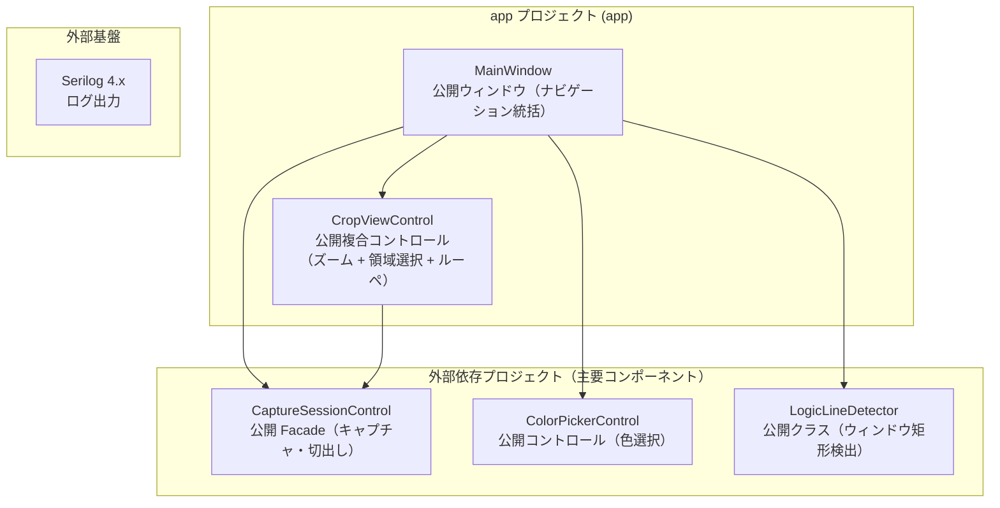
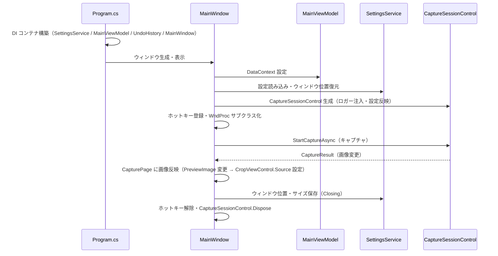

# App.AvaloniaUI システム仕様書

## 目次

- [1. システム概要](#1-システム概要)
- [2. 技術スタック](#2-技術スタック)
- [3. アーキテクチャ](#3-アーキテクチャ)
  - [3.1 レイヤー構造](#31-レイヤー構造)
  - [3.2 依存方向](#32-依存方向)
- [4. 例外処理ポリシー](#4-例外処理ポリシー)
  - [4.1 基本方針](#41-基本方針)
  - [4.2 本プロジェクト固有の例外処理](#42-本プロジェクト固有の例外処理)
- [5. コンポーネント図](#5-コンポーネント図)
- [6. コンポーネント一覧](#6-コンポーネント一覧)
  - [6.1 MainWindow](#61-mainwindow)
  - [6.2 CapturePage](#62-capturepage)
  - [6.3 FolderViewPage](#63-folderviewpage)
  - [6.4 UndoPage](#64-undopage)
  - [6.5 SettingsPage](#65-settingspage)
  - [6.6 CropViewControl（ズーム・パン表示と領域選択）](#66-cropviewcontrolズームパン表示と領域選択)
  - [6.7 ViewModel 群](#67-viewmodel-群)
  - [6.8 SettingsService](#68-settingsservice)
  - [6.9 その他のコントロール](#69-その他のコントロール)
  - [6.10 App（テーマ適用）](#610-appテーマ適用)
- [7. 依存ルール](#7-依存ルール)
- [8. ログ](#8-ログ)
- [9. ライフサイクル](#9-ライフサイクル)

---

## 1. システム概要

SaveEvidence は、Windows デスクトップ上の画面をキャプチャし、プレビュー・編集・保存するための Avalonia UI アプリケーションです（.NET 10.0 / C# 14 / MVVM）。

本プロジェクト（app）は、このシステムの**実行可能アプリケーション本体**です。 UI（ウィンドウ・ページ・コントロール）・ViewModel・設定サービスを統括し、キャプチャ・切出し・保存・ズーム・フォルダビュー・設定画面をユーザーに提供します。 キャプチャ・切出しのセッションは Parts.CapturePreviewControl.AvaloniaUI、色選択は ColorPickerControl、プラットフォーム抽象は Platform.AvaloniaUI を利用します。

## 2. 技術スタック

| 項目 | 内容 |
| --- | --- |
| **プロジェクト** | `App.AvaloniaUI` |
| **ルート名前空間** | `App.AvaloniaUI` |
| **言語** | C# 14（.NET 10.0） |
| **UI フレームワーク** | Avalonia UI 12.1（Avalonia.Desktop / Avalonia.Themes.Fluent / FluentAvaloniaUI） |
| **MVVM フレームワーク** | CommunityToolkit.Mvvm 8.x（ソースジェネレーター） |
| **ターゲットフレームワーク** | net10.0-windows10.0.17763.0 |
| **ビルドツール** | MSBuild / .NET SDK 10.0 |
| **DI** | Microsoft.Extensions.DependencyInjection |
| **ログ** | Serilog 4.x + Serilog.Sinks.File（ファイル出力 `%LOCALAPPDATA%\SaveEvidence\logs\SaveEvidence.log`）+ Microsoft.Extensions.Logging（LoggerMessage ソース生成） |
| **シリアル化** | System.Text.Json（設定ファイル） |
| **テスト** | xUnit v3 / Avalonia.Headless.XUnit |
| **依存プロジェクト** | Parts.CapturePreviewControl.AvaloniaUI / ColorPickerControl / Platform.AvaloniaUI / LineDetection |

## 3. アーキテクチャ

### 3.1 レイヤー構造

```text
View Layer（MainWindow / CapturePage / FolderViewPage / UndoPage / SettingsPage）
  → ViewModel Layer（MainViewModel / FolderViewViewModel / UndoViewModel）
    → Model / Service Layer（UndoHistory / SettingsService 等）
      → 外部ライブラリ（Parts.CapturePreviewControl.AvaloniaUI / ColorPickerControl / Platform.AvaloniaUI / LineDetection）
```

### 3.2 依存方向

- 依存は**一方向の階層構造**（View → ViewModel → Service / Model → 外部ライブラリ）。
- ViewModel は View の詳細（コントロール型）に依存せず、公開プロパティ・コールバックで連携する。
- サービスはインターフェース（`ISettingsService`）を介して注入される（DIP）。
- ズーム計算・表示は `CropViewControl`（`ZoomViewControl` を内包。 Parts.CapturePreviewControl.AvaloniaUI 経由の推移的依存）に委譲し、app は `CropViewControl` の `Source` 設定・`ZoomChanged` 購読で操作を指示する（一方向依存）。

## 4. 例外処理ポリシー

### 4.1 基本方針

- ユーザー操作起因の例外は各イベントハンドラ内で catch し、UI の応答性を維持する。
- ファイル保存・画像処理の例外は catch し、`false` または空値を返す。
- 設定ファイル読み書きの例外は catch し、デフォルト値で続行する。
- グローバル例外は Avalonia の標準例外処理に委ねる（デバッグビルドでは Avalonia.Diagnostics が未処理例外を表示）。
- ログは LoggerMessage ソース生成（`src/App.AvaloniaUI/src/Logging/AppLog.cs`）で出力する。 操作イベントは Information、障害は Error / Warning で記録する。

### 4.2 本プロジェクト固有の例外処理

- キャプチャセッションの例外は Parts.CapturePreviewControl.AvaloniaUI がオーバーレイを閉じて通常状態に復帰する（app は結果を Task で受ける）。
- クリップボードからの画像取得に失敗した場合は無視し、既存のプレビューを維持する。
- サムネイル読み込み（FolderViewPage）の失敗は null を返し、アイテム一覧に影響させない。

## 5. コンポーネント図



## 6. コンポーネント一覧

### 6.1 MainWindow

- **分類**: 公開ウィンドウ（`public sealed partial class : Window`）
- **責務**:
  - ナビゲーション（キャプチャ / フォルダビュー / Undo 一覧 / 設定）の統括
  - キャプチャ（ScreenSelect / WindowSelect / AreaSelect）の開始と結果の反映
  - グローバルホットキーの登録・WM_HOTKEY 受信（`IGlobalHotKeyService` 経由）
  - 設定変更の CaptureSessionControl への即時反映（`ApplyCaptureSessionSettings`）
  - ウィンドウ位置・サイズの復元 / 保存
- **公開メンバー**: `StartSelectionMode(CaptureType)` / `ApplyCaptureSessionSettings()` 等
- **依存**: CapturePage / FolderViewPage / UndoPage / SettingsPage / MainViewModel / SettingsService / CaptureSessionControl / IGlobalHotKeyService / ConfirmDialog

### 6.2 CapturePage

- **分類**: 公開ページ（`public sealed partial class : UserControl`）
- **責務**:
  - 画像プレビュー（`CropViewControl`（ズーム + 領域選択 + ルーペを内包））の統括
  - 切出し（Crop）セッションの開始・確定・キャンセル
  - キャプチャメニュー（全画面 / ウィンドウ / 範囲選択）の受付
  - ステータスバーへのポインタ座標・画像サイズ表示
  - Ctrl ショートカット（保存 / コピー / 貼り付け / Undo / Redo / 切り出し / ズーム）の一括処理（`OnGlobalKeyDown`）
- **公開メンバー**: `Initialize(...)` / `ExitCropMode()` / `CleanupCaptureResources()` 等
- **依存**: MainViewModel / CropViewControl（Parts.CapturePreviewControl.AvaloniaUI 経由の推移的依存）/ CaptureSessionControl / UndoHistory / AppLog

### 6.3 FolderViewPage

- **分類**: 公開ページ（`public sealed partial class : ViewModePageBase`）
- **責務**:
  - 保存先フォルダの画像一覧表示（サムネイル + ファイル名）
  - 表示モード（特大 / 大 / 中）・ソート（昇順 / 降順）の切替
  - 表示モード・ソート順の設定保存（`Settings.FolderViewModeIndex` / `Settings.FolderViewSortAscending`）とページ表示時復元
  - ダブルクリックで既定アプリによりファイルを開く
- **特徴**: 一覧の ItemsPanel は `BottomAlignWrapPanel`（行内下端揃え）。 行の高さは各行の最大アイテム高さに応じ、ファイル名 1 文字目の高さ位置が行内で揃う
- **テーマ対応**: リスト背景・ファイル名ラベル・サムネイル枠線/影はテーマ（ライト/ダーク）に応じて切り替わる。 背景・枠線・文字色は Fluent テーマの標準リソース（`DynamicResource`）を参照し、影のみ App リソース（`ThumbnailShadow`）で定義する
- **復元タイミング**: `IsVisible` 変更時（ナビゲーション再表示）に保存済み設定を復元し、ToggleButton の選択状態へ同期して一覧を再構築する（`ViewModePageBase` に共通化）
- **依存**: FolderViewViewModel / MainViewModel / SettingsService

### 6.4 UndoPage

- **分類**: 公開ページ（`public sealed partial class : ViewModePageBase`）
- **責務**:
  - Undo / Redo スタックと現在のプレビュー画像を時系列順（新しい → 古い）にサムネイル一覧表示
  - 現在のキャプチャページに表示中の画像を青枠（`BorderBrush #0078D4`・`BorderThickness 3`）で強調
  - 表示モード（特大 / 大 / 中）の切替と設定保存（`Settings.UndoViewModeIndex`）・ページ表示時復元
  - サムネイルのダブルクリックで一時ファイル（PNG）に保存し、OS の既定アプリ（外部ツール）で開く
- **表示順**: Redo（新しい）→ 現在 → Undo（古い）の固定（時系列順で新しい → 古い）
- **更新タイミング**: `IsVisible` 変更時（ナビゲーション再表示）に自身で最新の履歴を読み込む（保存済み設定の復元と一覧の再構築。 `ViewModePageBase` に共通化）
- **依存**: UndoViewModel / MainViewModel（PreviewImage・DI シングルトン）/ UndoHistory（DI シングルトン・CapturePage と共有）

### 6.5 SettingsPage

- **分類**: 公開ページ（`public sealed partial class : UserControl`）
- **責務**: アプリケーション設定（外観・キャプチャ・ルーペ・保存・表示・ラベル・ホットキー）の編集 UI
- **外観設定**: テーマ（`ThemeMode`: Light / Dark / System）を ComboBox で選択。 System は OS の設定に追従。 右下の「デフォルト値に戻す」ボタンで外観設定（選択枠・暗転・ハンドル・マーカー・ルーペ・プレビューの市松模様・ラベル）を `Settings.ResetAppearanceToDefaults()` により一括復元（外観設定以外は変更されない）
- **ラベル設定**: キャプチャ選択画面の左上ラベル（1 行目 = サイズ / 2 行目 = 操作 / 3 行目 = 情報）を行ごとに設定。 各行で表示・文字色・背景色・フォントサイズを個別に設定可能（背景色は不透明度を統合した `#AARRGGBB` 形式。 カラーピッカーでアルファも設定できる）
- **設定項目の対応先**: 全設定項目と反映先コントロールの対応は `SPEC_SettingTargetTable.md` を参照
- **依存**: SettingsService / ColorPickerControl（色選択）

### 6.6 CropViewControl（ズーム・パン表示と領域選択）

ズーム・パン・Fit 表示は **`CropViewControl`**（内部に `ZoomViewControl` と `FadeMaskDragRectControl` を内包する複合コントロール。 `Parts.CapturePreviewControl.AvaloniaUI` 経由の推移的依存）が提供する。 CapturePage が `CropViewControl` の `Source` を設定し、`ZoomChanged`（ズーム率・可否）・`ViewportChanged`（パン・ズーム）を購読して操作を指示する。 `CaptureSessionControl.StartCropAsync` は `CropViewControl` を受け取り、切出しセッション（座標変換・確定・キャンセル）を管理する。 切り出しの対象画像は `CropViewControl.Source` から解決する（画像を別引数で渡さない）。 詳細は `CropViewControl` の `SPEC_System.md` を参照。

### 6.7 ViewModel 群

| コンポーネント | 分類 | 責務 |
| --- | --- | --- |
| `MainViewModel` | `ObservableObject` | メイン画面の状態（PreviewImage / ZoomPercent / ZoomDisplayText / PointerDisplayText / 保存・コピーコマンド等）。 テーマ選択肢 `ThemeModes` を提供 |
| `FolderViewViewModel` | `ObservableObject` | フォルダビューの状態（ItemCount / SelectedViewModeIndex / IsSortAscending / FolderPathText） |
| `UndoViewModel` | `ObservableObject` | Undo 一覧の状態（ItemCount / SelectedViewModeIndex） |

### 6.8 SettingsService

- **分類**: 公開サービス（`public sealed class : ISettingsService`）
- **責務**: 設定（`Settings`）の JSON 永続化（`%LOCALAPPDATA%\SaveEvidence\settings.json`）。 Lock によるスレッドセーフな読み書き
- **特徴**: enum（`ThemeMode` 等）は数値ではなく文字列で保存（`JsonStringEnumConverter`）。 設定ファイルの可読性向上
- **依存**: System.Text.Json / Settings

### 6.9 その他のコントロール

| コンポーネント | 分類 | 責務 |
| --- | --- | --- |
| `BottomAlignWrapPanel` | 公開パネル（`public sealed class : Panel`） | 横方向折り返し + 行内下端揃え。 各行の高さは最大アイテム高さで決定（FolderViewPage の一覧用） |
| `ViewModePageBase` | 公開基底ページ（`public abstract class : UserControl`） | 表示モードを持つ一覧ページ（FolderViewPage / UndoPage）の共通基盤。 設定復元・保存、ToggleButton 同期、ページ表示時の一覧再構築を共通化 |
| `FileNameTemplate` | 公開ユーティリティ（`public sealed partial class`） | ファイル名テンプレートの解析・生成・検証。 日時プレースホルダ（`{date}` / `{time}` 等）とエスケープ（`{{` / `}}`）の解決、右端数値のオートインクリメント。 外部仕様は SPEC_ExtFunc.md（5. ファイル名テンプレート）を参照 |

### 6.10 App（テーマ適用）

- **分類**: アプリケーションエントリポイント（`public sealed partial class : Application`）
- **責務**: DI コンテナ初期化（Program.cs）・MainWindow 表示・テーマ（`ThemeMode`）の `RequestedThemeVariant` への反映
- **テーマ反映**: 起動時に `Settings.ThemeMode` を反映し、変更時は `PropertyChanged` 購読で即時反映する。 `Light` → `ThemeVariant.Light` / `Dark` → `ThemeVariant.Dark` / `System` → `ThemeVariant.Default`（OS 追従）
- **特徴**: FluentTheme の DynamicResource により、テーマ切替で全コントロールの色が自動的に切り替わる。 フォルダビュー等は標準リソース（`SystemControlBackgroundAltHighBrush` 等）を参照し、サムネイル影のみ App リソース（`ThumbnailShadow`）で定義する

## 7. 依存ルール

- 依存方向は**一方向の階層構造**（View → ViewModel → Service / Model → 外部ライブラリ）。
- View は ViewModel に依存する（DataBindings とイベントハンドラ経由）。 ViewModel は View の詳細（コントロール型）に依存しない。
- サービスはインターフェース（`ISettingsService`）を介して注入される（DIP）。
- ズーム計算・表示は `CropViewControl`（`ZoomViewControl` を内包。 Parts.CapturePreviewControl.AvaloniaUI 経由の推移的依存）に委譲し、app は `CropViewControl` の `Source` 設定・`ZoomChanged` 購読で操作を指示する（一方向依存）。
- キャプチャ・切出しの詳細は Parts.CapturePreviewControl.AvaloniaUI に委譲し、app は公開 Facade（CaptureSessionControl）のみに依存する。

## 8. ログ

ログ定義は `src/App.AvaloniaUI/src/Logging/AppLog.cs`（LoggerMessage ソース生成）に集約し、Serilog 経由で `%LOCALAPPDATA%\SaveEvidence\logs\SaveEvidence.log`（日次ローテーション・7日で自動アーカイブ・削除）へ出力する。

| LogLevel | 対象 | 例 |
| --- | --- | --- |
| `Information` | ユーザー操作の主要イベント（低頻度） | キャプチャメニュークリ ック / ホットキー発火 / キャプチャ開始・戻り値（ズーム変更 % はコアの `CapturePreviewLogMessage` が出力） |
| `Error` | 例外・失敗 | 設定変更の CaptureSessionControl 反映で例外 |

詳細は `SPEC_ExtFunc.md` の「8. ログ」を参照。

## 9. ライフサイクル


