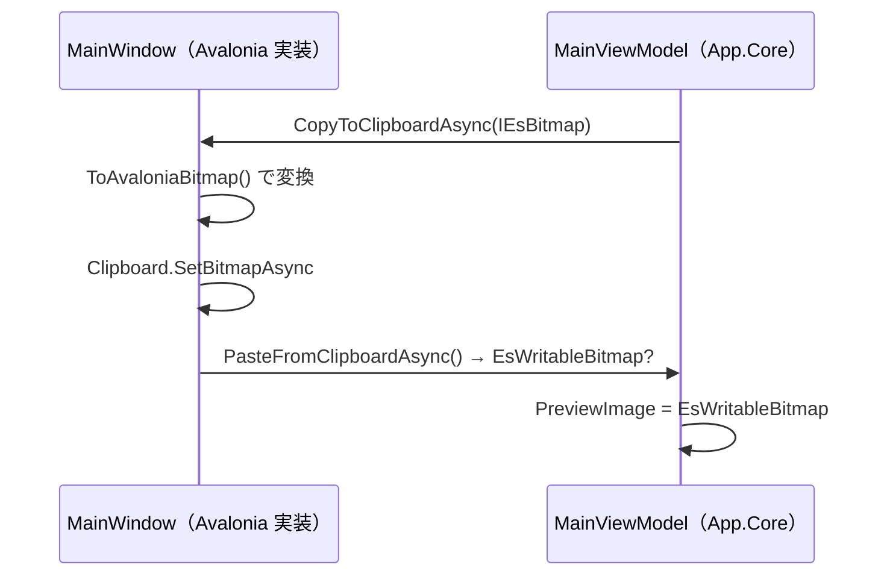

# App.Core システム仕様書

## 目次 <!-- omit from toc -->

- [1. 概要](#1-概要)
- [2. 技術スタック](#2-技術スタック)
- [3. アーキテクチャ](#3-アーキテクチャ)
- [4. コンポーネント構成](#4-コンポーネント構成)
- [5. UI 依存の注入（依存性逆転）](#5-ui-依存の注入依存性逆転)
- [6. 例外処理ポリシー](#6-例外処理ポリシー)
- [7. 可視性ポリシー](#7-可視性ポリシー)
- [8. 設定ファイルの互換性](#8-設定ファイルの互換性)
- [9. テスト](#9-テスト)

## 1. 概要

SaveEvidence 本体（Avalonia UI 実装 `App.AvaloniaUI`）と将来の MewUI ホストが共有する、UI フレームワーク非依存のモデル・ユーティリティ・ViewModel を提供するライブラリです。 SaveEvidence のマルチ UI 対応における「app の Core / UI 分割」（ティア F）です。

## 2. 技術スタック

- .NET 10 / C# 14
- UI フレームワークは一切参照しない
- 外部依存は `CommunityToolkit.Mvvm`（UI フレームワーク非依存の MVVM ツールキット）のみ

## 3. アーキテクチャ

```mermaid
  A[app<br/>Avalonia 実装] --> B[App.Core]
  C["App.MewUI（将来）"] --> B
  B --> D[EsUtil.Platform.Core]
  B --> F[LineDetection]
  A --> E[Parts.CapturePreview.ControlAvaloniaUI / ColorPickerControl / Platform.AvaloniaUI]
  A -->|コールバック注入（クリップボード / 上書き確認）| B
```

- `App.Core` は UI フレームワークへ依存しません。
- 名前空間は `EsUtil.SaveEvidence.App.Core`、アセンブリ名は `App.Core` です（ホストの `EsUtil.SaveEvidence.App.AvaloniaUI` とは名前空間もアセンブリも別）。
- `internal` 型（`CapacityLimitedCache` / `ImageFileExtensions` / `ViewModeDisplay`）は `InternalsVisibleTo`（`SaveEvidence` / `SaveEvidence.MewUI` / `App.AvaloniaUI.Tests` / `App.Core.Tests` / `App.MewUI.Tests`）で UI 実装とテストへ公開します。

## 4. コンポーネント構成

| ファイル | 可視性 | 内容 |
| --- | --- | --- |
| `src/App.Core/src/Enums/AppPage.cs` | `public enum` | ナビゲーションページの識別子 |
| `src/App.Core/src/Enums/ThemeMode.cs` | `public enum` | テーマモード（`Description` 属性で表示名を保持） |
| `src/App.Core/src/Models/Settings.cs` | `public sealed partial class` | アプリケーション設定（変更通知付き） |
| `src/App.Core/src/Models/FileNameTemplate.cs` | `public static partial class` | ファイル名テンプレートの書式と使用不可文字の検証・解析・生成（**唯一の所有者**） |
| `src/App.Core/src/Models/UndoHistory.cs` | `public sealed class` | 画像の Undo / Redo スタック |
| `src/App.Core/src/Models/HotKeyParser.cs` | `public static class` | ホットキー文字列の解析 |
| `src/App.Core/src/Models/CapacityLimitedCache.cs` | `internal static class` | 容量制限付きの静的キャッシュ操作（上限超過時の全クリアと `IDisposable` の破棄まで含めた**唯一の所有者**） |
| `src/App.Core/src/Models/ImageFileExtensions.cs` | `internal static class` | 画像ファイルの拡張子判定（フォルダビューの一覧に含める拡張子の**唯一の所有者**。 両 UI が委譲する） |
| `src/App.Core/src/Layout/BottomAlignWrapLayout.cs` | `internal static class` | 折り返しパネルの行高さ・下端揃えの配置計算（Avalonia / MewUI 両版のパネルが委譲する単一所有） |
| `src/App.Core/src/Services/ISettingsService.cs` | `public interface` | 設定管理サービスの抽象 |
| `src/App.Core/src/Services/IImageWriter.cs` | `public interface` | 画像（`IEsBitmap`）のファイル書き込みの抽象 |
| `src/App.Core/src/Services/SettingsService.cs` | `public sealed class` | JSON ファイルによる設定管理（**設定の永続化形式 = JSON の構造・enum の文字列表現の唯一の所有者**）。 ソース生成コンテキストを必須とする |
| `src/App.Core/src/Services/EsRectIntJsonConverter.cs` | `internal sealed class` | `EsRectInt` の JSON コンバーター |
| `src/App.Core/src/ViewModels/ViewModeDisplay.cs` | `internal static class` | 表示モード（特大 / 大 / 中）の名称・件数表示（**唯一の所有者**。 `FolderViewViewModel` / `UndoViewModel` が委譲する） |
| `src/App.Core/src/ViewModels/FolderViewViewModel.cs` | `public sealed partial class` | フォルダビューの表示モード・ソート状態 |
| `src/App.Core/src/ViewModels/UndoViewModel.cs` | `public sealed partial class` | Undo 一覧の表示モード状態 |
| `src/App.Core/src/ViewModels/MainViewModel.cs` | `public sealed partial class` | メイン画面の状態（プレビュー画像・保存・自動切り出し・ズーム表示）。 **プレビュー画像の所有権とライフサイクル（差し替え時の破棄順序）の唯一の所有者**（`OnPreviewImageChanging` / `OnPreviewImageChanged`） |

## 5. UI 依存の注入（依存性逆転）

`MainViewModel` は UI 操作が必要な箇所をコールバック / インターフェースとして受け取り、UI 型を直接持たないようにします。



| 注入点 | 種類 | 内容 |
| --- | --- | --- |
| `IImageWriter` | コンストラクター引数 | 画像の保存（Avalonia 版は `AvaloniaImageWriter`。 `Program.cs` で DI 登録）。 **保存形式の判別とエンコードはコアの `EsBitmapFileExtensions` が単一所有する** |
| `CopyToClipboardAsync` | コールバック | `IEsBitmap` を受け取り、UI 型へ変換してクリップボードへ書く |
| `PasteFromClipboardAsync` | コールバック | クリップボードから読み、UI 型から `EsWritableBitmap` へ変換して返す |
| `ConfirmOverwriteAsync` | コールバック | 上書き確認ダイアログ |
| `BeforeEditAction` | コールバック | 画像編集前の Undo プッシュ |
| `StartSelectionMode` | コールバック | キャプチャの開始（`CaptureType`） |

## 6. 例外処理ポリシー

例外を送出しません。 入力の不正（解釈できないホットキー文字列・無効なテンプレート）は `bool` の戻り値（`TryParse` / `IsValidTemplate`）またはクランプ（`ClampIndex`）で表現します。

`UndoHistory` が保持する `EsWritableBitmap` の破棄は所有者（`UndoHistory`）が行います。 `Undo` / `Redo` の戻り値の所有権は呼び出し側へ移ります。

## 7. 可視性ポリシー

- `AppPage` / `ThemeMode` / `Settings` / `FileNameTemplate` / `UndoHistory` / `HotKeyParser` / `ISettingsService` / `SettingsService` / `FolderViewViewModel` / `UndoViewModel` は `public`（`App.AvaloniaUI` と MewUI ホストが共有する契約）。
- `CapacityLimitedCache` / `ImageFileExtensions` / `ViewModeDisplay` / `EsRectIntJsonConverter` は `internal`。 `internal` → `public` の変更は破壊的な設計変更として扱います。

## 8. 設定ファイルの互換性

| 項目 | 型 | JSON 表現 |
| --- | --- | --- |
| ウィンドウ位置・サイズ | `EsRectInt?` | `{"X":..,"Y":..,"Width":..,"Height":..}` |
| ウィンドウ状態 | `EsWindowState` | `"Normal"` 等の名前 |

`EsRectInt` は専用コンバーター、`EsWindowState` は `JsonStringEnumConverter` により読み書きされるため、**既存の `settings.json` はそのまま読み込める**。

## 9. テスト

- `src/App.Core/tests`（`App.Core.Tests`）が本プロジェクトのテストを持ちます。
- UI 初期化が不要なため、すべて `[Fact]`（`AvaloniaFact` ではない）で並列実行されます。
- UI 依存の検証（ページの描画・入力・画像の表示変換）は `App.AvaloniaUI.Tests`（Avalonia ヘッドレス・直列）が担います。
