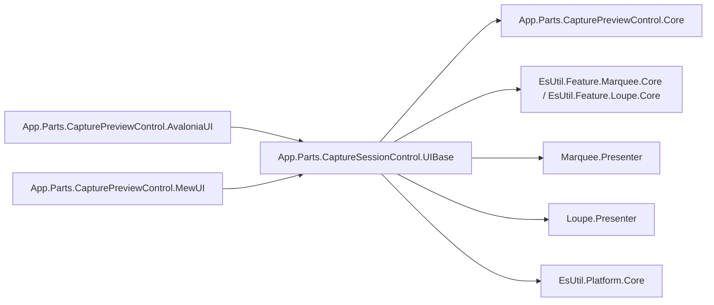
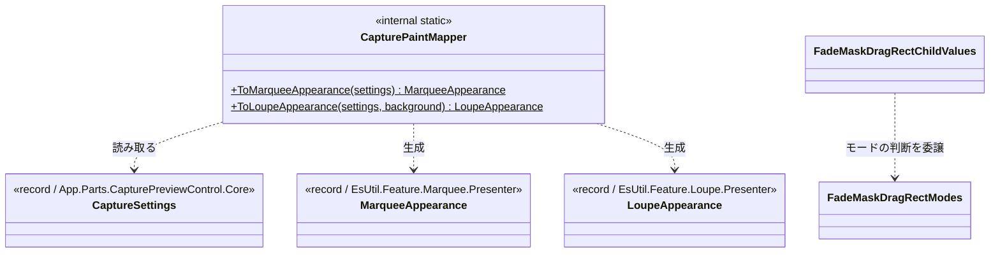
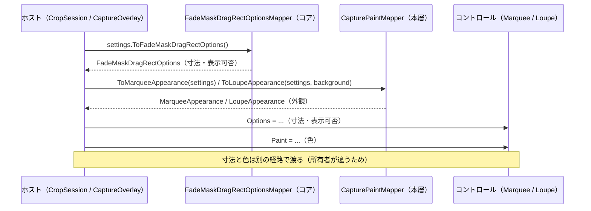

# App.Parts.CaptureSessionControl.UIBase システム仕様書

## 概要

`App.Parts.CaptureSessionControl.UIBase` は、拠影・切り出しのセッションを実装する両 UI が共有する**設定写像と複合コントロールの共有処理**を提供します。 対象は次の 3 つです。

- **キャプチャ設定（`CaptureSettings`）→ 外観（`MarqueeAppearance` / `LoupeAppearance`）の写像**
- **設定とモードから内包コントロールへ適用する値の解決**（`FadeMaskDragRectChildValues`）
- **付加情報ラベル（操作・情報）の配置指示の解決**（`FadeMaskHostLabelRenderer` / `MarqueeHostLabelRenderer`）

寸法・表示可否はコアの設定マッパー（`FadeMaskDragRectOptionsMapper`）が単一所有するため、本層は色だけを扱います。

外部機能と公開 API は [SPEC_ExtFunc](SPEC_ExtFunc.md)、利用手順は [README](README.md) を参照してください。

## 技術スタック

| 項目 | 内容 |
| --- | --- |
| 目的 | 設定から色への写像と、複合コントロールの共有処理を 1 箇所へ集約し、両 UI で同じ見た目・振る舞いになるようにする |
| 提供形態 | クラスライブラリ（`EsUtil.SaveEvidence.Parts.CaptureSession.UIBase.dll`）。 写像は `internal`、複合コントロールの共有処理は `public` |
| 想定利用者 | 両 UI のホスト（`App.Parts.CapturePreviewControl.AvaloniaUI` / `App.Parts.CapturePreviewControl.MewUI` の撮影オーバーレイ・切り出しセッション） |
| ターゲット | `net10.0` |
| 言語 | C# 14（`Nullable` 有効・`ImplicitUsings` 有効） |
| ルート名前空間 | `EsUtil.SaveEvidence.Parts.CaptureSession.UIBase` |
| 汎用性 | 特定の UI に依存しない。 UI フレームワークを参照しない |

## アーキテクチャ



依存の向きは **UI → UIBase（本層）→ Core / 各提示層の設定**の一方向です。 逆向きの参照はありません。

### 本層を置く理由

| 置き場所の候補 | 可否 | 理由 |
| --- | --- | --- |
| `App.Parts.CapturePreviewControl.Core` | 不可 | 写像先が提示層の型（`MarqueeAppearance` / `LoupeAppearance`）のため、Core → UIBase の逆流になる |
| 再利用ライブラリ | 不可 | 写像元が製品の設定型（`CaptureSettings`）のため、再利用ライブラリが製品設定へ依存する |
| `App.Parts.CaptureSessionControl.UIBase`（本層） | 採用 | セッションの設定と両 UI の中間にあり、両 UI のホストが同じ写像・同じ組み立てを共有できる |

## コンポーネント構成

| ファイル | 可視性 | 内容 |
| --- | --- | --- |
| `CapturePaintMapper.cs` | `internal static class` | `CaptureSettings` → `MarqueeAppearance` / `LoupeAppearance` の写像 |
| `FadeMaskDragRectChildValues.cs` | `public readonly record struct` | 設定とモードから内包コントロールへ適用する値の解決 |
| `FadeMaskHostLabelRenderer.cs` | `public static class` | 付加情報ラベル（操作・情報）の縦積みの配置指示の解決 |
| `MarqueeHostLabelRenderer.cs` | `public static class` | ラベル 1 行の体裁（背景の寸法）の配置指示の解決 |

## クラス図



## データフロー



## 単一所有（Single Source of Truth）

| 内容 | 所有者 |
| --- | --- |
| 設定から**寸法・表示可否**への写像 | `FadeMaskDragRectOptionsMapper`（`App.Parts.CapturePreviewControl.Core`） |
| 設定から**色**への写像 | `CapturePaintMapper`（本層） |
| 設定とモードから子コントロールへ適用する値 | `FadeMaskDragRectChildValues`（本層） / モードの判断は `FadeMaskDragRectModes`（コア） |
| 付加情報ラベルの積み上げ位置と表示可否 | `FadeMaskHostLabelRenderer`（本層） |
| ラベル 1 行の体裁（背景の寸法） | `MarqueeHostLabelRenderer`（本層） / 内側余白の値は `MarqueeAppearance`（提示層） |
| 色の値と既定値 | `MarqueeAppearance` / `LoupeAppearance`（各提示層） |
| 描画の可否 | `MarqueeAppearance` の明示フラグ（提示層） |
| 枠線の色（選択枠線と外枠で共通） | 設定の `BorderColor` 1 項目 |

**写像漏れの防止**: 写像は 1 箇所（`CapturePaintMapper`）に集約されており、以前は両 UI に同じ写像が 2 コピー
存在していました（片方だけ更新される余地があった）。 本層への集約により、両 UI のホストが同じ写像を使うことが
構造的に保証されます。

## 例外処理ポリシー

| 状況 | 挙動 |
| --- | --- |
| `settings` が null | `ArgumentNullException`（呼び出し側の実装誤りであり、回復して続行すべき状況ではない） |
| 設定メンバーの null | 想定外（`ToNonNull` 済みを渡す契約）。 `!` で参照する |

本層は外部 I/O・非同期処理・リソース解放を持ちません。

## 可視性ポリシー

- **写像（`CapturePaintMapper`）は `internal`**。 両 UI のホストが使う内部処理のためです。
- **複合コントロールの共有処理（`FadeMaskDragRectChildValues` / `FadeMaskHostLabelRenderer` / `MarqueeHostLabelRenderer`）は `public`**。 UIBase を参照する側（複合コントロールの UI 実装）が直接使うためです。
- `internal` は `InternalsVisibleTo`（`App.Parts.CapturePreviewControl.AvaloniaUI` / `App.Parts.CapturePreviewControl.MewUI` /
  `App.Parts.CaptureSessionControl.UIBase.Tests`）で公開します。
- **`internal` → `public` の変更は破壊的な設計変更として扱います**。

## テスト

```text
tests/
├── CapturePaintMapper.Tests.cs          # 写像の網羅（8 件）
├── FadeMaskDragRectChildValues.Tests.cs # モードから導出する値の上書き（9 件）
├── FadeMaskHostLabelRenderer.Tests.cs   # 付加情報ラベルの縦積みと表示可否（12 件）
└── MarqueeHostLabelRenderer.Tests.cs    # ラベル 1 行の体裁（背景の寸法の検証）（6 件）
```

| 検証内容 | 件数 |
| --- | --- |
| 選択矩形の 9 項目の写像 | 1 |
| 外枠とハンドル枠が同じ枠線色になること | 1 |
| 写像しない色が既定値を保つこと | 1 |
| ルーペの 7 項目の写像 | 1 |
| ルーペの画像外の色が設定から与えられること | 1 |
| `settings` が null の場合の例外 | 1 |
| モードから導出する項目の上書き（ハンドル・全面暗転・入力の可否） | 9 |
| 付加情報ラベルの積み上げ・表示可否と、体裁（背景の寸法） | 12 / 6 |

UI 初期化が不要なため、すべて `[Fact]` で並列実行されます。

```powershell
dotnet test src/App.Parts.CaptureSessionControl.UIBase/tests/App.Parts.CaptureSessionControl.UIBase.Tests.csproj
```

UI 依存の検証（設定が実際にコントロールへ届くか、描画結果が期待どおりか）は各 UI のテストプロジェクトが担います。
