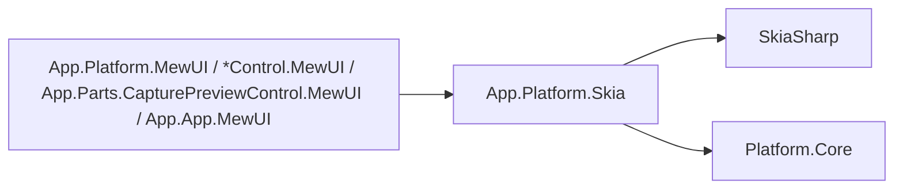
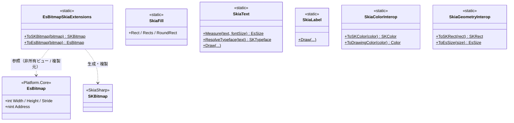
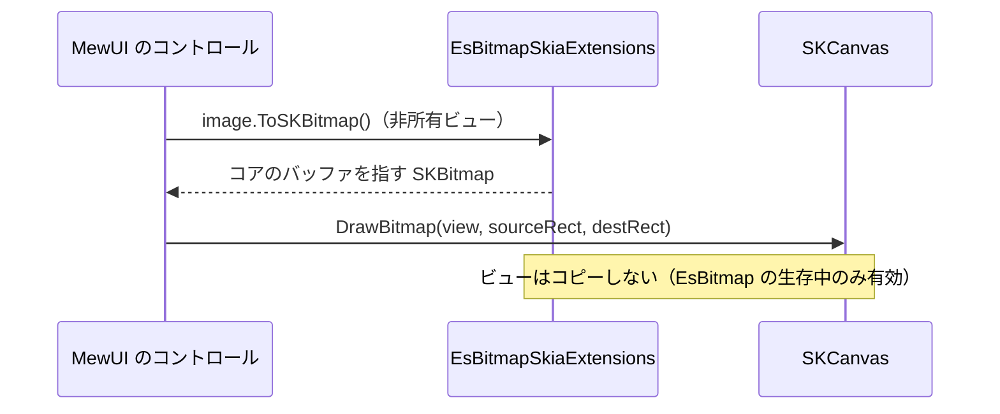
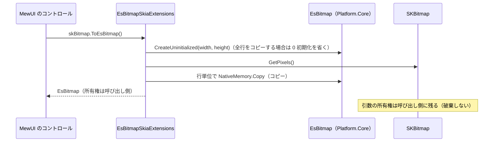

# App.Platform.Skia システム仕様書

## 概要

`App.Platform.Skia` は、**SkiaSharp への依存を 1 箇所へ閉じ込める**プラットフォーム層です。

1. **ビットマップの相互変換**（`EsBitmapSkiaExtensions`）— コアの `EsBitmap` と `SKBitmap` を変換する（非所有ビュー／複製）
2. **描画の部品**（`SkiaFill` / `SkiaLabel` / `SkiaText`）と**変換**（`SkiaColorInterop` / `SkiaGeometryInterop`）

**描画 API の抽象は持ちません**（UI フレームワークごとの描画モデルの差は抽象では吸収しきれないため）。 描画の呼び出し（層の順序）は各 UI が行います。

外部機能と公開 API は [SPEC_ExtFunc](SPEC_ExtFunc.md)、利用手順は [README](README.md) を参照してください。

## 技術スタック

| 項目 | 内容 |
| --- | --- |
| 目的 | `Platform.Core` の判定基準（外部パッケージなし）を守るため、Skia 依存を本層へ隔離する |
| 提供形態 | クラスライブラリ（`EsUtil.SaveEvidence.Platform.Skia.dll`）。 SkiaSharp を参照する唯一のプロジェクト |
| 想定利用者 | `App.Platform.MewUI`、MewUI 系の各コントロール（Marquee / Loupe / FadeMaskDragRect / ZoomView）、`App.App.MewUI`、テスト |
| ターゲット | `net10.0` |
| 言語 | C# 14（`Nullable` 有効・`ImplicitUsings` 有効・`AllowUnsafeBlocks` 有効＝ピクセルポインタのため） |
| ルート名前空間 | `EsUtil.SaveEvidence.Platform.Skia` |
| 汎用性 | UI フレームワーク非依存（SkiaSharp には依存する） |

## アーキテクチャ



- 依存の向きは **MewUI 系 → App.Platform.Skia →（SkiaSharp / Platform.Core）** です。
- **`Platform.Core` は SkiaSharp を参照しません**（Skia 依存は本層で止まる）。
- `EsBitmapSkiaExtensions` は `Platform.Core` の `EsBitmap` を拡張します。

## コンポーネント構成

| ファイル | 可視性 | 内容 |
| --- | --- | --- |
| `EsBitmapSkiaExtensions.cs` | `public static class` | `ToSKBitmap`（非所有ビュー）/ `ToEsBitmap`（複製） |
| `SkiaFill.cs` | `public static class` | 矩形・角丸矩形の塗り |
| `SkiaLabel.cs` | `public static class` | ラベル 1 件（背景 + 文字）の描画順 |
| `SkiaText.cs` | `public static class` | 実寸測定・描画・書体の解決 |
| `SkiaColorInterop.cs` | `public static class` | 色の相互変換 |
| `SkiaGeometryInterop.cs` | `public static class` | 幾何の相互変換 |

## クラス図



## データフロー（画像の描画）



## データフロー（コアのビットマップ生成）



## 単一所有（Single Source of Truth）

| 内容 | 所有者 |
| --- | --- |
| SkiaSharp への依存 | `App.Platform.Skia`（本プロジェクトだけが参照する） |
| `EsBitmap` ⇔ `SKBitmap` の変換（所有権・寿命） | `EsBitmapSkiaExtensions` |
| 矩形・角丸矩形の塗り | `SkiaFill` |
| テキストの実寸測定・書体の解決 | `SkiaText` |
| ラベル 1 件の描画順（背景 → 文字） | `SkiaLabel` |
| 色・幾何の相互変換 | `SkiaColorInterop` / `SkiaGeometryInterop` |
| コアのピクセルバッファとピクセル操作 | `EsBitmap`（`Platform.Core`） |
| 画像配置の矩形計算 | `ImageDrawMath`（`App.Platform.MewUI`。 Skia を必要としないため本層に置かない） |

## 例外処理ポリシー

| 状況 | 挙動 |
| --- | --- |
| `ToSKBitmap` の対象が破棄済み | `ObjectDisposedException` |
| `ToSKBitmap` の引数が null | `ArgumentNullException` |
| ビューの作成に失敗（形式・寸法が不正） | `InvalidOperationException`（作成した `SKBitmap` は破棄してから投げる） |
| `ToEsBitmap` の引数が null | `ArgumentNullException` |
| `ToEsBitmap` のピクセルポインタが null | 複製せずに空のビットマップを返す（描画可能な状態を保つ） |

## 可視性ポリシー

- 全型が `public` です。 MewUI 系の複数プロジェクトが同じ変換と描画の部品を使うためです。
- `App.Platform.Skia.Tests` からのみ `internal` 型へアクセスできます（現在 `internal` 型はありません）。
- **`internal` → `public` の変更は破壊的な設計変更として扱います**。

## テスト

```text
tests/
├── App.Platform.Skia.Tests.csproj
├── EsBitmapSkiaExtensions.Tests.cs
├── SkiaColorInterop.Tests.cs
├── SkiaFill.Tests.cs
├── SkiaGeometryInterop.Tests.cs
├── SkiaLabel.Tests.cs
└── SkiaText.Tests.cs
```

| 内容 | 件数 |
| --- | --- |
| `EsBitmapSkiaExtensions`（非所有ビュー・ピクセル共有・ビュー破棄後の安全性・破棄済みの例外・複製・アルファ保持・往復） | 8 |
| `SkiaColorInterop`（往復・成分の対応・アルファ） | 8 |
| `SkiaFill`（矩形・複数矩形・角丸） | 9 |
| `SkiaGeometryInterop`（矩形・サイズの変換） | 5 |
| `SkiaLabel`（背景 → 文字の順序） | 5 |
| `SkiaText`（実寸測定・書体の解決・描画） | 10 |

UI 初期化（ウィンドウ）が不要なため、すべて `[Fact]` / `[Theory]` で並列実行されます。

```powershell
dotnet test src/App.Platform.Skia/tests/App.Platform.Skia.Tests.csproj
```
