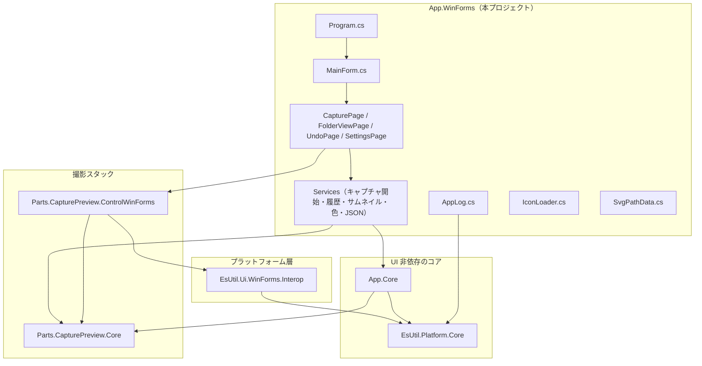
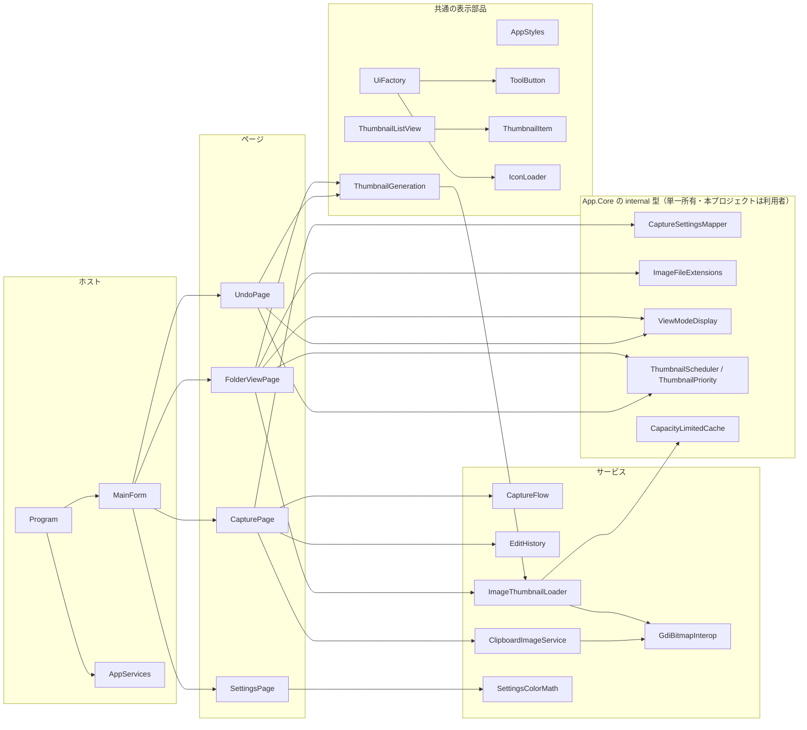
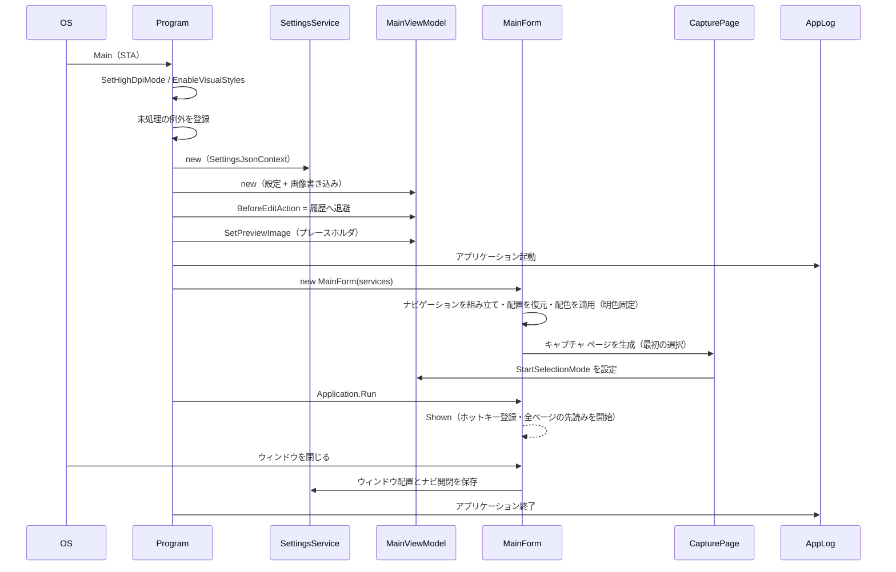
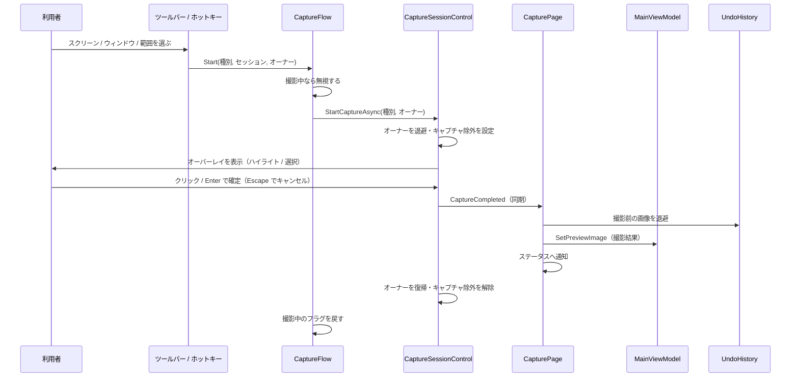
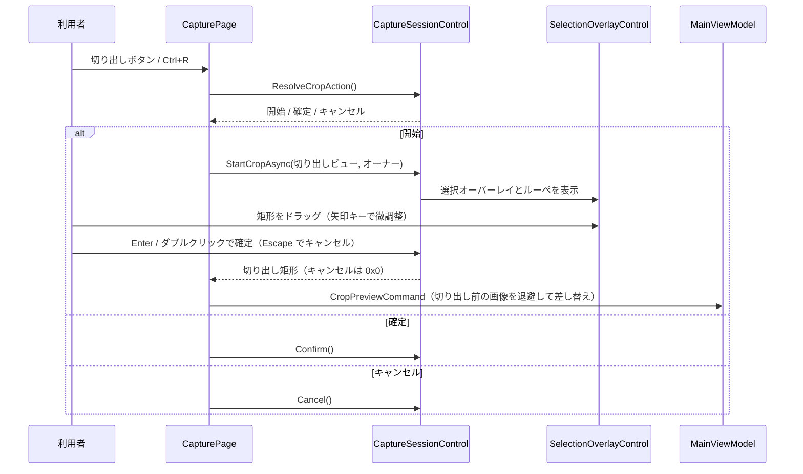
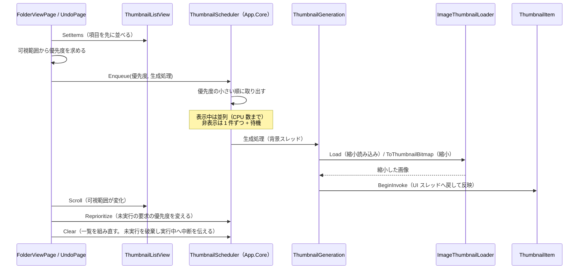
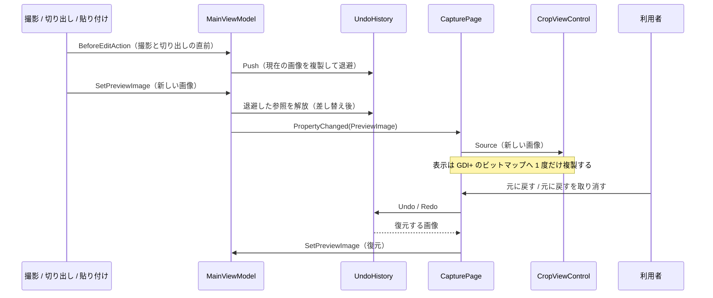
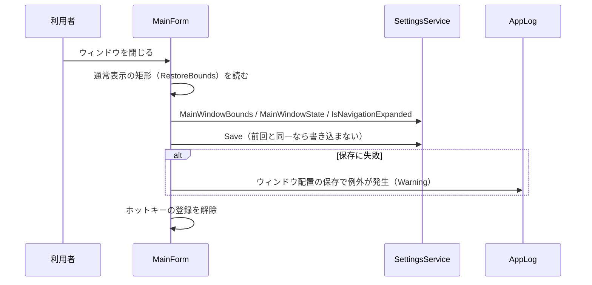

# App.WinForms システム仕様書

`App.WinForms`（実行ファイル `SaveEvidence.WinForms.exe`）は、Windows デスクトップの画面キャプチャ アプリの **WinForms 版ホスト**です。 本ドキュメントは内部の構造（アーキテクチャ・コンポーネント・依存関係・処理の流れ）を記述します。 利用者から見た機能は [`SPEC_ExtFunc.md`](SPEC_ExtFunc.md) を参照してください。

## 目次 <!-- omit from toc -->

- [1. システム概要](#1-システム概要)
- [2. 技術スタック](#2-技術スタック)
- [3. アーキテクチャ](#3-アーキテクチャ)
  - [3.1 層の構成と依存方向](#31-層の構成と依存方向)
  - [3.2 UI 非依存の担保](#32-ui-非依存の担保)
  - [3.3 境界の変換](#33-境界の変換)
- [4. コンポーネント構成](#4-コンポーネント構成)
- [5. クラス図](#5-クラス図)
- [6. シーケンス図（起動）](#6-シーケンス図起動)
- [7. シーケンス図（キャプチャ）](#7-シーケンス図キャプチャ)
- [8. シーケンス図（プレビューの切り出し）](#8-シーケンス図プレビューの切り出し)
- [9. シーケンス図（サムネイルの生成）](#9-シーケンス図サムネイルの生成)
- [10. シーケンス図（画像の差し替えと履歴）](#10-シーケンス図画像の差し替えと履歴)
- [11. シーケンス図（ウィンドウ配置の保存）](#11-シーケンス図ウィンドウ配置の保存)
- [12. 例外処理ポリシー](#12-例外処理ポリシー)
- [13. テスト方針](#13-テスト方針)

## 1. システム概要

本アプリは、UI 非依存のコア（`App.Core`）と撮影スタック（`Parts.CapturePreview.Core` / `Parts.CapturePreview.ControlWinForms`）、および WinForms 版のプラットフォーム層（`EsUtil.Ui.WinForms.Interop`）を組み合わせ、**UI 層（ページ・サービス・ログ・アイコン）だけを本プロジェクトで実装**します。

| 関心事 | 所有者 |
| --- | --- |
| 設定モデル・設定の読み書き・メイン ViewModel・編集履歴のスタック・ファイル名テンプレート・ホットキー文字列の解析 | `App.Core` |
| 撮影セッション・切り出しセッション・選択オーバーレイ・切り出しビュー・ラベル文言・切り出し矩形の計算 | `Parts.CapturePreview.Core` / `Parts.CapturePreview.ControlWinForms` |
| コア型 ⇔ GDI+ 型の変換・ウィンドウ配置の換算・モニター DPI・GDI+ の描画プリミティブ | `EsUtil.Ui.WinForms.Interop` |
| 画像の保持・切り出し・縮小・保存（面積平均・GDI+ コーデック）・画面キャプチャ・要素検出・グローバル ホットキー | `EsUtil.Platform.Core`（隣のリポジトリ。 本ソリューションはプロジェクト参照で参照する） |
| 設定の写像（設定 → 撮影設定）・拡張子判定・表示モードの表示名・件数上限付きキャッシュ・サムネイル生成のスケジューラと優先度 | `App.Core`（`internal`。 `InternalsVisibleTo` で本プロジェクトへ公開する） |
| ページの組み立て・ナビゲーション・一覧のサムネイル・設定画面・ログ・アイコン | **本プロジェクト** |

## 2. 技術スタック

| 項目 | 内容 |
| --- | --- |
| 対象フレームワーク | `net10.0-windows10.0.17763.0` |
| UI | Windows Forms（`UseWindowsForms` = true）。 画面は**コードで組み立てる**（`Designer.cs` を使わない） |
| 画像 | GDI+（`System.Drawing`）。 縮小・保存・形式判定は `EsUtil.Platform.Core` に委譲する |
| MVVM | `CommunityToolkit.Mvvm`（コアの ViewModel が使用。 本プロジェクトは変更通知を購読するだけ） |
| ログ | `Microsoft.Extensions.Logging` + `Serilog`（`Serilog.Sinks.File` で日次ローテーション） |
| 出力 | `WinExe` / `AssemblyName` = `SaveEvidence.WinForms` |
| DPI | Per-Monitor V2（起動時に `Application.SetHighDpiMode` で有効化） |

## 3. アーキテクチャ

### 3.1 層の構成と依存方向



依存は**上から下への一方向**です。 本プロジェクトは `App.Core` / `Parts.CapturePreview.*` / `EsUtil.Ui.WinForms.Interop` / `EsUtil.Platform.Core` を参照し、逆方向の参照を持ちません（参照の許可範囲は [`.github/依存関係.md`](../../../.github/依存関係.md) が定めます）。

### 3.2 UI 非依存の担保

- **状態と操作の判断はコアが持ちます**。 撮影種別ごとの選択モードの対応、切り出しの 1 操作の決定（開始 / 確定 / キャンセル）、矩形のヒット判定、ファイル名の生成、履歴の段数、設定の検証はいずれもコアの API を呼ぶだけです。
- **UI 依存の操作はコールバックとして注入します**。 `MainViewModel` はクリップボード操作・上書き確認・編集前の退避を `Func` / `Action` として受け取ります。 本プロジェクトは `ClipboardImageService` と `MessageBox` を割り当てます（コアは WinForms を参照しません）。
- **`internal` の補助は `App.Core` が単一所有します**。 設定の写像（`CaptureSettingsMapper`）・拡張子判定（`EsImageFileExtensions`）・表示モードの表示名（`ViewModeDisplay`）・件数上限付きキャッシュ（`CapacityLimitedCache`。 EsUtil.Platform.Core）・サムネイル生成のスケジューラと優先度（`ThumbnailScheduler` / `ThumbnailPriority`）は `App.Core` の `internal` 型であり、`InternalsVisibleTo` を通じて本プロジェクトが**そのまま使います**（同じ表を二重に持たない）。

### 3.3 境界の変換

| 境界 | 変換 |
| --- | --- |
| コアの画像（`EsReadOnlyBitmap` / `EsBitmap`）⇔ GDI+（`Bitmap`） | `GdiBitmapInterop`（BGRA8888・アルファ乗算済み ⇔ `Format32bppPArgb`。 行幅が異なるため行単位でコピーする） |
| 設定（`Settings`）→ 撮影設定（`CaptureSettings`） | `App.Core` の `CaptureSettingsMapper`（色は `#AARRGGBB` の文字列から `Color` へ） |
| 設定の色文字列 ⇔ `Color` | `SettingsColorMath` |
| キー（`EsKey` ⇔ `Keys`）・ウィンドウ状態（`EsWindowState` ⇔ `FormWindowState`）・コアの幾何 ⇔ GDI+ | `EsUtil.Ui.WinForms.Interop` |
| 設定の JSON | `SettingsJsonContext`（ソース生成。 トリミング / Native AOT でも設定項目が失われない） |

## 4. コンポーネント構成



| コンポーネント | 内容 |
| --- | --- |
| `Program` | DPI 対応と見た目の初期化、未処理の例外の記録、コアの組み立て（`AppServices`）、プレースホルダ画像の生成、ウィンドウの表示 |
| `AppServices` | 起動時に生成したコア オブジェクトの束（メイン ViewModel / 設定サービス / 編集履歴 / 一覧の表示状態） |
| `MainForm` | ナビゲーション パネルとページ内容、ページの遅延生成（初回描画後に 1 ページずつ背景で先読みし、UI を止めずに切り替えを待たせない）、グローバル ホットキーの登録、ウィンドウ配置の復元と保存、配色の適用（明色固定）、ショートカットの転送（テキスト入力中は転送しない） |
| `AppStyles` | 配色とフォント（ページ・ナビゲーション・一覧・ツールバー・ステータス バー・アクセント）。 色は 4 UI 版共通の `AppPalette`（App.Core）から取得し、**常に明色**（本 UI 版はダークテーマを使用しない）。 ボタンの面・枠線・選択中のアクセント色、一覧の背景、ステータス バーの文字サイズも 4 UI 版で共通の値を使う |
| `UiFactory` | ツールバー・ステータスバー・ツールヒント・数値入力・色入力の生成と配色の適用。 ツールバーの背景はページの下地と同じ色にする（他の UI 版と同じ）。 ツールヒントはプロセスで 1 つの部品を共用する |
| `ToolButton` | アイコン付きのツールバー ボタン。 DPI の変更でアイコンを描き直す。 **ツールバーのボタンは WinUI 3 の既定のボタンと同じ外観**（面 + 枠線 + 選択中はアクセント色。 `IsToolbarButton`）、ナビゲーションの項目は下地を持たない |
| `PageContent` | ページの内容と、表示のたび / 表示から外れるたび / 起動後の先読みに実行する処理、およびページ固有のショートカットの受け口 |
| `CapturePage` | ツールバー・切り出しビュー・ステータスバーの組み立て。 撮影の開始、切り出しの切り替え、自動切り出しのオーバーレイ、ズームの同期、履歴の操作 |
| `FolderViewPage` | 保存先フォルダの列挙、表示モードと並べ替え、サムネイル生成の依頼、外部表示 |
| `UndoPage` | 編集履歴の並べ替え（やり直し → 現在 → 取り消し）、サムネイル生成の依頼、元の寸法での一時ファイル書き出しと外部表示 |
| `SettingsPage` | 6 セクションの入力の組み立てと即時保存（ダークテーマを使用しないためテーマの選択は置かない）。 ホットキーの解析と整形、色の選択、保存先の入力欄を残り幅へ追従させる処理 |
| `CaptureFlow` | 撮影の開始を 1 箇所に集約し、撮影中の多重起動を防ぐ |
| `EditHistory` | 履歴から画像を取り出してプレビューへ差し替える操作の集約 |
| `CaptureSettingsMapper`（`App.Core`） | 設定 → 撮影設定の写像（色の解析を含む）。 本プロジェクトは呼ぶだけ（同じ写像を二重に持たない） |
| `EsImageFileExtensions`（`App.Core`） | 一覧に含める画像の拡張子判定 |
| `ViewModeDisplay`（`App.Core`） | 表示モード（特大 / 大 / 中）の表示名とアイテム数テキスト |
| `CapacityLimitedCache`（EsUtil.Platform.Core） | 件数の上限を持つキャッシュ（上限を超える新規登録では全体を破棄する。 生成は並列、判定と登録は直列） |
| `ThumbnailScheduler` / `ThumbnailPriority`（`App.Core`） | サムネイル生成のスケジューラ（優先度順の実行・表示中は並列 / 非表示は 1 件ずつ・一覧の再構築で未実行の要求を破棄）と優先度。 要求は `ThumbnailScheduler.ThumbnailRequest`（入れ子型）を保持する |
| `ImageThumbnailLoader` | 画像ファイルの縮小読み込み（GDI+ の高品質縮小）と結果の共有。 コアの画像を表示用のビットマップへ縮小する入口も持つ |
| `ThumbnailGeneration` | 1 件分の縮小を背景で実行し、完成した画像を UI スレッドへ戻して項目へ反映する |
| `ThumbnailListView` / `ThumbnailItem` | サムネイルを格子状に並べる一覧と 1 件分の項目（縦横比を保った表示・下揃えのファイル名・ホバーと選択の枠） |
| `ClipboardImageService` | クリップボードとの画像の受け渡し（GDI+ へ複製して渡し、貼り付けは書き換え可能なコアの画像として返す） |
| `GdiBitmapInterop` | GDI+ のビットマップとコアの画像の相互変換 |
| `SettingsColorMath` / `SettingsJsonContext` | 色文字列の解析と整形（色ダイアログの往復に使う） / 設定の JSON ソース生成 |
| `AppLog` | ログ定義（接頭辞 `[App.WinForms]` と Serilog のファイル出力） |

## 5. クラス図

```mermaid
classDiagram
    class Program
    class MainForm
    class AppServices
    class PageContent
    class CapturePage
    class FolderViewPage
    class UndoPage
    class SettingsPage
    class CaptureFlow
    class EditHistory
    class ImageThumbnailLoader
    class ThumbnailGeneration
    class ThumbnailListView
    class ThumbnailItem
    class ClipboardImageService
    class GdiBitmapInterop
    class SettingsColorMath
    class SettingsJsonContext
    class AppStyles
    class UiFactory
    class ToolButton
    class IconLoader
    class AppLog
    class AppIcon
    class CaptureSettingsMapper
    class ImageFileExtensions
    class ViewModeDisplay
    class CapacityLimitedCache
    class ThumbnailScheduler
    class ThumbnailPriority
    note for CaptureSettingsMapper "App.Core（internal）"
    note for ImageFileExtensions "App.Core（internal）"
    note for ViewModeDisplay "App.Core（internal）"
    note for CapacityLimitedCache "EsUtil.Platform.Core（public）"
    note for ThumbnailScheduler "App.Core（internal）"
    note for ThumbnailPriority "App.Core（internal）"

    Program --> MainForm : 生成して表示
    Program --> AppServices : 組み立て
    MainForm --> AppServices : 保持
    MainForm --> PageContent : 保持（遅延生成）
    PageContent --> CapturePage : 生成
    PageContent --> FolderViewPage : 生成
    PageContent --> UndoPage : 生成
    PageContent --> SettingsPage : 生成
    CapturePage --> CaptureFlow : 撮影の開始
    CapturePage --> EditHistory : 履歴の移動
    CapturePage --> ClipboardImageService : クリップボード
    CapturePage --> CaptureSettingsMapper : 設定の写像
    FolderViewPage --> ImageThumbnailLoader : 縮小読み込み
    FolderViewPage --> ImageFileExtensions : 画像の判定
    FolderViewPage --> ViewModeDisplay : 表示名
    FolderViewPage --> ThumbnailScheduler : 生成の依頼
    UndoPage --> ViewModeDisplay : 表示名
    UndoPage --> ThumbnailScheduler : 生成の依頼
    ThumbnailScheduler --> ThumbnailPriority : 優先度
    ThumbnailGeneration --> ImageThumbnailLoader : 縮小
    ThumbnailGeneration --> ThumbnailItem : 反映
    ThumbnailListView --> ThumbnailItem : 並べる
    ImageThumbnailLoader --> CapacityLimitedCache : 結果の共有
    ImageThumbnailLoader --> GdiBitmapInterop : 変換
    ClipboardImageService --> GdiBitmapInterop : 変換
    SettingsPage --> SettingsColorMath : 色の変換
    UiFactory --> ToolButton : 生成
    UiFactory --> IconLoader : 描画
    ToolButton --> IconLoader : 描画
    AppStyles <. ToolButton : 配色
    Program --> AppLog : 記録
    MainForm --> AppLog : 記録
```

## 6. シーケンス図（起動）



## 7. シーケンス図（キャプチャ）



## 8. シーケンス図（プレビューの切り出し）



## 9. シーケンス図（サムネイルの生成）



## 10. シーケンス図（画像の差し替えと履歴）



## 11. シーケンス図（ウィンドウ配置の保存）



## 12. 例外処理ポリシー

送出・捕捉・翻訳の共通方針は [`.github/例外処理規約.md`](../../../.github/例外処理規約.md) が定めます。 本プロジェクト固有の状況は次のとおりです。 捕捉はすべて `catch (Exception ex) when (BoundaryCatch.IsRecoverable(ex))` の形にし、**境界であることをコード上に表します**。

| 状況 | 扱い |
| --- | --- |
| 未処理の例外（`AppDomain` / `Application.ThreadException` / `TaskScheduler`） | Critical で記録します。 UI スレッドの例外は記録後に継続し、ウィンドウの表示を維持します（黙ってプロセスを終了させません） |
| ウィンドウを閉じるときの配置の保存 | Warning で記録し、終了は妨げません（伝播すると CLR がプロセスを異常終了させ、終了ログも保存結果も残りません） |
| 設定変更の撮影セッションへの反映 | Error で記録し、UI を壊しません（範囲外の設定値で操作が不能にならないようにします） |
| フォルダの列挙・画像ファイルの読み込み | Error（列挙） / 表示不可として null（読み込み）で扱い、一覧の表示は継続します |
| サムネイルの生成（背景） | Warning で記録し、次の要求へ進みます（1 件の失敗で一覧の生成を止めません） |
| 外部ツールでの表示 | Error で記録し、操作は妨げません（関連付けが無い環境でも他の操作を続けられます） |
| ホットキーの登録 | 登録できなかった組み合わせを Warning で記録し、アプリは継続します |
| 設定ファイルの読み書き | `SettingsService` が握りつぶし、既定値または現状のまま続行します（破損した設定で起動できなくならないようにします） |
| サムネイル生成の 1 件分の失敗 | スケジューラが `onError` へ渡し、呼び出し側（ページ）が記録します |

## 13. テスト方針

ウィンドウ（ハンドル）と UI スレッドを必要としない範囲を検証します。 具体的には次のとおりです。

| 対象 | 検証内容 | テストの所在 |
| --- | --- | --- |
| `SettingsColorMath` | 8 桁 / 6 桁の解析、記号と空白の省略、不正値のフォールバック、整形 | 本プロジェクト |
| `CaptureSettingsMapper`（`App.Core`） | 設定の写像、色の解析とフォールバック、描画スケールの写像 | 本プロジェクト（`App.Core.Tests` に同等のテストが無いため利用側で固定） |
| `CapacityLimitedCache`（EsUtil.Platform.Core） | 同じキーでの再生成の防止、上限ちょうどの保持、上限超過時の破棄、容量 0 以下での直近 1 件の保持 | `App.Core.Tests` |
| `GdiBitmapInterop` | 画素の並び、往復の一致、引数の検証 | 本プロジェクト |
| `ImageThumbnailLoader` | 縮小の上限、等倍の維持、非画像・破損ファイルの扱い、結果の共有、拡大しないこと | 本プロジェクト |
| `IconLoader` | 全アイコンの描画（サイズと不透明な画素）、色の反映、サイズの下限、ウィンドウ アイコンの生成 | 本プロジェクト |
| `SvgPathData` | 絶対・相対コマンド、水平垂直、3 次ベジェ、指数表記、未対応コマンドと壊れたデータの扱い、塗りの規則 | 本プロジェクト |
| `AppLog` | 生成コードの両パス（有効 / 無効）と出力書式・接頭辞 | 本プロジェクト |
| `SettingsPage` | ホットキーの整形（未設定・修飾キー） | 本プロジェクト |
| `ThumbnailScheduler`（`App.Core`） | 優先度順の実行、上方優先、優先度の変更、中断（未実行の破棄・実行中への伝達）、表示中の並列実行、失敗時の継続、破棄後の受付拒否 | `App.Core.Tests` |
| `ThumbnailPriority`（`App.Core`） | 見えている判定（端が一致するだけでは見えているとしない）、優先度の比較 | `App.Core.Tests` |
| `EsImageFileExtensions`（`App.Core`） | 拡張子の判定（大文字小文字を区別しない）、拡張子の一覧 | `App.Core.Tests` |
| `ViewModeDisplay`（`App.Core`） | 表示名、クランプ、アイテム数テキスト、`Count` との整合 | `App.Core.Tests` |

`App.Core` の `internal` 型のうち、**本プロジェクトから使うが `App.Core.Tests` に検証が無いもの**（`CaptureSettingsMapper`）は、**利用側である本プロジェクトのテストで境界を固定します**（`App.Core.Tests` へ同等のテストが追加された場合は本プロジェクト側を削除できます）。

ウィンドウを必要とする操作（コントロールの生成・`Handle`・`PointToScreen`）と、実際の画面キャプチャ・クリップボードはテストしません（実機での確認に委ねます）。 検証の手順は [`.github/検証手順.md`](../../../.github/検証手順.md) が定めます。
