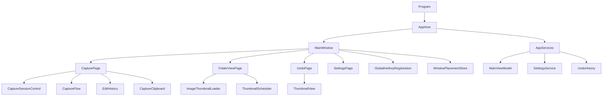
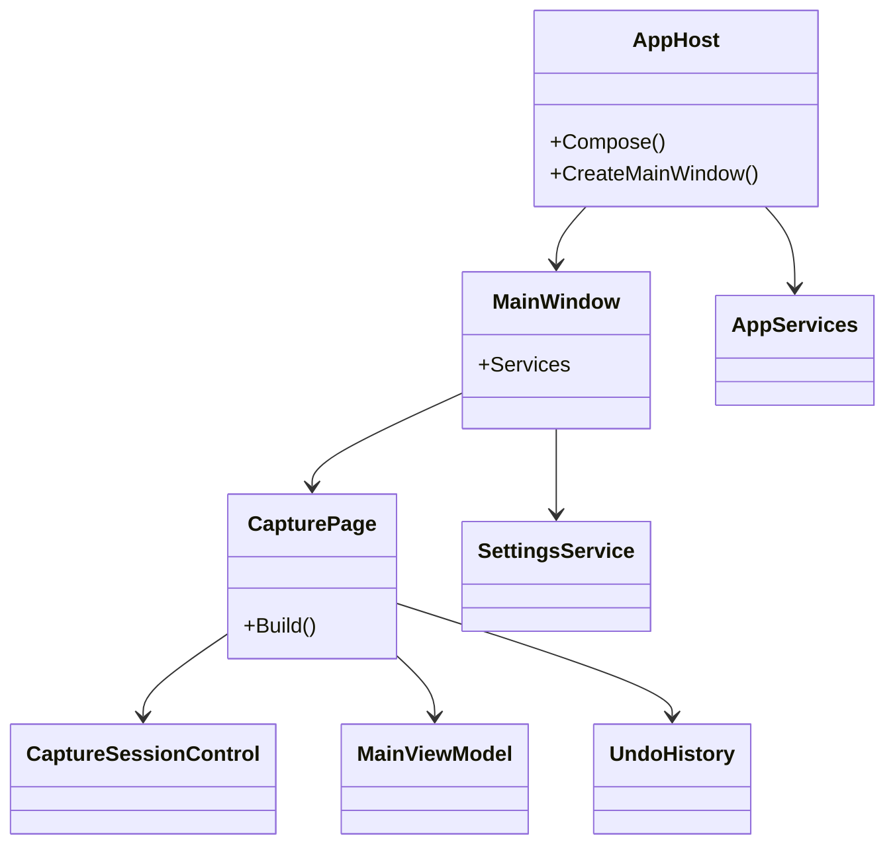
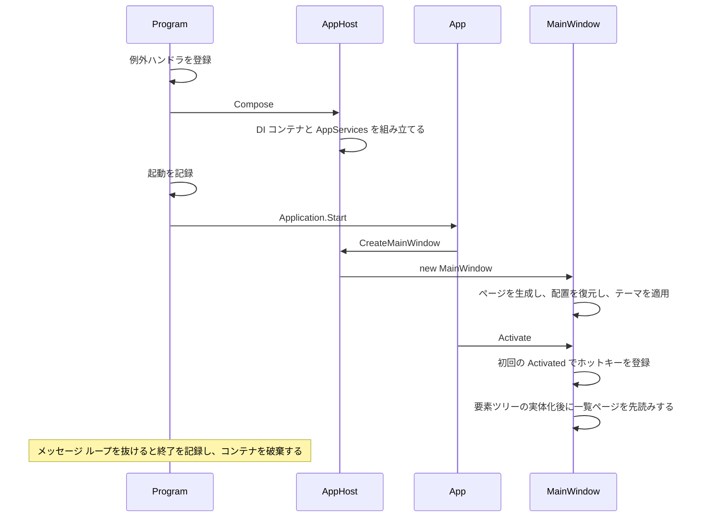
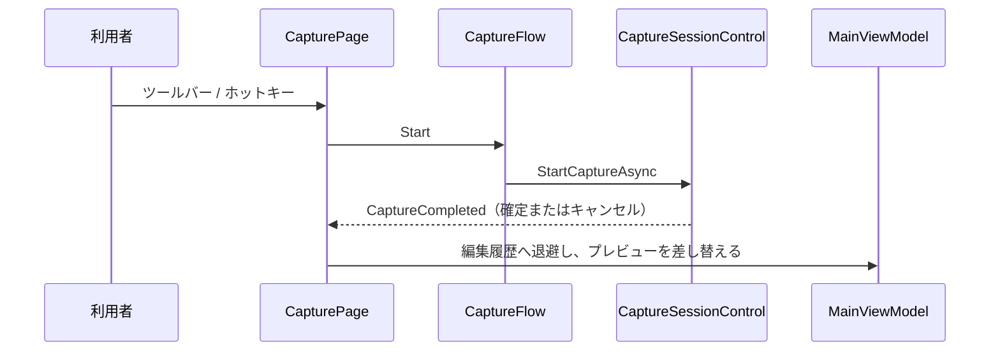
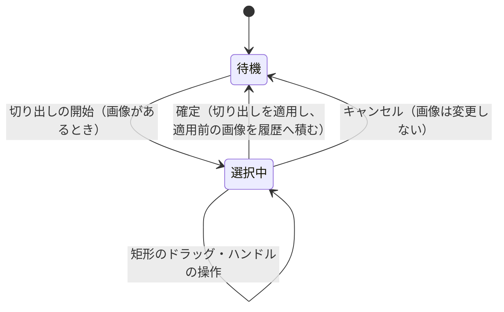

# App.WinUI3 システム仕様書

`App.WinUI3` の構造・依存・設計判断を記載します。 利用者から見た機能は [`SPEC_ExtFunc.md`](SPEC_ExtFunc.md) が所有します。

## 目次 <!-- omit from toc -->

- [1. 概要](#1-概要)
- [2. 技術スタック](#2-技術スタック)
- [3. アーキテクチャ](#3-アーキテクチャ)
- [4. コンポーネント構成](#4-コンポーネント構成)
  - [4.1 プロジェクト構成](#41-プロジェクト構成)
  - [4.2 コンポーネント一覧](#42-コンポーネント一覧)
  - [4.3 クラス図](#43-クラス図)
- [5. 依存関係](#5-依存関係)
  - [5.1 参照するプロジェクト](#51-参照するプロジェクト)
  - [5.2 参照の規則](#52-参照の規則)
- [6. 例外処理ポリシー](#6-例外処理ポリシー)
- [7. 起動シーケンス](#7-起動シーケンス)
- [8. 撮影のシーケンス](#8-撮影のシーケンス)
- [9. 切り出しの状態遷移](#9-切り出しの状態遷移)
- [10. テストできない範囲と理由](#10-テストできない範囲と理由)
  - [10.1 テストの分担（コアが提供する型）](#101-テストの分担コアが提供する型)
- [11. 関連ドキュメント](#11-関連ドキュメント)

---

## 1. 概要

`App.WinUI3` は SaveEvidence の WinUI 3 版アプリです。 UI 非依存のコア（設定・ViewModel・画像コンテナ）と
撮影スタックを共有し、**画面の構築と OS との境界だけ**を実装します。

- 層の帰属（Core / Presenter / UI のどれに置くか）は [`../../../src/README.md`](../../../src/README.md) が所有します。
- 依存の許可範囲は [`../../../.github/依存関係.md`](../../../.github/依存関係.md) が所有します。

## 2. 技術スタック

| 項目 | 値 |
| --- | --- |
| 言語 / ランタイム | C# 14 / .NET 10 |
| UI フレームワーク | WinUI 3（`Microsoft.WindowsAppSDK` 1.x） |
| 対象フレームワーク | `net10.0-windows10.0.22621.0`（`SupportedOSPlatformVersion` は 10.0.19041.0） |
| 配置 | アンパッケージ（`WindowsPackageType=None`）/ Windows App SDK 自己完結 / `win-x64` |
| 画像処理 | Skia（アイコンのラスタライズ・サムネイルの縮小デコード・画像表示のキャンバス） |
| ログ | `Serilog` + `Microsoft.Extensions.Logging`（`LoggerMessage` ソース生成） |
| 合成 | `Microsoft.Extensions.DependencyInjection` |
| 設定 | `System.Text.Json` のソース生成（`AppJsonContext`） |
| テスト | xUnit v3（`OutputType` は `Exe`） |

- **`OutputType` はアプリが `WinExe`、テストが `Exe`** です。 テストは `UseWinUI` が `OutputType` を
  `WinExe` へ変えるため、実行可能ファイルであることを明示的に戻します。
- **エントリ ポイントは本プロジェクトの `Program`** です。 定数 `DISABLE_XAML_GENERATED_MAIN` で
  XAML コンパイラが生成する `Main` を無効化し、`<StartupObject>` で `Program` を指定します。

## 3. アーキテクチャ

画面は**コード マークアップ**で組み立てます。 XAML ファイルは `App.xaml`（既定スタイルの読み込み）だけです。
ページごとの XAML とコードビハインドの二重管理を避け、ページの状態と購読の寿命を 1 つの型で扱います。



- **ページは 1 度だけ生成**し、選択のたびに同じ要素を表示します（状態と購読を保持するため）。
  表示のたびに必要な処理（一覧の再構築・背景生成の負荷切り替え）は `PageContent` のコールバックで明示的に呼びます。
- **変更通知で表示を更新**します（バインディング エンジンを使わず、必要な箇所だけを更新する）。
- **UI スレッドを跨ぐ処理**（サムネイルの背景生成）は結果の反映だけを UI スレッドへ戻します。
- 図の `ThumbnailScheduler` はコア（`App.Core`）が単一所有する型です（本プロジェクトは型を持たずに使います。 §4.2・§5.2）。

## 4. コンポーネント構成

### 4.1 プロジェクト構成

```text
src/App.WinUI3/src/
├── Program.cs                          エントリ ポイント（例外の記録 → 合成 → XAML アプリケーションの開始）
├── App.xaml.cs                         XAML アプリケーション定義（メイン ウィンドウの生成・UI スレッド例外の記録）
├── App.xaml                            既定スタイルの読み込み
├── AppHost.cs                          合成ルート（DI コンテナと共有オブジェクト）
├── AppServices.cs                      ページへ渡すコア オブジェクトの束
├── Logging/
│   └── AppLog.cs                       ログの定義と出力構成
├── Icons/
│   └── IconLoader.cs                   SVG アイコンの読み込みとラスタライズ
├── Services/
│   ├── CaptureFlow.cs                  撮影の開始（多重起動の防止）
│   ├── EditHistory.cs                  編集履歴（戻す / やり直し）の実行
│   ├── SettingsColorMath.cs            設定の色文字列 ⇔ 色の変換
│   ├── AppJsonContext.cs               設定の JSON ソース生成コンテキスト
│   ├── CaptureClipboard.cs             クリップボードとの画像の受け渡し
│   ├── GlobalHotKeyRegistration.cs     グローバル ホットキーの登録と配信
│   ├── WindowPlacementStore.cs         ウィンドウ配置の保存と復元
│   ├── ImageThumbnailLoader.cs         画像ファイルの縮小デコードとキャッシュ
│   ├── ThumbnailBackground.cs          背景生成の共通処理（代替画像・UI スレッド反映）
│   └── FolderFileListReader.cs         一覧に出す画像ファイルの列挙
└── Views/
    ├── MainWindow.cs                   ナビゲーション ペインとページの切り替え（先読みの開始）
    ├── PageContent.cs                  ページの内容と表示ライフサイクルの処理
    ├── AppStyles.cs                    共通の寸法とテーマの適用
    ├── CapturePage.cs                  キャプチャ ページ
    ├── FolderViewPage.cs               フォルダビュー ページ
    ├── UndoPage.cs                     Undo 一覧ページ
    ├── SettingsPage.cs                 設定ページ
    ├── ConfirmDialog.cs                上書き確認ダイアログ
    ├── ThumbnailView.cs                縦横比を保って収める画像表示
    └── WrapLayoutMath.cs               一覧の折り返し配置の計算
```

### 4.2 コンポーネント一覧

| コンポーネント | 内容 |
| --- | --- |
| `Program` | 未処理の例外の記録を登録し、合成 → XAML アプリケーションの開始 → 終了の記録を行う |
| `App` | XAML のアプリケーション定義。 メイン ウィンドウの生成（UI スレッド）と UI スレッド例外の記録を担う |
| `AppHost` | 合成ルート。 DI コンテナと共有オブジェクト（`AppServices`）を組み立て、メイン ウィンドウを生成する |
| `AppServices` | ページへ渡すコア オブジェクトの束（メイン ViewModel / 設定サービス / 編集履歴 / フォルダビューの表示状態） |
| `MainWindow` | ナビゲーション ペイン・ページの切り替え・キーの転送・ウィンドウ配置の保存と復元・ホットキーの登録 |
| `PageContent` | 1 ページ分の内容と、表示 / 非表示 / 先読み / キー入力で実行する処理 |
| `AppStyles` | 共通の寸法とテーマの適用（テーマ変更の通知を含む） |
| `CapturePage` | ツールバー・プレビュー・ステータス バーの組み立てと、撮影・切り出し・履歴・クリップボードの接続 |
| `FolderViewPage` | 保存先フォルダのサムネイル一覧（表示モード・ソート順・既定アプリで開く） |
| `UndoPage` | 編集履歴と現在の画像のサムネイル一覧（一時ファイルへ書き出して開く） |
| `SettingsPage` | 設定のセクションと入力（真偽値 / 数値 / 色 / 選択肢 / ホットキー） |
| `ThumbnailView` | 画像を縦横比を保って領域へ収める表示（描画は `Platform.WinUI3` の画像表示ビューへ委譲する） |
| `WrapLayoutMath` / `AppStyles` | 一覧の配置の計算・共通の寸法 |
| `CaptureFlow` | 撮影の開始（多重起動の防止）。 画像の反映は撮影完了イベントの購読側が行う |
| `EditHistory` | 編集履歴（戻す / やり直し）の実行 |
| `SettingsColorMath` | 設定の色文字列（`#AARRGGBB`）と色の相互変換 |
| `AppJsonContext` | 設定の JSON ソース生成コンテキスト |
| `CaptureClipboard` | クリップボードとの画像の受け渡し（PNG として授受する） |
| `GlobalHotKeyRegistration` | グローバル ホットキーの登録・解除と押下の配信 |
| `WindowPlacementStore` | ウィンドウの位置・サイズ・表示状態の保存と復元 |
| `ImageThumbnailLoader` | 画像ファイルの縮小デコードとキャッシュ（縮小はコアの面積平均を使う） |
| `ThumbnailBackground` | 背景のサムネイル生成の共通処理（代替画像・UI スレッドへの反映） |
| `FolderFileListReader` | 一覧に出す画像ファイルの列挙と並び順 |
| `IconLoader` | 埋め込み SVG の読み込みと、指定色・指定サイズへのラスタライズ |
| `AppLog` | ログの定義（`LoggerMessage` ソース生成）と出力構成 |
| `ConfirmDialog` | 上書き確認ダイアログ |

**コア（`App.Core`）が単一所有する型**（本プロジェクトは型を持たず、そのまま使う）:

| 型 | 内容 |
| --- | --- |
| `ThumbnailScheduler` / `ThumbnailPriority` | サムネイル生成の優先度付きスケジューラと優先度（優先順位・並列度・中断・失敗の分離） |
| `CapacityLimitedCache` | 容量制限付きキャッシュ（上限超過時の一括破棄） |
| `ImageFileExtensions` | 一覧へ出す画像の拡張子判定 |
| `CaptureSettingsMapper` | 設定 → 撮影スタックの外観設定の変換（色と描画スケールの写像） |
| `ViewModeDisplay` | 表示モード（特大 / 大 / 中）の文言と範囲補正 |

### 4.3 クラス図



## 5. 依存関係

### 5.1 参照するプロジェクト

| 参照先 | 用途 |
| --- | --- |
| `App.Core` | 設定・ViewModel・画像のコンテナ・保存の実装 |
| `Parts.CapturePreview.Core` | 切り出しの共通規則・外観設定の型・オーバーレイの型 |
| `Parts.CapturePreview.ControlWinUI3` | 撮影セッション・切り出しビュー・ズーム ビュー |
| `Platform.WinUI3` | コア型と WinUI 3 型の相互変換・画像の Skia 描画・DIP の換算 |

`EsUtil` リポジトリのプロジェクトは上記の推移参照で解決します。

### 5.2 参照の規則

- 依存は一方向です（上位の層から下位の層へのみ参照します）。
- 参照先は [`../../../.github/依存関係.md`](../../../.github/依存関係.md) §3 の許可一覧に含まれるプロジェクトだけです
  （`Directory.Build.targets` の `DEP0001`〜`DEP0006` が機械的に検査します）。
- **`App.Core` の内部型は `InternalsVisibleTo`（`SaveEvidence.WinUI3` / `App.WinUI3.Tests`）で参照します**。
  サムネイル生成のスケジューラ・容量制限付きキャッシュ・拡張子の判定・表示モードの文言・設定の写像は
  **コアの実装が単一所有**であり、本プロジェクトに同じ役割の型を持ちません（§4.2 の一覧）。
  内部型を使う理由は「公開 API を増やさずに UI 実装間で規則を 1 つに保つ」ことです。
- **`EsUtil` リポジトリのプロジェクト**は `ProjectReference` の推移参照で解決します（本プロジェクトから
  直接参照するのは `Platform.WinUI3` と `Parts.CapturePreview.ControlWinUI3` です）。

## 6. 例外処理ポリシー

共通方針は [`../../../.github/例外処理規約.md`](../../../.github/例外処理規約.md) が所有します。 本プロジェクト固有の状況は次のとおりです。

| 境界 | 扱い |
| --- | --- |
| エントリ ポイント | `AppDomain.UnhandledException` と `TaskScheduler.UnobservedTaskException` を記録する（後者は観測済みにして継続する） |
| UI スレッド | XAML アプリケーションの `UnhandledException` を記録し、アプリを継続する（1 回分の入力・描画の失敗で終了させない） |
| 撮影 | 撮影スタックが公開操作の境界で記録する。 呼び出し側は再記録しない（同じ例外を 2 回記録しない） |
| 設定の反映 | 検証の失敗で UI を壊さないよう例外保護付きで反映し、原因だけを記録する |
| 一覧・サムネイル | 1 件の失敗で全体を止めない（失敗は記録して次へ進む） |
| クリップボード | 使用中の失敗は記録して継続する（通知は出さない） |
| ウィンドウ配置の保存 | 終了処理の境界のため、失敗しても終了を妨げず原因だけを記録する |

## 7. 起動シーケンス



- **ウィンドウを `Application.Start` の後に生成する理由**: UI 要素の生成は XAML のディスパッチャ
  （UI スレッド）を要するためです。 `Application.Start` より前に生成すると COM のスレッド アパートメント
  エラーで起動に失敗します。
- **ホットキーを初回の表示後に登録する理由**: `WM_HOTKEY` の受信先はウィンドウ プロシージャであり、
  ウィンドウの表示後に確定するためです。
- **先読みの起点は要素ツリーの実体化（`Loaded`）** です。 表示が済んでから一覧ページを構築し、
  サムネイル生成を低負荷で始めます（キャプチャ ページの操作を妨げません）。

## 8. 撮影のシーケンス



- 撮影の開始経路（ツールバー・メニュー・ホットキー）は `CaptureFlow` へ一本化します。
- 画像の変更は撮影セッションの完了イベントだけが行います（変更の経路を 1 つにする）。

## 9. 切り出しの状態遷移



- 開始・確定・キャンセルのどれを行うかの判断は撮影スタックが単一所有します
  （アプリ側は 1 つの操作から 3 つの経路へ振り分けるだけです）。

## 10. テストできない範囲と理由

**XAML の型（`Microsoft.UI.Xaml.*`）はウィンドウのないプロセスで生成できません**（実測: `COMException 0x80040154`
（`REGDB_E_CLASSNOTREG`））。 そのため自動テストは XAML に依存しない範囲へ絞り、次の範囲はテストしません。

| テストしない範囲 | 理由と代替の確認方法 |
| --- | --- |
| ページ・ウィンドウの組み立て（`MainWindow` / `CapturePage` / `FolderViewPage` / `UndoPage` / `SettingsPage`） | XAML の型を生成できないため。 代替: 実行ファイルを起動し、ログ（起動 / 終了）とウィンドウの表示を実機で確認する |
| 撮影セッションの実行（`CaptureSessionControl`） | 撮影スタックが自前のテストを持ち、ウィンドウを必要とする範囲はそちらで検証する |
| グローバル ホットキーの登録（`GlobalHotKeyRegistration`） | OS のホットキー登録とウィンドウ プロシージャの差し替えを要するため。 代替: 実機でホットキーの押下を確認する |
| ウィンドウ配置の保存・復元（`WindowPlacementStore`） | `AppWindow` を要するため。 代替: 実機で位置・サイズを変えて再起動し、配置が復元されることを確認する |
| 色の入力と表示（`SettingsPage` の色ピッカー） | XAML の型を生成できないため。 代替: 設定ファイルの値の往復をテストで確認する |
| クリップボードの実操作（`CaptureClipboard`） | クリップボードは OS の共有資源であり、テストの並列実行と干渉するため。 代替: エンコード / デコードの経路は他のテストと同じ画像 API を使う |
| アイコンのラスタライズ（`IconLoader`） | `WriteableBitmap` を要するため。 代替: SVG のパス抽出と画像生成の規則（縮小・色）はコードで確認する |

### 10.1 テストの分担（コアが提供する型）

コア（`App.Core`）が単一所有する型の検証は、**原則として `App.Core.Tests` が持ちます**。
本プロジェクトは次のとおり使い分けます。

| 対象 | 検証の所在 |
| --- | --- |
| `ThumbnailScheduler` / `ThumbnailPriority` | `App.Core.Tests`（優先順位・並列度・中断・失敗の分離） |
| `ImageFileExtensions` / `ViewModeDisplay` | `App.Core.Tests`（拡張子の判定・表示モードの文言と範囲補正） |
| `CapacityLimitedCache` | 専用のテストは無く、本プロジェクトの `ImageThumbnailLoader.Tests`（同一条件で同じ実体を返すこと）が通る |
| `CaptureSettingsMapper` | **本プロジェクト**（`App.Core.Tests` に検証が無く、本アプリの撮影設定の写像を保証する必要があるため） |

- 本プロジェクトのテストは**本プロジェクト固有の振る舞い**（色文字列の往復・設定の JSON 往復・
  サムネイルの縮小デコードとキャッシュ・一覧の抽出と並び順・編集履歴・折り返し配置の計算・ログ定義の書式）を
  検証します。 コアの型をそのまま検証するだけのテストは持ちません（重複を避ける）。

## 11. 関連ドキュメント

- [`../README.md`](../README.md) — 利用仕様書
- [`SPEC_ExtFunc.md`](SPEC_ExtFunc.md) — 外部機能仕様書
- [`../../../.github/依存関係.md`](../../../.github/依存関係.md) — 依存の許可範囲
- [`../../../src/README.md`](../../../src/README.md) — 層の帰属
