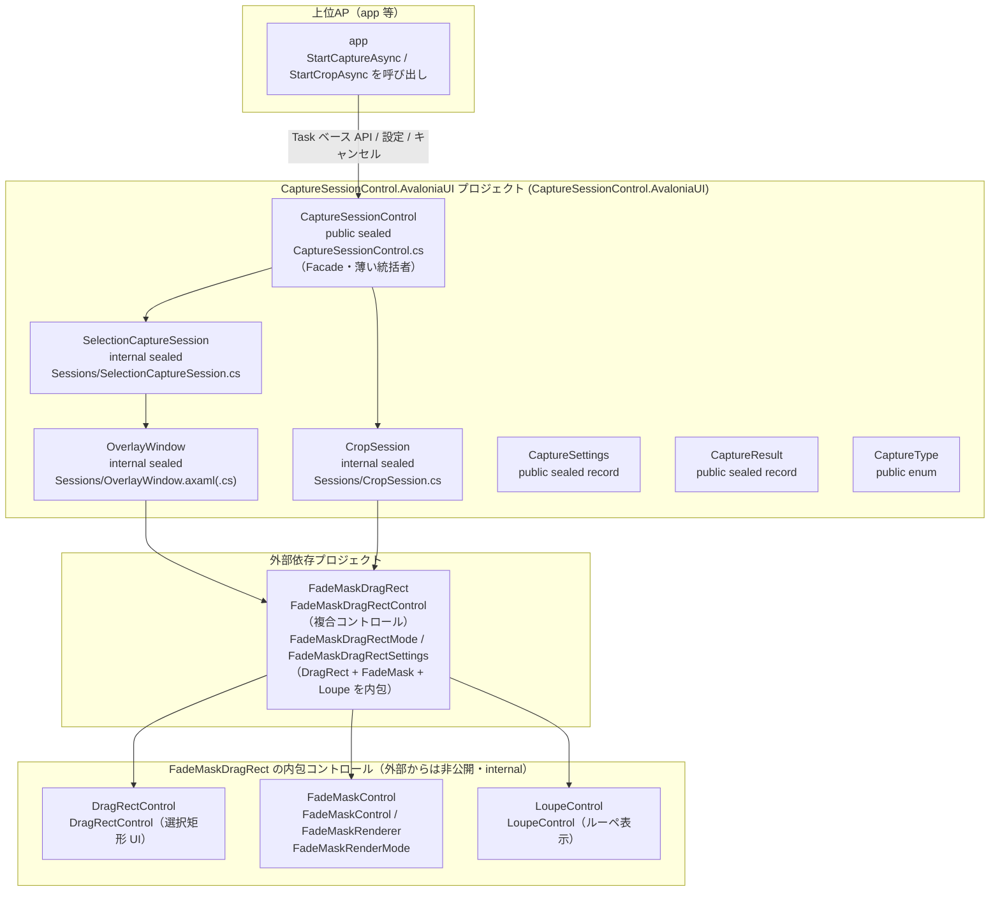
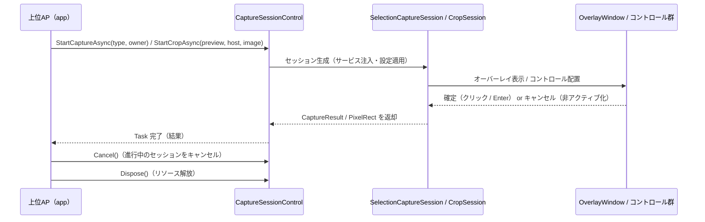

# CaptureSessionControl.AvaloniaUI システム仕様書（SPEC_System）

## 目次

- [CaptureSessionControl.AvaloniaUI システム仕様書（SPEC\_System）](#capturesessioncontrolavaloniaui-システム仕様書spec_system)
  - [目次](#目次)
  - [1. システム概要](#1-システム概要)
  - [2. 技術スタック](#2-技術スタック)
  - [3. アーキテクチャ](#3-アーキテクチャ)
    - [3.1 レイヤー構造](#31-レイヤー構造)
    - [3.2 依存の方向](#32-依存の方向)
  - [4. 例外処理ポリシー](#4-例外処理ポリシー)
    - [4.1 基本方針](#41-基本方針)
    - [4.2 本プロジェクト固有の例外処理](#42-本プロジェクト固有の例外処理)
  - [5. コンポーネント図](#5-コンポーネント図)
  - [6. コンポーネント一覧](#6-コンポーネント一覧)
    - [6.1 CaptureSessionControl](#61-capturesessioncontrol)
    - [6.2 SelectionCaptureSession](#62-selectioncapturesession)
    - [6.3 CropSession](#63-cropsession)
    - [6.4 OverlayWindow](#64-overlaywindow)
    - [6.5 公開データ型](#65-公開データ型)
  - [7. 依存ルール](#7-依存ルール)
  - [8. ライフサイクル](#8-ライフサイクル)
  - [9. ログ](#9-ログ)
    - [9.1 LogLevel 設定ポリシー](#91-loglevel-設定ポリシー)
    - [9.2 ログ定義一覧](#92-ログ定義一覧)

---

## 1. システム概要

SaveEvidence は、Windows デスクトップ上の画面をキャプチャし、プレビュー・編集・保存するための Avalonia UI アプリケーションです（.NET 10.0 / C# 14 / MVVM）。

本プロジェクト（CaptureSessionControl.AvaloniaUI）は、このシステムのうち**画面キャプチャ（ScreenSelect / WindowSelect / AreaSelect）と切出し（Crop）のセッション統括**を担います。上位 AP（app）へは Task ベースの公開 Facade（`CaptureSessionControl`）を提供し、内部でオーバーレイ（`OverlayWindow`）と複合コントロール（`FadeMaskDragRectControl`）を組み立てて実行します。

## 2. 技術スタック

| 項目 | 内容 |
| --- | --- |
| **プロジェクト** | `CaptureSessionControl.AvaloniaUI` |
| **ルート名前空間** | `Estable.AvaloniaUI.CaptureSession` |
| **言語** | C# 14（.NET 10.0） |
| **UI フレームワーク** | Avalonia UI 12.1 |
| **ターゲットフレームワーク** | net10.0-windows10.0.17763.0 |
| **ビルドツール** | MSBuild / .NET SDK 10.0 |
| **ログ** | Microsoft.Extensions.Logging.Abstractions（LoggerMessage ソース生成） |
| **テスト** | xUnit v3 / Avalonia.Headless.XUnit |
| **依存プロジェクト** | FadeMaskDragRect（複合コントロール）/ PlatformFactory（ScreenConverter）/ PlatformFactory.Native（プラットフォームサービス） |

CaptureSessionControl.AvaloniaUI は内包コントロール（DragRectControl / FadeMaskControl / LoupeControl）を直接参照しない（公開型のカプセル化。窓口は FadeMaskDragRectControl のみ。推移的依存として各プロジェクトを利用）。

## 3. アーキテクチャ

### 3.1 レイヤー構造

```text
公開 Facade（CaptureSessionControl）
  → セッション（SelectionCaptureSession / CropSession）
    → オーバーレイ / 複合コントロール（OverlayWindow / FadeMaskDragRectControl）
      → 各コントロール（DragRect / FadeMask / Loupe）+ PlatformFactory
```

### 3.2 依存の方向

- 依存は**一方向の階層構造**（CaptureSessionControl → Sessions → 複合コントロール → 各コントロール / PlatformFactory）。
- 配線・状態同期は複合コントロールに集約し、セッションは薄い統括者（SRP / DRY）。
- プラットフォームサービス（ICaptureService / IWindowService / IElementFinder）は注入され、内部で生成しない（DIP）。

## 4. 例外処理ポリシー

### 4.1 基本方針

- ライブラリは例外を原則伝播し、上位 AP（app）で処理する。
- UI レイヤー（app）ではユーザー操作起因の例外を各ハンドラで catch し、UI の応答性を維持する。
- ログは LoggerMessage ソース生成（`Logging/LogMessage.cs`）で出力する。高頻度イベントは Debug、障害は Error / Warning で記録する。

### 4.2 本プロジェクト固有の例外処理

- キャプチャ中の例外はオーバーレイを閉じて通常状態に復帰する。
- 仮想スクリーン全体のキャプチャはバックグラウンド + 5 秒タイムアウト（DWM 応答不能時の安全策）。

## 5. コンポーネント図



## 6. コンポーネント一覧

### 6.1 CaptureSessionControl

- **分類**: 公開統括者（`public sealed class : IDisposable`・Facade パターン）
- **責務**:
  - キャプチャ / Crop の開始・キャンセル・確定の公開 API を提供（単一の窓口）
  - セッションの生成とライフサイクル管理（再入禁止・Dispose ガード）
  - 設定（`CaptureSettings`）の保持・部分更新・検証
  - プラットフォームサービスの注入（`PlatformFactory.Native` 経由）
- **公開メンバー**:
  - コンストラクタ: `CaptureSessionControl(CaptureSettings? initialSettings = null, ILogger? logger = null)`
  - プロパティ: `AppearanceSettings`（`CaptureSettings`。getter は全メンバー non-null / setter は部分更新 + 検証）
  - メソッド: `StartCaptureAsync(CaptureType, Window)` / `StartCropAsync(CropViewControl, Window, EsBitmap, Action<bool>?)` / `Cancel()` / `Confirm()` / `Dispose()`
- **可視性**: public
- **依存**: SelectionCaptureSession / CropSession / CaptureSettings / CaptureResult / CaptureType / PlatformFactory

### 6.2 SelectionCaptureSession

- **分類**: 内部セッションクラス（`internal sealed class`・Primary Constructor）
- **責務**:
  - 背景キャプチャ（AreaSelect 用仮想スクリーン全体。バックグラウンド + 5 秒タイムアウト）
  - オーナーウィンドウのキャプチャ除外設定（`SetCaptureExclusion`）
  - `OverlayWindow` の生成・表示と TCS での結果待機
  - 結果の返却（キャンセル時は 0x0 の空結果）
- **可視性**: internal
- **依存**: OverlayWindow / IWindowService / ICaptureService / IElementFinder（注入）/ CaptureType / CaptureSettings

### 6.3 CropSession

- **分類**: 内部セッションクラス（`internal sealed class`・Primary Constructor）
- **責務**:
  - 複合コントロール `FadeMaskDragRectControl`（DragRect + FadeMask + Loupe の配線を内包）の配置・ライフサイクル管理
  - 外観設定の適用: `CaptureSettings` → `FadeMaskDragRectSettings`（拡張メソッドで一元化）→ `AppearanceSettings`（部分更新 + 同一値スキップ）
  - 座標変換: `CoordTransform`（`CropViewControl` の `ViewportToContent` / `ContentToViewport` に委譲）で論理（元画像 px）↔ ビューポート DIP を 1 段変換し、複合コントロールへ注入
  - カーソル上書き抑止（Crop 中の十字カーソル維持）
  - 確定 → 論理 Rect / キャンセル → 0x0 の空 `PixelRect` を返却
- **可視性**: internal
- **依存**: FadeMaskDragRect（FadeMaskDragRectControl / FadeMaskDragRectSettings）/ PlatformFactory.Native（ICursorOverrideGuard）/ PlatformFactory.Core（ICoordTransform / CoordTransform）

### 6.4 OverlayWindow

- **分類**: 内部ウィンドウ（`internal sealed partial class : Window`）
- **責務**:
  - 全画面透明・Topmost・Alt+Tab 非表示の選択オーバーレイ
  - 選択 UI の配置: `VirtualScreenImage`（背景）/ `SelectionOverlay`（FadeMaskDragRectControl 複合コントロール）
  - モード別の選択処理（AreaSelect: ドラッグ選択 + ルーペ / Screen・WindowSelect: 要素検出 + ハイライト）
  - クリック確定 → キャプチャ実行 → 結果コールバック
  - 非アクティブ化 / Close → キャンセル
- **可視性**: internal（クラス。コンストラクタ等のシグネチャは public）
- **依存**: FadeMaskDragRect（FadeMaskDragRectControl / FadeMaskDragRectMode）/ PlatformFactory（ScreenConverter）/ PlatformFactory.Native（ICaptureService / IWindowService / IElementFinder）

### 6.5 公開データ型

| コンポーネント | 説明 |
| --- | --- |
| `CaptureType` enum | `ScreenSelect`（全画面）/ `WindowSelect`（ウィンドウ選択）/ `AreaSelect`（範囲選択）。UI 非依存の共通基盤 `PlatformFactory.Core`（`Estable.Platform`）提供 |
| `CaptureSettings` record | キャプチャの外観・動作設定（全メンバー nullable・部分更新可・`Validate()` / `ToNonNull()`） |
| `CaptureResult` record | キャプチャ結果（`Image` / `SourceBounds`。エラー時両方 null・キャンセル時両方 0x0） |

## 7. 依存ルール

- 依存方向は**一方向の階層構造**（CaptureSessionControl → Sessions → 複合コントロール FadeMaskDragRectControl → 各コントロール / PlatformFactory）。
- CaptureSessionControl / セッションは状態を保持せず、状態は複合コントロールと各コントロール / PlatformFactory が保持する（薄い統括者・SRP）。
- DragRect / FadeMask / Loupe の配線は複合コントロールに集約され、セッションは配線コードを持たない（DRY）。
- セッションへのプラットフォームサービス（ICaptureService / IWindowService / IElementFinder）は注入され、内部で生成しない（DIP）。
- 上位 AP への通知は Task 返却のみ（コールバック / イベント型 API ではない）。
- 選択状態の同期は各コントロールの公開イベントのみ（ポーリングなし）。

## 8. ライフサイクル



## 9. ログ

ログ定義は `Logging/LogMessage.cs`（LoggerMessage ソース生成）に集約し、`ILogger` の拡張メソッドとして定義する。
各メソッドは `this ILogger` 第一引数で定義し、呼び出し側では logger 引数を省略する（例: `_log.LogCaptureStart(type)`）。
`CaptureSessionControl` コンストラクタの `logger` 引数で注入し、null の場合は出力しない（app では NLog へ転送）。
出力先・レベル制御はホストアプリケーションが所有する（本クラスは定義のみ）。

### 9.1 LogLevel 設定ポリシー

トレースログは LogLevel.Trace に限定せず、「重要度 × 発生頻度」でレベルを使い分ける。

| LogLevel | 対象 | 本番での意図 |
| --- | --- | --- |
| `Error` | 例外・失敗（処理継続不可） | 常時出力し、障害を確実に残す |
| `Warning` | 異常だがフォールバックで継続 | 常時出力し、異常発生の痕跡を残す |
| `Information` | ユーザー操作の主要イベント（低頻度） | 常時出力し、操作手順の再現を可能にする |
| `Debug` | 操作イベントの詳細（セッション開始 / 確定 / キャンセル / 設定変更） | 障害時のみ有効化して解析 |
| `Trace` | 高頻度・極詳細 | 特別な性能・座標解析時のみ有効化 |

判断基準:

1. 例外・警告は常時残す（`Error` / `Warning`）
2. 操作の起点イベント（低頻度）は `Information`
3. マウス・キー等の操作イベント（中頻度）は `Debug`
4. 高頻度・極詳細は `Trace`
5. 設定変更（変更前後）は `Debug`

### 9.2 ログ定義一覧

| レベル | メソッド | 出力内容 |
| --- | --- | --- |
| `Debug` | `LogMessage.LogCaptureStart` | キャプチャセッション開始（種別） |
| `Debug` | `LogMessage.LogCaptureCompleted` | キャプチャ確定（矩形） |
| `Debug` | `LogMessage.LogCaptureCancelled` | キャプチャキャンセル |
| `Debug` | `LogMessage.LogResult` | キャプチャ結果サイズ（画像サイズ / 矩形） |
| `Debug` | `LogMessage.LogOverlayConfirm` | オーバーレイ確定要求（Enter / ダブルクリック等） |
| `Debug` | `LogMessage.LogOverlayCancel` | オーバーレイキャンセル要求（Esc 等） |
| `Debug` | `LogMessage.LogVirtualScreen` | 仮想スクリーン設定（原点 / サイズ） |
| `Trace` | `LogMessage.LogHighlight` | ハイライト検出結果（ScreenSelect / WindowSelect・検出矩形 / タイトル / クラス名。マルチモニタ・最大化ウィンドウの矩形検証とデスクトップウィンドウの特定用） |
| `Debug` | `LogMessage.LogCropStart` | Crop セッション開始（元画像サイズ） |
| `Debug` | `LogMessage.LogCropCompleted` | Crop 確定（切り出し矩形） |
| `Debug` | `LogMessage.LogCropCancelled` | Crop キャンセル |
| `Debug` | `LogMessage.LogSettingChanged` | 設定値変更（変更前後） |
