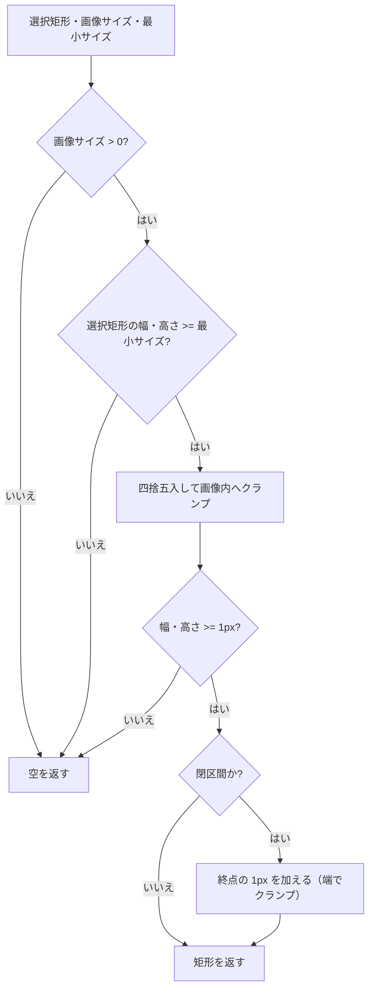

# CaptureSessionControl.Core システム仕様

## 1. 概要

撮影（スクリーン / ウィンドウ / 範囲選択）と切り出し（Crop）の**共通規則**を単一所有する UI 非依存ライブラリです。

## 2. 技術スタック

| 項目 | 内容 |
| --- | --- |
| 言語 / フレームワーク | C# 14 / .NET 10（`net10.0`） |
| 依存パッケージ | なし（`System.Drawing.Primitives` は共有フレームワーク） |
| テスト | xUnit v3（`CaptureSessionControl.Core.Tests`） |

## 3. アーキテクチャ

### 3.1 レイヤー構造

```text
CaptureSessionControl.AvaloniaUI / CaptureSessionControl.MewUI（UI 実装）
        │ 参照
        ▼
CaptureSessionControl.Core（本プロジェクト。共通規則）
        │ 参照
        ▼
Platform.Core（Es* 幾何型 / EsBitmap / ICaptureService / IWindowService）
```

依存は一方向です。Core は UI フレームワーク（Avalonia / MewUI）を参照せず、`Microsoft.Extensions.Logging.Abstractions` のみに依存します。

### 3.2 層の責務の境界

| 区分 | 所有者 | 内容 |
| --- | --- | --- |
| 状態 | Core | セッションの実行中・完了（`CaptureSessionState`）、受付スロット（`CaptureSessionSlot`）、結果の確定（`CaptureCompletion`）、ハイライトとクリック確定（`CaptureHighlightSession` / `CaptureClickSelection`）、撮影画像（`CaptureImageHolder`） |
| 判断 | Core | 切り出し範囲・ハイライトの反映・キー操作・クリック確定・種別の性質・モニタ倍率・設定のマージ・退避と除外の順序・画像配置・平均色・取得の打ち切り（`CaptureVirtualScreen`） |
| 契約 | Core | `ICaptureTarget` / `ICaptureOwnerWindow` / `CaptureSessionSlot` / `CaptureCompletion` |
| ログ定義 | Core | `CaptureLogMessage` / `CaptureLogFormat` / `CaptureSettingsLogMessage` |
| 入力ブリッジ | UI | ポインタ・キー・ホイールの購読とコア型への変換、返された効果の適用 |
| 描画 | UI | 外観値を持たず、設定とコア共有値を読んで描く |
| ホスト結線 | UI | Window の生成と表示、`Screens` / DPI の取得、`Dispatcher`、カーソル、レイアウト、Bitmap のライフサイクル |

### 3.3 コンポーネントの構成

```text
┌──────────────────────────────────────────────────────┐
│ 撮影画像の保持と取得の待ち方（クラス）                  │
│  CaptureImageHolder: Set（差し替え・破棄後の破棄）           │
│                      Image / Origin / Bounds / Dispose │
│  CaptureVirtualScreen: AwaitAsync（タイムアウト・未使用結果の破棄）│
└──────────────────────────────────────────────────────┘
┌──────────────────────────────────────────────────────┐
│ CropBoundsMath（静的クラス）                           │
│  ComputeCropBounds(selection, imageSize, min, closed)│
│    ├─ 最小サイズ判定                                  │
│    ├─ ToPixelRect      （クランプ + 四捨五入）         │
│    └─ ToClosedInterval （終点の 1 ピクセル + 端のクランプ）│
└──────────────────────────────────────────────────────┘
┌──────────────────────────────────────────────────────┐
│ CaptureSettings（record・全メンバー nullable）         │
│  Validate / ToNonNull                                 │
│ CaptureSettingsMerge（静的クラス）                     │
│  Merge（部分更新のマージ） / Apply（検証 + マージ + 同値スキップ）│
└──────────────────────────────────────────────────────┘
┌──────────────────────────────────────────────────────┐
│ CaptureLabelTexts（静的クラス）                        │
│  ToSelectionMode(CaptureType) FadeMaskDragRectMode    │
│  GetOperationText(mode) string                        │
│  GetInfoText(mode, windowTitle) string?               │
│ CropLabelTexts（静的クラス）                           │
│  FormatCropSizeLabel(rect, zoomPercent) string        │
└──────────────────────────────────────────────────────┘
┌──────────────────────────────────────────────────────┐
│ 種別・モニタの判断（静的クラス）                        │
│  CaptureTypeTraits: IsHighlighted / UsesClosedInterval│
│                     GetElementTarget                  │
│  MonitorScalingMath: ResolveForRect / ResolveForDomainRect（中心で判定）      │
│                     Collect（倍率未確定の除外） / ResolveScaling（代表値）      │
│  ImageColorMath: AverageColor（標本間引き）                            │
│  CaptureClipMath: ResolveCaptureRect（切り出し矩形の唯一の求解。整数/浮動小数。座標空間は画面物理）            │
│                   画面物理⇔画像ローカル矩形の相互変換 / 画像の共有値 / 切り出し         │
└──────────────────────────────────────────────────────┘
┌──────────────────────────────────────────────────────┐
│ ハイライトの状態と判断（クラス）                          │
│  CaptureHighlightSession: Update（検出→状態の導出） / Title / DomainRect │
│  CaptureHighlight: DomainRect / TitleChanged                            │
│  CaptureClickSelection: Fix（押下で固定） / Take（解放で取り出し）    │
└──────────────────────────────────────────────────────┘
┌──────────────────────────────────────────────────────┐
│ セッションの状態と排他（クラス）                        │
│  CaptureSessionState: IsRunning / IsCompleted         │
│                       TryBegin / TryComplete / End     │
│  CaptureSessionSlot{TCapture, TCrop}:                  │
│    HasCapture / HasCrop / IsBusy / Crop                │
│    TryBeginCapture / EndCapture / TryBeginCrop / EndCrop│
│    HasCropSelection / CancelAll                        │
│  CaptureCompletion{TResult}: Task / TrySetResult       │
└──────────────────────────────────────────────────────┘
┌──────────────────────────────────────────────────────┐
│ ホスト連携のポートと手順                               │
│  ICaptureTarget: 切り出し結果の適用先                  │
│  ICaptureOwnerWindow: 撮影時の退避対象                 │
│  CaptureOwnerScope: Enter（除外→退避） / Dispose（復帰）│
└──────────────────────────────────────────────────────┘
┌──────────────────────────────────────────────────────┐
│ ログ定義（静的クラス）                                 │
│  CaptureLogMessage / CaptureSettingsLogMessage        │
│  CaptureLogFormat: Rect（X,Y,Width,Height）            │
└──────────────────────────────────────────────────────┘
┌──────────────────────────────────────────────────────┐
│ オーバーレイのキー操作（静的クラス）                    │
│  CaptureKeyActions: Resolve(key, hasConfirmTarget)     │
│  CaptureKeyAction: None / Confirm / Cancel              │
└──────────────────────────────────────────────────────┘
┌──────────────────────────────────────────────────────┐
│ CaptureResult（record）                               │
│  Image: EsBitmap? / SourceBounds: EsPixelRect?        │
└──────────────────────────────────────────────────────┘
```

### 3.4 クラス図

```mermaid
classDiagram
    class CropBoundsMath {
        +ComputeCropBounds(EsRect, EsSize, double, bool) EsPixelRect
        +ToPixelRect(EsRect, EsSize) EsPixelRect
        +ToClosedInterval(EsPixelRect) EsPixelRect
        +ToClosedInterval(EsPixelRect, EsSize) EsPixelRect
        +RoundToPixel(double) int
    }
    class CaptureTypeTraits {
        +IsHighlighted(CaptureType) bool
        +UsesClosedInterval(CaptureType) bool
        +GetElementTarget(CaptureType) CaptureElementTarget
        +FindUnderCursor(IElementFinder, CaptureType, EsPixelPoint) ElementFinderResults
        +ResolveRect(CaptureType, EsRect, EsRect) EsRect?
    }
    class CaptureClipMath {
        +ResolveCaptureRect(CaptureType, EsRect, EsPixelRect) EsPixelRect
        +ResolveCaptureRect(CaptureType, EsPixelRect, EsPixelRect) EsPixelRect
        +ImageSize(EsBitmap) EsSize
        +ImageBounds(EsBitmap, EsPixelPoint) EsPixelRect
        +ValidateImage(EsBitmap, string)
        +ToLocalRect(EsPixelRect, EsPixelPoint) EsPixelRect
        +ToScreenRect(EsRect, EsPixelPoint) EsRect
        +ToScreenRect(EsPixelRect, EsPixelPoint) EsPixelRect
        +Extract(EsBitmap, EsPixelPoint, EsPixelRect) EsBitmap?
    }
    class CaptureHighlightSession {
        +EsRect? DomainRect
        +string Title
        +Update(CaptureType, ElementFinderResults, EsPixelPoint) CaptureHighlight
    }
    class CaptureKeyActions {
        +Resolve(EsKey, bool) CaptureKeyAction
    }
    class CaptureClickSelection {
        +Fix(EsPixelRect) bool
        +Take() EsPixelRect?
    }
    class CaptureResult {
        +EsBitmap? Image
        +EsPixelRect? SourceBounds
        +From(EsBitmap, EsPixelRect) CaptureResult
    }
    class CaptureHighlight {
        +EsRect? DomainRect
        +bool TitleChanged
    }
    class MonitorScalingMath {
        +ResolveForRect(EsPixelRect, IReadOnlyList, double) double
        +ResolveForDomainRect(EsRect, EsPixelPoint, IReadOnlyList, double) double
        +Collect(IEnumerable) IReadOnlyList
        +ResolveScaling(IEnumerable) double
    }
    class CaptureClipCache {
        +HasCached(EsPixelRect) bool
        +Take(EsPixelRect) EsBitmap?
        +Store(EsPixelRect, EsBitmap)
        +Dispose()
    }
    class CaptureImageHolder {
        +EsBitmap? Image
        +EsPixelPoint Origin
        +EsPixelRect Bounds
        +Set(EsBitmap, EsPixelPoint) bool
        +Dispose()
    }
    class CaptureVirtualScreen {
        +AwaitAsync(Task, TimeSpan) Task
    }
    class CropSessionActions {
        +Resolve(bool, bool) CropSessionAction
    }
    class CaptureTiming {
        +TimeSpan ScreenCaptureTimeout
        +int OwnerOffScreenCoordinate
    }
    class CaptureSettings {
        +bool? HideOwnerWindow
        +int? MinSelectionSize
        +Color? BorderColor
        +Validate()
        +ToNonNull() CaptureSettings
    }
    class CaptureSettingsMerge {
        +Merge(CaptureSettings, CaptureSettings) CaptureSettings
        +Apply(CaptureSettings, ref CaptureSettings, ILogger) bool
    }
    class CaptureSessionState {
        +bool IsRunning
        +bool IsCompleted
        +TryBegin() bool
        +TryComplete() bool
        +End()
    }
    class CaptureSessionSlot~TCapture, TCrop~ {
        +bool IsBusy
        +TryBeginCapture(TCapture) bool
        +TryBeginCrop(TCrop) bool
        +CancelAll(Action, Action)
    }
    class CaptureOwnerScope {
        +Enter(IWindowService, EsPlatformHandle, ICaptureOwnerWindow, bool) CaptureOwnerScope
        +Dispose()
    }
    CaptureHighlightSession ..> CaptureHighlight : 導出
    CaptureKeyActions ..> CaptureKeyAction : 返す
    CaptureClipMath ..> CropBoundsMath : 規則の合成
    CaptureSettingsMerge ..> CaptureSettings : マージ
    CaptureSessionState ..> CaptureSessionSlot : 状態を担う
    CaptureOwnerScope ..> ICaptureOwnerWindow : 退避と復帰
    CropBoundsMath ..> EsPixelRect : 生成
    CaptureResult ..> EsPixelRect : 保持
```



## 4. 処理フロー

### 4.1 切り出し範囲の計算



## 5. 例外処理ポリシー

| 状況 | 挙動 |
| --- | --- |
| 設定値が範囲外（`CaptureSettings.Validate`） | `ArgumentOutOfRangeException`（null メンバーは対象外） |
| 切り出しできない入力（`CropBoundsMath`） | 例外を投げず、`IsEmpty` が true の矩形を返す（呼び出し側がキャンセル扱いにする） |

## 6. 設計判断

- **切り出し規則を 1 箇所に置く**: 閉区間（終点の 1 px を含む）と端のクランプという切り出しの規則は `CropBoundsMath` が単一所有し、撮影の確定（`CaptureClipMath`）と切り出し（`CropSession`）が委譲する。規則が複数箇所にあると、同じドラッグでも 1 px 異なる矩形になる。
- **色は `System.Drawing.Color`**: UI 非依存のプリミティブ（`System.Drawing.Primitives`）で、MewUI のコントロールがそのまま受け取れる。設定から複合コントロールの設定値（`FadeMaskDragRectOptions`）への変換は本プロジェクトの `FadeMaskDragRectOptionsMapper` が単一所有する（両 UI で同じ変換を使う）。
- **判定を「クランプ前の値」で行う**: 画像外へ出た選択矩形を「大きい」と誤判定しないため、最小サイズの判定は画像内へクランプする前の値で行う。
- **丸めは 0.5 を切り上げ**: `Math.Round` の既定（銀行丸め）はピクセル座標の直感に反するため `MidpointRounding.AwayFromZero` を使う。

## 7. 検証

| 対象 | 内容 |
| --- | --- |
| `CropBoundsMath` | 純粋関数のためヘッドレスで検証する。四捨五入（0.5 の切り上げ）・画像外のクランプ・画像と重ならない場合の空・1 ピクセル未満の空・最小サイズ・閉区間と端のクランプ・画像サイズ 0 以下・丸め規則の公開（41 件）。Avalonia 版 / MewUI 版から移した境界値テストを 1 箇所へ集約した |
| `CaptureSettings` / `CaptureSettingsMerge` | 既定値の解決（`ToNonNull`）・部分更新のマージ・同値スキップ・範囲外の検証 |
| `CaptureTypeTraits` | 3 種別すべての性質（ハイライト・閉区間・検出対象）と未定義値のフォールバック・検出関数の呼び分け・確定対象の選択（16 件） |
| `MonitorScalingMath` | 中心を含むモニタの選択・単一モニタ・どのモニタにも含まれない場合のフォールバック・負座標・ドメイン座標からの原点加算 |
| `CropLabelTexts` / `ImageColorMath` | ラベル書式（閉区間の `WH`・倍率の丸め）・平均色（単色・標本間引き・null 検証） |
| `CaptureClipMath` / `CaptureClipCache` | 画面物理⇔画像ローカル座標の双方向変換（往復一致）・座標空間の混在で切り出せなくなる機序・切り出しの未取得時 null・同一判定・所有権の移動・旧値の破棄 |
| `CaptureTiming` / `CropSessionActions` | 方針値（タイムアウト・画面外座標）と、1 操作で実行する内容の決定（4 通りの入力） |
| `CaptureVirtualScreen` | 撮影対象の範囲（単一・複数モニタ・負の原点・モニタが無い場合）と、タイムアウト待ち・未使用結果の破棄 |
| `CaptureSessionState` / `CaptureSessionSlot` | 再入の禁止・単一完了・撮影と切り出しの相互排他・選択有無の委譲・一括キャンセル |
| `CaptureLogMessage` | 全定義の本文書式とイベント ID（記録ロガーで検証） |
