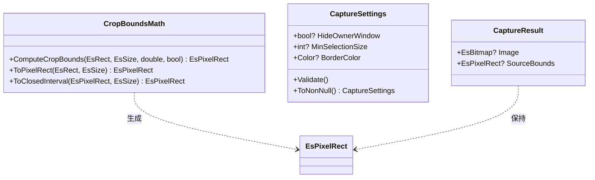
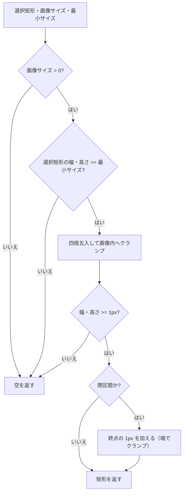

# CaptureSessionControl.Core システム仕様

## 1. 概要

撮影（スクリーン / ウィンドウ / 範囲選択）と切り出し（Crop）の**共通規則**を単一所有する UI 非依存ライブラリです。

## 2. 技術スタック

| 項目 | 内容 |
| --- | --- |
| 言語 / フレームワーク | C# 14 / .NET 10（`net10.0`） |
| 依存パッケージ | なし（`System.Drawing.Primitives` は共有フレームワーク） |
| テスト | xUnit v3（`CaptureSessionControl.Core.Tests`） |

## 3. アーキテクチャ

### 3.1 レイヤー構造

```text
CaptureSessionControl.AvaloniaUI / CaptureSessionControl.MewUI（UI 実装）
        │ 参照
        ▼
CaptureSessionControl.Core（本プロジェクト。共通規則）
        │ 参照
        ▼
Platform.Core（Es* 幾何型 / EsBitmap / ICaptureService / IWindowService）
```

依存は一方向です。Core は UI フレームワーク（Avalonia / MewUI）を参照しません。

### 3.2 コンポーネントの構成

```text
┌──────────────────────────────────────────────────────┐
│ CropBoundsMath                                       │
│  ComputeCropBounds(selection, imageSize, min, closed)│
│    ├─ 最小サイズ判定                                  │
│    ├─ ToPixelRect      （クランプ + 四捨五入）         │
│    └─ ToClosedInterval （終点の 1 ピクセル + 端のクランプ）│
└──────────────────────────────────────────────────────┘
┌──────────────────────────────────────────────────────┐
│ CaptureSettings（record・全メンバー nullable）         │
│  Validate / ToNonNull / （UI 側で部分更新マージ）      │
└──────────────────────────────────────────────────────┘
┌──────────────────────────────────────────────────────┐
│ CaptureResult（record）                               │
│  Image: EsBitmap? / SourceBounds: EsPixelRect?        │
└──────────────────────────────────────────────────────┘
```

### 3.3 クラス図



## 4. 処理フロー

### 4.1 切り出し範囲の計算



## 5. 例外処理ポリシー

| 状況 | 挙動 |
| --- | --- |
| 設定値が範囲外（`CaptureSettings.Validate`） | `ArgumentOutOfRangeException`（null メンバーは対象外） |
| 切り出しできない入力（`CropBoundsMath`） | 例外を投げず、`IsEmpty` が true の矩形を返す（呼び出し側がキャンセル扱いにする） |

## 6. 設計判断

- **切り出し規則を 1 箇所に置く**: Avalonia 版（`CropSession.ComputeCropBounds`）と MewUI 版（`CaptureSelectionMath`）が同じ規則（閉区間 + 端のクランプ）を別々に実装しており、`No.51` で「同じドラッグでも 1 px 異なる」不具合を出した。規則を本プロジェクトへ集約し、両 UI が委譲する。
- **色は `System.Drawing.Color`**: UI 非依存のプリミティブ（`System.Drawing.Primitives`）で、MewUI のコントロールがそのまま受け取れる。設定から複合コントロールの設定値（`FadeMaskDragRectOptions`）への変換は本プロジェクトの `FadeMaskDragRectOptionsMapper` が単一所有する（両 UI で同じ変換を使う）reSettingsMapper`）で 1 行変換する。
- **判定を「クランプ前の値」で行う**: 画像外へ出た選択矩形を「大きい」と誤判定しないため、最小サイズの判定は画像内へクランプする前の値で行う。
- **丸めは 0.5 を切り上げ**: `Math.Round` の既定（銀行丸め）はピクセル座標の直感に反するため `MidpointRounding.AwayFromZero` を使う。

## 7. 検証

| 対象 | 内容 |
| --- | --- |
| `CropBoundsMath` | 純粋関数のためヘッドレスで検証する。四捨五入（0.5 の切り上げ）・画像外のクランプ・画像と重ならない場合の空・1 ピクセル未満の空・最小サイズ・閉区間と端のクランプ・画像サイズ 0 以下（33 件）。Avalonia 版 / MewUI 版から移した境界値テストを 1 箇所へ集約した |
| `CaptureSettings` | 既定値の解決（`ToNonNull`）・指定値の維持・範囲外の検証（`CaptureSessionControl.AvaloniaUI.Tests`） |
