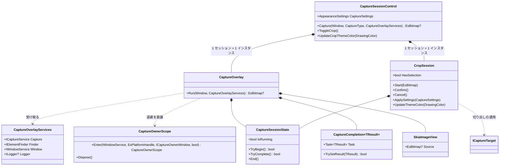
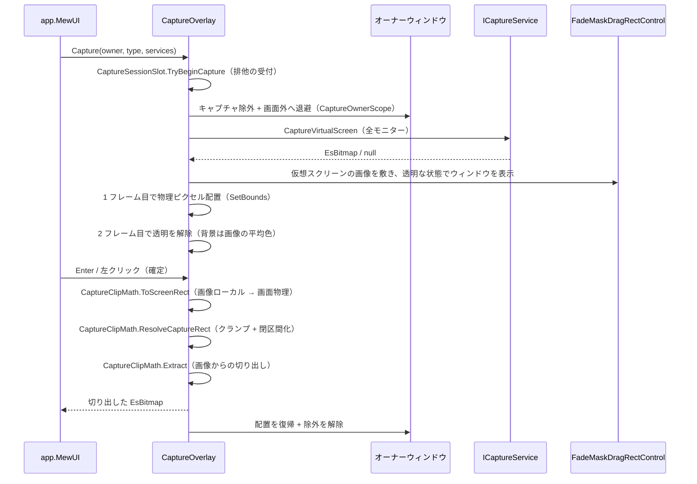

# CaptureSessionControl.MewUI システム仕様

## 1. 概要

MewUI 版の撮影セッション（画面キャプチャのオーバーレイ）を提供します。共通規則は `CaptureSessionControl.Core` が単一所有し、本プロジェクトは MewUI の描画・入力・ウィンドウ操作を担います。

## 2. 技術スタック

| 項目 | 内容 |
| --- | --- |
| 言語 / フレームワーク | C# 14 / .NET 10（`net10.0-windows`） |
| UI | Aprillz.MewUI 0.21.1（バージョン固定。0.x で API が安定化中のため） |
| 描画 | SkiaSharp（`SkiaCanvasView` へ直接描画）+ Direct2D ブリッジ |
| テスト | 本プロジェクトにはテストプロジェクトを置かない（画面を伴うセッションのため、実機検証スクリプトで確認する）。共通規則は `CaptureSessionControl.Core` の単体テストで検証する |

## 3. アーキテクチャ

### 3.1 レイヤー構造

```text
app.MewUI（ホスト）
        │ 参照
        ▼
CaptureSessionControl.MewUI（本プロジェクト。オーバーレイ・入力・描画）
        │ 参照
        ▼
CaptureSessionControl.Core（共通規則: 切り出し矩形・設定・状態・退避手順）
        │ 参照
        ▼
Platform.Core（Es* 型 / サービス抽象）
```

本プロジェクトは **`app.Core`（`EsUtil.SaveEvidence`）を参照しません**（参照するとアプリのコアへ依存し、ライブラリとして成立しないため）。

### 3.2 コンポーネントの構成

```text
┌────────────────────────────────────────────────────────┐
│ CaptureSessionControl（Facade。公開 API はここだけ）     │
│  Capture(owner, type, services) / ToggleCrop()         │
│  UpdateCropThemeColor(color)                           │
│    └─ CaptureSessionSlot（排他。撮影と切り出しで 1 つまで）│
└────────────────────────────────────────────────────────┘
┌────────────────────────────────────────────────────────┐
│ CaptureOverlay（撮影セッション。internal）               │
│  Run(owner, services)                                   │
│    ├─ CaptureOwnerScope.Enter(...)   … 除外 + 退避      │
│    ├─ ICaptureService.CaptureVirtualScreen … 全モニター │
│    ├─ FadeMaskDragRectControl（暗転 + 選択 + ルーペ）    │
│    ├─ SkiaImageView（撮影画像の描画。Platform.MewUI）    │
│    ├─ CaptureSessionState（再入禁止・単一完了）           │
│    └─ CaptureClipMath（切り出し矩形の解決と切り出し）      │
└────────────────────────────────────────────────────────┘
┌────────────────────────────────────────────────────────┐
│ CropSession（切り出しセッション。internal）              │
│  Start(image) / Ended（終了の通知）                      │
│  ├─ CropViewControl（ズームビュー + 矩形オーバーレイ）    │
│  ├─ FadeMaskDragRectControl（暗転 + 選択 + ルーペ）       │
│  ├─ CaptureSessionState（再入禁止・単一完了）             │
│  ├─ CropLabelTexts（サイズラベルの書式）                  │
│  └─ ICaptureTarget（切り出しの適用先。アプリが実装）      │
└────────────────────────────────────────────────────────┘
```

### 3.3 クラス図



## 4. 撮影の処理フロー



## 5. 設計判断

- **共通規則は Core へ集約**: 切り出し矩形（`CaptureClipMath.ResolveCaptureRect`。種別ごとの閉区間の `+1` と画像内へのクランプ、整数の選択矩形向けの入口を含む。**座標空間は画面物理に統一**: 選択矩形が画像ローカル座標の場合は `ToScreenRect` で戻してから渡す）・画像の共有値（`ImageSize` / `ImageBounds`）・設定（`CaptureSettings`）・セッション状態（`CaptureSessionState`）・オーナー退避（`CaptureOwnerScope`）・種別の性質（`CaptureTypeTraits`）・ハイライトの状態（`CaptureHighlightSession`。ドメイン変換・未検出の正規化・表示名の変化・診断ログ）・**クリック確定の固定（`CaptureClickSelection`。押下で固定・解放で確定・退化した検出は固定しない）**・キー操作（`CaptureKeyActions`。確定対象が無い場合の Enter は何もしない）・サイズラベルの表示倍率（`MonitorScalingMath`。原点の加算・中心判定・倍率未確定の除外を含む）・切り出し（`CaptureClipMath`）・ログ定義（`CaptureLogMessage`。切り出しの終了は `LogCropFinished` が退化した選択をキャンセルとして記録する）は `CaptureSessionControl.Core` が単一所有する。本プロジェクトは MewUI の描画・入力だけを担う（Avalonia 版と同じ分担）。
- **アプリの型を参照しない**: 設定は `CaptureSettings`、結果の適用先はアプリ側のポート（切り出しセッションで `ICaptureTarget`）で受ける。ログは注入された `ILogger` へ出力し、ログ基盤はホストが所有する。
- **設定は Facade が単一所有する**: 設定（`AppearanceSettings`）は撮影と切り出しで同じ値を使う（`CaptureOverlayServices` に設定を含めると、ホストが同じ変換を 2 回呼び、2 つの値が食い違う余地ができる）。部分更新・検証・同値スキップ・適用ログはコア（`CaptureSettingsMerge.Apply`）が単一所有し、実行中の切り出しセッションへは `CropSession.ApplySettings` で即時反映する（ページは 1 度だけ生成されるため、購読しないと設定画面での変更が届かない）。
- **記録する診断情報は Avalonia 版と同一の集合にする**: 撮影の開始（`LogCaptureStart`）・撮影範囲の原点とサイズ（`LogVirtualScreen`）・確定要求（`LogConfirmRequested`）・キャンセル要求（`LogCancelRequested`）・セッションの終了（`LogCaptureFinished`。確定は 2 件 / キャンセルは 1 件）を、Avalonia 版と同じ順序で出力する（片方の UI だけが出す情報を作ると、同じ操作のログを比較できない）。
- **オーナーの退避は位置の変更で行う**: 非表示（`Hide`）は復帰時にウィンドウが再作成され「一瞬表示 → 非表示 → 再表示」のちらつきが出る。位置の変更（画面外配置）とキャプチャ除外の併用にする（Avalonia 版と同じ）。
- **オーバーレイは透明で表示する**: ウィンドウは表示時に背景色（`EffectiveOpaqueBackground`）で塗られるため、そのまま表示すると画像を描くまでの数十 ms が背景色の面として見える。透明で表示し、画像が合成されたフレームで透明を解除する。背景色は撮影画像の平均色に合わせて差を目立たなくする。
- **配置は物理ピクセルで指定する**: 全モニターを跨ぐウィンドウは論理座標（DIP）の配置が OS により作業領域内へ補正される。`IWindowService.SetBounds`（`SetWindowPos`）で物理ピクセル指定にし、起動時の配置より後（透明な 1 フレーム目）に適用する。
- **切り出し中のホイールはビューポートへ転送する**: 選択オーバーレイは切り出し中にプレビューを覆って入力を占有するため、ホイールはオーバーレイだけが受け取る。`CropViewControl.PanByWheel` / `ZoomByWheel` へ転送し、切り出し中もパン・ズームを可能にする（換算とズーム率の決定はビューポートが単一所有する）。
- **切り出しの座標変換はビューポートへ委譲する**: ローカル DIP ⇔ 画像ピクセルの変換（画像矩形・実効倍率・Fit / 中央寄せの原点補正）は `CropViewControl.ViewportToContent` / `ContentToViewport` が単一所有する。`CropSession` は式を持たず、ズーム・パンのたびにポートを作り直すだけにする（撮影の `CaptureOverlay` は単一モニタ全体を敷くため倍率のみを使う）。
- **排他は Facade がコアのスロットで行う**: 撮影と切り出しは同時に 1 つだけ実行できる（規則は `CaptureSessionSlot` が単一所有する）。UI ごとにフィールドの null 判定を書くと片方だけ漏れるため、本プロジェクトは Facade（`CaptureSessionControl`）が唯一の適用者になる（Avalonia 版と同じ）。
- **1 セッション = 1 インスタンス**: 撮影（`CaptureOverlay`）も切り出し（`CropSession`）もセッションごとに生成・破棄する。切り出しのオーバーレイは開始時に表示ツリーへ加え、終了時に取り外す（アプリはオーバーレイを事前に配置しない）。終了時は長命のオブジェクト（ビューポート・適用先）への購読を解除する（残すとセッション数だけ呼び出しが増え、終了したセッションを参照し続ける）。
- **外観は設定に従う（固定値を持たない）**: 切り出し（`CropSession`）の枠線・ハンドル・十字マーカー・座標ラベルは `CaptureSettings` から反映する（撮影の `CaptureOverlay` と Avalonia 版の `CropSession` に同じ対応）。ただし、切り出しのルーペ・ラベルはプレビューの表示倍率（`CropViewControl` が所有）に従うため、`LoupeRenderScaling` / `DisplayScaleScaling` は与えない。UI ごとに白枠 2 DIP 等の固定値を持つと、設定を変えても反映されず UI 間で見た目がずれる。
- **ちらつき対策の待機量は本 UI の実測値**: 透明を解除するフレーム数（`FramesUntilReveal`）は実測に基づく MewUI 固有の実装値である（外観の設定値ではない）。画面外へ退避する座標は全 UI 共通のためコア（`CaptureTiming`）が単一所有する。
- **選択の破棄は画像の差し替え時だけ行う**: ズーム・パンではドメイン座標（元画像ピクセル）が変わらないため、選択矩形は維持する（座標変換ポートの更新のみ）。画像の差し替えでは座標系が変わるため選択を破棄する。

## 6. 実測で判明した制約

| 事象 | 対処 |
| --- | --- |
| **全モニターを跨ぐウィンドウの論理座標配置は OS に補正される**（実測: 仮想スクリーン原点の `y=-1200` を指定すると `y=0` へ移動） | `SetWindowPos` で物理ピクセル指定にする |
| **`WindowState.Maximized` は 1 モニターへ寄せる**（全モニターを覆えない） | 最大化は使わず、物理ピクセルで仮想スクリーン全面を指定する |
| **ウィンドウは表示時に背景色で塗られる**（画像を描くまで数十 ms の空白） | 透明で表示し、2 フレーム目で解除する（背景は画像の平均色） |
| **`Hide` と `Show` の往復はウィンドウを再作成させる** | 退避は位置の変更にし、復帰は位置を戻すだけにする |
| **`MarqueeSizeLabel` は `Feature.MarqueeCore`（`EsUtil.Feature.MarqueeCore`）、`MarqueeLabelPlan` は `MarqueeControl.Rendering`（`EsUtil.SaveEvidence.Marquee.Rendering`）で `public`** | 汎用コアと描画層として公開する（`InternalsVisibleTo` は不要） |

## 7. 検証

| 対象 | 方法 |
| --- | --- |
| 撮影 3 種の確定矩形 | 実機で検証する（オーバーレイ表示 → 操作 → `撮影確定` のログに出る矩形を実測値と比較）。マルチモニター（100% / 125% 混在）で、スクリーン選択がモニター全域、ウィンドウ選択が対象ウィンドウ、領域選択がドラッグした矩形と一致することを確認する |
| ちらつき・写り込み | 画面を高頻度でサンプリングして、背景色の面が見える時間・画面が何も覆わない時間を実測する |
| 設定の反映 | 設定画面の値を変えて撮影し、枠・暗転・ラベル・ルーペの見た目を撮影画像で確認する |
