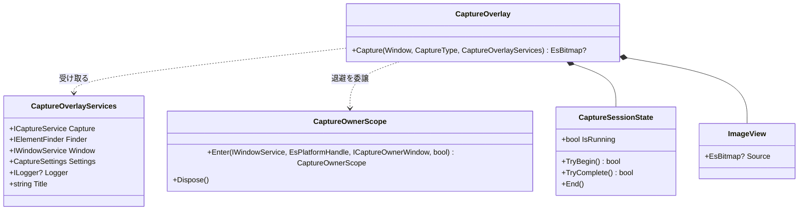
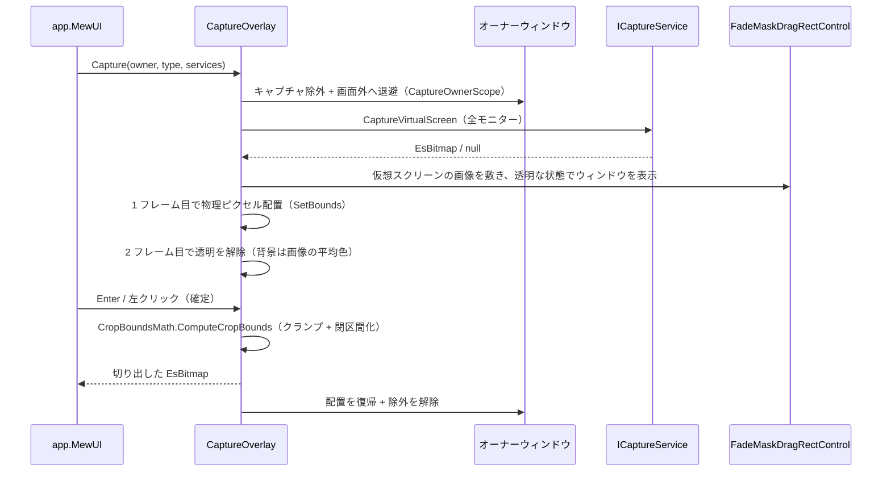

# CaptureSessionControl.MewUI システム仕様

## 1. 概要

MewUI 版の撮影セッション（画面キャプチャのオーバーレイ）を提供します。共通規則は `CaptureSessionControl.Core` が単一所有し、本プロジェクトは MewUI の描画・入力・ウィンドウ操作を担います。

## 2. 技術スタック

| 項目 | 内容 |
| --- | --- |
| 言語 / フレームワーク | C# 14 / .NET 10（`net10.0-windows`） |
| UI | Aprillz.MewUI 0.21.1（バージョン固定。0.x で API が安定化中のため） |
| 描画 | SkiaSharp（`SkiaCanvasView` へ直接描画）+ Direct2D ブリッジ |
| テスト | 未作成（画面を伴うセッションのため、実機検証スクリプトで確認している） |

## 3. アーキテクチャ

### 3.1 レイヤー構造

```text
app.MewUI（ホスト）
        │ 参照
        ▼
CaptureSessionControl.MewUI（本プロジェクト。オーバーレイ・入力・描画）
        │ 参照
        ▼
CaptureSessionControl.Core（共通規則: 切り出し矩形・設定・状態・退避手順）
        │ 参照
        ▼
Platform.Core（Es* 型 / サービス抽象）
```

本プロジェクトは **`app.Core`（`Estable.SaveEvidence`）を参照しません**（参照するとアプリのコアへ依存し、ライブラリとして成立しないため）。

### 3.2 コンポーネントの構成

```text
┌────────────────────────────────────────────────────────┐
│ CaptureOverlay（公開ファサード）                        │
│  Capture(owner, type, services)                        │
│    ├─ CaptureOwnerScope.Enter(...)   … 除外 + 退避      │
│    ├─ ICaptureService.CaptureVirtualScreen … 全モニター │
│    ├─ CaptureOverlaySession（内部）                     │
│    │    ├─ FadeMaskDragRectControl（暗転 + 選択 + ルーペ）│
│    │    ├─ ImageView（撮影画像の描画）                   │
│    │    └─ CaptureSessionState（再入禁止・単一完了）      │
│    └─ CropBoundsMath.ComputeCropBounds … 切り出し範囲    │
└────────────────────────────────────────────────────────┘┌────────────────────────────────────────────────────────┐│ CropOverlay（プレビューの切り出し。公開クラス）          ││  ├─ CropViewControl（ズームビュー + 矩形オーバーレイ）    ││  ├─ FadeMaskDragRectControl（暗転 + 選択 + ルーペ）       ││  ├─ CaptureSessionState（再入禁止・単一完了）             ││  └─ ICaptureTarget（切り出しの適用先。アプリが実装）      │└────────────────────────────────────────────────────────┘
```

### 3.3 クラス図



## 4. 撮影の処理フロー



## 5. 設計判断

- **共通規則は Core へ集約**: 切り出し矩形（`CropBoundsMath`）・設定（`CaptureSettings`）・セッション状態（`CaptureSessionState`）・オーナー退避（`CaptureOwnerScope`）は `CaptureSessionControl.Core` が単一所有する。本プロジェクトは MewUI の描画・入力だけを担う（Avalonia 版と同じ分担）。
- **アプリの型を参照しない**: 設定は `CaptureSettings`、結果の適用先はアプリ側のポート（切り出しセッションで `ICaptureTarget`）で受ける。ログは注入された `ILogger` へ出力し、ログ基盤はホストが所有する。
- **オーナーの退避は位置の変更で行う**: 非表示（`Hide`）は復帰時にウィンドウが再作成され「一瞬表示 → 非表示 → 再表示」のちらつきが出る。位置の変更（画面外配置）とキャプチャ除外の併用にする（Avalonia 版と同じ）。
- **オーバーレイは透明で表示する**: ウィンドウは表示時に背景色（`EffectiveOpaqueBackground`）で塗られるため、そのまま表示すると画像を描くまでの数十 ms が背景色の面として見える。透明で表示し、画像が合成されたフレームで透明を解除する。背景色は撮影画像の平均色に合わせて差を目立たなくする。
- **配置は物理ピクセルで指定する**: 全モニターを跨ぐウィンドウは論理座標（DIP）の配置が OS により作業領域内へ補正される。`IWindowService.SetBounds`（`SetWindowPos`）で物理ピクセル指定にし、起動時の配置より後（透明な 1 フレーム目）に適用する。
- **切り出し中のホイールはビューポートへ転送する**: 選択オーバーレイは切り出し中にプレビューを覆って入力を占有するため、ホイールはオーバーレイだけが受け取る。`CropViewControl.PanByWheel` / `ZoomByWheel` へ転送し、切り出し中もパン・ズームを可能にする（換算とズーム率の決定はビューポートが単一所有する）。
- **外観は設定に従う（固定値を持たない）**: 切り出し（`CropOverlay`）の枠線・ハンドル・十字マーカー・座標ラベルは `CaptureSettings` から反映する（撮影の `CaptureOverlay` と Avalonia 版の `CropSession` に同じ対応）。UI ごとに白枠 2 DIP 等の固定値を持つと、設定を変えても反映されず UI 間で見た目がずれる。
- **選択の破棄は画像の差し替え時だけ行う**: ズーム・パンではドメイン座標（元画像ピクセル）が変わらないため、選択矩形は維持する（座標変換ポートの更新のみ）。画像の差し替えでは座標系が変わるため選択を破棄する。

## 6. 実測で判明した制約

| 事象 | 対処 |
| --- | --- |
| **全モニターを跨ぐウィンドウの論理座標配置は OS に補正される**（実測: 仮想スクリーン原点の `y=-1200` を指定すると `y=0` へ移動） | `SetWindowPos` で物理ピクセル指定にする |
| **`WindowState.Maximized` は 1 モニターへ寄せる**（全モニターを覆えない） | 最大化は使わず、物理ピクセルで仮想スクリーン全面を指定する |
| **ウィンドウは表示時に背景色で塗られる**（画像を描くまで数十 ms の空白） | 透明で表示し、2 フレーム目で解除する（背景は画像の平均色） |
| **`Hide` と `Show` の往復はウィンドウを再作成させる** | 退避は位置の変更にし、復帰は位置を戻すだけにする |
| **`OuterDecoLabels` は `internal`**（`MarqueeControl.Core` の `Estable.Marquee.Decoration`） | `InternalsVisibleTo` で本ライブラリへ公開する |

## 7. 検証

| 対象 | 方法 |
| --- | --- |
| 撮影 3 種の確定矩形 | 実機で検証する（オーバーレイ表示 → 操作 → `撮影確定` のログに出る矩形を実測値と比較）。マルチモニター（100% / 125% 混在）で、スクリーン選択がモニター全域、ウィンドウ選択が対象ウィンドウ、領域選択がドラッグした矩形と一致することを確認する |
| ちらつき・写り込み | 画面を高頻度でサンプリングして、背景色の面が見える時間・画面が何も覆わない時間を実測する |
| 設定の反映 | 設定画面の値を変えて撮影し、枠・暗転・ラベル・ルーペの見た目を撮影画像で確認する |
