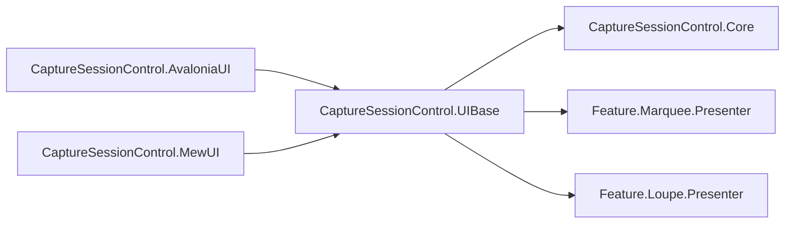
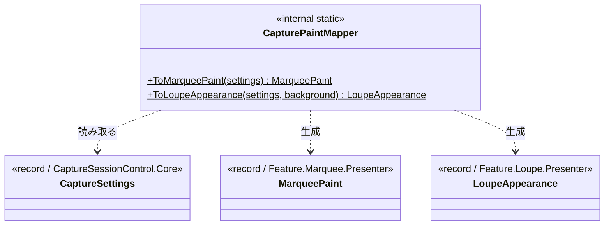
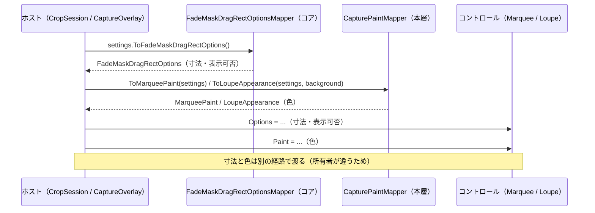

# CaptureSessionControl.UIBase システム仕様書

## 概要

`CaptureSessionControl.UIBase` は、撮影・切り出しのセッションを実装する両 UI が共有する**設定写像**を提供します。対象は次の 1 つです。

- **キャプチャ設定（`CaptureSettings`）→ 描画の設定（`MarqueePaint` / `LoupeAppearance`）の写像**

寸法・表示可否はコアの設定マッパー（`FadeMaskDragRectOptionsMapper`）が単一所有するため、本層は色だけを扱います。

外部機能と公開 API は [SPEC_ExtFunc](SPEC_ExtFunc.md)、利用手順は [README](README.md) を参照してください。

## 技術スタック

| 項目 | 内容 |
| --- | --- |
| 目的 | 設定から色への写像を 1 箇所へ集約し、両 UI で同じ見た目になるようにする |
| 提供形態 | クラスライブラリ（`CaptureSessionControl.UIBase.dll`）。**公開 API は持たない**（`internal` のみ） |
| 想定利用者 | 両 UI のホスト（`CaptureSessionControl.AvaloniaUI` / `CaptureSessionControl.MewUI` の撮影オーバーレイ・切り出しセッション） |
| ターゲット | `net10.0` |
| 言語 | C# 14（`Nullable` 有効・`ImplicitUsings` 有効） |
| ルート名前空間 | `EsUtil.SaveEvidence.CaptureSession.UIBase` |
| 汎用性 | 特定の UI に依存しない。UI フレームワークを参照しない |

## アーキテクチャ



依存の向きは **UI → UIBase → Core / 各描画の設定**の一方向です。逆向きの参照はありません。

### 本層を置く理由

| 置き場所の候補 | 可否 | 理由 |
| --- | --- | --- |
| `CaptureSessionControl.Core` | 不可 | 写像先が描画層の型（`MarqueePaint` / `LoupeAppearance`）のため、Core → UIBase の逆流になる |
| `FadeMaskDragRectControl.UIBase` | 不可 | 写像元が製品の設定型（`CaptureSettings`）のため、再利用ライブラリが製品設定へ依存する |
| `CaptureSessionControl.UIBase`（本層） | 採用 | セッションの設定と両 UI の中間にあり、両 UI のホストが同じ写像を共有できる |

## コンポーネント構成

| ファイル | 可視性 | 内容 |
| --- | --- | --- |
| `CapturePaintMapper.cs` | `internal static class` | `CaptureSettings` → `MarqueePaint` / `LoupeAppearance` の写像 |

## クラス図



## データフロー



## 単一所有（Single Source of Truth）

| 内容 | 所有者 |
| --- | --- |
| 設定から**寸法・表示可否**への写像 | `FadeMaskDragRectOptionsMapper`（`CaptureSessionControl.Core`） |
| 設定から**色**への写像 | `CapturePaintMapper`（本層） |
| 色の値と既定値 | `MarqueePaint` / `LoupeAppearance`（各 UIBase） |
| 描画の可否 | `MarqueeDecoOptions` の明示フラグ（コア） |
| 枠線の色（選択枠線と穴あけ枠で共通） | 設定の `BorderColor` 1 項目 |

**写像漏れの防止**: 写像は 1 箇所（`CapturePaintMapper`）に集約されており、以前は両 UI に同じ写像が 2 コピー
存在していました（片方だけ更新される余地があった）。本層への集約により、両 UI のホストが同じ写像を使うことが
構造的に保証されます。

## 例外処理ポリシー

| 状況 | 挙動 |
| --- | --- |
| `settings` が null | `ArgumentNullException`（呼び出し側の実装誤りであり、回復して続行すべき状況ではない） |
| 設定メンバーの null | 想定外（`ToNonNull` 済みを渡す契約）。`!` で参照する |

本層は外部 I/O・非同期処理・リソース解放を持ちません。

## 可視性ポリシー

- **公開 API を持ちません**（すべて `internal`）。写像は両 UI のホストが使う内部処理のためです。
- `internal` は `InternalsVisibleTo`（`CaptureSessionControl.AvaloniaUI` / `CaptureSessionControl.MewUI` /
  `CaptureSessionControl.UIBase.Tests`）で公開します。
- **`internal` → `public` の変更は破壊的な設計変更として扱います**。

## テスト

```text
tests/
└── CapturePaintMapper.Tests.cs  # 写像の網羅（6 件）
```

| 検証内容 | 件数 |
| --- | --- |
| 選択矩形の 9 項目の写像 | 1 |
| 穴あけ枠とハンドル枠が同じ枠線色になること | 1 |
| 写像しない色が既定値を保つこと | 1 |
| ルーペの 7 項目の写像 | 1 |
| ルーペの画像外の色が設定から与えられること | 1 |
| `settings` が null の場合の例外 | 1 |

UI 初期化が不要なため、すべて `[Fact]` で並列実行されます。

```powershell
dotnet test src/CaptureSessionControl.UIBase/tests/CaptureSessionControl.UIBase.Tests.csproj
```

UI 依存の検証（設定が実際にコントロールへ届くか、描画結果が期待どおりか）は各 UI のテストプロジェクトが担います。
