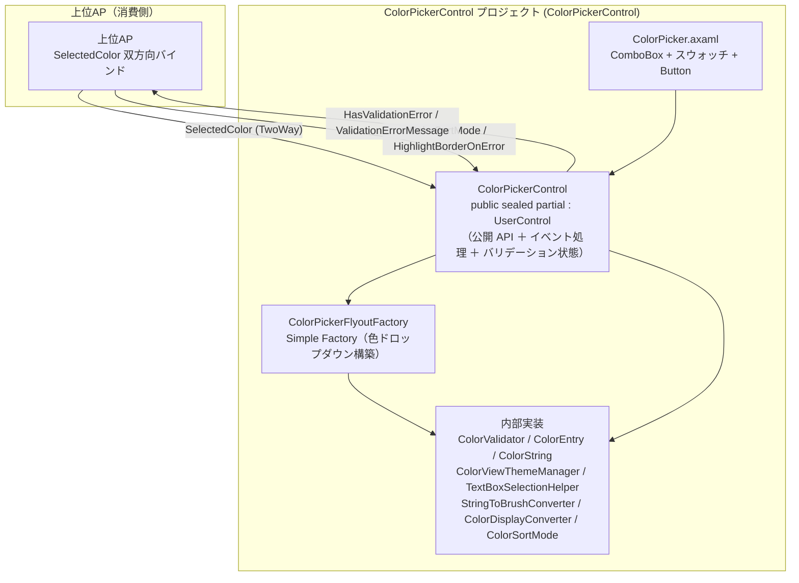
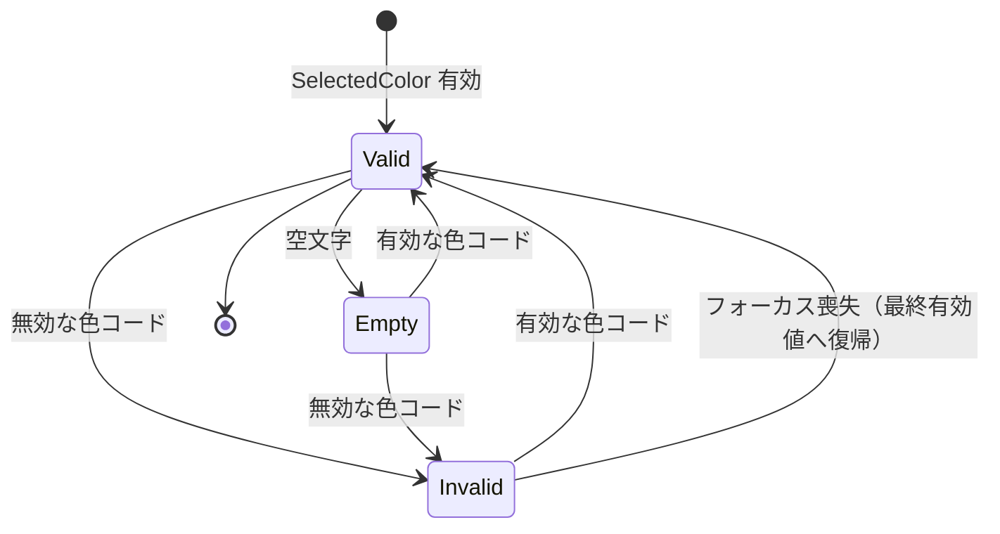
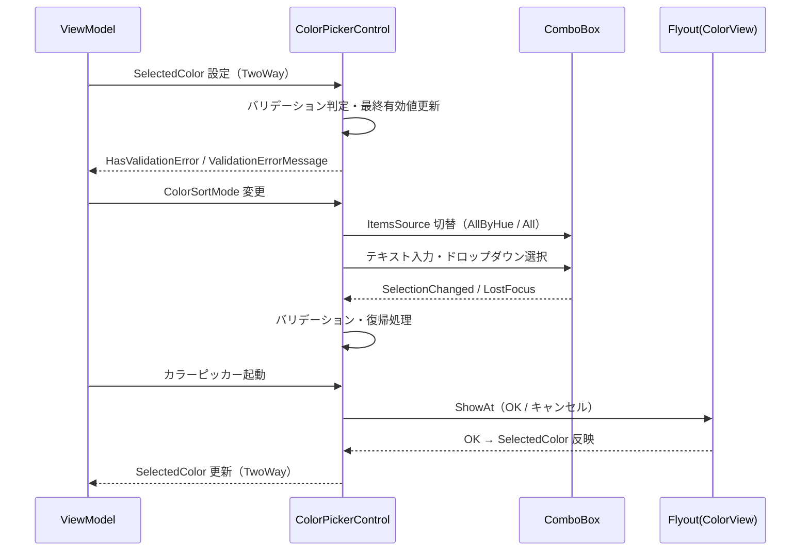

# ColorPickerControl システム仕様書（SPEC_System）

## 目次

- [ColorPickerControl システム仕様書（SPEC\_System）](#colorpickercontrol-システム仕様書spec_system)
  - [目次](#目次)
  - [1. システム概要](#1-システム概要)
  - [2. 技術スタック](#2-技術スタック)
  - [3. アーキテクチャ](#3-アーキテクチャ)
    - [3.1 レイヤー構造](#31-レイヤー構造)
    - [3.2 依存の方向](#32-依存の方向)
  - [4. 例外処理ポリシー](#4-例外処理ポリシー)
    - [4.1 基本方針](#41-基本方針)
    - [4.2 本プロジェクト固有の例外処理](#42-本プロジェクト固有の例外処理)
  - [5. コンポーネント図](#5-コンポーネント図)
  - [6. コンポーネント一覧](#6-コンポーネント一覧)
    - [6.1 ColorPickerControl](#61-colorpickercontrol)
    - [6.2 ColorPicker.axaml](#62-colorpickeraxaml)
    - [6.3 ColorEntry](#63-colorentry)
    - [6.4 ColorSortMode](#64-colorsortmode)
    - [6.5 StringToBrushConverter](#65-stringtobrushconverter)
    - [6.6 ColorString](#66-colorstring)
    - [6.7 ColorDisplayConverter](#67-colordisplayconverter)
    - [6.8 ColorValidator](#68-colorvalidator)
    - [6.9 TextBoxSelectionHelper](#69-textboxselectionhelper)
    - [6.10 ColorViewThemeManager](#610-colorviewthememanager)
    - [6.11 ColorPickerFlyoutFactory](#611-colorpickerflyoutfactory)
  - [7. 依存ルール](#7-依存ルール)
  - [8. バリデーション状態遷移](#8-バリデーション状態遷移)
  - [9. ライフサイクル](#9-ライフサイクル)
  - [10. ログ](#10-ログ)
    - [10.1 LogLevel 設定ポリシー](#101-loglevel-設定ポリシー)
    - [10.2 ログ定義一覧](#102-ログ定義一覧)
  - [11. テスト](#11-テスト)

---

## 1. システム概要

SaveEvidence は、Windows デスクトップ上の画面をキャプチャし、プレビュー・編集・保存するための Avalonia UI アプリケーションです（.NET 10.0 / C# 14 / MVVM）。

本プロジェクト（ColorPickerControl）は、このシステムのうち**色選択 UI**（色名 / 16進入力 + ドロップダウン + カラーピッカー）を担う再利用可能なコントロールです。app の設定画面などから双方向バインディングで利用されます。

## 2. 技術スタック

| 項目 | 内容 |
| --- | --- |
| **プロジェクト** | `ColorPickerControl` |
| **ルート名前空間** | `Estable.AvaloniaUI.ColorPicker` |
| **言語** | C# 14（.NET 10.0） |
| **UI フレームワーク** | Avalonia UI 12.1（UserControl / ComboBox / ColorView / Flyout） |
| **ターゲットフレームワーク** | net10.0 |
| **ビルドツール** | MSBuild / .NET SDK 10.0 |
| **ログ** | Microsoft.Extensions.Logging.Abstractions（LoggerMessage ソース生成） |
| **テスト** | xUnit v3 / Avalonia.Headless.XUnit |
| **依存プロジェクト** | なし（Avalonia.Controls.ColorPicker の ColorView を利用） |

## 3. アーキテクチャ

### 3.1 レイヤー構造

```text
公開コントロール（ColorPickerControl: ColorPicker.axaml.cs）
  → 生成（ColorPickerFlyoutFactory）→ テーマ管理（ColorViewThemeManager）
  → 検証（ColorValidator）/ 選択解除（TextBoxSelectionHelper）
  → ドメイン（ColorEntry / ColorSortMode / ColorString）
  → コンバーター（StringToBrushConverter / ColorDisplayConverter）
```

### 3.2 依存の方向

- 依存は**一方向の階層構造**（XAML → コントロール → 生成/検証 → ドメイン / コンバーター）。
- 公開 API（StyledProperty・公開プロパティ）は `ColorPicker.axaml.cs` に集約する。
- 関心事ごとに専用クラスへ委譲し、単一責任（SRP）と疎結合を維持する:
  - Flyout 構築: `ColorPickerFlyoutFactory`（Simple Factory）
  - テーマ適用: `ColorViewThemeManager`
  - 色の妥当性検証: `ColorValidator`
  - テキスト選択の解除: `TextBoxSelectionHelper`
- 状態管理はすべて StyledProperty（Avalonia プロパティシステム）に集約する。
- ドメインロジック（`ColorString` / `ColorEntry`）は UI 非依存（Avalonia.Media のみ）。
- 上位APへは双方向バインド（StyledProperty）と PropertyChanged のみで連携。

## 4. 例外処理ポリシー

### 4.1 基本方針

- ライブラリは例外を原則伝播し、上位 AP（app）で処理する。
- UI レイヤー（app）ではユーザー操作起因の例外を各ハンドラで catch し、UI の応答性を維持する。
- ログは LoggerMessage ソース生成（`Logging/ColorPickerLog.cs`）で出力する。高頻度イベントは Debug / Trace、障害は Error で記録する。

### 4.2 本プロジェクト固有の例外処理

- 無効な色入力は例外にせず、バリデーション状態（`HasValidationError` / `ValidationErrorMessage`）で通知し、フォーカス喪失時に最終有効値へ復帰する。
- `StringToBrushConverter.ConvertBack` は未サポートのため `NotSupportedException` を投げる（双方向変換は行わない）。
- 解釈不能な色文字列は `Brushes.Transparent`（スウォッチ背景）として安全に扱う。

## 5. コンポーネント図



## 6. コンポーネント一覧

### 6.1 ColorPickerControl

- **分類**: 公開コントロール（`public sealed partial class : UserControl`）
- **責務**:
  - `SelectedColor`（色名/16進コード）の双方向バインド対応の保持（公開 API は ColorPicker.axaml.cs に集約）
  - 入力バリデーション状態の管理（`UpdateValidationStatus`。検証自体は `ColorValidator` に委譲）
  - ドロップダウン（ComboBox）の構築と並び順切替（`ColorSortMode`）
  - テキスト選択の自動解除（`OnSelectionChanged` → `TextBoxSelectionHelper.ResetSelection`）
  - 無効入力の最終有効値復帰（`OnLostFocus`）
  - カラーピッカー Flyout の表示（`OnColorPickerButtonClick` → `ColorPickerFlyoutFactory.Create`）
  - スウォッチ用の Padding 調整（`OnComboBoxTemplateApplied` → `ApplyPaddingWithSwatchOffset`）
  - バリデーション失敗時の枠線強調（`UpdateBorderValidationVisual`）
- **公開API**: `SelectedColor` / `ColorSortMode` / `HighlightBorderOnError` / `HasValidationError` / `ValidationErrorMessage` / `ComboBoxMinWidth` / `ComboBoxMaxWidth` / `ComboBoxWidth` / `ComboBoxPadding` / `ComboBoxMargin` / `Log`（StyledProperty も同ファイルに定義）
- **構成**: 公開 API（StyledProperty・公開プロパティ）とイベント処理・バリデーション状態を保持し、関心事ごとに専用クラスへ委譲（単一責任・疎結合）
- **内部メソッド（internal）**: `UpdateValidationStatus`（テストからの検証用に公開）
- **依存**: ColorPickerFlyoutFactory / ColorValidator / TextBoxSelectionHelper / ColorViewThemeManager / ColorEntry / ColorSortMode / ColorString

### 6.2 ColorPicker.axaml

- **分類**: UI レイアウト（XAML）
- **責務**:
  - ComboBox（テキスト入力 + ドロップダウン）の配置
  - 色スウォッチ（Border）のオーバーレイ配置
  - カラーピッカー起動ボタン（…）の配置
  - コンバーターのリソース登録
- **依存**: ColorPickerControl / StringToBrushConverter / ColorDisplayConverter

### 6.3 ColorEntry

- **分類**: 内部レコード（色名 + 色を表す文字列の組。ドロップダウンの選択肢データ）
- **可視性**: `internal sealed record`（公開 API ではなく内部型。外部から直接扱わない）
- **責務**:
  - 色の英語名・色名（`Color.TryParse` で解釈可能な文字列）の保持
  - 全色一覧の静的提供（`All` / `AllByHue`）
  - 色相順ソートキーの計算（`GetSortKey`）
- **特徴**: 色一覧は `ColorString.ColorNames`（`ColorString` が構築済みの辞書）を再利用する（リフレクション走査の重複排除・単一所有）。`Value` パラメータには現在の実装では色名（= `Colors` のプロパティ名）が保持される
- **依存**: ColorString / Avalonia.Media

### 6.4 ColorSortMode

- **分類**: 公開 enum
- **責務**: ドロップダウンの並び順の指定（`ByName` / `ByHue`）
- **依存**: なし

### 6.5 StringToBrushConverter

- **分類**: 公開 IValueConverter（`public sealed class`）
- **責務**: 色名/16進コード → `IBrush`（スウォッチ背景）
- **特徴**: 解釈不能な値は `Brushes.Transparent`。`ConvertBack` は `NotSupportedException`。解析済み色のブラシはカラー選択で再利用され、容量管理は `ColorString.AddWithCapacityLimit` に委譲（単一所有）
- **依存**: Avalonia.Media / Avalonia.Data.Converters / ColorString

### 6.6 ColorString

- **分類**: 公開静的ユーティリティ（`public static class`）
- **責務**: 色文字列（色名 / #RRGGBB / #AARRGGBB / +% 形式）の解析・整形・正規化
- **特徴**:
  - 保存値は `ToArgbHex` で `#AARRGGBB`（アルファ先頭 8 桁）へ正規化
  - 画面表示は `ToDisplayText` / `Format` で `{色}+{不透明度%}` 形式へ整形（不透明度 100% は省略）
  - `TryParse` で両形式を受け付ける（色と不透明度の合成）
  - 色 → 色名 の逆引き辞書（ARGB 完全一致 / RGB 一致）を保持し、色名の検索に利用する
  - 容量管理は `AddWithCapacityLimit` ヘルパーに一元化（単一所有。`StringToBrushConverter` のブラシキャッシュも委譲）
  - `Colors` のリフレクション列挙を単一所有し、`ColorEntry` が再利用する
- **依存**: Avalonia.Media

### 6.7 ColorDisplayConverter

- **分類**: 公開 IValueConverter（`public sealed class`）
- **責務**: 保存値（`#AARRGGBB`）と画面表示テキスト（`{色}+{不透明度%}`）の相互変換
- **特徴**: `Convert` / `ConvertBack` とも `ColorString`（`ToDisplayText` / `ToArgbHex`）に委譲。解釈不能な値は入力をそのまま返す
- **依存**: Avalonia.Media / Avalonia.Data.Converters / ColorString

### 6.8 ColorValidator

- **分類**: 内部静的ユーティリティ（`internal static class`）
- **責務**: 色文字列（色名 / #RRGGBB / #AARRGGBB / +% 形式）の妥当性検証（`IsValid`）
- **特徴**: 検証は `ColorString.TryParse` に一元委譲（解析ロジックの二重所有を排除）。UI 非依存のため他プロジェクトでも流用可能
- **依存**: ColorString

### 6.9 TextBoxSelectionHelper

- **分類**: 内部静的ユーティリティ（`internal static class`）
- **責務**: ビジュアルツリー内の `TextBox` の検索（`FindTextBox`）とテキスト選択の解除（`ResetSelection`）
- **特徴**: ドロップダウン選択後のテキスト全選択解除を担当。`ColorPickerControl` から独立しており、ComboBox 等の他のコントロールでも流用可能
- **依存**: Avalonia ビジュアルツリー

### 6.10 ColorViewThemeManager

- **分類**: 内部静的ユーティリティ（`internal static class`）
- **責務**: ColorView（カラーピッカー）テーマのアプリケーションへの自動適用（`EnsureApplied` / `EnsureAppliedCore` / `IsColorViewTheme`）
- **特徴**: ホストの明示指定（StyleInclude）を優先し、未指定時のみ内包テーマを一度だけ適用する。**Native AOT では実行時の XAML 解決ができないためロードに失敗するが、例外にはせずホストの XAML 取り込みに任せる**
- **依存**: Avalonia.Application / AvaloniaXamlLoader

### 6.11 ColorPickerFlyoutFactory

- **分類**: 内部静的ファクトリ（`internal static class`。Simple Factory パターン）
- **責務**: カラーピッカー（ColorView）を格納した Flyout の構築（`Create`）と OK / キャンセルイベントの配線
- **特徴**: 初期色は `SelectedColor` を `ColorString.TryParse` で解析（失敗時は白）。OK は `ColorString.ToArgbHex` で `#AARRGGBB` へ変換し、コールバック（`Action<string>`）経由で `SelectedColor` へ反映。OK / キャンセルボタンの共通外観は生成ヘルパー（`CreateActionButton`）に集約し、重複を排除。テーマ適用は `ColorViewThemeManager` に委譲
- **依存**: ColorViewThemeManager / ColorString / ColorPickerLog / Avalonia.Controls.ColorPicker（ColorView）

## 7. 依存ルール

- 依存方向は**一方向の階層構造**（XAML → コントロール → 生成/検証 → ドメイン/コンバーター）。
- 公開 API（StyledProperty・公開プロパティ）は `ColorPicker.axaml.cs` に集約する。
- 関心事ごとの専用クラス（Factory / ThemeManager / Validator / Helper）は internal とし、コントロールからのみ参照する（外部へは公開しない）。
- 依存は 1 方向のみ（コントロール → Factory/Validator/Helper → ColorString / ColorViewThemeManager）。双方向依存・循環参照は持たない。
- 状態管理はすべて StyledProperty（Avalonia プロパティシステム）に集約し、private フィールドは補助（`_lastValidColor`）のみ。
- ドメインロジック（`ColorString` / `ColorEntry`）は UI 非依存（Avalonia.Media のみ）。
- 上位APへは双方向バインド（StyledProperty）と PropertyChanged のみで連携。

## 8. バリデーション状態遷移



- `HasValidationError` / `ValidationErrorMessage` は `SelectedColor` の変更に応じて更新されます。

## 9. ライフサイクル



## 10. ログ

ログ定義は `Logging/LogMessage.cs`（internal・LoggerMessage ソース生成）に集約し、`ILogger` の拡張メソッドとして定義する。
各メソッドは `this ILogger` 第一引数で定義し、呼び出し側では logger 引数を省略する（例: `_log.LogSelectedColorChanged(old, new)`）。
ログ出力先の `ILogger` は公開プロパティ `Log` で注入する（未設定時は `NullLogger` のため出力なし）。
出力先・レベル制御はホストアプリケーションが所有する（本クラスは定義のみ）。

### 10.1 LogLevel 設定ポリシー

トレースログは LogLevel.Trace に限定せず、「重要度 × 発生頻度」でレベルを使い分ける。

| LogLevel | 対象 | 本番での意図 |
| --- | --- | --- |
| `Error` | 例外・失敗（処理継続不可） | 常時出力し、障害を確実に残す |
| `Warning` | 異常だがフォールバックで継続 | 常時出力し、異常発生の痕跡を残す |
| `Information` | ユーザー操作の主要イベント（低頻度） | 常時出力し、操作手順の再現を可能にする |
| `Debug` | 操作イベントの詳細（色選択 / Flyout / 設定変更） | 障害時のみ有効化して解析 |
| `Trace` | 高頻度・極詳細（フォーカス喪失） | 特別な解析時のみ有効化 |

判断基準:

1. 例外・警告は常時残す（`Error` / `Warning`）
2. 操作の起点イベント（低頻度）は `Information`
3. マウス・キー等の操作イベント（中頻度）は `Debug`
4. 高頻度・極詳細は `Trace`
5. 設定変更（変更前後）は `Debug`

### 10.2 ログ定義一覧

| レベル | メソッド | 出力内容 |
| --- | --- | --- |
| `Debug` | `LogMessage.LogSelectedColorChanged` | 選択色変更（変更前後） |
| `Debug` | `LogMessage.LogOpenFlyout` | カラーピッカー Flyout を開く（現在の選択色） |
| `Debug` | `LogMessage.LogFlyoutOk` | Flyout の OK で色確定 |
| `Debug` | `LogMessage.LogFlyoutCancel` | Flyout のキャンセル |
| `Trace` | `LogMessage.LogLostFocus` | フォーカス喪失（色と有効性） |

## 11. テスト

`tests/` プロジェクト（xUnit v3 + Avalonia.Headless）で、行・ブランチカバレッジ 100% を達成しています。

- 公開プロパティ・バリデーション・並び順切替
- イベントハンドラ（SelectionChanged / LostFocus / カラーピッカー）
- コンバーター・ColorEntry の全分岐
- 防御分岐（内部メソッド直接テスト）
