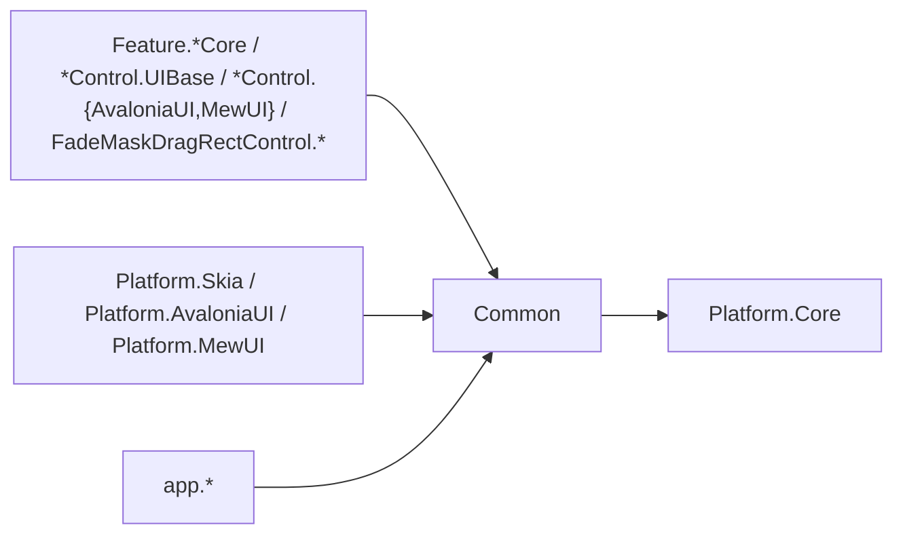
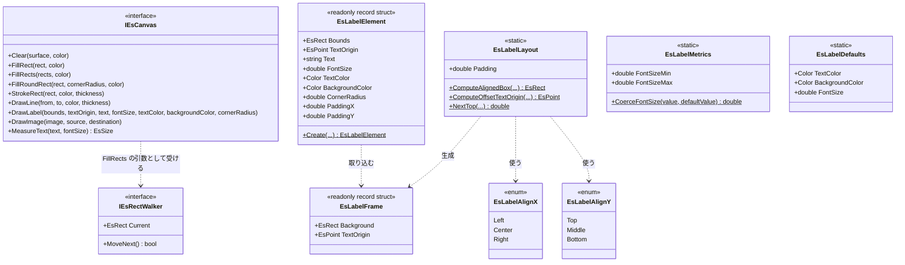
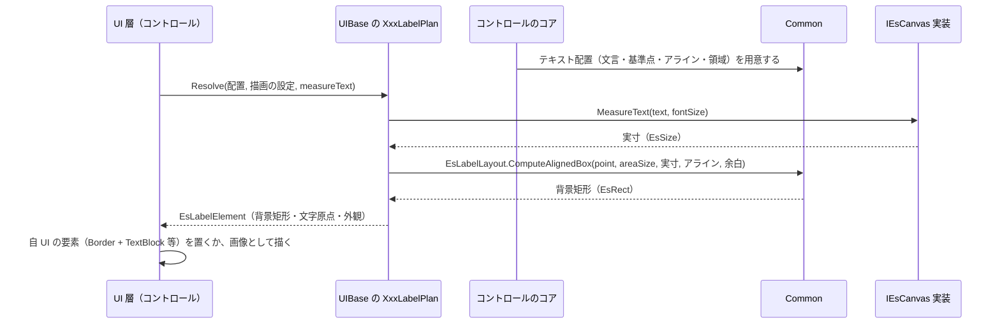

# Common システム仕様書

## 概要

`Common` は、SaveEvidence のソリューション内で共有する**UI 非依存の契約**を提供します。

1. **描画ポート**（`IEsCanvas`）— コア側の描画手順が唯一呼ぶ即時描画ポート
2. **ラベルの値**（`EsLabelFrame` / `EsLabelElement`）— 配置の値と、UI が要素として置くための配置指示

**ラベル契約（`IEsLabel`）と要素への写像（`EsLabelExtensions`）は置きません**（テキストを要素として置くか画像として描くかは UI 層の判断であり、コアは文言・基準点・アライン・領域だけを渡す）。
3. **ラベルの体裁**（`EsLabelLayout` / `EsLabelMetrics` / `EsLabelDefaults` / `EsLabelElement.Create`）— 背景と文字の組み立ての単一所有

外部機能と公開 API は [SPEC_ExtFunc](SPEC_ExtFunc.md)、利用手順は [README](README.md) を参照してください。

## 技術スタック

| 項目 | 内容 |
| --- | --- |
| 目的 | ソリューション固有の共有契約を `Platform.Core`（汎用）から分離し、判定基準「このソリューション以外でも使える型」を `Platform.Core` で守れるようにする |
| 提供形態 | クラスライブラリ（`Common.dll`） |
| 想定利用者 | 各コントロールのコア / UIBase / UI、各プラットフォーム層、アプリ層 |
| ターゲット | `net10.0` |
| 言語 | C# 14（`Nullable` 有効・`ImplicitUsings` 有効） |
| ルート名前空間 | `EsUtil.SaveEvidence.Common`（型は `.Imaging`） |
| 汎用性 | UI フレームワーク非依存。外部パッケージ非依存 |

## アーキテクチャ



- 依存の向きは **各層 → Common → Platform.Core** の一方向です。
- **`Platform.Core` は Common を参照しません**（Common が `Platform.Core` の幾何値型だけを使うため）。
- UI フレームワークと外部パッケージへの依存はありません。

## コンポーネント構成

| ファイル | 可視性 | 内容 |
| --- | --- | --- |
| `Imaging/IEsCanvas.cs` | `public interface` | 即時描画ポート（10 メンバー） |
| `Imaging/IEsRectWalker.cs` | `public interface` | 矩形の列を確保なしで走査する列挙子（構造体）の契約（`IEsCanvas.FillRects` の引数） |
| `Imaging/EsLabelFrame.cs` | `public readonly record struct` | 配置の値（背景矩形・文字の原点） |
| `Imaging/EsLabelElement.cs` | `public readonly record struct` | UI 要素の配置指示（`Create` が写像を単一所有する） |
| `Imaging/EsLabelLayout.cs` | `public static class` | 体裁（背景・文字の原点・アライン・行送り）の単一所有 |
| `Imaging/EsLabelAlignX.cs` / `EsLabelAlignY.cs` | `public enum` | 基準点がラベルのどこを指すかの指定（水平: 左端/中央/右端、垂直: 上端/中央/下端） |
| `Imaging/EsLabelMetrics.cs` | `public static class` | フォントサイズの安全域と補正 |
| `Imaging/EsLabelDefaults.cs` | `public static class` | 既定の色とフォントサイズ |

## クラス図



## データフロー（ラベルの配置）



**実寸は描画 API でしか測れない**ため、測定は UI 層が行い、体裁の適用は本プロジェクトが単一所有します。**テキストをどう描くか（要素 / 画像）は UI 層が決めます**。

## 単一所有（Single Source of Truth）

| 内容 | 所有者 |
| --- | --- |
| 描画 API の抽象（描画の可変性） | `IEsCanvas`（本プロジェクト） |
| ラベルの体裁（背景 = 実寸 + 内側余白×2・文字の原点・アライン・行送り） | `EsLabelLayout` |
| ラベルの基準点がどこを指すかの指定 | `EsLabelAlignX` / `EsLabelAlignY` |
| 配置と外観から要素の配置指示を組み立てる手順 | `EsLabelElement.Create` |
| フォントサイズの安全域（6〜48）と補正 | `EsLabelMetrics` |
| ラベルの既定の色・フォントサイズ | `EsLabelDefaults` |
| ラベルの**色**の実体 | 呼び出し側（描画にだけ必要な設定。コントロールの UIBase が所有する） |
| ビットマップ（`EsBitmap`）とピクセル操作 | `Platform.Core`（汎用のため本プロジェクトへは移さない） |
| Skia との相互変換 | `Platform.Skia` |

## 例外処理ポリシー

| 状況 | 挙動 |
| --- | --- |
| 引数の null | 各実装が `ArgumentNullException`（呼び出し側の実装誤りであり回復して続行すべき状況ではない） |
| 実寸が 0（未測定） | 例外にせず、体裁の計算がそのまま成立する（背景は内側余白だけで決まる） |
| フォントサイズが範囲外・非有限 | `EsLabelMetrics.CoerceFontSize` が安全域または既定値へ補正する（例外にしない） |

本プロジェクトは外部 I/O・非同期処理・リソース解放を持ちません（値と純粋計算のみ）。

## 可視性ポリシー

- 全型が `public` です。各コントロールのコア（別プロジェクト）と各 UI が同じ契約を使うためです。
- `Common.Tests` からのみ `internal` 型へアクセスできます（現在 `internal` 型はありません）。
- **`internal` → `public` の変更は破壊的な設計変更として扱います**。

## テスト

```text
tests/
├── Common.Tests.csproj
└── Imaging/
    ├── EsLabelElement.Tests.cs      # 写像結果の値・内側余白の導出
        ├── EsLabelLayout.Tests.cs       # 体裁・行送り・配置（境界とクランプ）
    └── EsLabelMetrics.Tests.cs      # フォントサイズの安全域（非有限値を含む）
```

UI 初期化が不要なため、すべて `[Fact]` / `[Theory]` で並列実行されます。

```powershell
dotnet test src/Common/tests/Common.Tests.csproj
```
