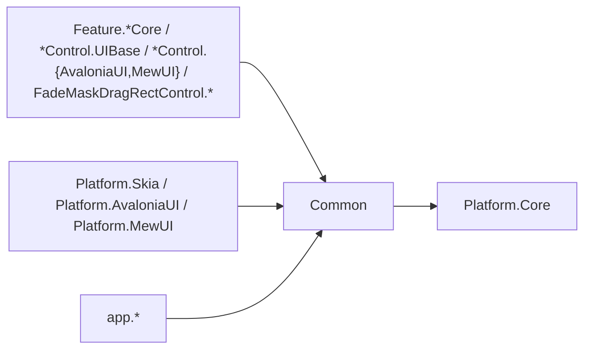
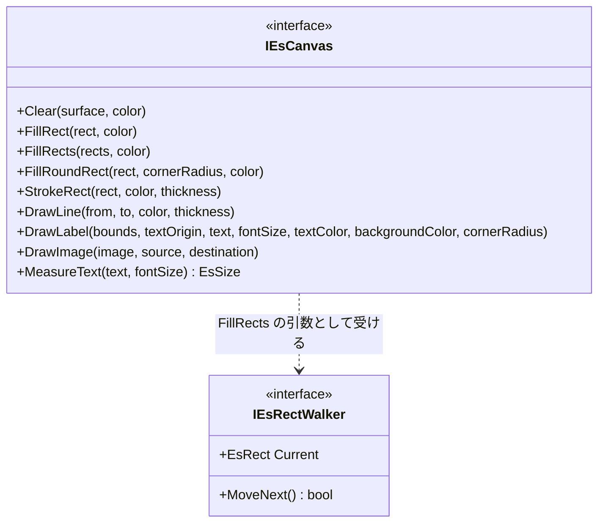
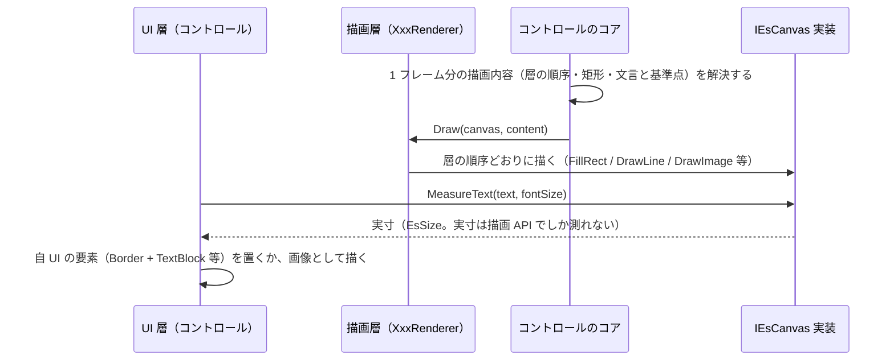

# Common システム仕様書

## 概要

`Common` は、SaveEvidence のソリューション内で共有する**UI 非依存の描画ポート**を提供します。

1. **描画ポート**（`IEsCanvas`）— コア側の描画手順が唯一呼ぶ即時描画ポート
2. **矩形列挙子の契約**（`IEsRectWalker<TSelf>`）— `IEsCanvas.FillRects` が受け取る列挙子の型

**ラベル専用の型は置きません**（配置の値・体裁・要素への写像）。ラベルの体裁（内側余白・フォントサイズ・色・角丸）と実寸 → 配置矩形の写像は描画層（`MarqueeControl.UIBase` / `LoupeControl.UIBase` の `MarqueePaint` / `LoupePaint` と `MarqueeLabelPlan` / `LoupeLabelPlan`）が単一所有し、テキストを要素として置くか画像として描くかは UI 層の判断です。コアは文言・基準点・アライン・領域だけを渡します。

外部機能と公開 API は [SPEC_ExtFunc](SPEC_ExtFunc.md)、利用手順は [README](README.md) を参照してください。

## 技術スタック

| 項目 | 内容 |
| --- | --- |
| 目的 | ソリューション固有の共有契約を `Platform.Core`（汎用）から分離し、判定基準「このソリューション以外でも使える型」を `Platform.Core` で守れるようにする |
| 提供形態 | クラスライブラリ（`Common.dll`） |
| 想定利用者 | 各コントロールのコア / UIBase / UI、各プラットフォーム層、アプリ層 |
| ターゲット | `net10.0` |
| 言語 | C# 14（`Nullable` 有効・`ImplicitUsings` 有効） |
| ルート名前空間 | `EsUtil.SaveEvidence.Common`（型は `.Imaging`） |
| 汎用性 | UI フレームワーク非依存。外部パッケージ非依存 |

## アーキテクチャ



- 依存の向きは **各層 → Common → Platform.Core** の一方向です。
- **`Platform.Core` は Common を参照しません**（Common が `Platform.Core` の幾何値型とビットマップだけを使うため）。
- UI フレームワークと外部パッケージへの依存はありません。

## コンポーネント構成

| ファイル | 可視性 | 内容 |
| --- | --- | --- |
| `Imaging/IEsCanvas.cs` | `public interface` | 即時描画ポート（10 メンバー） |
| `Imaging/IEsRectWalker.cs` | `public interface` | 矩形の列を確保なしで走査する列挙子（構造体）の契約（`IEsCanvas.FillRects` の引数） |

## クラス図



## データフロー（描画と実寸測定）



**実寸は描画 API でしか測れない**ため、測定と配置の反映は UI 層が行います。**テキストをどう描くか（要素 / 画像）も UI 層が決めます**。

## 単一所有（Single Source of Truth）

| 内容 | 所有者 |
| --- | --- |
| 描画 API の抽象（描画の可変性） | `IEsCanvas`（本プロジェクト） |
| ビットマップ（`EsBitmap`）とピクセル操作 | `Platform.Core`（汎用のため本プロジェクトへは移さない） |
| Skia との相互変換 | `Platform.Skia` |
| 描画の層の順序と描画手順 | コアの契約（`IMarqueeRenderer` / `ILoupeRenderer`）と描画層の実装 |
| ラベルの体裁（内側余白・フォントサイズ・色・角丸） | 描画層の設定（`MarqueePaint` / `LoupePaint`） |
| 実寸 → ラベル配置矩形の写像 | 描画層（`MarqueeLabelPlan` / `LoupeLabelPlan`） |
| ラベルの文言・基準点・アライン・クランプ領域 | コア（`MarqueeTextPlacement` / `LoupeTextPlacement`） |

## 例外処理ポリシー

| 状況 | 挙動 |
| --- | --- |
| 引数の null | 各実装が `ArgumentNullException`（呼び出し側の実装誤りであり回復して続行すべき状況ではない） |
| 空の矩形列 | `FillRects` は何もせずに戻る（描画のたびに呼ばれるため例外にしない） |
| 色のアルファ 0 | 描画 API にそのまま渡す（「描くかどうか」の判定は描画内容の解決が単一所有する） |

本プロジェクトは外部 I/O・非同期処理・リソース解放を持ちません（契約のみ）。

## 可視性ポリシー

- 全型が `public` です。各コントロールのコア（別プロジェクト）と各 UI が同じ契約を使うためです。
- `internal` 型はありません。
- **`internal` → `public` の変更は破壊的な設計変更として扱います**。

## テスト

本プロジェクトは契約のみを持ち、テストプロジェクトを持ちません（実装が無いため検証対象がありません）。実装は各 UI のアダプタであり、それぞれの利用側のテストが検証します。

```powershell
dotnet test src/Platform.AvaloniaUI/tests/Platform.AvaloniaUI.Tests.csproj
dotnet test src/Platform.Skia/tests/Platform.Skia.Tests.csproj
```
