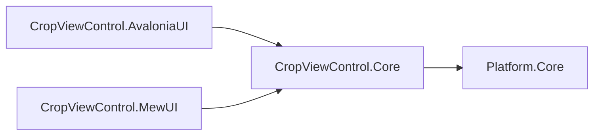
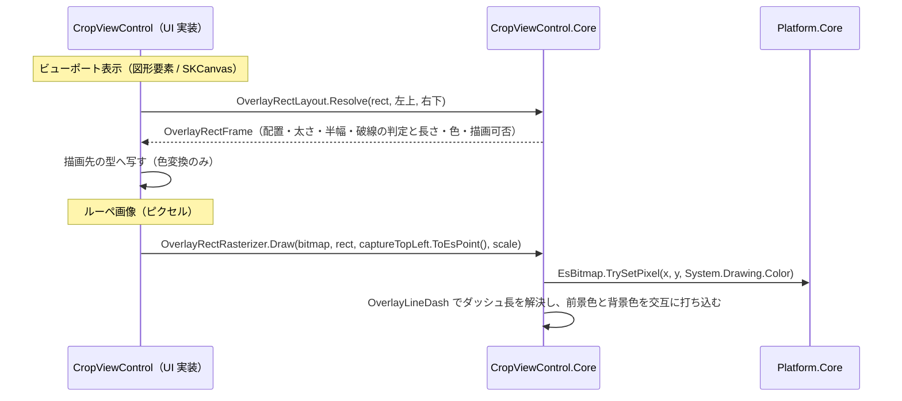

# CropViewControl.Core システム仕様書

## 概要

`CropViewControl.AvaloniaUI`（Avalonia UI 実装）と `CropViewControl.MewUI`（MewUI 実装）が共有する、UI フレームワーク非依存の矩形オーバーレイ定義と描画の計算を提供するライブラリです。SaveEvidence のマルチ UI 対応における「コントロールの Core / UI 分割」の 3 例目（ティア E）です。

## 技術スタック

- .NET 10 / C# 14
- UI フレームワークは一切参照しない
- 外部パッケージへの直接依存なし（依存は `Platform.Core` のみ）

## アーキテクチャ

- `CropViewControl.Core` は UI フレームワークへ依存しません。
- UI 実装は、コア型（`EsRect` / `System.Drawing.Color`）と自身の型（`Avalonia.Rect` / `Avalonia.Media.Color` / `SKColor`）を境界で相互変換します。
- 公開型は `OverlayRect` / `OverlayLineStyle` / `OverlayRectLayout` / `OverlayRectFrame` です。`OverlayLineDash` / `OverlayRectRasterizer` は `internal` とし、`InternalsVisibleTo`（`CropViewControl.AvaloniaUI` / `CropViewControl.MewUI.Tests` / `CropViewControl.Core.Tests`）で UI 実装とテストへ公開します。

## コンポーネント構成

| ファイル | 可視性 | 内容 |
| --- | --- | --- |
| `OverlayRect.cs` | `public readonly record struct` | 外部提供矩形の描画情報 |
| `OverlayLineStyle.cs` | `public enum` | 枠線スタイル |
| `OverlayRectLayout.cs` | `public static class` | 描画入力の解決（負サイズのクランプ・太さの下限・破線の判定） |
| `OverlayRectFrame.cs` | `public readonly record struct` | 矩形 1 個分の描画入力（配置・太さ・半幅・破線・色・描画可否） |
| `OverlayLineDash.cs` | `internal static class` | 枠線スタイルに対応するダッシュ長の単一所有 |
| `OverlayRectRasterizer.cs` | `internal static class` | 矩形の 4 辺を `EsBitmap` へ描画 |

## データフロー

## 単一所有（Single Source of Truth）

| 内容 | 所有者 |
| --- | --- |
| 矩形の配置（負サイズのクランプ） | `OverlayRectLayout.ViewportRectFromCorners` |
| 枠線の太さの下限と半幅 | `OverlayRectLayout.EffectiveThickness` / `OverlayRectFrame.HalfThickness` |
| 破線かどうかと背景色を使うか | `OverlayRectLayout.Resolve` / `OverlayRectFrame` |
| 枠線スタイルごとのダッシュ長と間隔 | `OverlayLineDash` |
| 矩形の 4 辺のラスタライズ（太さ・破線の色交互） | `OverlayRectRasterizer` |
| ピクセル書き込み（範囲外の無視） | `Platform.Core` の `EsBitmap.TrySetPixel` |

ベクター経路（UI の図形要素 / `SKCanvas`）とラスタ経路（ルーペ画像）は同じ `OverlayLineDash` と `OverlayRectLayout` を参照し、ダッシュ長と太さの下限の二重定義がありません。

## 例外処理ポリシー

本プロジェクトは値型とピクセル操作で構成され、例外を送出しません。範囲外座標への書き込みは `EsBitmap.TrySetPixel` が false を返して無視します。

## 可視性ポリシー

- `OverlayRect` / `OverlayLineStyle` / `OverlayRectLayout` / `OverlayRectFrame` は `public`（ホストと UI 実装が使う契約）。
- `OverlayLineDash` / `OverlayRectRasterizer` は `internal`。`internal` → `public` の変更は破壊的な設計変更として扱います。

## テスト

- `src/CropViewControl.Core/tests`（`CropViewControl.Core.Tests`）が本プロジェクトのテストを持ちます。
- UI 初期化が不要なため、すべて `[Fact]`（`AvaloniaFact` ではない）で並列実行されます。
- UI 依存の検証（コントロール生成・図形要素の配置・座標変換）は `CropViewControl.AvaloniaUI.Tests`（Avalonia ヘッドレス・直列）が担います。

## 移行の経緯

従来 `CropViewControl`（Avalonia）プロジェクト内にあった以下の型・処理を本プロジェクトへ切り出しました。

| 対象 | 移行内容 |
| --- | --- |
| `OverlayLineStyle` | そのまま移設（UI 非依存） |
| `OverlayRect` | `Avalonia.Rect` → `EsRect`、`Avalonia.Media.Color` → `System.Drawing.Color` |
| `DrawRectToLoupe` / `DrawRectEdge` / `StampPixel`（`CropViewControl` の private static） | `OverlayRectRasterizer` へ統合（`Point` → `EsPoint`、`Avalonia.Media.Color` → `System.Drawing.Color`） |
| 破線パターン（ベクター側 `CreateRectElement` とラスタ側 `DrawRectEdge` に二重定義） | `OverlayLineDash` へ一元化し、両経路が参照する |

`OverlayRect` は `CropViewControl.Rects` の型として公開されており、利用箇所は UI 実装とそのテストに加え、ホスト（`app.AvaloniaUI` / `app.MewUI`）が検出矩形の枠線を描く用途でも使用します。このため名前空間は UI 非依存の `EsUtil.SaveEvidence.CropView` へ統一しました。
