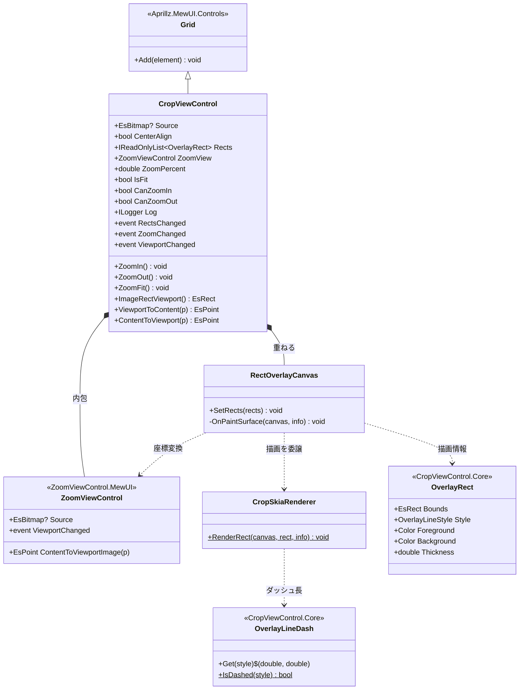
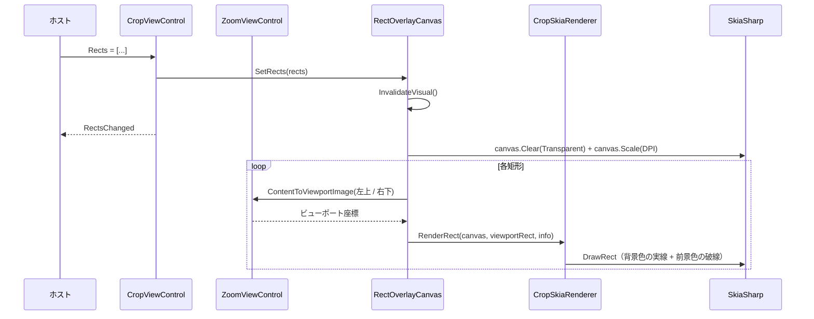

# CropViewControl.MewUI システム仕様書

CropViewControl（MewUI 版）のシステム概要・アーキテクチャ・依存関係・設計判断を記載します。

## システム概要

`CropViewControl.MewUI` は、Avalonia 版 `CropViewControl` と**同一の UI 非依存コア（`CropViewControl.Core` / `ZoomViewControl.Core`）**を使い、
画像表示（拡大・パン・Fit）と外部提供矩形のオーバーレイ描画を提供する高レベル複合コントロールです。

Facade パターンを適用し、内部のズームビューと矩形オーバーレイをホストから隠蔽します。

## 技術スタック

| 区分 | 採用技術 |
| --- | --- |
| 対象フレームワーク | .NET 10（`net10.0`） |
| 言語 | C# 14 |
| UI フレームワーク | MewUI（`Aprillz.MewUI.Skia` **0.21.1 固定**） |
| 描画 | SkiaSharp（矩形枠は `DrawRect` + `SKPathEffect.CreateDash` で描画する） |
| 基底クラス | `Aprillz.MewUI.Controls.Grid`（子要素を重ねる） |
| 内包コントロール | `ZoomViewControl.MewUI` |

## アーキテクチャ

### 依存方向（一方向を厳守）

```text
┌──────────────────────┐        ┌──────────────────────┐
│ CropViewControl.MewUI│        │   CropViewControl    │
│ （MewUI の描画層）   │        │ （Avalonia の描画層）│
└──────────┬───────────┘        └──────────┬───────────┘
           │                               │
           ├───────────────┬───────────────┘
           ▼               ▼
┌──────────────────┐ ┌──────────────────────┐
│CropViewControl.  │ │ ZoomViewControl.     │  矩形情報・ダッシュ長
│      Core        │ │  Core /  .MewUI      │  ズームの計算と描画
└────────┬─────────┘ └──────────┬───────────┘
         │                      │
         └──────────┬───────────┘
                    ▼
         ┌──────────────────────┐
         │  Platform.Core│  コア幾何型
         └──────────────────────┘
```

### 責務の分担

| 層 | 責務 |
| --- | --- |
| `CropViewControl.Core` | 矩形情報（`OverlayRect`）・ダッシュ長（`OverlayLineDash`）の単一所有、ルーペ画像へのラスタライズ |
| `ZoomViewControl.Core` | ズーム・パンの幾何計算 |
| `ZoomViewControl.MewUI` | 画像の描画、ズーム・パンの入力、ビューポート変化の通知 |
| `CropViewControl.MewUI` | 矩形のビューポート座標変換と枠の描画、内包コントロールの公開 API への委譲 |
| ホスト（`app.MewUI` 等） | `Source` / `Rects` の供給、ズーム操作、イベント購読 |

## コンポーネント構成

```text
src/CropViewControl.MewUI/
├── src/
│   ├── CropViewControl.cs      Facade（ZoomViewControl + RectOverlayCanvas の配置と委譲）
│   ├── RectOverlayCanvas.cs    透明なオーバーレイ（ドメイン→ビューポート変換）
│   └── CropSkiaRenderer.cs     矩形 1 つを SKCanvas へ描画（テスト対象）
└── tests/
    ├── TestHelper.cs                 テスト用の描画先（SKBitmap + SKCanvas）と画像生成
    ├── CropSkiaRenderer.Tests.cs     枠・破線・境界値の画素検証（12 件）
    └── CropViewControl.Tests.cs      Facade の委譲・イベント・座標変換（12 件）
```

| コンポーネント | 責務 |
| --- | --- |
| `CropViewControl` | 子要素の配置、`Rects` の保持、公開 API の内包コントロールへの委譲、イベントの中継、ログの伝搬 |
| `RectOverlayCanvas` | 矩形をドメイン座標からビューポート座標へ変換し、キャンバスへ描画する |
| `CropSkiaRenderer` | 矩形 1 つを実線または破線（背景色の実線 + 前景色の破線）で描画する |

## クラス図



## シーケンス図（矩形オーバーレイの描画）



## 設計判断

1. **Facade を `Grid` 派生で実装した**。Avalonia 版は `Panel` 派生だが、MewUI では `Grid`（`Panel` は abstract）が子の重ね合わせに適する。
2. **オーバーレイは別キャンバスにした**。ズームビューは画像の描画と入力を持ち、オーバーレイは矩形の描画のみを持つ。
   1 つのキャンバスに統合すると、ズームビューの内部状態（ズーム率・オフセット）へオーバーレイが依存することになる。
   重ね合わせることで**入力は下のズームビューが受け取り、描画は上のオーバーレイが担う**という単純な分担になる。
3. **破線は「背景色の実線 + 前景色の破線」で表現した**。Avalonia 版が下層矩形と破線矩形を重ねる方式と同じであり、
   2 色のダッシュを 1 回の描画で表現する API が Skia にないため。
4. **ダッシュ長はコアを単一所有元とした**。Avalonia 版のベクター描画・ルーペのラスタ描画・MewUI 版の 3 経路が同じ値を使う。
5. **枠線は矩形の内側へ描画する**。Avalonia の `Rectangle.Stroke` と同じ見た目にするため（`inset` で半幅ずらす）。
6. **領域選択オーバーレイを持たない**。ドラッグ選択・暗転マスク・ルーペの複合は `FadeMaskDragRectControl.MewUI` が担うため、本コントロールへ重ねれば済む（依存を増やさず、ホストが構成する。`app.MewUI` の切り出しはこの構成）。
7. **ログは内包するズームビューへ委譲する**。本コントロール自身はログを持たず、`Log` プロパティをズームビューへ伝搬する（Avalonia 版が `CropViewControl.Log` を内包コントロールへ委譲するのと同じ分担）。

## テスト方針

| 対象 | 方針 |
| --- | --- |
| `CropSkiaRenderer` | `SKBitmap` + `SKCanvas` へ実際に描画して**画素を実測**する（枠・破線のダッシュ長・境界値・半透明色） |
| `CropViewControl` | `Measure` / `Arrange` でビューポートを確定させ、委譲・イベント・座標変換を検証する |
| コアロジック | `CropViewControl.Core.Tests` / `ZoomViewControl.MewUI.Tests` が担保する |
| アプリ組み込み | `app.MewUI/verify-ui.ps1` が実機の画素を実測して検証する |

## 未実装・今後の対応

| 項目 | 内容 |
| --- | --- |
| 領域選択オーバーレイ | 対象外。ホストが `FadeMaskDragRectControl.MewUI` を重ねて構成する（`app.MewUI` の切り出しはこの構成） |
| 選択状態の公開 API | `FadeMaskDragRectControl.MewUI` が担う（本コントロールは矩形オーバーレイのみ） |
| ルーペへの矩形描画 | `LoupeControl.MewUI` の描画完了イベント（`Rendered`）でキャンバスへ打ち込める（選択矩形の破線は `FadeMaskDragRectControl.MewUI` が実装済み） |
| スクロールバー連携 | `AttachScrollViewer` 相当（ズームビューのスクロールバー実装に依存する） |
| 選択オーバーレイ上のホイール | ホストが `PanByWheel` / `ZoomByWheel` へ転送する（本コントロールはオーバーレイを含まないため） |
