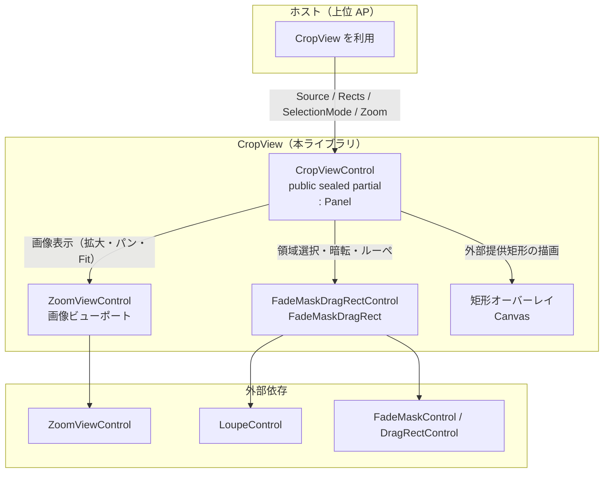

# CropView システム仕様書

本仕様書は、`Estable.AvaloniaUI.CropView`（CropView ライブラリ）の**システム概要・アーキテクチャ・内部設計**を定義します。

## 目次

- [CropView システム仕様書](#cropview-システム仕様書)
  - [目次](#目次)
  - [1. システム概要](#1-システム概要)
  - [2. 技術スタック](#2-技術スタック)
  - [3. アーキテクチャ](#3-アーキテクチャ)
  - [4. コンポーネント構成](#4-コンポーネント構成)
  - [5. 依存関係](#5-依存関係)
  - [6. 例外処理ポリシー](#6-例外処理ポリシー)

---

## 1. システム概要

CropView は、画像表示（拡大・パン・Fit）と領域選択（ドラッグ・暗転・ルーペ）を統合した高レベル複合コントロールです。

- 画像ビューポート（`ZoomViewControl`）と領域選択オーバーレイ（`FadeMaskDragRectControl`）を内包します。
- 外部提供矩形（`OverlayRect`）を View（ビューポート）とルーペ画像の両方へ描画します。

## 2. 技術スタック

| 項目 | 内容 |
| --- | --- |
| 言語 | C#（.NET 10） |
| UI フレームワーク | Avalonia 12.1 |
| 内包コントロール | ZoomViewControl / FadeMaskDragRectControl / LoupeControl |

## 3. アーキテクチャ

- ホストは `CropViewControl` にのみ依存します（Facade）。
- 画像表示（`ZoomViewControl`）・領域選択（`FadeMaskDragRectControl`）・矩形描画は本コントロール内で配線されます。
- 領域選択オーバーレイの可視性とヒットテストは `SetSelectionOverlayVisible` で制御します（Crop セッションの開始・終了時にホストが切替）。`Source` 設定では制御しません。
  - 初期状態（`Source` 未設定）はオーバーレイを不可視（`IsVisible = false`）+ ヒットテスト不可（`IsHitTestVisible = false`）にします（コンストラクタで設定）。
    - 画像なしでの選択矩形作成を防止し、Crop モードの全面暗転（FadeMask）で市松模様が暗くならないようにします。
  - `Source` が `null` に変わるときは**選択のみクリア**します（オーバーレイの表示・ヒットテスト状態は維持。`SetSelectionOverlayVisible` が専任）。
  - `Source` が設定されてもオーバーレイは自動では表示しません（プレビュー表示時は非表示）。
    - キャプチャ完了直後に Crop モード（全面暗転）が残るのを防ぐため、Crop セッション開始時に `SetSelectionOverlayVisible(true)` で表示します。
  - Crop セッション終了時は `SetSelectionOverlayVisible(false)` で非表示 + 選択クリアに戻します。

## 4. コンポーネント構成

| ファイル | 責務 |
| --- | --- |
| `CropViewControl.cs` | 高レベル複合コントロール本体。ZoomViewControl / FadeMaskDragRect / 矩形オーバーレイの組み立て・配線・状態同期。ズーム操作・座標変換・ルーペへの矩形描画。 |
| `OverlayRect.cs` | 外部提供矩形の描画情報（record struct）。破線種類・前景色・背景色・線幅。 |
| `OverlayLineStyle.cs` | 枠線スタイル enum（Solid / Dashed / Dotted）。 |

## 5. 依存関係

- `CropViewControl.cs` → `ZoomViewControl` / `FadeMaskDragRectControl` / `Avalonia`
- `CropViewControl.cs` → `LoupeControl`（ルーペへの矩形描画のため `LoupeRenderedEventArgs`）
- `CropViewControl.cs` → `PlatformFactory`（座標変換ポート `ICoordTransform` / `PbBitmap`）/ `Microsoft.Extensions.Logging`（`ILogger`）
- `OverlayRect.cs` → `Avalonia`（`Rect`）/ `Avalonia.Media`（`Color`）
- `OverlayLineStyle.cs` → `Estable` 非依存（純粋 enum）

## 6. 例外処理ポリシー

- 内包コントロール（ZoomViewControl / FadeMaskDragRect）が発生させる例外は、そのまま伝播します（本コントロールで捕捉しません）。
- ルーペ描画失敗（画像デコード・ピクセル操作）は `LoupeControl` の `ILogger` 通知に委譲します。
