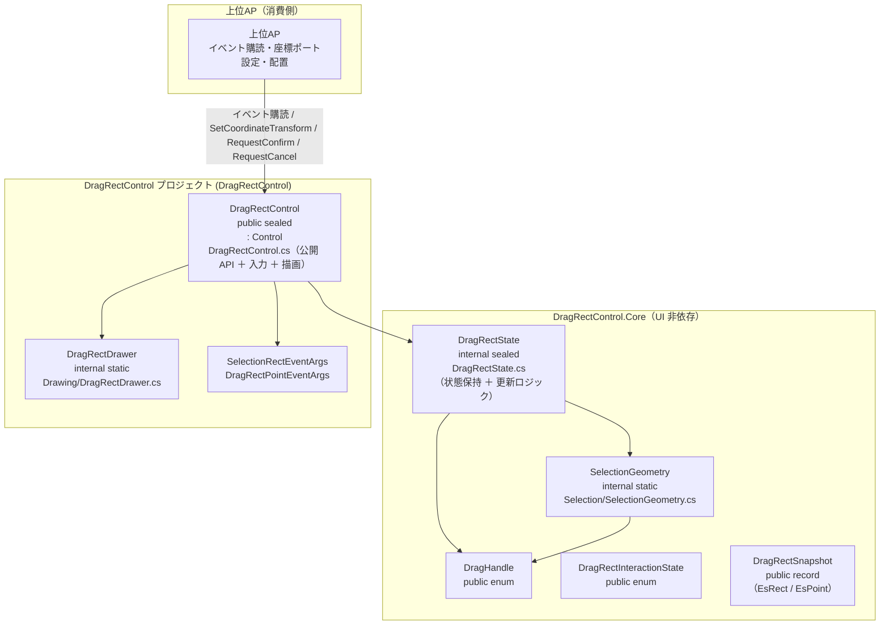
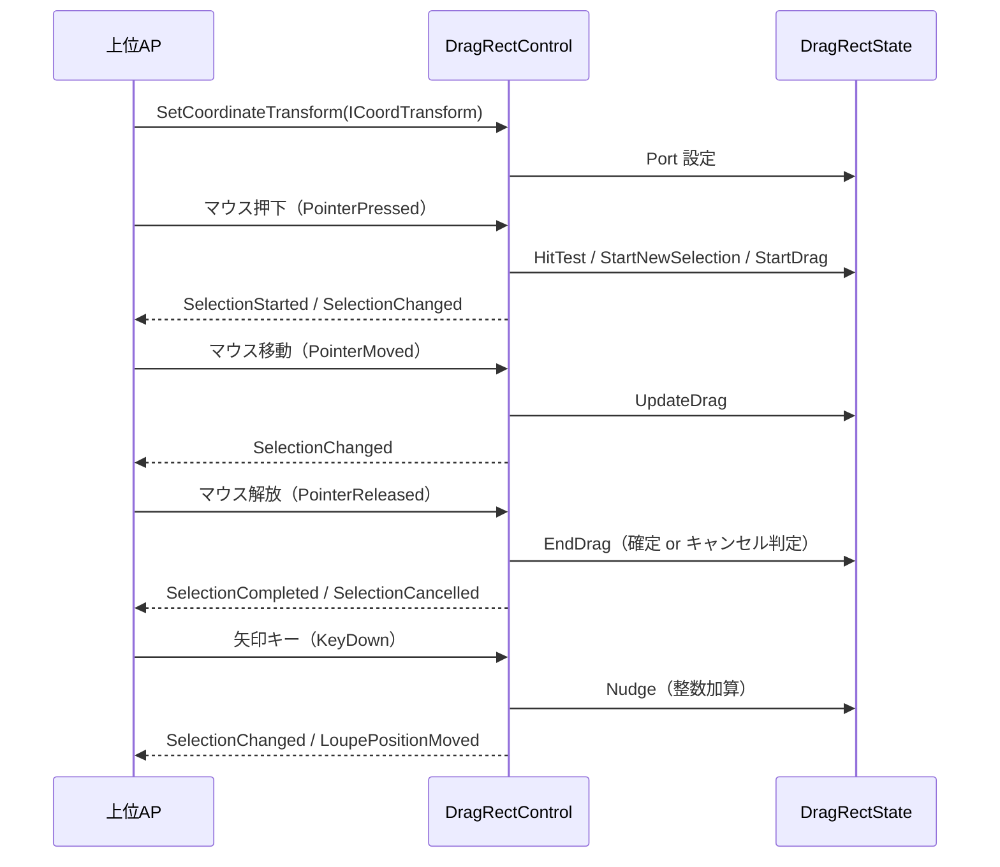

# DragRectControl システム仕様書（SPEC_System）

## 目次

- [DragRectControl システム仕様書（SPEC\_System）](#dragrectcontrol-システム仕様書spec_system)
  - [目次](#目次)
  - [1. システム概要](#1-システム概要)
  - [2. 技術スタック](#2-技術スタック)
  - [3. アーキテクチャ](#3-アーキテクチャ)
    - [3.1 レイヤー構造](#31-レイヤー構造)
    - [3.2 依存の方向](#32-依存の方向)
  - [4. 例外処理ポリシー](#4-例外処理ポリシー)
    - [4.1 基本方針](#41-基本方針)
    - [4.2 本プロジェクト固有の例外処理](#42-本プロジェクト固有の例外処理)
  - [5. コンポーネント図](#5-コンポーネント図)
  - [6. コンポーネント一覧](#6-コンポーネント一覧)
    - [6.1 DragRectControl](#61-dragrectcontrol)
    - [6.2 DragRectState](#62-dragrectstate)
    - [6.3 SelectionGeometry](#63-selectiongeometry)
    - [6.4 DragRectDrawer](#64-dragrectdrawer)
    - [6.5 DragHandle](#65-draghandle)
    - [6.6 公開イベント引数](#66-公開イベント引数)
  - [7. 依存ルール](#7-依存ルール)
  - [8. ライフサイクル](#8-ライフサイクル)
    - [8.1 状態の初期化と破棄（所有権）](#81-状態の初期化と破棄所有権)
  - [9. ログ](#9-ログ)

---

## 1. システム概要

SaveEvidence は、Windows デスクトップ上の画面をキャプチャし、プレビュー・編集・保存するための Avalonia UI アプリケーションです（.NET 10.0 / C# 14 / MVVM）。

本プロジェクト（DragRectControl）は、このシステムのうち**領域選択ドラッグ矩形**の UI・操作・描画を自己完結する再利用可能なコントロールです。上位 AP（CaptureSessionControl.AvaloniaUI / app）に依存せず、マウス操作・キーボード操作（nudge）・描画をコントロール内で完結します。

## 2. 技術スタック

| 項目 | 内容 |
| --- | --- |
| **プロジェクト** | `DragRectControl` |
| **ルート名前空間** | `Estable.AvaloniaUI.DragRect` |
| **言語** | C# 14（.NET 10.0） |
| **UI フレームワーク** | Avalonia UI 12.1（Control / StyledProperty / DrawingContext） |
| **ターゲットフレームワーク** | net10.0 |
| **ビルドツール** | MSBuild / .NET SDK 10.0 |
| **ログ** | Microsoft.Extensions.Logging.Abstractions（LoggerMessage ソース生成） |
| **テスト** | xUnit v3 / Avalonia.Headless.XUnit |
| **依存プロジェクト** | Platform.AvaloniaUI（ScreenConverter）/ Platform.Native（ICursorService）/ Platform.Core（ICoordTransform / CoordTransform） |

## 3. アーキテクチャ

### 3.1 レイヤー構造

```text
公開コントロール（DragRectControl）
  → 状態（DragRectState）
    → 共有型（SelectionGeometry / DragRectDrawer）+ Platform.AvaloniaUI
```

### 3.2 依存の方向

- 依存は**一方向の階層構造**（DragRectControl → DragRectState → SelectionGeometry / Platform.AvaloniaUI / Platform.Native / Platform.Core）。
- DragRectControl は上位 AP に依存しない（再利用可能）。
- 描画は DragRectDrawer へ委譲し、状態（選択矩形・nudge）は DragRectState に集約する（1 コントロール 1 状態クラス・SRP）。
- 座標変換は `ICoordTransform`（`Platform.Core` 提供）が担い、コントロールは変換関数を生成しない。
- 上位 AP へはイベントのみで通知し、上位 AP はポインター・キーイベントを直接処理しない。

## 4. 例外処理ポリシー

### 4.1 基本方針

- ライブラリは例外を原則伝播し、上位 AP（app）で処理する。
- UI レイヤー（app）ではユーザー操作起因の例外を各ハンドラで catch し、UI の応答性を維持する。
- ログは LoggerMessage ソース生成（`Logging/LogMessage.cs`）で出力する。操作イベントは Debug、Down 直前 / Up 直後の位置・ホイールは Trace で記録する。

### 4.2 本プロジェクト固有の例外処理

- イベントハンドラ内の例外は握りつぶさず、上位 AP へ伝播する（コントロールの内部状態を不正にしない）。
- 状態は DragRectState に集約し、クリップ（`ClampToDomainBounds` + `Port.Bounds`）により不正な選択矩形を防止する。

## 5. コンポーネント図



## 6. コンポーネント一覧

### 6.1 DragRectControl

- **分類**: 公開コントロール（`public sealed class : Control`）
- **責務**:
  - ポインターイベント（Pressed / Moved / Released）の受付と処理（状態更新・クリック/ダブルクリック検出・カーソル形状）
  - 矢印キー・Escape / Enter キーイベントの受付（nudge・確定・キャンセルの自己処理）
  - 描画（`Render`）の起動（DragRectDrawer へ委譲）
  - フォーカス獲得
  - 公開イベント（Selection系 / Mouse系 / Confirm / Cancel / Viewport）の通知
  - ドメイン↔DIP 座標ポートの保持（`SetCoordinateTransform`）
  - 祖先 ScrollViewer の ScrollChanged 購読（`ViewportChanged` 発行）
  - 公開イベントの発火は専用ヘルパー（`Raise...`）に集約（イベント引数の生成と `?.Invoke` の一元化・発火形式の一貫性）
- **公開API**:
  - イベント 14 種: `SelectionStarted` / `SelectionChanged` / `SelectionCompleted` / `SelectionCancelled` / `MouseDown` / `MouseUp` / `MouseClicked` / `MouseDoubleClicked` / `MouseMoved` / `LoupePositionMoved` / `ViewportChanged` / `ZoomRequested` / `ConfirmRequested` / `CancelRequested`
  - StyledProperty 13 種: `BorderColor` / `BorderThickness` / `HandleColor` / `HandleSize` / `HandleHitRadius` / `MinSelectionSize` / `ClampToDomainBounds` / `MarkerColor` / `MarkerLength` / `ShowCoordLabel` / `CoordLabelColor` / `CoordLabelBackgroundColor` / `CoordLabelFontSize`
  - プロパティ: `Log`
  - メソッド: `SetCoordinateTransform(ICoordTransform?)` / `SetSelection` / `ResetSelection` / `RequestCancel` / `RequestConfirm`
- **構成（シンプル実装）**: 公開 API とイベントオーバーライド（処理は DragRectState へ委譲）を集約し、内部実装を責務別クラスへ分割しない
- **依存**: DragRectState / DragRectDrawer / SelectionGeometry / ICoordTransform（Platform.Core）/ ICursorService（Platform.Native）/ ScreenConverter（Platform.AvaloniaUI）

### 6.2 DragRectState

- **分類**: 内部状態クラス（`internal sealed class`・コンポジション）
- **責務**:
  - 選択矩形・ドラッグ状態・アクティブハンドル・nudge 状態（基点＋累積オフセット）の保持
  - 純粋ロジック: `HitTest` / `StartNewSelection` / `StartDrag` / `UpdateDrag` / `EndDrag` / `Nudge` / `GetOppositeCorner` / `GetInteractionState` / `CreateSnapshot`
  - クリップ（`ClampToDomainBounds` + `Port.Bounds` による境界内制限。境界 Rect 生成は `GetBoundsRect` に一元化）
  - カーソル操作（`ICursorService`）
  - nudge 終了の共通化（`EndNudgeIfActive`。`Reset` / `SetSelection` でカーソル再表示を委譲）
- **可視性**: internal（外部から見えない）
- **依存**: SelectionGeometry / DragHandle / ICoordTransform（Platform.Core）/ ICursorService（Platform.Native）

### 6.3 SelectionGeometry

- **分類**: 内部静的クラス（`internal static class`）
- **責務**: 選択矩形の純粋な幾何計算（正規化・ハンドル位置・ヒットテスト・対角計算）
- **可視性**: internal（外部から見えない）
- **依存**: UI 非依存（`DragRectControl.Core` の `EsPoint` / `EsRect`）

### 6.4 DragRectDrawer

- **分類**: 内部静的クラス（`internal static class`）
- **責務**: 枠線・ドラッグハンドル・始点マーカー・座標ラベルの描画
- **可視性**: internal（外部から見えない）
- **特徴**: 色・太さで決まる `SolidColorBrush` / `Pen` を容量制限付きで共有し、描画で再利用する。容量管理は `AddWithCapacityLimit` に一元化（単一所有）。描画対象の 8 方向ハンドル配列は静的フィールドに保持する（`s_handleTypes`）
- **依存**: Avalonia（DrawingContext / SolidColorBrush / Pen）/ SelectionGeometry

### 6.5 DragHandle

- **分類**: 公開 enum
- **責務**: ドラッグハンドルの種別（ヒットテスト・矩形変形・nudge・描画で共通利用）
- **可視性**: public（上位 AP がカーソル形状のマッピングに使用するため）

### 6.6 公開イベント引数

- `DragRectInteractionState` enum（public）: NoSelection / StartPointNudging / Dragging / DraggingNudging / Selected / SelectedNudging
- `DragRectSnapshot` record（public）: State / SelectionRect / ActiveHandle / MousePosition / IsMouseDown / IsDragging / NudgeActive / HasSelection。座標は UI 非依存の `EsRect` / `EsPoint`（各 UI の境界で自前の型へ変換する）
- `SelectionRectEventArgs`（public）: Rect（Avalonia）+ Snapshot
- `DragRectPointEventArgs`（public）: Point（Avalonia）+ Snapshot

## 7. 依存ルール

- 依存方向は**一方向の階層構造**（DragRectControl → DragRectState → SelectionGeometry / Platform.AvaloniaUI / Platform.Core）。
- DragRectControl は上位 AP に**依存しない**（再利用可能）。
- 描画は DragRectDrawer へ委譲し、状態（選択矩形・nudge）は DragRectState に集約する（1 コントロール 1 状態クラス・SRP）。
- 座標変換は `ICoordTransform`（`Platform.Core` 提供）が担い、コントロールは変換関数を生成しない。
- 上位 AP へはイベントのみで通知し、上位 AP はポインター・キーイベントを直接処理しない。

## 8. ライフサイクル



### 8.1 状態の初期化と破棄（所有権）

- コントロール自身が保持する状態（選択矩形・nudge 状態）は `ResetSelection()` で初期化します（上位 AP は状態をポーリングせず、イベントで把握）。
- 上位 AP はコントロールを Visual Tree から除去するだけで破棄できます（所有権は上位 AP にあり、明示的な解放 API は不要）。
- ビジュアルツリー切断時（`OnDetachedFromVisualTree`）は TopLevel キー購読・ScrollViewer 購読を解除し、nudge 中ならポインターを再表示します（`EndNudge` に委譲）。

## 9. ログ

ログ定義は `Logging/LogMessage.cs`（LoggerMessage ソース生成・`this ILogger` 拡張メソッド）に集約し、`Log` プロパティの `ILogger` 経由で出力する。
各メソッドは `this ILogger` 第一引数で定義し、呼び出し側では logger 引数を省略する。未設定（null）の場合は `NullLogger` で無出力。
出力先・レベル制御はホストアプリケーションが所有する（本クラスは定義のみ）。マウス移動の高頻度ログは行わない（Down 直前・Up 直後の位置のみ `Trace` で記録）。

### 9.1 ログ定義一覧

| レベル | メソッド | 出力内容 |
| --- | --- | --- |
| `Debug` | `LogMessage.LogMouseDown` | ポインター押下（位置 / クリック数 / 選択有無） |
| `Debug` | `LogMessage.LogMouseUp` | ポインター解放（位置 / ドラッグ有無 / 選択有無） |
| `Debug` | `LogMessage.LogClick` | クリック（位置） |
| `Debug` | `LogMessage.LogDoubleClick` | ダブルクリック（位置 / 選択内側か） |
| `Debug` | `LogMessage.LogDragStart` | ドラッグ開始（ハンドル / 位置） |
| `Debug` | `LogMessage.LogKeyDown` | キー入力（キー名 / 処理有無） |
| `Debug` | `LogMessage.LogConfirmRequested` | Enter キーによる確定要求（矩形） |
| `Debug` | `LogMessage.LogCancelRequested` | Escape キーによるキャンセル要求 |
| `Debug` | `LogMessage.LogZoomRequested` | Ctrl+ホイールによるズーム要求（拡大/縮小） |
| `Debug` | `LogMessage.LogSettingChanged` | 設定値変更（変更前後） |
| `Trace` | `LogMessage.LogPositionBeforeDown` | Down 直前のマウス位置 |
| `Trace` | `LogMessage.LogPositionAfterUp` | Up 直後のマウス位置 |
| `Trace` | `LogMessage.LogWheelScroll` | 通常ホイールによるスクロール（移動量 / オフセット） |
