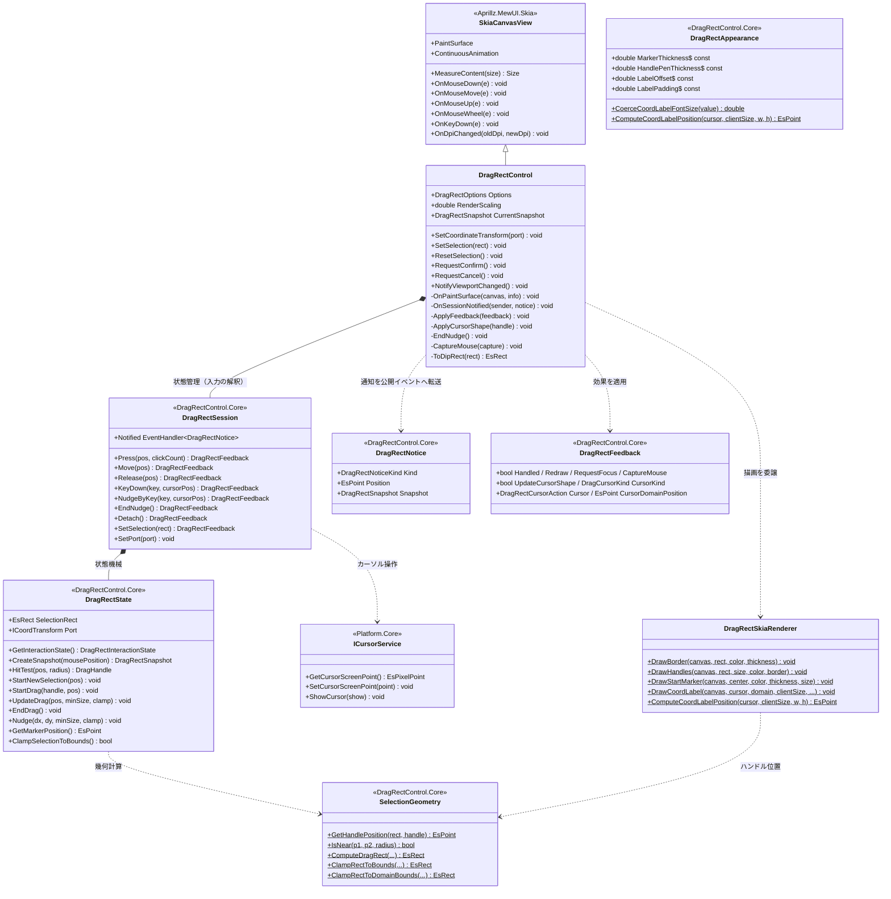
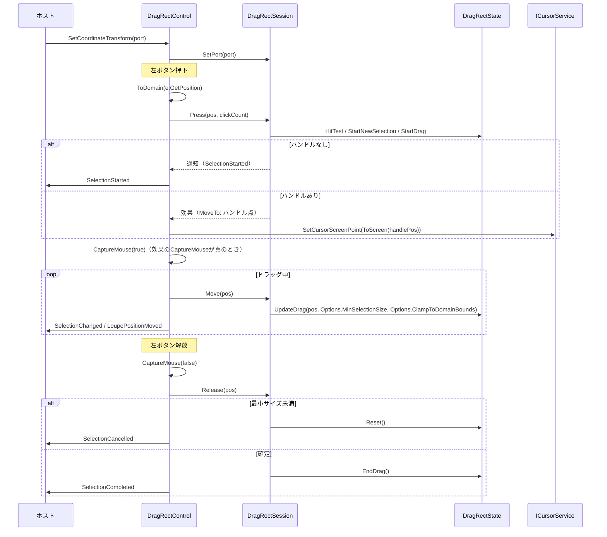
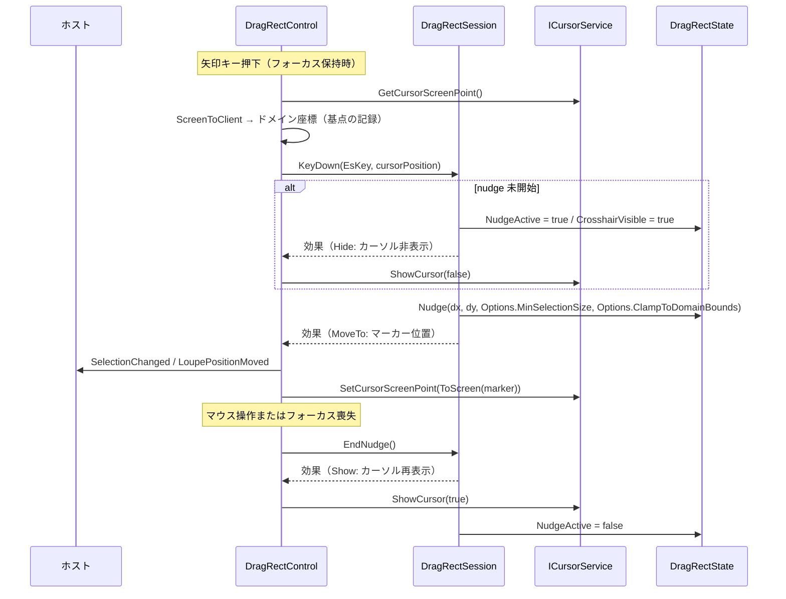
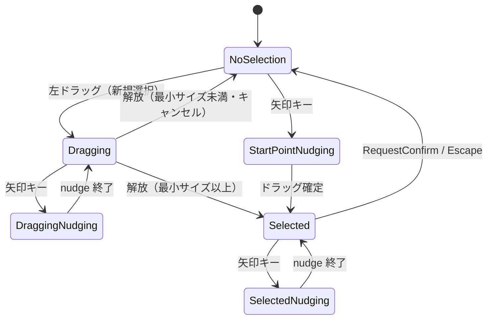

# DragRectControl.MewUI システム仕様書

DragRectControl（MewUI 版）のシステム概要・アーキテクチャ・依存関係・設計判断を記載します。

## システム概要

`DragRectControl.MewUI` は、Avalonia 版 `DragRectControl` と**同一の UI 非依存コア（`DragRectControl.Core`）**を使い、
入力の受付・効果の適用・通知の転送・描画のみを MewUI（SkiaSharp）で実装したドラッグ矩形コントロールです。

コアが担う範囲（選択矩形の正規化・ハンドル位置・ヒットテスト・ドラッグ変形・nudge・境界クリップ・対話状態の合成に加えて、
nudge セッション・ダブルクリックの確定/キャンセル・ハンドルのスナップ・クリック検出・最小サイズによるキャンセルの判断）は
両 UI で完全に共通であり、本プロジェクトは入力をコアへ通知し、返された効果を適用して結果をキャンバスへ描画します。

## 技術スタック

| 区分 | 採用技術 |
| --- | --- |
| 対象フレームワーク | .NET 10（`net10.0`） |
| 言語 | C# 14 |
| UI フレームワーク | MewUI（`Aprillz.MewUI.Skia` **0.21.1 固定**） |
| 描画 | SkiaSharp（`DrawRect` / `DrawLine` / `DrawText`） |
| 基底コントロール | `Aprillz.MewUI.Skia.Controls.SkiaCanvasView` |
| プロパティシステム | `MewProperty<T>`（`MewPropertyOptions.AffectsRender`） |
| カーソル操作 | `ICursorService`（`Platform.Native` の Win32 実装） |

## アーキテクチャ

### 依存方向（一方向を厳守）

```text
┌───────────────────────┐        ┌───────────────────────┐
│ DragRectControl.MewUI │        │   DragRectControl     │
│ （MewUI の描画・入力）│        │ （Avalonia の描画・入力）│
└───────────┬───────────┘        └───────────┬───────────┘
            │                                │
            └───────────┬────────────────────┘
                        ▼
            ┌───────────────────────┐
            │  DragRectControl.Core │  状態管理クラス・幾何計算・状態機械（単一所有）
            └───────────┬───────────┘
                        ▼
            ┌───────────────────────┐
            │  Platform.Core │  コア幾何型・座標変換ポート・カーソル抽象
            └───────────┬───────────┘
                        ▼
            ┌───────────────────────┐
            │ Platform.Native│  Win32 / NoOp 実装（UI 非依存）
            └───────────────────────┘
```

### 責務の分担

| 層 | 責務 |
| --- | --- |
| `DragRectControl.Core` | 選択矩形の幾何計算、ヒットテスト、ドラッグ変形、nudge、境界クリップ、対話状態の合成、スナップショット生成、**入力の解釈（nudge セッション・確定/キャンセル・スナップ・クリック検出・最小サイズ判定）と通知・効果の生成（効果の適用順、ビューポート変化の通知、ログの保持を含む）** |
| `DragRectControl.MewUI` | 入力（マウス・キー）をコア型へ変換してセッションへ通知する、返された効果（再描画・フォーカス・マウスキャプチャ・カーソル形状/操作）を適用する、通知を公開イベントへ転送する、状態を `SKCanvas` へ描画する、DPI の追従 |
| ホスト | 座標変換ポートの設定、選択の復元・確定・キャンセル、重ね順の管理、ビューポート変化の通知 |

### 設計判断

| 判断 | 理由 |
| --- | --- |
| 状態機械（`DragRectState`）と入力の判断（`DragRectSession`）をコアに置き、UI 側は入力の変換と効果の適用のみを行う | 本コントロールの本体は「状態遷移 + 幾何 + 入力の解釈」であり、UI に残すと MewUI 版で丸ごと書き直しになる |
| イベント引数をコア型（`EsPoint` / `EsRect`）で公開する | コアの状態機械と同一の型になり境界変換が不要になる。MewUI の `Rect` は負のサイズを 0 にクランプするため、`EsRect` のほうが安全 |
| カーソルサービスの既定実装の解決を UI 層で行う | コアは `Platform.Native` を参照できない（循環参照）。コアは抽象と `null` のみを扱う |
| `SkiaCanvasView`（`Control` 系）を基底にする | 画像の上へ重ねるオーバーレイであり、子要素を持たない。背景を塗らないため下の画像が透ける |
| `ScrollViewer` を自動購読しない | MewUI 版の画面構成（`Grid` 重ね合わせ）では祖先探索の前提が異なる。ビューポート変化はホストが `NotifyViewportChanged()` で通知する |
| マウスダウン・アップのイベントを公開しない | `UIElement` が同名メンバー（＝同じ情報を提供するイベント）を持つため、本コントロールでは公開しない（重複を避ける） |
| ログの出力先を持つ | 入力を持つコントロールは操作ログが必要（上位 AP はドラッグ・nudge 用のキー・マウスイベントを直接検出しないため）。既定は `NullLogger` で、ホストが `Log` プロパティで注入する（保持・フォールバック・セッションへの伝搬はコアが単一所有する） |

## コンポーネント構成

```text
src/DragRectControl.MewUI/
├── src/
│   ├── DragRectControl.cs          公開 API・入力の受付と効果の適用・カーソル制御・描画の起点
│   ├── DragRectSkiaRenderer.cs     枠線・ハンドル・十字マーカー・座標ラベルの描画
│   ├── DragRectPointEventArgs.cs   座標通知のイベント引数
│   └── SelectionRectEventArgs.cs   選択矩形通知のイベント引数
└── tests/
    ├── TestHelper.cs                     テスト用の描画先（SKBitmap + SKCanvas）と画素数え上げ
    ├── RecordingLogger.cs                ログ出力を収集するテスト用 ILogger
    ├── DragRectSkiaRenderer.Tests.cs     描画の検証（6 件）
    └── DragRectControl.Tests.cs          公開 API・プロパティ・イベントの検証（21 件）
```

| コンポーネント | 責務 |
| --- | --- |
| `DragRectControl` | `MewProperty` の定義、入力のドメイン変換とセッションへの通知、返された効果（再描画・フォーカス・マウスキャプチャ・カーソル）の適用、マウスキャプチャの取得/解放、DPI 変更の追従 |
| `DragRectSkiaRenderer` | 枠線・8 方向ハンドル・十字マーカー・座標ラベルの描画と、ラベル配置の純粋計算 |
| `DragRectPointEventArgs` / `SelectionRectEventArgs` | 通知時点の座標（矩形）とスナップショットの組 |
| `RenderTarget`（テスト） | ウィンドウ不要の描画先。`SKBitmap` と `SKCanvas` を保持し、画素を読み取る |

## クラス図



## シーケンス図（新規選択のドラッグ）



## シーケンス図（矢印キー nudge）



## 状態遷移

コアの `DragRectState.GetInteractionState()` が合成する対話状態です（nudge が最優先）。



## 描画フロー

```text
OnPaintSurface(canvas, info)
  ├─ canvas.Scale(RenderScaling)                     … DPI の適用（境界 1 箇所）
  ├─ HasSelection なら
  │    ├─ _session.ToDipRect(SelectionRect)          … Inverse 変換（終点は +1 して閉区間を表現。規則はコア）
  │    ├─ DragRectSkiaRenderer.DrawBorder            … 枠線
  │    └─ DragRectSkiaRenderer.DrawHandles           … SelectionGeometry から 8 方向の中心を取得
  ├─ NudgeActive かつ CrosshairVisible なら
  │    └─ DragRectSkiaRenderer.DrawStartMarker       … GetMarkerPosition() の位置
  └─ Options.ShowCoordLabel なら
       └─ DragRectSkiaRenderer.DrawCoordLabel        … CoordinateFormatter（コア）で文字列化
```

背景は塗りません（透明のままにして下の画像を透かします）。

## エラー処理ポリシー

| 条件 | 動作 |
| --- | --- |
| カーソルサービスが null | `PlatformFactory.CreateCursorService()` の既定実装を使用する |
| ウィンドウを特定できない（未レイアウト・未表示） | マウスキャプチャとカーソル移動を行わない（例外にしない） |
| `Options.CoordLabelFontSize` に NaN / ∞ | 既定値（12）へ補正する |
| 破棄済みの画像を描画しようとした | 本コントロールは画像を扱わない（対象外） |

## 実装上の注意（実測・設計から得た知見）

1. **`UIElement` は `MouseDown` / `MouseUp` メンバーを持つ**。同名の公開イベントを定義すると `CS0108`（メンバーの隠蔽）になるため、
   基底 `UIElement` が同名メンバー（`MouseDown` / `MouseUp`）を持ち、同じ情報を提供するため、本コントロールでは公開しない（重複を避ける）。
2. **MewUI の `Rect` / `Size` は負のサイズを 0 にクランプする**。コアは `EsRect` を使うため影響を受けないが、
   MewUI 型へ変換する場合は値が変わりうる（本コントロールはイベント引数も `EsRect` で公開して回避する）。
3. **`MouseEventArgs.ScreenPosition` は画面座標（デバイスピクセル）**、**`Window.Position` / `ClientToScreen` の入力は DIP** である。
   カーソル移動（nudge）の座標変換はこの非対称性を踏まえて実装する。
4. **スナップショットはドラッグ状態の解除前に生成する**。`EndDrag` の後ではマーカー位置が固定コーナーを返すため、
   nudge 位置は解放処理の冒頭で計算する。
5. **ストロークの座標は「経路の中心」に描かれる**。太さ 2 の枠線は辺の座標を挟む 2 ピクセル（例: `[x-1, x+1)`）を覆う。
   描画テストの期待値はこの前提で書く。

## 未実装（今後の判断）

| 項目 | 状況 |
| --- | --- |
| `ScrollViewer` の自動連携 | ホストが `NotifyViewportChanged()` を呼ぶ方式で代替 |
| フォーカス非依存の矢印キー nudge | フォーカス依存で実装（`TopLevel` のキー購読は行わない） |
| 通常ホイールのスクロールログ | スクロールの実処理はホストが担うため出力しない（操作ログの定義はコア（`Estable.DragRect.LogMessage`）が所有し、書式・レベルとも Avalonia 版と同一） |
| 実ウィンドウへの組み込み | `FadeMaskDragRectControl.MewUI` を経由して配線済み（撮影・切り出しの両方） |
