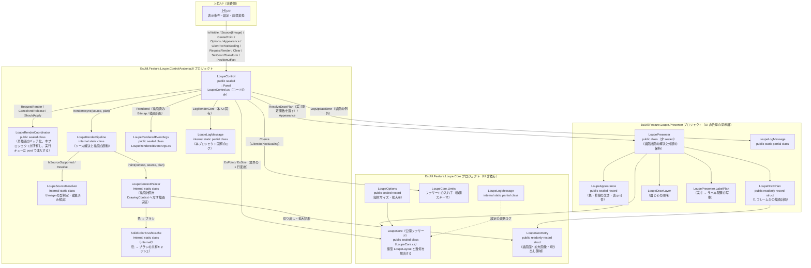
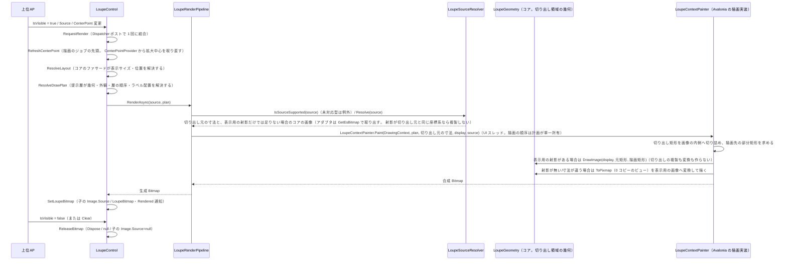

# EsUtil.Feature.Loupe.ControlAvaloniaUI システム仕様書

## 目次 <!-- omit from toc -->

- [1. システム概要](#1-システム概要)
- [2. 技術スタック](#2-技術スタック)
- [3. アーキテクチャ](#3-アーキテクチャ)
  - [3.1 レイヤー構造](#31-レイヤー構造)
  - [3.2 依存方向](#32-依存方向)
- [4. 例外処理ポリシー](#4-例外処理ポリシー)
  - [4.1 基本方針](#41-基本方針)
  - [4.2 本プロジェクト固有の例外処理](#42-本プロジェクト固有の例外処理)
- [5. コンポーネント図](#5-コンポーネント図)
- [6. コンポーネント一覧](#6-コンポーネント一覧)
  - [6.1 LoupeControl](#61-loupecontrol)
  - [6.2 LoupeContextPainter（描画実装）](#62-loupecontextpainter描画実装)
  - [6.3 描画責務分割](#63-描画責務分割)
  - [6.4 画像入力とピクセル抽出](#64-画像入力とピクセル抽出)
  - [6.5 切り出し領域の幾何（`EsUtil.Feature.Loupe.Core`）](#65-切り出し領域の幾何esutilfeatureloupecore)
  - [6.6 LoupeLogMessage](#66-loupelogmessage)
  - [6.7 上位AP（消費側）](#67-上位ap消費側)
  - [6.8 UI 固有の機構（コアへ移さない）](#68-ui-固有の機構コアへ移さない)
- [7. 依存ルール](#7-依存ルール)
- [8. ライフサイクル](#8-ライフサイクル)
- [9. 補正（coerce）一覧](#9-補正coerce一覧)

---

## 1. システム概要

SaveEvidence は、Windows デスクトップ上の画面をキャプチャし、プレビュー・編集・保存するための Avalonia UI アプリケーションです（.NET 10.0 / C# 14 / MVVM）。

本プロジェクト（EsUtil.Feature.Loupe.ControlAvaloniaUI）は、このシステムのうち**ルーペ（拡大鏡）表示**を担う再利用可能なコントロールです。 元画像の指定座標を拡大表示し、十字線・枠線を合成描画します（画像外は無地）。 上位のアプリの合成コントロールのルーペ表示に使用されます。

## 2. 技術スタック

| 項目 | 内容 |
| --- | --- |
| **プロジェクト** | `EsUtil.Feature.Loupe.ControlAvaloniaUI` |
| **ルート名前空間** | `EsUtil.Feature.Loupe.AvaloniaUI` |
| **言語** | C# 14（.NET 10.0） |
| **UI フレームワーク** | Avalonia UI 12.1（StyledProperty / DrawingContext / RenderTargetBitmap / IBrush） |
| **ターゲットフレームワーク** | net10.0 |
| **ビルドツール** | MSBuild / .NET SDK 10.0 |
| **ログ** | Microsoft.Extensions.Logging（LoggerMessage ソース生成） |
| **テスト** | xUnit v3 / Avalonia.Headless.XUnit |
| **依存プロジェクト** | `EsUtil.Feature.Loupe.Core`（UI 非依存の計算ロジック）/ `EsUtil.Feature.Loupe.Presenter`（描画の手順・ラベル計画）/ `EsUtil.Platform.Core`（コア型）。 製品固有のプラットフォーム層（`Platform.*`）は参照せず、使う変換・描画ヘルパーを `src/AvaloniaUI/Internal/` へ複製して持つ（[`.github/依存関係.md`](../../../.github/依存関係.md) §4.1） |

## 3. アーキテクチャ

### 3.1 レイヤー構造

```text
公開コントロール（LoupeControl）
  → 描画オーケストレーション（LoupeRenderPipeline / LoupeSourceResolver）※ UI 固有の機構
  → レンダリング（描画層 EsUtil.Feature.Loupe.Presenter の LoupePresenter。描画先は DrawingContext が適合させる）
  → Core（EsUtil.Feature.Loupe.Core: 寸法 / 数値補正 / 表示位置・サイズ / 切り出し領域と可否 / ラベル計画 / 区画数の切り上げ / 描画完了時の表示情報 / ログ定義）
```

### 3.2 依存方向

- 依存は**一方向の階層構造**（LoupeControl → EsUtil.Feature.Loupe.Presenter → EsUtil.Feature.Loupe.Core → EsUtil.Platform.Core）。 双方向依存・具象依存なし。
- LoupeControl は上位 AP に依存しない（再利用可能）。
- 色の境界変換（設定文字列 → コアの色型）は上位AP 側で行い、LoupeControl 内に文字列解析を持ち込まない（外観は `Appearance`（`LoupeAppearance`）として `System.Drawing.Color` で受け取る）。
- 描画計画（層の順序・装飾の矩形・ラベルの文言と配置）と外観は提示層（`EsUtil.Feature.Loupe.Presenter` の `LoupePresenter` / `LoupeAppearance`）が単一所有し、本コントロールは描画（`LoupeContextPainter` を `DrawingContext` へ写す）とラベル要素の配置、状態（DP）とライフサイクル（Bitmap 生成 / 解放）を担う。
- 表示可否（十字線・枠線・ラベル・ペーストボード）と枠線の太さは提示層の外観（`LoupeAppearance`）が、切り出しの可否・表示サイズの決定はコアが判定・所有し、本プロジェクトはその結果で描画する。
- `LoupeSourceResolver`（`IImage` の型判定）と中間ビットマップを生成するパイプラインは **Avalonia 固有の機構** であり、コアへ移さない（MewUI 版は同期描画のため不要）。
- 再描画のバッチ化（`LoupeRenderCoordinator`）は中間ビットマップを持つ UI にだけ必要なため **本プロジェクトが所有する**（コアにも共有層にも置かない）。
- 描画可否の判断（非表示なら描画しない・解放する、古い世代は反映しない）と、未実行要求の破棄と解放の手順は **`LoupeRenderCoordinator` が単一所有** する（コントロールは `RequestRender` / `CancelAndRelease` / `ShouldApply` を呼ぶだけ）。
- 表示方式は LoupeControl 内部の Image.Source に統一し、外部の DrawingContext 描画 API は提供しない。
- UI 非依存のロジックは `EsUtil.Feature.Loupe.Core`（全型 `public`）へ委譲し、境界でのみコア型（`EsPoint` / `EsSize`）と Avalonia 型を相互変換する（1 行変換）。

## 4. 例外処理ポリシー

### 4.1 基本方針

- ライブラリは例外を原則伝播し、上位 AP（app）で処理する。
- UI レイヤー（app）ではユーザー操作起因の例外を各ハンドラで catch し、UI の応答性を維持する。
- ログは LoggerMessage ソース生成で出力する（コアが出力する定義は `EsUtil.Feature.Loupe.Core` の `LoupeLogMessage`、本 UI が出力する定義は本プロジェクトの `LoupeLogMessage`、本 UI 固有の定義は `LoupeLogMessage`）。 設定変更・画像変更は Debug、再描画・位置更新は Trace、例外は Error で記録する。

### 4.2 本プロジェクト固有の例外処理

- `Source` に `Bitmap` / `EsBitmapAvaloniaAdapter` 以外の `IImage` が設定された場合、`NotSupportedException` を生成し `LoupeLogMessage.LogUpdateError` で記録する。
- 描画の例外（未対応の画像型等）は `Log` へ記録され、呼び出し元へは伝播しない（開始側が例外を観測する）。
- 自動再描画の場合は例外を観測済みとして処理し、UI スレッドを未処理例外で終了させない。
- 非同期生成は世代番号で古い結果を破棄し、解放後の破棄を防止する。

## 5. コンポーネント図



## 6. コンポーネント一覧

### 6.1 LoupeControl

- **分類**: 公開コントロール（`public sealed class LoupeControl : Panel`。 AXAML を持たずコードのみで子要素を構成する）
- **責務**:
  - 状態管理: 5 個の StyledProperty（`Source: IImage?` / `CenterPoint` / 設定 `Options` / 外観 `Appearance` / 環境値 `ClientToPixelScaling`）
  - 座標ラベル: **コントロールがテキスト要素（`Border` + `TextBlock`）として表示する**。 文言・基準点は提示層（`EsUtil.Feature.Loupe.Presenter` の `LoupePresenter`（`LabelTexts` partial））が、表示可否と体裁（フォントサイズ・色・角丸）は外観（`LoupeAppearance`）が、実寸 → 配置矩形の写像は同層の `LoupePresenter`（`LabelPlan` partial） が単一所有する。 コントロールは配置フェーズ（`ArrangeOverride`）で要素を追加・更新する（ラベル要素は子の末尾に置かれ、子は親より後に描かれるため常に最上位）
    - **実寸測定は UI が行う理由**: テキストの実寸は描画 API（`FormattedText`）でしか測れないため、UI が測って `LoupePresenter`（`LabelPlan` partial）（描画層 `EsUtil.Feature.Loupe.Presenter`）へ渡し、返された配置を要素へ反映する
    - ライフサイクル: 世代管理付き非同期ビットマップ生成と解放（`ReleaseBitmap`）
  - 表示制御: 標準プロパティ `IsVisible` で表示・非表示を指示（表示時=再生成要求（非同期・1 フレームに 1 回の生成へ結合）、非表示時=未実行要求の破棄と解放）
    - 再描画のバッチ化: `Dispatcher.UIThread.Post` で複数プロパティ変更を1フレーム1回の再描画に結合。 ポストは 1 回だけで、そのジョブの中で生成（`LoupeRenderPipeline.RenderAsync`）と表示への反映（`ApplyBitmap`）まで行う（追加のディスパッチャー往復は、往復を次の描画フェーズまで待つ分だけ画像の反映を遅らせる）
    - 表示位置と画像の同期: 表示位置（`RenderTransform`）は `CenterPoint` の変更（入力ハンドラー）で同期に確定し、画像も再描画のポストした同じジョブで確定する。 アプリが描く内容であるため提示は OS が合成するカーソルより 1 フレーム遅れるが、表示位置と画像は同じフレームに載る（位置だけが遅れる状態・画像だけが遅れる状態を作らない）
    - 非同期生成: 切り出しと合成（`RenderTargetBitmap` / `DrawingContext`）は UI スレッドで行い（バックグラウンド抽出（`Task.Run`）は使わない。 連続再描画時にスレッドプールが競合し、移動中の追従が止まるため）、古い世代の結果は採用せず破棄する
    - 表示サイズ・位置: `UpdatePosition` がコアのファサード `LoupeCore.ResolveLayout` を呼び、返された `LoupeLayout`（表示サイズと表示位置）を要素（`Width` / `Height`）と `RenderTransform` へ写すだけである（表示サイズの決定・オフセット加算・親領域内への位置の補正はコアが単一所有し、`UpdatePosition` は表示サイズの唯一の反映元になる）
    - 座標単位: `Options.RequestedSize` は DIP、描画計画へ渡す表示サイズと枠線の太さも DIP（物理ピクセルへの換算は提示層が `DpiScaler.ScaleToPixel` へ委譲する）
  - 値の補正: コアの設定値（`LoupeOptions`）は型の生成時に補正される（UI は関与しない）。 環境値の `ClientToPixelScaling` のみ `coerce` コールバックで矯正する
- **公開API**: 入力（`Source: IImage?` / `CenterPoint`）/ 設定（`Options`（コアの `LoupeOptions` が単一所有する基本サイズ・拡大率。 UI は設定値を保持しない）/ 外観（`Appearance`（`LoupeAppearance`。 `System.Drawing.Color` で受け取り描画時にブラシへ変換する）））/ 環境（`ClientToPixelScaling`）/ ログ（`Log`）/ イベント（`Rendered`・`LoupeRenderedEventArgs` で描画済み Bitmap と描画計画（切り出し左上・拡大率）を通知。 ホストが Bitmap へオーバーレイ（線分・選択枠等）を直接描画できる）/ 操作（`Clear` / `RequestRender` / `SetCoordTransform` / `PositionOffset` / `RefreshPosition`）
- **依存**: LoupePresenter（描画計画と配置の写像）/ LoupeAppearance（`EsUtil.Feature.Loupe.Presenter`） / LoupeLogMessage（本プロジェクト） / LoupeContextPainter / LoupeRenderCoordinator / LoupeRenderPipeline / LoupeSourceResolver（本プロジェクト） / LoupeOptions / Loupe（`EsUtil.Feature.Loupe.Core`） / DrawingContext（Avalonia） / Avalonia / ILogger

### 6.2 LoupeContextPainter（描画実装）

- **分類**: 内部静的クラス（`internal static class LoupeContextPainter`。 Avalonia 版の描画実装）
- **責務**: 描画計画（`LoupeDrawPlan`）を Avalonia の描画 API（`DrawingContext`）へ写す（**層の順序も描く値も計画が単一所有する**ため、本クラスは順に描く だけである）
- **可視性**: internal（描画の実装詳細。 見た目の差し替えは `LoupeControl.Appearance` / `DrawPlanResolver` / `DrawPlan` で行う）
  **描画の入口**: `LoupeContextPainter.Paint(DrawingContext context, EsReadOnlyBitmap? source, in LoupeDrawPlan plan)`（図形のみ。 **テキストは描かない**。 中心座標ラベルはコントロールが UI 要素として配置する）
- **特徴**:  描画の可否は外観（`Appearance` の `Show*`）を見て本クラスが判断する（計画は表示可否で矩形も層も消さない）。 枠線の太さの物理ピクセルへの換算と装飾の矩形の導出は**提示層が解決済み**である（本クラスは計算を持たない）。 色 → ブラシの共有は `SolidColorBrushCache` が
- **依存**: EsUtil.Feature.Loupe.Presenter（`LoupeDrawPlan` / `LoupeAppearance` / `LoupeDrawLayer`）/ `Internal/`（`SolidColorBrushCache`）/ EsUtil.Platform.Core（画像型 / `System.Drawing.Color`）

### 6.3 描画責務分割

- 描画計画（層の順序・装飾の矩形・ラベルの文言と配置）と外観（色・枠線の太さ・表示可否）は**提示層（`EsUtil.Feature.Loupe.Presenter`）が単一所有**し、Avalonia 版と MewUI 版が同じ計画を共有する。
- 各 UI の描画実装（Avalonia は `LoupeContextPainter`、MewUI は `LoupeSkiaPainter`）は**計画を自 UI の描画 API へ写すだけ**である（順序の判断も描く値の算出も持たない）。
- 描画 API の抽象は持たない。 UI フレームワークをまたぐ描画の抽象は、フレームワークごとの描画モデルの差を吸収しきれないためである。
- `SolidColorBrushCache`（`Internal/`）: コアの色型（`System.Drawing.Color`）→ `SolidColorBrush` の変換と容量制限付きキャッシュを単一所有する。 描画実装（`LoupeContextPainter`）とラベル要素の配置（本コントロールとマーキー）が共用する。

> 十字線・枠線の矩形計算、枠線の太さの換算、拡大描画の矩形計算は提示層（`EsUtil.Feature.Loupe.Presenter`）が単一所有します（MewUI 版と共用）。
> 本プロジェクトは `DrawingContext` への写しと要素の配置を担います。

> **通知契約**: `LoupeRenderedEventArgs` はホストがオーバーレイを描くのに必要な値（描画済み Bitmap ・描画計画）を通知します。 描画計画は切り出し領域の左上（`CaptureTopLeft`）・拡大率（`ZoomLevel`）・描画面のサイズを単一所有し、本引数は複製しません。 中心座標ラベルはコントロールがテキスト要素として表示するため含みません。 表示位置・表示サイズは消費側が無いため含みません（必要になればコントロールの公開プロパティから取得できます）。

### 6.4 画像入力とピクセル抽出

- 公開画像入力はAvalonia標準の `IImage?` とし、`Image.Source` と同じBindingモデルで利用できる。
- ピクセル抽出が必要な切り出しの内部境界だけ `EsReadOnlyBitmap` を要求する（切り出し領域はコアの `LoupeGeometry.MagnifiedImage` が決める）。
- `Source` が `Bitmap`（`WriteableBitmap` / `RenderTargetBitmap` を含む派生型）の場合は `CopyPixels` による複製（`EsBitmap` 化）で抽出する。 **この複製は表示用の射影を切り出し元の座標系として使えない場合だけ行う**（DPI が 96 以外の `Bitmap` は `Size`（DIP）と `PixelSize` が一致しないため元矩形の解釈が変わる。 一致する場合は射影をそのまま使えるため複製せず、寸法だけを解決する）。
- `Source` が `EsBitmapAvaloniaAdapter` の場合は `GetEsBitmap()` でコアの画像（`EsReadOnlyBitmap`）を取り出し、そのピクセルを直接抽出する（複製なし）。
- `Bitmap`（派生を含む） / `EsBitmapAvaloniaAdapter` 以外の `IImage`（`CroppedBitmap` 等）は `NotSupportedException` が発生する。
- **切り出しの複製を作らない**（表示用の射影を元矩形つきで描く）: `LoupeContextPainter` は `Source` の射影（`IImage`）と切り出し元の寸法を受け取り、**画像と交差する部分だけ**を `DrawImage(image, 元矩形, 描画矩形)` で描く。 外側は描かない（ペーストボードが出る ＝ 透明で埋めた画像を貼るのと同じ見た目）ため、**毎フレームの切り出しの複製と表示用の変換が不要**になる。 射影が無い経路（オフスクリーン描画）と射影の寸法が切り出し元と違う場合は、**0 コピーの読み取りビュー**（`ToPixmap`）を読み、表示用の画像へ変換して描く（切り出しの複製は作らない。 射影だけのソース（コアの画像を持たない `Bitmap`）は射影をそのまま使うため、寸法が一致しない場合は渡さない）。
- 合成（`RenderTargetBitmap` / `DrawingContext`）は UI スレッドで行う（バックグラウンド抽出は連続再描画時にスレッドプールが競合し、移動中の追従が止まるため行わない）。 一時 `RenderTargetBitmap` は描画直後に破棄する。

### 6.5 切り出し領域の幾何（`EsUtil.Feature.Loupe.Core`）

- **提供元**: `LoupeGeometry` の公開メンバー（`CaptureSize` / `CaptureTopLeft` / `CaptureCropTopLeft` / `CaptureDrawOffset` / `CaptureCenterOffset` / `MagnifiedImage`）
- **分類**: 幾何（`public readonly record struct`）の導出プロパティ
- **責務**: 切り出し領域の幾何（どこを切り出すか）を幾何の値から導出する
- **公開API**: 描画計画（`LoupeDrawPlan.MagnifiedImage`）として外部へ渡る
- **切り出しの実行は本メンバーにない**: 読み取りの範囲（`CropSourceRect`）を渡すだけで、描画実装（Avalonia は `LoupeContextPainter`）が 0 コピーのビュー（`ToPixmap`）を読んで描く（切り出しの複製を作らない）
- **依存**: `EsUtil.Platform.Core`（`EsPoint` / `EsRect` / `EsRectInt`）。 Avalonia には依存しない

### 6.6 LoupeLogMessage

- **分類**: ログ定義（`LoggerMessage` source generator。 `public static partial class`）
- **責務**: ログの書式・レベルを UI 間で揃え、定義の所有者を出力の主体ごとに分ける
- **本 UI が呼ぶ定義**: **本プロジェクトの `LoupeLogMessage`** が単一所有する（`LogSourceChanged`（Debug。 設定名は本 UI が付与）/ `LogUpdateError`（Error））。 拡大元画像はコントロール固有の値であり（コアのファサードは画像を保持しない）、画像の寸法の文字列化は本 UI が `IImage.Size` から行う（`IImage` はコアの `EsReadOnlyBitmap` へ依存しないため共通化しない。 破棄済みは型名で代用する）
- **コアが出力する定義**: `EsUtil.Feature.Loupe.Core` の `LoupeLogMessage`（internal）が持つ（設定値・拡大中心の変更。 **設定名はコアが付与**し、UI 層は値だけを渡す）
- **本 UI 固有のログ**: 中間ビットマップを生成する描画パイプライン固有の `LogRenderCore` / `LogGenerateAsyncDone` は **本プロジェクトの `LoupeLogMessage`**（`src/EsUtil.Feature.Loupe.ControlAvaloniaUI/src/AvaloniaUI/Logging/LoupeLogMessage.cs`・`internal static partial class`）が所有する
- **依存**: Microsoft.Extensions.Logging

### 6.7 上位AP（消費側）

- 上位AP が本コントロールを参照して利用する（表示条件・設定・座標変換は上位AP 側の責務）。
- 本コントロールは上位AP の詳細（内部構造・型）に依存しない。

### 6.8 UI 固有の機構（コアへ移さない）

- `LoupeRenderCoordinator`: 再描画要求のバッチ化（実行キューへのポストで 1 フレーム 1 回に結合）、表示中の判定と世代番号による古い結果の破棄、未実行要求の破棄と解放の手順を単一所有する。 中間ビットマップを持つ UI にだけ必要なため本プロジェクトが所有し、実行キューと優先度は `post: action => Dispatcher.UIThread.Post(…)`（描画のジョブの先頭で拡大中心を取り直してから本体を走らせる）として注入する。
- `LoupeRenderPipeline`: Avalonia の `IImage` を切り出し元（寸法と、必要なら `EsReadOnlyBitmap`）へ解決し、描画（`LoupeContextPainter.Paint`。 `DrawingContext` 経由）を UI スレッドで実行する（`RenderAsync(source, plan)`）。 UI スレッド上ではその場で描き、UI スレッド外からは描画フェーズ（`DispatcherPriority.Render`）へポストする（通常の経路は UI スレッド上のため往復しない）。 `IImage` の型判定と `Bitmap` → `EsBitmap` の複製が UI 固有。
- `LoupeSourceResolver`: `IImage` の対応型判定（`Bitmap` / `EsBitmapAvaloniaAdapter`）・破棄済みの検出・切り出し元の寸法の解決（`Bitmap` の複製の要否の判断を含む）を単一所有する（UI スレッドに依存しない純粋関数）。

## 7. 依存ルール

- 依存方向は**一方向の階層構造**です（層の全体像は [`src/README.md`](../README.md)）。 LoupeControl（UI）→ EsUtil.Feature.Loupe.Presenter（提示層）→ EsUtil.Feature.Loupe.Core（コア）→ EsUtil.Platform.Core。 双方向依存・具象依存なし。
- LoupeControl は上位AP に**依存しない**（再利用可能）。
- 色の境界変換（string → IBrush）は上位AP 側で行い、LoupeControl 内に文字列解析を持ち込まない。
- 描画計画（層の順序・装飾の矩形・ラベルの文言と配置）と外観は提示層（`EsUtil.Feature.Loupe.Presenter` の `LoupePresenter` / `LoupeAppearance`）が単一所有し、本コントロールは描画（`LoupeContextPainter` の写し）とラベル要素の配置、状態（DP）とライフサイクル（Bitmap 生成/解放）を担う。
- UI 非依存の計算ロジック・設定・寸法・ログ定義は `EsUtil.Feature.Loupe.Core` が単一所有し、UI 側は境界でコア型へ 1 行変換して委譲する。
- **UI 層は設定値・寸法値を保持しない**（`Options`（コアの `LoupeOptions`）を 1 つ公開し、描画時に読むだけ）。 色は `Appearance`（`LoupeAppearance`）として公開し、描画実装へ渡す。
- 表示方式は `LoupeControl` 内部の `Image.Source` に統一し、外部の `DrawingContext` 描画APIは提供しない。
- 複数の依存関係プロパティを連続設定した場合、Dispatcher上の保留中再描画要求は `_renderQueued` により1件へ集約される。

## 8. ライフサイクル



**描画計画は 1 フレーム 1 回だけ解決します。** 配置（`ArrangeOverride`。 ラベル要素の配置に使う）と描画（本図）は同じ表示サイズを渡すため、2 回目の解決はキャッシュを返します（十字線・枠線の矩形の導出とラベルの実寸測定をやり直しません）。 キャッシュのキーは表示サイズとスケーリング係数で、それ以外の入力（拡大中心・設定・外観・`DrawPlanResolver`）の変更は `RequestRender` が破棄します。

## 9. 補正（coerce）一覧

| プロパティ | 範囲 | 補正の場所 |
| --- | --- | --- |
| `Options`（`RequestedSize` / `ZoomLevel`） | 1〜4096 / 1〜64 | **コアの `LoupeOptions`（`init` アクセサ）** |
| `ClientToPixelScaling` | 0.1〜8.0（非有限値は 1.0） | `coerce` コールバック（プロパティのメタデータ） |
| `Appearance.BorderThickness` | 1〜64 | **提示層の `LoupeAppearance`（`init` アクセサ）** |
| `Appearance.CoordLabelFontSize` / `Appearance.CoordLabelCornerRadius` | 6〜48 / 0〜64 | **提示層の `LoupeAppearance`（`init` アクセサ）** |

環境値の `ClientToPixelScaling` は `coerce` コールバックへ登録するため、バインディングなど setter を経由しない設定にも適用されます（規則はコアの `LoupeCore.Limits` が単一所有し、UI は登録するだけです）。 MewUI 版も `MewProperty.Register` の coerce コールバックで同じ契約を満たします。

設定（`Options`）の数値項目は**コアの型が生成時に補正**し、外観（`Appearance`）の数値項目は**提示層の型が生成時に補正**するため、UI 側に補正の登録を置きません（値の設定経路（オブジェクト初期化子・`with` 式・逆シリアル化・バインディング）によらず範囲内の値だけが保持されます）。
