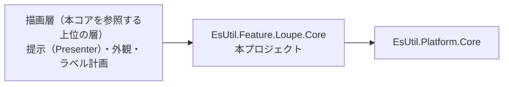
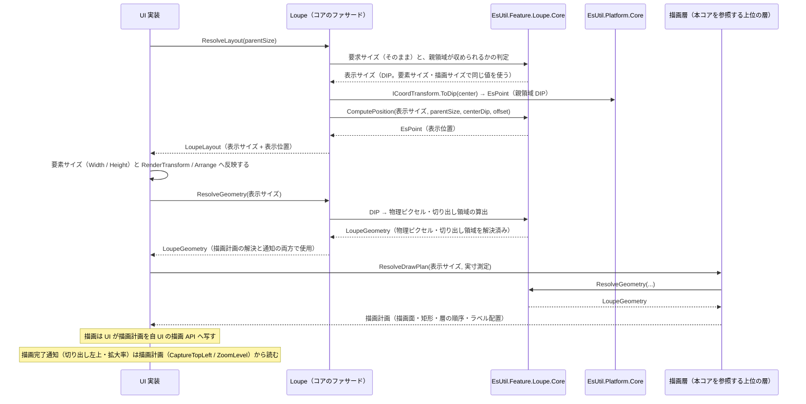

# EsUtil.Feature.Loupe.Core システム仕様書

ルーペ（選択範囲の拡大表示）の **UI 非依存のコア**の構造・依存・例外処理・設計判断・コンポーネント構成を記載します。 公開 API は [`SPEC_API.md`](SPEC_API.md)、使い方は [`../README.md`](../README.md) を参照してください。

## 目次

- [1. システム概要](#1-システム概要)
- [2. 技術スタック](#2-技術スタック)
- [3. アーキテクチャ](#3-アーキテクチャ)
  - [3.1 依存方向](#31-依存方向)
  - [3.2 データフロー（レイアウト → 幾何 → 描画）](#32-データフローレイアウト--幾何--描画)
- [4. コンポーネント構成](#4-コンポーネント構成)
- [5. 例外処理ポリシー](#5-例外処理ポリシー)
- [6. 可視性ポリシー](#6-可視性ポリシー)
- [7. テスト方針](#7-テスト方針)
- [8. 設計判断（UI 非依存の境界）](#8-設計判断ui-非依存の境界)
- [9. ログ](#9-ログ)
  - [9.1 出力する操作と出力しない操作](#91-出力する操作と出力しない操作)

## 1. システム概要

| 項目 | 内容 |
| --- | --- |
| 目的 | ルーペの表示レイアウトと描画の幾何の解決を 1 箇所に集約し、UI ごとの実装差から切り離す |
| 提供形態 | クラスライブラリ（`EsUtil.Feature.Loupe.dll`） |
| 想定利用者 | UI 実装と、それらを組み込むホストアプリケーション |
| 汎用性 | 特定のアプリ・UI に依存しない。 コントロールを「Core / Presenter / UI」に分ける構成のパイロット実装であり、そのまま別プロジェクトへ独立できる |

## 2. 技術スタック

| 項目 | 内容 |
| --- | --- |
| ターゲット | `net10.0` |
| 言語 | C# 14（`Nullable` 有効・`ImplicitUsings` 有効） |
| ルート名前空間 | `EsUtil.Feature.Loupe`（**公開面はすべてここに属する**。 ファサードと、ファサードのメンバーの型（`LoupeGeometry` / `LoupeMagnifiedImage` / `LoupeOptions` / `LoupeLayout`））。 `internal` の型だけが層フォルダ `src/Core/` の配下（`EsUtil.Feature.Loupe.Core.Logging`）に残る |
| ドキュメント生成 | `GenerateDocumentationFile` 有効（XML は配布物へ出さず `cref` の検証のみに使う） |
| テスト | xUnit v3（UI 初期化不要。 `InternalsVisibleTo` で `internal` を検証する） |
| 依存 | UI フレームワークを一切参照しない。 直接依存は `EsUtil.Platform.Core` と `Microsoft.Extensions.Logging.Abstractions`（ログ定義のソース生成）のみ（SkiaSharp は参照しない） |

## 3. アーキテクチャ

### 3.1 依存方向



層の全体像は [`src/README.md`](../../README.md) を参照してください。

- `EsUtil.Feature.Loupe.Core` は UI フレームワークへ依存しません。 依存は `EsUtil.Platform.Core` のみです。
- **提示（描画計画の解決）と外観は描画層（本コアを参照する上位の層）が単一所有します**（本プロジェクトは描画 API も描画の抽象も色も持ちません）。 **描画は各 UI が自 UI の描画 API で行います**。
- **コントロール化にだけ必要な処理（再描画要求のバッチ化・世代番号管理）は上位のコントロール実装が所有します**（中間ビットマップを生成する UI にだけ必要な処理であり、同期描画の UI には不要です）。
- UI 実装は、コア型と自身の型（`Avalonia.Point` / `Size` / `IBrush`、`SKColor`）を相互変換します。 変換は境界（サービス呼び出し・イベント引数の生成・描画）の 1 行に限定し、UI 側の状態・描画は UI の型のまま維持します。
- 設定（**計算に必要な値**である表示サイズ・拡大率）は `LoupeOptions` が単一所有し、UI 層は本型を 1 プロパティとして公開するだけです（設定の既定値・補正も本型が持つ）。 UI 層は寸法値を保持しません（描画時に読むだけ）。 **色・フォント・枠線の太さ・表示可否はコアの型に含めず、描画層の外観が単一所有します**。
- `LoupeGeometry` を含む**大部分の型を `public`** とします（外部が独自の UI アダプタを実装できるようにするため）。 内部手順（配置計算・区画数の切り上げ）は `internal` とし、単体テストにのみ `InternalsVisibleTo`（`EsUtil.Feature.Loupe.Core.Tests`）で公開します。
- コントロール化に必要な型（描画の再描画スケジューリング等）は上位のコントロール実装が提供します。

### 3.2 データフロー（レイアウト → 幾何 → 描画）



## 4. コンポーネント構成

**公開面**（ファサード `LoupeCore.cs` と、ファサードから返る・渡す型（`LoupeGeometry` / `LoupeMagnifiedImage` / `LoupeOptions` / `LoupeLayout`））は `src/` 直下（ルート名前空間）に属します。 **内部手順**（`internal`）は層フォルダ（`src/Core/`）の配下へ置き、名前空間に層名を挟みます（`src/Core/Logging/` → `EsUtil.Feature.Loupe.Core.Logging`）。

| ファイル | 型 | 可視性 | 責務 |
| --- | --- | --- | --- |
| `src/EsUtil.Feature.Loupe.Core/src/LoupeCore.cs` | `LoupeCore` | public | **公開ファサード（操作の唯一の窓口）**。 設定・環境値・拡大中心・位置オフセットの保持、設定変更の検出とログ出力（`Log`）、座標変換ポートの設定（`SetCoordTransform`） |
| `src/EsUtil.Feature.Loupe.Core/src/LoupeCore.Limits.cs` | `LoupeCore.Limits`（`LoupeCore` の入れ子） | public | 数値パラメータの既定値・安全域（最小 / 最大）の単一所有と、範囲外の値の補正。 **UI がプロパティ登録に使う**（枠線の太さの安全域は描画層の外観が参照する） |
| `src/EsUtil.Feature.Loupe.Core/src/LoupeOptions.cs` | `LoupeOptions` | public | 計算に必要な設定の値オブジェクト（表示サイズ・拡大率）。 既定値・生成時の補正（`init` アクセサ。 設定経路によらず範囲内の値だけを保持する）・`Default`。 **色・フォント・枠線の太さ・表示可否は持たない**（描画層の外観が単一所有する） |
| `src/EsUtil.Feature.Loupe.Core/src/LoupeGeometry.cs` | `LoupeGeometry` | public | 1 フレーム分の描画の幾何（コア⇔UI の契約）。 値の組は `LoupeCore.ResolveGeometry` が 1 箇所に閉じる（UI 層は自分で組み立てない）。 切り出し領域の幾何を導出する（`CaptureSize` / `CaptureTopLeft` / `MagnifiedImage` / `ClientPixelRect`） |
| `src/EsUtil.Feature.Loupe.Core/src/LoupeMagnifiedImage.cs` | `LoupeMagnifiedImage` | public | 拡大画像の切り出しと描画の矩形（切り出し領域・描画元・描画先） |
| `src/EsUtil.Feature.Loupe.Core/src/LoupeLayout.cs` | `LoupeLayout` | public | 表示レイアウトの値（表示サイズ + 表示位置。 配置しない場合は位置が null） |
| （本プロジェクトには置かない） | 描画計画と外観 | — | 提示（描画計画の解決）と外観は **描画層（本コアを参照する上位の層）が所有します**（本コアは描画 API も描画の抽象も持たない） |
| `src/EsUtil.Feature.Loupe.Core/src/Core/Logging/LoupeLogMessage.cs` | `LoupeLogMessage` | internal | コアが出力するログ定義（`LoggerMessage` ソース生成）の単一所有（**上位層が出力する定義と書式は上位層が単一所有する**） |
| `src/EsUtil.Feature.Loupe.Core/src/LoupeCore.Geometry.cs` | `LoupeCore` の partial | public | 幾何の入口（`ResolveLayout` / `ResolveGeometry`）と内部手順（表示位置のオフセット加算と親領域内への補正、領域が正方形を収められるかの判定）。 内部手順は `private static` に閉じる |

## 5. 例外処理ポリシー

本プロジェクトは純粋計算で構成されます。 例外を送出するのは `EsBitmap` の引数検証（`ArgumentOutOfRangeException`）と破棄後アクセス（`ObjectDisposedException`）のみです。 破棄済みソースの例外の捕捉は描画実装（各 UI の painter）の責務とします。

**領域が表示サイズを収められない場合も例外にしません**（配置しないとして位置を null で返す。 ルーペを縮小してまで描画しないため）。

## 6. 可視性ポリシー

- 大部分の型・メンバーを `public` とします（UI 非依存の汎用ライブラリとして、外部の UI アダプタ実装を可能にするため）。 内部手順は `internal` とし、単体テストにのみ `InternalsVisibleTo` で公開します。
- **クラスが `internal` の場合、そのメンバーも `internal` とします**（`public` と書いても外部から見えないため、可視性の宣言を実態と一致させる）。
- 可視性の変更（`public` → `internal`）は破壊的な設計変更として扱います。
- **UI 固有のログは各 UI 実装が所有します**（中間ビットマップを生成する描画パイプライン固有のログ等）。

## 7. テスト方針

| 方針 | 内容 |
| --- | --- |
| UI 初期化不要 | ヘッドレス実行を必要としないため `[Fact]` / `[Theory]`（UI のテスト属性ではない）で並列実行する |
| 単位 | ファサード（表示レイアウト・描画の幾何・設定・ログ） |
| 配置 | **ソースのフォルダを鏡映**する（`tests/Drawing` / `tests/Logging` / `tests/Placement` / `tests/Setting`。 ファサードの partial のテストはルート） |
| UI 依存の検証 | 上位（UI 側）のテストが担う（コントロール生成・描画・依存プロパティ経由の反映・イベント発火・描画の画素検証。 画素検証はソフトウェア描画の UI 側で行う。 中間ビットマップの画素を読めない UI では不可能なため） |
| 合計 | 102 件（`[Theory]` は展開後のケース数） |

```powershell
dotnet test src/EsUtil.Feature.Loupe.Core/tests/EsUtil.Feature.Loupe.Core.Tests.csproj
```

## 8. 設計判断（UI 非依存の境界）

本プロジェクトの型は、UI フレームワークの型をシグネチャに持たないことを境界の条件としています。

| 判断 | 内容 |
| --- | --- |
| 座標・寸法の型 | コア（`EsUtil.Platform.Core.Geometry`）の `EsPoint` / `EsSize` / `EsRect` を使い、UI 型は境界で 1 行変換する |
| 画像の型 | 拡大元画像は UI ごとに型が異なるため契約（`LoupeGeometry`）に含めず、描画実装が解決した `EsBitmap` を別引数で受け取る |
| 文字の描画 | コアは文言・基準点・配置の基準も持たない（描画層（上位の層）が文言と基準点、ならびに実寸 → 配置矩形の写像を担い、UI 層が実寸測定と要素の配置を担う。 色は描画層の外観が与える） |
| 再描画のバッチ化 | UI のディスパッチャーに依存するため上位のコントロール実装が単一所有する（コアは同期計算のみ） |
| 色 | コアは色を持たない（色は描画にだけ必要な設定であり、描画層の外観が単一所有する）。 色の型は UI 非依存の `System.Drawing.Color` とし、UI の色型への変換は描画の境界で行う |
| 切り出し領域の左上 | 切り出し（描画実装）と描画完了通知の 2 経路で重複する計算を `LoupeGeometry.CaptureTopLeft` が単一所有する（切り出しと通知が同じ値を使う） |
| ラベルの体裁 | 「背景 = 文字の実寸 + 内側余白 × 2」「行送り」は描画にだけ必要な規則のため、描画層（本コアを参照する上位の層）が単一所有する（コアは値を渡さない） |
| 設定する値・しない値 | **計算に必要な値（表示サイズ・拡大率）は `LoupeOptions` として公開する**。 **体裁（色・フォントサイズ・角丸・枠線の太さ・ラベルのオフセット・表示可否）は公開しない**（描画にだけ必要な設定のため、描画層の外観が単一所有する） |
| フォントサイズの安全域 | 6〜48 と「非数は既定値」は描画層の外観が単一所有する |

## 9. ログ

ロガーは `LoupeCore.Log` で受け取り、**ファサードの生成・低頻度の設定変更・低頻度のメソッド呼び出し**（`[Loupe] Setting: {名前} {前} → {後}` 等。 Debug）を出力します。 ロガー未設定（null）は出力なしです。

**メッセージの接頭辞は、そのログを定義しているアセンブリ名（本コアは `[Loupe]`）とします**（規則は [`.github/命名規約.md`](../../../.github/命名規約.md) が単一所有する）。

### 9.1 出力する操作と出力しない操作

**出力するのはファサードの状態変更と生成だけです**（毎フレーム呼ばれる解決メソッドはログを持ちません）。 **頻度の高い設定値は最も低いレベル（Trace）で出力し、既定の出力では溢れさせません**。

| 操作 | 頻度 | レベル | 出力 |
| --- | --- | --- | --- |
| 生成（コンストラクター注入時、または `Log` の初回設定時） | 1 回 | Information | 生成時の設定（`RequestedSize` / `ZoomLevel`） |
| `Log` の set | 低頻度（ホストの結線時） | Debug | 出力を開始した契機 |
| `Options` の set | 低頻度（設定変更時） | Debug | 変化した項目だけ（`RequestedSize` / `ZoomLevel`） |
| `ClientToPixelScaling` の set | 低頻度（DPI 変更時） | Debug | 変化したときだけ |
| `PositionOffset` の set | 低頻度（ホストの結線時） | Debug | 変化したときだけ |
| `SetCoordTransform` | 低頻度（レイアウト変化時） | Debug | 変化したときだけ（未設定 = `null` またはポートの実装型名） |
| `CenterPoint` の set | 高頻度（マウス移動ごと） | **Trace** | 変化したときだけ |
| `ResolveLayout` / `ResolveGeometry` | 高頻度（毎フレーム） | — | 出力しない |

**生成の記録は、ロガーが注入された時点（コンストラクターまたは初回の `Log` 設定）に行います**（初期値はフィールドへ直接保持するため、構築時点では出力先が未設定であり、その場で出力しても記録が残らない。 どちらの経路でも生成時の設定を 1 度だけ記録する）。

**差分検出（変化した項目だけを出力する判断）と「同値なら出力しない」規則は本コアが単一所有します**（UI 層は前後の値を渡さず、変更を通知するだけです）。 描画にだけ必要な設定（枠線の太さ・表示可否）の変更ログは描画層が出力します。 ログ基盤（ファイル出力・レベル制御）はホストが所有し、本コアは定義だけを持ちます。

設定値の変更は `LogSettingChanged(名前, 前, 後)`（整数 / 実数 / 真偽）で出力し、**設定名は `nameof` をコアが付与します**（UI 層に設定名の文字列を持たせません）。 拡大中心は座標の整形（`(X, Y)`）を伴うため専用の定義（`LogCenterPointChanged`）を持ちます。 設定の変更ログの対象項目は `LoupeOptions` の項目（表示サイズ・拡大率）に一致します。

**UI が出力するログ（拡大元画像の変更・描画の例外）とその書式は描画層が単一所有します**（コアは UI が呼ぶ定義を持ちません）。 **UI 固有の処理に対応するログは各 UI 実装が所有します**（中間ビットマップを生成する描画パイプライン固有のログ等）。
