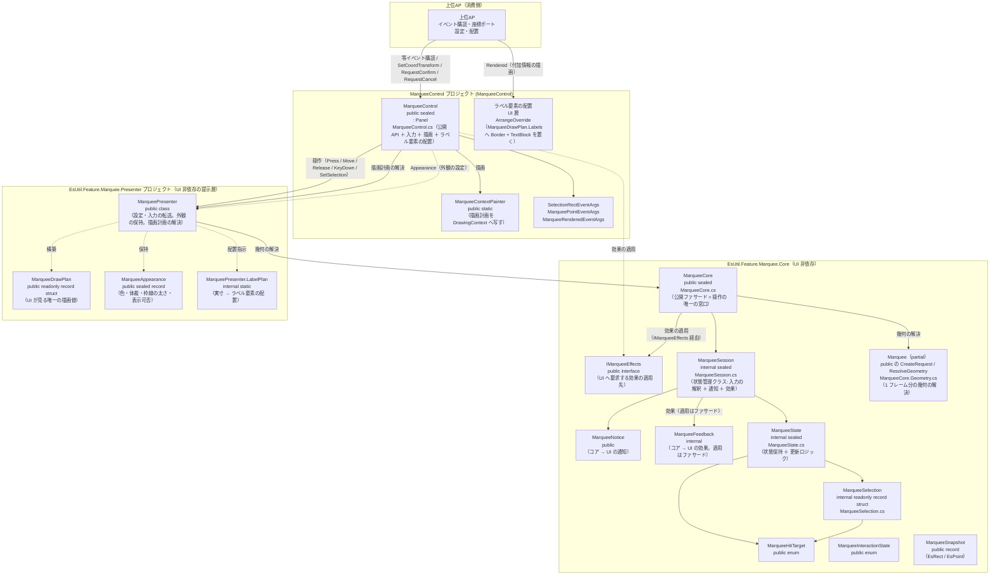
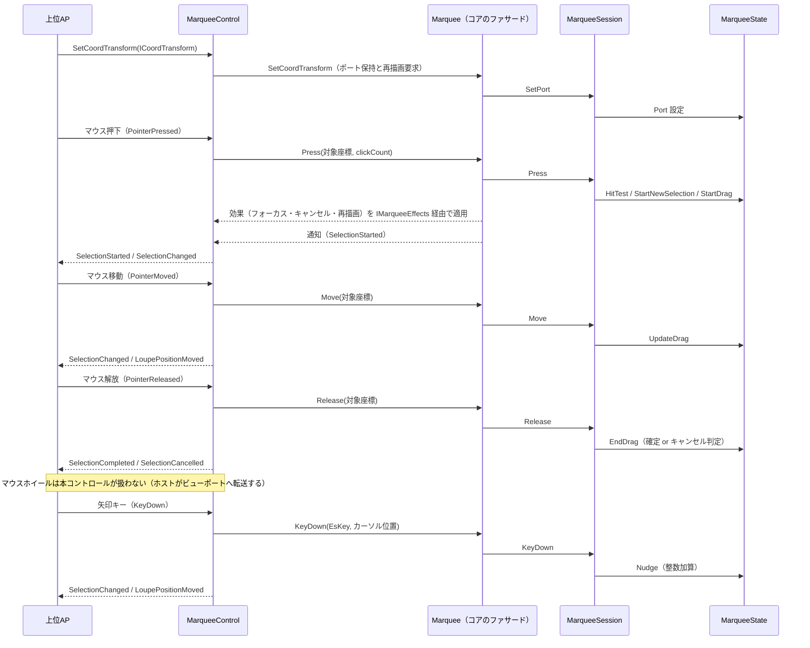

# EsUtil.Feature.Marquee.ControlAvaloniaUI システム仕様書

## 目次

- [MarqueeControl システム仕様書（SPEC\_System）](#esutilfeaturemarqueecontrolavaloniaui-システム仕様書)
  - [目次](#目次)
  - [1. システム概要](#1-システム概要)
  - [2. 技術スタック](#2-技術スタック)
  - [3. アーキテクチャ](#3-アーキテクチャ)
    - [3.1 レイヤー構造](#31-レイヤー構造)
    - [3.2 依存方向](#32-依存方向)
  - [4. 例外処理ポリシー](#4-例外処理ポリシー)
    - [4.1 基本方針](#41-基本方針)
    - [4.2 本プロジェクト固有の例外処理](#42-本プロジェクト固有の例外処理)
  - [5. コンポーネント図](#5-コンポーネント図)
  - [6. コンポーネント一覧](#6-コンポーネント一覧)
    - [6.1 MarqueeControl](#61-marqueecontrol)
    - [6.2 MarqueeCore（公開ファサード・コア）](#62-marqueecore公開ファサードコア)
    - [6.3 MarqueeState](#63-marqueestate)
    - [6.4 MarqueeSelection](#64-marqueeselection)
    - [6.5 MarqueePresenter（EsUtil.Feature.Marquee.Presenter）](#65-marqueepresenteresutilfeaturemarqueepresenter)
    - [6.6 MarqueeAppearance（EsUtil.Feature.Marquee.Presenter）](#66-marqueeappearanceesutilfeaturemarqueepresenter)
    - [6.7 MarqueePresenter.LabelPlan（EsUtil.Feature.Marquee.Presenter）](#67-marqueepresenterlabelplanesutilfeaturemarqueepresenter)
    - [6.8 ラベル要素の配置（本コントロールの内部実装）](#68-ラベル要素の配置本コントロールの内部実装)
    - [6.9 MarqueeContextPainter（本プロジェクト）](#69-marqueecontextpainter本プロジェクト)
    - [6.10 MarqueeCore（コアの幾何解決）](#610-marqueecoreコアの幾何解決)
    - [6.11 MarqueeHitTarget](#611-marqueehittarget)
    - [6.12 公開イベント引数](#612-公開イベント引数)
  - [7. 依存ルール](#7-依存ルール)
  - [8. ライフサイクル](#8-ライフサイクル)
    - [8.1 状態の初期化と破棄（所有権）](#81-状態の初期化と破棄所有権)
  - [9. ログ](#9-ログ)
    - [9.1 ログ定義一覧](#91-ログ定義一覧)
      - [コア（`EsUtil.Feature.Marquee.Core.Logging.MarqueeLogMessage`）](#コアesutilfeaturemarqueecoreloggingmarqueelogmessage)
      - [提示層（`EsUtil.Feature.Marquee.Presenter.Logging.MarqueePresenterLogMessage`）](#提示層esutilfeaturemarqueepresenterloggingmarqueepresenterlogmessage)

---

## 1. システム概要

SaveEvidence は、Windows デスクトップ上の画面をキャプチャし、プレビュー・編集・保存するための Avalonia UI アプリケーションです（.NET 10.0 / C# 14 / MVVM）。

本プロジェクト（MarqueeControl）は、このシステムのうち**領域選択ドラッグ矩形**の UI・操作・描画を自己完結する再利用可能なコントロールです。 上位 AP（Parts.CapturePreviewControl.AvaloniaUI / app）に依存せず、マウス操作・キーボード操作（nudge）・描画をコントロール内で完結します。

## 2. 技術スタック

| 項目 | 内容 |
| --- | --- |
| **プロジェクト** | `MarqueeControl` |
| **ルート名前空間** | `EsUtil.Feature.Marquee.AvaloniaUI` |
| **言語** | C# 14（.NET 10.0） |
| **UI フレームワーク** | Avalonia UI 12.1（Control / StyledProperty / DrawingContext） |
| **ターゲットフレームワーク** | net10.0 |
| **ビルドツール** | MSBuild / .NET SDK 10.0 |
| **ログ** | Microsoft.Extensions.Logging.Abstractions（LoggerMessage ソース生成） |
| **テスト** | xUnit v3 / Avalonia.Headless.XUnit |
| **依存プロジェクト** | EsUtil.Feature.Marquee.Core（公開ファサード・幾何）/ EsUtil.Feature.Marquee.Presenter（描画計画・外観・ラベル計画・組み込み規則）/ Platform.AvaloniaUI（ScreenConverter）/ EsUtil.Platform.Core（`Native.ICursorService` / ICoordTransform / CoordTransform） |

## 3. アーキテクチャ

### 3.1 レイヤー構造

```text
公開コントロール（MarqueeControl）… 入力の受付 / 効果の適用 / 通知の転送 / 描画（自 UI の API）
  → 状態管理クラス（MarqueeSession）… 入力の解釈と状態遷移の判断
    → 状態（MarqueeState）… 状態保持と更新ロジック
      → コア内部の純粋幾何（MarqueeSelection）+ Platform.AvaloniaUI
  → 幾何の解決（コアの MarqueeCore.CreateRequest → MarqueeCore.ResolveGeometry）… 選択の状態 + 設定 → 幾何 1 値（MarqueeGeometry）
  → 描画計画の解決（EsUtil.Feature.Marquee.Presenter の MarqueePresenter.ResolveDrawPlan）… 幾何 + 外観 → 描画計画（MarqueeDrawPlan）
  → 描画（本コントロール）… 描画計画の Layers の順に自 UI の描画 API（DrawingContext）で描く
  → ラベルの配置（本コントロール）… 描画計画の Labels（配置指示）へ `Border` + `TextBlock` を置く（ラベルは常に最上位）
```

### 3.2 依存方向

- 依存は**一方向の階層構造**（MarqueeControl → MarqueeSession → MarqueeState → MarqueeSelection（これらの幾何計算はコア内部の値の振る舞い）/ Platform.AvaloniaUI / EsUtil.Platform.Core（`Native` を含む）。 描画計画は MarqueeControl → MarqueePresenter（EsUtil.Feature.Marquee.Presenter）→ 幾何（EsUtil.Feature.Marquee.Core））。
- MarqueeControl は上位 AP に依存しない（再利用可能）。
- **判断はコア（`MarqueeCore`）・反映は UI**: nudge セッション・ダブルクリックの確定/キャンセル・ハンドルのスナップ・クリック検出・最小サイズによるキャンセルはコアが決め、コントロールは `IMarqueeEffects` を実装して要求された効果を適用するだけにする。
- **描画計画と外観は提示層（`EsUtil.Feature.Marquee.Presenter` の `MarqueePresenter` / `MarqueeAppearance` / `MarqueeDrawPlan` / `MarqueePresenter`（`LabelPlan` partial））が単一所有**し、本コントロールは `Appearance` プロパティで外観を与え、`ResolveDrawPlan` が返す描画計画を自 UI の描画 API（`DrawingContext`）で写すだけです（**描画 API の抽象は持ちません**）。 装飾の**判断**も持ちません（状態（選択矩形・nudge）はコア（`MarqueeState`）に集約する）。
- **装飾（暗転・外枠・ハイライト・内側の塗り）は選択矩形コントロール単体の概念ではない**（組み込み先の表示である）ため、提示層が単一所有します。 本コントロールは `Appearance` で外観（表示可否・太さ・色）を設定し、描画計画の装飾矩形を描きます。
- **文字（サイズラベル・座標ラベル）は本コントロールがテキスト要素（`Border` + `TextBlock`）として配置する**。 配置するラベルの一覧と順序は提示層（`EsUtil.Feature.Marquee.Presenter` の `MarqueePresenter`（`LabelPlan` partial））が単一所有し（ラベルの色とフォントサイズは外観 `MarqueeAppearance` から写す）、本コントロールは自 UI の API（`FormattedText`）で測った実寸を渡して返された配置を要素へ反映する（ラベル要素は子の末尾に置かれ、子は親より後に描かれるため常に最上位）
- 座標変換は `ICoordTransform`（`EsUtil.Platform.Core` 提供）が担い、コントロールは変換関数を生成しない。
- 上位 AP へはイベントのみで通知し、上位 AP はポインター・キーイベントを直接処理しない。

## 4. 例外処理ポリシー

### 4.1 基本方針

- ライブラリは例外を原則伝播し、上位 AP（app）で処理する。
- UI レイヤー（app）ではユーザー操作起因の例外を各ハンドラで catch し、UI の応答性を維持する。
- ログは LoggerMessage ソース生成で出力する。 操作イベントは Debug、Down 直前 / Up 直後の位置は Trace で記録する。 入力判断のログ定義はコア（名前空間 `EsUtil.Feature.Marquee` の `MarqueeLogMessage`）が、提示層が単一所有する設定（外観・表示スケーリング係数）の変更ログは提示層（`EsUtil.Feature.Marquee.Presenter` の `MarqueePresenterLogMessage`）が単一所有し、本プロジェクトはログ定義を持たない

### 4.2 本プロジェクト固有の例外処理

- イベントハンドラ内の例外は握りつぶさず、上位 AP へ伝播する（コントロールの内部状態を不正にしない）。
- 状態は MarqueeState に集約し、クリップ（`MarqueeOptions.ClampToSourceBounds` + `Port.Bounds`）により不正な選択矩形を防止する。

## 5. コンポーネント図



## 6. コンポーネント一覧

### 6.1 MarqueeControl

- **分類**: 公開コントロール（`public sealed class : Panel`。 XAML を持たずコードのみで子要素を構成する）
- **責務**:
  - ポインターイベント（Pressed / Moved / Released）をコア型へ変換してコア（ファサード）へ通知する
  - キーイベント（矢印キー・Escape / Enter）を `EsKey` へ変換してコアへ通知する。 購読は **TopLevel の 1 経路のみ**（フォーカス非依存）
  - コアが要求する効果（カーソル操作・フォーカス・カーソル形状・再描画）を `IMarqueeEffects` 実装で受けて適用する（効果の選択と適用順はコアが単一所有）
  - コアからの通知を公開イベントへ転送する（判断はしない）
  - 描画（`Render`）を起動し、提示層（`EsUtil.Feature.Marquee.Presenter` の `MarqueePresenter.ResolveDrawPlan`）が返した描画計画（`MarqueeDrawPlan`）を**自 UI の描画 API（`DrawingContext`）で写す**（`MarqueeContextPainter`）。 **サイズ・座標ラベルはテキスト要素として配置する**（子の末尾に置かれ常に最上位）。 描画のたびに `Rendered`（描画計画全体）を発火してホストへ渡す（ホストは付加情報を描ける）
  - ホイール操作は**扱わない**（コントロール化を前提とした処理のためホストが行う。 本コントロールはイベントを素通しし、`e.Handled` を立てない）
  - **全面を当たり判定の対象にする**（透明の背景（`Background`）を設定する。 図形は子の `ShapeLayer` が描き、当たるのは `ShapeLayer` 自身になるため、背景が無いと本コントロールは押下を受け取れない。 透明は描画結果を変えない）
  - 表示の変化（パン・ズーム）への追従（`RefreshOverlay()`：再描画とルーペ位置の再計算）
  - **図形の再描画は子の描画層（`ShapeLayer`）へも要求する**（`InvalidateRender()` が単一所有する）。 子は自分の描画リストを持つため、親の `InvalidateVisual` だけでは図形が更新されない（実際に選択矩形が表示されない不具合として発生した）
  - 設定（寸法・表示可否・対話パラメータ・色）・環境値（倍率）・文言プロバイダの保持とファサード（色は描画実装）への伝搬
- **公開API**:
- イベント 8 種: `SelectionStarted` / `SelectionChanged` / `SelectionCompleted` / `SelectionCancelled` / `LoupePositionMoved` / `ConfirmRequested` / `CancelRequested` / `Rendered`（描画完了。 描画コンテキストと描画内容を渡し、ホストは付加情報（操作・情報ラベル）を描ける。 サイズ・座標ラベルはコントロールがテキスト要素として表示する）。 **生のポインター入力（Mouse 系）は公開しない**（ホストは自 UI の入力イベントを使う。 押下状態は `CurrentSnapshot.IsMouseDown`）
  - StyledProperty 4 種: `Options`（不変の設定値 `MarqueeOptions`。 寸法・対話パラメータを内包） / `Appearance`（外観の単一値 `MarqueeAppearance`） / `ClientToSourceScaling` / `DisplayScaleScaling`（環境値。 XAML のバインディング・スタイルで設定できるよう依存関係プロパティとして公開する）。 設定はコア（ファサード）または提示層（外観）へ委譲する（MewUI 版と同じ形）
  - プロパティ: `Log`（保持・`NullLogger` へのフォールバックはコアが単一所有） / `SizeLabelOverrideProvider`（外側の装飾のラベル文言。 デリゲートのため設定値に含めない） / `HasSelection` / `SelectionSourceRect`
  - メソッド: `SetCoordTransform(ICoordTransform?)` / `SetSelection` / `ResetSelection` / `RequestCancel` / `RequestConfirm` / `RefreshOverlay` / **`InvalidateRender()`**（描画に関わる変更の唯一の入口。 図形の層・ラベル・配置をまとめて無効化する）
- **構成（薄い層）**: 公開 API・入力の受付・効果の適用・通知の転送・描画の起動のみを集約し、判断（状態遷移・確定/キャンセル・スナップ・クリック検出・装飾の描画内容）と描画の手順はコアと描画層へ委譲する
- **依存**: MarqueeCore（公開ファサード）/ IMarqueeEffects / MarqueeSession（間接） / MarqueeOptions / MarqueeNotice / MarqueeGeometry（EsUtil.Feature.Marquee.Core）/ MarqueePresenter（描画計画と配置の写像）/ MarqueeAppearance / MarqueeDrawPlan（EsUtil.Feature.Marquee.Presenter）/ ICoordTransform（EsUtil.Platform.Core）/ ICursorService（EsUtil.Platform.Core の `Native`）/ ScreenConverter（Platform.AvaloniaUI）

### 6.2 MarqueeCore（公開ファサード・コア）

- **分類**: ファサードクラス（`public sealed class`・コア提供。 適用パターン: Facade）
- **責務**: Marquee の**操作の唯一の窓口**。 UI 層とホストは本型だけを参照する
  - 操作の提供: `Press` / `Move` / `Release` / `KeyDown` / `EndNudge` / `SetSelection` / `ResetSelection` / `RequestConfirm` / `RequestCancel` / `ResolveDrawPlan`
  - 設定・環境値の保持: `Options` / `Appearance` / `ClientToSourceScaling` / `DisplayScaleScaling` / `SizeLabelOverrideProvider` / `Log` / `SetCoordTransform`
  - 効果の適用: `IMarqueeEffects`（UI が実装）へフォーカス・再描画・カーソル形状・ポインターキャプチャ・座標変換を要求する（適用順の単一所有）
  - ホイール操作はホストが行う（本コントロールは通知も要求も持たない。 コントロール化を前提とした処理は UI 層の責務である）
  - 通知: `Notified`（状態機械の通知をそのまま転送する）
- **内部実装**: 状態機械 `MarqueeSession`（`internal`）を保持・利用する（幾何の解決は同じ型の `MarqueeCore.Geometry.cs`（partial）の公開メソッド `CreateRequest` / `ResolveGeometry` として実装する）
- **可視性**: public（ファサードのみ。 内部の状態機械は `internal` で隠す）
- **備考**: 設定・効果の適用・通知の転送・描画内容の解決を 1 型に集約したため、UI 層は自 UI の公開プロパティ・公開イベント・描画 API へつなぐだけになる（ホイールは本コントロールも提示層も扱わず、ホスト（UI 層）がビューポートへ転送する）

### 6.3 MarqueeState

- **分類**: 内部状態クラス（`internal sealed class`・コンポジション。 コア提供）
- **責務**:
  - 選択矩形・ドラッグ状態・アクティブハンドル・nudge 状態（基点＋累積オフセット）の保持
  - 純粋ロジック: `HitTest` / `StartNewSelection` / `StartDrag` / `UpdateDrag` / `EndDrag` / `Nudge` / `GetInteractionState` / `CreateSnapshot`（幾何計算は `MarqueeSelection` へ委譲する）
  - クリップ（`MarqueeOptions.ClampToSourceBounds` + `Port.Bounds` による境界内制限。 境界 Rect 生成は `GetBoundsRect` に一元化）
  - カーソル操作（`ICursorService`）
  - nudge 終了の共通化（`EndNudge`。 `Reset` / `SetSelection` / `MarqueeSession` から共用し、カーソル再表示を委譲）
- **可視性**: internal（本コントロールはコアの公開ファサード（`MarqueeCore`）と公開型（`MarqueeSnapshot`）のみを使う。 `MarqueeState` / `MarqueeSession` はコアの内部実装であり参照しない）
- **依存**: MarqueeSelection / MarqueeHitTarget / ICoordTransform（EsUtil.Platform.Core）/ ICursorService（EsUtil.Platform.Core の `Native`）

### 6.4 MarqueeSelection

- **分類**: 静的クラス（`internal static class`・コア内部。 本プロジェクトは参照しない）
- **責務**: 選択矩形の純粋な幾何計算（正規化・ハンドル位置・ヒットテスト・対角計算）。 ハンドル位置を使うのはコアの状態機械と描画内容の解決であり、**UI 層へは解決済みの矩形が渡る**
- **可視性**: internal（コア内部。 本プロジェクトは参照しない）
- **依存**: UI 非依存（`EsUtil.Feature.Marquee.Core` の `EsPoint` / `EsRect`）

### 6.5 MarqueePresenter（EsUtil.Feature.Marquee.Presenter）

- **分類**: 公開クラス（`public class`。 `sealed` にしない。 所属は UI 非依存の提示層 `EsUtil.Feature.Marquee.Presenter`）
- **責務**: コアのファサードを内部に保持し、設定・環境値・入力の転送と、外観（`MarqueeAppearance`）の保持、描画計画（`MarqueeDrawPlan`）の解決（`ResolveDrawPlan`）を行う
- **可視性**: public（UI 実装・独自コントロールの作者が参照する）
- **特徴**: **描画は行わない**（描画計画というデータを返す）。 継承して `ResolveDrawPlan` を上書きすることで独自の見た目を提供できる（`sealed` にしない理由）
- **依存**: EsUtil.Feature.Marquee.Core（幾何・判断）/ EsUtil.Platform.Core（`Es*` 値型）

### 6.6 MarqueeAppearance（EsUtil.Feature.Marquee.Presenter）

- **分類**: 公開 sealed record（所属は UI 非依存の提示層）
- **責務**: 描画に使う色・ラベルの体裁（フォントサイズ・内側余白）・枠線の太さ・表示可否の単一所有者
- **可視性**: public（UI 実装・ホストが参照する）
- **特徴**: 枠線の太さの安全域への補正はコアの `MarqueeCore.Limits.CoerceBorderThickness` へ委譲する。 表示可否の述語（`ShouldShowSizeLabel` / `ShouldShowCoordLabel` / `ShouldDrawOverlay`）を持つ
- **依存**: EsUtil.Feature.Marquee.Core（`MarqueeCore.Limits`）/ EsUtil.Platform.Core（`EsRect`）

### 6.7 MarqueePresenter.LabelPlan（EsUtil.Feature.Marquee.Presenter）

- **分類**: 公開静的クラス（所属は UI 非依存の提示層）
- **責務**: 実寸（描画 API の測定値）からラベル要素の配置指示（`MarqueeLabelPlacement`）を解決する（一覧と順序を単一所有する）
- **可視性**: public（UI 実装が参照する）
- **特徴**: 文言と基準点は提示層（`MarqueePresenter`（`LabelTexts` partial） / `MarqueePresenter`）が単一所有し、体裁（フォントサイズ・色・内側余白）は `MarqueeAppearance` から写す。 **要素として置くか canvas へ描くかは UI 層が決める**
- **依存**: EsUtil.Platform.Core（`Es*` 値型）/ `MarqueeLabelPlacement` / `MarqueeAppearance`（同層）

### 6.8 ラベル要素の配置（本コントロールの内部実装）

- **分類**: `MarqueeControl` の内部実装（`ArrangeOverride` と `SyncLabels` / `Apply` / `MeasureText`。 独立し た型ではない）
- **責務**: 描画計画のラベル（サイズ・カーソル座標）をテキスト要素（`Border` + `TextBlock`）として配置する
- **可視性**: 非公開（ホストは `Rendered` の `Content`（描画計画）を参照できる）
- **特徴**: 文言と基準点は提示層の `MarqueePresenter`（`LabelTexts` partial） が、体裁は `MarqueeAppearance` が単一所有し、実寸からの配置矩形は `MarqueePresenter`（`LabelPlan` partial） が単一所有する。 本実装は実寸測定（**`Platform.AvaloniaUI.Imaging` の `AvaloniaTextMeasure` へ委譲する**。 実寸を返さないと背景が内側余白だけの大きさになり文字が切り落とされる）と要素への反映（`Border` の余白・大きさ・位置、`TextBlock` の文言・文字サイズ ・色）を持つ。 色 → ブラシは `SolidColorBrushCache`（`Platform.AvaloniaUI.Imaging`）が単一所有する
- **依存**: Avalonia（`FormattedText` / テキスト要素）/ EsUtil.Feature.Marquee.Presenter（`MarqueePresenter`（`LabelPlan` partial） / `MarqueeLabelPlacement` / `MarqueeAppearance`）/ Platform.AvaloniaUI（色変換・ブラシキャッシュ）

### 6.9 MarqueeContextPainter（本プロジェクト）

- **分類**: 公開静的クラス（`public static class`。 本プロジェクトが所有する）
- **責務**: 描画計画（`MarqueeDrawPlan`）を Avalonia の `DrawingContext` へ写す（層の順に描く）
- **可視性**: public（独自コントロールの作者が参照する）
- **特徴**: 描画計画の項目はすべて解決済みであるため、本クラスは図形の描画 API を呼ぶだけであり、判断も計算も持たない。 色 → ブラシ・ペンは容量制限付きのキャッシュ（`Platform.AvaloniaUI.Imaging`）が単一所有する
- **依存**: Avalonia（`DrawingContext`）/ EsUtil.Feature.Marquee.Presenter（`MarqueeDrawPlan`）/ Platform.AvaloniaUI（色変換・キャッシュ）

### 6.10 MarqueeCore（コアの幾何解決）

- **分類**: 公開ファサード（`public sealed partial class`）の**幾何解決の部分**（`MarqueeCore.Geometry.cs`。 コア提供）
- **責務**: 1 フレーム分の幾何（注目矩形・ハンドル・始点マーカー・マウス位置）を解決する（`MarqueeRenderRequest` → `MarqueeGeometry`）
- **可視性**: `ResolveGeometry` / `CreateRequest` は public（写し・ホストが使う窓口）。 内部手順（ハンドル・マーカー）は private
- **特徴**: 選択矩形と選択の有無は**セッションが単一のソース**であり、設定値には選択の状態を持たせない。 **描く値の無い項目は null / 空で返す**（注目矩形なし・選択なし・nudge 中でない）。 **表示可否は本コアの責務ではなく、提示層の外観（`MarqueeAppearance`）が単一所有する**

### 6.11 MarqueeHitTarget

- **分類**: 公開 enum
- **責務**: ドラッグハンドルの種別（ヒットテスト・矩形変形・nudge・描画で共通利用）
- **可視性**: public（上位 AP がカーソル形状のマッピングに使用するため）

### 6.12 公開イベント引数

- `MarqueeInteractionState` enum（public）: NoSelection / StartPointNudging / Dragging / DraggingNudging / Selected / SelectedNudging
- `MarqueeSnapshot` readonly record struct（public）: State / SelectionSourceRect / ActiveTarget / MousePosition / IsMouseDown / NudgeActive / HasSelection。 座標は UI 非依存の `EsRect` / `EsPoint`（各 UI の境界で自前の型へ変換する）。 値型のため通知のたびにヒープを確保しない
- `SelectionRectEventArgs`（public）: Rect（Avalonia）+ Snapshot
- `MarqueePointEventArgs`（public）: Point（Avalonia）+ Snapshot
- `MarqueeRenderedEventArgs`（public）: Context（`DrawingContext`。 描画中のみ有効）+ Content（`MarqueeDrawPlan`。 描画計画）

## 7. 依存ルール

- 依存方向は**一方向の階層構造**です（層の全体像は [`src/README.md`](../README.md)）。 コア内部は MarqueeControl → Marquee（ファサード） → MarqueeSession → MarqueeState → MarqueeSelection（幾何計算はコア内部の値の振る舞いに閉じる）、提示層は MarqueeControl → MarqueePresenter（EsUtil.Feature.Marquee.Presenter）→ 幾何（EsUtil.Feature.Marquee.Core）。
- MarqueeControl は上位 AP に**依存しない**（再利用可能）。
- 判断（状態遷移・確定/キャンセル・スナップ・クリック検出）はコアの `MarqueeCore`（内部の `MarqueeSession`）に集約し、UI 層は効果（`IMarqueeEffects`）を適用するだけにする。
- 描画計画（層の順序・装飾矩形・文言・配置）と外観（色・フォント・枠線の太さ・表示可否）は提示層（`EsUtil.Feature.Marquee.Presenter` の `MarqueePresenter` / `MarqueeAppearance` / `MarqueeDrawPlan`）が単一所有し、**描画は本コントロールが自 UI の API（`DrawingContext`）で行う**（`MarqueeContextPainter`。 描画 API の抽象は持たない）。 状態（選択矩形・nudge）は MarqueeState に集約し、装飾の**判断**は持たない。
- **サイズ・カーソル座標ラベルはコントロールがテキスト要素として配置する**（配置矩形は提示層 `EsUtil.Feature.Marquee.Presenter` の `MarqueePresenter`（`LabelPlan` partial） が実寸から求める）。 操作・情報ラベルはホストが `Rendered` のハンドラで描く。 `Rendered` の契約は描画計画全体であるため、ホストは付加情報以外の参照もできる。
- 座標変換は `ICoordTransform`（`EsUtil.Platform.Core` 提供）が担い、コントロールは変換関数を生成しない。
- 上位 AP へはイベントのみで通知し、上位 AP はポインター・キーイベントを直接処理しない。
- **キーイベントは 1 経路で受ける**（TopLevel のトンネル購読）。 コントロール自身のキーハンドラを持たないため、同一キーの二重処理を防ぐ仕組み（フラグ等）が不要になる。 トンネルはルートから下降するため、祖先のバブリングハンドラより先に処理済みにできる。

## 8. ライフサイクル



### 8.1 状態の初期化と破棄（所有権）

- コントロール自身が保持する状態（選択矩形・nudge 状態）は `ResetSelection()` で初期化します（上位 AP は状態をポーリングせず、イベントで把握）。
- 上位 AP はコントロールを Visual Tree から除去するだけで破棄できます（所有権は上位 AP にあり、明示的な解放 API は不要）。
- ビジュアルツリー切断時（`OnDetachedFromVisualTree`）は TopLevel キー購読・ScrollViewer 購読を解除し、コア（`MarqueeCore.ResetSelection`）へ対話状態の初期化を要求します（nudge 中ならポインターを再表示して選択状態を初期化。 「切断」自体は UI のライフサイクルであるため、コアに専用 API は持ちません）。

## 9. ログ

ログ定義はコア（`EsUtil.Feature.Marquee.Core.Logging.MarqueeLogMessage`、`src/EsUtil.Feature.Marquee.Core/src/Core/Logging/MarqueeLogMessage.cs`）と、提示層（`EsUtil.Feature.Marquee.Presenter.Logging.MarqueePresenterLogMessage`）が単一所有する
（入力の判断に伴うログは UI から出せず、後から出すと行の順序が変わるため）。 UI 層に固有のログ定義は持たない
（通常ホイールのスクロールログは、スクロールの実行をホスト（連携 `ScrollViewer` 等）へ委ねる形になり、
本コントロール内に記録すべき判断が無くなったため削除した）。
各メソッドは `this ILogger` 第一引数で定義し、呼び出し側では logger 引数を省略する。 未設定（null）の場合は `NullLogger` で無出力。
出力先・レベル制御はホストアプリケーションが所有する（定義のみ）。 マウス移動の高頻度ログは行わない（Down 直前・Up 直後の位置のみ `Trace` で記録）。

### 9.1 ログ定義一覧

#### コア（`EsUtil.Feature.Marquee.Core.Logging.MarqueeLogMessage`）

| レベル | メソッド | 出力内容 |
| --- | --- | --- |
| `Debug` | `MarqueeLogMessage.LogMouseDown` | ポインター押下（位置 / クリック数 / 選択有無） |
| `Debug` | `MarqueeLogMessage.LogMouseUp` | ポインター解放（位置 / ドラッグ有無 / 選択有無） |
| `Debug` | `MarqueeLogMessage.LogDoubleClick` | ダブルクリック（位置 / 選択内側か） |
| `Debug` | `MarqueeLogMessage.LogDragStart` | ドラッグ開始（ハンドル / 位置）。 新規選択も `handle=None` として記録する |
| `Debug` | `MarqueeLogMessage.LogKeyDown` | キー入力（キー名 / 処理有無） |
| `Debug` | `MarqueeLogMessage.LogConfirmRequested` | 確定要求（矩形） |
| `Debug` | `MarqueeLogMessage.LogCancelRequested` | キャンセル要求 |
| `Trace` | `MarqueeLogMessage.LogPositionBeforeDown` | Down 直前のマウス位置 |
| `Trace` | `MarqueeLogMessage.LogPositionAfterUp` | Up 直後のマウス位置 |
| `Debug` | `MarqueeLogMessage.LogSettingChanged` | 設定値変更（変更前後） |

#### 提示層（`EsUtil.Feature.Marquee.Presenter.Logging.MarqueePresenterLogMessage`）

| レベル | メソッド | 出力内容 |
| --- | --- | --- |
| `Debug` | `MarqueePresenterLogMessage.LogSettingChanged` | 本層が所有する設定（表示スケーリング係数）の変更（変更前後） |
| `Debug` | `MarqueePresenterLogMessage.LogAppearanceChanged` | 外観（色・フォントサイズ・枠線の太さ・表示可否）の変更（変化した項目だけ） |
