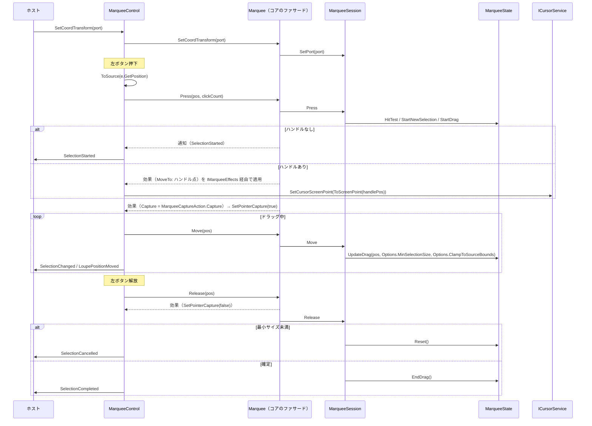
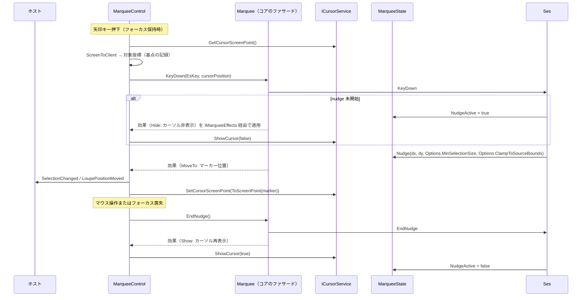
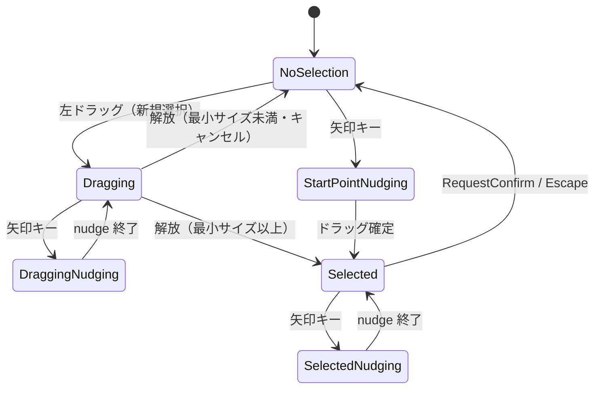

# EsUtil.Feature.Marquee.ControlMewUI システム仕様書

MarqueeControl（MewUI 版）のシステム概要・アーキテクチャ・依存関係・設計判断を記載します。

## システム概要

`EsUtil.Feature.Marquee.ControlMewUI` は、Avalonia 版 `MarqueeControl` と**同一の UI 非依存コア（`EsUtil.Feature.Marquee.Core`）と描画層（`EsUtil.Feature.Marquee.Presenter`）**を使い、
入力の受付・効果の適用・通知の転送・描画ポートの適合のみを MewUI（SkiaSharp）で実装したドラッグ矩形コントロールです。

コアが担う範囲（選択矩形の正規化・ハンドル位置・ヒットテスト・ドラッグ変形・nudge・境界クリップ・対話状態の合成に加えて、
nudge セッション・ダブルクリックの確定/キャンセル・ハンドルのスナップ・クリック検出・最小サイズによるキャンセルの判断）は
両 UI で完全に共通であり、本プロジェクトは入力をコア（公開ファサード `MarqueeCore`）へ通知し、返された効果を適用し、描画計画（提示層の `MarqueePresenter.ResolveDrawPlan`）を自 UI の描画 API（Skia）で描きます。

## 技術スタック

| 区分 | 採用技術 |
| --- | --- |
| 対象フレームワーク | .NET 10（`net10.0`） |
| 言語 | C# 14 |
| UI フレームワーク | MewUI（`Aprillz.MewUI.Skia` **0.21.1 固定**） |
| 描画 | SkiaSharp（本プロジェクトが自 UI の描画 API で描画計画を写す。 描画の部品は `Platform.Skia`） |
| 基底コントロール | `Aprillz.MewUI.Skia.Controls.SkiaCanvasView` |
| プロパティシステム | `MewProperty<T>`（`MewPropertyOptions.AffectsRender`） |
| カーソル操作 | `ICursorService`（`EsUtil.Platform.Core` の `Native`。 既定実装は `Native.Win`） |

## アーキテクチャ

### 依存方向

層の全体像（Core / Presenter / UI）は [`src/README.md`](../README.md) を参照してください。

```text
UI 層（EsUtil.Feature.Marquee.ControlAvaloniaUI / EsUtil.Feature.Marquee.ControlMewUI）
  入力の受付・効果の適用・通知の転送・描画（自 UI の描画 API）・ラベル要素の配置
    ├──> EsUtil.Feature.Marquee.Presenter   どう見せるか（描画計画の解決）＋ 外観 ＋ 組み込み先があるときだけ必要な規則
    └──> EsUtil.Feature.Marquee.Core   何を計算するか + 判断（状態・値・純粋計算・コア⇔UI の契約）
           └──> EsUtil.Platform.Core（Es* 値型・ICoordTransform・ICursorService）
※ Core は提示層を参照しない（提示層がコアの幾何を使う向きだけ）。
※ 本コントロール（UI 層）は EsUtil.Platform.Core（Win32 実装は `Native.Win`）・Platform.MewUI・Platform.Skia も参照する。
```

### 責務の分担

| 層 | 責務 |
| --- | --- |
| `EsUtil.Feature.Marquee.Core` | 選択矩形の幾何計算、ヒットテスト、ドラッグ変形、nudge、境界クリップ、対話状態の合成、スナップショット生成、**入力の解釈（nudge セッション・確定/キャンセル・スナップ・クリック検出・最小サイズ判定）と通知・効果の生成（効果の適用順、ログの保持を含む）**。 公開ファサード `MarqueeCore` を唯一の窓口とし、状態機械と幾何の解決は内部契約（`internal`）とする |
| `EsUtil.Feature.Marquee.Presenter` | 描画計画（層の順序・装飾矩形・文言・配置）と外観（`MarqueeAppearance`）とラベル計画（実寸 → 配置指示）。 UI 非依存であり、UI フレームワークを参照しない |
| `EsUtil.Feature.Marquee.ControlMewUI` | 入力（マウス・キー）をコア型へ変換して提示層へ通知する、`IMarqueeEffects` を実装して要求された効果（再描画・フォーカス・マウスキャプチャ・カーソル形状/操作）を適用する、通知を公開イベントへ転送する、**描画計画を自 UI の描画 API（Skia）で描く**、DPI の追従 |
| ホスト | 座標変換ポートの設定、選択の復元・確定・キャンセル、重ね順の管理、ビューポート変化の通知 |

### 設計判断

| 判断 | 理由 |
| --- | --- |
| 状態機械（`MarqueeState`）と入力の判断（`MarqueeSession`）をコアに置き、UI 側は入力の変換と効果の適用のみを行う | 本コントロールの本体は「状態遷移 + 幾何 + 入力の解釈」であり、UI に残すと MewUI 版で丸ごと書き直しになる |
| コアの操作を公開ファサード `MarqueeCore` に一本化し、状態機械とフレーム解決を `internal` にする | 操作の入口が 1 つになり、UI 層がコアの内部契約へ踏み込む余地がなくなる（両 UI で同じ窓口を使う） |
| イベント引数をコア型（`EsPoint` / `EsRect`）で公開する | コアの状態機械と同一の型になり境界変換が不要になる。 MewUI の `Rect` は負のサイズを 0 にクランプするため、`EsRect` のほうが安全 |
| カーソルサービスの既定実装の解決を UI 層で行う | コアは既定実装（`Native.Win`）を知らず、抽象と `null` のみを扱う（既定実装の選択は組み込み先＝UI 層の責務） |
| `SkiaCanvasView`（`Control` 系）を基底にする | 画像の上へ重ねるオーバーレイであり、子要素を持たない。 背景を塗らないため下の画像が透ける |
| `ScrollViewer` を自動購読しない | MewUI 版の画面構成（`Grid` 重ね合わせ）では祖先探索の前提が異なる。 表示の変化はホストが検知して `RefreshOverlay()` で再描画を要求する |
| ホイール操作を扱わない | コントロール化を前提とした処理であり、ホストが `MouseWheel` を購読してビューポートへ転送する（本コントロールは素通しする） |
| マウスダウン・アップのイベントを公開しない | `UIElement` が同名メンバー（＝同じ情報を提供するイベント）を持つため、本コントロールでは公開しない（重複を避ける） |
| ログの出力先を持つ | 入力を持つコントロールは操作ログが必要（上位 AP はドラッグ・nudge 用のキー・マウスイベントを直接検出しないため）。 既定は `NullLogger` で、ホストが `Log` プロパティで注入する（保持・フォールバック・ファサードへの伝搬はコアが単一所有する） |

## コンポーネント構成

```text
src/EsUtil.Feature.Marquee.ControlMewUI/
├── src/
│   ├── MarqueeControl.cs                 公開 API・入力の受付と効果の適用・カーソル制御・描画（描画計画を Skia で写す。ラベル要素の配置も含む）
│   ├── MarqueeSkiaPainter.cs             描画計画を Skia のキャンバスへ写す（層の順に描く）
│   ├── ラベルの要素配置（ArrangeContent）        内部: ラベル要素（Border + TextBlock）の追加・更新と配置
│   ├── MarqueeRenderedEventArgs.cs        描画完了通知のイベント引数（サイズ・座標ラベルはコントロールが表示する）
│   ├── MarqueePointEventArgs.cs          座標通知のイベント引数
│   └── SelectionRectEventArgs.cs          選択矩形通知のイベント引数
└── tests/
    ├── RecordingLogger.cs                ログ出力を収集するテスト用 ILogger
    └── MarqueeControl.Tests.cs          公開 API・プロパティ・イベントの検証
```

| コンポーネント | 責務 |
| --- | --- |
| `MarqueeControl` | `MewProperty` の定義、入力の対象変換と提示層への通知、`IMarqueeEffects` の実装（効果の適用）、マウスキャプチャの取得/解放、DPI 変更の追従、描画計画の自 UI への写し（`MarqueeSkiaPainter`）、子要素（図形キャンバス・ラベル要素）の計測と配置、付加情報の描画機会の通知（`Rendered`） |
| `MarqueePresenter`（提示層） | 幾何（コア）と外観から描画計画（`MarqueeDrawPlan`）を解決する。 継承して `ResolveDrawPlan` を上書きすることで独自の見た目を提供できる |
| `MarqueeAppearance`（提示層） | 色・ラベルの体裁・枠線の太さ・表示可否の単一所有者 |
| `MarqueeSkiaPainter`（本プロジェクト） | 描画計画を層の順に Skia のキャンバスへ写す。 **選択枠線は描かない**（装飾の外枠が同じ矩形を描くため）。 **サイズ・座標ラベルも描かない**（コントロールがテキスト要素として表示する） |
| UI 層のラベル要素 | 親パネルの子要素（`Border` + `TextBlock`）としてサイズ・座標ラベルを配置する。 文言と基準点は提示層が、色とフォントサイズは `MarqueeAppearance` が単一所有し、実寸から配置矩形を求める写像は `MarqueePresenter`（`LabelPlan` partial）（提示層）が単一所有する |
| `MarqueePointEventArgs` / `SelectionRectEventArgs` / `MarqueeRenderedEventArgs` | 通知時点の座標（矩形）とスナップショットの組・描画完了（描画先と描画内容の契約） |

## クラス図

```mermaid
classDiagram
    class SkiaCanvasView {
        <<Aprillz.MewUI.Skia>>
        +PaintSurface
        +ContinuousAnimation
        +MeasureContent(size) Size
        +OnMouseDown(e) void
        +OnMouseMove(e) void
        +OnMouseUp(e) void
        +OnMouseWheel(e) void
        +OnKeyDown(e) void
        +OnDpiChanged(oldDpi, newDpi) void
    }
    class MarqueeControl {
        +MarqueeOptions Options
        +MarqueeAppearance Appearance
        +double ClientToPixelScaling
        +MarqueeSnapshot CurrentSnapshot
        +SetCoordTransform(port) void
        +SetSelection(rect) void
        +ResetSelection() void
        +RequestConfirm() void
        +RequestCancel() void
        +RefreshOverlay() void
        -OnPaintSurface(canvas, info) void
        -OnNotified(notice) void
        -ToScreen(sourcePos) EsPointInt
        -CaptureMouse(capture) void
    }
    class MarqueeCore {
        <<EsUtil.Feature.Marquee.Core / 公開ファサード>>
        +Press(pos, clickCount) void
        +Move(pos) void
        +Release(pos) void
        +KeyDown(key, cursorPos) bool
        +EndNudge() void
        +SetSelection(rect) void
        +RequestConfirm() / RequestCancel() void
        +SetCoordTransform(port) void
        +ResolveGeometry(request) MarqueeGeometry
        +Notified
    }
    class IMarqueeEffects {
        <<EsUtil.Feature.Marquee.Core / UI が実装>>
        +RequestFocus() / RequestRedraw()
        +SetCursorShape(kind) / SetPointerCapture(capture)
        +ToScreenPoint(sourcePoint) EsPointInt
    }
    class MarqueeSession {
        <<internal / EsUtil.Feature.Marquee.Core>>
        +Press(pos, clickCount) MarqueeFeedback
        +Move(pos) MarqueeFeedback
        +Release(pos) MarqueeFeedback
        +KeyDown(key, cursorPos) MarqueeFeedback
        +NudgeByKey(key, cursorPos) MarqueeFeedback
        +EndNudge() MarqueeFeedback
        +SetSelection(rect) MarqueeFeedback
        +SetPort(port) void
        +Notified EventHandler~MarqueeNotice~
    }
    class MarqueeNotice {
        <<EsUtil.Feature.Marquee.Core>>
        +MarqueeNoticeKind Kind
        +EsPoint Position
        +MarqueeSnapshot Snapshot
    }
    class MarqueeFeedback {
        <<internal / EsUtil.Feature.Marquee.Core>>
        +bool Handled / Redraw / RequestFocus
        +bool UpdateCursorShape / MarqueeCursorKind CursorKind
        +MarqueeCursorActions Cursor / EsPoint CursorSourcePosition
        +MarqueeCaptureAction Capture
    }
    class MarqueePresenter {
        <<EsUtil.Feature.Marquee.Presenter / 提示層>>
        +MarqueePresenter(effects, cursor, options) void
        +MarqueeAppearance Appearance
        +ResolveDrawPlan(clientSize, measureText) MarqueeDrawPlan
    }
    class MarqueeAppearance {
        <<EsUtil.Feature.Marquee.Presenter / 提示層>>
        +DrawingColor HandleColor / HandleBorderColor / MarkerColor
        +DrawingColor SizeLabelColor / SizeLabelBackgroundColor
        +DrawingColor CoordLabelColor / CoordLabelBackgroundColor
        +double SizeLabelFontSize / CoordLabelFontSize
        +DrawingColor OverlayColor / OuterBorderColor
        +DrawingColor InnerFillColor / InnerBorderColor
        +double OuterBorderThickness / InnerBorderThickness
        +bool ShowHandles / ShowSizeLabel / ShowCoordLabel
        +bool ShowOverlay / ShowOuterBorder / ShowFullOverlay
        +bool ShowInnerFill / ShowInnerBorder
    }
      class MarqueeSkiaPainter {
        <<本プロジェクト（UI 層）>>
        +Paint(canvas, plan)$ void
      }
      class ラベル要素の配置 {
        <<内部（親パネルの子要素）>>
        +SyncLabelElements(count) void
        +ApplyLabelElement(border, element)$ void
      }
      class MarqueeOptions {
          <<EsUtil.Feature.Marquee.Core>>
          +double HandleSize / HandleBorderThickness
        +double MarkerLength
          +double HandleHitRadius / MinSelectionSize
          +bool ClampToSourceBounds
      }
      class MarqueeLimits {
          <<EsUtil.Feature.Marquee.Core / MarqueeCore.Limits>>
          +CoerceHandleSize(value)$ double
          +CoerceMarkerLength(value)$ double
          +CoerceHandleHitRadius(value)$ double
          +CoerceMinSelectionSize(value)$ double
          +CoerceClientToSourceScaling(value)$ double
          +CoerceBorderThickness(value)$ double
      }
    class MarqueeLabelPlacement {
        <<EsUtil.Feature.Marquee.Presenter>>
        +EsRect Bounds
        +double PaddingX / PaddingY
        +string Text
        +double FontSize
    }
    class MarqueeState {
        <<EsUtil.Feature.Marquee.Core>>
        +EsRect SelectionSourceRect
        +ICoordTransform Port
        +GetInteractionState() MarqueeInteractionState
        +CreateSnapshot(mousePosition) MarqueeSnapshot
        +HitTest(pos, radius) MarqueeHitTarget
        +StartNewSelection(pos) void
        +StartDrag(handle, pos) void
        +UpdateDrag(pos, minSize, clamp) void
        +EndDrag() void
        +Nudge(dx, dy, minSize, clamp) void
        +GetMarkerPosition() EsPoint
        +ClampSelectionToBounds() bool
    }
    class MarqueeSelection {
        <<EsUtil.Feature.Marquee.Core>>
        +GetHandlePosition(rect, handle)$ EsPoint
        +IsNear(p1, p2, radius)$ bool
        +ComputeDragRect(...)$ EsRect
        +ClampRectToBounds(...)$ EsRect
        +ClampRectToSourceBounds(...)$ EsRect
    }
    class ICursorService {
        <<EsUtil.Platform.Core>>
        +GetCursorScreenPoint() EsPointInt
        +SetCursorScreenPoint(point) void
        +ShowCursor(show) void
    }

    SkiaCanvasView <|-- MarqueeControl
    MarqueeControl *-- MarqueeCore : 操作の唯一の窓口（公開ファサード）
    MarqueeControl *-- ラベル要素の配置 : 子要素として配置（テキスト要素。常に最上位）
    MarqueeControl ..> IMarqueeEffects : 実装（effects の適用先）
    MarqueeCore *-- MarqueeSession : 状態管理（入力の解釈）
    Marquee ..> MarqueeNotice : 通知を UI へ転送（UI は公開イベントへ）
    Marquee ..> MarqueeFeedback : 効果を IMarqueeEffects 経由で適用
    MarqueeControl ..> MarqueeSkiaPainter : 描画（図形）
    MarqueeControl ..> MarqueePresenter : 描画計画の解決・外観の設定
    MarqueePresenter ..> MarqueeAppearance : 保持
    MarqueeSession *-- MarqueeState : 状態機械
    MarqueeSession ..> ICursorService : カーソル操作
    MarqueeState ..> MarqueeSelection : 幾何計算
```



## シーケンス図（新規選択のドラッグ）



## シーケンス図（矢印キー nudge）



## 状態遷移

コアの `MarqueeState.GetInteractionState()` が合成する対話状態です（nudge が最優先）。



## 描画フロー

```text
OnPaintSurface(canvas, info)
  ├─ 実効倍率の解決（描画面 ÷ 表示領域）             … DPI の適用（境界 1 箇所）
  ├─ canvas.Clear(透明)                              … 前フレームの描画を残さない
  ├─ MarqueePresenter.ResolveDrawPlan(clientSize, MewUITextMeasure.Measure)  … 描画計画 1 値（幾何はコア、外観と層の順序は提示層）
  └─ MarqueeSkiaPainter.Paint(canvas, plan)          … Layers の順に描く
       ├─ 層 Decoration   … 暗転領域・外枠・内側の塗りと内枠（すべて解決済みの矩形）
       ├─ 層 Handles      … 8 方向の矩形（中心はコアが解決済み）
       └─ 層 Marker       … nudge 中の十字マーカー
  └─ plan.Labels は本パネルの子要素（テキスト要素）が表示する
  └─ Rendered（ホスト）                         … ホストは付加情報（操作・情報ラベル）を描ける
```

背景は塗りません（透明のままにして下の画像を透かします）。 **選択枠線は装飾の外枠が描きます**（別々に描くと線幅が二重になるため）。 **サイズ・座標ラベルはコントロールがテキスト要素として表示します**（実寸測定は描画 API 依存のためコントロールが行い、配置指示は `MarqueePresenter`（`LabelPlan` partial）（提示層）が単一所有する）。

## エラー処理ポリシー

| 条件 | 動作 |
| --- | --- |
| カーソルサービスが null | `new WinCursorService()` の既定実装を使用する |
| ウィンドウを特定できない（未レイアウト・未表示） | マウスキャプチャとカーソル移動を行わない（例外にしない） |
| `Appearance.CoordLabelFontSize` に NaN / ∞ | 既定値（12）へ補正する |
| 破棄済みの画像を描画しようとした | 本コントロールは画像を扱わない（対象外） |

## 実装上の注意（実測・設計から得た知見）

1. **生のポインター入力（Mouse 系）は公開イベント化しない**。 押下・解放・クリック・移動は入力そのものであり、ホストは自 UI の入力イベントで観測できる（押下状態は `CurrentSnapshot.IsMouseDown`）。
   参考として、MewUI の基底 `UIElement` は `MouseDown` / `MouseUp` を CLR イベントとして持つため、派生コントロールが同名の公開イベントを宣言すると `CS0108`（メンバーの隠蔽）になる（`new` を付けても同名の別物が並ぶ）。
   なお **基底のイベントは `Handled` を立てても止まらない**（`UIElement.OnMouseDown` は `Handled` を見ずに発火する。 実測で確認）。
2. **MewUI の `Rect` / `Size` は負のサイズを 0 にクランプする**。 コアは `EsRect` を使うため影響を受けないが、
   MewUI 型へ変換する場合は値が変わりうる（本コントロールはイベント引数も `EsRect` で公開して回避する）。
3. **`MouseEventArgs.ScreenPosition` は画面座標（デバイスピクセル）**、**`Window.Position` / `ClientToScreen` の入力は DIP** である。
   カーソル移動（nudge）の座標変換はこの非対称性を踏まえて実装する。
4. **スナップショットはドラッグ状態の解除前に生成する**。 `EndDrag` の後ではマーカー位置が固定コーナーを返すため、
   nudge 位置は解放処理の冒頭で計算する。
5. **枠線は 4 辺の塗り（FILL）で描かれる**。 提示層の `MarqueePresenter.ComputeBorderDipRects`（辺の計算は `EsRect.ComputeInnerEdges` が単一所有）が注目矩形の内側に太さ分の帯を 4 本返し、それを塗る（ストロークではないため、太さが半分外側へはみ出さない）。
   太さの安全域への補正は外観（`MarqueeAppearance.OuterBorderThickness` / `InnerBorderThickness`）の生成時に適用される（本計算は補正を持たない）。
   描画テストの期待値はこの前提で書く。

## 未実装（今後の判断）

| 項目 | 状況 |
| --- | --- |
| `ScrollViewer` の自動連携 | ホストが変化を検知して `RefreshOverlay()` を呼ぶ方式で代替 |
| フォーカス非依存の矢印キー nudge | フォーカス依存で実装（`TopLevel` のキー購読は行わない） |
| 通常ホイールのスクロールログ | スクロールの実処理はホストが担うため出力しない（操作ログの定義はコア（`EsUtil.Feature.Marquee.Core.Logging.MarqueeLogMessage`）が所有し、本層が所有する設定（外観・表示スケーリング係数）の変更ログは提示層（`EsUtil.Feature.Marquee.Presenter.Logging.MarqueePresenterLogMessage`）が所有する。 書式・レベルとも Avalonia 版と同じ） |
| 実ウィンドウへの組み込み | `Parts.CapturePreviewControl.MewUI` を経由して配線済み（撮影・切り出しの両方） |
