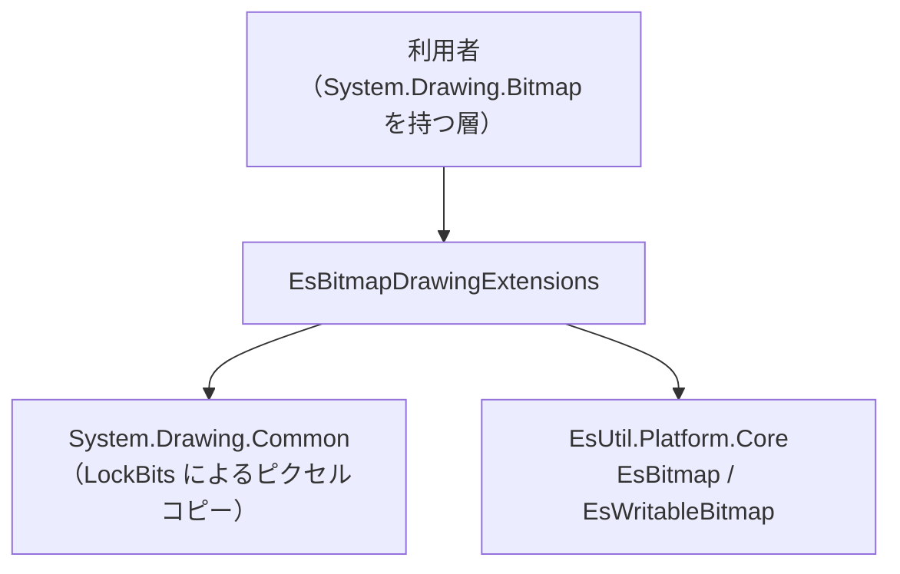
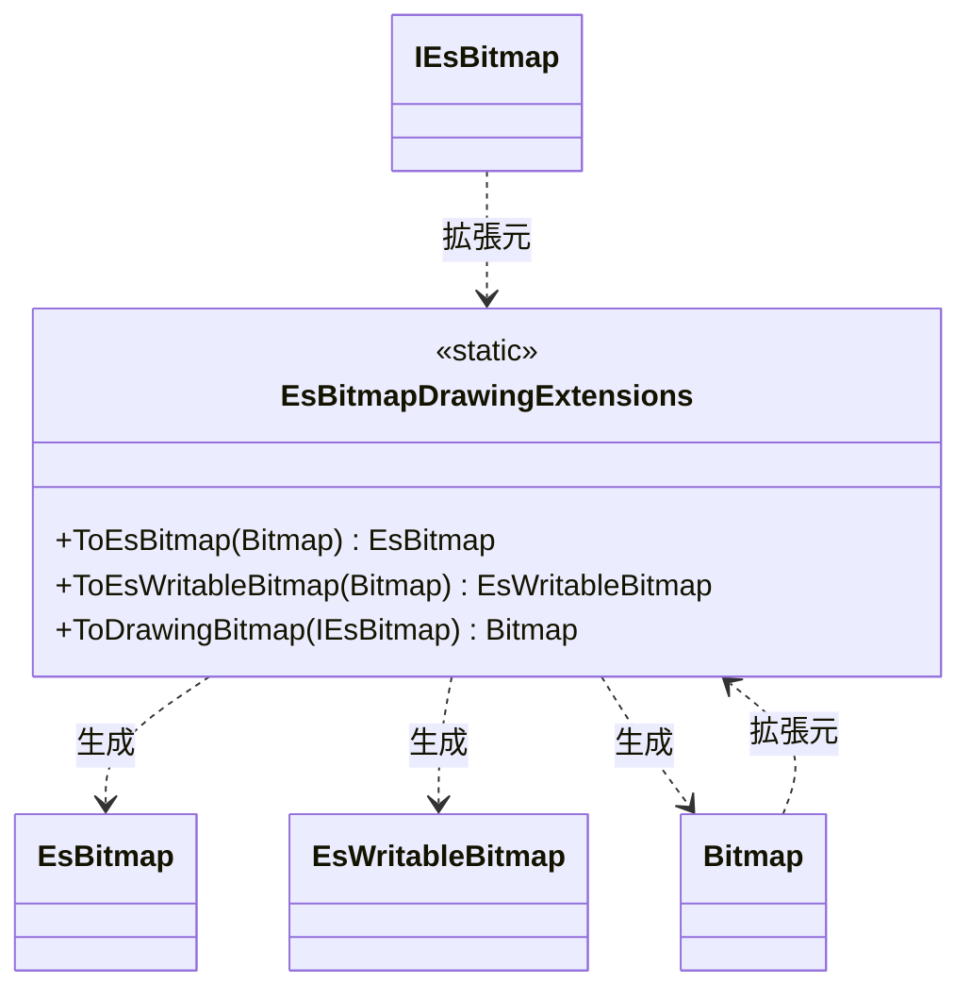

# EsUtil.Platform.Core.Windows システム仕様書

## 目次 <!-- omit from toc -->

- [1. 概要](#1-概要)
- [2. 技術スタック](#2-技術スタック)
- [3. アーキテクチャ](#3-アーキテクチャ)
- [4. 依存関係](#4-依存関係)
- [5. コンポーネント構成](#5-コンポーネント構成)
- [6. クラス図](#6-クラス図)
- [7. データフロー（変換）](#7-データフロー変換)
- [8. 例外処理ポリシー](#8-例外処理ポリシー)
- [9. 可視性ポリシー](#9-可視性ポリシー)
- [10. テスト](#10-テスト)
- [11. 関連ドキュメント](#11-関連ドキュメント)

## 1. 概要

`System.Drawing.Bitmap`（Windows 専用の画像型）と `EsUtil.Platform.Core` の画像型（`EsBitmap` / `EsWritableBitmap`）を相互変換します。

**存在する理由**は 2 つです。

1. **コアから外部パッケージを切り離す**: コア（`EsUtil.Platform.Core`）は外部パッケージを参照しません。 `System.Drawing.Common` に依存する変換は本プロジェクトが単一所有します。
2. **借用と所有を型で表す**: `System.Drawing.Bitmap` は可変かつ `IDisposable` であるため、コアの「読み取り専用（`EsBitmap`）／書き換え可能（`EsWritableBitmap`）」の区別をそのまま表せません。 変換の入口を 2 つに分けることで、利用者が権利を選んでから画像を作ります。

## 2. 技術スタック

- .NET 10 / C# 14
- System.Drawing.Common（`System.Drawing.Bitmap` / `System.Drawing.Imaging.BitmapData`。 Microsoft 公式パッケージ。 **Windows 専用**）
- `EsUtil.Platform.Core`（変換先・変換元の画像型）
- UI フレームワークは参照しません

## 3. アーキテクチャ

- **本プロジェクトは変換だけを持ちます**（画像の確保・描画・ファイル入出力は持ちません）。
- **コアは本プロジェクトを参照しません**（依存の向きは本プロジェクト → コアの一方向です）。

## 4. 依存関係

| 種別 | 依存 |
| --- | --- |
| 参照するプロジェクト | `EsUtil.Platform.Core` |
| 参照するパッケージ | `System.Drawing.Common`（Windows 専用） |
| 参照される側 | 本リポジトリ内では `System.Drawing.Bitmap` を扱う利用者が明示的に参照します（コア・機能コア・コントロール層は参照しません） |

参照の許可範囲は [`.github/依存関係.md`](../../../.github/依存関係.md) が所有します。

## 5. コンポーネント構成

| コンポーネント | パス | 内容 |
| --- | --- | --- |
| `Imaging.EsBitmapDrawingExtensions` | `src/EsUtil.Platform.Core.Windows/src/Imaging/EsBitmapDrawingExtensions.cs` | `System.Drawing.Bitmap` ⇔ コアの画像の相互変換（公開） |

## 6. クラス図

## 7. データフロー（変換）

| 方向 | 手順 |
| --- | --- |
| `Bitmap` → コア | `LockBits`（`Format32bppPArgb`・読み取り専用）→ 行単位または連続領域でコピー → `UnlockBits`。 行幅がコピー先より狭い場合は覆われない右端を 0 にします |
| コア → `Bitmap` | `Bitmap`（`Format32bppPArgb`）を確保 → `LockBits`（書き込み用）→ コピー → `UnlockBits` |

- **行幅が一致する場合は連続領域として 1 回でコピーします**（高速化）。
- **アルファは乗算済みのまま保持します**（部分的なアルファを 255 へ強制しません）。

## 8. 例外処理ポリシー

共通方針は [`例外処理規約.md`](../../../.github/例外処理規約.md) §2・§3 に従います。

| 状況 | 挙動 |
| --- | --- |
| 引数が null | `ArgumentNullException` |
| 破棄済みの画像を変換 | `ObjectDisposedException`（コアの画像型が投げます） |

## 9. 可視性ポリシー

- **公開型は変換の拡張メソッドだけです**（`EsBitmapDrawingExtensions`）。
- 内部実装（`LockBits` のストライド計算・行コピー）は `private` のまま公開しません。

## 10. テスト

| 対象 | 内容 |
| --- | --- |
| `EsBitmapDrawingExtensions` | ピクセルの一致・部分的なアルファの保持・複製であること・往復変換の寸法一致 |

テストは `[Fact]` で並列実行できます（Windows 専用のため `SupportedOSPlatform("windows")` で限定します）。

## 11. 関連ドキュメント

- 変換元の画像型 … [`EsUtil.Platform.Core` のシステム仕様書](../../EsUtil.Platform.Core/docs/SPEC_System.md)
- 参照の許可範囲 … [`.github/依存関係.md`](../../../.github/依存関係.md)
- 対象フレームワークの割り当て … [`.github/ビルド設定規約.md`](../../../.github/ビルド設定規約.md)
