# EsUtil.Platform.Core 計測結果

本プロジェクトの Imaging（`src/EsUtil.Platform.Core/src/Imaging/`）の**所要とメモリの実測値**を単一所有する文書です（[`.github/ドキュメント規約.md`](../../../.github/ドキュメント規約.md) §1・§10）。

計測値はコードのコメント・仕様書・README へ書かず、本ドキュメントだけが持ちます（数値を書いた時点で古くなるため）。 表は**どの型を計測したか**と**どの寸法か**を軸にした 2 軸表です。

## 目次 <!-- omit from toc -->

- [1. 使い方](#1-使い方)
- [2. 計測環境](#2-計測環境)
- [3. 計測の対象](#3-計測の対象)
- [4. 生成と複製](#4-生成と複製)
  - [4.1 Create](#41-create)
  - [4.2 CreateFilled](#42-createfilled)
  - [4.3 FromPixelCopy](#43-frompixelcopy)
  - [4.4 Copy](#44-copy)
  - [4.5 FromReadOnlyBitmap](#45-fromreadonlybitmap)
  - [4.6 FromPixmap](#46-frompixmap)
  - [4.7 InstallPixels](#47-installpixels)
  - [4.8 FromBitmap（凍結の有無）](#48-frombitmap凍結の有無)
- [5. 切り出しと 0 コピーのビュー](#5-切り出しと-0-コピーのビュー)
  - [5.1 Crop](#51-crop)
  - [5.2 ToPixmap](#52-topixmap)
  - [5.3 ToPixmap（入れ子）](#53-topixmap入れ子)
- [6. 縮小（長辺 320 へ収める）](#6-縮小長辺-320-へ収める)
  - [6.1 EsBitmap](#61-esbitmap)
  - [6.2 EsReadOnlyBitmap](#62-esreadonlybitmap)
  - [6.3 EsPixmap](#63-espixmap)
  - [6.4 EsBitmap（縮小先を変えた場合）](#64-esbitmap縮小先を変えた場合)
  - [6.5 EsReadOnlyBitmap（縮小先を変えた場合）](#65-esreadonlybitmap縮小先を変えた場合)
  - [6.6 EsPixmap（縮小先を変えた場合）](#66-espixmap縮小先を変えた場合)
  - [6.7 出力の品質（品質 × 寸法）](#67-出力の品質品質--寸法)
- [7. 減色](#7-減色)
  - [7.1 EsBitmap（品質）](#71-esbitmap品質)
  - [7.2 EsBitmap（ディザ）](#72-esbitmapディザ)
  - [7.3 EsReadOnlyBitmap（品質）](#73-esreadonlybitmap品質)
  - [7.4 EsReadOnlyBitmap（ディザ）](#74-esreadonlybitmapディザ)
  - [7.5 EsPixmap（品質）](#75-espixmap品質)
  - [7.6 EsPixmap（ディザ）](#76-espixmapディザ)
  - [7.7 内容による違い（3840x2160・Mid・256 色）](#77-内容による違い3840x2160mid256-色)
  - [7.8 出力の品質（256 色）](#78-出力の品質256-色)
  - [7.9 縞の出にくさ（256 色・Mid）](#79-縞の出にくさ256-色mid)
  - [7.10 出力の品質（16 色）](#710-出力の品質16-色)
  - [7.11 縞の出にくさ（16 色・Mid）](#711-縞の出にくさ16-色mid)
- [8. 画素の取得・設定・走査](#8-画素の取得設定走査)
  - [8.1 GetPixel](#81-getpixel)
  - [8.2 SetPixel](#82-setpixel)
  - [8.3 Clear](#83-clear)
  - [8.4 ReadOnlyPixels](#84-readonlypixels)
  - [8.5 Pixels](#85-pixels)
- [9. ファイル入出力（Windows 専用の符号化）](#9-ファイル入出力windows-専用の符号化)
  - [9.1 Save](#91-save)
  - [9.2 Save（BMP）](#92-savebmp)
  - [9.3 Save（PNG）](#93-savepng)
  - [9.4 Save（JPEG）](#94-savejpeg)
  - [9.5 Save（GIF）](#95-savegif)
  - [9.6 Save の出力の大きさ](#96-save-の出力の大きさ)
  - [9.7 Load](#97-load)
- [10. 縮小と減色のサンプル](#10-縮小と減色のサンプル)
  - [10.1 縮小（実施前 → 実施後）](#101-縮小実施前--実施後)
  - [10.2 縮小の拡大（Low / Mid / High）](#102-縮小の拡大low--mid--high)
  - [10.3 減色（256 色・実施前 → 実施後）](#103-減色256-色実施前--実施後)
  - [10.4 減色の拡大（256 色・Mid）](#104-減色の拡大256-色mid)
  - [10.5 減色（16 色・実施前 → 実施後）](#105-減色16-色実施前--実施後)
  - [10.6 減色の拡大（16 色・Mid）](#106-減色の拡大16-色mid)
- [11. 改善の記録](#11-改善の記録)
  - [11.1 画素の取得と設定](#111-画素の取得と設定)
  - [11.2 一時配列は借りて返す](#112-一時配列は借りて返す)
  - [11.3 縮小のアルゴリズム（Low / Mid / High）](#113-縮小のアルゴリズムlow--mid--high)
  - [11.4 減色の作業量と品質の段階](#114-減色の作業量と品質の段階)
  - [11.5 0 コピーのビュー（EsPixmap）](#115-0-コピーのビューespixmap)
  - [11.6 ビューの全走査は行の間隔も読む](#116-ビューの全走査は行の間隔も読む)
  - [11.7 凍結した画像の共有](#117-凍結した画像の共有)
  - [11.8 保存の形式](#118-保存の形式)
- [12. 読み方と留意点](#12-読み方と留意点)

## 1. 使い方

```powershell
# 計測して本ドキュメントの計測結果を差し替える
pwsh -NoProfile -File src/EsUtil.Platform.Core/docs/Result_Measurement.ps1

# 表示だけ（文書を書き換えない）
pwsh -NoProfile -File src/EsUtil.Platform.Core/docs/Result_Measurement.ps1 -NoWrite

# 計測回数を増やす（値のばらつきを減らす）
pwsh -NoProfile -File src/EsUtil.Platform.Core/docs/Result_Measurement.ps1 -Iterations 50 -Warmup 60
```

- 一時プロジェクト（Release / `net10.0`）を `%TEMP%` 配下へ生成して実行し、本ドキュメントの「計測開始」マーカーと「計測終了」マーカーの間を差し替えます。
- 1 回の計測には **5 分半程度**かかります（ウォームアップを厚く取り、減色を全組み合わせで測るため）。
- プロセッサの名前は `Get-CimInstance Win32_Processor` から取り、計測プログラムへ環境変数で渡します（.NET からは取れないため）。
- **`-Warmup` は 40 回を下限とします**（それより小さい値を指定しても 40 回で計測します）。 実行時は呼び出しの回数で最適化の段階を上げるため、回数が少ないと**最適化されていないコードの所要**を測ってしまい、測定の順番だけで数倍の差が出ます。
- 計測するのは**公開 API だけ**です（内部型の名前を計測コードへ埋め込まないため、実装を変えても計測が壊れません）。
- 計測の対象と表の軸は `src/EsUtil.Platform.Core/docs/Result_Measurement.ps1` が所有します（対象を増やすときはスクリプトを直します）。
- 計測で一時的に作るファイルはスクリプトが片付けます（実行後は `%TEMP%` に残しません）。

<!-- 計測開始（src/EsUtil.Platform.Core/docs/Result_Measurement.ps1 が差し替える） -->

<!-- markdownlint-disable MD060 -->

## 2. 計測環境

| 項目 | 値 |
| --- | --- |
| 計測日時 | 2026-10-13 13:01:51 +09:00 |
| OS | Microsoft Windows 10.0.26300 |
| プロセッサ | 12th Gen Intel(R) Core(TM) i7-12700 |
| 論理コア | 20 / X64 |
| .NET | 10.0.12 |
| サーバー GC | False |
| 構成 | Release（最適化あり） |
| ウォームアップ / 計測回数 | 40 回の後に 3 巡へ分けて 1 巡 7 回（合計 21 回。 妨害の無い最小値）。 ファイル入出力は 1 巡 5 回、画素の取得と設定は 1 巡 5 回 |

**計測のばらつき**は、同じ仕事（1920x1080 の生成と長辺 320 への縮小）を**続けて 2 度**測ったずれ（23%。 プロセスの起動直後の巡は外して数える）と、**計測の巡をまたいだ**ずれ（最後 ÷ 最初。 生成 93%、縮小 45%。 最大 2.2 倍）です。 表の中の行を比べるときは前者（隣り合う 2 度のずれ）を境目にし（§3 の備考）、**表をまたいで値を比べるときは後者を足して読みます**。

## 3. 計測の対象

計測するのは **公開 API だけ**です（内部型の名前を計測コードへ埋め込まないため、実装を変えても計測が壊れません）。 対象は次の 3 型で、すべての表が**どの型を計測したか**を行または節の軸に持ちます。

| 型 | 何であるか | 計測に使う入口 |
| --- | --- | --- |
| EsBitmap | 書き換え可能な画像 | `Create` 系・`SetPixel`・`Pixels`・`Clear`・`SetReadOnly` |
| EsReadOnlyBitmap | 読み取り専用の画像 | `Create` 系・`FromBitmap`・`Copy`・`Save`・`Load` |
| EsPixmap | 画像の一部を指す 0 コピーの読み取りビュー | `ToPixmap`（生成の唯一の入口）・`Resize`・`ReduceColors` |

**所要の表**は、行を型・品質・内容など、列を寸法として、行の 1 番目（表ごとに定めた基準）を 100% とした**速度比**を足します。

所要はセルごとに単位 `ms` を付け、**列の中で桁を揃えて右揃え**にします（0.000001 ms（1 ナノ秒）まで表示し、それ未満は `<0.000001` と書きます）。 `-` はその型にメソッドが無い（対称でない）ことを表します。 1 マイクロ秒を下回る操作は、タイマーの分解能に埋もれるため **1 回の計測につき 100 回呼び、1 回あたりへ換算**します。 **値はコードスパンで囲まず**、桁を揃える詰め物の空白はそのまま書きます（`MD060` を計測結果の範囲だけ無効化しています。 [`.github/検証手順.md`](../../../.github/検証手順.md) §11）。

**速度比**は同じ寸法の 1 行目との比です（`基準の所要 ÷ その行の所要`。 100% より大きいほど速い）。 速度比の列は、寸法の列と同じ順に並べます。 基準の所要が 0.001 ms 未満の表では示しません（ばらつきが比率を支配するため）。

**所要は妨害の無い最短値（最小値）**です（3 巡へ分けて測り、まとめた標本の最小値を採ります）。 機械の妨害を含む値（中央値・平均）は**実装の違いを比べる**目的に使えないためです（§2 のばらつきの目安を参照）。

**備考**は、速度比の列が示す**列ごとの差を行ごとに総括したもの**です（列ごとの比較結果は述べません）。 行のすべての列の比が 100% ± 23% の内側なら `差は誤差の範囲`（差が計測のばらつきに埋もれています）、外側へ出た場合は**比の範囲と向き**（`速い` / `遅い` / `列により速い・遅い`）を述べます。 境目の 23% は、続けて 2 度測った同じ仕事のずれ（§2）と 10% の大きいほうです。 **比が意味を持たない行**（速度比を示さない表のすべての行、その型にメソッドが無い行、所要が分解能 0.001 ms に埋もれる列しか無い行）は `-` とし、1 行目は `基準` と書きます。

**寸法の軸**は元の画像（`EsPixmap` はビュー）の寸法です。 縮小だけは**縮小先を長辺 320 に固定**し（型と寸法の比較を揃えるため）、縮小先を変えた表を別に示します。 減色は 256 色を既定とし、色数とディザの表を別に示します。

計測に使う画像は**折り返す勾配**です（B = X % 251・G = Y % 251・R = (X + Y) % 251・A = 255。 決定的で、実行のたびに同じ画像になります）。 折り返すのは、画像の一部を切り出したビューと元画像とで**色の範囲を揃える**ためです（減色の費用は色の範囲で決まるため、折り返さない勾配では内容の違うもの同士を比べることになります）。 減色だけは内容の影響が大きいため、内容を変えた表を別に示します。

**品質の表**は、出力がどれだけ元の画素に近いかを **PSNR (dB)** で示します（大きいほど近い）。 縮小は**面積平均の結果を基準**とし（最も正確な縮小）、減色は**元画像を基準**とします。 1 画素ごとの差では**ディザの狙い（縞を散らすこと）が見えない**ため、減色は**縞の出にくさ**（4×4 の平均で見た PSNR）も示します（§7.9・§7.11）。

画素の領域（`幅 × 4 × 高さ`）は**アンマネージド**であり、所要の表には現れません（ビューは `行間隔 × 高さ`）。

| 項目 | 3840x2160 | 1920x1080 | 640x360 |
| --- | ---: | ---: | ---: |
| 画素の領域 (B) | 33,177,600 | 8,294,400 | 921,600 |

1 回だけ呼ぶ操作（`Dispose` / `ThrowIfDisposed`）と、実体ごとに 1 度しか呼べない操作（`SetReadOnly`）は、所要が他の処理に支配されるため計測しません。 `ToString` 系（`ToSizeText`）と、幅・高さ・行の間隔などのプロパティ（フィールドの読み取りだけ）も同様です。

## 4. 生成と複製

メソッドごとに、行を型・列を寸法とした 2 軸表を示します。

### 4.1 Create

| 型 | 3840x2160 | 1920x1080 | 640x360 | 速度比 | 備考 |
| --- | ---: | ---: | ---: | ---: | --- |
| EsBitmap | 6.368 ms | 1.530 ms | 0.0124 ms | 100% / 100% / 100% | 基準 |
| EsReadOnlyBitmap | 6.327 ms | 1.575 ms | 0.0124 ms |  101% / 97% / 100% | 差は誤差の範囲 |
| EsPixmap | - | - | - |          - / - / - | - |

### 4.2 CreateFilled

| 型 | 3840x2160 | 1920x1080 | 640x360 | 速度比 | 備考 |
| --- | ---: | ---: | ---: | ---: | --- |
| EsBitmap | 6.196 ms | 1.568 ms | 0.0124 ms | 100% / 100% / 100% | 基準 |
| EsReadOnlyBitmap | 6.130 ms | 1.516 ms | 0.0124 ms | 101% / 103% / 100% | 差は誤差の範囲 |
| EsPixmap | - | - | - |          - / - / - | - |

### 4.3 FromPixelCopy

| 型 | 3840x2160 | 1920x1080 | 640x360 | 速度比 | 備考 |
| --- | ---: | ---: | ---: | ---: | --- |
| EsBitmap | 5.540 ms | 1.162 ms | 0.0298 ms | 100% / 100% / 100% | 基準 |
| EsReadOnlyBitmap | 5.498 ms | 1.194 ms | 0.0302 ms |   101% / 97% / 99% | 差は誤差の範囲 |
| EsPixmap | - | - | - |          - / - / - | - |

### 4.4 Copy

| 型 | 3840x2160 | 1920x1080 | 640x360 | 速度比 | 備考 |
| --- | ---: | ---: | ---: | ---: | --- |
| EsBitmap | 5.554 ms | 1.159 ms | 0.0306 ms | 100% / 100% / 100% | 基準 |
| EsReadOnlyBitmap | 5.684 ms | 1.156 ms | 0.0293 ms |  98% / 100% / 104% | 差は誤差の範囲 |
| EsPixmap | - | - | - |          - / - / - | - |

### 4.5 FromReadOnlyBitmap

| 型 | 3840x2160 | 1920x1080 | 640x360 | 速度比 | 備考 |
| --- | ---: | ---: | ---: | ---: | --- |
| EsBitmap | 5.612 ms | 1.125 ms | 0.0292 ms | 100% / 100% / 100% | 基準 |
| EsReadOnlyBitmap | - | - | - |          - / - / - | - |
| EsPixmap | - | - | - |          - / - / - | - |

### 4.6 FromPixmap

| 型 | 3840x2160 | 1920x1080 | 640x360 | 速度比 | 備考 |
| --- | ---: | ---: | ---: | ---: | --- |
| EsBitmap | 5.729 ms | 1.164 ms | 0.0294 ms | 100% / 100% / 100% | 基準 |
| EsReadOnlyBitmap | 5.562 ms | 1.158 ms | 0.0315 ms |  103% / 100% / 93% | 差は誤差の範囲 |
| EsPixmap | - | - | - |          - / - / - | - |

### 4.7 InstallPixels

| 型 | 3840x2160 | 1920x1080 | 640x360 | 速度比 | 備考 |
| --- | ---: | ---: | ---: | ---: | --- |
| EsBitmap | 0.000045 ms | 0.000043 ms | 0.000038 ms | - / - / - | - |
| EsReadOnlyBitmap | 0.000044 ms | 0.000043 ms | 0.000038 ms | - / - / - | - |
| EsPixmap | - | - | - | - / - / - | - |

### 4.8 FromBitmap（凍結の有無）

書き換え可能な画像から読み取り専用の画像を作る唯一の入口です（`EsBitmap` からは作れません）。 行を凍結の有無・列を寸法とした 2 軸表を示します。 凍結済みは 0 コピーで共有し、未凍結は複製します。

| 状態 | 3840x2160 | 1920x1080 | 640x360 | 速度比 | 備考 |
| --- | ---: | ---: | ---: | ---: | --- |
| 未凍結（複製） |     5.744 ms |     1.188 ms |    0.0311 ms | 100% / 100% / 100% | 基準 |
| 凍結済み（共有） | <0.000001 ms | <0.000001 ms | <0.000001 ms |          - / - / - | - |

## 5. 切り出しと 0 コピーのビュー

メソッドごとに、行を型・列を寸法とした 2 軸表を示します。

### 5.1 Crop

| 型 | 3840x2160 | 1920x1080 | 640x360 | 速度比 | 備考 |
| --- | ---: | ---: | ---: | ---: | --- |
| EsBitmap | 1.577 ms | 0.4361 ms | 0.0056 ms | 100% / 100% / 100% | 基準 |
| EsReadOnlyBitmap | 1.649 ms | 0.3940 ms | 0.0057 ms |   96% / 111% / 98% | 差は誤差の範囲 |
| EsPixmap | - | - | - |          - / - / - | - |

### 5.2 ToPixmap

| 型 | 3840x2160 | 1920x1080 | 640x360 | 速度比 | 備考 |
| --- | ---: | ---: | ---: | ---: | --- |
| EsBitmap | 0.000025 ms | 0.000023 ms | 0.000023 ms | - / - / - | - |
| EsReadOnlyBitmap | 0.000025 ms | 0.000023 ms | 0.000024 ms | - / - / - | - |
| EsPixmap | 0.000023 ms | 0.000027 ms | 0.000023 ms | - / - / - | - |

### 5.3 ToPixmap（入れ子）

| 型 | 3840x2160 | 1920x1080 | 640x360 | 速度比 | 備考 |
| --- | ---: | ---: | ---: | ---: | --- |
| EsBitmap | 0.000025 ms | 0.000025 ms | 0.000023 ms | - / - / - | - |
| EsReadOnlyBitmap | 0.000024 ms | 0.000026 ms | 0.000023 ms | - / - / - | - |
| EsPixmap | 0.000023 ms | 0.000025 ms | 0.000023 ms | - / - / - | - |

## 6. 縮小（長辺 320 へ収める）

縮小先を**長辺 320 に固定**し、型ごとに、行を品質・列を元画像の寸法とした 2 軸表を示します。

### 6.1 EsBitmap

| 品質 | 3840x2160 | 1920x1080 | 640x360 | 速度比 | 備考 |
| --- | ---: | ---: | ---: | ---: | --- |
| Low | 0.0131 ms | 0.0098 ms | 0.0101 ms | 100% / 100% / 100% | 基準 |
| Mid | 0.1054 ms | 0.0854 ms | 0.0942 ms |    12% / 11% / 11% | 差は誤差を超える（1 行目の 11〜12%・遅い） |
| High |  1.064 ms | 0.3047 ms | 0.0797 ms |      1% / 3% / 13% | 差は誤差を超える（1 行目の 1〜13%・遅い） |

### 6.2 EsReadOnlyBitmap

| 品質 | 3840x2160 | 1920x1080 | 640x360 | 速度比 | 備考 |
| --- | ---: | ---: | ---: | ---: | --- |
| Low | 0.0136 ms | 0.0101 ms | 0.0095 ms | 100% / 100% / 100% | 基準 |
| Mid | 0.1035 ms | 0.0833 ms | 0.0826 ms |    13% / 12% / 12% | 差は誤差を超える（1 行目の 12〜13%・遅い） |
| High |  1.082 ms | 0.2923 ms | 0.0824 ms |      1% / 3% / 12% | 差は誤差を超える（1 行目の 1〜12%・遅い） |

### 6.3 EsPixmap

| 品質 | 3840x2160 | 1920x1080 | 640x360 | 速度比 | 備考 |
| --- | ---: | ---: | ---: | ---: | --- |
| Low | 0.0125 ms | 0.0100 ms | 0.0105 ms | 100% / 100% / 100% | 基準 |
| Mid | 0.1026 ms | 0.0814 ms | 0.0858 ms |    12% / 12% / 12% | 差は誤差を超える（1 行目の 12〜12%・遅い） |
| High |  1.054 ms | 0.3176 ms | 0.0803 ms |      1% / 3% / 13% | 差は誤差を超える（1 行目の 1〜13%・遅い） |

### 6.4 EsBitmap（縮小先を変えた場合）

元画像は 3840x2160 に固定し、行を縮小先・列を品質とした 2 軸表を示します。 長辺 320 は品質の表と同じ計測です。

| 縮小先 | Low | Mid | High | 速度比 | 備考 |
| --- | ---: | ---: | ---: | ---: | --- |
| 長辺 320 | 0.0131 ms | 0.1054 ms | 1.064 ms | 100% / 100% / 100% | 基準 |
| 長辺 960 | 0.4501 ms | 0.8421 ms | 1.535 ms |     3% / 13% / 69% | 差は誤差を超える（1 行目の 3〜69%・遅い） |
| 長辺 1920 |  1.194 ms |  3.072 ms | 3.084 ms |      1% / 3% / 34% | 差は誤差を超える（1 行目の 1〜34%・遅い） |

### 6.5 EsReadOnlyBitmap（縮小先を変えた場合）

元画像は 3840x2160 に固定し、行を縮小先・列を品質とした 2 軸表を示します。 長辺 320 は品質の表と同じ計測です。

| 縮小先 | Low | Mid | High | 速度比 | 備考 |
| --- | ---: | ---: | ---: | ---: | --- |
| 長辺 320 | 0.0136 ms | 0.1035 ms | 1.082 ms | 100% / 100% / 100% | 基準 |
| 長辺 960 | 0.4335 ms | 0.8339 ms | 1.564 ms |     3% / 12% / 69% | 差は誤差を超える（1 行目の 3〜69%・遅い） |
| 長辺 1920 |  1.129 ms |  3.106 ms | 3.124 ms |      1% / 3% / 35% | 差は誤差を超える（1 行目の 1〜35%・遅い） |

### 6.6 EsPixmap（縮小先を変えた場合）

元画像は 3840x2160 に固定し、行を縮小先・列を品質とした 2 軸表を示します。 長辺 320 は品質の表と同じ計測です。

| 縮小先 | Low | Mid | High | 速度比 | 備考 |
| --- | ---: | ---: | ---: | ---: | --- |
| 長辺 320 | 0.0125 ms | 0.1026 ms | 1.054 ms | 100% / 100% / 100% | 基準 |
| 長辺 960 | 0.4072 ms | 0.8795 ms | 1.581 ms |     3% / 12% / 67% | 差は誤差を超える（1 行目の 3〜67%・遅い） |
| 長辺 1920 |  1.120 ms |  3.097 ms | 3.018 ms |      1% / 3% / 35% | 差は誤差を超える（1 行目の 1〜35%・遅い） |

### 6.7 出力の品質（品質 × 寸法）

縮小先を長辺 320 に固定し、**面積平均（High）の結果を基準**とした PSNR (dB) です（大きいほど基準に近い）。 行を品質・列を元画像の寸法とした 2 軸表を示します。 値は 3 型で同じでした（同じ実装を共有しているためです）。

| 品質 | 3840x2160 | 1920x1080 | 640x360 | 速度比 | 備考 |
| --- | ---: | ---: | ---: | ---: | --- |
| Low | 17.94 dB | 21.14 dB | 28.11 dB | 100% / 100% / 100% | 基準 |
| Mid | 25.01 dB | 29.49 dB |     ∞ dB |    12% / 11% / 11% | 差は誤差を超える（1 行目の 11〜12%・遅い） |
| High |     ∞ dB |     ∞ dB |     ∞ dB |      1% / 3% / 13% | 差は誤差を超える（1 行目の 1〜13%・遅い） |

## 7. 減色

型ごとに、行を品質またはディザ・列を元画像の寸法とした 2 軸表を示します。

### 7.1 EsBitmap（品質）

| 品質（256 色） | 3840x2160 | 1920x1080 | 640x360 | 速度比 | 備考 |
| --- | ---: | ---: | ---: | ---: | --- |
| Low | 39.178 ms | 11.900 ms |  3.090 ms | 100% / 100% / 100% | 基準 |
| Mid | 43.953 ms | 15.787 ms |  7.066 ms |    89% / 75% / 44% | 差は誤差を超える（1 行目の 44〜89%・遅い） |
| High | 47.185 ms | 19.114 ms | 10.402 ms |    83% / 62% / 30% | 差は誤差を超える（1 行目の 30〜83%・遅い） |

### 7.2 EsBitmap（ディザ）

| 指定（Mid） | 3840x2160 | 1920x1080 | 640x360 | 速度比 | 備考 |
| --- | ---: | ---: | ---: | ---: | --- |
| 16 色（ディザなし） |  38.746 ms | 11.063 ms |  2.470 ms | 100% / 100% / 100% | 基準 |
| 256 色（ディザなし） |  43.953 ms | 15.787 ms |  7.066 ms |    88% / 70% / 35% | 差は誤差を超える（1 行目の 35〜88%・遅い） |
| 16 色（Floyd–Steinberg） |  95.356 ms | 27.153 ms |  5.499 ms |    41% / 41% / 45% | 差は誤差を超える（1 行目の 41〜45%・遅い） |
| 256 色（Floyd–Steinberg） | 120.599 ms | 37.683 ms | 13.157 ms |    32% / 29% / 19% | 差は誤差を超える（1 行目の 19〜32%・遅い） |

### 7.3 EsReadOnlyBitmap（品質）

| 品質（256 色） | 3840x2160 | 1920x1080 | 640x360 | 速度比 | 備考 |
| --- | ---: | ---: | ---: | ---: | --- |
| Low | 39.460 ms | 11.550 ms |  2.986 ms | 100% / 100% / 100% | 基準 |
| Mid | 43.697 ms | 15.866 ms |  6.941 ms |    90% / 73% / 43% | 差は誤差を超える（1 行目の 43〜90%・遅い） |
| High | 46.903 ms | 19.072 ms | 10.354 ms |    84% / 61% / 29% | 差は誤差を超える（1 行目の 29〜84%・遅い） |

### 7.4 EsReadOnlyBitmap（ディザ）

| 指定（Mid） | 3840x2160 | 1920x1080 | 640x360 | 速度比 | 備考 |
| --- | ---: | ---: | ---: | ---: | --- |
| 16 色（ディザなし） |  39.426 ms | 10.833 ms |  2.411 ms | 100% / 100% / 100% | 基準 |
| 256 色（ディザなし） |  43.697 ms | 15.866 ms |  6.941 ms |    90% / 68% / 35% | 差は誤差を超える（1 行目の 35〜90%・遅い） |
| 16 色（Floyd–Steinberg） |  95.333 ms | 26.765 ms |  5.607 ms |    41% / 40% / 43% | 差は誤差を超える（1 行目の 40〜43%・遅い） |
| 256 色（Floyd–Steinberg） | 120.600 ms | 37.987 ms | 13.422 ms |    33% / 29% / 18% | 差は誤差を超える（1 行目の 18〜33%・遅い） |

### 7.5 EsPixmap（品質）

| 品質（256 色） | 3840x2160 | 1920x1080 | 640x360 | 速度比 | 備考 |
| --- | ---: | ---: | ---: | ---: | --- |
| Low | 39.222 ms | 12.414 ms |  3.049 ms | 100% / 100% / 100% | 基準 |
| Mid | 45.914 ms | 16.512 ms |  7.252 ms |    85% / 75% / 42% | 差は誤差を超える（1 行目の 42〜85%・遅い） |
| High | 48.787 ms | 19.768 ms | 10.517 ms |    80% / 63% / 29% | 差は誤差を超える（1 行目の 29〜80%・遅い） |

### 7.6 EsPixmap（ディザ）

| 指定（Mid） | 3840x2160 | 1920x1080 | 640x360 | 速度比 | 備考 |
| --- | ---: | ---: | ---: | ---: | --- |
| 16 色（ディザなし） |  41.324 ms | 11.486 ms |  2.525 ms | 100% / 100% / 100% | 基準 |
| 256 色（ディザなし） |  45.914 ms | 16.512 ms |  7.252 ms |    90% / 70% / 35% | 差は誤差を超える（1 行目の 35〜90%・遅い） |
| 16 色（Floyd–Steinberg） |  95.469 ms | 27.634 ms |  5.487 ms |    43% / 42% / 46% | 差は誤差を超える（1 行目の 42〜46%・遅い） |
| 256 色（Floyd–Steinberg） | 119.893 ms | 38.215 ms | 13.609 ms |    34% / 30% / 19% | 差は誤差を超える（1 行目の 19〜34%・遅い） |

### 7.7 内容による違い（3840x2160・Mid・256 色）

減色の費用は**画素が入った箱の数**で決まるため、内容を変えた表を示します（行を型・列を内容とした 2 軸表）。 平坦は箱が 1 つで下限の側、ノイズは箱が最大で上限の側です。

| 型 | 平坦 | グラデーション | ノイズ | 速度比 | 備考 |
| --- | ---: | ---: | ---: | ---: | --- |
| EsBitmap | 36.019 ms | 43.953 ms | 94.915 ms | 100% / 100% / 100% | 基準 |
| EsReadOnlyBitmap | 35.730 ms | 43.697 ms | 94.358 ms | 101% / 101% / 101% | 差は誤差の範囲 |
| EsPixmap | 33.611 ms | 45.914 ms | 94.481 ms |  107% / 96% / 100% | 差は誤差の範囲 |

### 7.8 出力の品質（256 色）

**元画像を基準**とした PSNR (dB) です（大きいほど元に近い）。 行をディザと品質・列を元画像の寸法とした 2 軸表を示します。 値は 3 型で同じでした（同じ実装を共有しているためです）。

品質の段階（Low / Mid / High）による所要の**最大と最小の比が 1.10 倍を超える**ため、**品質ごとに示しています**（所要は同じ条件の表を参照）。

| 指定 | 3840x2160 | 1920x1080 | 640x360 | 速度比 | 備考 |
| --- | ---: | ---: | ---: | ---: | --- |
| ディザなし・Low | 30.59 dB | 30.43 dB | 30.51 dB | 100% / 100% / 100% | 基準 |
| ディザなし・Mid | 31.50 dB | 31.37 dB | 31.22 dB |    89% / 75% / 44% | 差は誤差を超える（1 行目の 44〜89%・遅い） |
| ディザなし・High | 31.51 dB | 31.39 dB | 31.28 dB |    83% / 62% / 30% | 差は誤差を超える（1 行目の 30〜83%・遅い） |
| ディザあり（Floyd–Steinberg）・Low | 25.63 dB | 25.53 dB | 26.11 dB |    34% / 35% / 33% | 差は誤差を超える（1 行目の 33〜35%・遅い） |
| ディザあり（Floyd–Steinberg）・Mid | 25.86 dB | 26.18 dB | 26.61 dB |    32% / 32% / 23% | 差は誤差を超える（1 行目の 23〜32%・遅い） |
| ディザあり（Floyd–Steinberg）・High | 25.96 dB | 26.19 dB | 26.55 dB |    31% / 29% / 18% | 差は誤差を超える（1 行目の 18〜31%・遅い） |

### 7.9 縞の出にくさ（256 色・Mid）

**元画像を基準**とし、4×4 の平均で見た PSNR (dB) です（大きいほど元のなだらかな変化に一致し、**縞が出にくい**）。 行をディザ・列を元画像の寸法とした 2 軸表を示します。 1 画素ごとの差（上の表）ではディザが不利に出ますが、**目のぼけを模したこの比べ方ではディザが有利に出ます**（ディザは差をとなりへ散らすため、平均すると打ち消し合います）。

| 指定 | 3840x2160 | 1920x1080 | 640x360 | 速度比 | 備考 |
| --- | ---: | ---: | ---: | ---: | --- |
| ディザなし | 33.22 dB | 33.08 dB | 32.91 dB | 100% / 100% / 100% | 基準 |
| ディザあり（Floyd–Steinberg） | 34.40 dB | 34.54 dB | 35.41 dB |    36% / 42% / 54% | 差は誤差を超える（1 行目の 36〜54%・遅い） |

### 7.10 出力の品質（16 色）

**元画像を基準**とした PSNR (dB) です（大きいほど元に近い）。 行をディザ・列を元画像の寸法とした 2 軸表を示します。 値は 3 型で同じでした（同じ実装を共有しているためです）。

品質の段階（Low / Mid / High）による所要の**最大と最小の比が 1.10 倍以内**だったため、**品質の行を畳んでいます**（同じ所要で品質が最も高い High だけを示します）。

| 指定 | 3840x2160 | 1920x1080 | 640x360 | 速度比 | 備考 |
| --- | ---: | ---: | ---: | ---: | --- |
| ディザなし | 19.94 dB | 19.86 dB | 19.96 dB | 100% / 100% / 100% | 基準 |
| ディザあり（Floyd–Steinberg） | 17.33 dB | 17.12 dB | 17.83 dB |    42% / 40% / 43% | 差は誤差を超える（1 行目の 40〜43%・遅い） |

### 7.11 縞の出にくさ（16 色・Mid）

**元画像を基準**とし、4×4 の平均で見た PSNR (dB) です（大きいほど元のなだらかな変化に一致し、**縞が出にくい**）。 行をディザ・列を元画像の寸法とした 2 軸表を示します。 1 画素ごとの差（上の表）ではディザが不利に出ますが、**目のぼけを模したこの比べ方ではディザが有利に出ます**（ディザは差をとなりへ散らすため、平均すると打ち消し合います）。

| 指定 | 3840x2160 | 1920x1080 | 640x360 | 速度比 | 備考 |
| --- | ---: | ---: | ---: | ---: | --- |
| ディザなし | 20.36 dB | 20.27 dB | 20.38 dB | 100% / 100% / 100% | 基準 |
| ディザあり（Floyd–Steinberg） | 22.31 dB | 22.17 dB | 22.49 dB |    41% / 41% / 45% | 差は誤差を超える（1 行目の 41〜45%・遅い） |

## 8. 画素の取得・設定・走査

メソッドごとに、行を型・列を寸法とした 2 軸表を示します。 `GetPixel` と `SetPixel` は **1 回あたり 1,000,000 画素**を扱う時間、`Clear` / `ReadOnlyPixels` / `Pixels` は **1 回あたり全画素**を扱う時間です。

### 8.1 GetPixel

| 型 | 3840x2160 | 1920x1080 | 640x360 | 速度比 | 備考 |
| --- | ---: | ---: | ---: | ---: | --- |
| EsBitmap | 3.744 ms | 3.811 ms | 0.8990 ms | 100% / 100% / 100% | 基準 |
| EsReadOnlyBitmap | 3.801 ms | 3.820 ms | 0.8915 ms |  99% / 100% / 101% | 差は誤差の範囲 |
| EsPixmap | 3.688 ms | 3.847 ms | 0.8844 ms |  102% / 99% / 102% | 差は誤差の範囲 |

### 8.2 SetPixel

| 型 | 3840x2160 | 1920x1080 | 640x360 | 速度比 | 備考 |
| --- | ---: | ---: | ---: | ---: | --- |
| EsBitmap | 3.839 ms | 3.802 ms | 3.811 ms | 100% / 100% / 100% | 基準 |
| EsReadOnlyBitmap | - | - | - |          - / - / - | - |
| EsPixmap | - | - | - |          - / - / - | - |

### 8.3 Clear

| 型 | 3840x2160 | 1920x1080 | 640x360 | 速度比 | 備考 |
| --- | ---: | ---: | ---: | ---: | --- |
| EsBitmap | 1.057 ms | 0.1694 ms | 0.0118 ms | 100% / 100% / 100% | 基準 |
| EsReadOnlyBitmap | - | - | - |          - / - / - | - |
| EsPixmap | - | - | - |          - / - / - | - |

### 8.4 ReadOnlyPixels

| 型 | 3840x2160 | 1920x1080 | 640x360 | 速度比 | 備考 |
| --- | ---: | ---: | ---: | ---: | --- |
| EsBitmap | 9.743 ms | 2.319 ms | 0.2627 ms | 100% / 100% / 100% | 基準 |
| EsReadOnlyBitmap | 9.658 ms | 2.368 ms | 0.2628 ms |  101% / 98% / 100% | 差は誤差の範囲 |
| EsPixmap | 9.802 ms | 4.728 ms |  1.576 ms |    99% / 49% / 17% | 差は誤差を超える（1 行目の 17〜99%・遅い） |

### 8.5 Pixels

| 型 | 3840x2160 | 1920x1080 | 640x360 | 速度比 | 備考 |
| --- | ---: | ---: | ---: | ---: | --- |
| EsBitmap | 7.217 ms | 1.705 ms | 0.1885 ms | 100% / 100% / 100% | 基準 |
| EsReadOnlyBitmap | - | - | - |          - / - / - | - |
| EsPixmap | - | - | - |          - / - / - | - |

## 9. ファイル入出力（Windows 専用の符号化）

メソッドごとに、行を型・列を寸法とした 2 軸表を示します。

### 9.1 Save

| 型 | 3840x2160 | 1920x1080 | 640x360 | 速度比 | 備考 |
| --- | ---: | ---: | ---: | ---: | --- |
| EsBitmap | 78.478 ms | 24.364 ms | 5.906 ms | 100% / 100% / 100% | 基準 |
| EsReadOnlyBitmap | 79.652 ms | 24.535 ms | 5.708 ms |   99% / 99% / 103% | 差は誤差の範囲 |
| EsPixmap | - | - | - |          - / - / - | - |

### 9.2 Save（BMP）

| 型 | 3840x2160 | 1920x1080 | 640x360 | 速度比 | 備考 |
| --- | ---: | ---: | ---: | ---: | --- |
| EsBitmap | 17.584 ms | 5.869 ms | 1.542 ms | 100% / 100% / 100% | 基準 |
| EsReadOnlyBitmap | 19.734 ms | 6.947 ms | 1.592 ms |    89% / 84% / 97% | 差は誤差の範囲 |
| EsPixmap | - | - | - |          - / - / - | - |

### 9.3 Save（PNG）

| 型 | 3840x2160 | 1920x1080 | 640x360 | 速度比 | 備考 |
| --- | ---: | ---: | ---: | ---: | --- |
| EsBitmap | 79.825 ms | 24.378 ms | 5.853 ms | 100% / 100% / 100% | 基準 |
| EsReadOnlyBitmap | 79.461 ms | 24.963 ms | 5.768 ms |  100% / 98% / 101% | 差は誤差の範囲 |
| EsPixmap | - | - | - |          - / - / - | - |

### 9.4 Save（JPEG）

| 型 | 3840x2160 | 1920x1080 | 640x360 | 速度比 | 備考 |
| --- | ---: | ---: | ---: | ---: | --- |
| EsBitmap | 18.149 ms | 4.738 ms | 0.6462 ms | 100% / 100% / 100% | 基準 |
| EsReadOnlyBitmap | 18.057 ms | 4.713 ms | 0.6614 ms |  101% / 101% / 98% | 差は誤差の範囲 |
| EsPixmap | - | - | - |          - / - / - | - |

### 9.5 Save（GIF）

| 型 | 3840x2160 | 1920x1080 | 640x360 | 速度比 | 備考 |
| --- | ---: | ---: | ---: | ---: | --- |
| EsBitmap | 100.727 ms | 31.978 ms | 9.760 ms | 100% / 100% / 100% | 基準 |
| EsReadOnlyBitmap |  99.711 ms | 32.059 ms | 9.830 ms |  101% / 100% / 99% | 差は誤差の範囲 |
| EsPixmap | - | - | - |          - / - / - | - |

### 9.6 Save の出力の大きさ

保存したファイルの大きさ (B) です（行を形式・列を寸法とした 2 軸表）。 `EsBitmap` で測った値です（`EsReadOnlyBitmap` も同じ画素を書くため同じ大きさになります）。 画像の内容は折り返す勾配であり、内容で圧縮の効きが変わります。 拡張子から判定する版と形式を指定した版は同じ大きさになります（同じ処理であることの確認になります）。

| 形式 | 3840x2160 | 1920x1080 | 640x360 |
| --- | ---: | ---: | ---: |
| PNG（`Save(path)` 既定） |  1,997,591 |   944,701 | 301,846 |
| BMP（形式を指定） | 33,177,654 | 8,294,454 | 921,654 |
| PNG（形式を指定） |  1,997,591 |   944,701 | 301,846 |
| JPEG（品質 90） |  1,070,248 |   269,729 |  29,887 |
| GIF（256 色へ減色） |    984,622 |   279,483 |  40,574 |

### 9.7 Load

| 型 | 3840x2160 | 1920x1080 | 640x360 | 速度比 | 備考 |
| --- | ---: | ---: | ---: | ---: | --- |
| EsBitmap | 25.223 ms | 8.336 ms | 1.927 ms | 100% / 100% / 100% | 基準 |
| EsReadOnlyBitmap | 25.058 ms | 8.215 ms | 1.936 ms | 101% / 101% / 100% | 差は誤差の範囲 |
| EsPixmap | - | - | - |          - / - / - | - |

## 10. 縮小と減色のサンプル

計測に使った画像（折り返す勾配）で、**実施前と実施後**を並べます（所要や PSNR では分からない見え方を確かめるためです）。 サンプルの元画像は **800x450** です（計測の 3840x2160 のままでは実施前を等倍で表示できないため）。 **縮小先は計測と同じ長辺 320**、**減色は同じ寸法のまま**です。 画像は計測スクリプトが生成します（手で作った画像は置きません）。

**縮小の粗さは縮小の比率で変わります**。 サンプルの比（2.5 倍）は計測（12 倍）より小さいため、Low（最近傍）の粗さは**計測より小さく出ます**。

### 10.1 縮小（実施前 → 実施後）

実施前は 800x450 です。 **実施前だけを等倍で示し**、その下へ**実施後 3 つを同じ大きさ**（長辺 320 → 320x180）で並べます（**縮小の見え方は同じ大きさ同士で比べる**ためです）。

| 実施前 |
| --- |
| 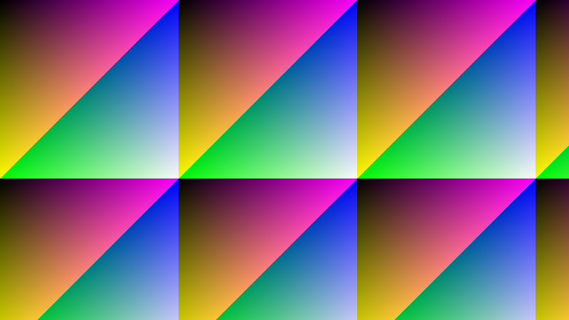 |

| 実施後 Low | 実施後 Mid | 実施後 High |
| --- | --- | --- |
|  |  | 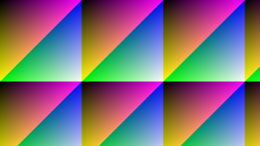 |

縮小先の長辺は**計測と同じ 320** です。 元画像を **800x450**（計測は 3840x2160）にしているため、比は **2.5 倍**です。 元画像を 640x360 にすると**ちょうど 2 倍**になり、**Mid（双線形）と High（面積平均）が同じ画素**になります（2 倍の縮小では双線形が 2x2 の平均をそのまま求めるためです。 実測で最大差 0）。 3 つの違いを見るため、**割り切れない比**にしています。

### 10.2 縮小の拡大（Low / Mid / High）

実施後の**1 画素を 4×4 で写した**ものです（実施後の (68, 39) から 80x45 の領域。 **実施前は上の表**を参照）。 縮小の違いは細かい模様に出るため、拡大すると**Low（最近傍）の階段**（元の模様を飛ばして拾うため）と、**Mid・High のなだらかさ**が見えます。

| 実施後 Low（拡大） | 実施後 Mid（拡大） | 実施後 High（拡大） |
| --- | --- | --- |
| 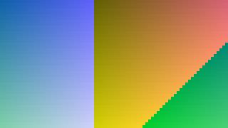 | 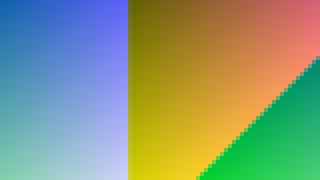 |  |

### 10.3 減色（256 色・実施前 → 実施後）

実施前は 800x450（全色）です。 実施後は同じ寸法のまま 256 色へ減色した結果です。 縮小していないため、**減色だけの違い**が分かります。 所要は §7.2、1 画素ごとの差は §7.8 です。

| 実施前 | 実施後（ディザなし） | 実施後（ディザあり） |
| --- | --- | --- |
|  | 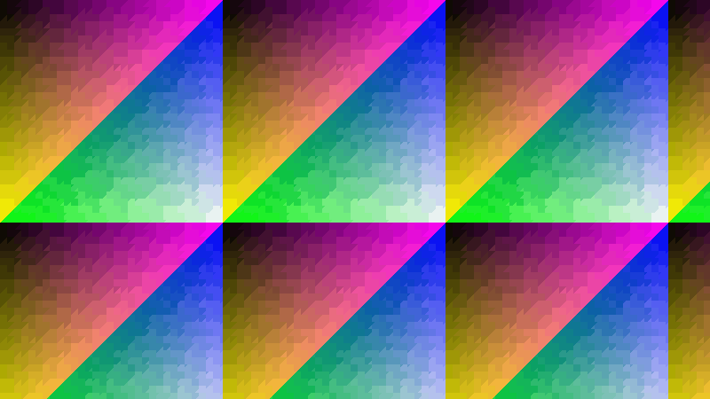 | 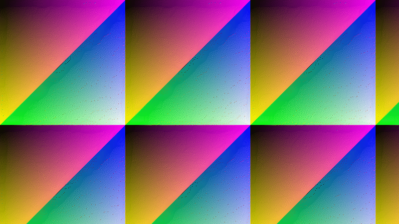 |

### 10.4 減色の拡大（256 色・Mid）

上の表の**1 画素を 4×4 で写した**ものです（実施前の (230, 120) から 80x45 の領域）。 **ディザの粒**（色を混ぜて中間色に見せる点）が見えます。 縞の出にくさは §7.9 です。

| 実施前（拡大） | 実施後（ディザなし・拡大） | 実施後（ディザあり・拡大） |
| --- | --- | --- |
|  | 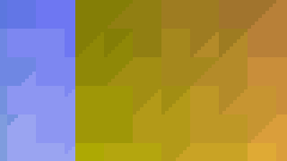 | 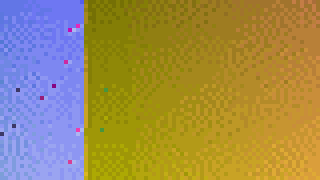 |

### 10.5 減色（16 色・実施前 → 実施後）

実施前は 800x450（全色）です。 実施後は同じ寸法のまま 16 色へ減色した結果です。 縮小していないため、**減色だけの違い**が分かります。 所要は §7.2、1 画素ごとの差は §7.10 です。

| 実施前 | 実施後（ディザなし） | 実施後（ディザあり） |
| --- | --- | --- |
|  | 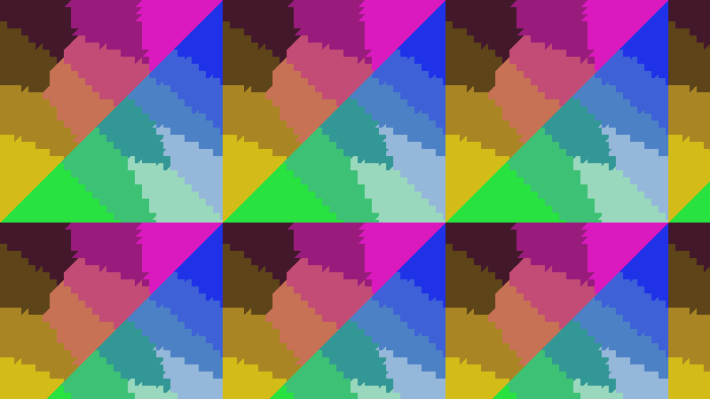 | 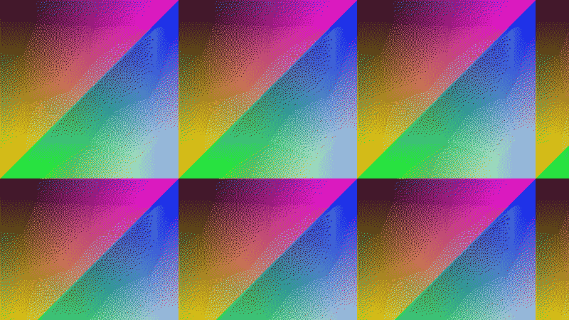 |

### 10.6 減色の拡大（16 色・Mid）

上の表の**1 画素を 4×4 で写した**ものです（実施前の (230, 120) から 80x45 の領域）。 **ディザの粒**（色を混ぜて中間色に見せる点）が見えます。 縞の出にくさは §7.11 です。

| 実施前（拡大） | 実施後（ディザなし・拡大） | 実施後（ディザあり・拡大） |
| --- | --- | --- |
|  |  | 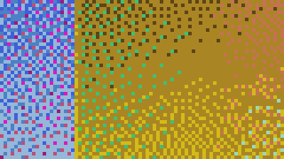 |

<!-- markdownlint-enable MD060 -->

<!-- 計測終了 -->

## 11. 改善の記録

計測で確認したことを記録します（数値は本ドキュメントの計測結果が持ちます。 ここには「何を根拠に何を決めたか」だけを書きます）。

### 11.1 画素の取得と設定

画素の取得（`GetPixel`）と設定（`SetPixel`）は、内部のバッファのアドレスを生成時に 1 度だけ求めて保持し、破棄済みの判定をフィールドの直接の読み取りで行います。 仮想呼び出しを含むアドレス取得と、インライン化されない破棄済み判定の呼び出しを画素ごとに繰り返さないためです。

### 11.2 一時配列は借りて返す

減色と縮小は、ヒストグラム（箱ごとの画素数と成分の合計）、箱の一覧、箱の代表色の Lab、列の対応表、詰め直しの作業場所のように**大きい配列を繰り返し必要とします**。 これらを呼び出しごとに確保すると LOH に入り、繰り返すほど Gen2 の GC を誘発します。 すべて `ArrayPool<T>` から借りて返すようにし、**借りた配列は使う前に必要な範囲だけを消す**（内容は次の借り手が消すため、返すときに消しません）ことで、減色を繰り返しても確保が積み上がりません。

### 11.3 縮小のアルゴリズム（Low / Mid / High）

- **Low**（最近傍）: 画素ごとの仕事が最も小さい（4 バイトのコピー 1 回）ため、所要は最も小さく**品質は最も低くなります**（面積平均を基準とした PSNR は §6.7 を参照）。 縮小先の列の対応表を先に求めることで、内側のループから除算を無くしています。

- **Mid**（双線形）: 列の対応（参照する 2 列と重み）を行に依存しないため 1 度だけ求めます。 逐次と並列が同じ実装を使いながら、行の範囲を引数に取ることで境界チェックの除去とベクター化の最適化を保ちます。 品質は面積平均に近く（縮小先が小さいほど差が開き、大きいほど一致します）、所要は Low の数倍です。

- **High**（面積平均）: 費用は**元画像の画素数**で決まり、中間画像を作りません。 品質の基準であり（自分自身と一致するため基準に対する差はありません）、縮小先が大きいほど **Mid** との所要の差は縮み、長辺 1920 ではほぼ等しくなります（測定のばらつきの範囲で入れ替わります）。 元画像が大きいほど Low との差が開きます（§6.1〜§6.3 が所要、§6.7 が品質）。

**縮小の用途ごとの選び方**: 品質を優先するなら **High**（最も正確で所要は最大）、所要を優先するなら **Low**（最も速いが品質は最も低い）、その中間は **Mid**（品質は High に近く、所要は Low と High の間）です。 §6.1〜§6.3 の速度比の列が「どれだけ譲るか」を示します。

**ちょうど 2 倍の縮小では Mid と High が同じ画素になります**（§10.1 のサンプルを作るときに実測で分かりました。 640x360 → 長辺 320 で最大差 0）。 2 倍の縮小では**双線形が 2x2 の平均をそのまま求める**（各軸の重みが 0.5 ずつになる）ためです。 したがって**2 倍ちょうどの縮小では High を選ぶ意味がありません**（所要は増え、結果は同じです。 §6.1〜§6.3 の計測は 12 倍の縮小であるため、この条件には当たりません）。

3 つの段階のいずれも、縮小先の行を範囲へ分けて並列実行し、**小さい画像では逐次**に切り替えます（並列化の起動と範囲の分割の費用が、小さい画像では仕事を上回るため）。 並列化を判定する画素数は段階ごとに違い、**その段階の費用が何で決まるかに合わせて**います（最近傍と双線形は縮小先の画素数、面積平均は元画像の画素数）。

**しきい値は実測で決めています**（下の表）。 実測の損益分岐は、最近傍が縮小先 14,400〜22,400 画素、双線形が 1,296〜2,304 画素、面積平均が元画像 5,184〜9,216 画素でした（元画像 3840x2160 の縮小。 基準の縮小先は長辺 320 で、その画素数は 320x180 = 57,600）。 コードのしきい値はこれに**コア数が半分の機械でも並列が勝つ側へ留まるための 2 倍**を掛けています（最近傍 36,864・双線形 3,072・面積平均 11,264）。

| 段階 | 判定に使う画素数 | 逐次 (ms) | 並列 (ms) | 並列 / 逐次 |
| --- | --- | ---: | ---: | ---: |
| 最近傍 | 縮小先 9,216 | `0.01 ms` | `0.02 ms` | 54% |
| 最近傍 | 縮小先 22,400 | `0.02 ms` | `0.02 ms` | 126% |
| 最近傍 | 縮小先 230,400 | `0.14 ms` | `0.07 ms` | 196% |
| 双線形 | 縮小先 1,296 | `0.01 ms` | `0.01 ms` | 114% |
| 双線形 | 縮小先 9,216 | `0.09 ms` | `0.03 ms` | 349% |
| 双線形 | 縮小先 230,400 | `2.11 ms` | `0.38 ms` | 557% |
| 面積平均 | 元画像 5,184 | `0.01 ms` | `0.01 ms` | 95% |
| 面積平均 | 元画像 57,600 | `0.07 ms` | `0.02 ms` | 371% |

この表は**しきい値を決めるための一時的な計測**です（しきい値を 0（常に並列）と上限（常に逐次）へ変えて 2 通りでビルドし、各寸法を 1 つの時点で 21 回測った値を 7 回取り、その最小値で比べました）。 目的が違うため**通常の計測（§2〜§9）には含めていません**（繰り返し測る対象ではなく、しきい値を変えたときだけ測り直すため）。

### 11.4 減色の作業量と品質の段階

減色の費用は**画像の内容**で大きく変わります（**画素が入った箱の数**で重さが決まるため）。 内容を変えた表（§7.7）が根拠です。 実際の画面の取り込みは内容次第であり、平坦寄り（同じ色が多い画面）とノイズ寄り（写真や細かい模様の画面）の両方があるため、本ドキュメントの既定の画像（折り返す勾配）は**その中間**と見ます。

**品質の段階（Low / Mid / High）が何を変えるか**も実測で分かります（§7.1〜§7.6 が所要、§7.8・§7.10 が 1 画素ごとの差）。

- **Low → Mid**: 品質が**明確に改善し**（§7.8・§7.10）、所要の増加は**小さい**（§7.1。 元画像が小さいほど増えます）。 品質の改善に対して費用が小さいため、**選ぶ意味があります**。
- **Mid → High**: 品質が**変わりません**（§7.10 の 16 色では値が一致し、§7.8 の 256 色でも差は表の刻みの中）。 所要はわずかに増えるため、**High を選ぶ意味はありません**。 実質は **Low / Mid の 2 段階**です。

したがって減色で意味のある選択は **Low**（最も速いが品質は最も低い）と **Mid**（High と同じ品質で High より速い）です。 **16 色では所要の差がしきい値（1.10 倍）以内**に収まるため（品質は High が最も高い）、§7.10 は品質の行を畳んで**最も高い品質だけ**を示します。 256 色は 1.10 倍を超えるため、品質ごとに示します。

**ディザは「遅く、1 画素ごとの差が増え、なだらかな変化には一致する」ものです**（§7.2 が所要、§7.8・§7.10 が 1 画素ごとの差、§7.9・§7.11 が低周波の一致）。 3 つは別々のことを測っているため、**どれか 1 つでは良し悪しを決められません**。

- **所要は増えます**（1 画素ごとに誤差をとなりへ配り、誤差を加えた色の最近傍を引くため）。 **並列化できません**（誤差がとなりへ伝わるため画素の走査に順序が要ります）。
- **1 画素ごとの差は増えます**（§7.8・§7.10）。 これは**わざと**そうしています（差をとなりへ散らすのが目的です）。
- **なだらかな変化（低周波）には一致します**（§7.9・§7.11）。 目のぼけを模した 4×4 の平均で見ると、**ディザありのほうが一致します**。 1 画素ごとの差が大きくても、平均すると打ち消し合うためです。 これが**縞（階調の飛び）の解消**であり、ディザを選ぶ理由です。

したがって「ディザありは品質が悪い」は**1 画素ごとの差についてだけ成り立ちます**。 なだらかな画面（空・ぼかし・グラデーション）では縞が消える分だけ良くなり、細かい模様の画面では差が目立ちます（**セル画のような平坦な領域の多い画面**では、ディザの粒状感が目立つことがあります）。 判断は**画面の内容**で行います。

減色の重い部分は「画素を箱へ数えること」ではなく「箱ごとにパレットの最近傍を求めること」です。 箱ごとに 1 度だけ求めて参照表にし（箱の数 × パレット長）、画素はその参照表を引きます。 参照表の大きさは履歴のビット数で決まるため、8 ビット（16,777,216 箱）は採らず 5 ビット（32,768 箱）を既定にしています（表が大きくなると参照表の利点が消えます）。 参照表を埋めるのは**画素があった箱だけ**です（画素が無い箱は走査で読まれません）。

- **画素を書く経路**は、色番号の中間配列（1 画素 1 バイト）を作らず、参照表を引いた結果を**32 ビットの 1 回の書き込み**で出力へ書きます。

- **ディザの経路**は、書き先を「色番号をそのまま書く」と「パレットの色へ戻して画素へ書く」の 2 つに分けます（画素を返す経路が中間配列を持たないようにするため）。 **ディザは所要を大きく増やします**（§7.2 の速度比）が、**縞の解消と引き換え**です（1 画素ごとの差では測れないため、§7.9・§7.11 の低周波の一致で確かめています）。

- **詰め直しの反復**は、1 回の費用が「使われている箱の数 × 色数」に比例するため、`RefinementWorkBudget` で回数を絞ります（`High` は上限まで回し、時間の上限で打ち切ります）。

**High** は反復（k-means）の回数と時間の上限を持つため、収束しにくい画像では打ち切られます。 数え上げ・中央分割・参照表の作成は中断しないため、色数は指定どおりになります（中断できるのは反復だけ）。 反復が品質を変えないのは、**中央分割で既に十分なパレットが得られている**ためです（§7.9 の 16 色では Mid と High の品質が完全に一致しました）。

### 11.5 0 コピーのビュー（EsPixmap）

切り出しの複製を作らずに一部を読む入口（`ToPixmap`）は、実体の生成と共有の参照カウントだけを行います。 切り出しの複製（`Crop`）に対して所要と確保の両方で有利であり、ルーペの描画は**切り出しの複製を経由しません**。 射影（表示用の画像）をそのまま使える場合は元矩形つきの描画で済ませ、使えない場合（オフスクリーン描画・射影の寸法が違う場合）も **0 コピーのビューを表示用へ変換**します（`Crop` は使いません）。

### 11.6 ビューの全走査は行の間隔も読む

ビューは元画像の**行の間隔を引き継ぐ**ため、全走査（`ReadOnlyPixels`）が読む範囲は `幅 × 4 × 高さ` ではなく `行の間隔 × 高さ` になります。 元画像より狭いビューでは、その差がそのまま走査の所要になります（ビューの幅が元画像の 1/6 であれば、同じ高さでも 6 倍近い範囲を読みます）。 狭いビューを繰り返し走査する場面では、ビューではなく `幅 × 4` の行の間隔を持つ画像へ写すか、走査の対象をビューの行に限るかを選びます。

### 11.7 凍結した画像の共有

書き換え可能な画像から読み取り専用の画像を作る入口（`FromBitmap`）は、**元が凍結済みなら 0 コピーで共有**し、**未凍結なら複製**します（凍結の有無で費用が 4 桁以上変わります。 §4.8 が根拠です）。 凍結は「この実体からは書けない」ことの宣言であり、それを受けて**同じ画素を指す実体を増やす**判断ができます。 共有した場合はどちらを先に破棄しても画素は有効なままです（参照を数えて解放します）。

### 11.8 保存の形式

保存の費用は**形式で 4 倍前後変わります**（同じ画素を書く場合。 §9.2〜§9.5 が根拠です）。 無圧縮（BMP）は画素数に比例するだけであり、可逆圧縮（PNG）は圧縮の計算が加わり、非可逆圧縮（JPEG）は圧縮の計算が軽い代わりに画素の情報を捨てます。 256 色へ減色する形式（GIF）は減色の費用（§7）が加わります。 出力の大きさは形式と内容の両方で変わるため、保存の表では**所要と出力の大きさを分けて**示します（§9.6）。

## 12. 読み方と留意点

- **所要は妨害の無い最短値（最小値）**です。 実行時は呼び出しの回数で最適化の段階を上げるため、ウォームアップを 40 回以上取ってから測ります（回数が少ないと、同じ処理でも測定の順番だけで数倍の差が出ます）。 標本は**巡（既定 3 巡）へ分けて**取り、まとめた最小値を採ります（1 つの時点で続けて測ると、機械が遅い状態の値がそのまま表へ入ります）。
- **同じ処理の所要でも、機械の妨害で 2 倍以上に見えることがあります**（実測。 計測の巡をまたいだ同じ仕事の比は §2 に示します）。 したがって**表をまたいで値を比べるときは、差がその範囲を超えているか**を確かめてください。 **同じ表の中の行は続けて測る**ため、行の比較はこれより小さな差で済みます（備考の列が示す境目）。
- **所要が 1 マイクロ秒を下回る操作は、1 回の計測で 100 回呼んで 1 回あたりへ換算**します（タイマーの刻みに埋もれるため）。 この換算した値は**タイマーの刻みとループの費用**を含みます。
- **速度比は同じ寸法の 1 行目との比**です（`基準の所要 ÷ その行の所要`。 100% より大きいほど速い）。 基準の所要が 1 マイクロ秒未満の表では示しません（ばらつきが比率を支配するため）。 **備考の列**が、その行の差が計測のばらつきの範囲かどうかを述べます（§3）。
- **計測に使う画像は折り返す勾配**です（決定的で、実行のたびに同じ画像になります）。 実際の画面の取り込みは内容が違うため、**減色と保存の大きさは内容で変わります**（減色は §7.7、保存は §9.6 を参照）。
- **画素の領域は所要の表に現れません**（`Create` 系が確保する画素はアンマネージドです。 `幅 × 4 × 高さ`）。 所要の表が持つのは所要だけです。
- **ビューの全走査（`ReadOnlyPixels`）は行の間隔も読みます**。 ビューは元画像の行の間隔を引き継ぐため、元画像の幅がビューより広いほど読む範囲が広がります（§8.4 を参照）。
- **値は環境で変わります**（CPU のコア数・メモリ帯域・GC の設定）。 本ドキュメントの値は「計測環境」の項に記した 1 台での実測です。
- **ファイル入出力は Windows 専用の符号化（GDI+）**を使います（他の OS では計測しません）。
- **並列化を判定するしきい値は実測で決めた値**です（§11.3）。 コア数の少ない機械では並列化の損益分岐が大きくなるため、しきい値には 2 倍の余裕を持たせています。
