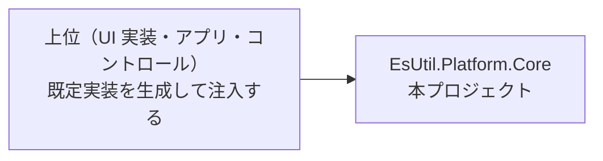

# EsUtil.Platform.Core システム仕様書

UI フレームワーク非依存の共通基盤の型を提供するライブラリの構造・依存・例外処理・設計判断を記載します。 公開 API は [`SPEC_API.md`](SPEC_API.md)、使い方は [`../README.md`](../README.md) を参照してください。

## 目次 <!-- omit from toc -->

- [1. システム概要](#1-システム概要)
- [2. 技術スタック](#2-技術スタック)
- [3. アーキテクチャ](#3-アーキテクチャ)
- [4. コンポーネント構成](#4-コンポーネント構成)
- [5. 例外処理ポリシー](#5-例外処理ポリシー)
- [6. ログ出力ポリシー](#6-ログ出力ポリシー)
- [7. 設計判断（UI 非依存の境界）](#7-設計判断ui-非依存の境界)
  - [7.1 ファイル入出力の実装方式](#71-ファイル入出力の実装方式)
  - [7.2 コア型の命名](#72-コア型の命名)
- [8. 依存の判定基準（本プロジェクトの存在理由）](#8-依存の判定基準本プロジェクトの存在理由)

## 1. システム概要

| 項目 | 内容 |
| --- | --- |
| 目的 | UI フレームワークに依存していた型（キーと入力・幾何・座標変換・画像・OS サービス抽象）を 1 箇所へ集約し、複数の UI 実装が同じ型と計算結果を共有できるようにする |
| 提供形態 | クラスライブラリ（`EsUtil.Platform.Core.dll`） |
| 想定利用者 | UI 実装・コントロールの層・上位のアプリ（OS サービスの Windows 実装はホストが生成して注入する） |
| 汎用性 | 特定のアプリ・UI に依存しない（このソリューション以外でもそのまま使える型だけを置く。 `Native/` 配下だけが例外） |

## 2. 技術スタック

- .NET 10 / C# 14
- 外部パッケージを参照しない（ログは呼び出し側が所有し、OS 操作は OS の API を直接呼ぶ）
- OS 標準のコーデック（`gdiplus.dll` のフラット API。 `src/EsUtil.Platform.Core/src/Native/Win` の画像ファイル入出力のみ。 Windows 専用。 **外部パッケージは参照しない**）
- UI フレームワークは一切参照しない

## 3. アーキテクチャ

- `EsUtil.Platform.Core` は他プロジェクトへ依存しない末端の共有ライブラリです。
- 各 UI 実装は、コア型と自身の型（例: `Avalonia.Input.Key` / `Avalonia.Point` / `IPlatformHandle`）を相互変換する Interop 層を個別に用意します（本プロジェクトは UI 型を参照しません）。
- サービス抽象（`ICaptureService` 等）とその Windows 実装（Win32）は、本プロジェクトの `src/EsUtil.Platform.Core/src/Native` 配下が提供します。 **実行時のプラットフォーム分岐（ファクトリ）を持たず、ホストが `src/EsUtil.Platform.Core/src/Native/Win` の具象を生成して抽象型として注入します**。 テストは抽象を実装したモックを注入するため、Win32 実行環境を必要としません。

## 4. コンポーネント構成

| ファイル | 内容 |
| --- | --- |
| `EsKey.cs` | UI フレームワーク非依存のキー識別子（列挙型）。 `Avalonia.Input.Key` と名前集合が完全一致し（223 メンバー）、WPF / MewUI のキー型の上位互換である（往復テストが追随を強制する） |
| `EsWindowState.cs` | UI フレームワーク非依存のウィンドウ表示状態（列挙型）。 `Avalonia.Controls.WindowState` と同名のメンバーを持つ |
| `HotKeyModifiers.cs` | ホットキー修飾キーのフラグ列挙型 |
| `HotKeySetting.cs` | ホットキー設定の値オブジェクト（record） |
| `EsKeyExtensions.cs` | キーの正規化（未定義値を `None` へ寄せる拡張メソッド `Normalize`） |
| `EnumCanonical.cs` | 同じ値を持つ別名（重複値）を持つ列挙型の代表名による解決（各 Interop が共有する） |
| `src/EsUtil.Platform.Core/src/Native/ICaptureService.cs` | 画面領域キャプチャの抽象 |
| `src/EsUtil.Platform.Core/src/Native/ICursorService.cs` | OS カーソル操作の抽象 |
| `src/EsUtil.Platform.Core/src/Native/IWindowService.cs` | ネイティブウィンドウ操作の抽象 |
| `src/EsUtil.Platform.Core/src/Native/IElementFinder.cs` | 要素（ウィンドウ・スクリーン）検出の抽象 |
| `src/EsUtil.Platform.Core/src/Native/ICursorOverrideGuard.cs` | カーソル上書き抑止の抽象 |
| `src/EsUtil.Platform.Core/src/Native/IGlobalHotKeyService.cs` | グローバルホットキー管理の抽象 |
| `src/EsUtil.Platform.Core/src/Native/ElementFinderResults.cs` | 要素検出の結果（`readonly record struct`） |
| `src/EsUtil.Platform.Core/src/Native/Win/WinNative.cs` | OS API（Win32 / GDI+）の P/Invoke の宣言集約（internal）。 **本ファイルは複数の DLL で共有する構造体とヘルパーを持ち、宣言は DLL ごとの `partial` ファイルが持つ** |
| `src/EsUtil.Platform.Core/src/Native/Win/WinNative.User32.cs` | user32 の宣言（カーソル・ウィンドウ・要素検出・画面キャプチャのデバイス コンテキスト） |
| `src/EsUtil.Platform.Core/src/Native/Win/WinNative.Gdi32.cs` | gdi32 の宣言（画面キャプチャの DIB と `BitBlt`） |
| `src/EsUtil.Platform.Core/src/Native/Win/WinNative.DwmApi.cs` | dwmapi の宣言（影を除いた可視矩形・合成の完了待ち） |
| `src/EsUtil.Platform.Core/src/Native/Win/WinNative.Kernel32.cs` | kernel32 の宣言（プロセス ID） |
| `src/EsUtil.Platform.Core/src/Native/Win/WinNative.HotKey.cs` | グローバル ホットキーの宣言（user32）とキー変換 |
| `src/EsUtil.Platform.Core/src/Native/Win/WinNative.GdiPlus.cs` | gdiplus の宣言（画像のエンコード・デコード） |
| `src/EsUtil.Platform.Core/src/Native/Win/WinCaptureService.cs` | `ICaptureService` の Windows 実装 |
| `src/EsUtil.Platform.Core/src/Native/Win/WinCursorService.cs` | `ICursorService` の Windows 実装 |
| `src/EsUtil.Platform.Core/src/Native/Win/WinWindowService.cs` | `IWindowService` の Windows 実装 |
| `src/EsUtil.Platform.Core/src/Native/Win/WinElementFinder.cs` | `IElementFinder` の Windows 実装 |
| `src/EsUtil.Platform.Core/src/Native/Win/WinCursorOverrideGuard.cs` | `ICursorOverrideGuard` の Windows 実装 |
| `src/EsUtil.Platform.Core/src/Native/Win/WinGlobalHotKeyService.cs` | `IGlobalHotKeyService<T>` の Windows 実装 |
| `src/EsUtil.Platform.Core/src/Native/Win/WinGdiPlusImageCodec.cs` | 画像のファイル保存・読み込みの実装（GDI+。 Windows 専用。 画像型を名指しせず、公開面は画像型の `Save` / `Load`） |
| `src/EsUtil.Platform.Core/src/Native/Win/WinGdiPlusLifetime.cs` | GDI+ のプロセス単位の初期化（internal・1 回だけ実行） |
| `src/EsUtil.Platform.Core/src/Coord/ScrollMath.cs` | スクロール範囲・ビューポートサイズの純粋計算とホイール 1 段のスクロール量（`WheelScrollUnit`） |
| `src/EsUtil.Platform.Core/src/Coord/DpiScaler.cs` | DIP 値を物理ピクセルへ変換する純粋計算（DPI 基準値と DPI → スケーリング換算を含む） |
| `src/EsUtil.Platform.Core/src/Coord/CoordTransformExtensions.cs` | 座標変換ポート未設定（null）を等価変換として解決する |
| `src/EsUtil.Platform.Core/src/Coord/ICoordTransform.cs` | ローカル DIP と対象座標の変換ポート（`ToSource` / `ToDip` / `SourceArea`） |
| `src/EsUtil.Platform.Core/src/Coord/CoordTransform.cs` | 変換ポートの具象実装（`Func` 委譲・`Identity` / `ClientToSource`）。 **原点基準の等方スケーリングの純粋計算も単一所有する**（`MultiplyPoint` / `DividePoint` は internal） |
| `src/EsUtil.Platform.Core/src/Geometry/EsPoint.cs` | UI フレームワーク非依存の 2 次元座標（`readonly record struct`）。 座標ラベルの文言（`Format`）と、フレームワーク対照の操作（`WithX` / `Offset` / `DistanceTo` / `NearlyEquals` / 演算子）を提供する |
| `src/EsUtil.Platform.Core/src/Geometry/EsSize.cs` | UI フレームワーク非依存の 2 次元サイズ（`readonly record struct`。 領域の確定判定 `HasArea` とクランプ `ClampToArea` / `ClampOffset`。 `Constrain` / `Inflate` / `Deflate` / 四則演算） |
| `src/EsUtil.Platform.Core/src/Geometry/EsVector.cs` | UI フレームワーク非依存の 2 次元ベクター（`readonly record struct`。 `Length` / `LengthSquared` / `Normalize` / `Dot` / `Cross` / `Min` / `Max` / `Abs` / 四則演算） |
| `src/EsUtil.Platform.Core/src/Geometry/EsRect.cs` | UI フレームワーク非依存の矩形（`readonly record struct`。 枠線の内側 4 辺 `ResolveInnerEdges`（配列版 `ComputeInnerEdges`）・領域内クランプ `ClampToArea`・重なり部分 `Intersect` / `Intersects`・`Union` / `CenterRect` / `Normalize`・区間の流儀 `Interval`）。 派生メソッドは座標・サイズを差し替えても `Interval` を引き継ぐ（`CenterRect` のみ引数の流儀を使う） |
| `src/EsUtil.Platform.Core/src/Geometry/EsPointInt.cs` | UI フレームワーク非依存の整数座標（`EsPoint` の整数版。 丸めは `FromEsPoint` が単一所有する） |
| `src/EsUtil.Platform.Core/src/Geometry/EsSizeInt.cs` | UI フレームワーク非依存の整数サイズ（`EsSize` の整数版。 `IsEmpty`（0 以下）と `FromEsSize`） |
| `src/EsUtil.Platform.Core/src/Geometry/EsRectInt.cs` | UI フレームワーク非依存の整数矩形（`EsRect` の整数版。 `Contains` / `Intersects` / `Intersect` / `Union` / `Center` / `FromEsRect`） |
| `src/EsUtil.Platform.Core/src/Geometry/EsAxis.cs` | レイアウト計算で扱う軸（`X` / `Y`）。 軸を `bool` で指定しないための列挙型 |
| `src/EsUtil.Platform.Core/src/Geometry/EsRounding.cs` | 小数を整数へ丸める方法（`Truncate` / `Round` / `Ceiling`）。 丸め規則を整数型の変換へ集約するための列挙型 |
| `src/EsUtil.Platform.Core/src/Geometry/EsRectInterval.cs` | 矩形の幅・高さが終点を含むかどうか（`HalfOpen` / `Closed`）。 ピクセル数への変換（`+1`）の判断を `EsRect` へ集約するための列挙型 |
| `src/EsUtil.Platform.Core/src/Geometry/EsThickness.cs` | 4 辺の厚さ（`readonly record struct`。 `EsSize` / `EsRect` の `Inflate` / `Deflate` の引数） |
| `src/EsUtil.Platform.Core/src/Geometry/EsRectEdges.cs` | 矩形の 4 辺の矩形を保持する固定長コンテナ（`readonly struct`。 `EsRect.ResolveInnerEdges` の戻り値） |
| `src/EsUtil.Platform.Core/src/Geometry/EsMath.cs` | 幾何値の近似比較（`AreClose`）と整数への丸め（`RoundToInt`）の単一所有者（internal） |
| `EsPlatformHandle.cs` | UI フレームワーク非依存のネイティブウィンドウ識別子（座標・寸法ではないため `Geometry` に置かない） |
| `src/EsUtil.Platform.Core/src/Imaging/EsBitmap.cs` | **書き換え可能**な画像（`EsReadOnlyBitmap` とは**兄弟**。 BGRA8888・Premul。 外部パッケージに依存しない。 書き込みの入口（`Pixels`・`SetPixel`・`TrySetPixel`・`Clear`・`SetReadOnly`）だけが読み取り専用の型と異なる） |
| `src/EsUtil.Platform.Core/src/Imaging/EsReadOnlyBitmap.cs` | **読み取り専用**の画像（画素を書き換える入口を持たない。 `EsBitmap` と対称な入口を持ち、変換の向き（`FromBitmap`）だけが異なる） |
| `src/EsUtil.Platform.Core/src/Imaging/EsBitmapBuffer.cs` | 画素バッファの内部型（確保・借用・共有・凍結・解放を単一所有する。 公開しない。 2 型の実装の共有もこの型が担う） |
| `src/EsUtil.Platform.Core/src/Imaging/EsPixmap.cs` | 画像の一部を指す **0 コピーの読み取りビュー**（行幅を持つ。 切り出しの複製を避ける。 元の寿命に依存しない） |
| `src/EsUtil.Platform.Core/src/Imaging/SafeAlignedBuffer.cs` | 整列したアンマネージド バッファの所有者（`SafeHandle`。 **解放の実装を単一所有する**。 `Dispose` 忘れはファイナライザが解放する） |
| `src/EsUtil.Platform.Core/src/Imaging/DrawingColorExtensions.cs` | 描画色の可視判定（アルファが 0 より大きいか）の単一所有 |

## 5. 例外処理ポリシー

本プロジェクトは値型・列挙型と純粋計算で構成されます。 例外はコアの画像の引数検証（`ArgumentOutOfRangeException`）と破棄後アクセス（`ObjectDisposedException`）のみです。

## 6. ログ出力ポリシー

**本プロジェクトはログを出力しません**（`Microsoft.Extensions.Logging.Abstractions` を参照しないため `ILogger` を扱えず、ログ定義も持ちません。 規約は [`.github/ログ規約.md`](../../../.github/ログ規約.md) §3・§6 が所有します）。

失敗は**例外または戻り値**で呼び出し側へ返し、記録は呼び出し側の層が行います（[`.github/例外処理規約.md`](../../../.github/例外処理規約.md) §2・§3）。

| 失敗の種類 | 表し方 | 例 |
| --- | --- | --- |
| OS 操作の失敗（回復できない） | `Win32Exception` を投げる（日本語のメッセージに**操作と対象**を含める） | `WinCaptureService.CaptureArea` / `WinWindowService.SetBounds` / `WinGlobalHotKeyService.Initialize` |
| 能力の有無・正常な入力の変種 | `bool` の戻り値 | `WinWindowService.SetCaptureExclusion`（Windows 10 2004 未満）/ `WinGlobalHotKeyService.RegisterAll`（他のアプリとの競合）/ `ICursorService.TryGetCursorScreenPoint` |
| 該当なし | 空の結果 | `WinElementFinder`（見つからない） |
| 取得できない（撮影の前提が欠ける） | `null` | `WinCaptureService.CaptureVirtualScreen`（仮想スクリーンの境界が測れない） |

## 7. 設計判断（UI 非依存の境界）

本プロジェクトの型は、UI フレームワークの型を保持しないことを境界の条件としています。

| 判断 | 内容 |
| --- | --- |
| キーとウィンドウ状態 | `Avalonia.Input.Key` / `Avalonia.Controls.WindowState` と**メンバー名を一致**させ、名前ベースの変換で相互変換する（既存の設定ファイルをそのまま読み込める） |
| 座標・寸法 | `Avalonia.Point` / `Size` / `Vector` → `EsPoint` / `EsSize` / `EsVector` へ統一し、UI 境界で 1 行変換する |
| 色 | `System.Drawing.Color`（共有フレームワーク同梱でクロスプラットフォーム。 `System.Drawing.Common` ではない）を使い、UI の色型への変換は境界で行う |
| Skia の描画プリミティブ | SkiaSharp は外部パッケージであるため、Skia に依存する型（描画ポートの適合・ビットマップの相互変換・テキスト測定）は Skia を使用する上位層が単一所有する（本プロジェクトは SkiaSharp を参照しない） |
| 描画の契約 | 描画計画を担う上位の層が単一所有する（本プロジェクトは参照される側であり、それらを参照しない） |
| ロガー | 本プロジェクトはロガーを扱わない（外部パッケージを参照しない）。 ログの取得と記録は呼び出し側の層が所有する |

### 7.1 ファイル入出力の実装方式

画像のファイル入出力（画像型の `Save` / `Load`）は **OS の `gdiplus.dll` を直接呼びます**。 この判断は「外部パッケージを参照しない」ことと引き換えに、**プロセス全体に及ぶ副作用**を引き受けます（実測）。

| 副作用 | 内容 |
| --- | --- |
| GDI+ の有効化 | 初回の `Save` / `Load` で `GdiplusStartup` を 1 回呼ぶ。 **呼ばないと GDI+ の API は 1 つも動かない**（未初期化の `GdipCreateBitmapFromScan0` は状態 18 = `GdiplusNotInitialized` で失敗する） |
| バックグラウンド スレッド +1 | GDI+ が表示設定の通知を受け取るために作る（起動直後 8 → 9）。 **抑止すると初期化自体が失敗する**（`SuppressBackgroundThread = 1` は通知フックを要求するため `InvalidParameter` になる。 実測） |
| 解放されない参照カウント | `GdiplusShutdown` を**呼ばない**（呼ぶと利用者の GDI+ を止める可能性がある）。 プロセス終了時に OS が解放する |
| 初回の遅延 | 最初の `Save` / `Load` に初期化のコストが乗る（初回 4.89 ms / 2 回目 0.53 ms。 実測） |

**影響を受けるのは GDI+ を他に使っていないプロセスだけです**（`System.Drawing.Common` を使うアプリには同じ初期化とスレッドが既に存在します）。 副作用を避ける唯一の現実的な手段は **WIC へ移すこと**（`IWICImagingFactory` の COM 起動であり、プロセス全体の初期化もスレッドも不要）ですが、実装量が最大で GDI+ より遅い（実測: BMP で 6.8 倍）ため採用していません。 形式の網羅性と速度の実測比較は [`SPEC_API.md`](SPEC_API.md) の該当節が持ちます。

### 7.2 コア型の命名

コア型には **`Es`（`EsUtil` の略）接頭辞**を付けます（`EsKey` / `EsPoint` / `EsSize` / `EsVector` / `EsRect` / `EsPointInt` / `EsSizeInt` / `EsRectInt` / `EsAxis` / `EsPlatformHandle` / `EsWindowState` / `EsBitmap`）。 **整数版の型は `Es` + 型名 + `Int`** とします。

規則（付ける理由・整数版の扱い）は [`.github/命名規約.md`](../../../.github/命名規約.md) が単一所有します。

## 8. 依存の判定基準（本プロジェクトの存在理由）

本プロジェクトは**「このソリューション以外でもそのまま使える型」**だけを置きます（`Native/` 配下だけが例外です）。 判定は依存で機械的に行います。

| 基準 | 内容 |
| --- | --- |
| **外部 PackageReference なし** | `.NET 標準ライブラリ`（`System.*`）と **Microsoft 公式パッケージ**（`Microsoft.*`）は許容する。 それ以外の外部パッケージは**参照しない**（`.NET` 以外は Microsoft 公式のみ） |
| **UI フレームワーク非依存** | Avalonia / MewUI / WinUI / WinForms を参照しない |
| **ソリューション固有の概念を持たない** | 特定のアプリ・コントロールに固有の型は置かない（そのような型は各コントロールの層へ置く） |
| **OS 依存なし** | Win32 P/Invoke を含まない（`Native/` 配下の責務） |

**`Native/` 配下は上記の「可搬性」の基準から除外します**（Windows 限定の実装を、抽象と同じ場所で保守するための例外です）。 **Win32 の P/Invoke（`user32` / `gdi32` / `dwmapi` / `kernel32`）と OS 標準のコーデック（`gdiplus`）は `Native/` 配下だけが持ちます**（外部パッケージは参照しません）。

**画像のファイル入出力（`EsBitmapExtensions.Save` / `EsReadOnlyBitmap.Load` / `EsBitmap.Load`）は Windows 専用のメンバーです**（`Imaging/` の型と拡張メソッドに置きますが、実体は `src/EsUtil.Platform.Core/src/Native/Win` の `WinGdiPlusImageCodec` が担います）。 型そのものは可搬であり、これらのメンバーだけが `SupportedOSPlatform("windows")` で限定されます（非 Windows では `DllNotFoundException`。 判断の詳細は §7.1）。

**Skia は「外部パッケージ」に該当するため、本プロジェクトは SkiaSharp に依存しません**（Skia への依存は Skia を使用する上位層が単一所有します）。
