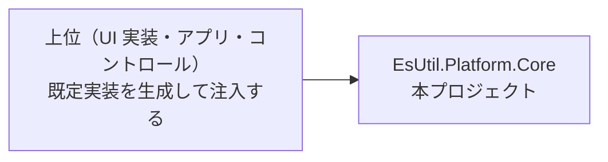

# EsUtil.Platform.Core システム仕様書

UI フレームワーク非依存の共通基盤の型を提供するライブラリの構造・依存・例外処理・設計判断を記載します。 公開 API は [`SPEC_API.md`](SPEC_API.md)、使い方は [`../README.md`](../README.md) を参照してください。

## 目次

- [1. システム概要](#1-システム概要)
- [2. 技術スタック](#2-技術スタック)
- [3. アーキテクチャ](#3-アーキテクチャ)
- [4. コンポーネント構成](#4-コンポーネント構成)
- [5. 例外処理ポリシー](#5-例外処理ポリシー)
- [6. ログ出力ポリシー](#6-ログ出力ポリシー)
- [7. 設計判断（UI 非依存の境界）](#7-設計判断ui-非依存の境界)
  - [7.1 コア型の命名](#71-コア型の命名)
- [8. 依存の判定基準（本プロジェクトの存在理由）](#8-依存の判定基準本プロジェクトの存在理由)

## 1. システム概要

| 項目 | 内容 |
| --- | --- |
| 目的 | UI フレームワークに依存していた型（キーと入力・幾何・座標変換・画像・OS サービス抽象）を 1 箇所へ集約し、複数の UI 実装が同じ型と計算結果を共有できるようにする |
| 提供形態 | クラスライブラリ（`EsUtil.Platform.Core.dll`） |
| 想定利用者 | UI 実装・コントロールの層・上位のアプリ（OS サービスの Windows 実装はホストが生成して注入する） |
| 汎用性 | 特定のアプリ・UI に依存しない（このソリューション以外でもそのまま使える型だけを置く。 `Native/` 配下だけが例外） |

## 2. 技術スタック

- .NET 10 / C# 14
- Microsoft.Extensions.Logging.Abstractions（`LoggerFallback` のロガー抽象のみ。 Microsoft 公式パッケージ）
- System.Drawing.Common（`Native/Imaging` の `System.Drawing.Bitmap` 変換のみ。 Microsoft 公式パッケージ。 Windows 専用）
- UI フレームワークは一切参照しない

## 3. アーキテクチャ

- `EsUtil.Platform.Core` は他プロジェクトへ依存しない末端の共有ライブラリです。
- 各 UI 実装は、コア型と自身の型（例: `Avalonia.Input.Key` / `Avalonia.Point` / `IPlatformHandle`）を相互変換する Interop 層を個別に用意します（本プロジェクトは UI 型を参照しません）。
- サービス抽象（`ICaptureService` 等）とその Windows 実装（Win32）は、本プロジェクトの `Native/` 配下が提供します。 **実行時のプラットフォーム分岐（ファクトリ）を持たず、ホストが `Native/Win` の具象を生成して抽象型として注入します**。 テストは抽象を実装したモックを注入するため、Win32 実行環境を必要としません。

## 4. コンポーネント構成

| ファイル | 内容 |
| --- | --- |
| `EsKey.cs` | UI フレームワーク非依存のキー識別子（列挙型）。 `Avalonia.Input.Key` と同名のメンバーを持つ |
| `EsWindowState.cs` | UI フレームワーク非依存のウィンドウ表示状態（列挙型）。 `Avalonia.Controls.WindowState` と同名のメンバーを持つ |
| `HotKeyModifiers.cs` | ホットキー修飾キーのフラグ列挙型 |
| `HotKeySetting.cs` | ホットキー設定の値オブジェクト（record） |
| `src/EsUtil.Platform.Core/src/Native/ICaptureService.cs` | 画面領域キャプチャの抽象 |
| `src/EsUtil.Platform.Core/src/Native/ICursorService.cs` | OS カーソル操作の抽象 |
| `src/EsUtil.Platform.Core/src/Native/IWindowService.cs` | ネイティブウィンドウ操作の抽象 |
| `src/EsUtil.Platform.Core/src/Native/IElementFinder.cs` | 要素（ウィンドウ・スクリーン）検出の抽象 |
| `src/EsUtil.Platform.Core/src/Native/ICursorOverrideGuard.cs` | カーソル上書き抑止の抽象 |
| `src/EsUtil.Platform.Core/src/Native/IGlobalHotKeyService.cs` | グローバルホットキー管理の抽象 |
| `src/EsUtil.Platform.Core/src/Native/ElementFinderResults.cs` | 要素検出の結果（`readonly record struct`） |
| `src/EsUtil.Platform.Core/src/Native/NativeLogMessage.cs` | Win 実装が出力するログ定義（internal。 本ファイルに集約する） |
| `src/EsUtil.Platform.Core/src/Native/Win/WinNative.cs` | Win32 P/Invoke の宣言集約（internal） |
| `src/EsUtil.Platform.Core/src/Native/Win/WinCaptureService.cs` | `ICaptureService` の Windows 実装 |
| `src/EsUtil.Platform.Core/src/Native/Win/WinCursorService.cs` | `ICursorService` の Windows 実装 |
| `src/EsUtil.Platform.Core/src/Native/Win/WinWindowService.cs` | `IWindowService` の Windows 実装 |
| `src/EsUtil.Platform.Core/src/Native/Win/WinElementFinder.cs` | `IElementFinder` の Windows 実装 |
| `src/EsUtil.Platform.Core/src/Native/Win/WinCursorOverrideGuard.cs` | `ICursorOverrideGuard` の Windows 実装 |
| `src/EsUtil.Platform.Core/src/Native/Win/WinGlobalHotKeyService.cs` | `IGlobalHotKeyService<T>` の Windows 実装 |
| `src/EsUtil.Platform.Core/src/Native/Imaging/EsBitmapDrawingExtensions.cs` | `System.Drawing.Bitmap` ⇔ `EsBitmap` の相互変換（Windows 専用） |
| `LoggerFallback.cs` | ロガーの null を `NullLogger.Instance` へ吸収する共通ヘルパー（拡張メソッド `OrNullLogger`） |
| `src/EsUtil.Platform.Core/src/Coord/ScrollMath.cs` | スクロール範囲・ビューポートサイズの純粋計算とホイール 1 段のスクロール量（`WheelScrollUnit`） |
| `src/EsUtil.Platform.Core/src/Coord/DpiScaler.cs` | DIP 値を物理ピクセルへ変換する純粋計算（DPI 基準値と DPI → スケーリング換算を含む） |
| `src/EsUtil.Platform.Core/src/Coord/CoordTransformExtensions.cs` | 座標変換ポート未設定（null）を等価変換として解決する |
| `src/EsUtil.Platform.Core/src/Coord/ICoordTransform.cs` | ローカル DIP と対象座標の変換ポート（`ToSource` / `ToDip` / `SourceArea`） |
| `src/EsUtil.Platform.Core/src/Coord/CoordTransform.cs` | 変換ポートの具象実装（`Func` 委譲・`Identity` / `ClientToSource`）。 **原点基準の等方スケーリングの純粋計算も単一所有する**（`MultiplyPoint` / `DividePoint` は internal） |
| `src/EsUtil.Platform.Core/src/Geometry/EsPoint.cs` | UI フレームワーク非依存の 2 次元座標（`readonly record struct`）。 座標ラベルの文言（`Format`）と、フレームワーク対照の操作（`WithX` / `Offset` / `DistanceTo` / `NearlyEquals` / 演算子）を提供する |
| `src/EsUtil.Platform.Core/src/Geometry/EsSize.cs` | UI フレームワーク非依存の 2 次元サイズ（`readonly record struct`。 領域の確定判定 `HasArea` とクランプ `ClampToArea` / `ClampOffset`。 `Constrain` / `Inflate` / `Deflate` / 四則演算） |
| `src/EsUtil.Platform.Core/src/Geometry/EsVector.cs` | UI フレームワーク非依存の 2 次元ベクター（`readonly record struct`。 `Length` / `LengthSquared` / `Normalize` / `Dot` / `Cross` / `Min` / `Max` / `Abs` / 四則演算） |
| `src/EsUtil.Platform.Core/src/Geometry/EsRect.cs` | UI フレームワーク非依存の矩形（`readonly record struct`。 枠線の内側 4 辺 `ResolveInnerEdges`（配列版 `ComputeInnerEdges`）・領域内クランプ `ClampToArea`・重なり部分 `Intersect` / `Intersects`・`Union` / `CenterRect` / `Normalize`・区間の流儀 `Interval`）。 派生メソッドは座標・サイズを差し替えても `Interval` を引き継ぐ（`CenterRect` のみ引数の流儀を使う） |
| `src/EsUtil.Platform.Core/src/Geometry/EsPointInt.cs` | UI フレームワーク非依存の整数座標（`EsPoint` の整数版。 丸めは `FromEsPoint` が単一所有する） |
| `src/EsUtil.Platform.Core/src/Geometry/EsSizeInt.cs` | UI フレームワーク非依存の整数サイズ（`EsSize` の整数版。 `IsEmpty`（0 以下）と `FromEsSize`） |
| `src/EsUtil.Platform.Core/src/Geometry/EsRectInt.cs` | UI フレームワーク非依存の整数矩形（`EsRect` の整数版。 `Contains` / `Intersects` / `Intersect` / `Union` / `Center` / `FromEsRect`） |
| `src/EsUtil.Platform.Core/src/Geometry/EsAxis.cs` | レイアウト計算で扱う軸（`X` / `Y`）。 軸を `bool` で指定しないための列挙型 |
| `src/EsUtil.Platform.Core/src/Geometry/EsRounding.cs` | 小数を整数へ丸める方法（`Truncate` / `Round` / `Ceiling`）。 丸め規則を整数型の変換へ集約するための列挙型 |
| `src/EsUtil.Platform.Core/src/Geometry/EsRectInterval.cs` | 矩形の幅・高さが終点を含むかどうか（`HalfOpen` / `Closed`）。 ピクセル数への変換（`+1`）の判断を `EsRect` へ集約するための列挙型 |
| `src/EsUtil.Platform.Core/src/Geometry/EsThickness.cs` | 4 辺の厚さ（`readonly record struct`。 `EsSize` / `EsRect` の `Inflate` / `Deflate` の引数） |
| `src/EsUtil.Platform.Core/src/Geometry/EsRectEdges.cs` | 矩形の 4 辺の矩形を保持する固定長コンテナ（`readonly struct`。 `EsRect.ResolveInnerEdges` の戻り値） |
| `src/EsUtil.Platform.Core/src/Geometry/EsMath.cs` | 幾何値の近似比較（`AreClose`）と整数への丸め（`RoundToInt`）の単一所有者（internal） |
| `EsPlatformHandle.cs` | UI フレームワーク非依存のネイティブウィンドウ識別子（座標・寸法ではないため `Geometry` に置かない） |
| `src/EsUtil.Platform.Core/src/Imaging/EsBitmap.cs` | 自前のピクセルバッファを所有するピクセルコンテナ（BGRA8888・Premul。 外部パッケージに依存しない） |
| `src/EsUtil.Platform.Core/src/Imaging/DrawingColorExtensions.cs` | 描画色の可視判定（アルファが 0 より大きいか）の単一所有 |

## 5. 例外処理ポリシー

本プロジェクトは値型・列挙型と純粋計算で構成されます。 例外は `EsBitmap` の引数検証（`ArgumentOutOfRangeException`）と破棄後アクセス（`ObjectDisposedException`）のみです。

## 6. ログ出力ポリシー

**値型・列挙型・純粋計算（`Geometry/` / `Imaging/` / `Coord/` / `LoggerFallback`）はログを出力しません**（ログ定義も持ちません）。 同じ入力からは同じ結果が得られ、失敗は例外として呼び出し側へ返るため、記録すべき状態がありません。

ログを出力するのは `Native/` 配下の Windows 実装だけです（`WinCaptureService` / `WinCursorService` / `WinWindowService` / `WinElementFinder` / `WinGlobalHotKeyService` / `WinCursorOverrideGuard` と、その定義 `NativeLogMessage`）。 出力元の層は接頭辞 `[Platform.Core]` で、出力元の対象はメッセージ本文（`Cursor` / `WindowService` / `CaptureService` / `ElementFinder` / `GlobalHotKey` / `CursorGuard`）で読み分けられます。

**OS 操作の失敗はすべて記録します**（成否を返す API は結果を含めて出力し、失敗した場合に別の結果を返す API は失敗専用の定義を出力する）。 ただし列挙の内部で 1 件ごとに発生しうる失敗（矩形を取得できないウィンドウの除外）は Debug とし、既定の出力では溢れさせません。

| 出力元 | 内容（LogLevel） | 出力する理由 |
| --- | --- | --- |
| `WinCaptureService` | 仮想スクリーンの範囲・キャプチャの完了（Debug） | OS の状態（モニタ構成・DPI）に依存し、失敗の原因が呼び出し側のコードに現れない |
| `WinCursorService` | カーソル表示状態の変更（Information） | Win32 API の戻り値が真偽のみであり、実際に適用されたかを呼び出し側で確認できない |
| `WinWindowService` | ウィンドウの非表示・キャプチャ除外・領域設定（Information）と、ハング時の退避（Warning） | 対象ウィンドウが外部プロセスに属するため、操作の成否を呼び出し側で再現できない |

`Native/` 配下は「OS 操作が外部要因で失敗しうる」唯一の領域であり、原因を残せるのがログだけであるため例外とします。 **高頻度の呼び出し（カーソル位置の取得・マウス移動に伴う操作）はログ対象外**とし、記録するのは状態が変化したときだけです。

## 7. 設計判断（UI 非依存の境界）

本プロジェクトの型は、UI フレームワークの型を保持しないことを境界の条件としています。

| 判断 | 内容 |
| --- | --- |
| キーとウィンドウ状態 | `Avalonia.Input.Key` / `Avalonia.Controls.WindowState` と**メンバー名を一致**させ、名前ベースの変換で相互変換する（既存の設定ファイルをそのまま読み込める） |
| 座標・寸法 | `Avalonia.Point` / `Size` / `Vector` → `EsPoint` / `EsSize` / `EsVector` へ統一し、UI 境界で 1 行変換する |
| 色 | `System.Drawing.Color`（共有フレームワーク同梱でクロスプラットフォーム。 `System.Drawing.Common` ではない）を使い、UI の色型への変換は境界で行う |
| Skia の描画プリミティブ | SkiaSharp は外部パッケージであるため、Skia に依存する型（描画ポートの適合・ビットマップの相互変換・テキスト測定）は Skia を使用する上位層が単一所有する（本プロジェクトは SkiaSharp を参照しない） |
| 描画の契約 | 描画計画を担う上位の層が単一所有する（本プロジェクトは参照される側であり、それらを参照しない） |
| ロガー未設定 | `LoggerFallback.OrNullLogger()` が単一所有し、各所の `?? NullLogger.Instance` を排除する |

### 7.1 コア型の命名

コア型には **`Es`（`EsUtil` の略）接頭辞**を付けます（`EsKey` / `EsPoint` / `EsSize` / `EsVector` / `EsRect` / `EsPointInt` / `EsSizeInt` / `EsRectInt` / `EsAxis` / `EsPlatformHandle` / `EsWindowState` / `EsBitmap`）。 **整数版の型は `Es` + 型名 + `Int`** とします。

規則（付ける理由・整数版の扱い）は [`.github/命名規約.md`](../../../.github/命名規約.md) が単一所有します。

## 8. 依存の判定基準（本プロジェクトの存在理由）

本プロジェクトは**「このソリューション以外でもそのまま使える型」**だけを置きます（`Native/` 配下だけが例外です）。 判定は依存で機械的に行います。

| 基準 | 内容 |
| --- | --- |
| **外部 PackageReference なし** | `.NET 標準ライブラリ`（`System.*`）と **Microsoft 公式パッケージ**（`Microsoft.*`）は許容する。 それ以外の外部パッケージは**参照しない**（`.NET` 以外は Microsoft 公式のみ） |
| **UI フレームワーク非依存** | Avalonia / MewUI / WinUI / WinForms を参照しない |
| **ソリューション固有の概念を持たない** | 特定のアプリ・コントロールに固有の型は置かない（そのような型は各コントロールの層へ置く） |
| **OS 依存なし** | Win32 P/Invoke を含まない（`Native/` 配下の責務） |

**`Native/` 配下は上記の「可搬性」の基準から除外します**（Windows 限定の実装を、抽象と同じ場所で保守するための例外です）。 Win32 P/Invoke と `System.Drawing.Common`（`System.Drawing.Bitmap` を扱う `Native.Imaging`）は `Native/` 配下だけが持ちます。

**Skia は「外部パッケージ」に該当するため、本プロジェクトは SkiaSharp に依存しません**（Skia への依存は Skia を使用する上位層が単一所有します）。
