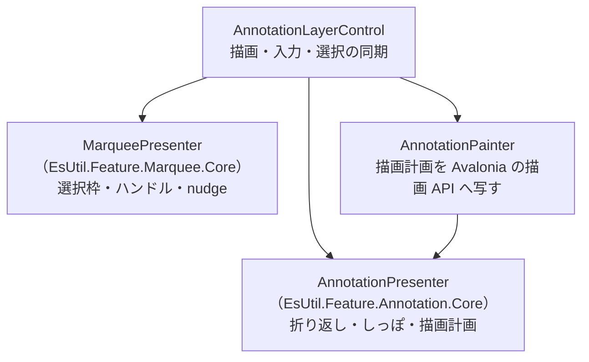

# EsUtil.Ui.AvaloniaUI.Annotation システム仕様書

## 目次

- [1. 概要](#1-概要)
- [2. 技術スタック](#2-技術スタック)
- [3. アーキテクチャ](#3-アーキテクチャ)
- [4. コンポーネント](#4-コンポーネント)
- [5. 依存関係](#5-依存関係)
- [6. 例外処理ポリシー](#6-例外処理ポリシー)

## 1. 概要

画像に注釈（枠線・吹き出し）を重ねる Avalonia UI 版のコントロールです。 画像は焼き込まず、注釈をレイヤーとして重ねます。

| 項目 | 内容 |
| --- | --- |
| 目的 | 注釈の表示・選択・移動・サイズ変更・しっぽの移動・本文の編集 |
| 保存 | 行わない（注釈 JSON と合成画像の書き出しはホストの責務） |
| 座標 | 注釈は元画像ピクセル。 表示は縦横比を保って中央へ置く |

## 2. 技術スタック

| 項目 | 内容 |
| --- | --- |
| 対象フレームワーク | `net11.0-windows10.0.17763.0` |
| UI | Avalonia（`Control` を継承した自前描画。 XAML のテンプレートを持たない） |
| 選択枠 | `EsUtil.Feature.Marquee.Core` の提示層（`MarqueePresenter`） |
| 画像 | `IImage`（ホストが `EsBitmapAdapter` 等で用意する） |

## 3. アーキテクチャ

- **入力は 1 本の経路**です（押下 → しっぽの先端 → 注釈の本体（Marquee へ転送）→ 背景の順に判定）。
- **Marquee からの通知（選択矩形の変化）を文書へ書き戻します**（移動・サイズ変更の結果が `Document` に残る）。
- **描画は元画像座標で行います**（表示倍率の変換を 1 回だけ掛ける。 枠線・文字の比率が保存画像と一致する）。

## 4. コンポーネント

| コンポーネント | 分類 | 責務 |
| --- | --- | --- |
| `AnnotationLayerControl` | `public` | 画像の表示・注釈の描画・入力の受付・選択の同期・文書の変更通知 |
| `AnnotationPainter`（内部） | `internal` | 描画計画の写像（角丸・しっぽ・文字・下線/取り消し線）と文字の実寸計測 |
| `AnnotationMarqueeEffects`（内部） | `internal` | Marquee が要求する効果（再描画・フォーカス・カーソル・キャプチャ）の写像 |

## 5. 依存関係

| 方向 | 内容 |
| --- | --- |
| 許可 | 本アセンブリ → `EsUtil.Feature.Annotation.Core` / `EsUtil.Feature.Marquee.Core` / `EsUtil.Platform.Core` |
| 禁止 | 本アセンブリ → アプリ（`App.*`） |
| 禁止 | 本アセンブリ → 撮影スタック（`Parts.CapturePreview.*`） |

規則の所有者は [`.github/依存関係.md`](../../../../.github/依存関係.md) です。

## 6. 例外処理ポリシー

| 場面 | 扱い |
| --- | --- |
| 文書が空・選択が無い | 何もしない（null を返す。 例外にしない） |
| 画像が未設定 | 注釈だけを描く（`Source` が null でも動作する） |
| 文字の計測に失敗しうる環境 | フォントが無い場合は優先順の次のフォントへ落とす（例外にしない） |

共通方針は [`.github/例外処理規約.md`](../../../../.github/例外処理規約.md) が所有します。
