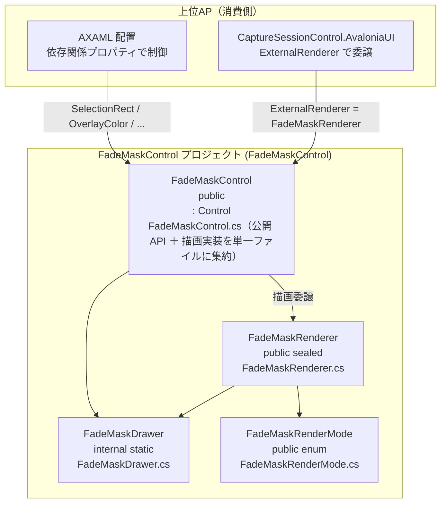
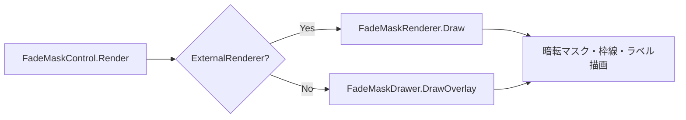

# FadeMaskControl システム仕様書（SPEC_System）

## 目次

- [FadeMaskControl システム仕様書（SPEC_System）](#fademaskcontrol-システム仕様書spec_system)
  - [目次](#目次)
  - [1. システム概要](#1-システム概要)
  - [2. 技術スタック](#2-技術スタック)
  - [3. アーキテクチャ](#3-アーキテクチャ)
  - [4. 例外処理ポリシー](#4-例外処理ポリシー)
  - [5. コンポーネント図](#5-コンポーネント図)
  - [6. コンポーネント一覧](#6-コンポーネント一覧)
    - [6.1 FadeMaskControl](#61-fademaskcontrol)
    - [6.2 FadeMaskRenderer](#62-fademaskrenderer)
    - [6.3 FadeMaskRenderMode](#63-fademaskrendermode)
    - [6.4 FadeMaskDrawer](#64-fademaskdrawer)
  - [7. 依存ルール](#7-依存ルール)
  - [8. 描画フロー](#8-描画フロー)
  - [9. ログ](#9-ログ)
    - [9.1 ログ定義一覧](#91-ログ定義一覧)

---

## 1. システム概要

SaveEvidence は、Windows デスクトップ上の画面をキャプチャし、プレビュー・編集・保存するための Avalonia UI アプリケーションです（.NET 10.0 / C# 14 / MVVM）。

本プロジェクト（FadeMaskControl）は、このシステムのうち**選択オーバーレイ描画**（暗転マスク・選択枠線・サイズラベル・モード別描画）を担う再利用可能なコントロールです。上位 AP（CaptureSessionControl.AvaloniaUI / FadeMaskDragRect）のオーバーレイ表示に使用されます。

## 2. 技術スタック

| 項目 | 内容 |
| --- | --- |
| **プロジェクト** | `FadeMaskControl` |
| **ルート名前空間** | `Estable.AvaloniaUI.FadeMask` |
| **言語** | C# 14（.NET 10.0） |
| **UI フレームワーク** | Avalonia UI 12.1（Control / DrawingContext / StyledProperty） |
| **ターゲットフレームワーク** | net10.0 |
| **ビルドツール** | MSBuild / .NET SDK 10.0 |
| **ログ** | Microsoft.Extensions.Logging.Abstractions（LoggerMessage ソース生成） |
| **テスト** | xUnit v3 / Avalonia.Headless.XUnit |
| **依存プロジェクト** | Platform.Core（ICoordTransform / CoordTransform）、FadeMaskControl.Core（ラベルの文言・行配置・暗転幾何） |

## 3. アーキテクチャ

### 3.1 レイヤー構造

```text
公開コントロール（FadeMaskControl）
  → レンダラー（FadeMaskRenderer）
    → 描画ユーティリティ（FadeMaskDrawer）+ モード（FadeMaskRenderMode）
```

### 3.2 依存の方向

- 依存は**一方向の階層構造**（公開コントロール → レンダラー → 描画ユーティリティ）。
- 描画状態は `FadeMaskRenderer` のプロパティ（真のソース）に集約し、`FadeMaskControl` の StyledProperty は独立した描画経路を提供する。
- `FadeMaskDrawer` は internal（外部から見えない）。
- 上位 AP は公開 API（StyledProperty / ExternalRenderer / FadeMaskRenderer）のみで連携。

## 4. 例外処理ポリシー

### 4.1 基本方針

- ライブラリは例外を原則伝播し、上位 AP（app）で処理する。
- UI レイヤー（app）ではユーザー操作起因の例外を各ハンドラで catch し、UI の応答性を維持する。
- ログは LoggerMessage ソース生成（`Logging/LogMessage.cs`）で出力する。状態変更は Debug、座標変換設定は Trace で記録する。

### 4.2 本プロジェクト固有の例外処理

- 描画専用コントロールのため例外処理は原則不要（状態は公開プロパティで完全に制御可能）。
- マウス・キーイベントを扱わないため、入力起因の例外は発生しない。

## 5. コンポーネント図



## 6. コンポーネント一覧

### 6.1 FadeMaskControl

- **分類**: 公開コントロール（`public class : Control`）
- **責務**:
  - 選択矩形の穴あけマスク（暗転）とサイズラベルの描画（公開 API は FadeMaskControl.cs に集約）
  - `ExternalRenderer` 設定時の描画完全委譲（モード別描画の統一）
- **公開API**: `LogicalSelectionRect` / `OverlayColor` / `BorderColor` / `BorderThickness` / `TextColor` / `TextBackgroundColor` / `FontSize` / `ShowSizeLabel` / `ExternalRenderer` / `Log` / `SetCoordinateTransform`
- **構成**: 公開 API（StyledProperty・公開プロパティ）と描画実装（静的コンストラクタ・Render オーバーライド・AffectsRender 登録）を単一ファイルに集約（無理な分割はしない）
- **依存**: FadeMaskRenderer / FadeMaskDrawer / Avalonia

### 6.2 FadeMaskRenderer

- **分類**: 公開レンダラー（`public sealed class`。描画状態の真のソース）
- **責務**:
  - モード別の描画状態（ハイライト・選択矩形・全面暗転・タイトル・スクリーン番号）の保持
  - `Draw()` での全描画要素（暗転マスク・選択枠線・サイズラベル・情報ラベル）
- **公開API**: `Scaling` / `DisplayScaleScaling` / 外観（TextColor 等 9 個）/ 描画状態（Mode 等 12 個）/ `Draw`
- **依存**: FadeMaskDrawer / FadeMaskRenderMode / Avalonia

### 6.3 FadeMaskRenderMode

- **分類**: 公開 enum
- **責務**: 描画モードの指定（`AreaSelect` / `ScreenSelect` / `WindowSelect` / `Crop`）。bool フラグによる分岐は行わない
- **依存**: なし

### 6.4 FadeMaskDrawer

- **分類**: 内部描画ユーティリティ（`internal static class`。公開 API ではなく内部型）
- **責務**: 暗転マスク（4 辺の穴あけ）とサイズラベルの共通描画ロジック
- **依存**: Avalonia（DrawingContext / SolidColorBrush / FormattedText）、FadeMaskControl.Core（サイズラベルの文言・行配置）
- **委譲**: サイズラベルの文言は `FadeMaskLabels.FormatSizeLabel`、行配置は `FadeMaskLabelLayout`（いずれも Core）へ委譲する（MewUI 版と同じ実装を共有するため）

## 7. 依存ルール

- 依存方向は**一方向の階層構造**（公開コントロール → レンダラー → 描画ユーティリティ）。
- 描画状態は `FadeMaskRenderer` のプロパティ（真のソース）に集約し、`FadeMaskControl` の StyledProperty は独立した描画経路を提供する。
- `FadeMaskDrawer` は internal（外部から見えない）。
- 上位 AP は公開 API（StyledProperty / ExternalRenderer / FadeMaskRenderer）のみで連携。

## 8. 描画フロー



## 9. ログ

ログ定義は `Logging/LogMessage.cs`（LoggerMessage ソース生成・`this ILogger` 拡張メソッド）に集約し、`FadeMaskControl.Log` プロパティの `ILogger` 経由で出力する。
描画専用コントロールのため、マウス・キーイベントのログはない（状態の変更のみ記録）。出力先・レベル制御はホストアプリケーションが所有する。

### 9.1 ログ定義一覧

| レベル | メソッド | 出力内容 |
| --- | --- | --- |
| `Debug` | `LogMessage.LogSelectionRectChanged` | 論理選択矩形（ドメイン座標）の変更（変更前後） |
| `Debug` | `LogMessage.LogExternalRenderer` | 外部レンダラーの設定 / 解除 |
| `Trace` | `LogMessage.LogCoordinateTransform` | 座標変換ポートの設定 |
