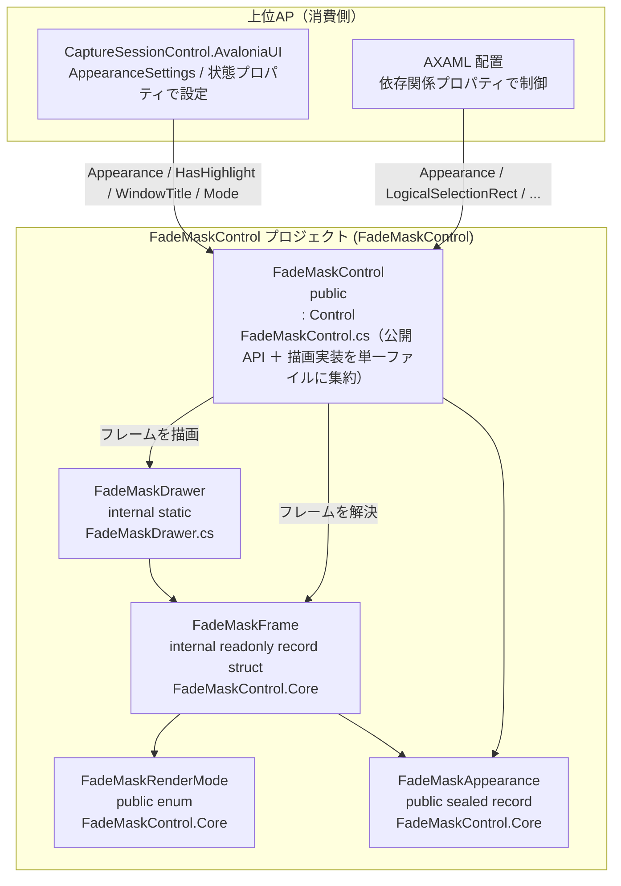
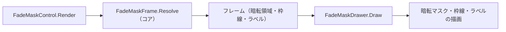

# FadeMaskControl システム仕様書（SPEC_System）

## 目次

- [FadeMaskControl システム仕様書（SPEC_System）](#fademaskcontrol-システム仕様書spec_system)
  - [目次](#目次)
  - [1. システム概要](#1-システム概要)
  - [2. 技術スタック](#2-技術スタック)
  - [3. アーキテクチャ](#3-アーキテクチャ)
  - [4. 例外処理ポリシー](#4-例外処理ポリシー)
  - [5. コンポーネント図](#5-コンポーネント図)
  - [6. コンポーネント一覧](#6-コンポーネント一覧)
    - [6.1 FadeMaskControl](#61-fademaskcontrol)
    - [6.2 FadeMaskAppearance](#62-fademaskappearance)
    - [6.3 FadeMaskRenderMode](#63-fademaskrendermode)
    - [6.4 FadeMaskDrawer](#64-fademaskdrawer)
    - [6.5 FadeMaskFrame（コア）](#65-fademaskframeコア)
  - [7. 依存ルール](#7-依存ルール)
  - [8. 描画フロー](#8-描画フロー)
  - [9. ログ](#9-ログ)
    - [9.1 ログ定義一覧](#91-ログ定義一覧)

---

## 1. システム概要

SaveEvidence は、Windows デスクトップ上の画面をキャプチャし、プレビュー・編集・保存するための Avalonia UI アプリケーションです（.NET 10.0 / C# 14 / MVVM）。

本プロジェクト（FadeMaskControl）は、このシステムのうち**選択オーバーレイ描画**（暗転マスク・選択枠線・サイズラベル・モード別描画）を担う再利用可能なコントロールです。上位 AP（CaptureSessionControl.AvaloniaUI / FadeMaskDragRect）のオーバーレイ表示に使用されます。

## 2. 技術スタック

| 項目 | 内容 |
| --- | --- |
| **プロジェクト** | `FadeMaskControl` |
| **ルート名前空間** | `Estable.AvaloniaUI.FadeMask` |
| **言語** | C# 14（.NET 10.0） |
| **UI フレームワーク** | Avalonia UI 12.1（Control / DrawingContext / StyledProperty） |
| **ターゲットフレームワーク** | net10.0 |
| **ビルドツール** | MSBuild / .NET SDK 10.0 |
| **ログ** | Microsoft.Extensions.Logging.Abstractions（LoggerMessage ソース生成） |
| **テスト** | xUnit v3 / Avalonia.Headless.XUnit |
| **依存プロジェクト** | Platform.Core（ICoordTransform / CoordTransform）、FadeMaskControl.Core（外観・ラベルの文言・行配置・暗転幾何・ログ定義） |

## 3. アーキテクチャ

### 3.1 レイヤー構造

```text
公開コントロール（FadeMaskControl）
  → 描画ユーティリティ（FadeMaskDrawer）
  → コア（FadeMaskAppearance / FadeMaskOverlayGeometry / FadeMaskLabels / FadeMaskLabelLayout）
```

### 3.2 依存の方向

- 依存は**一方向の階層構造**（公開コントロール → 描画ユーティリティ → コア）。
- 描画状態（選択矩形・ハイライト矩形・全面暗転・モード）と外観（`Appearance`）は `FadeMaskControl` に集約する（MewUI 版と同じ構造）。
- 外観の既定値と `IValueConverter` 相当の変換を持たない（外観はコアの `FadeMaskAppearance` が単一所有）。
- `FadeMaskDrawer` は internal（外部から見えない）。
- 上位 AP は公開 API（StyledProperty / 公開プロパティ / `SetCoordinateTransform`）のみで連携。

## 4. 例外処理ポリシー

### 4.1 基本方針

- ライブラリは例外を原則伝播し、上位 AP（app）で処理する。
- UI レイヤー（app）ではユーザー操作起因の例外を各ハンドラで catch し、UI の応答性を維持する。
- ログは LoggerMessage ソース生成（コアの `LogMessage`）で出力する。状態変更は Debug、座標変換設定は Trace で記録する。

### 4.2 本プロジェクト固有の例外処理

- 描画専用コントロールのため例外処理は原則不要（状態は公開プロパティで完全に制御可能）。
- マウス・キーイベントを扱わないため、入力起因の例外は発生しない。

## 5. コンポーネント図



## 6. コンポーネント一覧

### 6.1 FadeMaskControl

- **分類**: 公開コントロール（`public class : Control`）
- **責務**:
  - 外観（`Appearance`）と描画状態（選択矩形・ハイライト矩形・全面暗転・モード）の保持
  - 外観と状態をコアの `FadeMaskRequest` へ詰めて `FadeMaskFrame.Resolve` を呼び、返されたフレームを `FadeMaskDrawer` で描画
- **公開API**: `Appearance` / `LogicalSelectionRect` / `LogicalHighlightRect` / `HasSelection` / `HasHighlight` / `WindowTitle` / `Mode` / `ShowFullOverlay` / `Scaling` / `DisplayScaleScaling` / `SizeLabelOverrideProvider` / `Log` / `SetCoordinateTransform`
- **構成**: 公開 API（StyledProperty・公開プロパティ）と描画実装（静的コンストラクタ・Render オーバーライド・AffectsRender 登録）を単一ファイルに集約（無理な分割はしない）
- **依存**: FadeMaskDrawer / FadeMaskControl.Core（外観・フレーム解決・ログ定義） / Avalonia
- **判断を持たない**: 「どの矩形を暗転するか」「枠線を描くか」「どのラベルを描くか」（サイズラベルの自動生成を含む）はコアが単一所有する

### 6.2 FadeMaskAppearance

- **分類**: 公開の外観値（コアの `FadeMaskControl.Core`・`public sealed record`）。描画状態ではなく外観のみを持つ
- **責務**:
  - 暗転色・枠線（色・太さ）・ラベル（サイズ・操作・情報の表示有無と色・サイズ）の単一所有
  - `BuildSubLines(mode, windowTitle)` によるラベルの行（2 行目以降）の組立
- **依存**: FadeMaskLabels（文言・行の組立） / FadeMaskSubLine / FadeMaskRenderMode
- **委譲**: 行の文言・順序・表示可否はコアの `FadeMaskLabels.BuildSubLines` へ委譲する（行の組立ての単一所有。両 UI で同一の結果になる）

### 6.3 FadeMaskRenderMode

- **分類**: 公開 enum（コアの `FadeMaskControl.Core`）
- **責務**: 描画モードの指定（`AreaSelect` / `ScreenSelect` / `WindowSelect` / `Crop`）。bool フラグによる分岐は行わない
- **依存**: なし

### 6.4 FadeMaskDrawer

- **分類**: 内部描画ユーティリティ（`internal static class`。公開 API ではなく内部型）
- **責務**: フレーム（暗転領域・枠線の矩形・ラベル）を Avalonia の描画 API へ写す
- **依存**: Avalonia（DrawingContext / SolidColorBrush / FormattedText）、FadeMaskControl.Core（`FadeMaskFrame` / `FadeMaskSubLine` / `FadeMaskLabelLayout`）
- **描画内容の決定を持たない**: 描画の要否・領域・文言は `FadeMaskFrame` が持つため、本クラスに分岐はない（空のコレクションは何もしない）
- **テキストの実寸測定**: `FormattedText` で行う（Skia の `SKFont` とは計量が異なるため、UI 固有の責務として UI 側に残す）。行の配置（背景矩形・文字の描画原点・次の行の Y 座標）はコアの `FadeMaskLabelLayout` が単一所有する
- **色の変換**: コア色（`System.Drawing.Color`）を描画直前に Avalonia 色へ変換する（背景色の実効色はコアが解決済み）

### 6.5 FadeMaskFrame（コア）

- **分類**: 内部の描画契約（コアの `FadeMaskControl.Core`・`internal readonly record struct`）
- **責務**:
  - `FadeMaskFrame.Resolve(FadeMaskRequest)` で「暗転領域・枠線・サイズラベルの文言・サブライン」を決定する
  - 論理矩形 → DIP の変換規則（選択は閉区間 +1・ハイライトは +0）と穴あけ矩形の優先順（ハイライト → 選択）を適用する
  - 座標変換ポートの決定（ポート優先・未指定なら倍率 / 0 以下・等倍は等価変換）を適用する
  - 透明指定（暗転色・枠線色のアルファ 0）を「描かない」として解決する
  - サイズラベルの文言を決定する（プロバイダ未指定・空文字なら矩形から自動生成）
  - ラベル背景の実効色（アルファ 0 を黒 50% とする規則）を解決する
- **依存**: FadeMaskOverlayGeometry / FadeMaskLabels / FadeMaskAppearance / FadeMaskLabelStyle

## 7. 依存ルール

- 依存方向は**一方向の階層構造**（公開コントロール → 描画ユーティリティ → コア）。
- 描画状態（選択矩形・ハイライト矩形・全面暗転・モード）と外観（`Appearance`）の真のソースは `FadeMaskControl` である。
- `FadeMaskDrawer` は internal（外部から見えない）。
- 上位 AP は公開 API（StyledProperty / 公開プロパティ / `SetCoordinateTransform`）のみで連携。

## 8. 描画フロー



`FadeMaskFrame.Resolve` が「論理矩形 → DIP 変換」「穴あけ矩形の決定」「透明指定の解決」「サイズラベルの文言決定」「サブラインの組立」を行い、
`FadeMaskDrawer.Draw` はフレームの各項目を描画 API へ写す（判断も分岐も持たない）。

## 9. ログ

ログ定義はコアの `LogMessage`（LoggerMessage ソース生成・`this ILogger` 拡張メソッド・`Estable.FadeMask` 名前空間）が単一所有し、`FadeMaskControl.Log` プロパティの `ILogger` 経由で出力する。
本プロジェクトは自前のログ定義を持たない（MewUI 版と同一書式になることを保証するため）。
描画専用コントロールのため、マウス・キーイベントのログはない（状態の変更のみ記録）。出力先・レベル制御はホストアプリケーションが所有する。

### 9.1 ログ定義一覧

ログ定義の本体は `FadeMaskControl.Core` の `LogMessage` にある。

| レベル | メソッド | 出力内容 |
| --- | --- | --- |
| `Debug` | `LogMessage.LogSelectionRectChanged` | 選択矩形（ドメイン座標）の変更（変更前後） |
| `Debug` | `LogMessage.LogHighlightRectChanged` | ハイライト矩形（ドメイン座標）の変更（変更前後） |
| `Trace` | `LogMessage.LogCoordinateTransform` | 座標変換ポートの設定 / 解除 |
