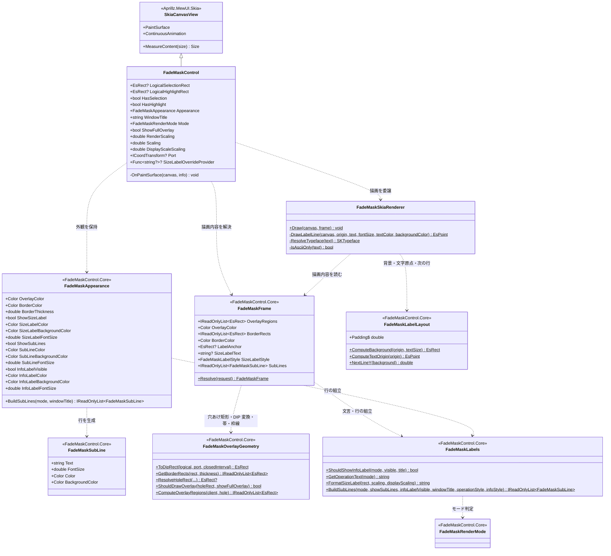
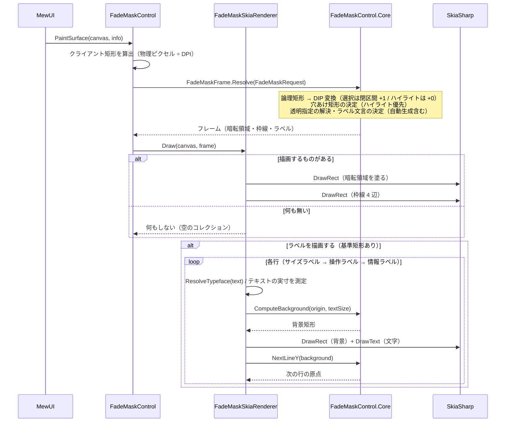

# FadeMaskControl.MewUI システム仕様書

FadeMaskControl（MewUI 版）のシステム概要・アーキテクチャ・依存関係・設計判断を記載します。

## システム概要

`FadeMaskControl.MewUI` は、Avalonia 版 `FadeMaskControl` と**同一の UI 非依存コア（`FadeMaskControl.Core`）**を使い、
描画層のみを MewUI（SkiaSharp）で実装した暗転オーバーレイコントロールです。

コアが担う範囲（穴あけ矩形の決定・帯への分割・枠線矩形・論理座標から DIP への変換）は両 UI で完全に共通であり、
本プロジェクトはその計算結果をキャンバスへ描画するだけです。

## 技術スタック

| 区分 | 採用技術 |
| --- | --- |
| 対象フレームワーク | .NET 10（`net10.0`） |
| 言語 | C# 14 |
| UI フレームワーク | MewUI（`Aprillz.MewUI.Skia` **0.21.1 固定**） |
| 描画 | SkiaSharp（`DrawRect` で塗りつぶす） |
| 基底コントロール | `Aprillz.MewUI.Skia.Controls.SkiaCanvasView` |
| プロパティシステム | `MewProperty<T>`（`MewPropertyOptions.AffectsRender`） |

## アーキテクチャ

### 依存方向（一方向を厳守）

```text
┌──────────────────────┐        ┌──────────────────────┐
│ FadeMaskControl.MewUI│        │   FadeMaskControl    │
│ （MewUI の描画層）   │        │ （Avalonia の描画層）│
└──────────┬───────────┘        └──────────┬───────────┘
           │                               │
           └────────────┬──────────────────┘
                        ▼
              ┌──────────────────────┐
              │ FadeMaskControl.Core │  幾何計算（単一所有）
              └──────────┬───────────┘
                         ▼
              ┌──────────────────────┐
              │  Platform.Core│  コア幾何型・座標変換
              └──────────────────────┘
```

### 責務の分担

| 層 | 責務 |
| --- | --- |
| `FadeMaskControl.Core` | 穴あけ矩形の決定、暗転領域（4 帯）の計算、枠線矩形、論理座標 → DIP 変換、ラベルの行配置と文言の単一所有、サブラインの組み立て（行の文言・順序・表示可否）、**1 フレーム分の描画内容の決定**（`FadeMaskFrame`）、外観の値型、描画状態変更のログ定義 |
| `FadeMaskControl.MewUI` | コアの計算結果を `SKCanvas` へ描画する。`MewProperty` による入力の受付。DPI の自動追従。テキストの実寸測定とフォントの解決 |
| ホスト | `LogicalSelectionRect` / `HasSelection` の設定、重ね順の管理、`IsHitTestVisible = false` の設定、ラベルの文言の供給 |

## コンポーネント構成

```text
src/FadeMaskControl.MewUI/
├── src/
│   ├── FadeMaskControl.cs         MewProperty の定義・DPI 追従・描画の起点
│   └── FadeMaskSkiaRenderer.cs    暗転（4 帯）・枠線（4 辺）・ラベルの描画
└── tests/
    ├── TestHelper.cs                 テスト用の描画先（SKBitmap + SKCanvas）と画素数え上げ
    └── FadeMaskSkiaRenderer.Tests.cs 暗転・穴あけ・枠線・ラベル・境界値の画素検証（26 件）
```

| コンポーネント | 責務 |
| --- | --- |
| `FadeMaskControl` | 入力プロパティ（`MewProperty`）の定義、論理座標 → DIP 変換、DPI 変更の追従、`PaintSurface` から描画を開始 |
| `FadeMaskSubLine` | 2 行目以降の行の値（文言・文字サイズ・文字色・背景色）。コア（`FadeMaskControl.Core`）が定義する UI 非依存の値型を、Avalonia 版と共有する |
| `FadeMaskSkiaRenderer` | フレーム（暗転領域・枠線・ラベル）を Skia の描画 API へ写す（判断を持たない）。フォントの解決・テキストの実寸測定を担う |
| `RenderTarget`（テスト） | ウィンドウ不要の描画先。`SKBitmap` と `SKCanvas` を保持し、画素を読み取る |

## クラス図



## シーケンス図（描画）



## 設計判断

1. **外観は 1 つの値（コアの `FadeMaskAppearance`）が単一所有する**。UI ごとに既定値を持たないため、両 UI の見た目が一致する。
   透明指定（アルファ 0）の扱いもコアが解決する（UI 層に「アルファ 0 なら描かない」等の判断を持たせない）。
2. **暗転は「クライアント − 穴」の 4 帯で表現する**。クリッピング（穴あけパス）を使わず矩形の塗り分けにするのは、
   バックエンド差異に依存しない確実な方法であり、Avalonia 版も同じ方式（4 帯）であるため。
3. **枠線は穴あけ矩形の内側に描く**。Avalonia 版の `GetBorderRects` をコアへ移したため、見た目は完全に一致する。
4. **選択は閉区間（+1）、ハイライトは +0**。Avalonia 版と同じ規則をコアが単一所有する。
5. **入力を持たない**。装飾専用とし、ホストが重ね順とヒットテストを管理する（Avalonia 版と同じ）。
6. **座標変換は `Port`（推奨）または `Scaling`（等倍スケール専用）で指定する**。`Port` が設定されている場合はそちらを優先し、
   オフセットを含む変換（ズームビューのレターボックス等）でも暗転の穴あけと選択矩形が一致する。
7. **ラベルはコアが配置を、UI が実寸を担う**。テキストの実寸は UI の描画 API でしか測れないため、
   実寸だけを引数で渡し、余白・背景・文字原点・次の行の位置は `FadeMaskLabelLayout` が単一所有する（両 UI の見た目を一致させる）。
8. **文言はコアが単一所有する**。サイズラベル（`FormatSizeLabel`）・操作ラベル（`GetOperationText`）・情報ラベルの表示判定
   （`ShouldShowInfoLabel`）を `FadeMaskLabels` へ集約し、UI は文言を組み立てない。
9. **非 ASCII を含むテキストは字形を持つフォントへフォールバックする**。`SKTypeface.Default` は日本語のグリフを
   持たない環境があり、ラベルが豆腐（□）になるため（解決結果はフィールドへキャッシュする）。

## テスト方針

| 対象 | 方針 |
| --- | --- |
| `FadeMaskSkiaRenderer` | `SKBitmap` + `SKCanvas` へ実際に描画して**画素を実測**する（暗転・穴あけ・枠線・ラベルの背景と色・フォント解決・境界値） |
| `FadeMaskControl` | 間接的に検証する（薄いラッパであり、座標変換はコアのテストが担保する） |
| コアロジック | `FadeMaskControl.Core.Tests`（37 件）が担保する（幾何・文言・ラベル配置） |
| アプリ組み込み | `app.MewUI/verify-ui.ps1` が実機の画素を実測して検証する（ラベルは撮影オーバーレイで確認済み） |

## 未実装・今後の対応

| 項目 | 内容 |
| --- | --- |
| モード別の描画切り替え | `FadeMaskRenderMode` に応じた描画要素の切り替え（切出し用途では不要。モードの解釈は `FadeMaskDragRectControl` が担う） |

## ログ

描画状態の変更を記録します（Avalonia 版と同一の書式・レベル）。FadeMaskControl は描画専用のため、入力イベントのログは持ちません。

| レベル | 出力元 |
| --- | --- |
| Debug | `LogicalSelectionRect` / `LogicalHighlightRect` の変更（同一値なら出力しない） |
| Trace | `Port`（座標変換ポート）の設定・解除 |

出力先は `Log` プロパティへ注入します（既定は `NullLogger`）。  
複合コントロール（`FadeMaskDragRectControl.MewUI`）は選択のたびにログが出るため伝搬せず、必要なら Overlay.Log を直接設定します。
