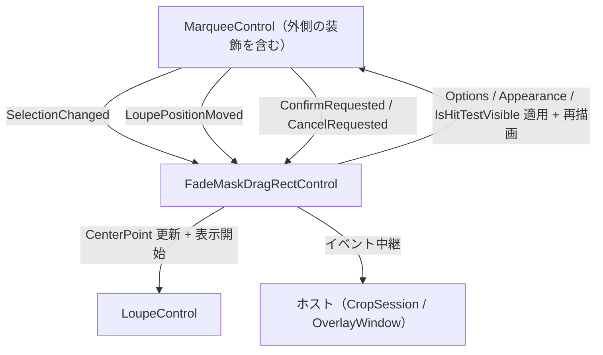

# FadeMaskDragRectControl 外部機能仕様書

## 目次

- [FadeMaskDragRectControl 外部機能仕様書](#fademaskdragrectcontrol-外部機能仕様書)
  - [目次](#目次)
  - [1. 文書概要](#1-文書概要)
  - [2. 目的](#2-目的)
  - [3. 外部利用条件](#3-外部利用条件)
    - [3.1 プロジェクト参照](#31-プロジェクト参照)
    - [3.2 必要な名前空間](#32-必要な名前空間)
  - [4. 基本的な使用方法](#4-基本的な使用方法)
  - [5. 公開API](#5-公開api)
    - [5.1 プロパティ](#51-プロパティ)
    - [5.2 メソッド](#52-メソッド)
    - [5.3 イベント](#53-イベント)
    - [5.4 型](#54-型)
      - [5.4.1 FadeMaskDragRectMode](#541-fademaskdragrectmode)
      - [5.4.2 FadeMaskDragRectOptions（コア）](#542-fademaskdragrectoptionsコア)
  - [6. 座標系](#6-座標系)
  - [7. モード](#7-モード)
  - [8. 配線（内部で完結する状態同期）](#8-配線内部で完結する状態同期)
  - [9. ライフサイクルと所有権](#9-ライフサイクルと所有権)
  - [10. 制約事項](#10-制約事項)

---

## 1. 文書概要

| 項目 | 内容 |
| --- | --- |
| 対象 | `FadeMaskDragRect` |
| プロジェクト | `FadeMaskDragRectControl/FadeMaskDragRect.csproj` |
| 名前空間 | `FadeMaskDragRect` |
| 対象フレームワーク | `net10.0` |
| UIフレームワーク | Avalonia 12.1 |
| 主要基底クラス | `Avalonia.Controls.Panel` |
| 適用パターン | Facade / Composite（内包コントロールの公開 API を統合） |
| 主な用途 | 領域選択（Marquee（外側の装飾を含む）+ Loupe）の組み立て・配線・状態同期を 1 箇所に集約する複合コントロール |

## 2. 目的

`FadeMaskDragRectControl` は、ドラッグ選択（`MarqueeControl`。暗転マスクはその**外側の装飾**として描画される）・拡大鏡（`LoupeControl`）の**組み立て・配線・状態同期**を内包する複合コントロールです。

2 コントロールの生成・座標変換注入・イベント購読・状態同期の配線を本コントロールに集約し、ホストはライフサイクルとモード固有処理に専念できます（Facade / Composite パターン・単一責任の原則）。

次の機能を提供します。

- Marquee / Loupe の生成・配置・配線（内部で完結）
- 選択状態の暗転マスク・ルーペへの同期
- 確定・キャンセル・ズーム要求のホスト通知
- モード別の描画モード・可視性・全面暗転の一括切替
- 設定の一括適用（コアの `FadeMaskDragRectOptions`。値の解決は UIBase の `FadeMaskDragRectChildValues`）
- 外観の一括適用（提示層の `MarqueeAppearance` / `LoupeAppearance`）
- 付加情報ラベル（操作・情報）の描画（描画層（UIBase）の `FadeMaskHostLabelRenderer`。文言はホストが生成する）
- 座標変換ポートの一括分配

## 3. 外部利用条件

### 3.1 プロジェクト参照

```xml
<ProjectReference Include="..\FadeMaskDragRectControl\src\FadeMaskDragRect.csproj" />
```

### 3.2 必要な名前空間

```csharp
using EsUtil.SaveEvidence.FadeMaskDragRect.AvaloniaUI;
using EsUtil.Platform.Core.Coord; // ICoordTransform / CoordTransform（コア提供）
using EsUtil.Platform.Core.Geometry;   // EsPoint / EsSize / EsVector（コア提供）
using EsUtil.Feature.Marquee.Presenter.Setting; // MarqueeAppearance（描画にだけ必要な外観）
using EsUtil.Feature.Loupe.Presenter.Setting;   // LoupeAppearance（描画にだけ必要な色）
```

公開 API は内包コントロール（MarqueeControl / LoupeControl）の型を参照しないため、
これらの using は不要です（公開型のカプセル化）。

## 4. 基本的な使用方法

1. AXAML（またはコード）で `FadeMaskDragRectControl` を配置します。
2. `Mode` を設定します（キャプチャ種別に応じた描画モード・可視性の切替）。
3. `Options` で設定（選択矩形 / 暗転マスク / ルーペ / 選択矩形破線）を一括適用します（コアの設定値を 1 つ渡す。**色は含まれません**）。
4. `MarqueeAppearance` / `LoupeAppearance` で外観（描画にだけ必要な設定）を適用します。
5. `SetCoordTransform(ICoordTransform?)` でドメイン ↔ DIP 変換を注入します。
6. イベント（`ConfirmRequested` / `CancelRequested`）を購読します。
7. ルーペソース（`Loupe.Source`）を設定します。

ホイール操作（ズーム・パン）は本コントロールの対象外です。選択オーバーレイはポインター入力を占有するため、
ホイールはホストが受け取り、ビューポート（`ZoomViewControl` 等）へ転送します。
表示（パン・ズーム）の変化への追従はホストが検知して `RefreshOverlay()` を呼びます。

```csharp
// Crop モードの例（プレビュー内の切出し）
var overlay = new FadeMaskDragRectControl
{
    Mode = FadeMaskDragRectMode.Crop,
    ClipToBounds = true,
};
// ホストの設定型からコアの設定値へ変換する（変換はコアのマッパーが単一所有する）
overlay.Options = captureSettings.ToFadeMaskDragRectOptions();
// 色（描画にだけ必要な設定）は描画層の色の単一値で与える（Core → UIBase の逆流を作らない）
overlay.MarqueeAppearance = MarqueeAppearance.Default with { OverlayColor = System.Drawing.Color.FromArgb(128, 0, 0, 0) };
overlay.LoupeAppearance = LoupeAppearance.Default with { BackgroundColor = System.Drawing.Color.White };
// DPI スケーリングは設定（Options）の対象外（環境値。個別プロパティで設定）
overlay.DomainToDipScaling = 1.0;
overlay.SetCoordTransform(CoordTransform.Compose(
    CoordTransform.ImageLayout(() => preview.Bounds.Size.ToEsSize(), imageSize.ToEsSize(), () => true),
    CoordTransform.ScrollOffset(() => new EsVector(origin.X, origin.Y))));
overlay.Loupe.Source = sourceImage;
parentPanel.Children.Add(overlay);
```

## 5. 公開API

### 5.1 プロパティ

| 名前 | 型 | 説明 |
| --- | --- | --- |
| `Options` | `FadeMaskDragRectOptions`（コア） | 設定（選択矩形 / 暗転マスク / ルーペ / 選択矩形破線）の単一値。同じ値の再設定はスキップされる（既定値・項目の対応はコアが単一所有する） |
| `Mode` | `FadeMaskDragRectMode` | 動作モード。設定時に描画モード・Marquee / Loupe の可視性・全面暗転を一括切替（既定値: `AreaSelect`） |
| `HasSelection` | `bool` | 選択矩形の有無（選択状態の真のソースは Core の `Marquee` ファサード） |
| `SelectionRect` | `Rect` | 現在の選択矩形（ドメイン座標。未選択時は 0x0 の空矩形） |
| `SizeLabelOverrideProvider` | `Func<string?>?` | サイズラベルを描画時に評価するプロバイダ（`MarqueeControl` へ委譲） |
| `LogicalHighlightRect` | `Rect?` | ハイライト矩形（ドメイン座標。未検出時は null。**null が「ハイライトなし」を意味する**。ScreenSelect / WindowSelect 用） |
| `DomainToDipScaling` | `double` | DPI スケーリング係数（設定（`Options`）の対象外・環境値。選択矩形コントロールへ委譲） |
| `DisplayScaleScaling` | `double` | サイズラベル用表示スケール（マルチスクリーン補正。設定（`Options`）の対象外・環境値。選択矩形コントロールへ委譲） |
| `LoupeDipToDeviceScaling` | `double` | ルーペの DIP → 物理ピクセル倍率（設定（`Options`）の対象外・DPI から自動取得。`LoupeControl.DipToDeviceScaling` へ委譲） |
| `MarqueeAppearance` | `MarqueeAppearance`（提示層） | 選択矩形コントロールの外観（描画にだけ必要な色・枠線の太さ・表示可否）の単一値。既定は `MarqueeAppearance.Default`。内包する選択矩形コントロールへ委譲する。**設定時はモードから導出する表示可否（ハンドル・全面暗転）を上書きし直す**（外観は評価値ではなくホストが与える素材。代入の順序でモードの判断が失われない） |
| `LoupeAppearance` | `LoupeAppearance`（描画層） | ルーペの描画に使う色（描画にだけ必要な設定）の単一値。既定は `LoupeAppearance.Default`。内包するルーペコントロールへ委譲する |
| `SizeLabelOverrideProvider` / `OperationTextProvider` / `InfoTextProvider` | `Func<string?>?` | ラベル文言を描画時に評価するプロバイダ（文言はホストが与える。`WindowTitle` は廃止し `InfoTextProvider` へ統合） |
| `ShowFullOverlay` | `bool` | 全面暗転（穴あけなし）を表示するかどうか（Crop / AreaSelect で有効。読み取り専用） |
| `LoupeCenterPoint` | `Point?` | ルーペ中心（ドメイン座標。未設定時は null） |
| `Log` | `ILogger` | 操作ログの出力先（null は `NullLogger` へフォールバック。内包するドラッグ選択コントロールとルーペへ伝搬する） |

### 5.2 メソッド

| 名前 | シグネチャ | 説明 |
| --- | --- | --- |
| `SetCoordTransform` | `void SetCoordTransform(ICoordTransform? port)` | 座標変換ポートを Marquee / Loupe へ一括分配（null で倍率からコアが解決） |
| `SetSelection` | `void SetSelection(Rect rect)` | 選択矩形（ドメイン座標）を暗転マスクとルーペへ反映。サイズ 0 以下は選択なし（判定はコアが単一所有） |
| `ClearSelection` | `void ClearSelection()` | 選択状態をクリアして全面暗転（穴あけなし）に戻す |
| `SetLoupePosition` | `void SetLoupePosition(Point domainPos)` | ルーペ中心（ドメイン座標）を設定して表示開始（Parent 未接続は無視） |
| `SetLoupeSource` | `void SetLoupeSource(IImage? source)` | ルーペの拡大元画像（Source）を設定（null で解除し非表示。表示開始は `SetLoupePosition` が担う） |
| `ClearLoupe` | `void ClearLoupe()` | ルーペを非表示にして後片付け（拡大元画像・中心・Bitmap を解放。セッション終了時に使用） |
| `FocusMarquee` | `void FocusMarquee()` | Marquee へフォーカスを設定（矢印キー nudge の受付開始） |
| `InvalidateOverlay` | `void InvalidateOverlay()` | 選択オーバーレイ（暗転マスク・ハイライト・選択矩形）の再描画を要求 |
| `RequestConfirm` | `void RequestConfirm()` | 選択確定要求を Marquee へ委譲（Enter キー相当。選択確定後のみ発火） |
| `RequestCancel` | `void RequestCancel()` | キャンセル要求を Marquee へ委譲（Escape キー相当） |
| `RefreshOverlay` | `void RefreshOverlay()` | 表示（パン・ズーム・表示サイズ）の変化を内包コントロールへ通知する。表示の実装に依存せずホストが中継する（Marquee の再描画 + ルーペ表示位置の再計算を要求） |

### 5.3 イベント

| 名前 | 型 | 説明 |
| --- | --- | --- |
| `ConfirmRequested` | `EventHandler<FadeMaskDragRectSelectionEventArgs>` | 確定要求（Marquee の Enter / ダブルクリック / `RequestConfirm`。選択確定後のみ発火） |
| `CancelRequested` | `EventHandler` | キャンセル要求（Marquee の Escape / `RequestCancel`） |
| `LoupePositionMoved` | `EventHandler<FadeMaskDragRectPointEventArgs>` | ルーペ中心の更新（ドメイン座標。ホストの追加制御用フック） |
| `LoupePositionMoved` | `EventHandler<FadeMaskDragRectPointEventArgs>` | ルーペ中心の更新通知（ドメイン座標。ホストの追加制御用フック） |
| `LoupeRendered` | `EventHandler<LoupeRenderedEventArgs>` | ルーペ描画完了の通知（描画済み Bitmap と切り出し左上・スケール。ホストが Bitmap へ外部提供矩形（破線等）を直接描く用。`LoupeControl.Rendered` を中継する） |

### 5.4 型

| 名前 | 種類 | 説明 |
| --- | --- | --- |
| `FadeMaskDragRectMode` | enum | 動作モード（`Crop` / `AreaSelect` / `ScreenSelect` / `WindowSelect`） |
| `FadeMaskDragRectOptions` | record（コア） | 設定の単一値（選択矩形 / 暗転マスク / ルーペ / 選択矩形破線）。`EsUtil.SaveEvidence.FadeMaskDragRect` |
| `FadeMaskDragRectSelectionEventArgs` | record | 確定要求イベントの引数（`SelectionRect: Rect`（ドメイン座標）） |
| `FadeMaskDragRectPointEventArgs` | record | ルーペ位置イベントの引数（`Position: Point`（ドメイン座標）） |

**公開型のカプセル化**: 公開 API は内包コントロール（MarqueeControl / LoupeControl）の型を参照しない。
イベント引数は本プロジェクト独自の型（`FadeMaskDragRectSelectionEventArgs` / `FadeMaskDragRectPointEventArgs`）、状態は `HasSelection` / `SelectionRect` / ハイライトプロパティで提供する。
内包コントロールへの直接アクセス（`Loupe` / `Marquee`）は internal（自身のテストのみ）。

#### 5.4.1 FadeMaskDragRectMode

UI 非依存コア（`FadeMaskDragRectControl.Core`、名前空間 `EsUtil.SaveEvidence.FadeMaskDragRect`）が単一所有する。
モードから描画設定への写像もコア（`FadeMaskDragRectModes`）が持ち、Avalonia / MewUI で共有する。

| 値 | 説明 |
| --- | --- |
| `Crop` | プレビュー内の切出し（Marquee / Loupe 有効・全面暗転） |
| `AreaSelect` | 全画面オーバーレイの範囲選択（Marquee / Loupe 有効・全面暗転） |
| `ScreenSelect` | スクリーン選択（ハイライトのみ・クリック確定フローはホストが担う） |
| `WindowSelect` | ウィンドウ選択（ハイライトのみ・クリック確定フローはホストが担う） |

#### 5.4.2 FadeMaskDragRectOptions（コア）

設定の単一値を所有するレコード（**全て non-null・既定値は各内包コントロールの既定値**）。内包コントロールへ分配する規則（枠線の共用等）もコアが単一所有し、UI 層は `Options` を 1 つ設定するだけです。

| プロパティ | 型 | 説明 |
| --- | --- | --- |
| `Loupe` | `LoupeOptions`（コア） | ルーペの設定（拡大率・表示サイズ・寸法・ラベル表示の可否。**色は含まない**。色は描画層の `LoupeAppearance` が単一所有する） |
| `SelectionRectColorA` | `System.Drawing.Color` | ルーペ画像上の選択矩形破線の色 A（描画開始色） |
| `SelectionRectColorB` | `System.Drawing.Color` | 選択矩形破線の色 B（色 A と交互に使用） |
| `LoupeOffset` | `double` | ルーペのカーソル中心からの右下オフセット（DIP） |
| `Default` | `FadeMaskDragRectOptions` | 既定値（各内包コントロールの既定値） |

- 部分変更は `with` 式（`control.Options = control.Options with { Loupe = ... with { RequestedSize = 240 } }`）で行います。
- 枠線の太さ（`BorderThickness`）は**外観（`MarqueeAppearance.OuterBorderThickness`）が単一所有**します。選択枠線と暗転マスクの穴あけ枠は同じ矩形に重なって描画されるため、太さが異なると見た目が崩れます。破線の色（`SelectionRectColorA` / `SelectionRectColorB`）以外の色はコアの設定値に含まれず、提示層の `MarqueeAppearance` / `LoupeAppearance` が単一所有します。
- 設定値の検証（範囲・非数）は各コア型の生成時に行われるため、本コントロールは補正を持ちません。
- ホストの設定型（`CaptureSettings` 等）からの変換はコアのマッパー（`FadeMaskDragRectOptionsMapper.ToFadeMaskDragRectOptions`）が単一所有します（両 UI で同じ変換を使う）。

## 6. 座標系

- **ドメイン座標**: ホストが定義する論理座標（Crop: 元画像ピクセル / AreaSelect: 仮想スクリーンピクセル）。
- **DIP 座標**: コントロールローカル DIP。`SetCoordTransform` で注入した `ICoordTransform` が変換します。
- **追従性**: ズーム・スクロール・ウィンドウサイズ変更などのレイアウト変化に、座標変換が常に追従します。
- **閉区間描画**: 選択領域は始点・終点を含む閉区間として扱い、暗転マスク（非暗転領域）とルーペの選択枠が一致します（コアの `MarqueeRenderRequest.ToDipRect` が終点に +1）。

## 7. モード

| モード | Marquee | Loupe | 全面暗転（`MarqueeAppearance.ShowFullOverlay`） | 用途 |
| --- | --- | --- | --- | --- |
| `Crop` | 有効 | 有効（LoupePositionMoved で表示開始） | 有効 | プレビュー内の切出し |
| `AreaSelect` | 有効 | 有効（LoupePositionMoved で表示開始） | 有効 | 全画面オーバーレイの範囲選択 |
| `ScreenSelect` | 無効 | 無効 | 無効 | スクリーン選択（ハイライトのみ。クリック確定フローはホストが担う） |
| `WindowSelect` | 無効 | 無効 | 無効 | ウィンドウ選択（ハイライトのみ。クリック確定フローはホストが担う） |

- **モードが決めるのは子コントロールの有効・無効と全面暗転のみ**です（暗転マスクの描画内容は外観が決め、文言はホストがプロバイダで与えます）。判断はコアの `FadeMaskDragRectModes.Resolve` が単一所有します。

- ルーペの選択矩形破線はモードに応じて有効になる（`Crop` / `AreaSelect` で有効）。描画の可否はコアの `FadeMaskDragRectState.ShowSelectionOverlay` が単一所有し、描画時に問い合わせる（UI は派生値を保持しない）。描画は `LoupeControl.Rendered` イベントを受けた本コントロール（ホスト側）が行う。
- 破線の色（`Options.SelectionRectColorA` / `SelectionRectColorB`）と破線の表示可否は、ルーペの設定（`LoupeOptions`）には現れません。したがってこれらが変わった場合（設定の適用・モード変更）は `LoupeControl.RequestRender()` でルーペ Bitmap の再生成を要求します（プロパティ通知では再生成されないため）。選択矩形の変更も破線の内容が変わるため同様に要求します。既存 Bitmap を破線だけ書き換える API は提供しません（再生成して `Rendered` で描き直す方式に統一）。

## 8. 配線（内部で完結する状態同期）



- `SelectionChanged`: 選択矩形の変更をルーペの再描画要求として伝える（選択矩形の描画と外側の装飾は `MarqueeControl` がセッションから直接読んで描画する）。ルーペの選択矩形破線は `Rendered` イベント経由で描画する（破線は Bitmap へ焼き込まれるため、選択矩形の変更で `LoupeControl.RequestRender()` を要求する）。

- `LoupePositionMoved`: ルーペの `CenterPoint` を更新して表示開始（表示位置は座標変換ポートから自己計算）。
- `ConfirmRequested` / `CancelRequested`: ホストへ中継。

**ホイール操作と表示の変化の追従は本クラスの配線ではありません**（コントロール化を前提とした処理）。
ホイールはホストが受け取ってビューポートへ転送し、表示の変化はホストが検知して `RefreshOverlay()` を呼びます。

## 9. ライフサイクルと所有権

- 内包コントロール（Marquee / Loupe）はコンストラクタで生成・配置され、本コントロールの子として保持されます（ホストは配置・破棄を管理しません）。
- ルーペソース（`Loupe.Source`）と座標変換ポート（`SetCoordTransform`）はホストが設定します。
- ホストが本コントロールを破棄する場合は、Visual Tree から取り除くだけで後片付けが完了します（子コントロールも同時に破棄されます）。

## 10. 制約事項

- レイアウト: `Panel` のサブクラスとして全子コントロールをパネル全面に配置します。`ArrangeOverride` で子を同一矩形に配置するため、子コントロールの個別配置（位置・サイズ）は行いません。
- `SetLoupePosition` はコントロールが Visual Tree に配置されてから呼び出してください（配置前は無視されます）。
- `ScreenSelect` / `WindowSelect` モードでは Marquee / Loupe が無効になるため、`RequestConfirm` / `RequestCancel` は使用できません（クリック確定フローはホストが担います）。
- 全面暗転（`ShowFullOverlay`）は `Crop` / `AreaSelect` でのみ有効です。
