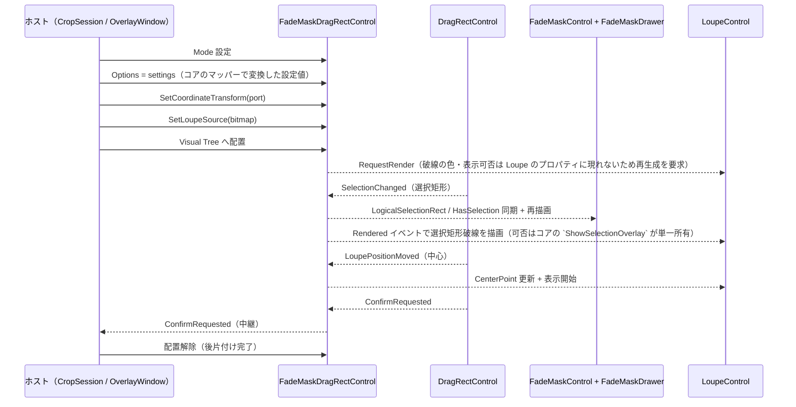

# FadeMaskDragRectControl システム仕様書（SPEC_System）

## 目次

- [FadeMaskDragRectControl システム仕様書（SPEC\_System）](#fademaskdragrectcontrol-システム仕様書spec_system)
  - [目次](#目次)
  - [1. システム概要](#1-システム概要)
  - [2. 技術スタック](#2-技術スタック)
  - [3. アーキテクチャ](#3-アーキテクチャ)
    - [3.1 レイヤー構造](#31-レイヤー構造)
    - [3.2 依存の方向](#32-依存の方向)
  - [4. 例外処理ポリシー](#4-例外処理ポリシー)
    - [4.1 基本方針](#41-基本方針)
    - [4.2 本プロジェクト固有の例外処理](#42-本プロジェクト固有の例外処理)
  - [5. コンポーネント図](#5-コンポーネント図)
  - [6. コンポーネント一覧](#6-コンポーネント一覧)
    - [6.1 FadeMaskDragRectControl](#61-fademaskdragrectcontrol)
    - [6.2 FadeMaskDragRectMode](#62-fademaskdragrectmode)
    - [6.3 FadeMaskDragRectOptions（コア）](#63-fademaskdragrectoptionsコア)
    - [6.4 内包コントロール（外部プロジェクト）](#64-内包コントロール外部プロジェクト)
    - [6.5 公開イベント引数](#65-公開イベント引数)
  - [7. 依存ルール](#7-依存ルール)
  - [8. ライフサイクル](#8-ライフサイクル)
  - [9. 配線（状態同期の流れ）](#9-配線状態同期の流れ)

---

## 1. システム概要

SaveEvidence は、Windows デスクトップ上の画面をキャプチャし、プレビュー・編集・保存するための Avalonia UI アプリケーションです（.NET 10.0 / C# 14 / MVVM）。

本プロジェクト（FadeMaskDragRect）は、このシステムのうち**領域選択の複合コントロール**（DragRect + FadeMask + Loupe の組み立て・配線・状態同期）を担います。Facade / Composite パターンでホストへ統一インターフェースを提供し、CaptureSessionControl.AvaloniaUI のセッション（OverlayWindow / CropSession）から使用されます。

## 2. 技術スタック

| 項目 | 内容 |
| --- | --- |
| **プロジェクト** | `FadeMaskDragRectControl` |
| **ルート名前空間** | `FadeMaskDragRect` |
| **言語** | C# 14（.NET 10.0） |
| **UI フレームワーク** | Avalonia UI 12.1（Panel / Control / DrawingContext） |
| **ターゲットフレームワーク** | net10.0 |
| **ビルドツール** | MSBuild / .NET SDK 10.0 |
| **ログ** | Microsoft.Extensions.Logging.Abstractions（LoggerMessage ソース生成） |
| **テスト** | xUnit v3 / Avalonia.Headless.XUnit |
| **依存プロジェクト** | DragRectControl / FadeMaskControl / LoupeControl / Platform.AvaloniaUI |

## 3. アーキテクチャ

### 3.1 レイヤー構造

```text
公開複合コントロール（FadeMaskDragRectControl）
  → 内包コントロール（DragRectControl / FadeMaskControl / LoupeControl）+ Platform.AvaloniaUI
```

### 3.2 依存の方向

- 依存は**一方向の階層構造**（FadeMaskDragRectControl → DragRectControl / FadeMaskControl / LoupeControl / Platform.AvaloniaUI）。逆依存なし。
- 内包コントロールは上位 AP の設定型（CaptureSettings 等）に依存しない（コアの `FadeMaskDragRectOptions` が変換先の境界）。
- ホスト（上位 AP）は FadeMaskDragRectControl の公開 API のみを使用する（内包コントロールへの直接操作はテスト用アクセサ経由のみ）。
- 配線・状態同期は本コントロールに集約し、セッションは配線コードを持たない（DRY）。

## 4. 例外処理ポリシー

### 4.1 基本方針

- ライブラリは例外を原則伝播し、上位 AP（app）で処理する。
- UI レイヤー（app）ではユーザー操作起因の例外を各ハンドラで catch し、UI の応答性を維持する。
- ログは内包コントロール（DragRect / FadeMask / Loupe）の LoggerMessage 定義に委譲する（本プロジェクトは配線のみ）。

### 4.2 本プロジェクト固有の例外処理

- 描画・配線専用の複合コントロールのため例外処理は原則不要（状態は公開プロパティで完全に制御可能）。
- 内包コントロールのイベント（SelectionChanged / ConfirmRequested 等）は中継のみで、例外は握りつぶさない。

## 5. コンポーネント図

```mermaid
flowchart TB
    subgraph Host["上位AP（消費側）"]
        AP["CropSession / OverlayWindow<br/>ライフサイクル・モード固有処理"]
    end
    subgraph FDR["FadeMaskDragRect プロジェクト (FadeMaskDragRect)"]
        direction TB
        Ctl["FadeMaskDragRectControl<br/>public sealed<br/>: Panel<br/>FadeMaskDragRectControl.cs（公開 API ＋ 配線 ＋ レイアウト）"]
        Args["FadeMaskDragRectSelectionEventArgs<br/>FadeMaskDragRectPointEventArgs<br/>public sealed record"]
    end
    subgraph Core["FadeMaskDragRectControl.Core（UI 非依存）"]
        direction TB
        Mode["FadeMaskDragRectMode<br/>public enum"]
        Modes["FadeMaskDragRectModes<br/>internal static<br/>（モード → 状態の解決）"]
        State["FadeMaskDragRectState<br/>internal readonly record struct<br/>（表示可否）"]
        Opt["FadeMaskDragRectOptions<br/>public sealed record<br/>（設定の単一値）"]
        Sel["FadeMaskDragRectSelection<br/>internal static<br/>（選択矩形の可否判定）"]
        Ov["FadeMaskDragRectOverlay<br/>internal static<br/>（選択矩形の破線描画）"]
    end
    subgraph Dep["内包コントロール（外部プロジェクト）"]
        direction TB
        DR["DragRectControl<br/>Estable.AvaloniaUI.DragRect"]
        FM["FadeMaskControl<br/>Estable.AvaloniaUI.FadeMask<br/>（コアの Appearance・幾何を共有）"]
        LC["LoupeControl<br/>Estable.AvaloniaUI.Loupe"]
    end

    AP -->|"Mode / Options / SetCoordinateTransform / イベント購読"| Ctl
    Ctl -->|"ConfirmRequested / CancelRequested / ZoomRequested / ScrollRequested"| AP
    Ctl --> DR
    Ctl --> FM
    Ctl --> LC
    Ctl ..> Modes : モードの解釈
    Ctl ..> Opt : 設定の分配（枠線の共用）
    Ctl ..> Sel : 選択矩形の可否
    Ctl ..> Ov : 破線描画
```

## 6. コンポーネント一覧

### 6.1 FadeMaskDragRectControl

| 項目 | 内容 |
| --- | --- |
| ファイル | `FadeMaskDragRectControl.cs` |
| 基底クラス | `Avalonia.Controls.Panel` |
| 可視性 | public sealed |
| 責務 | 内包コントロール（DragRect / FadeMask / Loupe）の生成・配置・配線・状態同期と、ホストへの統一インターフェース提供 |
| 主要メンバー | `Mode` / `Options` / `SetCoordinateTransform` / `SetSelection` / `ClearSelection` / `SetDragRectSelection` / `SetLoupePosition` / `SetLoupeSource` / `ClearLoupe` / `FocusDragRect` / `RequestConfirm` / `RequestCancel` / `AttachScrollViewer` / `NotifyViewportChanged` / `HasSelection` / `SelectionRect` / ハイライト状態（LogicalHighlightRect 等）/ スケーリング（`Scaling` / `DisplayScaleScaling` / `LoupeRenderScaling`。設定（`Options`）の対象外の環境値）/ 公開イベント 6 種（独自引数） |
| 内部アクセサ（internal） | `Loupe` / `Overlay` / `DragRect`（自身の Tests のみアクセス可。公開型のカプセル化のため internal 化） |
| 内部フィールド | `_overlay`（FadeMaskControl）/ `_dragRect`（DragRectControl）/ `_loupeControl`（LoupeControl） |

### 6.2 FadeMaskDragRectMode

| 項目 | 内容 |
| --- | --- |
| ファイル | `FadeMaskDragRectControl.Core/src/FadeMaskDragRectMode.cs`（UI 非依存コア。`FadeMaskDragRectControl.Core`） |
| 種類 | public enum |
| メンバー | `Crop` / `AreaSelect` / `ScreenSelect` / `WindowSelect` |
| 責務 | 描画モード（FadeMaskRenderMode）・DragRect / Loupe の可視性・全面暗転の切替指示 |
| 備考 | モードから描画設定への写像はコアの `FadeMaskDragRectModes` が単一所有し、Avalonia / MewUI で共有する |

### 6.3 FadeMaskDragRectOptions（コア）

| 項目 | 内容 |
| --- | --- |
| ファイル | `FadeMaskDragRectControl.Core/src/FadeMaskDragRectOptions.cs`（UI 非依存コア） |
| 種類 | public sealed record |
| 責務 | 設定（選択矩形 / 暗転マスク / ルーペ / 選択矩形破線）の単一所有。枠線の共用規則（`ResolveDragRectOptions`）も所有する |
| 備考 | 既定値は各内包コントロールの既定値を参照する（UI 側に既定値の写しを置かない） |

### 6.4 内包コントロール（外部プロジェクト）

| コンポーネント | プロジェクト | 責務 |
| --- | --- | --- |
| `DragRectControl` | DragRectControl | ドラッグ選択・リサイズ・nudge（ドメイン座標 + 座標変換ポート） |
| `FadeMaskControl` | FadeMaskControl | 暗転マスク・選択枠・ラベル・ハイライトの描画（設定と描画状態は `Options` = コアの `FadeMaskOptions` 1 値） |
| `LoupeControl` | LoupeControl | 拡大鏡（中心 = ドメイン座標、表示位置 = 座標変換ポートから自己計算） |

### 6.5 公開イベント引数

| 型 | プロジェクト | 用途 |
| --- | --- | --- |
| `FadeMaskDragRectSelectionEventArgs` | 本プロジェクト | 確定要求イベントの引数（`SelectionRect: Rect`（ドメイン座標）） |
| `FadeMaskDragRectPointEventArgs` | 本プロジェクト | ルーペ位置イベントの引数（`Position: Point`（ドメイン座標）） |
| `FadeMaskDragRectMode` | Estable.FadeMaskDragRect（コア） | 動作モード（描画モード・可視性・全面暗転の切替） |
| `FadeMaskDragRectOptions` | Estable.FadeMaskDragRect（コア） | 設定の単一値（選択矩形 / 暗転マスク / ルーペ / 選択矩形破線） |
| `ICoordTransform` / `CoordTransform` | Platform.Core | ドメイン ↔ DIP の座標変換ポート |

**公開型のカプセル化**: 公開 API は内包コントロール（DragRectControl / FadeMaskControl / LoupeControl）の型を参照しない（イベント引数は独自型・状態はプロパティで提供）。

## 7. 依存ルール

- `FadeMaskDragRectControl` → `DragRectControl` / `FadeMaskControl` / `LoupeControl` / `Platform.AvaloniaUI` の**一方向依存**（逆依存なし）。
- 内包コントロールは上位 AP の設定型（CaptureSettings 等）に依存しない（コアの `FadeMaskDragRectOptions` が変換先の境界）。
- ホスト（上位 AP）は `FadeMaskDragRectControl` の公開 API のみを使用する（内包コントロールへの直接アクセスは internal 化され、外部からは不可能）。

## 8. ライフサイクル



## 9. 配線（状態同期の流れ）

| 内包イベント | 複合コントロールの処理 | 同期先 |
| --- | --- | --- |
| `SelectionChanged` | `SetSelection(e.Rect)` | FadeMask（LogicalSelectionRect / HasSelection）+ 再描画 + ルーペ Bitmap 再生成（`RequestRender`）。ルーペの選択矩形破線は Rendered イベント経由で描画し、描画の可否はコアの `ShowSelectionOverlay` が単一所有する（UI は派生値を保持しない） |
| `ViewportChanged` / ホスト通知（`NotifyViewportChanged`） | `NotifyViewportChanged()`（再描画 + ルーペ位置再計算） | DragRect + FadeMask 再描画 + Loupe（RefreshPosition）。選択矩形はビューポート変化で不変のため再同期しない |
| `SelectionStarted` | `ClearSelection()` | FadeMask 選択状態クリア（残留防止） |
| `SelectionCancelled` | `ClearSelection()` | FadeMask 選択状態クリア（残留防止） |
| `LoupePositionMoved` | `IsVisible = true` + `CenterPoint` 更新 | Loupe + ホスト通知（`LoupePositionMoved`） |
| `ConfirmRequested` | ホストへ中継 | ホスト |
| `CancelRequested` | ホストへ中継 | ホスト |
| `ZoomRequested` / `ScrollRequested` | ホストへ中継 | ホスト |
