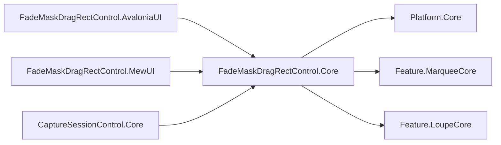
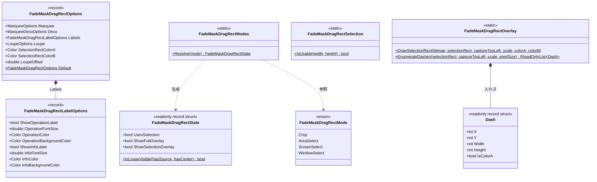
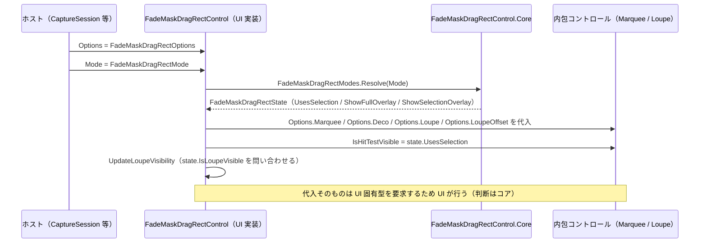
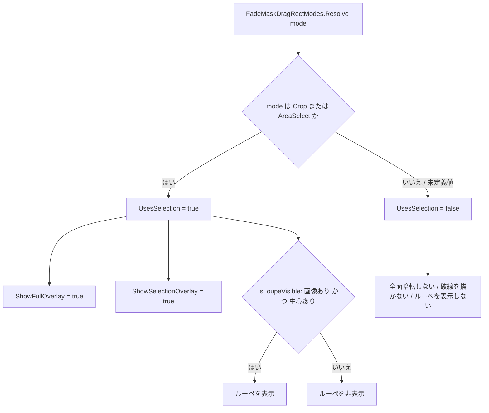
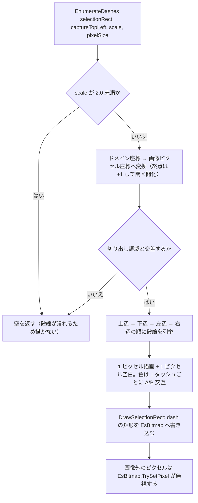

# FadeMaskDragRectControl.Core システム仕様書

## 概要

`FadeMaskDragRectControl.Core` は、領域選択の複合コントロール `FadeMaskDragRectControl` の **UI 非依存コア**です。Avalonia 版と MewUI 版が次の 5 つを共有します。

1. **動作モードの型**（両 UI が同一の enum を使う）
2. **設定の単一値**（既定値・項目の対応・子コントロールへの分配規則を UI に持たせない）
3. **モードから導出する状態**（表示可否の判断を UI に書かせない）
4. **選択矩形の可否判定**（0 サイズの選択が片方の UI だけに残らないようにする）
5. **ルーペ画像への選択矩形破線の描画**（破線の幾何を 1 箇所に集約する）

外部機能と公開 API は [SPEC_ExtFunc](SPEC_ExtFunc.md)、利用手順は [README](README.md) を参照してください。

## 技術スタック

| 項目 | 内容 |
| --- | --- |
| 目的 | 複合コントロールの設定・モード解釈・選択矩形の可否・破線描画を 1 箇所へ集約し、両 UI の挙動が構造的に一致するようにする |
| 提供形態 | クラスライブラリ（`FadeMaskDragRectControl.Core.dll`） |
| 想定利用者 | UI 実装（`FadeMaskDragRectControl.AvaloniaUI` / `FadeMaskDragRectControl.MewUI`）、ホスト（`CaptureSessionControl.Core` の設定写像） |
| ターゲット | `net10.0` |
| 言語 | C# 14（`Nullable` 有効・`ImplicitUsings` 有効） |
| ルート名前空間 | `EsUtil.SaveEvidence.FadeMaskDragRect` |
| 汎用性 | 特定のアプリ・UI に依存しない。UI フレームワークを参照しない |

## アーキテクチャ



- 本プロジェクトは UI フレームワークへ依存しません。
- 依存の向きは **Core → Platform.Core / Feature.*Core** の一方向です（本プロジェクトを参照する側は UI 実装とホストで、逆向きの参照はありません）。
- 設定の構成要素（`MarqueeOptions` / `MarqueeDecoOptions` / `LoupeOptions`）を再利用するため、Marquee / Loupe のコアを参照します。
- **色は本プロジェクトが持ちません**（`MarqueePaint` / `LoupeAppearance` が描画層で単一所有する）。例外はルーペ画像へピクセルで書き込む破線の色（`SelectionRectColorA` / `SelectionRectColorB`）です。これは描画 API ではなく `EsBitmap` への直接書き込みに使うため、本プロジェクトが所有します。

## コンポーネント構成

| ファイル | 可視性 | 内容 |
| --- | --- | --- |
| `FadeMaskDragRectMode.cs` | `public enum` | 動作モード（`Crop` / `AreaSelect` / `ScreenSelect` / `WindowSelect`） |
| `FadeMaskDragRectOptions.cs` | `public sealed record` | 設定の単一値（`Marquee` / `Deco` / `Labels` / `Loupe` / 破線の色 2 / `LoupeOffset`） |
| `FadeMaskDragRectLabelOptions.cs` | `public sealed record` | 操作ラベル・情報ラベルの外観（表示可否・寸法・色） |
| `FadeMaskDragRectModes.cs` | `internal static class` | モード → 状態の解決 |
| `FadeMaskDragRectState.cs` | `internal readonly record struct` | モードから導出する表示可否 |
| `FadeMaskDragRectSelection.cs` | `internal static class` | 選択矩形の可否判定 |
| `FadeMaskDragRectOverlay.cs` | `internal static class` | 破線の列挙（`EnumerateDashes`）と `EsBitmap` への描画（`DrawSelectionRect`）。入れ子に `Dash` |

## クラス図



## データフロー（設定とモードの適用）



## モードから状態への導出（フローチャート）



未定義の値は `Crop` でも `AreaSelect` でもないため後者（選択矩形を使わない）へ落ちます。これは `WindowSelect` と同じ扱いです。

## 選択矩形オーバーレイの描画（フローチャート）



## 単一所有（Single Source of Truth）

| 内容 | 所有者 |
| --- | --- |
| 動作モードの定義 | `FadeMaskDragRectMode`（両 UI がこの型を参照する） |
| 設定値・既定値・子コントロールへの分配規則 | `FadeMaskDragRectOptions` / `FadeMaskDragRectLabelOptions` |
| モードと表示可否の対応 | `FadeMaskDragRectModes` / `FadeMaskDragRectState` |
| 選択として成立するサイズの条件（幅 > 0 かつ 高さ > 0） | `FadeMaskDragRectSelection.IsUsable` |
| 選択矩形の破線の幾何（位置・長さ・色順・最小倍率） | `FadeMaskDragRectOverlay.EnumerateDashes` |
| 枠線の太さ（選択枠線と暗転マスクの穴あけ枠で共通） | `MarqueeDecoOptions.OuterAppearance`（`Deco` 経由） |
| コントロールの外観色 | 描画層の `MarqueePaint` / `LoupeAppearance`（本プロジェクトは持たない） |
| 操作・情報ラベルの文言 | ホスト（本プロジェクトは外観のみ持つ） |

## 例外処理ポリシー

- 引数の null は `ArgumentNullException.ThrowIfNull` で拒否します（`DrawSelectionRect` の `bitmap`）。これは**呼び出し側の実装誤り**であり、回復して続行すべき状況ではないためです。
- 画像の外側へはみ出すピクセル書き込みは `EsBitmap.TrySetPixel` が false を返すだけで、例外にしません（画像端に接する選択矩形は正常な入力のため）。
- 本プロジェクトは外部 I/O・非同期処理・リソース解放を持ちません。

## 可視性ポリシー

- ホストと UI 実装が使う契約（`FadeMaskDragRectMode` / `FadeMaskDragRectOptions` / `FadeMaskDragRectLabelOptions`）は `public`。
- モード解釈・可否判定・破線描画（`FadeMaskDragRectModes` / `FadeMaskDragRectState` / `FadeMaskDragRectSelection` / `FadeMaskDragRectOverlay`）は `internal`。UI 実装が参照しますが公開 API 面を増やしません。
- `internal` は `InternalsVisibleTo`（`FadeMaskDragRectControl.AvaloniaUI` / `.MewUI` / `.AvaloniaUI.Tests` / `.MewUI.Tests` / `.Core.Tests`）で公開します。
- **`internal` → `public` の変更は破壊的な設計変更として扱います**。

## テスト

```text
tests/
├── FadeMaskDragRectModes.Tests.cs      # モードの解決・ルーペ表示可否（12 件）
├── FadeMaskDragRectOptions.Tests.cs    # 既定値・部分変更・外側の装飾の単一所有（6 件）
├── FadeMaskDragRectOverlay.Tests.cs    # 破線の列挙と描画の画素検証（15 件）
└── FadeMaskDragRectSelection.Tests.cs  # 選択矩形の可否判定（9 件）
```

合計 42 件（`[Theory]` は展開後のケース数）。UI 初期化が不要なため、すべて `[Fact]` / `[Theory]` で並列実行されます。

```powershell
dotnet test src/FadeMaskDragRectControl.Core/tests/FadeMaskDragRectControl.Core.Tests.csproj
```

UI 依存の検証（コントロール生成・要素の配置・イベントの発火）は各 UI のテストプロジェクトが担います（Avalonia 版はヘッドレス・直列、MewUI 版は `[Fact]`）。
