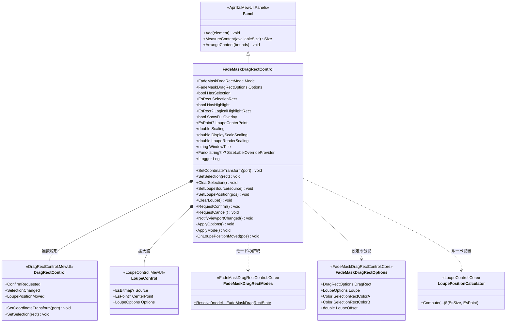
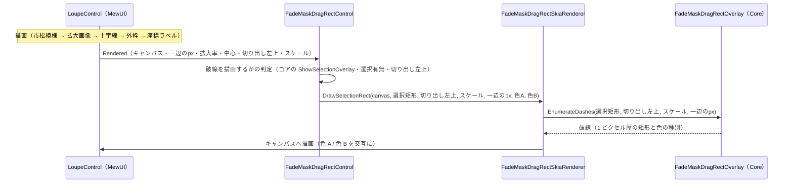
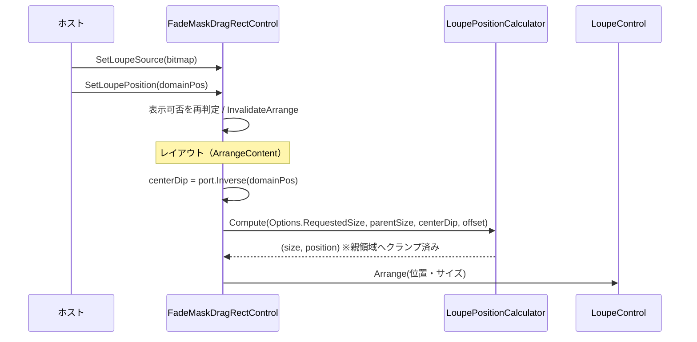

# FadeMaskDragRectControl.MewUI システム仕様書

FadeMaskDragRectControl（MewUI 版）のシステム概要・アーキテクチャ・依存関係・設計判断を記載します。

## システム概要

`FadeMaskDragRectControl.MewUI` は、Avalonia 版 `FadeMaskDragRectControl` と同じ UI 非依存コア
（`FadeMaskDragRectControl.Core` と各コントロールの Core）を使い、選択矩形・暗転マスク・ルーペを
1 つの Facade にまとめた MewUI コントロールです。

ホストは `Mode` と座標変換ポートを設定するだけで、目的のキャプチャ種別に応じた見た目（選択矩形の有無・全面暗転）を得られます。

## 技術スタック

| 区分 | 採用技術 |
| --- | --- |
| 対象フレームワーク | .NET 10（`net10.0`） |
| 言語 | C# 14 |
| UI フレームワーク | MewUI（`Aprillz.MewUI.Skia` **0.21.1 固定**） |
| 基底 | `Aprillz.MewUI.Panels.Panel`（`MeasureContent` / `ArrangeContent` をオーバーライド） |
| 描画 | 内包コントロール（`SkiaCanvasView` 派生）が担当 |
| プロパティシステム | `MewProperty<T>`（各内包コントロール） |

## アーキテクチャ

### 依存方向（一方向を厳守）

```text
┌──────────────────────────────────────┐   ┌──────────────────────────────────────┐
│  FadeMaskDragRectControl.MewUI       │   │  FadeMaskDragRectControl（Avalonia） │
│  （Facade: 配線・状態同期・配置）     │   │  （Facade: 配線・状態同期・配置）     │
└──────────────────┬───────────────────┘   └──────────────────┬───────────────────┘
                   │                                          │
                   └────────────────┬─────────────────────────┘
                                    ▼
                    ┌────────────────────────────────┐
                    │ FadeMaskDragRectControl.Core   │  動作モード・写像・破線描画
                    └────────────────┬───────────────┘
                                     ▼
        ┌──────────────┬──────────────┬──────────────┐
        ▼              ▼              ▼
 DragRectControl  LoupeControl     Platform.Core
    .Core            .Core            .Core
（選択の状態機械・外側の装飾の外観と幾何）（ルーペの表示位置計算）（幾何・変換）
```

### 責務の分担

| 層 | 責務 |
| --- | --- |
| `FadeMaskDragRectControl.Core` | 動作モードの定義、モード → 描画設定の写像、ルーペ画像への破線オーバーレイ描画 |
| 各コントロールの `*.Core` | 選択矩形の状態機械、選択矩形の外側の装飾（暗転マスク・穴あけ枠・ラベル）の外観・幾何、ルーペの表示位置計算 |
| `FadeMaskDragRectControl.MewUI` | 内包コントロールの生成・重ね合わせ・イベント配線・状態同期・配置（レイアウト）・ラベル設定の委譲 |
| ホスト | モードの指定、座標変換ポートの設定、ルーペ画像の供給、ラベル文言の供給、破線色の供給、ログの注入、確定・キャンセル後の後始末 |

### 設計判断

| 判断 | 理由 |
| --- | --- |
| 基底を `Panel` にして `ArrangeContent` を自前実装した | 暗転マスクと選択矩形は全面、ルーペは「中心 + オフセット」の絶対配置という異なる配置規則が必要（`Grid` のセル配置では表現できない） |
| モードの解釈をコア（`FadeMaskDragRectModes`）へ置いた | モードと可視性・ルーペの表示可否・全面暗転の対応が UI 間でずれるのを防ぐ（enum の重複定義も解消） |
| ルーペの位置決めを本クラスで行う | MewUI のルーペは位置を持たない（描画のみ）ため、親領域サイズ・中心・オフセットから配置する必要がある。計算はコアの `LoupePositionCalculator` を共用する |
| 設定をコアの単一値（`FadeMaskDragRectOptions`）として公開した | 既定値・項目の対応・子コントロールへの分配規則を UI に持たせない（Avalonia 版と同一の設定値を使うため、見た目も一致する） |
| イベント引数をコア型で公開した | 内包コントロールのイベント引数と同一の型になり境界変換が不要になる |
| 選択矩形コントロールへ座標変換ポートを渡すようにした | ズームビューのレターボックス等オフセット付きの変換でも、外側の装飾の穴あけと選択矩形が一致する（等倍スケールのみでは位置がずれる） |
| ラベルは選択矩形コントロールへ委譲し、本クラスは委譲プロパティのみを持つ | 描画・行配置は `DragRectControl`（背景・位置はコアの `OuterDecoLabelLayout`）が単一所有するため、重複する実装を持たない |
| ルーペ画像上の破線はルーペの `Rendered` で描画する | MewUI のルーペは中間ビットマップを作らないため、描画先（キャンバス）を受け取れるイベントが必要（破線の幾何はコアが単一所有し、Avalonia 版と同じ見た目になる） |
| ログはドラッグ選択コントロールとルーペへ伝搬する | 入力操作と表示状態の変化を 1 箇所の設定で有効化できる（Avalonia 版と同じ範囲。外側の装飾の描画もドラッグ選択コントロールが担うため、そのログも同じロガーで出力される） |
| ラベルの文言はホストが与える | 情報ラベル（ウィンドウタイトル等）はホストしか知らない上、文言の単一所有はコアの `OuterDecoLabels` にある（本クラスで再生成しない） |

## コンポーネント構成

```text
src/FadeMaskDragRectControl.MewUI/
├── src/
│   ├── FadeMaskDragRectControl.cs               Facade（配線・状態同期・配置）
│   ├── FadeMaskDragRectSkiaRenderer.cs          選択矩形破線の描画（コアの破線幾何をキャンバスへ）
│   ├── FadeMaskDragRectSelectionEventArgs.cs    確定要求のイベント引数（EsRect）
│   └── FadeMaskDragRectPointEventArgs.cs        ルーペ位置のイベント引数（EsPoint）
└── tests/
    ├── FadeMaskDragRectControl.Tests.cs          モード・同期・配置・委譲の検証
    ├── FadeMaskDragRectSkiaRenderer.Tests.cs     破線描画の画素検証
    └── TestHelper.cs                             テスト用の描画先（キャンバスと画素読み取り）
```

| コンポーネント | 責務 |
| --- | --- |
| `FadeMaskDragRectControl` | 子の生成と重ね合わせ、イベント配線、選択状態の同期、モード適用、設定の分配、ルーペの配置、ラベル・破線色・ログの委譲 |
| `FadeMaskDragRectSkiaRenderer` | コアが列挙した破線を 2 色でキャンバスへ描画する |
| `FadeMaskDragRectSelectionEventArgs` | 確定した選択矩形（ドメイン座標）の通知 |
| `FadeMaskDragRectPointEventArgs` | ルーペ中心（ドメイン座標）の通知 |

## クラス図



## シーケンス図（選択と状態同期）

```mermaid
sequenceDiagram
    participant Host as ホスト
    participant Facade as FadeMaskDragRectControl
    participant Drag as DragRectControl

    Host->>Facade: Mode = Crop
    Facade->>Drag: OuterShowFullOverlay = true / ShowHandles = true
    Host->>Facade: SetCoordinateTransform(port)
    Facade->>Drag: SetCoordinateTransform(port)
    Note over Drag: 左ドラッグ（新規選択）
    Drag->>Facade: SelectionStarted
    Drag->>Facade: SelectionChanged(rect)
    Facade->>Facade: ルーペの再描画を要求
    Drag->>Facade: LoupePositionMoved(pos)
    Facade->>Facade: 中心を更新し配置を再計算
    Facade->>Host: LoupePositionMoved(pos)
    Drag->>Facade: ConfirmRequested(rect)
    Facade->>Host: ConfirmRequested(rect)
```



## シーケンス図（ルーペ画像上の選択矩形破線）



## シーケンス図（ルーペの配置）



## レイアウト

```text
ArrangeContent(bounds)                     … bounds はウィンドウ絶対座標（DIP）
  ├─ DragRect.Arrange(bounds)              … 選択矩形と外側の装飾は全面（入力もここが受ける）
  └─ ルーペ
       ├─ 非表示（モード不一致・画像未設定・中心未設定）→ サイズ 0 で配置
       └─ 表示 → Compute(Options.RequestedSize, 親サイズ, port.Inverse(中心), オフセット)
                  → Arrange(親原点 + 位置, サイズ)
```

`MeasureContent` は子を測定したうえで `Size.Empty` を返します（親が割り当てた領域全体を選択対象にするため、
自身の希望サイズを持たない）。

## エラー処理ポリシー

| 条件 | 動作 |
| --- | --- |
| 座標変換ポートが null | 等価変換（1 ドメインピクセル = 1 DIP・境界なし）を適用する |
| ルーペ画像が未設定 | ルーペを表示しない（中心は記録する） |
| 選択矩形のサイズが 0 以下 | 選択なしとして扱う |
| 未定義のモード値 | `WindowSelect` と同じ扱いにする（例外にしない） |
| ルーペの位置が親領域の外 | 親領域内へクランプする |
| 破線を描画しない状態（選択なし・選択矩形を使わないモード・切り出し左上が未設定） | 何もしない（例外にしない） |
| `Log` が null | `NullLogger` へフォールバックする（出力なし） |

## 実装上の注意（実測・設計から得た知見）

1. **モードの変更はルーペの可視性にも及ぶ**。`SetLoupePosition` はモードを確認してから表示する
   （表示しないモードで画像と中心だけが設定された場合に、ルーペが現れないようにする）。
2. **`ArrangeContent` は非表示の子も配置する**。可視性の判定を配置側でも行わないと、
   非表示のルーペにサイズが付き、テストで「配置されていない」ことを検証できない。
3. **`Panel` の `ArrangeContent` の `bounds` はウィンドウ絶対座標**（子も同じ座標系で `Arrange` する）。
   親の原点を加算して配置する。
4. **暗転マスクの座標変換はポートで渡す**。等倍スケール（`Scaling`）だけでは、オフセット付きの変換で穴あけ位置がずれる。

## 未実装（今後の判断）

| 項目 | 状況 |
| --- | --- |
| ハイライトのウィンドウタイトル | ホストが `WindowTitle` で与える（表示可否はコアの `OuterDecoLabels.ShouldShowInfoLabel` が判定する） |
| 実ウィンドウへの組み込み | `app.MewUI` のキャプチャフローで配線済み（撮影・切り出しの両方） |
