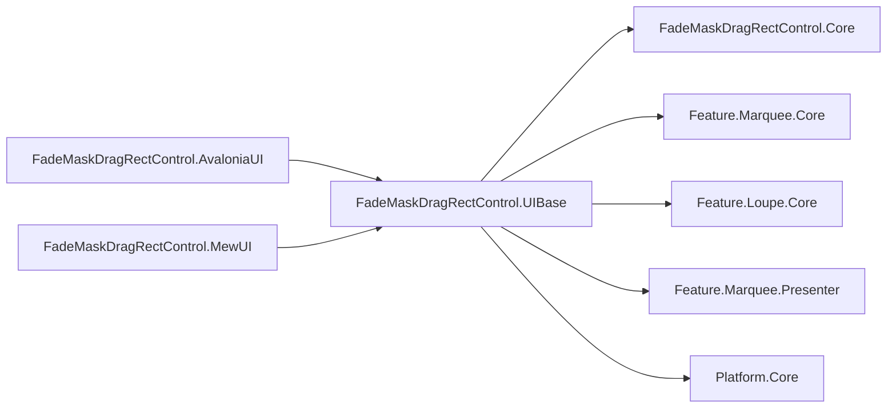
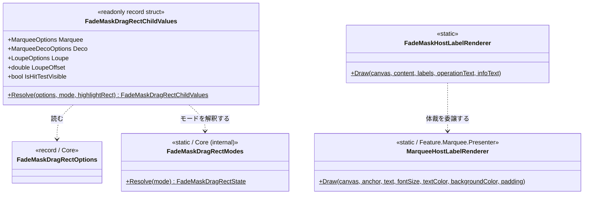
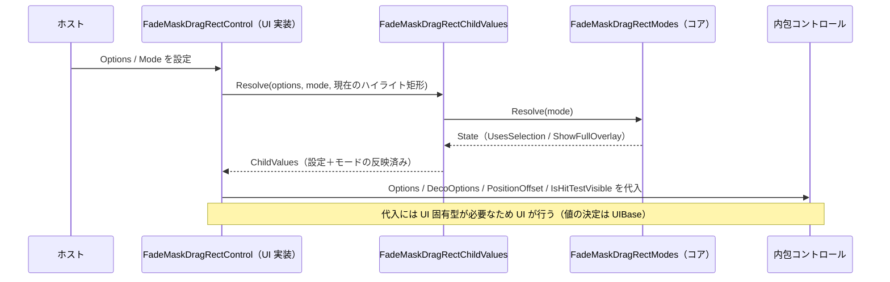
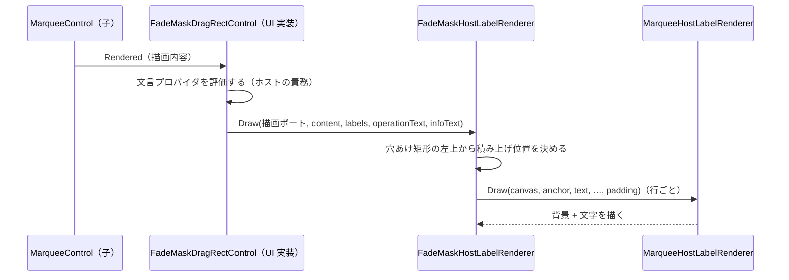
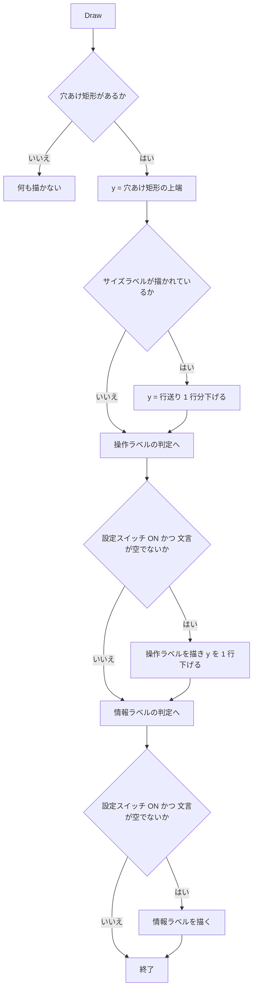

# FadeMaskDragRectControl.UIBase システム仕様書

## 概要

`FadeMaskDragRectControl.UIBase` は、領域選択の複合コントロール `FadeMaskDragRectControl` の両 UI が共有する処理を提供します。

1. **設定とモードから内包コントロールの値への解決**（`FadeMaskDragRectChildValues`）
2. **付加情報ラベル（操作・情報）の積み上げと描画**（`FadeMaskHostLabelRenderer`）

外部機能と公開 API は [SPEC_ExtFunc](SPEC_ExtFunc.md)、利用手順は [README](README.md) を参照してください。

## 技術スタック

| 項目 | 内容 |
| --- | --- |
| 目的 | 複合コントロールの分配規則とラベル配置を 1 箇所へ集約し、両 UI の挙動が構造的に一致するようにする |
| 提供形態 | クラスライブラリ（`FadeMaskDragRectControl.UIBase.dll`） |
| 想定利用者 | `FadeMaskDragRectControl.AvaloniaUI` / `FadeMaskDragRectControl.MewUI`（および両者のテスト） |
| ターゲット | `net10.0` |
| 言語 | C# 14（`Nullable` 有効・`ImplicitUsings` 有効） |
| ルート名前空間 | `EsUtil.SaveEvidence.FadeMaskDragRect.UIBase` |
| 汎用性 | 特定のアプリ・UI に依存しない。UI フレームワークを参照しない |

## アーキテクチャ



依存の向きは **UI → UIBase → Core / 各コア**の一方向です。`Feature.Marquee.Presenter` は UI フレームワークを参照しない
（描画ポート `IEsCanvas` 経由で描く）ため、本層から参照しても UI 非依存性は損なわれません。

## コンポーネント構成

| ファイル | 可視性 | 内容 |
| --- | --- | --- |
| `FadeMaskDragRectChildValues.cs` | `public readonly record struct` | 設定とモードから内包コントロールへ適用する値の解決 |
| `FadeMaskHostLabelRenderer.cs` | `public static class` | 付加情報ラベルの積み上げと描画 |

## クラス図



## データフロー（設定の適用）



## データフロー（付加情報ラベルの描画）



## 積み上げのフローチャート



## 単一所有（Single Source of Truth）

| 内容 | 所有者 |
| --- | --- |
| 動作モードの定義と解釈（表示可否の判断） | `FadeMaskDragRectModes` / `FadeMaskDragRectState`（コア） |
| 設定の既定値と構成 | `FadeMaskDragRectOptions`（コア） |
| 設定とモードから子の値への解決 | `FadeMaskDragRectChildValues`（本層） |
| ハイライト矩形（実行時状態） | ホスト（本層は引数で受けるだけ） |
| 付加情報ラベルの積み上げ位置と表示可否 | `FadeMaskHostLabelRenderer`（本層） |
| ラベルの体裁（背景 = 実寸 + 内側余白） | `MarqueeHostLabelRenderer`（Feature.Marquee.Presenter） |
| 内側余白（体裁の値）と行送り | `MarqueePaint`（Feature.Marquee.Presenter） |
| 付加情報ラベルの文言 | ホスト |
| 選択矩形の破線の幾何 | `FadeMaskDragRectOverlay`（コア） |

**集約による削減**: 本層の新設前は、両 UI が同じ分配（2 段の上書き）と同じ積み上げ（`y` の加算とサイズラベルの
オフセット）をそれぞれ持っていました（各 67 行）。片方だけ規則が変わると同じ設定でも UI によって見た目が変わるため、
値の決定と積み上げを本層が単一所有します。

## 例外処理ポリシー

| 状況 | 挙動 |
| --- | --- |
| `canvas` が null | `ArgumentNullException`（呼び出し側の実装誤りであり、回復して続行すべき状況ではない） |
| 穴あけ矩形が無い | 何も描かずに戻る（早期リターン。選択もハイライトも無い状態は正常） |
| 文言が null / 空 | その行を描かない（対象外のモードで発生する正常な入力） |
| ハイライト矩形が null | 「ハイライトなし」として解決する（null が無効を意味する） |

本層は外部 I/O・非同期処理・リソース解放を持ちません。

## 可視性ポリシー

- 両 UI が参照する値と描画手順は `public`（UI 層が直接使う契約）。
- `FadeMaskDragRectControl.Core` の `internal` 型（`FadeMaskDragRectModes` / `FadeMaskDragRectState`）は
  `InternalsVisibleTo`（`FadeMaskDragRectControl.UIBase`）で参照します。
- **`internal` → `public` の変更は破壊的な設計変更として扱います**。

## テスト

```text
tests/
├── FadeMaskDragRectChildValues.Tests.cs   # 値の解決（8 件）
└── FadeMaskHostLabelRenderer.Tests.cs     # ラベルの積み上げ（9 件）
```

合計 17 件（`[Theory]` は展開後のケース数）。

| 検証内容 | 件数 |
| --- | --- |
| 選択矩形を使うモード（Crop / AreaSelect）で全面暗転・ハンドル・入力が有効になること | 2 |
| 選択矩形を使わないモード（ScreenSelect / WindowSelect）で無効になること | 2 |
| 未定義のモードが選択矩形を使わない扱いになること | 1 |
| ハイライト矩形が引数の値で反映されること（null はハイライトなし） | 1 |
| 設定の値がそのまま写されること | 1 |
| 値の等価性 | 1 |
| 穴あけ矩形が無ければ描かないこと | 1 |
| 操作・情報ラベルを縦に積むこと（画素検証） | 1 |
| サイズラベルの下から積むこと（画素検証） | 1 |
| 表示スイッチが無効な行を描かないこと | 3 |
| 文言が空の行を描かないこと | 1 |
| 空白のみの文言は描くこと | 1 |
| `canvas` が null の場合の例外 | 1 |

描画の検証は UI 非依存の描画ポート（Skia）で行うため、ウィンドウと UI 初期化が不要です（すべて `[Fact]` / `[Theory]`
で並列実行されます）。UI 固有の検証（子コントロールへの代入・イベントの発火）は各 UI のテストプロジェクトが担います。
