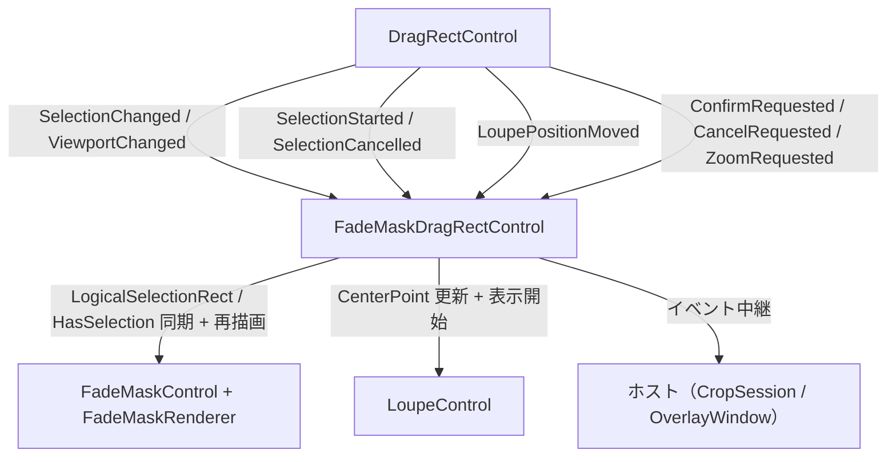

# FadeMaskDragRectControl 外部機能仕様書

## 目次

- [FadeMaskDragRectControl 外部機能仕様書](#fademaskdragrectcontrol-外部機能仕様書)
  - [目次](#目次)
  - [1. 文書概要](#1-文書概要)
  - [2. 目的](#2-目的)
  - [3. 外部利用条件](#3-外部利用条件)
    - [3.1 プロジェクト参照](#31-プロジェクト参照)
    - [3.2 必要な名前空間](#32-必要な名前空間)
  - [4. 基本的な使用方法](#4-基本的な使用方法)
  - [5. 公開API](#5-公開api)
    - [5.1 プロパティ](#51-プロパティ)
    - [5.2 メソッド](#52-メソッド)
    - [5.3 イベント](#53-イベント)
    - [5.4 型](#54-型)
      - [5.4.1 FadeMaskDragRectMode](#541-fademaskdragrectmode)
      - [5.4.2 FadeMaskDragRectSettings](#542-fademaskdragrectsettings)
  - [6. 座標系](#6-座標系)
  - [7. モード](#7-モード)
  - [8. 配線（内部で完結する状態同期）](#8-配線内部で完結する状態同期)
  - [9. ライフサイクルと所有権](#9-ライフサイクルと所有権)
  - [10. 制約事項](#10-制約事項)

---

## 1. 文書概要

| 項目 | 内容 |
| --- | --- |
| 対象 | `FadeMaskDragRect` |
| プロジェクト | `FadeMaskDragRectControl/FadeMaskDragRect.csproj` |
| 名前空間 | `FadeMaskDragRect` |
| 対象フレームワーク | `net10.0` |
| UIフレームワーク | Avalonia 12.1 |
| 主要基底クラス | `Avalonia.Controls.Panel` |
| 適用パターン | Facade / Composite（内包コントロールの公開 API を統合） |
| 主な用途 | 領域選択（DragRect + FadeMask + Loupe）の組み立て・配線・状態同期を 1 箇所に集約する複合コントロール |

## 2. 目的

`FadeMaskDragRectControl` は、ドラッグ選択（`DragRectControl`）・暗転マスク（`FadeMaskControl`）・拡大鏡（`LoupeControl`）の**組み立て・配線・状態同期**を内包する複合コントロールです。

3 コントロールの生成・座標変換注入・イベント購読・状態同期の配線を本コントロールに集約し、ホストはライフサイクルとモード固有処理に専念できます（Facade / Composite パターン・単一責任の原則）。

次の機能を提供します。

- DragRect / FadeMask / Loupe の生成・配置・配線（内部で完結）
- 選択状態の暗転マスク・ルーペへの同期
- 確定・キャンセル・ズーム要求のホスト通知
- モード別の描画モード・可視性・全面暗転の一括切替
- 外観設定の一括適用（`FadeMaskDragRectSettings`）
- 座標変換ポートの一括分配

## 3. 外部利用条件

### 3.1 プロジェクト参照

```xml
<ProjectReference Include="..\FadeMaskDragRectControl\src\FadeMaskDragRect.csproj" />
```

### 3.2 必要な名前空間

```csharp
using Estable.AvaloniaUI.FadeMaskDragRect;
using Estable.AvaloniaUI.Platform; // ICoordTransform / CoordTransform
```

公開 API は内包コントロール（DragRectControl / FadeMaskControl / LoupeControl）の型を参照しないため、
これらの using は不要です（公開型のカプセル化）。

## 4. 基本的な使用方法

1. AXAML（またはコード）で `FadeMaskDragRectControl` を配置します。
2. `Mode` を設定します（キャプチャ種別に応じた描画モード・可視性の切替）。
3. `AppearanceSettings` で外観を一括設定します（null メンバーは現在値維持の部分更新）。
4. `SetCoordinateTransform(ICoordTransform?)` でドメイン ↔ DIP 変換を注入します。
5. イベント（`ConfirmRequested` / `CancelRequested` / `ZoomRequested`）を購読します。
6. ルーペソース（`Loupe.Source`）を設定します。

```csharp
// Crop モードの例（プレビュー内の切出し）
var overlay = new FadeMaskDragRectControl
{
    Mode = FadeMaskDragRectMode.Crop,
    ClipToBounds = true,
};
overlay.AppearanceSettings = settings.ToFadeMaskDragRectSettings(positionOffset: 20.0);
// DPI スケーリングは AppearanceSettings の対象外（個別プロパティで設定）
overlay.Scaling = 1.0;
overlay.SetCoordinateTransform(CoordTransform.Compose(
    CoordTransform.ImageLayout(() => preview.Bounds.Size, imageSize, () => true),
    CoordTransform.ScrollOffset(() => new Vector(origin.X, origin.Y))));
overlay.Loupe.Source = sourceImage;
parentPanel.Children.Add(overlay);
```

## 5. 公開API

### 5.1 プロパティ

| 名前 | 型 | 説明 |
| --- | --- | --- |
| `Mode` | `FadeMaskDragRectMode` | 動作モード。設定時に描画モード・DragRect / Loupe の可視性・全面暗転を一括切替（既定値: `AreaSelect`） |
| `HasSelection` | `bool` | 選択矩形の有無（選択状態の真のソースは FadeMaskRenderer） |
| `SelectionRect` | `Rect` | 現在の選択矩形（ドメイン座標。未選択時は 0x0 の空矩形） |
| `SizeLabelOverrideProvider` | `Func<string?>?` | サイズラベルを描画時に評価するプロバイダ（レンダラーへ伝搬） |
| `LogicalHighlightRect` | `Rect?` | ハイライト矩形（ドメイン座標。未検出時は null。ScreenSelect / WindowSelect 用） |
| `HasHighlight` | `bool` | ハイライト表示の有無（ScreenSelect / WindowSelect 用） |
| `ScreenIndex` | `int` | ハイライト対象のスクリーンインデックス（未検出時は -1。ScreenSelect 用） |
| `Scaling` | `double` | DPI スケーリング係数（`AppearanceSettings` の対象外・コードから動的設定。`FadeMaskRenderer.Scaling` へ委譲） |
| `DisplayScaleScaling` | `double` | サイズラベル用表示スケール（マルチスクリーン補正。`AppearanceSettings` の対象外・コードから動的設定。`FadeMaskRenderer.DisplayScaleScaling` へ委譲） |
| `LoupeRenderScaling` | `double` | ルーペの DIP → 物理ピクセル倍率（`AppearanceSettings` の対象外・DPI から自動取得。`LoupeControl.RenderScaling` へ委譲） |
| `WindowTitle` | `string` | ハイライト対象のウィンドウタイトル（未検出時は空文字。WindowSelect 用） |
| `ShowFullOverlay` | `bool` | 全面暗転（穴あけなし）を表示するかどうか（Crop / AreaSelect で有効。読み取り専用） |
| `LoupeCenterPoint` | `Point?` | ルーペ中心（ドメイン座標。未設定時は null） |

### 5.2 メソッド

| 名前 | シグネチャ | 説明 |
| --- | --- | --- |
| `AppearanceSettings` | `FadeMaskDragRectSettings`（プロパティ） | 外観設定（DragRect / FadeMask / Loupe）を取得・設定。getter は全メンバー non-null / setter は部分更新 + 同一値スキップ |
| `SetCoordinateTransform` | `void SetCoordinateTransform(ICoordTransform? port)` | 座標変換ポートを DragRect / FadeMask / Loupe へ一括分配（null で等価変換） |
| `SetSelection` | `void SetSelection(Rect rect)` | 選択矩形（ドメイン座標）を暗転マスクとルーペへ反映。サイズ 0 以下は選択なし |
| `ClearSelection` | `void ClearSelection()` | 選択状態をクリアして全面暗転（穴あけなし）に戻す |
| `SetDragRectSelection` | `void SetDragRectSelection(Rect rect)` | DragRect の選択矩形をプログラム的に設定（外部復元・テスト用。SelectionChanged 発火 → 暗転マスクとルーペへ同期） |
| `SetLoupePosition` | `void SetLoupePosition(Point domainPos)` | ルーペ中心（ドメイン座標）を設定して表示開始（Parent 未接続は無視） |
| `SetLoupeSource` | `void SetLoupeSource(IImage? source)` | ルーペの拡大元画像（Source）を設定（null で解除） |
| `ClearLoupe` | `void ClearLoupe()` | ルーペを非表示にして現在の Bitmap を解放（セッション終了時の後片付け） |
| `FocusDragRect` | `void FocusDragRect()` | DragRect へフォーカスを設定（矢印キー nudge の受付開始） |
| `InvalidateOverlay` | `void InvalidateOverlay()` | FadeMask オーバーレイの再描画を要求 |
| `RequestConfirm` | `void RequestConfirm()` | 選択確定要求を DragRect へ委譲（Enter キー相当。選択確定後のみ発火） |
| `RequestCancel` | `void RequestCancel()` | キャンセル要求を DragRect へ委譲（Escape キー相当） |
| `AttachScrollViewer` | `void AttachScrollViewer(ScrollViewer? scrollViewer)` | 祖先 ScrollViewer を DragRect へ明示注入（スクロール・ズーム検知 + ホイール操作。Crop 用） |
| `NotifyViewportChanged` | `void NotifyViewportChanged()` | ビューポート（パン・ズーム・表示サイズ）の変化を内包コントロールへ通知。ビューポート実装に依存せずホストが中継する（DragRect / FadeMask の再描画 + ルーペ表示位置の再計算を要求。ScrollViewer 連携の `ViewportChanged` も本メソッドへ統合） |

### 5.3 イベント

| 名前 | 型 | 説明 |
| --- | --- | --- |
| `ConfirmRequested` | `EventHandler<FadeMaskDragRectSelectionEventArgs>` | 確定要求（DragRect の Enter / ダブルクリック / `RequestConfirm`。選択確定後のみ発火） |
| `CancelRequested` | `EventHandler` | キャンセル要求（DragRect の Escape / `RequestCancel`） |
| `ZoomRequested` | `EventHandler<bool>` | Ctrl+ホイールによるズーム要求（true = ズームイン / false = ズームアウト。Crop 用） |
| `LoupePositionMoved` | `EventHandler<FadeMaskDragRectPointEventArgs>` | ルーペ中心の更新通知（ドメイン座標。ホストの追加制御用フック） |

### 5.4 型

| 名前 | 種類 | 説明 |
| --- | --- | --- |
| `FadeMaskDragRectMode` | enum | 動作モード（`Crop` / `AreaSelect` / `ScreenSelect` / `WindowSelect`） |
| `FadeMaskDragRectSettings` | record | 外観設定（DragRect / FadeMask / Loupe の外観を網羅。全メンバー non-null・既定値付き） |
| `FadeMaskDragRectSelectionEventArgs` | record | 確定要求イベントの引数（`SelectionRect: Rect`（ドメイン座標）） |
| `FadeMaskDragRectPointEventArgs` | record | ルーペ位置イベントの引数（`Position: Point`（ドメイン座標）） |

**公開型のカプセル化**: 公開 API は内包コントロール（DragRectControl / FadeMaskControl / LoupeControl）の型を参照しない。
イベント引数は本プロジェクト独自の型（`FadeMaskDragRectSelectionEventArgs` / `FadeMaskDragRectPointEventArgs`）、状態は `HasSelection` / `SelectionRect` / ハイライトプロパティで提供する。
内包コントロールへの直接アクセス（`Loupe` / `Renderer` / `Overlay` / `DragRect`）は internal（自身のテストのみ）。

#### 5.4.1 FadeMaskDragRectMode

| 値 | 説明 |
| --- | --- |
| `Crop` | プレビュー内の切出し（DragRect / Loupe 有効・全面暗転） |
| `AreaSelect` | 全画面オーバーレイの範囲選択（DragRect / Loupe 有効・全面暗転） |
| `ScreenSelect` | スクリーン選択（ハイライトのみ・クリック確定フローはホストが担う） |
| `WindowSelect` | ウィンドウ選択（ハイライトのみ・クリック確定フローはホストが担う） |

#### 5.4.2 FadeMaskDragRectSettings

外観設定のレコード（**全て nullable・null メンバーは現在値維持の部分更新**）。`AppearanceSettings` で設定し、`ToNonNull()` で既定値付きの non-null 値へ変換できる。

**DragRect 外観（13 項目）**:

| プロパティ | 型 | 説明 |
| --- | --- | --- |
| `MinSelectionSize` | `double?` | 選択矩形の最小サイズ（ドメイン座標系） |
| `BorderColor` | `Color?` | 選択枠線の色（不透明度は色のアルファに統合） |
| `BorderThickness` | `double?` | 選択枠線の太さ |
| `HandleColor` | `Color?` | ドラッグハンドルの色 |
| `HandleSize` | `double?` | ドラッグハンドルの一辺サイズ（DIP） |
| `HandleHitRadius` | `double?` | ハンドルヒットテスト半径（DIP） |
| `ClampToDomainBounds` | `bool?` | 画像外の選択を禁止するか |
| `MarkerColor` | `Color?` | nudge 中の十字マーカーの色 |
| `MarkerLength` | `double?` | nudge 中の十字マーカーの長さ |
| `ShowCoordLabel` | `bool?` | カーソル座標ラベルの表示有無 |
| `CoordLabelColor` | `Color?` | カーソル座標ラベルの文字色 |
| `CoordLabelBackgroundColor` | `Color?` | カーソル座標ラベルの背景色（不透明度はアルファに統合） |
| `CoordLabelFontSize` | `double?` | カーソル座標ラベルのフォントサイズ |

**FadeMask 外観（13 項目）**:

| プロパティ | 型 | 説明 |
| --- | --- | --- |
| `OverlayColor` | `Color?` | 暗転オーバーレイの色（アルファ含む） |
| `TextColor` | `Color?` | ラベルテキストの色 |
| `TextBackgroundColor` | `Color?` | サイズラベル（1 行目）の背景色 |
| `FontSize` | `double?` | サイズラベルのフォントサイズ |
| `ShowSizeLabel` | `bool?` | サイズラベル（1 行目）の表示有無 |
| `InfoLabelVisible` | `bool?` | 情報ラベル（3 行目）の表示有無 |
| `InfoLabelColor` | `Color?` | 情報ラベル（3 行目）の文字色 |
| `InfoLabelBackgroundColor` | `Color?` | 情報ラベル（3 行目）の背景色 |
| `InfoLabelFontSize` | `double?` | 情報ラベル（3 行目）のフォントサイズ |
| `ShowSubLines` | `bool?` | 操作ラベル（2 行目）の表示有無 |
| `SubLineFontSize` | `double?` | 操作ラベル（2 行目）のフォントサイズ |
| `SubLineColor` | `Color?` | 操作ラベル（2 行目）の文字色 |
| `SubLineBackgroundColor` | `Color?` | 操作ラベル（2 行目）の背景色 |

**Loupe 外観（15 項目）**:

| プロパティ | 型 | 説明 |
| --- | --- | --- |
| `RequestedSize` | `int?` | ルーペの基本サイズ（DIP） |
| `ZoomLevel` | `int?` | 拡大倍率 |
| `CrossColor` | `Color?` | 十字線の色 |
| `CheckerSize` | `int?` | 市松模様のタイルサイズ |
| `CheckerColorA` | `Color?` | 市松模様の色 A |
| `CheckerColorB` | `Color?` | 市松模様の色 B |
| `FrameColor` | `Color?` | 外枠の色 |
| `FrameWidth` | `int?` | 外枠の太さ |
| `SelectionRectColorA` | `Color?` | 選択矩形破線の色 A |
| `SelectionRectColorB` | `Color?` | 選択矩形破線の色 B |
| `PositionOffset` | `double?` | ルーペ中心からの右下オフセット（DIP） |
| `LoupeShowCoordLabel` | `bool?` | 中心座標ラベルの表示有無 |
| `LoupeCoordLabelColor` | `Color?` | 中心座標ラベルの文字色 |
| `LoupeCoordLabelBackgroundColor` | `Color?` | 中心座標ラベルの背景色 |
| `LoupeCoordLabelFontSize` | `double?` | 中心座標ラベルのフォントサイズ |

## 6. 座標系

- **ドメイン座標**: ホストが定義する論理座標（Crop: 元画像ピクセル / AreaSelect: 仮想スクリーンピクセル）。
- **DIP 座標**: コントロールローカル DIP。`SetCoordinateTransform` で注入した `ICoordTransform` が変換します。
- **追従性**: ズーム・スクロール・ウィンドウサイズ変更などのレイアウト変化に、座標変換が常に追従します。
- **閉区間描画**: 選択領域は始点・終点を含む閉区間として扱い、暗転マスク（非暗転領域）とルーペの選択枠が一致します（FadeMaskRenderer.ToDipRect が終点に +1）。

## 7. モード

| モード | 描画モード（Renderer.Mode） | DragRect | Loupe | 全面暗転（ShowFullOverlay） | 用途 |
| --- | --- | --- | --- | --- | --- |
| `Crop` | `FadeMaskRenderMode.Crop` | 有効 | 有効（LoupePositionMoved で表示開始） | 有効 | プレビュー内の切出し |
| `AreaSelect` | `FadeMaskRenderMode.AreaSelect` | 有効 | 有効（LoupePositionMoved で表示開始） | 有効 | 全画面オーバーレイの範囲選択 |
| `ScreenSelect` | `FadeMaskRenderMode.ScreenSelect` | 無効 | 無効 | 無効 | スクリーン選択（ハイライトのみ。クリック確定フローはホストが担う） |
| `WindowSelect` | `FadeMaskRenderMode.WindowSelect` | 無効 | 無効 | 無効 | ウィンドウ選択（ハイライトのみ。クリック確定フローはホストが担う） |

- ルーペの選択矩形破線はモードに応じて `ApplyMode` が有効化する（`Crop` / `AreaSelect` で有効。モード依存設定のため、外観設定の「同じ値スキップ」に左右されない）。描画は `LoupeControl.Rendered` イベントを受けた本コントロール（ホスト側）が行う。

## 8. 配線（内部で完結する状態同期）



- `SelectionChanged` / `ViewportChanged`: 選択矩形を FadeMask（`LogicalSelectionRect` / `HasSelection`）へ同期し、オーバーレイを再描画。ルーペの選択矩形破線は `Rendered` イベント経由で描画する。
- `SelectionStarted` / `SelectionCancelled`: 選択状態をクリア（前の矩形の暗転マスク残留を防止）。
- `LoupePositionMoved`: ルーペの `CenterPoint` を更新して表示開始（表示位置は座標変換ポートから自己計算）。
- `ConfirmRequested` / `CancelRequested` / `ZoomRequested`: ホストへ中継。

## 9. ライフサイクルと所有権

- 内包コントロール（DragRect / FadeMask / Loupe）はコンストラクタで生成・配置され、本コントロールの子として保持されます（ホストは配置・破棄を管理しません）。
- ルーペソース（`Loupe.Source`）と座標変換ポート（`SetCoordinateTransform`）はホストが設定します。
- ホストが本コントロールを破棄する場合は、Visual Tree から取り除くだけで後片付けが完了します（子コントロールも同時に破棄されます）。

## 10. 制約事項

- レイアウト: `Panel` のサブクラスとして全子コントロールをパネル全面に配置します。`ArrangeOverride` で子を同一矩形に配置するため、子コントロールの個別配置（位置・サイズ）は行いません。
- `SetLoupePosition` はコントロールが Visual Tree に配置されてから呼び出してください（配置前は無視されます）。
- `ScreenSelect` / `WindowSelect` モードでは DragRect / Loupe が無効になるため、`RequestConfirm` / `RequestCancel` は使用できません（クリック確定フローはホストが担います）。
- 全面暗転（`ShowFullOverlay`）は `Crop` / `AreaSelect` でのみ有効です。
