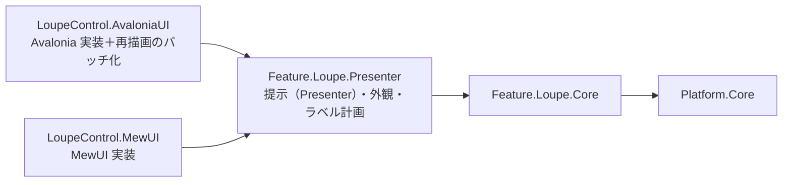
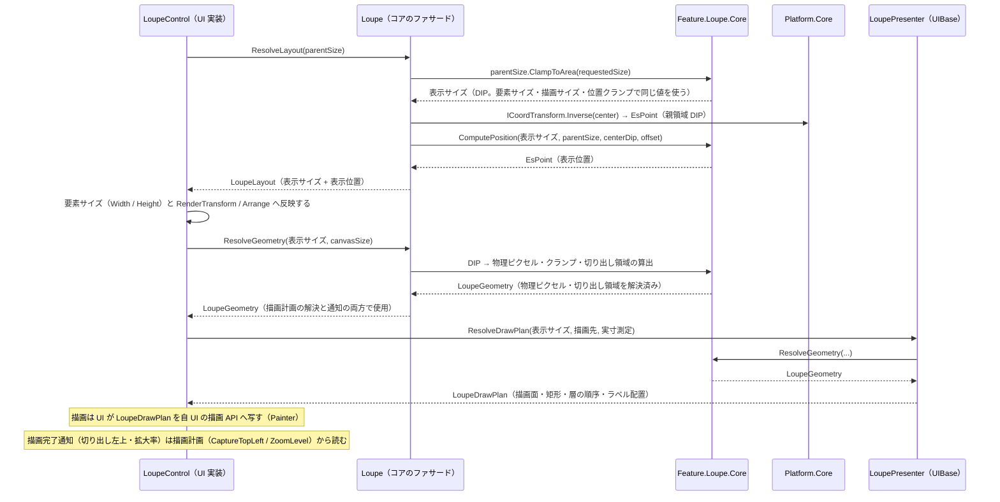

# Feature.Loupe.Core システム仕様書

`LoupeControl`（選択範囲を拡大表示するコントロール）の **UI 非依存のコア**の構造・依存・例外処理・設計判断・コンポーネント構成を記載します。公開 API は [`SPEC_API.md`](SPEC_API.md)、使い方は [`../README.md`](../README.md) を参照してください。

## 1. システム概要

| 項目 | 内容 |
| --- | --- |
| 目的 | ルーペの表示レイアウトと描画の幾何の解決を 1 箇所に集約し、UI ごとの実装差から切り離す |
| 提供形態 | クラスライブラリ（`Feature.Loupe.Core.dll`） |
| 想定利用者 | UI 実装（`LoupeControl.AvaloniaUI` / `LoupeControl.MewUI`）・それらを組み込むホストアプリケーション |
| 汎用性 | 特定のアプリ・UI に依存しない。SaveEvidence のマルチ UI 対応における「コントロールの Core / Presenter / UI 分割」のパイロット実装であり、そのまま別プロジェクトへ独立できる |

## 2. 技術スタック

| 項目 | 内容 |
| --- | --- |
| ターゲット | `net10.0` |
| 言語 | C# 14（`Nullable` 有効・`ImplicitUsings` 有効） |
| ルート名前空間 | `EsUtil.Feature.Loupe.Core`。フォルダへ追従し、`.Drawing` / `.Logging` / `.Placement` / `.Setting` を持ちます |
| ドキュメント生成 | `GenerateDocumentationFile` 有効（XML は配布物へ出さず `cref` の検証のみに使う） |
| テスト | xUnit v3（UI 初期化不要。`InternalsVisibleTo` で `internal` を検証する） |
| 依存 | UI フレームワークを一切参照しない。直接依存は `Platform.Core` と `Microsoft.Extensions.Logging.Abstractions`（ログ定義のソース生成）のみ（SkiaSharp は参照しない） |

## 3. アーキテクチャ

### 3.1 依存方向



層の全体像（Core / Presenter / UI）は [`src/README.md`](../README.md) を参照してください。

- `Feature.Loupe.Core` は UI フレームワークへ依存しません。依存は `Platform.Core` のみです。
- **提示（描画計画の解決）と外観は UI 側の共有層（`Feature.Loupe.Presenter` の `LoupePresenter` / `LoupeAppearance`）が単一所有します**（本プロジェクトは描画 API も描画の抽象も色も持ちません）。**描画は各 UI が自 UI の描画 API で行います**（`LoupeContextPainter` / `LoupeSkiaPainter`）。
- **コントロール化にだけ必要な処理（再描画要求のバッチ化・世代番号管理）は `LoupeControl.AvaloniaUI` が所有します**（中間ビットマップを生成する UI にだけ必要な処理であり、同期描画の `LoupeControl.MewUI` は不要です）。
- UI 実装は、コア型と自身の型（`Avalonia.Point` / `Size` / `IBrush`、`SKColor`）を相互変換します。変換は境界（サービス呼び出し・イベント引数の生成・描画）の 1 行に限定し、UI 側の状態・描画は UI の型のまま維持します。
- 設定（**計算に必要な値**である表示サイズ・拡大率）は `LoupeOptions` が単一所有し、UI 層は本型を 1 プロパティとして公開するだけです（設定の既定値・補正も本型が持つ）。UI 層は寸法値を保持しません（描画時に読むだけ）。**色・フォント・枠線の太さ・表示可否はコアの型に含めず、外観 `Feature.Loupe.Presenter` の `LoupeAppearance` が単一所有します**。
- `LoupeGeometry` を含む**大部分の型を `public`** とします（外部が独自の UI アダプタを実装できるようにするため）。内部手順（配置計算・区画数の切り上げ）は `internal` とし、単体テストにのみ `InternalsVisibleTo`（`Feature.Loupe.Core.Tests`）で公開します。
- コントロール化に必要な型（`LoupeRenderCoordinator`）は `LoupeControl.AvaloniaUI` が提供します。

### 3.2 データフロー（レイアウト → 幾何 → 描画）



## 4. コンポーネント構成

| ファイル | 型 | 可視性 | 責務 |
| --- | --- | --- | --- |
| `src/Loupe.cs`（ルート） | `Loupe` | public | **公開ファサード（操作の唯一の窓口）**。設定・環境値・拡大中心・位置オフセットの保持、設定変更の検出とログ出力（`Log`）、座標変換ポートの設定（`SetCoordTransform`） |
| `src/Loupe.Limits.cs`（ルート） | `Loupe.Limits`（`Loupe` の入れ子） | public | 数値パラメータの既定値・安全域（最小 / 最大）の単一所有と、範囲外の値の補正。**UI がプロパティ登録に使う**（枠線の太さの安全域は外観（`LoupeAppearance`）が参照する） |
| `src/Setting/LoupeOptions.cs` | `LoupeOptions` | public | 計算に必要な設定の値オブジェクト（表示サイズ・拡大率）。既定値・生成時の補正（`init` アクセサ。設定経路によらず範囲内の値だけを保持する）・`Default`。**色・フォント・枠線の太さ・表示可否は持たない**（外観 `Feature.Loupe.Presenter` の `LoupeAppearance` が単一所有する） |
| `src/Drawing/LoupeGeometry.cs` | `LoupeGeometry` | public | 1 フレーム分の描画の幾何（コア⇔UI の契約）。値の組は `Loupe.ResolveGeometry` が 1 箇所に閉じる（UI 層は自分で組み立てない）。切り出し領域の幾何を導出する（`CaptureSize` / `CaptureTopLeft` / `MagnifiedImage` / `SurfaceBounds`） |
| `src/Drawing/LoupeMagnifiedImage.cs` | `LoupeMagnifiedImage` | public | 拡大画像の切り出しと描画の矩形（切り出し領域・描画元・描画先） |
| `src/Placement/LoupeLayout.cs` | `LoupeLayout` | public | 表示レイアウトの値（表示サイズ + 表示位置。配置しない場合は位置が null） |
| （本プロジェクトには置かない） | `LoupePresenter` / `LoupeAppearance` | — | 提示（描画計画の解決）と外観は **UI 側の共有層（`Feature.Loupe.Presenter`）が所有します**（本コアは描画 API も描画の抽象も持たない） |
| `src/Logging/LoupeLogMessage.cs` | `LoupeLogMessage` | internal | コアが出力するログ定義（`LoggerMessage` ソース生成）の単一所有（**UI が出力する定義と書式は `Feature.Loupe.Presenter` が単一所有する**） |
| `src/Loupe.Geometry.cs`（ルート） | `Loupe` の partial | public | 幾何の入口（`ResolveLayout` / `ResolveGeometry`）と内部手順（表示位置のオフセット加算と親領域内へのクランプ。親サイズ未確定の判定も扱う）。内部手順は `private static` に閉じる |

## 5. 単一所有（同じ真実を 2 箇所に持たない）

| 計算 / 値 | 所有者 |
| --- | --- |
| ルーペの設定（表示サイズ・拡大率）とその既定値 | `LoupeOptions` |
| 設定の数値項目の安全域への補正（生成時） | `LoupeOptions`（`init` アクセサ。規則は `Loupe.Limits` が単一所有する） |
| 設定の変更ログの差分検出（変化した項目だけを出力） | `LoupeLogMessage.LogOptionsChanged`（出力の契機は `Loupe.Options` の setter） |
| 枠線の太さとラベル表示の可否（描画にだけ必要な設定） | `LoupeAppearance`（外観。描画層 `Feature.Loupe.Presenter`） |
| 描画の色（ペーストボード・枠線・十字線・中心座標ラベルの 5 色）とその既定値 | `LoupeAppearance`（外観。描画層 `Feature.Loupe.Presenter`） |
| 画像外（ペーストボード）の色とその既定値 | `LoupeAppearance.PasteboardColor`（外観。描画層 `Feature.Loupe.Presenter`） |
| 数値パラメータ（スカラー）の安全域への補正 | `Loupe.Limits` |
| 描画の可否（十字線・枠線・中心座標ラベルの表示可否） | `LoupeAppearance.ShowCrosshair` / `ShowBorder` / `ShowCoordLabel`（明示フラグ。透明色を代用にしない） |
| ラベル表示の可否（設定と中心の有無） | `LoupeAppearance.ShouldShowCoordLabel` |
| 切り出し領域の一辺（ドメインピクセル） | `LoupeGeometry.CaptureSize`（導出プロパティ。切り上げの規則も本値が単一所有する） |
| 切り出し領域の左上（中心 → 左上の変換） | `LoupeGeometry.CaptureTopLeft`（中心未設定は null。描画完了通知のためにも使う） |
| 拡大画像の切り出しと描画の矩形（切り出し領域・描画元・描画先） | `LoupeGeometry.MagnifiedImage`（切り出しの実行は描画実装） |
| 描画先の全領域（ペーストボードを塗る矩形） | `LoupeGeometry.SurfaceBounds` |
| 表示サイズの親領域へのクランプと表示サイズの決定 | `Loupe.ResolveLayout`（規則は `Platform.Core` の `EsSize.ClampToArea`。状態を保持しないため、親領域のサイズを引数で受ける） |
| 表示位置（中心 + オフセットと親領域内へのクランプ） | `Loupe.ResolveLayout`（内部手順は `Loupe.Geometry.cs` の private static `ComputePosition`。親サイズ未確定の判定は `EsSize.HasArea`） |
| 描画の幾何（物理ピクセルサイズ）の組み立てと描画先へのクランプ | `Loupe.ResolveGeometry`（規則は `Platform.Core` の `DpiScaler.ScaleToPixel` と `EsSize.ClampToArea`） |
| 描画完了通知の内容（切り出し左上・拡大率） | `LoupeGeometry.CaptureTopLeft` / `ZoomLevel`（描画の幾何が単一所有する。専用の通知型を持たない） |
| 中心座標ラベルの文言・基準点 | 描画層 `Feature.Loupe.Presenter` の `LoupePresenter`（`LabelTexts` partial） |
| ラベルの既定の見た目（文字色 = 白、背景色 = 黒 60%、フォントサイズ = 12.0） | 描画層 `Feature.Loupe.Presenter` の `LoupeAppearance` |
| 十字線・枠線の矩形 | 描画層 `Feature.Loupe.Presenter` の `LoupePresenter`（`DrawPlan` partial） |
| ラベルの余白・背景矩形・文字原点 | 描画層 `Feature.Loupe.Presenter` の `LoupePresenter`（`LabelPlan` partial） |
| 描画層と順序（`LoupeDrawLayer`） | 描画層 `Feature.Loupe.Presenter` の `LoupePresenter.ResolveDrawPlan` |
| DIP → 物理ピクセルの変換（切り上げ・最低 1） | `Platform.Core` の `DpiScaler.ScaleToPixel` |
| 寸法値の物理ピクセル換算（枠線の太さ） | 提示層 `Feature.Loupe.Presenter` の `LoupePresenter.ResolveDrawPlan`（換算の式は `Platform.Core` の `DpiScaler.ScaleToPixel`） |
| 区画数の切り上げ（切り出し領域の一辺） | `LoupeGeometry.CaptureSize`（導出プロパティ） |
| 設定・環境値・拡大中心・位置オフセットの変更の検出（変化したときだけ出力） | `Loupe`（`Options` / `DipToDeviceScaling` / `CenterPoint` / `PositionOffset` の setter） |
| ログの書式とレベル、変化判定（同値なら出力しない） | `LoupeLogMessage`（コアが出力する定義。UI が出力する定義と書式は `Feature.Loupe.Presenter` が単一所有する） |

## 6. 例外処理ポリシー

本プロジェクトは純粋計算で構成されます。例外を送出するのは `EsBitmap` の引数検証（`ArgumentOutOfRangeException`）と破棄後アクセス（`ObjectDisposedException`）のみです。破棄済みソースの例外の捕捉は描画実装（各 UI の painter）の責務とします。

## 7. 可視性ポリシー

- 大部分の型・メンバーを `public` とします（UI 非依存の汎用ライブラリとして、外部の UI アダプタ実装を可能にするため）。内部手順は `internal` とし、単体テストにのみ `InternalsVisibleTo` で公開します。
- **クラスが `internal` の場合、そのメンバーも `internal` とします**（`public` と書いても外部から見えないため、可視性の宣言を実態と一致させる）。
- 可視性の変更（`public` → `internal`）は破壊的な設計変更として扱います。
- **UI 固有のログは各 UI プロジェクトが所有します**（中間ビットマップを生成する描画パイプライン固有のログは `LoupeControl.AvaloniaUI` の `LoupeRenderLog`）。

## 8. テスト方針

| 方針 | 内容 |
| --- | --- |
| UI 初期化不要 | ヘッドレス実行を必要としないため `[Fact]` / `[Theory]`（`AvaloniaFact` ではない）で並列実行する |
| 単位 | ファサード（表示レイアウト・描画の幾何・設定・ログ） |
| 配置 | **ソースのフォルダを鏡映**する（`tests/Drawing` / `tests/Logging` / `tests/Placement` / `tests/Setting`。ファサードの partial のテストはルート） |
| UI 依存の検証 | `LoupeControl.AvaloniaUI.Tests`（Avalonia ヘッドレス・直列）が担う（コントロール生成・描画・`StyledProperty` の coerce 経由の反映・イベント発火）。**描画の画素検証は `LoupeControl.MewUI.Tests`**（Skia）が担う（Avalonia ヘッドレスでは `RenderTargetBitmap` の画素を読めないため） |
| 合計 | 95 件（`[Theory]` は展開後のケース数） |

```powershell
dotnet test src/Feature.Loupe.Core/tests/Feature.Loupe.Core.Tests.csproj
```

## 9. 設計判断（UI 非依存の境界）

本プロジェクトの型は、UI フレームワークの型をシグネチャに持たないことを境界の条件としています。

| 判断 | 内容 |
| --- | --- |
| 座標・寸法の型 | コア（`EsUtil.Platform.Core.Geometry`）の `EsPoint` / `EsSize` / `EsRect` を使い、UI 型は境界で 1 行変換する |
| 画像の型 | 拡大元画像は UI ごとに型が異なるため契約（`LoupeGeometry`）に含めず、描画実装が解決した `EsBitmap` を別引数で受け取る |
| 文字の描画 | コアは文言・基準点・配置の基準も持たない（描画層 `Feature.Loupe.Presenter` の `LoupePresenter`（`LabelTexts` partial） が文言と基準点を、`LoupePresenter`（`LabelPlan` partial） が実寸 → 配置矩形の写像を、UI 層が実寸測定と要素の配置を担う。色は外観 `LoupeAppearance` が与える） |
| 再描画のバッチ化 | UI のディスパッチャーに依存するため `LoupeControl.AvaloniaUI` が単一所有する（コアは同期計算のみ） |
| 色 | コアは色を持たない（色は描画にだけ必要な設定であり、外観 `Feature.Loupe.Presenter` の `LoupeAppearance` が単一所有する）。色の型は UI 非依存の `System.Drawing.Color` とし、UI の色型への変換は描画の境界で行う |
| 切り出し領域の左上 | 切り出し（描画実装）と描画完了通知の 2 経路で重複する計算を `LoupeGeometry.CaptureTopLeft` が単一所有する（切り出しと通知が同じ値を使う） |
| ラベルの体裁 | 「背景 = 文字の実寸 + 内側余白 × 2」「行送り」は描画にだけ必要な規則のため、描画層（`Feature.Loupe.Presenter`）が単一所有する（コアは値を渡さない） |
| 設定では変更しない固定値 | **公開しません**。描画層内だけで使う値（中心座標ラベルの上端余白）は `LoupePresenter`（`LabelTexts` partial） の private 定数とし、UI 層は解決済みの値（`LoupeLabelPlacement`）を受け取る |
| フォントサイズの安全域 | 6〜48 と「非数は既定値」は外観（`LoupeAppearance`）が単一所有する |

## 10. ログ

ロガーは `Loupe.Log` で受け取り、**設定の変更**（`[Feature.Loupe.Core] Setting: {名前} {前} → {後}`。Debug）を出力します。ロガー未設定（null）は出力なしです。

**メッセージの接頭辞は、そのログを定義しているプロジェクト名（コアは `[Feature.Loupe.Core]`、UI 側の共有層は `[Feature.Loupe.Presenter]`、UI 実装は `[LoupeControl.AvaloniaUI]` 等）とします**（接頭辞で出力元の層を読み分けられるようにする。全層が同じ接頭辞だと、ログを見てもどのアセンブリの定義が出力したかを特定できない）。

| 契機 | 出力 |
| --- | --- |
| `Options` の set | 変化した項目だけ（`RequestedSize` / `ZoomLevel`） |
| `DipToDeviceScaling` / `CenterPoint` / `PositionOffset` の set | 変化したときだけ |

**差分検出（変化した項目だけを出力する判断）と「同値なら出力しない」規則は本コアが単一所有します**（UI 層は前後の値を渡さず、変更を通知するだけです）。枠線の太さ・表示可否（外観）の変更ログは `Feature.Loupe.Presenter` が出力します。ログ基盤（ファイル出力・レベル制御）はホストが所有し、本コアは定義だけを持ちます。

設定値の変更は `LogSettingChanged(名前, 前, 後)`（整数 / 実数 / 真偽）で出力し、**設定名は `nameof` をコアが付与します**（UI 層に設定名の文字列を持たせません）。拡大中心は座標の整形（`(X, Y)`）を伴うため専用の定義（`LogCenterPointChanged`）を持ちます。設定の変更ログの所要項目は `LoupeOptions` の項目（表示サイズ・拡大率）に一致します。

**UI が出力するログ（拡大元画像の変更・描画の例外）とその書式は `Feature.Loupe.Presenter` が単一所有します**（コアは UI が呼ぶ定義を持ちません）。**UI 固有の処理に対応するログは各 UI プロジェクトが所有します**（中間ビットマップを生成する描画パイプライン固有のログ等は `LoupeControl.AvaloniaUI` にあります）。

## 11. 機能差に由来する非対称（もう一方のコアとの違い）

本コアと `Feature.Marquee.Core` は同じ規約（`UI → Presenter → Core → Platform.Core` の一方向依存、層の順序は提示層が所有、色は外観が所有）で作られています。揃えない（揃えると害になる）違いは機能差に由来するもので、以下に列挙します。

| 非対称 | Loupe | Marquee | 理由 |
| --- | --- | --- | --- |
| 描画パイプラインの段数 | 3 段（`ResolveLayout` → `ResolveGeometry` → 描画計画の解決） | 2 段（`ResolveGeometry` → 描画計画の解決） | Marquee は親セル全面へ重ねるため配置の余地がない（`LoupeLayout` 相当を持たない）。配置先はホストの親セル全面であり、位置を決める入力がコアに無い |
| 描画の幾何の生成の形 | `ResolveGeometry(double displaySize, EsSize? availableSize = null)`（一辺の表示サイズ＝親パネルのクランプ結果と、描画面＝ビットマップの領域が別） | `ResolveGeometry(in MarqueeRenderRequest)`（描画領域＝座標空間。表示サイズと同じ） | 本コアは正方形のルーペを自前の描画面へ描く（任意矩形の描画領域へ直接描く Marquee とは座標系の対応が違う） |
| 入力の通知と効果ポート | 持たない（状態はホストが設定するだけ。設定は表示のみ。変換の設定は再描画を要求せず、表示位置の再計算は UI が行う。ロガーはファサード自身が保持） | 対話モジュール（`Interaction/` + `Contract/` + `Press` / `Move` / `Release` / `KeyDown` + `Notified`）／設定に対話パラメータ（`MinSelectionSize` / `HandleHitRadius` / `ClampToDomainBounds`）／ラベル文言プロバイダ（`SizeLabelOverrideProvider` 等）／座標変換の設定で**コアが再描画を要求**（`RequestRedraw`）／ロガーはセッションが保持 | ルーペは入力の解釈も効果ポートも持たない（ホストが状態を設定するだけであり、再描画の要求先が無い） |
| 寸法の型 | `int`（物理ピクセルへ換算。矩形の塗りで描く） | `double`（DIP のまま。線で描く） | 描画プリミティブが違う（塗り / 線） |
| 設定型の数とログ定義 | 1 型（`LoupeOptions`）。ログは `LogOptionsChanged` のみ | 1 型（`MarqueeOptions`）。ログは `LogOptionsChanged` のみ | 装飾の設定はコアから提示層（外観）へ移したため、両コアとも 1 型 |
| 描画データの粒度 | 層ごとに素の矩形（`BorderRects` / `CrosshairRects`） | 層ごとに専用型（`MarqueeHandles` / `MarqueeMarker`） | 描画プリミティブが違う（塗る矩形の列 / 線の座標） |
| 描画の幾何の座標変換ポート | 幾何に持たない（ポートは `ResolveLayout` の表示位置解決だけに使う） | 幾何が保持する（`Port` ＋ 未指定時の `DomainToDipScaling`。`ResolvedPort` / `ToDipRect` が自分で解決する） | 本コアは自身の物理ピクセル面で描画が完結する（Marquee は選択矩形をドメイン → DIP へ変換して描き、その DIP はホストの座標系で決まる） |
| 下地の層 | `LoupeDrawLayer.Pasteboard`（画像外の色）で描画面全体を塗る | 持たない（`MarqueeDrawLayer` の先頭は `Decoration`） | ルーペは描画先のビットマップを自分で置き換える（Marquee は自身の表面へ直接描き、消去はフレームワークが行う） |
| 描画完了の通知の内容 | `LoupeRenderedEventArgs`（`CaptureTopLeft` / `ZoomLevel`） | `MarqueeRenderedEventArgs`（`MarqueeDrawPlan`: 層・文言の有無） | ホストが重ね描きするために必要な情報が違う（切り出し領域と倍率 / 選択矩形の所在） |
| 表示可否の述語の引数 | `LoupeAppearance.ShouldShowCoordLabel(bool)` | `MarqueeAppearance.ShouldShowSizeLabel(bool)` / `ShouldShowCoordLabel()` | ルーペの座標ラベルは拡大中心が未設定になりうる（Marquee の座標ラベルは入力に常にある） |
| `Limits` の追加役割 | 安全域と補正のみ | 未設定（0 以下）の解決規則も持つ（`ResolveDisplayScale`） | ラベルの表示スケールは Marquee 固有の概念 |
| 区画数の計算 | `LoupeGeometry.CaptureSize`（導出プロパティ）が持つ | 持たない | 切り出し領域の一辺が「余りを 1 区画として数える」規則を使う |
| 選択の幾何 | 持たない | `Selection/`（`MarqueeSelection`）を持つ | ルーペは選択操作を持たない |
| テスト補助（スパイ） | `RecordingLogger` のみ | `EffectsSpy` / `CursorServiceSpy` / `RecordingLogger` | ルーペは効果ポートもカーソルサービスも持たないため差し替える対象が無い（ログの検証だけが共通） |
