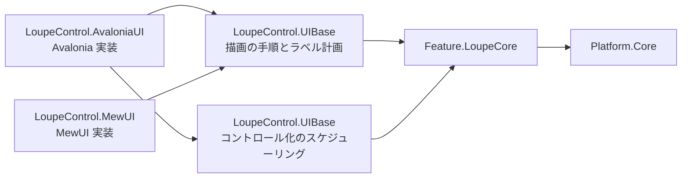

# Feature.LoupeCore システム仕様書

## 概要

`LoupeControl.AvaloniaUI`（Avalonia UI 実装）と `LoupeControl.MewUI`（MewUI 実装）が共有する、UI フレームワーク非依存のルーペロジックを提供するライブラリです。SaveEvidence のマルチ UI 対応における「コントロールの Core / UI 分割」のパイロット実装（ティア E）です。

## 技術スタック

- .NET 10 / C# 14
- UI フレームワークは一切参照しない
- 外部パッケージへの直接依存なし（`Platform.Core` 経由で SkiaSharp を参照）

## アーキテクチャ

層の全体像（Core / UIBase / UI）は [`src/README.md`](../README.md) を参照してください。

- `Feature.LoupeCore` は UI フレームワークへ依存しません。依存は `Platform.Core` のみです。
- **描画の手順と色は UI 側の共有層（`LoupeControl.UIBase` の `ILoupeRenderer` / `LoupeRendererBase` / `LoupeRenderer` / `LoupePaint`）が単一所有します**（描画先は `Common` の `IEsCanvas`。本プロジェクトは描画 API も色も持ちません）。
- **コントロール化にだけ必要な処理（再描画要求のバッチ化・世代番号管理）は `LoupeControl.UIBase` が所有します**（同層も UI フレームワークに依存せず、実行キューは UI がコールバックで注入します）。
- UI 実装は、コア型と自身の型（`Avalonia.Point` / `Size` / `IBrush`、`SKColor`）を相互変換します。変換は境界（サービス呼び出し・イベント引数の生成・描画）の 1 行に限定し、UI 側の状態・描画は UI の型のまま維持します。
- 設定（表示サイズ・拡大率・寸法・中心座標ラベルの表示可否）は `LoupeOptions` が単一所有し、UI 層は本型を 1 プロパティとして公開するだけです（設定の既定値・補正も本型が持つ）。UI 層は寸法値を保持しません（描画時に読むだけ）。**色はコアの型に含めず、描画層 `LoupeControl.UIBase` の `LoupePaint` が単一所有します**（コアは色の値を決めず、描画可否の判定にも使いません）。
- `LoupeOptions` を含む**大部分の型を `public`** とします（外部が独自の UI アダプタを実装できるようにするため）。内部手順（配置計算・描画引数の計算）は `internal` とし、単体テストにのみ `InternalsVisibleTo`（`Feature.LoupeCore.Tests`）で公開します。
- コントロール化に必要な型（`LoupeRenderCoordinator`）は `LoupeControl.UIBase` が `public` として提供します。

## コンポーネント構成

| ファイル | 内容 |
| --- | --- |
| `Loupe.cs`（ルート） | **公開ファサード（操作の唯一の窓口）**。設定・環境値・中心・オフセットの保持、表示レイアウトの解決（`ResolveLayout`）、描画入力の生成（`CreateRequest`）、**描画内容の解決（`ResolveContent`）**、設定変更の検出とログ出力（`Log`） |
| `Placement/LoupeLayout.cs` | 表示レイアウトの値（表示サイズ + 表示位置。配置しない場合は位置が null。**public**） |
| `Drawing/LoupeDrawContent.cs` | **1 フレーム分の描画内容**（描画面の矩形・タイル列挙子・十字線 / 円枠の矩形・拡大画像の幾何・層の順序）。描画層へ渡す唯一の描画契約であり、幾何計算を含まない |
| `Drawing/LoupeMagnifiedImage.cs` | 拡大画像の切り出しと描画の矩形（切り出し領域・描画元・描画先）。描画内容の一部 |
| `Drawing/LoupeCheckerTiles.cs` | 市松模様の暗色タイルの矩形を**リストを確保せずに列挙する構造体**（描画内容の一部。`foreach` で列挙でき、描画ポートの列挙子への適合は描画層が行う） |
| （本プロジェクトには置かない） | 描画の契約（`ILoupeRenderer`）と描画手順の基底は **UI 側の共有層（`LoupeControl.UIBase`）が所有します**（本コアは描画 API も描画ポートも持たない） |
| `Setting/LoupeOptions.cs` | ルーペの設定（表示サイズ・拡大率・寸法 2 項目（市松模様のタイルサイズ・外枠の太さ）・中心座標ラベルの表示可否）の単一所有（**public**）。既定値・生成時の補正（`init` アクセサ。設定経路によらず範囲内の値だけを保持する）・`Default`・`ShouldShowCoordLabel`。**色は持たない**（色は描画層 `LoupeControl.UIBase` の `LoupePaint` が単一所有する） |
| `Loupe.Limits.cs`（ルート） | 数値パラメータの既定値・安全域（最小 / 最大）の単一所有と、範囲外の値のクランプ（`Loupe` の**入れ子**。UI がプロパティ登録に使う） |
| `Drawing/LoupeRenderRequest.cs` | 1 フレーム分の描画入力（コア⇔UI の契約）、UI の DIP 値からの組み立て（`Create`。**換算済みの寸法** `CheckerSizePixels` / `FrameWidthPixels` を含む）、切り出し領域の幾何の導出（`CaptureSize` / `MagnifiedImage` は internal、`CaptureTopLeft` は描画完了通知のために public） |
| `Drawing/LoupeTextPlacement.cs` | コアが UI 層へ渡すテキスト（文言・基準点・アライン・描画領域）。**要素として置くか canvas へ描くかは UI 層が決める**（体裁・フォントサイズ・角丸・色は描画層 `LoupeControl.UIBase` の `LoupePaint` / `LoupeLabelPlan` が単一所有する） |
| `Loupe.DrawContent.cs`（`Loupe` の **partial**・**internal**） | 1 フレーム分の描画内容の解決（描く層の一覧の組み立てと中心座標ラベルのテキスト配置）。利用者はファサード（`Loupe.ResolveContent`）を使う |
| `Logging/LoupeLogMessage.cs` | コアが出力するログ定義（`LoggerMessage` ソース生成）の単一所有（**internal。UI が出力する定義と書式は `LoupeControl.UIBase` が単一所有する**） |

### 内部（`internal`。用途別フォルダ）

| ファイル | 内容 |
| --- | --- |
| `Checkerboard/LoupeCheckerboard.cs` | 市松模様の明暗の判定規則（タイル矩形の列挙は `LoupeCheckerTiles`） |
| `Checkerboard/LoupeDivMath.cs` | 区画数の切り上げ除算（`CeilDiv`。「余りを 1 区画として数える」規則の単一所有。タイル数と切り出し領域の一辺が共用する） |
| `Decoration/LoupeDecorationGeometry.cs` | 十字線（縦横 2 本）と円枠（4 辺）の描画矩形の計算 |
| `Decoration/LoupeMetricsScaler.cs` | 寸法値（タイルサイズ・円枠の太さ）の物理ピクセル換算（結果は描画入力へ解決済み） |
| `Placement/LoupePlacementGeometry.cs` | 表示位置（左上）の計算（中心 + オフセットと親領域内へのクランプ。親サイズ未確定の判定も本クラスが扱う） |

## データフロー

## 単一所有（Single Source of Truth）

| 計算 / 値 | 所有者 |
| --- | --- |
| ルーペの設定（表示サイズ・拡大率・寸法）とその既定値 | `LoupeOptions` |
| 設定の数値項目の安全域への補正（生成時） | `LoupeOptions`（`init` アクセサ。規則は `Loupe.Limits` が単一所有する） |
| 設定の変更ログの差分検出（変化した項目だけを出力） | `LoupeLogMessage.LogOptionsChanged`（出力の契機は `Loupe.Options` の setter） |
| ルーペの寸法（タイルサイズ・外枠の太さ）とラベル表示の可否 | `LoupeOptions` |
| 描画の色（下地・市松模様・外枠・十字線・中心座標ラベルの 7 色）とその既定値、および描画可否の述語 | `LoupePaint`（描画層 `LoupeControl.UIBase`） |
| 下地（ベース）色とその既定値 | `LoupePaint.BackgroundColor`（描画層 `LoupeControl.UIBase`。最初に塗る） |
| 数値パラメータ（スカラー）の安全域とクランプ | `Loupe.Limits` |
| 描画の可否（アルファ 0 は描画しない） | `LoupePaint.Has*`（`LoupeControl.UIBase`。判定の規則は `DrawingColorExtensions.IsVisible`） |
| ラベル表示の可否（設定と中心の有無） | `LoupeOptions.ShouldShowCoordLabel` |
| 切り出し領域の一辺（ドメインピクセル） | `LoupeRenderRequest.CaptureSize`（internal。切り上げは `LoupeDivMath.CeilDiv`） |
| 切り出し領域の左上（中心 → 左上の変換） | `LoupeRenderRequest.CaptureTopLeft`（中心未設定は null。描画完了通知のために public） |
| 拡大画像の切り出しと描画の矩形（切り出し領域・描画元・描画先） | `LoupeRenderRequest.MagnifiedImage`（internal）。`Loupe.ResolveContent` が `LoupeDrawContent.MagnifiedImage` として描画層へ渡す（切り出しの実行は描画層） |
| 表示サイズの親領域へのクランプと表示サイズの決定 | `Loupe.ResolveLayout`（規則は `Platform.Core` の `EsSize.ClampToArea`。状態を保持しないため、親領域のサイズを引数で受ける） |
| 表示位置（中心 + オフセットと親領域内へのクランプ） | `Loupe.ResolveLayout`（規則は internal の `Placement.LoupePlacementGeometry.ComputePosition`。親サイズ未確定の判定は `EsSize.HasArea`） |
| 描画入力（物理ピクセルサイズ）の組み立てと描画先へのクランプ | `Loupe.CreateRequest`（規則は internal の `LoupeRenderRequest.ResolvePixelSize`） |
| 描画完了通知の内容（切り出し左上・拡大率） | `LoupeRenderRequest.CaptureTopLeft` / `ZoomLevel`（描画入力が単一所有する。専用の通知型を持たない） |
| 中心座標ラベルの文言・基準点と表示可否 | `Loupe.ResolveContent`（文言は `EsPoint.Format`、表示可否は `LoupeOptions.ShouldShowCoordLabel`） |
| ラベルの既定の見た目（文字色 = 白、背景色 = 黒 60%、フォントサイズ = 12.0） | 描画層 `LoupeControl.UIBase` の `LoupePaint` |
| 十字線・円枠の矩形 | `Loupe.ResolveContent`（規則は internal の `Decoration.LoupeDecorationGeometry`） |
| ラベルの余白・背景矩形・文字原点 | 描画層 `LoupeControl.UIBase` の `LoupeLabelPlan`（左右の余白は `LoupeLabelPlan` が、上下はルーペ固有の値を単一所有する） |
| DIP → 物理ピクセルの変換（切り上げ・最低 1） | `Platform.Core` の `DpiScaler.ScaleToPixel` |
| 寸法値の物理ピクセル換算（市松タイル・円枠の太さ） | `LoupeRenderRequest.Create`（規則は internal の `Decoration.LoupeMetricsScaler`。結果は描画入力に含まれる） |
| 市松模様のタイル矩形の列挙 | `Loupe.ResolveContent`（`LoupeCheckerTiles`。リストを確保しない） |
| 設定・環境値・拡大中心の変更の検出（変化したときだけ出力） | `Loupe`（`Options` / `DipToDeviceScaling` / `CenterPoint` の setter） |
| ログの書式とレベル、変化判定（同値なら出力しない） | `LoupeLogMessage`（コアが出力する定義。UI が出力する定義と書式は `LoupeControl.UIBase` が単一所有する） |

`LoupeRenderRequest.MagnifiedImage`（internal）/ 描画層（`LoupeControl.UIBase`）の十字線・外枠描画はいずれも上記へ委譲し、同じ計算を二重に所有しません。

## 例外処理ポリシー

本プロジェクトは純粋計算で構成されます。例外を送出するのは `EsBitmap` の引数検証（`ArgumentOutOfRangeException`）と破棄後アクセス（`ObjectDisposedException`）のみです。破棄済みソースの例外の捕捉は描画層（`LoupeRendererBase`）の责務とします。

## 可視性ポリシー

- 大部分の型・メンバーを `public` とします（UI 非依存の汎用ライブラリとして、外部の UI アダプタ実装を可能にするため）。内部手順は `internal` とし、単体テストにのみ `InternalsVisibleTo` で公開します。
- 可視性の変更（`public` → `internal`）は破壊的な設計変更として扱います。
- **UI 固有のログは各 UI プロジェクトが所有します**（中間ビットマップを生成する描画パイプライン固有のログは `LoupeControl.AvaloniaUI` の `LoupeRenderLog`）。

## テスト

- `src/Feature.LoupeCore/tests`（`Feature.LoupeCore.Tests`）が本プロジェクトのテストを持ちます。
- UI 初期化が不要なため、`[Fact]` / `[Theory]`（`AvaloniaFact` ではない）で並列実行されます。
- UI 依存の検証（コントロール生成・描画・`StyledProperty` の coerce 経由の反映・イベント発火）は `LoupeControl.AvaloniaUI.Tests`（Avalonia ヘッドレス・直列）が担います。

## 設計判断（UI 非依存の境界）

本プロジェクトの型は、UI フレームワークの型をシグネチャに持たないことを境界の条件としています。

| 判断 | 内容 |
| --- | --- |
| 座標・寸法の型 | コア（`EsUtil.Platform.Core.Geometry`）の `EsPoint` / `EsSize` / `EsRect` を使い、UI 型は境界で 1 行変換する |
| 画像の型 | 拡大元画像は UI ごとに型が異なるため契約（`LoupeRenderRequest`）に含めず、描画層が解決した `EsBitmap` を別引数で受け取る |
| 文字の描画 | コアは文言・寸法・配置の基準だけを持ち、実寸 → 配置矩形の写像は描画層（`LoupeControl.UIBase` の `LoupeLabelPlan`）が、実寸測定と要素の配置は UI 層が行う（実寸は描画 API 依存のため）。色は描画層の `LoupePaint` が与える |
| 再描画のバッチ化 | UI のディスパッチャーに依存するため `LoupeControl.UIBase` が単一所有する（コアは同期計算のみ） |
| 色 | コアは色を持たない（色は描画にだけ必要な設定であり、描画層 `LoupeControl.UIBase` の `LoupePaint` が単一所有する）。色の型は UI 非依存の `System.Drawing.Color` とし、UI の色型への変換は描画ポートの境界で行う |
| 切り出し領域の左上 | 切り出し（描画層）と描画完了通知の 2 経路で重複する計算を `LoupeRenderRequest.CaptureTopLeft`（internal）が単一所有する（切り出しと通知が同じ値を使う） |
| ラベルの体裁 | 「背景 = 文字の実寸 + 内側余白 × 2」「アラインの適用」「行送り」は描画にだけ必要な規則のため、描画層（`MarqueeControl.UIBase` / `LoupeControl.UIBase`）が単一所有する（コアは文言・基準点・アライン・クランプ領域だけを渡す） |
| フォントサイズの安全域 | 6〜48 と「非数は既定値」は描画層（`LoupePaint` / `MarqueePaint`）が単一所有する |

## ライセンス

MIT License（全文は [`../../LICENSE`](../../LICENSE) を参照）。
