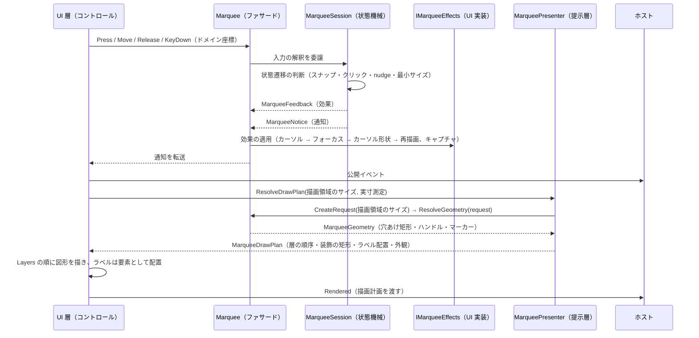
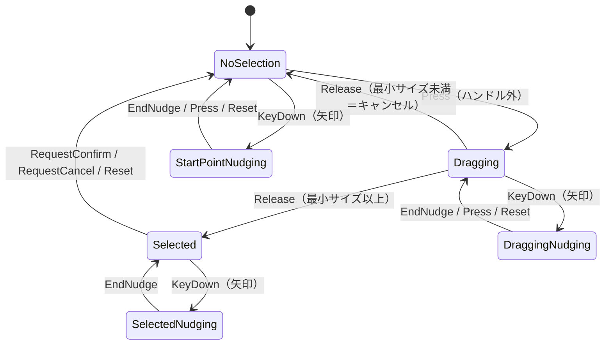

# Feature.Marquee.Core システム仕様書

`MarqueeControl`（ドラッグで矩形を選び、移動・リサイズできるコントロール）の **UI 非依存の計算層**の構造・依存・例外処理・コンポーネント構成を記載します。外部機能と公開 API は [SPEC_ExtFunc](SPEC_ExtFunc.md)、利用手順は [README](README.md) を参照してください。

## 1. システム概要

| 項目 | 内容 |
| --- | --- |
| 目的 | 選択矩形の幾何計算・状態機械・入力の解釈（判断）を 1 箇所に集約し、UI ごとの実装差から切り離す |
| 提供形態 | クラスライブラリ（`Feature.Marquee.Core.dll`） |
| 想定利用者 | UI 実装（`MarqueeControl.AvaloniaUI` / `MarqueeControl.MewUI`）・それらを組み込むホストアプリケーション |
| 汎用性 | 特定のアプリ・UI に依存しない。別コントロールの語彙を持たない（将来そのまま別プロジェクトへ独立できる） |

## 2. 技術スタック

| 項目 | 内容 |
| --- | --- |
| ターゲット | `net10.0` |
| 言語 | C# 14（`Nullable` 有効・`ImplicitUsings` 有効） |
| ルート名前空間 | `EsUtil.Feature.Marquee.Core`。フォルダへ追従し、`.Contract` / `.Drawing` / `.Interaction` / `.Logging` / `.Selection` / `.Setting` を持ちます |
| ドキュメント生成 | `GenerateDocumentationFile` 有効（XML は配布物へ出さず `cref` の検証のみに使う） |
| テスト | xUnit v3（UI 初期化不要。`InternalsVisibleTo` で `internal` を検証する） |
| 依存 | UI フレームワークを一切参照しない。直接依存は `Platform.Core` と `Microsoft.Extensions.Logging.Abstractions`（ログ定義のソース生成） |

## 3. アーキテクチャ

### 3.1 依存方向

層の全体像（Core / Presenter / UI）は [`src/README.md`](../README.md) を参照してください。

```text
UI 層（MarqueeControl.AvaloniaUI / MarqueeControl.MewUI）
  入力の受付・効果の適用・通知の転送・描画先の用意・ラベル要素の配置
    ├──> Feature.Marquee.Presenter   どう描くか（描画計画の解決と自 UI の描画面への写し）
    └──> Feature.Marquee.Core ← 本プロジェクト   何を計算するか（状態・判断・幾何）
           └──> Platform.Core（Es* 値型・ICoordTransform・ICursorService）
※ Core は Presenter を参照しない（Presenter がコアの幾何を使う向きだけ）。Core は Platform.* の UI アダプタも参照しない。
```

- 上位層は下位層のみを参照します（逆参照なし）。
- 本コアは UI フレームワークを参照しません。**描画 API も色も持たず、返すのは幾何だけ**です。装飾（暗転マスク・穴あけ枠・内側の塗り）は**本コアの概念ではありません**（選択矩形コントロール単体の概念ではなく、組み込み先の表示であるため提示層が単一所有します）。
- **描画計画（外観・文言・層の順序・装飾の矩形）は提示層が単一所有**し、提示層は本コアの幾何（`MarqueeGeometry`）だけを参照します（幾何計算は持ちません。ハンドル位置の計算は本コアが済ませています）。

### 3.2 データフロー（入力 → 描画）



### 3.3 状態遷移



- 状態は `MarqueeInteractionState` として外部へ公開します（nudge・ドラッグ・選択の合成）。
- nudge の終了時は**必ずカーソル再表示を効果として要求**します（非表示の残留を防ぐ）。
- **領域作成後の nudge はドラッグ中（マウス押下中）のみ許可**します（`Selected` かつ非押下では nudge しない）。

## 4. コンポーネント構成

| ファイル | 型 | 可視性 | 責務 |
| --- | --- | --- | --- |
| `src/Marquee.cs`（ルート） | `Marquee` | public | ファサード。設定・環境値の保持、入力の通知、外部操作、幾何の解決、効果の適用 |
| `src/Interaction/MarqueeSession.cs` | `MarqueeSession` | internal | 入力の解釈と状態遷移の判断。通知と効果を返す |
| `src/Interaction/MarqueeState.cs` | `MarqueeState` | internal | 選択矩形・ドラッグ・nudge の状態保持。**状態は操作（遷移メソッド）でのみ変わり、読み取りはプロパティ**（矛盾した状態を作れない） |
| `src/Marquee.Geometry.cs`（ルート） | `Marquee`（**partial**） | internal | 幾何の**内部手順**（穴あけ矩形の DIP 変換・ハンドル位置・始点マーカー。穴あけ矩形とポートは 1 回だけ解決する）。公開の入口 `ResolveGeometry` は `Marquee.cs` が持つ |
| `src/Drawing/MarqueeGeometry.cs` | `MarqueeGeometry` | public | 1 フレーム分の幾何（`ClientSize` / `HoleRect` / `HoleDomainRect` / `Handles` / `Marker` / `MousePosition` ＋ `SurfaceBounds`）。**コアが責任を持つ値の全量** |
| `src/Drawing/MarqueeRenderRequest.cs` | `MarqueeRenderRequest` | public | 幾何解決の入力（設定・状態・描画時に決まる値）。`MarqueeRenderRequest.Create` が値の組を 1 箇所に閉じ、`Marquee.CreateRequest` が状態を写して生成する。**本値から導出する値（座標変換ポートの決定・穴あけ矩形の決定・DIP 変換）は本値のインスタンスメンバーが単一所有する**（`ResolvedPort` / `Hole` / `ResolveHoleRectDip` / `ToDipRect` / `ToDomainRect`） |
| `src/Setting/MarqueeOptions.cs` | `MarqueeOptions` | public | 設定の値オブジェクト。既定値を単一所有し、生成時に安全域（`Marquee.Limits`）へ補正する（寸法・対話パラメータのみ。体裁と表示可否は提示層の `MarqueeAppearance` が単一所有する） |
| `src/Drawing/MarqueeHoleRect.cs` | `MarqueeHoleRect` | public | 穴あけ矩形と閉区間の指定（どちらの矩形を優先するかと +1 の判断を 1 値で持つ） |
| `src/Drawing/MarqueeHandles.cs` | `MarqueeHandles` | public | ドラッグハンドルの幾何（8 方向の矩形・枠線の太さ） |
| `src/Drawing/MarqueeMarker.cs` | `MarqueeMarker` | public | 始点マーカー（十字線）の幾何（中心・太さ・半幅） |
| `src/Interaction/MarqueeSnapshot.cs` | `MarqueeSnapshot` | public | 状態のスナップショット（`readonly record struct`。値型のため通知でヒープを確保しない） |
| `src/Interaction/MarqueeNotice.cs` | `MarqueeNotice` | public | 通知（種別・通知座標・スナップショット。値型） |
| `src/Interaction/MarqueeNoticeKind.cs` | `MarqueeNoticeKind` | public | 通知の種別 |
| `src/Interaction/MarqueeFeedback.cs` | `MarqueeFeedback` | internal | 効果（適用順を単一所有。適用先は `IMarqueeEffects`） |
| `src/Interaction/MarqueeCursorAction.cs` | `MarqueeCursorAction` | internal | 要求するカーソル操作のフラグ |
| `src/Interaction/MarqueeCaptureAction.cs` | `MarqueeCaptureAction` | internal | 要求するポインターキャプチャの操作 |
| `src/Contract/IMarqueeEffects.cs` | `IMarqueeEffects` | public | 効果の適用先（フォーカス・再描画・カーソル操作・カーソル形状・ポインターキャプチャ・座標変換） |
| `src/Contract/MarqueeEffectsBase.cs` | `MarqueeEffectsBase` | public abstract | 効果の既定実装（全メンバーが virtual の空実装） |
| `src/Interaction/MarqueeHitTarget.cs` | `MarqueeHitTarget` | public | ヒット対象 |
| `src/Interaction/MarqueeCursorKind.cs` | `MarqueeCursorKind` | public | カーソル形状の種別 |
| `src/Interaction/MarqueeInteractionState.cs` | `MarqueeInteractionState` | public | 対話状態 |
| `src/Logging/MarqueeLogMessage.cs` | `MarqueeLogMessage` | internal | LoggerMessage 定義（入力の判断・設定変更） |
| `src/Selection/MarqueeSelectionGeometry.cs` | `MarqueeSelectionGeometry` | internal | 純粋幾何計算（ハンドル一覧とハンドル位置を幾何の解決が使い、ヒットテスト・ドラッグ変形・境界クランプは状態機械の内部手順であるため internal） |

## 5. 単一所有（同じ真実を 2 箇所に持たない）

| 対象 | 所有者 |
| --- | --- |
| 選択の状態遷移の判断 | `MarqueeSession` |
| 選択矩形・ドラッグ・nudge の状態（遷移は操作メソッドでのみ変更できる） | `MarqueeState` |
| 純粋な幾何計算（正規化・ハンドル位置・境界クリップ・ドラッグ変形） | `MarqueeSelectionGeometry` |
| 穴あけ矩形の優先順（ハイライト → 選択） | `MarqueeRenderRequest.ResolveHoleRect`（静的メソッドが規則を持ち、`Hole` が呼ぶ） |
| 選択矩形の閉区間（DIP 変換時の終点 +1）とハイライト矩形の +0 | `MarqueeRenderRequest.ToDipRect` / `ResolveHoleRect`（規則を導出する `MarqueeHoleRect` が指定を持つ） |
| 座標変換ポートの決定（ポート優先・倍率の等価変換） | `MarqueeRenderRequest.ResolvePort`（`ResolvedPort` が呼ぶ） |
| ハンドルの位置（8 方向）と大きさの適用 | `Marquee.Geometry.cs`（`Marquee.ResolveHandles`。位置の式は `MarqueeSelectionGeometry.GetHandlePosition`） |
| 始点マーカーの太さ（2.0。設定で変更しない固定値） | `Marquee.Geometry.cs` の private 定数 |
| ハンドル枠の太さ（1.5。設定で変更しない固定値） | `Marquee.Geometry.cs` の private 定数（`MarqueeHandles.BorderThickness` として解決済みで渡す） |
| 設定の既定値・範囲補正 | `Marquee.Limits`（`MarqueeOptions` の生成時の `init` アクセサが参照する） |
| 枠線の太さの安全域（0.5〜64.0・既定 2.0） | `Marquee.Limits`（**補正を適用するのは提示層の外観** `MarqueeAppearance` の生成時の `init` アクセサ） |
| 未設定（0 以下）の解決規則（表示スケールが未指定のときに倍率を使う） | `Marquee.Limits.ResolveDisplayScale`（public。`Limits` は数値スキーマに加えて本規則を持つ） |
| 効果の適用順 | `MarqueeFeedback.ApplyCursor` / `ApplyVisual`（適用先は `IMarqueeEffects`。デリゲートを生成しない） |
| 入力の判断に伴うログと設定変更のログ | `MarqueeLogMessage` |
| 設定変更の差分検出（変化した項目だけを出力） | `MarqueeLogMessage.LogOptionsChanged`（出力の契機は `Marquee.Options` / `DomainToDipScaling` / `HighlightRect` の setter） |
| ラベルの文言と自動生成（書式を含む）・配置の写像 | 提示層 `Feature.Marquee.Presenter` の `MarqueeLabelTexts` / `MarqueeLabelPlan` |
| ラベルの表示可否（設定値と穴あけ矩形の有無） | 提示層の `MarqueeAppearance.ShouldShowSizeLabel` / `ShouldShowCoordLabel` / `ShouldDrawOverlay` |
| ラベルの既定色・フォントサイズ・枠線の太さ・内側余白 | 提示層の `MarqueeAppearance` |
| 色（ハンドル・始点マーカー・ラベル・装飾） | 提示層の `MarqueeAppearance`（本コアは色を持つ型を公開しない） |
| 描画する層とその順序（層にある ⇔ 描く値がある） | 提示層の `MarqueePresenter.ResolveLayers`（`MarqueeDrawPlan.Layers`） |
| 装飾の矩形（暗転領域・枠線・塗り）と枠線 4 辺の式 | 提示層の `MarqueeDecorationGeometry`（辺の式は `EsRect.ComputeInnerEdges` が単一所有する） |
| 描画 API の呼び出し（層の順序と写し方、色の参照） | 各 UI の描画クラス（`MarqueeContextPainter` / `MarqueeSkiaPainter`）。提示層は描画計画をデータとして渡すだけである |

## 6. 例外処理ポリシー

| 状況 | 扱い |
| --- | --- |
| `Marquee` の `effects` が null | `ArgumentNullException`（呼び出し側の実装誤り） |
| カーソルサービス未指定 | 例外にせず、カーソル操作を効果へ載せない（UI 初期化なしの検証を可能にする） |
| ロガー未設定 | `NullLogger` へ吸収する（呼び出し側は null を設定してよい） |
| 座標変換ポート未設定 | 等価変換（1 ドメインピクセル = 1 DIP・境界なし）として扱う |
| 未定義の `EsKey` | 何もしない（`default` の効果を返す） |
| 設定値の範囲外・非数 | 生成時に補正する（例外にしない）。安全域は `Marquee.Limits` が単一所有し、`MarqueeOptions` の `init` アクセサが適用する（提示層の外観も同じ `Limits` を参照する） |
| 選択もハイライトも無い | 穴あけ矩形を null とする（判断はコアが下し、UI 層は null を描かないことで扱う） |

## 7. 可視性ポリシー

- 外部が使わない型・メンバーは `internal` とし、単体テストにのみ `InternalsVisibleTo`（`Feature.Marquee.Core.Tests`）で公開します。
- **クラスが `internal` の場合、そのメンバーも `internal` とします**（`public` と書いても外部から見えないため、可視性の宣言を実態と一致させる）。
- `[EditorBrowsable]` による「見えにくくする」対処は行いません（公開面も契約も変わらず、見つけにくくなるだけのため）。
- **層 3（内部ヘルパー）は外部参照 0 件を実測して絞り込んだ結果**です。UI 実装が参照するのは `Marquee`・幾何の契約・列挙型・`MarqueeOptions` のみです（幾何計算は `internal` であり UI 実装からは参照できません）。

## 8. テスト方針

| 方針 | 内容 |
| --- | --- |
| UI 初期化不要 | ヘッドレス実行を必要としないため `[Fact]` / `[Theory]` で並列実行する |
| 単位 | 純粋計算（`MarqueeSelectionGeometry`）・状態機械・ファサード・幾何の解決・`MarqueeRenderRequest` |
| 配置 | **ソースのフォルダを鏡映**する（`tests/Contract` / `tests/Drawing` / `tests/Interaction` / `tests/Logging` / `tests/Selection` / `tests/Setting`。ファサードの partial のテストはルート） |
| 件数 | `dotnet test <csproj> --list-tests` のクラス別集計で確認する（`dotnet test` の出力は行が折り返され、並列実行では行が混ざるため、行単位で対応付けてはいけない） |

```powershell
dotnet test src/Feature.Marquee.Core/tests/Feature.Marquee.Core.Tests.csproj
```

## 9. 設計判断（UI 非依存の境界）

本プロジェクトの型は、UI フレームワークの型をシグネチャに持たないことを境界の条件としています。

| 判断 | 内容 |
| --- | --- |
| 座標・寸法の型 | コア（`EsUtil.Platform.Core.Geometry`）の `EsPoint` / `EsRect` / `EsSize` を使い、UI 型は境界で 1 行変換する |
| キー入力の型 | コアの `EsKey` を使い、UI のキー型は境界で変換する |
| カーソル操作 | `ICursorService` 抽象にのみ依存する（未指定はカーソル操作を行わない）。UI のカーソル型への写像は効果（`IMarqueeEffects.SetCursorShape`）を受けた UI が行う |
| 効果の適用 | UI 固有の操作（フォーカス・再描画・ポインターキャプチャ・画面座標変換）は `IMarqueeEffects` を唯一の境界とし、コアは UI 型を知らない（不要なメンバーの空実装は `MarqueeEffectsBase` で省略できる） |
| 文字の描画 | コアはマウス位置という素材だけを返し、文言・基準点・実寸 → 配置矩形の写像は提示層（`MarqueeLabelTexts` / `MarqueeLabelPlan`）が、実寸測定と要素の配置は UI 層が行う（実寸は描画 API 依存のため）。色は提示層の `MarqueeAppearance` が与える |
| 装飾 | コアは穴あけ矩形（幾何）だけを返し、装飾の矩形・表示可否・色は提示層が単一所有する（装飾は組み込み先の表示であり、選択コントロール単体の概念ではない） |
| 再描画のバッチ化 | UI のディスパッチャーに依存するため UI 層が単一所有する（コアは同期計算のみ） |
| 色 | コアは色を持たない（色は描画にだけ必要な設定であり、提示層の `MarqueeAppearance` が単一所有する）。色の型は UI 非依存の `System.Drawing.Color` とし、UI の色型への変換は各 UI の描画境界で行う |
| 選択矩形の閉区間 | 「終点を含む」規則（DIP への変換時の +1）はコア（`MarqueeRenderRequest.ToDipRect` の `closedInterval` と、その指定を導出する `MarqueeHoleRect`）が単一所有する（UI ごとに +1 すると片方だけずれる） |
| ラベルの体裁 | 「背景 = 文字の実寸 + 内側余白 × 2」「行送り」「描画領域へのクランプ」は描画にだけ必要な規則のため、提示層が単一所有する（コアは素材（マウス位置・穴あけ矩形）だけを渡す） |
| 設定では変更しない固定値 | **公開しません**。コア内だけで使う値（ハンドル枠の太さ・始点マーカーの太さ）は幾何の解決（`Marquee.Geometry.cs`）の private 定数とし、UI 層は解決済みの値（`MarqueeHandles.BorderThickness` 等）を受け取る |
| フォントサイズの安全域 | 6〜48 と「非数は既定値」は提示層の `MarqueeAppearance` が単一所有する |
| ドメイン境界 | 利用者が座標変換ポート（`ICoordTransform.Bounds`）で定義し、コアは `ClampToDomainBounds` が有効な場合だけクリップする |
| 描画面の原点 | コアは原点が常に (0, 0) である前提で幾何を返す（親の座標を混ぜるとハンドルがずれるため、描画領域は原点を持たない `EsSize` で受ける） |

## 10. ライセンス

もう一方のコア（`Feature.Loupe.Core`）との機能差に由来する非対称は、README の「機能差に由来する非対称（もう一方のコアとの違い）」を参照してください。

MIT License（全文は [`../../LICENSE`](../../LICENSE) を参照）。
