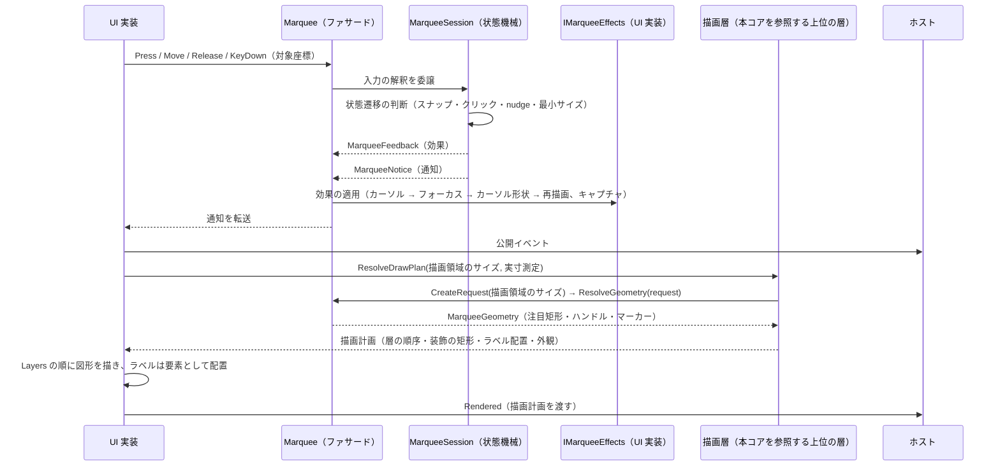
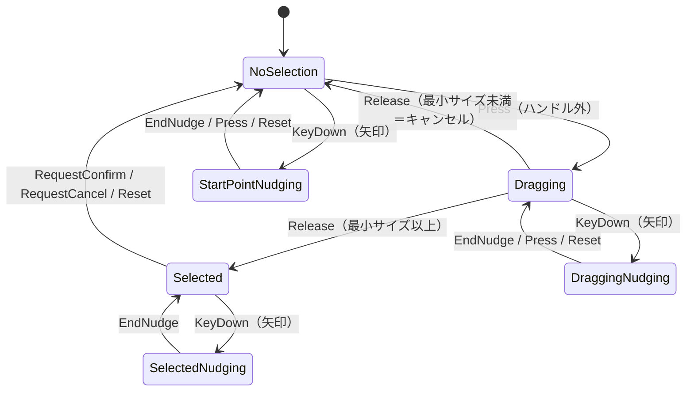

# Feature.Marquee.Core システム仕様書

マーキー選択（ドラッグで矩形を選び、移動・リサイズできる操作）の **UI 非依存の計算層**の構造・依存・例外処理・コンポーネント構成を記載します。 公開 API は [`SPEC_API.md`](SPEC_API.md)、使い方は [`../README.md`](../README.md) を参照してください。

## 目次

- [1. システム概要](#1-システム概要)
- [2. 技術スタック](#2-技術スタック)
- [3. アーキテクチャ](#3-アーキテクチャ)
  - [3.1 依存方向](#31-依存方向)
  - [3.2 データフロー（入力 → 描画）](#32-データフロー入力--描画)
  - [3.3 状態遷移](#33-状態遷移)
- [4. コンポーネント構成](#4-コンポーネント構成)
- [5. 例外処理ポリシー](#5-例外処理ポリシー)
- [6. 可視性ポリシー](#6-可視性ポリシー)
- [7. テスト方針](#7-テスト方針)
- [8. 設計判断（UI 非依存の境界）](#8-設計判断ui-非依存の境界)
- [9. ログ](#9-ログ)
- [10. 名称（Marquee の由来）](#10-名称marquee-の由来)

## 1. システム概要

| 項目 | 内容 |
| --- | --- |
| 目的 | 選択矩形の幾何計算・状態機械・入力の解釈（判断）を 1 箇所に集約し、UI ごとの実装差から切り離す |
| 提供形態 | クラスライブラリ（`EsUtil.Feature.Marquee.Core.dll`） |
| 想定利用者 | UI 実装と、それらを組み込むホストアプリケーション |
| 汎用性 | 特定のアプリ・UI に依存しない。 他コントロールの語彙を持たない（将来そのまま別プロジェクトへ独立できる） |

## 2. 技術スタック

| 項目 | 内容 |
| --- | --- |
| ターゲット | `net10.0` |
| 言語 | C# 14（`Nullable` 有効・`ImplicitUsings` 有効） |
| ルート名前空間 | `EsUtil.Feature.Marquee.Core`。 フォルダへ追従し、`.Contract` / `.Drawing` / `.Interaction` / `.Logging` / `.Selection` / `.Setting` を持ちます |
| ドキュメント生成 | `GenerateDocumentationFile` 有効（XML は配布物へ出さず `cref` の検証のみに使う） |
| テスト | xUnit v3（UI 初期化不要。 `InternalsVisibleTo` で `internal` を検証する） |
| 依存 | UI フレームワークを一切参照しない。 直接依存は `Platform.Core` と `Microsoft.Extensions.Logging.Abstractions`（ログ定義のソース生成） |

## 3. アーキテクチャ

### 3.1 依存方向

層の全体像は [`src/README.md`](../../README.md) を参照してください。

```text
UI 実装
  入力の受付・効果の適用・通知の転送・描画先の用意・ラベル要素の配置
    ├──> 描画層（上位の層）   どう描くか（描画計画の解決と自 UI の描画面への写し）
    └──> Feature.Marquee.Core ← 本プロジェクト   何を計算するか（状態・判断・幾何）
           └──> Platform.Core（Es* 値型・ICoordTransform・ICursorService）
※ 本コアは上位の層を参照しない（上位の層が本コアの幾何を使う向きだけ）。本コアは Platform.* の UI アダプタも参照しない。
```

- 上位層は下位層のみを参照します（逆参照なし）。
- 本コアは UI フレームワークを参照しません。 **描画 API も色も持たず、返すのは幾何だけ**です。 装飾（暗転マスク・外枠・内側の塗り）は**本コアの概念ではありません**（選択矩形単体の概念ではなく、組み込み先の表示であるため描画層が単一所有します）。
- **描画計画（外観・文言・層の順序・装飾の矩形）は描画層が単一所有**し、描画層は本コアの幾何（`MarqueeGeometry`）だけを参照します（幾何計算は持ちません。 ハンドル位置の計算は本コアが済ませています）。

### 3.2 データフロー（入力 → 描画）



### 3.3 状態遷移



- 状態は `MarqueeInteractionState` として外部へ公開します（nudge・ドラッグ・選択の合成）。
- nudge の終了時は**必ずカーソル再表示を効果として要求**します（非表示の残留を防ぐ）。
- **領域作成後の nudge はドラッグ中（マウス押下中）のみ許可**します（`Selected` かつ非押下では nudge しない）。

## 4. コンポーネント構成

| ファイル | 型 | 可視性 | 責務 |
| --- | --- | --- | --- |
| `src/Marquee.cs`（ルート） | `Marquee` | public | ファサード。 設定・環境値の保持、入力の通知、外部操作、幾何の解決、効果の適用 |
| `src/Interaction/MarqueeSession.cs` | `MarqueeSession` | internal | 入力の解釈と状態遷移の判断。 通知と効果を返す |
| `src/Interaction/MarqueeState.cs` | `MarqueeState` | internal | 選択矩形・ドラッグ・nudge の状態保持。 **状態は操作（遷移メソッド）でのみ変わり、読み取りはプロパティ**（矛盾した状態を作れない） |
| `src/Marquee.Geometry.cs`（ルート） | `Marquee`（**partial**） | internal | 幾何の**内部手順**（注目矩形の DIP 変換・ハンドル位置・始点マーカー。 注目矩形とポートは 1 回だけ解決する）。 公開の入口 `ResolveGeometry` は `Marquee.cs` が持つ |
| `src/Drawing/MarqueeGeometry.cs` | `MarqueeGeometry` | public | 1 フレーム分の幾何（`ClientSize` / `FocusDipRect` / `FocusSourceRect` / `Handles` / `Marker` / `MouseSourcePosition` / `MouseDipPosition` ＋ `ClientRect`）。 **コアが責任を持つ値の全量**。 マウス位置は文言用の対象座標と配置用の DIP の両方を渡す（描画層が座標変換ポートを持たないため） |
| `src/Drawing/MarqueeRenderRequest.cs` | `MarqueeRenderRequest` | public | 幾何解決の入力（設定・状態・描画時に決まる値）。 `MarqueeRenderRequest.Create` が値の組を 1 箇所に閉じ、`Marquee.CreateRequest` が状態を写して生成する。 **本値から導出する値（座標変換ポートの決定・注目矩形の決定・DIP 変換）は本値のインスタンスメンバーが単一所有する**（`ResolvedPort` / `Focus` / `ResolveFocusDipRect` / `ToDipRect` / `ToSourceRect`） |
| `src/Setting/MarqueeOptions.cs` | `MarqueeOptions` | public | 設定の値オブジェクト。 既定値を単一所有し、生成時に安全域（`Marquee.Limits`）へ補正する（寸法・対話パラメータのみ。 体裁と表示可否は描画層の外観が単一所有する） |
| `src/Drawing/MarqueeHandles.cs` | `MarqueeHandles` | public | ドラッグハンドルの幾何（8 方向の矩形・枠線の太さ） |
| `src/Drawing/MarqueeMarker.cs` | `MarqueeMarker` | public | 始点マーカー（十字線）の幾何（中心・半幅。 線の太さは描画層の外観が持つ） |
| `src/Interaction/MarqueeSnapshot.cs` | `MarqueeSnapshot` | public | 状態のスナップショット（`readonly record struct`。 値型のため通知でヒープを確保しない） |
| `src/Interaction/MarqueeNotice.cs` | `MarqueeNotice` | public | 通知（種別・通知座標・スナップショット。 値型） |
| `src/Interaction/MarqueeNoticeKind.cs` | `MarqueeNoticeKind` | public | 通知の種別 |
| `src/Interaction/MarqueeFeedback.cs` | `MarqueeFeedback` | internal | 効果（適用順を単一所有。 適用先は `IMarqueeEffects`） |
| `src/Interaction/MarqueeCursorActions.cs` | `MarqueeCursorActions` | internal | 要求するカーソル操作のフラグ |
| `src/Interaction/MarqueeCaptureAction.cs` | `MarqueeCaptureAction` | internal | 要求するポインターキャプチャの操作 |
| `src/Contract/IMarqueeEffects.cs` | `IMarqueeEffects` | public | 効果の適用先（フォーカス・再描画・カーソル操作・カーソル形状・ポインターキャプチャ・座標変換） |
| `src/Contract/MarqueeEffectsBase.cs` | `MarqueeEffectsBase` | public abstract | 効果の既定実装（全メンバーが virtual の空実装） |
| `src/Interaction/MarqueeHitTarget.cs` | `MarqueeHitTarget` | public | ヒット対象 |
| `src/Interaction/MarqueeCursorKind.cs` | `MarqueeCursorKind` | public | カーソル形状の種別 |
| `src/Interaction/MarqueeInteractionState.cs` | `MarqueeInteractionState` | public | 対話状態 |
| `src/Logging/MarqueeLogMessage.cs` | `MarqueeLogMessage` | internal | LoggerMessage 定義（入力の判断・設定変更） |
| `src/Selection/MarqueeSelection.cs` | `MarqueeSelection` | internal readonly record struct | 選択矩形の値と、その値だけから決まる純粋な幾何計算（正規化・ハンドル位置・対角・境界クリップ・ドラッグ変形。 状態機械と幾何の解決が使うため internal） |

## 5. 例外処理ポリシー

| 状況 | 扱い |
| --- | --- |
| `Marquee` の `effects` が null | `ArgumentNullException`（呼び出し側の実装誤り） |
| カーソルサービス未指定 | 例外にせず、カーソル操作を効果へ載せない（UI 初期化なしの検証を可能にする） |
| ロガー未設定 | `NullLogger` へ吸収する（呼び出し側は null を設定してよい） |
| 座標変換ポート未設定 | 等価変換（1 対象ピクセル = 1 DIP・境界なし）として扱う |
| 未定義の `EsKey` | 何もしない（`default` の効果を返す） |
| 設定値の範囲外・非数 | 生成時に補正する（例外にしない）。 安全域は `Marquee.Limits` が単一所有し、`MarqueeOptions` の `init` アクセサが適用する（描画層の外観も同じ `Limits` を参照する） |
| 選択もハイライトも無い | 注目矩形を null とする（判断はコアが下し、UI 層は null を描かないことで扱う） |

## 6. 可視性ポリシー

- 外部が使わない型・メンバーは `internal` とし、単体テストにのみ `InternalsVisibleTo`（`Feature.Marquee.Core.Tests`）で公開します。
- **クラスが `internal` の場合、そのメンバーも `internal` とします**（`public` と書いても外部から見えないため、可視性の宣言を実態と一致させる）。
- `[EditorBrowsable]` による「見えにくくする」対処は行いません（公開面も契約も変わらず、見つけにくくなるだけのため）。
- **層 3（内部ヘルパー）は外部参照 0 件を実測して絞り込んだ結果**です。 UI 実装が参照するのは `Marquee`・幾何の契約・列挙型・`MarqueeOptions` のみです（幾何計算は `internal` であり UI 実装からは参照できません）。

## 7. テスト方針

| 方針 | 内容 |
| --- | --- |
| UI 初期化不要 | ヘッドレス実行を必要としないため `[Fact]` / `[Theory]` で並列実行する |
| 単位 | 純粋計算（`MarqueeSelection`）・状態機械・ファサード・幾何の解決・`MarqueeRenderRequest` |
| 配置 | **ソースのフォルダを鏡映**する（`tests/Contract` / `tests/Drawing` / `tests/Interaction` / `tests/Logging` / `tests/Selection` / `tests/Setting`。 ファサードの partial のテストはルート） |
| 件数 | `dotnet test <csproj> --list-tests` のクラス別集計で確認する（`dotnet test` の出力は行が折り返され、並列実行では行が混ざるため、行単位で対応付けてはいけない） |

```powershell
dotnet test src/Feature.Marquee.Core/tests/Feature.Marquee.Core.Tests.csproj
```

## 8. 設計判断（UI 非依存の境界）

本プロジェクトの型は、UI フレームワークの型をシグネチャに持たないことを境界の条件としています。

| 判断 | 内容 |
| --- | --- |
| 座標・寸法の型 | コア（`EsUtil.Platform.Core.Geometry`）の `EsPoint` / `EsRect` / `EsSize` を使い、UI 型は境界で 1 行変換する |
| キー入力の型 | コアの `EsKey` を使い、UI のキー型は境界で変換する |
| カーソル操作 | `ICursorService` 抽象にのみ依存する（未指定はカーソル操作を行わない）。 UI のカーソル型への写像は効果（`IMarqueeEffects.SetCursorShape`）を受けた UI が行う |
| 効果の適用 | UI 固有の操作（フォーカス・再描画・ポインターキャプチャ・画面座標変換）は `IMarqueeEffects` を唯一の境界とし、コアは UI 型を知らない（不要なメンバーの空実装は `MarqueeEffectsBase` で省略できる） |
| 文字の描画 | コアはマウス位置という素材だけを返し、文言・基準点・実寸 → 配置矩形の写像は描画層（上位の層）が、実寸測定と要素の配置は UI 層が行う（実寸は描画 API 依存のため）。 色は描画層の外観が与える |
| 装飾 | コアは注目矩形（幾何）だけを返し、装飾の矩形・表示可否・色は描画層が単一所有する（装飾は組み込み先の表示であり、選択単体の概念ではない） |
| 再描画のバッチ化 | UI のディスパッチャーに依存するため UI 層が単一所有する（コアは同期計算のみ） |
| 色 | コアは色を持たない（色は描画にだけ必要な設定であり、描画層の外観が単一所有する）。 色の型は UI 非依存の `System.Drawing.Color` とし、UI の色型への変換は各 UI の描画境界で行う |
| 選択矩形の区間の流儀 | 「終点を含む」規則（DIP への 変換時の +1）は矩形の `Interval`（`EsRectInterval`）が単一所有し、`MarqueeRenderRequest.ToDipRect` が読む（UI ごとに +1 すると片方だけずれる） |
| ラベルの体裁 | 「背景 = 文字の実寸 + 内側余白 × 2」「行送り」「描画領域へのクランプ」は描画にだけ必要な規則のため、描画層が単一所有する（コアは素材（マウス位置・注目矩形）だけを渡す） |
| 設定値の安全域の適用 | 補正は設定型の生成時に適用し（`init` アクセサ）、安全域は `Marquee.Limits` が単一所有する（設定の経路（オブジェクト初期化子・`with` 式・逆シリアル化）によらず範囲内の値だけを保持する） |
| 設定する値・しない値 | **寸法・対話パラメータは `MarqueeOptions` として公開する**（ハンドルの一辺サイズ・枠線の太さ・十字マーカーの長さ・ヒット半径・最小サイズ・境界クリップの可否）。 **体裁（色・ラベルのフォントサイズ・十字マーカーの線の太さ・カーソル座標ラベルのオフセット）は公開しない**（描画にだけ必要な設定のため、描画層の外観が単一所有する） |
| 対象の境界 | 利用者が座標変換ポート（`ICoordTransform.SourceArea`）で定義し、コアは `ClampToSourceBounds` が有効な場合だけクリップする |
| 描画面の原点 | コアは原点が常に (0, 0) である前提で幾何を返す（親の座標を混ぜるとハンドルがずれるため、描画領域は原点を持たない `EsSize` で受ける） |

## 9. ログ

ロガーは `Marquee.Log` で受け取り（**コンストラクターからの注入も可能**）、**生成**（`[Feature.Marquee.Core] Facade created`。 Information。 生成時の設定を 1 度だけ）・**入力の判断**（`[Feature.Marquee.Core] MouseDown` / `MouseUp` / `DoubleClick` / `DragStart` / `KeyDown` / `ConfirmRequested` / `CancelRequested` 等。 Debug。 位置の記録は Trace）・**設定の変更**（`[Feature.Marquee.Core] Setting: {名前} {前} → {後}`）を出力します。 ロガー未設定（null）は出力なしです。

**出力の方針**（頻度でレベルを分ける）:

| 頻度 | 契機 | レベル |
| --- | --- | --- |
| 生成 | コンストラクターでの注入、または `Log` の初回設定 | Information |
| 低頻度 | ロガーの設定（`Logger attached`）・`Options` の変更（変化した項目だけ）・`ClientToSourceScaling` の変更・`SetCoordTransform` の呼び出し・入力の判断 | Debug |
| 高頻度 | `HighlightSourceRect` の変更（ホバーのたびに変わりうる） | Trace |

**出力しないもの**: 毎フレーム呼ばれる解決メソッド（`CreateRequest` / `ResolveGeometry`）と、マウス移動のたびに呼ばれる入力通知（`Move`）。

`Options` の変更では `HandleSize` / `HandleBorderThickness` / `MarkerLength` / `HandleHitRadius` / `MinSelectionSize` / `ClampToSourceBounds` のうち**変化した項目だけ**を出力します。

**差分検出（変化した項目だけを出力する判断）と「同値なら出力しない」規則は本コアが単一所有します**（UI 層は前後の値を渡さず、変更を通知するだけです）。 ログ基盤（ファイル出力・レベル制御）はホストが所有し、本コアは定義だけを持ちます。 **描画にだけ必要な設定（外観・表示スケーリング係数）の変更ログは描画層が所有します**。

**メッセージの接頭辞は、そのログを定義しているアセンブリ名（本コアは `[Feature.Marquee.Core]`）とします**（規則は [`.github/命名規約.md`](../../../.github/命名規約.md) が単一所有する）。

## 10. 名称（Marquee の由来）

`Marquee` は**マーキー選択**（ドラッグで矩形の範囲を指定する操作）の標準語に由来する名前です（Photoshop の矩形マーキー、Qt の `QRubberBand`、Windows Explorer のラバーバンド選択が同じ操作）。

用語の由来と型名の衝突確認の規則は [`.github/命名規約.md`](../../../.github/命名規約.md) が単一所有します。 本コアの型は WinForms / WinUI3 / Avalonia / MewUI / .NET 10 BCL のいずれとも型名が衝突しません（実測）。 UI を追加するときに注意するのは型名ではなく、色型とコントロール基底の境界変換です。
