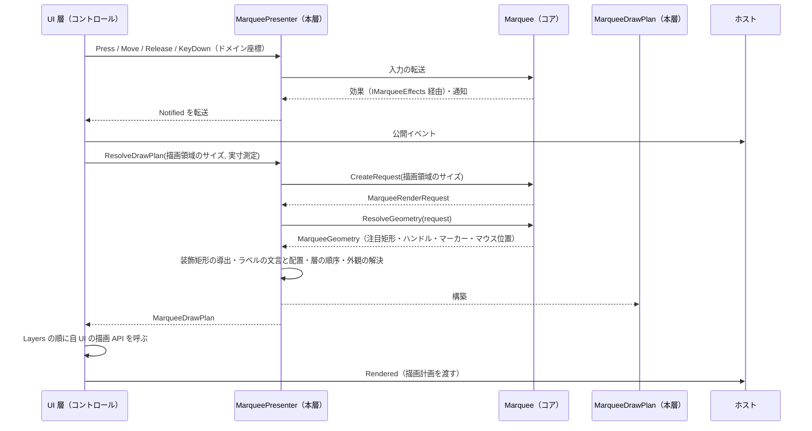
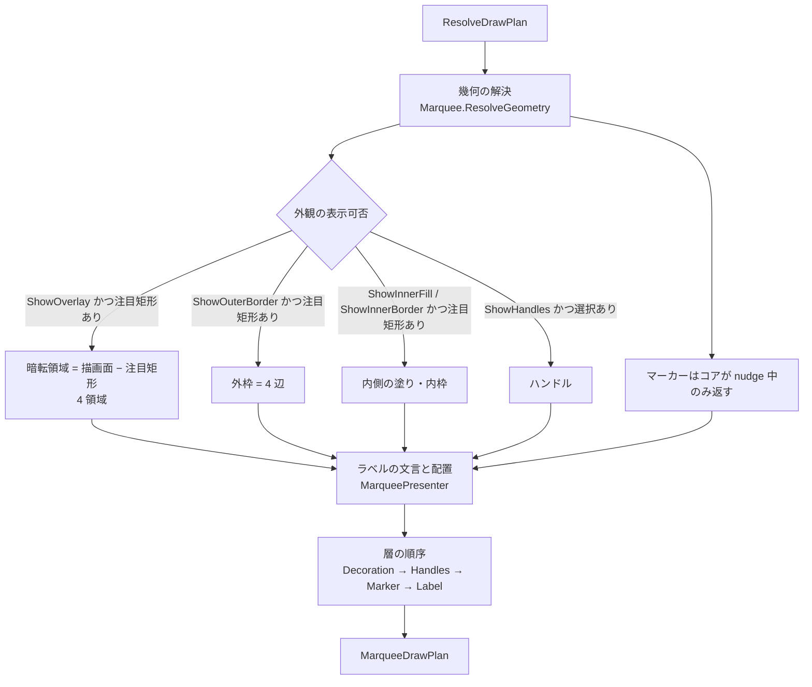

# Feature.Marquee.Presenter システム仕様書

マーキー選択（ドラッグで矩形を選び、移動・リサイズできる操作）の見た目を定める **コントロール化を前提としない UI 非依存層**の構造・依存・例外処理・コンポーネント構成を記載します。 公開 API は [`SPEC_API.md`](SPEC_API.md)、使い方は [`../README.md`](../README.md) を参照してください。

## 目次

- [1. システム概要](#1-システム概要)
- [2. 技術スタック](#2-技術スタック)
- [3. アーキテクチャ](#3-アーキテクチャ)
  - [3.1 依存方向](#31-依存方向)
  - [3.2 データフロー（入力 → 描画）](#32-データフロー入力--描画)
  - [3.3 描画計画の解決フロー](#33-描画計画の解決フロー)
- [4. コンポーネント構成](#4-コンポーネント構成)
- [5. 例外処理ポリシー](#5-例外処理ポリシー)
- [6. 可視性ポリシー](#6-可視性ポリシー)
- [7. テスト方針](#7-テスト方針)
- [8. 設計判断（UI 非依存の境界）](#8-設計判断ui-非依存の境界)
- [9. ログ](#9-ログ)

## 1. システム概要

| 項目 | 内容 |
| --- | --- |
| 目的 | 描画計画（層の順序・装飾矩形・文言・配置）と外観（色・フォント・枠線の太さ・表示可否）を 1 箇所に集約する |
| 提供形態 | クラスライブラリ（`EsUtil.Feature.Marquee.Presenter.dll`。 アセンブリ名はルート名前空間と一致する） |
| 想定利用者 | UI 実装と、それらを組み込むホストアプリケーション・独自コントロールの作者 |
| 汎用性 | 特定のアプリ・UI・コントロールに依存しない。 寸法・対話パラメータはコアが、外観と描画計画は本層が単一所有する |
| 前提としないもの | **コントロール化**（ホイール操作・ビューポート連携・組み込み先の概念は UI 層が持つ） |

## 2. 技術スタック

| 項目 | 内容 |
| --- | --- |
| ターゲット | `net10.0` |
| 言語 | C# 14（`Nullable` 有効・`ImplicitUsings` 有効） |
| ルート名前空間 | `EsUtil.Feature.Marquee.Presenter`（配下はフォルダに追従: `.Setting` / `.Drawing` / `.Label` / `.Logging`） |
| ドキュメント生成 | `GenerateDocumentationFile` 有効（XML は配布物へ出さず `cref` の検証のみに使う） |
| テスト | xUnit v3（UI 初期化不要。 `InternalsVisibleTo` で `internal` を検証する） |
| 依存 | UI フレームワークを一切参照しない。 直接依存は `Feature.Marquee.Core`・`Platform.Core`・`Microsoft.Extensions.Logging.Abstractions` |

## 3. アーキテクチャ

### 3.1 依存方向

層の全体像は [`src/README.md`](../../README.md) を参照してください。

```text
UI 実装
  入力の受付・効果の適用・通知の転送・描画（自 UI の API）・ラベル要素の配置・ホスト結線
  ホイール操作とビューポートの変化の追従（コントロール化を前提とした処理）
    ├──> Feature.Marquee.Presenter ← 本プロジェクト   提示（描画計画の解決）＋ 外観
    └──> Feature.Marquee.Core   何を計算するか（状態・判断・幾何）
           └──> Platform.Core（Es* 値型・ICoordTransform・ICursorService）
※ コアは本層を参照しない（本層がコアの幾何（`MarqueeGeometry`）を使う向きだけ）。
```

- 本層は UI フレームワークを参照しません。
- **描画 API の抽象を持ちません**。 UI フレームワークごとの描画モデルの差は描画 API の抽象では吸収しきれない（対象 UI が増えるたびに抽象が肥大して差異を吸収しきれなくなる）ため、本層は描画計画というデータを返し、描画は各 UI が自 UI の API で行います。

### 3.2 データフロー（入力 → 描画）



### 3.3 描画計画の解決フロー



- **層は描く値がある場合だけ含めます**（層の有無 = 描く値の有無）。 UI 層は層ごとの可否を判定しません。
- **テキストの層は必ず末尾**です（UI 要素として置く場合も子要素は親より後に描かれるため、常に最上位になります）。
- 注目矩形は 1 回だけ解決し、暗転領域・枠線・内側・サイズラベルのすべてに同じ値を渡します（各所が個別に変換すると矩形がずれます）。

## 4. コンポーネント構成

ルート（`src/`）に置くのは**ファサード本体**（`MarqueePresenter.cs`）とその partial（`MarqueePresenter.DrawPlan.cs` / `MarqueePresenter.LabelPlan.cs` / `MarqueePresenter.LabelTexts.cs`）です。 描画計画の値・外観・ラベル要素の配置指示は用途別のフォルダへまとめます。
**1 ファイル 1 型**とし、**名前空間はフォルダに追従**させます（ルート直下のみ `EsUtil.Feature.Marquee.Presenter`。 `Setting` / `Drawing` / `Label` / `Logging` は `EsUtil.Feature.Marquee.Presenter.<フォルダ名>`）。 コア（`Feature.Marquee.Core`）と同じ規約です。

| ファイル | 型 | 可視性 | 責務 |
| --- | --- | --- | --- |
| `src/MarqueePresenter.cs` | `MarqueePresenter` | public（`sealed` でない） | 提示のファサード。 コアの保持、設定・環境値・入力の転送、外観の保持、描画計画の解決（`ResolveDrawPlan`） |
| `src/Setting/MarqueeAppearance.cs` | `MarqueeAppearance` | public sealed record | 外観の単一所有者（色・ラベルの体裁・十字マーカーの線の太さ・カーソル座標ラベルのオフセット・枠線の太さ・表示可否・述語） |
| `src/Drawing/MarqueeDrawPlan.cs` | `MarqueeDrawPlan` | public readonly record struct | 描画計画（UI が見る唯一の描画値） |
| `src/Drawing/MarqueeDrawLayer.cs` | `MarqueeDrawLayer` | public enum | 描画層の順序 |
| `src/MarqueePresenter.DrawPlan.cs` | `MarqueePresenter`（`DrawPlan` partial） | internal | 枠線 4 辺・暗転領域の矩形の計算 |
| `src/Drawing/MarqueeTextPlacement.cs` | `MarqueeTextPlacement` | public readonly record struct | 描画層が UI 層へ渡すテキスト（文言・基準点・クランプ領域） |
| `src/MarqueePresenter.LabelTexts.cs` | `MarqueePresenter`（`LabelTexts` partial） | internal | サイズラベル・カーソル座標ラベルの文言と基準点 |
| `src/MarqueePresenter.LabelPlan.cs` | `MarqueePresenter`（`LabelPlan` partial） | internal | 実寸 → ラベル要素の配置指示の写像 |
| `src/Label/MarqueeLabelPlacement.cs` | `MarqueeLabelPlacement` | public readonly record struct | ラベル要素の配置指示 |
| `src/Logging/MarqueePresenterLogMessage.cs` | `MarqueePresenterLogMessage` | internal static partial | 本層のログ定義（生成・ロガー設定・本層が単一所有する設定の変更・コアへの転送） |

## 5. 例外処理ポリシー

| 状況 | 扱い |
| --- | --- |
| `ResolveDrawPlan` の `measureText` が null | `ArgumentNullException`（呼び出し側の実装誤り） |
| `MarqueePresenter.ResolveLabelPlacements` の `appearance` / `measureText` が null | `ArgumentNullException` |
| 表示可否が無効な項目 | 空のコレクション / null として返す（例外にしない。 UI 層は層を見るだけでよい） |
| サイズラベルの文言プロバイダが null または空文字を返す | 自動生成へフォールバックする（例外にしない） |

## 6. 可視性ポリシー

- UI 層とホストが使う面（`MarqueePresenter` / `MarqueeAppearance` / `MarqueeDrawPlan` / `MarqueeDrawLayer` / `MarqueeLabelPlacement` / `MarqueeTextPlacement`）は `public` とします。
- **本層の内部手順は `internal`** とします（`MarqueePresenter` の `DrawPlan` / `LabelPlan` / `LabelTexts` partial のメンバーと `MarqueePresenterLogMessage`）。 UI 層は解決済みの値（`MarqueeDrawPlan` の矩形・`Labels`）を受け取るため、これらを参照する必要がありません。 **`partial` はファイル分割であって可視性ではなく**、実寸 → 配置の写像（`ResolveLabelPlacements`）も内部手順です。 単体テストにのみ `InternalsVisibleTo`（`Feature.Marquee.Presenter.Tests`）で公開します。
- **クラスが `internal` の場合、そのメンバーも `internal` とします**（`public` と書いても外部から見えないため、可視性の宣言を実態と一致させる）。
- `[EditorBrowsable]` による「見えにくくする」対処は行いません（公開面も契約も変わらず、見つけにくくなるだけのため）。

## 7. テスト方針

| 方針 | 内容 |
| --- | --- |
| UI 初期化不要 | 描画計画の値（矩形・層・配置・文言）は UI 型を持たないため `[Fact]` / `[Theory]` で並列実行する |
| 画素の検証 | 描画 API を持つ UI 側のテストが担う。 本層は描画 API を持たないため画素テストを持たない |
| 単位 | 描画計画の値・外観・装飾矩形の計算・ラベルの写像・外観の変更ログ |
| 配置 | `tests/`（フォルダ分割なし。 ファイル名は対象型 + `.Tests.cs`） |
| 件数 | `dotnet test <csproj> --list-tests` のクラス別集計で確認する（出力は行が折り返され、並列実行では行が混ざるため、行単位で対応付けてはいけない） |

```powershell
dotnet test src/Feature.Marquee.Presenter/tests/Feature.Marquee.Presenter.Tests.csproj
```

## 8. 設計判断（UI 非依存の境界）

本プロジェクトの型は、UI フレームワークの型をシグネチャに持たないことを境界の条件としています。

| 判断 | 内容 |
| --- | --- |
| 座標・寸法の型 | コア（`EsUtil.Platform.Core.Geometry`）の `EsPoint` / `EsRect` / `EsSize` を使う |
| 色の型 | UI 非依存の `System.Drawing.Color` とし、各 UI の色型への変換は各 UI の描画境界で行う |
| 描画 API の抽象を持たない | UI フレームワークごとの描画モデルの差は描画 API の抽象では吸収しきれない（対象 UI が増えるたびに抽象が肥大して差異を吸収しきれなくなる）。 本層は描画計画を返し、描画は各 UI が自 UI の API で行う |
| 実寸測定 | 描画 API 依存のため `Func<string, double, EsSize>` を UI 層から受け取る（本層は測定 API を持たない） |
| 付加情報ラベルの配置 | コントロール固有の概念であるため本層に置かない（組み込み先のホストが持つ） |
| 組み込み規則を置かない | ホイールの解釈・ビューポート連携は「組み込み先が存在して初めて意味を持つ」（コントロール化を前提とした処理）ため、本層に置かず UI 層（ホスト）が持つ |
| 設定変更ログの所有者 | 値を所有する主体が記録する（コアの設定はコア、本層の外観は本層、UI の値は各 UI）。 接頭辞から伝搬を追える |
| 外観の拡張点 | `MarqueePresenter` を `sealed` にしない（`Appearance` の差し替えと `ResolveDrawPlan` の上書きで独自の見た目を提供できることが役割） |

## 9. ログ

- 本層が単一所有する設定（外観・表示スケーリング係数）の変更は、本層が記録します（`MarqueePresenterLogMessage`）。
- 出力先は `MarqueePresenter.Log`（コアのファサードが保持するロガー）です（ホストは 1 回設定するだけで、コアと本層のログが同じ基盤へ出ます）。 **コンストラクターからの注入も可能**です。
- **出力の方針**（頻度でレベルを分ける）:

| 頻度 | 契機 | レベル |
| --- | --- | --- |
| 生成 | コンストラクターでの注入、または `Log` の初回設定（本層とコアの生成をそれぞれ 1 度だけ） | Information |
| 低頻度 | 本層が所有する設定の変更（外観・表示スケーリング係数。 **変化した項目だけ**） | Debug |
| 高頻度 | コアへ伝搬した値の通過（`Options` / `DipToDomainScaling` / `HighlightDomainRect` / `SetCoordTransform`） | Trace |

**出力しないもの**: 毎フレーム呼ばれる解決メソッド（`ResolveDrawPlan`）と、マウス移動のたびに呼ばれる入力通知（`Move`）。

- **変化した項目だけ**を出力します（外観の再適用でログが溢れないため）。
- コアが所有する設定（`MarqueeOptions`・倍率・ハイライト矩形）の**値の変更**はコアが記録します（本層は重複して記録せず、通過したことだけを Trace で記録します）。
- 付加情報ラベル（操作・情報ラベル）はホストが所有します（文言の生成と描画。 本層は文言を生成しません）。
