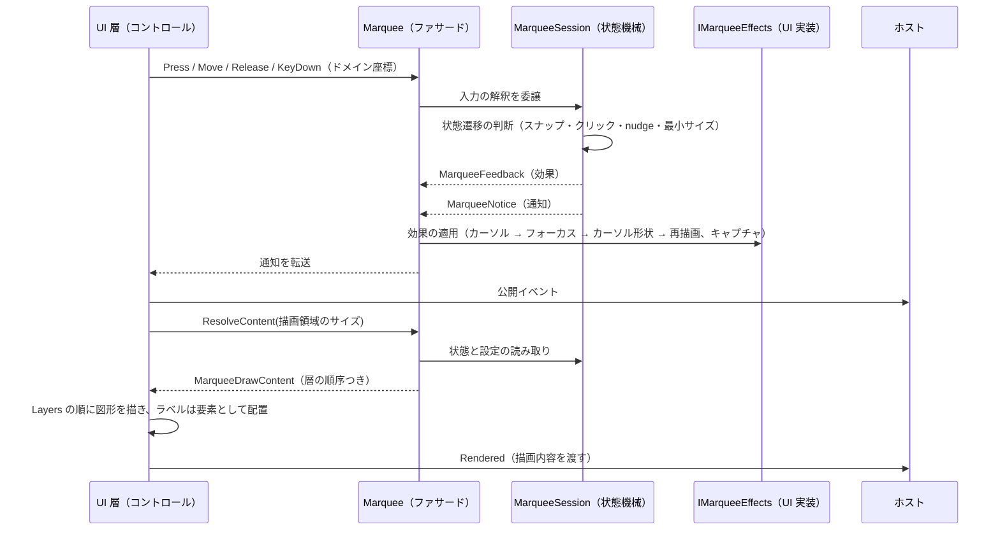
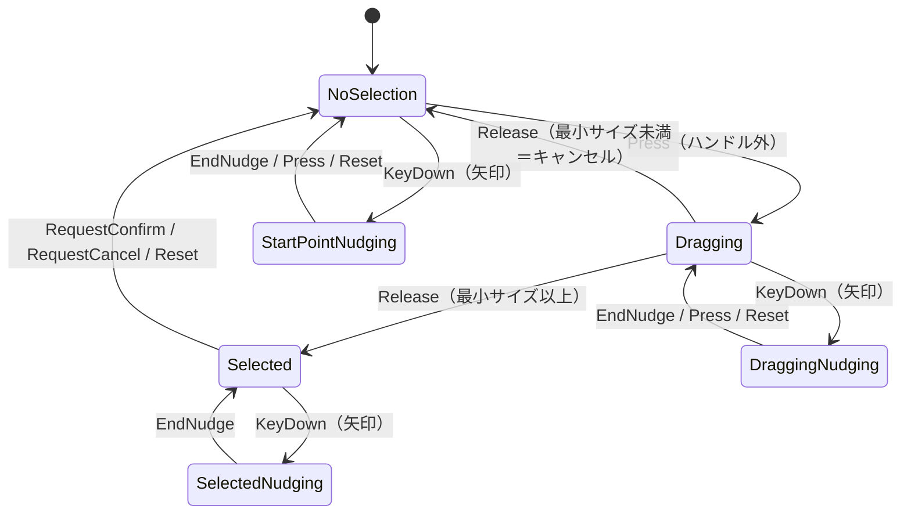

# Feature.MarqueeCore システム仕様書

`MarqueeControl`（ドラッグで矩形を選び、移動・リサイズできるコントロール）の **UI 非依存の状態層**の構造・依存・例外処理・コンポーネント構成を記載します。外部機能と公開 API は [SPEC_ExtFunc](SPEC_ExtFunc.md)、利用手順は [README](README.md) を参照してください。

## 1. システム概要

| 項目 | 内容 |
| --- | --- |
| 目的 | 選択矩形の幾何計算・状態機械・入力の解釈（判断）を 1 箇所に集約し、UI ごとの実装差から切り離す |
| 提供形態 | クラスライブラリ（`Feature.MarqueeCore.dll`） |
| 想定利用者 | UI 実装（`MarqueeControl.AvaloniaUI` / `MarqueeControl.MewUI`）・それらを組み込むホストアプリケーション |
| 汎用性 | 特定のアプリ・UI に依存しない。別コントロールの語彙を持たない（将来そのまま別プロジェクトへ独立できる） |

## 2. 技術スタック

| 項目 | 内容 |
| --- | --- |
| ターゲット | `net10.0` |
| 言語 | C# 14（`Nullable` 有効・`ImplicitUsings` 有効） |
| ルート名前空間 | `EsUtil.Feature.MarqueeCore`。フォルダへ追従し、`.Contract` / `.Drawing` / `.Interaction` / `.Setting` / `.Logging` / `.Content` / `.Session` / `.Selection` / `.Decoration` を持ちます |
| ドキュメント生成 | `GenerateDocumentationFile` 有効（XML は配布物へ出さず `cref` の検証のみに使う） |
| テスト | xUnit v3（UI 初期化不要。`InternalsVisibleTo` で `internal` を検証する） |

## 3. アーキテクチャ

### 3.1 依存方向（一方向）

層の全体像（Core / UIBase / UI）は [`src/README.md`](../README.md) を参照してください。

```text
UI 層（MarqueeControl.AvaloniaUI / MarqueeControl.MewUI）
  入力の受付・効果の適用・通知の転送・描画先の用意・ラベル要素の配置
    ├──> MarqueeControl.UIBase   どう描くか（UIBase が所有する描画手順）
    ├──> MarqueeControl.UIBase   組み込み先がある場合にだけ必要な規則
    └──> Feature.MarqueeCore ← 本プロジェクト   何を描くか + 判断（状態・値・純粋計算・コア⇔UI の契約）
           └──> Platform.Core（Es* 値型・ICoordTransform・ICursorService）
※ Core は UIBase を参照しない（本層の描画実装がコアの契約を実装する向きだけ）。
```

- 上位層は下位層のみを参照します（逆参照なし）。
- 本コアは UI フレームワークを参照しません。装飾（暗転マスク等）は**本コア内のサブ概念**として同居します（別プロジェクトに分けません）。
- 本コアは描画 API を持ちません。描画の手順は UI 非依存の描画層（`MarqueeControl.UIBase`）が単一所有し、描画層は本コアの描画内容（`MarqueeDrawContent`）と幾何（`SelectionGeometry.DirectionalHandles`（読み取り専用の一覧）等）を参照します。
- **本コアは描画層を参照しません**（依存の向きは `UI 層 → MarqueeControl.UIBase → Feature.MarqueeCore` の一方向。本コアは `Common` も `Platform.*` の UI アダプタも参照しません）。**描画は本コアの関心事ではない**ため、本コアは描画内容（`MarqueeDrawContent` と `Layers`）をデータとして返すだけであり、層の順序に従う描画手順は UI 側の共有層（`MarqueeControl.UIBase` の `MarqueeRendererBase`）が単一所有します。

### 3.2 データフロー（入力 → 描画）



### 3.3 状態遷移



- 状態は `MarqueeInteractionState` として外部へ公開します（nudge・ドラッグ・選択の合成）。
- nudge の終了時は**必ずカーソル再表示を効果として要求**します（非表示の残留を防ぐ）。

## 4. コンポーネント構成

| ファイル | 型 | 可視性 | 責務 |
| --- | --- | --- | --- |
| `src/Marquee.cs`（ルート） | `Marquee` | public | ファサード。設定・環境値の保持、入力の通知、外部操作、描画内容の解決、描画実装の保持、効果の適用 |
| `src/Session/MarqueeSession.cs` | `MarqueeSession` | internal | 入力の解釈と状態 遷移の判断。通知と効果を返す |
| `src/Session/MarqueeState.cs` | `MarqueeState` | internal | 選択矩形・ドラッグ・nudge の状態保持。**状態は操作（遷移メソッド）でのみ変わり、読み取りはプロパティ**（矛盾した状態を作れない） |
| `src/Marquee.DrawContent.cs`（ルート） | `Marquee`（**partial**） | internal | 1 フレーム分の描画内容 の解決（装飾・穴あけ矩形・ハンドル・テキストの配置。描くかどうかの判断を単一所有し、穴あけ矩形とポートは 1 回だけ解決する） |
| `src/Content/MarqueeFrameRequest.cs` | `MarqueeFrameRequest` | internal | フレー ム解決の入力（設定・状態・描画時に決まる値） |
| `src/Setting/MarqueeOptions.cs` | `MarqueeOptions` | public | 設定の値オブジェクト。既定値・補正・コントロール固有の定数（体裁は描画層の `MarqueePaint` が単一所有する） |
| `src/Drawing/MarqueeDrawContent.cs` | `MarqueeDrawContent` / `MarqueeHandles` / `MarqueeMarker` / `MarqueeTextPlacement` | public | 描画契約 |
| `src/Drawing/MarqueeTextPlacement.cs` | `MarqueeTextPlacement` | public | コアが UI 層へ渡すテキスト（文言・基準点・アライン・描画領域）。**要素として置くか canvas へ描くかは UI 層が決める**（フォントサイズ・色は描画層の `MarqueePaint` が持つ） |
| `src/Interaction/MarqueeSnapshot.cs` | `MarqueeSnapshot` | public | 状態のスナップショット（`readonly record struct`。値型のため通知でヒープを確保しない） |
| `src/Interaction/MarqueeNotice.cs` | `MarqueeNotice` / `MarqueeNoticeKind` | public | 通知（`MarqueeNotice` は値型） |
| `src/Session/MarqueeFeedback.cs` | `MarqueeFeedback` / `MarqueeCursorAction` / `MarqueeCaptureAction` | internal | 効果（適用順を単一所有。適用先は `IMarqueeEffects`） |
| `src/Contract/IMarqueeEffects.cs` | `IMarqueeEffects` | public | 効果の適用先（フォーカス・再描画・カーソル操作・カーソル形状・ポインターキャプチャ・座標変換） |
| `src/Contract/MarqueeEffectsBase.cs` | `MarqueeEffectsBase` | public abstract | 効果の既定実装（全メンバーが virtual の空実装） |
| `src/Drawing/MarqueeDrawLayer.cs` | `MarqueeDrawLayer` | public | 描画層の順序（`Decoration` / `Handles` / `Marker` / `Label`。`Label` はテキストがある場合のみ） |
| `src/Interaction/HitTarget.cs` | `HitTarget` | public | ヒット対象 |
| `src/Interaction/MarqueeCursorKind.cs` | `MarqueeCursorKind` | public | カーソル形状の種別 |
| `src/Interaction/MarqueeInteractionState.cs` | `MarqueeInteractionState` | public | 対話状態 |
| `src/Logging/MarqueeLogMessage.cs` | `MarqueeLogMessage` | internal | LoggerMessage 定義（入力の判断・設定変更） |
| `src/Selection/SelectionGeometry.cs` | `SelectionGeometry` | internal | 純粋幾何計算（ハンドル一覧とハンドル位置を描画内容の解決が使い、ヒットテスト・ドラッグ変形・境界クランプは状態機械の内部手順であるため internal） |
| `src/Decoration/MarqueeDecoOptions.cs` | `MarqueeDecoOptions` | public | 装飾の設定（寸法・描画可否フラグ・ハイライト・内側） |
| `src/Decoration/OuterDecoAppearance.cs` / `InnerDecoAppearance.cs` | `OuterDecoAppearance` / `InnerDecoAppearance` | public | 外側/内側の装飾の寸法（枠線の太さのみ。**色は持たない**） |
| `src/Decoration/OuterDecoFrame.cs` / `InnerDecoFrame.cs` | `OuterDecoFrame` / `InnerDecoFrame` | public | 装飾の描画内容（**純粋データ**。暗転領域・枠線・塗りを保持し、描くかどうかは `Marquee.ResolveFrame` が判断する） |
| `src/Decoration/DecoGeometry.cs` | `DecoGeometry` | internal | 装飾の幾何計算（穴あけ矩形・暗転領域・枠線矩形・DIP 変換） |

## 5. 単一所有（同じ真実を 2 箇所に持たない）

| 対象 | 所有者 |
| --- | --- |
| 選択の状態遷移の判断 | `MarqueeSession` |
| 選択矩形・ドラッグ・nudge の状態（遷移は操作メソッドでのみ変更できる） | `MarqueeState` |
| 純粋な幾何計算（正規化・ハンドル位置・境界クリップ・ドラッグ変形） | `SelectionGeometry` |
| 描画する層とその順序 | `Marquee.ResolveLayers`（`MarqueeDrawContent.Layers`） |
| 描くかどうかの判断（非表示・選択なし・nudge・装飾の描画可否フラグ・穴あけ 矩形なし） | `Marquee.ResolveFrame` |
| 設定の既定値・範囲補正・体裁定数 | `MarqueeOptions`（補正は生成時の `init` アクセサ） |
| ラベルの既定色（文字色 = 白、背景色 = 黒 60%）とフォントサイズの既定（14.0 / 12.0） | 描画層の `MarqueePaint` |
| フォントサイズの安全域（6〜48） | 描画層の `MarqueePaint` |
| ラベルの体裁（背景 = 実寸 + 余白×2、アライン、クランプ、行送り） | 描画層 `MarqueeControl.UIBase` の `MarqueePaint` / `MarqueeLabelPlan` |
| 装飾の DIP 変換と穴あけ矩形の決定 | `DecoGeometry` |
| 装飾の描画可否（明示フラグ。透明色を代用にしない） | `MarqueeDecoOptions.ShowOverlay` / `ShowOuterBorder` / `ShowInnerFill` / `ShowInnerBorder` |
| 色（ハンドル・始点マーカー・ラベル・装飾） | 描画層 `MarqueeControl.UIBase` の `MarqueePaint`（本コアは色を持つ型を公開しない） |
| サイズラベルの文言と自動生成（書式を含む） | `Marquee.ResolveFrame` の `ResolveSizeLabel`（書式は private の `FormatSizeLabel`） |
| 効果の適用順 | `MarqueeFeedback.ApplyCursor` / `ApplyVisual`（適用先は `IMarqueeEffects`。デリゲートを生成しない） |
| 描画 API の呼び出し（層の順序と写し方、色の参照） | 描画層 `MarqueeControl.UIBase`（`IMarqueeRenderer` / `MarqueeRendererBase` / `MarqueeRenderer` 等）。本コアは描画内容と層の順序（`MarqueeDrawContent.Layers`）をデータとして渡すだけである |
| 入力の判断に伴うログ | `MarqueeLogMessage` |

## 6. 例外処理ポリシー

| 状況 | 扱い |
| --- | --- |
| `Marquee` の `effects` が null | `ArgumentNullException`（呼び出し側の実装誤り） |
| カーソルサービス未指定 | 例外にせず、カーソル操作を効果へ載せない（UI 初期化なしの検証を可能にする） |
| ロガー未設定 | `NullLogger` へ吸収する（呼び出し側は null を設定してよい） |
| 座標変換ポート未設定 | 等価変換（1 ドメインピクセル = 1 DIP・境界なし）として扱う |
| 未定義の `EsKey` | 何もしない（`default` の効果を返す） |
| 設定値の範囲外・非数 | 生成時に補正する（例外にしない）。フォントサイズは 6〜48、非数は既定値 |

## 7. 可視性ポリシー

- 外部が使わない型・メンバーは `internal` とし、単体テストにのみ `InternalsVisibleTo`（`Feature.MarqueeCore.Tests`）で公開します。
- `[EditorBrowsable]` による「見えにくくする」対処は行いません（公開面も契約も変わらず、見つけにくくなるだけのため）。
- **層 3（内部ヘルパー）は外部参照 0 件を実測して絞り込んだ結果**です。UI 実装が参照するのは `Marquee`・描画契約・列挙型・`SelectionGeometry`・`MarqueeOptions`・`MarqueeDecoOptions` のみです。

## 8. テスト方針

| 方針 | 内容 |
| --- | --- |
| UI 初期化不要 | ヘッドレス実行を必要としないため `[Fact]` / `[Theory]` で並列実行する |
| 単位 | 純粋計算（`SelectionGeometry` / `DecoGeometry`）・状態機械・ファサード・描画内容の解決 |
| 合計 | 264 件（`[Theory]` は展開後のケース数） |

```powershell
dotnet test src/Feature.MarqueeCore/tests/Feature.MarqueeCore.Tests.csproj
```

## 9. ライセンス

MIT License（全文は [`../../LICENSE`](../../LICENSE) を参照）。
