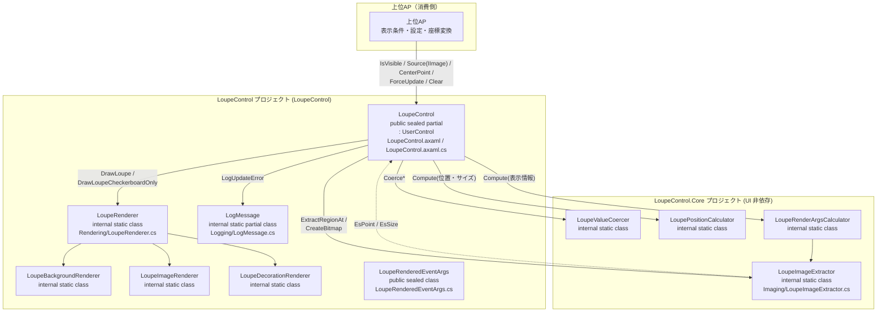
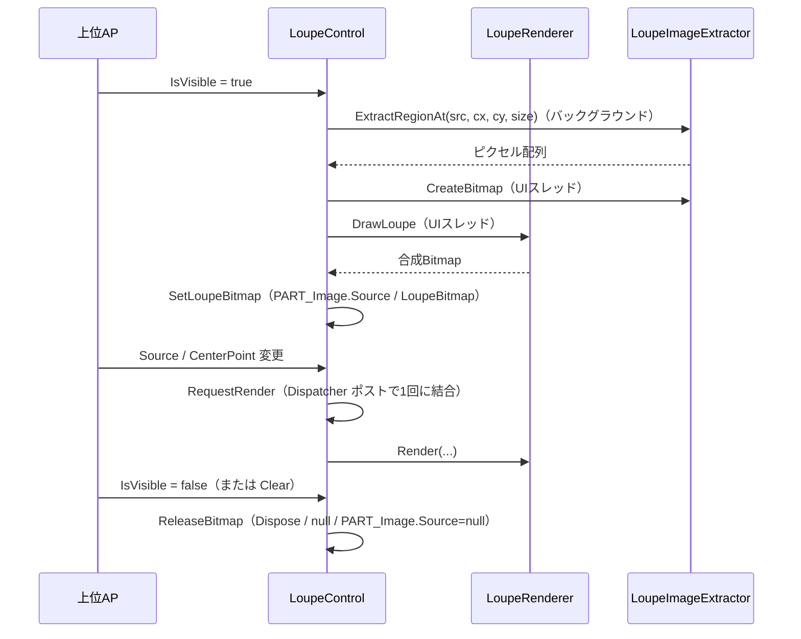

# LoupeControl システム仕様書（SPEC_System）

## 目次

- [LoupeControl システム仕様書（SPEC\_System）](#loupecontrol-システム仕様書spec_system)
  - [目次](#目次)
  - [1. システム概要](#1-システム概要)
  - [2. 技術スタック](#2-技術スタック)
  - [3. アーキテクチャ](#3-アーキテクチャ)
    - [3.1 レイヤー構造](#31-レイヤー構造)
    - [3.2 依存の方向](#32-依存の方向)
  - [4. 例外処理ポリシー](#4-例外処理ポリシー)
    - [4.1 基本方針](#41-基本方針)
    - [4.2 本プロジェクト固有の例外処理](#42-本プロジェクト固有の例外処理)
  - [5. コンポーネント図](#5-コンポーネント図)
  - [6. コンポーネント一覧](#6-コンポーネント一覧)
    - [6.1 LoupeControl](#61-loupecontrol)
    - [6.2 LoupeRenderer](#62-louperenderer)
    - [6.3 描画責務分割](#63-描画責務分割)
    - [6.4 画像入力とピクセル抽出](#64-画像入力とピクセル抽出)
    - [6.5 LoupeImageExtractor（`LoupeControl.Core`）](#65-loupeimageextractorloupecontrolcore)
    - [6.6 LogMessage](#66-logmessage)
    - [6.7 上位AP（消費側）](#67-上位ap消費側)
  - [7. 依存ルール](#7-依存ルール)
  - [8. ライフサイクル](#8-ライフサイクル)
  - [9. 補正（coerce）一覧](#9-補正coerce一覧)

---

## 1. システム概要

SaveEvidence は、Windows デスクトップ上の画面をキャプチャし、プレビュー・編集・保存するための Avalonia UI アプリケーションです（.NET 10.0 / C# 14 / MVVM）。

本プロジェクト（LoupeControl）は、このシステムのうち**ルーペ（拡大鏡）表示**を担う再利用可能なコントロールです。元画像の指定座標を拡大表示し、市松模様・十字線・外枠を合成描画します。上位 AP（SnipCaptureUI / FadeMaskDragRect）のルーペ表示に使用されます。

## 2. 技術スタック

| 項目 | 内容 |
| --- | --- |
| **プロジェクト** | `LoupeControl` |
| **ルート名前空間** | `Estable.AvaloniaUI.Loupe` |
| **言語** | C# 14（.NET 10.0） |
| **UI フレームワーク** | Avalonia UI 12.1（StyledProperty / DrawingContext / RenderTargetBitmap / IBrush） |
| **ターゲットフレームワーク** | net10.0 |
| **ビルドツール** | MSBuild / .NET SDK 10.0 |
| **ログ** | Microsoft.Extensions.Logging（LoggerMessage ソース生成） |
| **テスト** | xUnit v3 / Avalonia.Headless.XUnit |
| **依存プロジェクト** | `LoupeControl.Core`（UI 非依存の計算ロジック）/ `PlatformFactory`（コア型の相互変換・画像コンテナ） |

## 3. アーキテクチャ

### 3.1 レイヤー構造

```text
公開コントロール（LoupeControl）
  → 描画オーケストレーション（LoupeRenderCoordinator / LoupeRenderPipeline / LoupeSourceResolver）
  → レンダリング（LoupeRenderer + 背景 / 画像 / 装飾レンダラー）
  → Core（LoupeControl.Core: 数値補正 / 表示位置・サイズ / 切り出し領域 / 描画完了時の表示情報）
```

### 3.2 依存の方向

- 依存は**一方向の階層構造**（LoupeControl → Rendering → LoupeControl.Core → PlatformFactory.Core）。双方向依存・具象依存なし。
- LoupeControl は上位 AP に依存しない（再利用可能）。
- 色の境界変換（string → IBrush）は上位 AP 側で行い、LoupeControl 内に文字列解析を持ち込まない。
- 描画は LoupeRenderer へ委譲し、LoupeControl は状態（DP）とライフサイクル（Bitmap 生成 / 解放）に専念する。
- 表示方式は LoupeControl 内部の Image.Source に統一し、外部の DrawingContext 描画 API は提供しない。
- UI 非依存のロジックは `LoupeControl.Core`（`internal` + `InternalsVisibleTo`）へ委譲し、境界でのみコア型（`EsPoint` / `EsSize`）と Avalonia 型を相互変換する（1 行変換）。

## 4. 例外処理ポリシー

### 4.1 基本方針

- ライブラリは例外を原則伝播し、上位 AP（app）で処理する。
- UI レイヤー（app）ではユーザー操作起因の例外を各ハンドラで catch し、UI の応答性を維持する。
- ログは LoggerMessage ソース生成（`Logging/LogMessage.cs`）で出力する。設定変更は Debug、再描画・位置更新は Trace、例外は Error で記録する。

### 4.2 本プロジェクト固有の例外処理

- `Source` に `Bitmap` / `EsBitmapImage` 以外の `IImage` が設定された場合、`NotSupportedException` を生成し `LogMessage.LogUpdateError` で記録する。
- `RenderAsync()` を直接呼び出した場合は例外を呼び出し元へ返す。
- 自動再描画の場合は例外を観測済みとして処理し、UI スレッドを未処理例外で終了させない。
- 非同期生成は世代番号で古い結果を破棄し、解放後の破棄を防止する。

## 5. コンポーネント図



## 6. コンポーネント一覧

### 6.1 LoupeControl

- **分類**: 公開コントロール（`public sealed partial class LoupeControl : UserControl`）
- **責務**:
  - 状態管理: 15個の StyledProperty（`Source: IImage?` / `CenterPoint` / サイズ / 外観 / 座標ラベル）
    - ライフサイクル: 世代管理付き非同期ビットマップ生成と解放（`ReleaseBitmap`）
  - 表示制御: 標準プロパティ `IsVisible` で表示・非表示を指示（表示時=同期描画、非表示時=解放）
    - 再描画のバッチ化: `Dispatcher.UIThread.Post` で複数プロパティ変更を1フレーム1回の再描画に結合
    - 非同期描画: 領域抽出を `Task.Run` で非同期化し、Avaloniaの描画オブジェクト生成とUI反映はUIスレッドで行う。世代番号で古い結果を破棄する
    - 座標単位: `RequestedSize` はDIP、レンダラーへ渡すサイズと装飾幅は `RenderScaling` で物理ピクセルへ変換
  - 値の補正: `coerce` コールバックで数値プロパティを安全域へ矯正
- **公開API**: 入力（`Source: IImage?` / `CenterPoint`）/ サイズ（`RequestedSize` / `RenderScaling` / `ZoomLevel`）/ 外観（`CrossColor` / `CheckerSize` / `CheckerColorA` / `CheckerColorB` / `FrameColor` / `FrameWidth`・不透明度は色のアルファに統合）/ 座標ラベル（`ShowCoordLabel` / `CoordLabelColor` / `CoordLabelBackgroundColor` / `CoordLabelFontSize`）/ ログ（`Log`）/ イベント（`Rendered`・`LoupeRenderedEventArgs` で表示位置・サイズ・ズーム・中心・切り出し左上・スケールを通知。ホストが描画済み Bitmap へオーバーレイ（線分・選択枠等）を直接描画できる）/ 操作（`Clear` / `ForceUpdate` / `RenderAsync` / `SetCoordinateTransform` / `PositionOffset` / `RefreshPosition`）
- **依存**: LoupeRenderer / LogMessage / Avalonia / ILogger

### 6.2 LoupeRenderer

- **分類**: 内部静的クラス（`internal static class`）
- **責務**: ルーペ Bitmap の合成描画（市松模様 → 拡大画像 → 十字線 → 外枠）
- **公開API**: `Render` / `DrawLoupe` / `DrawLoupeCheckerboardOnly`
- **特徴**: 色は `IBrush` で受け取り文字列解析を行わない。十字線の不透明度は色のアルファに統合
- **依存**: LoupeImageExtractor

### 6.3 描画責務分割

- `LoupeBackgroundRenderer`: 市松模様の背景描画。明暗判定はコアの `LoupeCheckerboard` へ委譲する。
- `LoupeImageRenderer`: 切り出し済み画像の拡大描画。
- `LoupeDecorationRenderer`: 十字線と外枠の描画。矩形の計算はコアの `LoupeDecorationGeometry` へ委譲する。
- `LoupeRenderer`: 上記3層を合成し、生成したBitmapを返すオーケストレーター。

> 十字線・外枠の矩形計算と市松模様の明暗判定は `LoupeControl.Core` が単一所有します（MewUI 版と共用）。
> 本プロジェクトは返された `EsRect` を Avalonia の矩形へ変換して描画するだけです。

### 6.4 画像入力とピクセル抽出

- 公開画像入力はAvalonia標準の `IImage?` とし、`Image.Source` と同じBindingモデルで利用できる。
- ピクセル抽出が必要な `LoupeImageExtractor` の内部境界だけ `EsBitmap` を要求する。
- `Source` が `Bitmap` の場合は `CopyPixels` による複製（`EsBitmap` 化）で抽出する。
- `Source` が `EsBitmapImage` の場合は内包する `EsBitmap` を直接抽出する（複製なし）。
- `Bitmap` / `EsBitmapImage` 以外の `IImage` は `NotSupportedException` が発生する。
- バックグラウンドではピクセル配列だけを抽出する。合成（`RenderTargetBitmap` / `DrawingContext`）はUIスレッドで行い、合成完了後に一時 `RenderTargetBitmap` を破棄する。

### 6.5 LoupeImageExtractor（`LoupeControl.Core`）

- **分類**: 内部静的クラス（`internal static class`）
- **所属**: `LoupeControl.Core` プロジェクト（名前空間 `Estable.Loupe.Imaging`）
- **責務**: 元画像（`EsBitmap`）からの領域切り出し（範囲外は透明パディング）を `EsBitmap` として提供する
- **公開API**: `ExtractRegionAt`（`EsBitmap` 抽出）/ `ComputeCaptureSize`（切り出し領域サイズ計算）/ `ComputeCaptureTopLeft`（拡大中心 → 切り出し領域左上計算。`ExtractRegionAt` / `LoupeRenderArgsCalculator` で共用する単一所有）
- **依存**: `PlatformFactory.Core`（`EsBitmap` / `EsPoint`）のみ。Avalonia には依存しない

### 6.6 LogMessage

- **分類**: 内部静的クラス（`internal static partial class`）
- **責務**: LoggerMessage source generator によるログ定義
- **公開API**: `LogUpdateError`（Error）/ `LogSettingChanged`（Debug）/ `LogRequestRender`（Trace）/ `LogRenderCore`（Trace）/ `LogGenerateAsyncDone`（Trace）
- **依存**: Microsoft.Extensions.Logging

### 6.7 上位AP（消費側）

- 上位AP が本コントロールを参照して利用する（表示条件・設定・座標変換は上位AP 側の責務）。
- 本コントロールは上位AP の詳細（内部構造・型）に依存しない。

## 7. 依存ルール

- 依存方向は**一方向の階層構造**（LoupeControl → Rendering → LoupeControl.Core → PlatformFactory.Core）。双方向依存・具象依存なし。
- LoupeControl は上位AP に**依存しない**（再利用可能）。
- 色の境界変換（string → IBrush）は上位AP 側で行い、LoupeControl 内に文字列解析を持ち込まない。
- 描画は LoupeRenderer へ委譲し、LoupeControl は状態（DP）とライフサイクル（Bitmap 生成/解放）に専念する。
- UI 非依存の計算ロジックは `LoupeControl.Core` が単一所有し、UI 側は境界でコア型へ 1 行変換して委譲する。
- 表示方式は `LoupeControl` 内部の `Image.Source` に統一し、外部の `DrawingContext` 描画APIは提供しない。
- 複数の依存関係プロパティを連続設定した場合、Dispatcher上の保留中再描画要求は `_renderQueued` により1件へ集約される。

## 8. ライフサイクル



## 9. 補正（coerce）一覧

| プロパティ | 範囲 |
| --- | --- |
| RequestedSize | 1〜4096 |
| ZoomLevel | 1〜64 |
| RenderScaling | 0.1〜8.0（非有限値は 1.0） |
| CheckerSize | 1〜128 |
| FrameWidth | 1〜64 |
| CoordLabelFontSize | 6〜48（非有限値は 12.0） |
