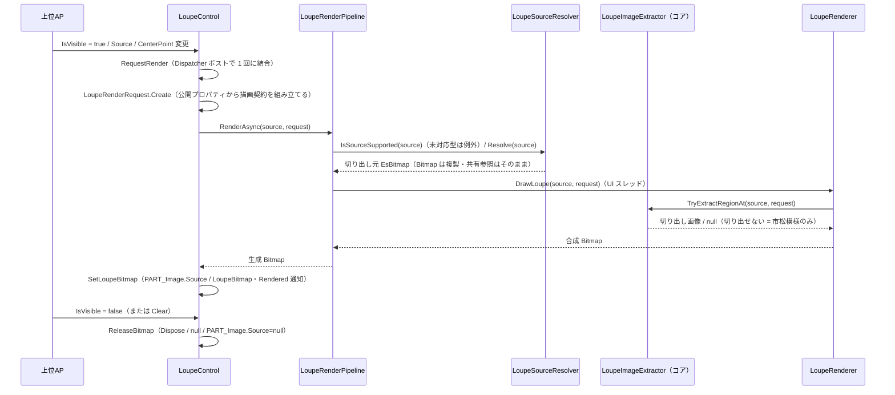

# LoupeControl システム仕様書（SPEC_System）

## 目次

- [LoupeControl システム仕様書（SPEC\_System）](#loupecontrol-システム仕様書spec_system)
  - [目次](#目次)
  - [1. システム概要](#1-システム概要)
  - [2. 技術スタック](#2-技術スタック)
  - [3. アーキテクチャ](#3-アーキテクチャ)
    - [3.1 レイヤー構造](#31-レイヤー構造)
    - [3.2 依存の方向](#32-依存の方向)
  - [4. 例外処理ポリシー](#4-例外処理ポリシー)
    - [4.1 基本方針](#41-基本方針)
    - [4.2 本プロジェクト固有の例外処理](#42-本プロジェクト固有の例外処理)
  - [5. コンポーネント図](#5-コンポーネント図)
  - [6. コンポーネント一覧](#6-コンポーネント一覧)
    - [6.1 LoupeControl](#61-loupecontrol)
    - [6.2 LoupeRenderer](#62-louperenderer)
    - [6.3 描画責務分割](#63-描画責務分割)
    - [6.4 画像入力とピクセル抽出](#64-画像入力とピクセル抽出)
    - [6.5 LoupeImageExtractor（`LoupeControl.Core`）](#65-loupeimageextractorloupecontrolcore)
    - [6.6 LoupeLogMessage](#66-loupelogmessage)
    - [6.7 上位AP（消費側）](#67-上位ap消費側)
    - [6.8 UI 固有の機構（コアへ移さない）](#68-ui-固有の機構コアへ移さない)
  - [7. 依存ルール](#7-依存ルール)
  - [8. ライフサイクル](#8-ライフサイクル)
  - [9. 補正（coerce）一覧](#9-補正coerce一覧)

---

## 1. システム概要

SaveEvidence は、Windows デスクトップ上の画面をキャプチャし、プレビュー・編集・保存するための Avalonia UI アプリケーションです（.NET 10.0 / C# 14 / MVVM）。

本プロジェクト（LoupeControl.AvaloniaUI）は、このシステムのうち**ルーペ（拡大鏡）表示**を担う再利用可能なコントロールです。元画像の指定座標を拡大表示し、市松模様・十字線・外枠を合成描画します。上位 AP（`CaptureSessionControl` / `FadeMaskDragRectControl`）のルーペ表示に使用されます。

## 2. 技術スタック

| 項目 | 内容 |
| --- | --- |
| **プロジェクト** | `LoupeControl.AvaloniaUI` |
| **ルート名前空間** | `Estable.AvaloniaUI.Loupe` |
| **言語** | C# 14（.NET 10.0） |
| **UI フレームワーク** | Avalonia UI 12.1（StyledProperty / DrawingContext / RenderTargetBitmap / IBrush） |
| **ターゲットフレームワーク** | net10.0 |
| **ビルドツール** | MSBuild / .NET SDK 10.0 |
| **ログ** | Microsoft.Extensions.Logging（LoggerMessage ソース生成） |
| **テスト** | xUnit v3 / Avalonia.Headless.XUnit |
| **依存プロジェクト** | `LoupeControl.Core`（UI 非依存の計算ロジック）/ `Platform.AvaloniaUI`（コア型の相互変換・画像コンテナ） |

## 3. アーキテクチャ

### 3.1 レイヤー構造

```text
公開コントロール（LoupeControl）
  → 描画オーケストレーション（LoupeRenderCoordinator / LoupeRenderPipeline / LoupeSourceResolver）※ UI 固有の機構
  → レンダリング（LoupeRenderer + 背景 / 画像 / 装飾レンダラー）
  → Core（LoupeControl.Core: 外観 / 数値補正 / 表示位置・サイズ / 切り出し領域と可否 / ラベル配置 / 市松模様 / 描画完了時の表示情報 / ログ定義）
```

### 3.2 依存の方向

- 依存は**一方向の階層構造**（LoupeControl → Rendering → LoupeControl.Core → Platform.Core）。双方向依存・具象依存なし。
- LoupeControl は上位 AP に依存しない（再利用可能）。
- 色の境界変換（設定文字列 → コアの色型）は上位AP 側で行い、LoupeControl 内に文字列解析を持ち込まない（外観は `System.Drawing.Color` として受け取る）。
- 描画は LoupeRenderer へ委譲し、LoupeControl は状態（DP）とライフサイクル（Bitmap 生成 / 解放）に専念する。
- 描画の可否（アルファ 0）・切り出しの可否・タイルサイズの補正はコアが判定・所有し、本プロジェクトはその結果で描画する。
- `LoupeRenderCoordinator`（再描画のバッチ化）と `LoupeSourceResolver`（`IImage` の型判定）は **Avalonia 固有の機構** であり、コアへ移さない（MewUI 版は同期描画のため不要）。
- 描画可否の判断（非表示なら描画しない・解放する、古い世代は反映しない）と、未実行要求の破棄と解放の手順は **`LoupeRenderCoordinator` が単一所有** する（コントロールは `RequestRender` / `CancelAndRelease` / `ShouldApply` を呼ぶだけ）。
- 表示方式は LoupeControl 内部の Image.Source に統一し、外部の DrawingContext 描画 API は提供しない。
- UI 非依存のロジックは `LoupeControl.Core`（`internal` + `InternalsVisibleTo`）へ委譲し、境界でのみコア型（`EsPoint` / `EsSize`）と Avalonia 型を相互変換する（1 行変換）。

## 4. 例外処理ポリシー

### 4.1 基本方針

- ライブラリは例外を原則伝播し、上位 AP（app）で処理する。
- UI レイヤー（app）ではユーザー操作起因の例外を各ハンドラで catch し、UI の応答性を維持する。
- ログは LoggerMessage ソース生成（コアの `LoupeLogMessage`。両 UI 分を `LoupeControl.Core` が単一所有する）で出力する。設定変更は Debug、再描画・位置更新は Trace、例外は Error で記録する。

### 4.2 本プロジェクト固有の例外処理

- `Source` に `Bitmap` / `EsBitmapAvaloniaImage` 以外の `IImage` が設定された場合、`NotSupportedException` を生成し `LoupeLogMessage.LogUpdateError` で記録する。
- 描画の例外（未対応の画像型等）は `Log` へ記録され、呼び出し元へは伝播しない（開始側が例外を観測する）。
- 自動再描画の場合は例外を観測済みとして処理し、UI スレッドを未処理例外で終了させない。
- 非同期生成は世代番号で古い結果を破棄し、解放後の破棄を防止する。

## 5. コンポーネント図

```mermaid
flowchart TB
    subgraph Host["上位AP（消費側）"]
        AP["上位AP<br/>表示条件・設定・座標変換"]
    end
    subgraph LC["LoupeControl.AvaloniaUI プロジェクト (LoupeControl.AvaloniaUI)"]
        direction TB
        Ctl["LoupeControl<br/>public sealed partial<br/>: UserControl<br/>LoupeControl.axaml / LoupeControl.axaml.cs"]
        Coh["LoupeRenderCoordinator<br/>internal sealed class<br/>（再描画のバッチ化）"]
        Pip["LoupeRenderPipeline<br/>internal static class<br/>（ソース解決と描画合成）"]
        Src["LoupeSourceResolver<br/>internal static class<br/>（IImage の型判定・破棄済み検出）"]
        Rdr["LoupeRenderer<br/>internal static class<br/>Rendering/LoupeRenderer.cs"]
        Brs["LoupeBrushes<br/>internal static class<br/>（色→共有ブラシ）"]
        Bg["LoupeBackgroundRenderer<br/>internal static class"]
        Img["LoupeImageRenderer<br/>internal static class"]
        Dec["LoupeDecorationRenderer<br/>internal static class"]
        Evt["LoupeRenderedEventArgs<br/>public sealed class<br/>LoupeRenderedEventArgs.cs"]
    end
    subgraph Core["LoupeControl.Core プロジェクト (UI 非依存)"]
        direction TB
        Opt["LoupeOptions<br/>public sealed record<br/>（表示サイズ・拡大率・外観）"]
        Req["LoupeRenderRequest<br/>internal readonly record struct<br/>（1 フレーム分の描画入力）"]
        App["LoupeAppearance<br/>public sealed record"]
        Ext["LoupeImageExtractor<br/>internal static class<br/>Imaging/LoupeImageExtractor.cs"]
        Coerce["LoupeValueCoercer<br/>internal static class"]
        Scale["LoupeAppearanceScaler<br/>internal static class"]
        Geo["LoupeDecorationGeometry / LoupeCheckerboard<br/>internal static class"]
        Lay["LoupeLabelLayout<br/>internal static class"]
        Pos["LoupePositionCalculator<br/>internal static class"]
        Args["LoupeRenderArgsCalculator<br/>internal static class"]
        Log["LoupeLogMessage<br/>internal static partial class"]
    end

    AP -->|"IsVisible / Source(IImage) / CenterPoint /<br/>Options / RenderScaling / RequestRender / Clear"| Ctl
    Ctl -->|"RequestRender / CancelAndRelease / ShouldApply"| Coh
    Ctl -->|"RenderAsync（描画入力）"| Pip
    Pip --> Src
    Pip -->|"DrawLoupe（描画入力）"| Rdr
    Ctl -->|"Coerce（RenderScaling）"| Coerce
    Ctl -->|"ClampSizeToArea / ComputePosition"| Pos
    Ctl -->|"Create（描画入力の組み立て。設定を渡す）"| Req
    Ctl -->|"Compute(表示情報)"| Args
    Ctl -->|"設定（表示サイズ・拡大率・外観）"| Opt
    Ctl -->|"外観の値・ラベル余白"| App
    Ctl -->|"ラベル余白"| Lay
    Ctl -->|"LogUpdateError / LogOptionsChanged"| Log
    Req -->|"拡大率・外観を参照"| Opt
    Rdr -->|"描画入力"| Bg
    Rdr -->|"描画入力"| Img
    Rdr -->|"描画入力"| Dec
    Rdr --> Brs
    Bg --> Brs
    Dec --> Brs
    Bg -->|"可否・タイルサイズ"| App
    Bg --> Scale
    Bg --> Geo
    Img -->|"切り出し・拡大矩形"| Ext
    Img --> Req
    Dec -->|"可否・太さ"| App
    Dec --> Scale
    Dec --> Geo
    Lay --> App
    Args --> Ext
    Ext -.->|"EsPoint / EsSize"| Ctl
```



## 6. コンポーネント一覧

### 6.1 LoupeControl

- **分類**: 公開コントロール（`public sealed partial class LoupeControl : UserControl`）
- **責務**:
  - 状態管理: 4 個の StyledProperty（`Source: IImage?` / `CenterPoint` / 設定 `Options` / 環境値 `RenderScaling`）
  - 座標ラベル: 余白・角丸・文字サイズ・色はコア（`LoupeLabelLayout` / `LoupeAppearance`）の値をコードビハインドで設定し、AXAML には外観値を書かない
    - **要素で描く理由（UI 層の例外）**: Avalonia ヘッドレスでは `RenderTargetBitmap` の画素を検証できないため、ビットマップへ焼き込むとラベルの描画をテストできない。レイアウトシステム（`Border` / `TextBlock`）に描かせると要素のプロパティとして検証できる（MewUI 版は Skia のキャンバスへ描画して画素を検証する）
    - ライフサイクル: 世代管理付き非同期ビットマップ生成と解放（`ReleaseBitmap`）
  - 表示制御: 標準プロパティ `IsVisible` で表示・非表示を指示（表示時=再生成要求（非同期・1 フレームに 1 回の生成へ結合）、非表示時=未実行要求の破棄と解放）
    - 再描画のバッチ化: `Dispatcher.UIThread.Post` で複数プロパティ変更を1フレーム1回の再描画に結合
    - 非同期生成: 切り出しと合成（`RenderTargetBitmap` / `DrawingContext`）は UI スレッドで行い（バックグラウンド抽出（`Task.Run`）は使わない。連続再描画時にスレッドプールが競合し、移動中の追従が止まるため）、古い世代の結果は採用せず破棄する
    - 表示サイズ・位置: `UpdatePosition` が唯一の書き込み元。親パネルのサイズ（未接続は領域未確定＝クランプなし）で `LoupePositionCalculator.ClampSizeToArea` が求めた表示サイズを要素（`Width` / `Height`）と `_displaySize` へ反映し、表示中は位置を `LoupePositionCalculator.ComputePosition` で求めて `RenderTransform` へ反映する。クランプは 1 回だけ行い、要素サイズ・描画サイズ・位置クランプで同じ値を使う
    - 座標単位: `Options.RequestedSize` は DIP、レンダラーへ渡すサイズと装飾幅は `RenderScaling` で物理ピクセルへ変換
  - 値の補正: コアの設定値（`LoupeOptions` / `LoupeAppearance`）は型の生成時に補正される（UI は関与しない）。環境値の `RenderScaling` のみ `coerce` コールバックで矯正する
- **公開API**: 入力（`Source: IImage?` / `CenterPoint`）/ 設定（`Options`（コアの `LoupeOptions` が単一所有する表示サイズ・拡大率・外観。UI は設定値を保持しない。色は `System.Drawing.Color` で受け取り描画時にブラシへ変換する））/ 環境（`RenderScaling`）/ ログ（`Log`）/ イベント（`Rendered`・`LoupeRenderedEventArgs` で描画済み Bitmap・切り出し左上・スケールを通知。ホストが Bitmap へオーバーレイ（線分・選択枠等）を直接描画できる）/ 操作（`Clear` / `RequestRender` / `SetCoordinateTransform` / `PositionOffset` / `RefreshPosition`）
- **依存**: LoupeRenderer / LoupeLogMessage（コア） / LoupeOptions（コア） / LoupeAppearance（コア） / Avalonia / ILogger

### 6.2 LoupeRenderer

- **分類**: 内部静的クラス（`internal static class`）
- **責務**: ルーペ Bitmap の合成描画（市松模様 → 拡大画像 → 十字線 → 外枠）
- **公開API**: `DrawLoupe(source, request)`（引数はコアの描画契約 `LoupeRenderRequest` と解決済みのソース。外観値・換算値を保持しない。切り出せない場合は市松模様のみを描画する）
- **特徴**: 外観の色はコアの色型で受け取り、`LoupeBrushes`（容量制限付きの `BrushCache` へ委譲）でブラシを共有する。描画の可否（アルファ 0）はコアが判定する。市松タイル・外枠の太さはコアの `LoupeAppearanceScaler` が物理ピクセルへ換算する（DIP の見た目を DPI に依存させない）。描画層へは契約（`LoupeRenderRequest`）を渡し、各層がコアへ問い合わせる（呼び出し側で可否を判定して null を渡す形にはしない）。
- **依存**: LoupeAppearance（コア） / LoupeAppearanceScaler（コア） / LoupeImageExtractor（コア）

### 6.3 描画責務分割

- `LoupeBackgroundRenderer`: 市松模様の背景描画。明暗判定はコアの `LoupeCheckerboard`、描画の可否は `LoupeAppearance.HasCheckerColor*`、タイルサイズの物理ピクセル換算はコアの `LoupeAppearanceScaler` へ委譲する（描画入力 `LoupeRenderRequest` を受け取る）。
- `LoupeImageRenderer`: ソースの切り出しと拡大描画。切り出しの可否はコアの `LoupeImageExtractor.TryExtractRegionAt`、切り出し元・描画先の矩形はコアの `LoupeImageExtractor.ComputeMagnifiedRects`（引数はビットマップの実寸 `EsBitmap.Size`）へ委譲する。
- `LoupeDecorationRenderer`: 十字線と外枠の描画。描画の可否は `LoupeAppearance.HasCrosshair` / `HasFrame`、矩形の計算はコアの `LoupeDecorationGeometry`、太さの換算は `LoupeAppearanceScaler` へ委譲する。
- `LoupeBrushes`: コアの色型 → 共有ブラシの変換と容量制限付きキャッシュの単一所有（コントロールの座標ラベルと描画層 3 層が共用する）。
- 描画層は**描画入力（`LoupeRenderRequest`）を受け取り、描画の可否・値の単位・幾何をコアへ問い合わせて描くだけ**にする（MewUI 版の描画層と同じ形。外観値は保持しない）。
- 描画する層の集合と順序（下地 → 市松模様 → 拡大画像 → 十字線 → 外枠）は `LoupeRenderer` が単一所有する。
- `LoupeRenderer`: 上記3層を合成し、生成したBitmapを返すオーケストレーター。

> 十字線・外枠の矩形計算、市松模様の明暗判定とタイルサイズの換算、拡大描画の矩形計算は `LoupeControl.Core` が単一所有します（MewUI 版と共用）。
> 本プロジェクトは返された `EsRect` を Avalonia の矩形へ変換して描画するだけです。

> **通知契約の縮小**: `LoupeRenderedEventArgs` はホストがオーバーレイを描くのに必要な最小限（描画済み Bitmap・切り出し左上・スケール）のみを通知します。表示位置・表示サイズ・拡大率・拡大中心は、消費側が存在しないため削除しました（必要になればコントロールの公開プロパティから取得できます）。

### 6.4 画像入力とピクセル抽出

- 公開画像入力はAvalonia標準の `IImage?` とし、`Image.Source` と同じBindingモデルで利用できる。
- ピクセル抽出が必要な `LoupeImageExtractor` の内部境界だけ `EsBitmap` を要求する。
- `Source` が `Bitmap` の場合は `CopyPixels` による複製（`EsBitmap` 化）で抽出する。
- `Source` が `EsBitmapAvaloniaImage` の場合は内包する `EsBitmap` を直接抽出する（複製なし）。
- `Bitmap` / `EsBitmapAvaloniaImage` 以外の `IImage` は `NotSupportedException` が発生する。
- 切り出し（`EsBitmap.Crop`）と合成（`RenderTargetBitmap` / `DrawingContext`）は UI スレッドで行う（バックグラウンド抽出は連続再描画時にスレッドプールが競合し、移動中の追従が止まるため行わない）。一時 `RenderTargetBitmap` は描画直後に破棄する。

### 6.5 LoupeImageExtractor（`LoupeControl.Core`）

- **分類**: 内部静的クラス（`internal static class`）
- **所属**: `LoupeControl.Core` プロジェクト（名前空間 `Estable.Loupe.Imaging`）
- **責務**: 元画像（`EsBitmap`）からの領域切り出し（範囲外は透明パディング）を `EsBitmap` として提供する
- **公開API**: `ExtractRegionAt`（`EsBitmap` 抽出）/ `TryExtractRegionAt`（切り出しの可否を含む。ソース・中心未設定や破棄済みは `null`）/ `ComputeCaptureSize`（切り出し領域サイズ計算）/ `ComputeCaptureTopLeft`（拡大中心 → 切り出し領域左上計算。`ExtractRegionAt` / `LoupeRenderArgsCalculator` で共用する単一所有）/ `ComputeMagnifiedRects`（切り出し元・描画先の矩形計算。両 UI が共用する拡大倍率の単一所有）
- **依存**: `Platform.Core`（`EsBitmap` / `EsPoint`）のみ。Avalonia には依存しない

### 6.6 LoupeLogMessage

- **分類**: 内部静的クラス（`internal static partial class`。所属は `LoupeControl.Core` の `Estable.Loupe`）
- **責務**: LoggerMessage source generator によるログ定義。**両 UI で同じ書式・レベルにするためコアが単一所有する**
- **公開API**: `LogUpdateError`（Error）/ `LogSettingChanged`（Debug。汎用）/ 設定項目ごとの名前付きメソッド（`LogSourceChanged` / `LogCenterPointChanged` / `LogRequestedSizeChanged` / `LogRenderScalingChanged` / `LogZoomLevelChanged`。**設定名はコアが付与**し、UI 層は値だけを渡す）/ `LogOptionsChanged`（設定 `LoupeOptions` の**変化した項目だけ**を出力）/ `LogRenderCore`（Trace）/ `LogGenerateAsyncDone`（Trace）
- **依存**: Microsoft.Extensions.Logging。値の文字列化はコアの `LoupeLogFormat` が行う

### 6.7 上位AP（消費側）

- 上位AP が本コントロールを参照して利用する（表示条件・設定・座標変換は上位AP 側の責務）。
- 本コントロールは上位AP の詳細（内部構造・型）に依存しない。

### 6.8 UI 固有の機構（コアへ移さない）

- `LoupeRenderCoordinator`: 再描画要求のバッチ化（`Dispatcher.UIThread` へのポストで 1 フレーム 1 回に結合）、表示中の判定と世代番号による古い結果の破棄、未実行要求の破棄と解放の手順を単一所有する（Avalonia の Dispatcher に依存するため UI 固有。MewUI 版は同期描画のため不要）。
- `LoupeRenderPipeline`: Avalonia の `IImage` を切り出し元（`EsBitmap`）へ解決し、描画（`LoupeRenderer.DrawLoupe`）を UI スレッドで実行する。`IImage` の型判定と `Bitmap` → `EsBitmap` の複製が UI 固有。
- `LoupeSourceResolver`: `IImage` の対応型判定（`Bitmap` / `EsBitmapAvaloniaImage`）・破棄済みの検出・ソース寸法のログ用表現を単一所有する（UI スレッドに依存しない純粋関数）。

## 7. 依存ルール

- 依存方向は**一方向の階層構造**（LoupeControl → Rendering → LoupeControl.Core → Platform.Core）。双方向依存・具象依存なし。
- LoupeControl は上位AP に**依存しない**（再利用可能）。
- 色の境界変換（string → IBrush）は上位AP 側で行い、LoupeControl 内に文字列解析を持ち込まない。
- 描画は LoupeRenderer へ委譲し、LoupeControl は状態（DP）とライフサイクル（Bitmap 生成/解放）に専念する。
- UI 非依存の計算ロジック・設定・外観・ログ定義は `LoupeControl.Core` が単一所有し、UI 側は境界でコア型へ 1 行変換して委譲する。
- **UI 層は設定値・外観値を保持しない**（`Options`（コアの `LoupeOptions`）を 1 つ公開し、描画時に読むだけ）。
- 表示方式は `LoupeControl` 内部の `Image.Source` に統一し、外部の `DrawingContext` 描画APIは提供しない。
- 複数の依存関係プロパティを連続設定した場合、Dispatcher上の保留中再描画要求は `_renderQueued` により1件へ集約される。

## 8. ライフサイクル



## 9. 補正（coerce）一覧

| プロパティ | 範囲 | 補正の場所 |
| --- | --- | --- |
| Options（RequestedSize / ZoomLevel） | 1〜4096 / 1〜64 | **コアの `LoupeOptions`（`init` アクセサ）** |
| RenderScaling | 0.1〜8.0（非有限値は 1.0） | `coerce` コールバック（プロパティのメタデータ） |
| Options.Appearance（CheckerSize / FrameWidth / CoordLabelFontSize / CoordLabelCornerRadius） | 1〜128 / 1〜64 / 6〜48 / 0〜64 | **コアの `LoupeAppearance`（`init` アクセサ）** |

環境値の `RenderScaling` は `coerce` コールバックへ登録するため、バインディングなど setter を経由しない設定にも適用されます（規則はコアの `LoupeValueCoercer` が単一所有し、UI は登録するだけです）。MewUI 版も `MewProperty.Register` の coerce コールバックで同じ契約を満たします。

設定（`Options`）と外観（`Options.Appearance`）の数値項目は**コアの型が生成時に補正**するため、UI 側に補正の登録を置きません（値の設定経路（オブジェクト初期化子・`with` 式・逆シリアル化・バインディング）によらず範囲内の値だけが保持されます）。
