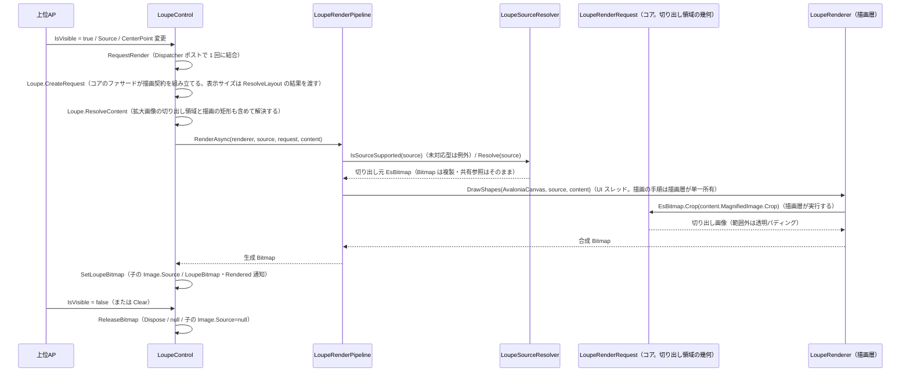

# LoupeControl システム仕様書（SPEC_System）

## 目次

- [LoupeControl システム仕様書（SPEC\_System）](#loupecontrol-システム仕様書spec_system)
  - [目次](#目次)
  - [1. システム概要](#1-システム概要)
  - [2. 技術スタック](#2-技術スタック)
  - [3. アーキテクチャ](#3-アーキテクチャ)
    - [3.1 レイヤー構造](#31-レイヤー構造)
    - [3.2 依存の方向](#32-依存の方向)
  - [4. 例外処理ポリシー](#4-例外処理ポリシー)
    - [4.1 基本方針](#41-基本方針)
    - [4.2 本プロジェクト固有の例外処理](#42-本プロジェクト固有の例外処理)
  - [5. コンポーネント図](#5-コンポーネント図)
  - [6. コンポーネント一覧](#6-コンポーネント一覧)
    - [6.1 LoupeControl](#61-loupecontrol)
    - [6.2 LoupeRenderer（LoupeControl.UIBase）](#62-louperendererloupecontroluibase)
    - [6.3 描画責務分割](#63-描画責務分割)
    - [6.4 画像入力とピクセル抽出](#64-画像入力とピクセル抽出)
    - [6.5 切り出し領域の幾何（`Feature.LoupeCore`）](#65-切り出し領域の幾何featureloupecore)
    - [6.6 LoupeLogMessage / LoupeRenderLog](#66-loupelogmessage--louperenderlog)
    - [6.7 上位AP（消費側）](#67-上位ap消費側)
    - [6.8 UI 固有の機構（コアへ移さない）](#68-ui-固有の機構コアへ移さない)
  - [7. 依存ルール](#7-依存ルール)
  - [8. ライフサイクル](#8-ライフサイクル)
  - [9. 補正（coerce）一覧](#9-補正coerce一覧)

---

## 1. システム概要

SaveEvidence は、Windows デスクトップ上の画面をキャプチャし、プレビュー・編集・保存するための Avalonia UI アプリケーションです（.NET 10.0 / C# 14 / MVVM）。

本プロジェクト（LoupeControl.AvaloniaUI）は、このシステムのうち**ルーペ（拡大鏡）表示**を担う再利用可能なコントロールです。元画像の指定座標を拡大表示し、市松模様・十字線・外枠を合成描画します。上位 AP（`CaptureSessionControl` / `FadeMaskDragRectControl`）のルーペ表示に使用されます。

## 2. 技術スタック

| 項目 | 内容 |
| --- | --- |
| **プロジェクト** | `LoupeControl.AvaloniaUI` |
| **ルート名前空間** | `EsUtil.SaveEvidence.Loupe.AvaloniaUI` |
| **言語** | C# 14（.NET 10.0） |
| **UI フレームワーク** | Avalonia UI 12.1（StyledProperty / DrawingContext / RenderTargetBitmap / IBrush） |
| **ターゲットフレームワーク** | net10.0 |
| **ビルドツール** | MSBuild / .NET SDK 10.0 |
| **ログ** | Microsoft.Extensions.Logging（LoggerMessage ソース生成） |
| **テスト** | xUnit v3 / Avalonia.Headless.XUnit |
| **依存プロジェクト** | `Feature.LoupeCore`（UI 非依存の計算ロジック）/ `LoupeControl.UIBase`（描画の手順・ラベル計画）/ `Platform.AvaloniaUI`（コア型の相互変換・画像コンテナ・`AvaloniaCanvas`） |

## 3. アーキテクチャ

### 3.1 レイヤー構造

```text
公開コントロール（LoupeControl）
  → 描画オーケストレーション（LoupeRenderPipeline / LoupeSourceResolver）※ UI 固有の機構
  → レンダリング（描画層 LoupeControl.UIBase の LoupeRenderer。描画先は AvaloniaCanvas が適合させる）
  → Core（Feature.LoupeCore: 寸法 / 数値補正 / 表示位置・サイズ / 切り出し領域と可否 / ラベル計画 / 市松模様 / 描画完了時の表示情報 / ログ定義）
```

### 3.2 依存の方向

- 依存は**一方向の階層構造**（LoupeControl → LoupeControl.UIBase → Feature.LoupeCore → Platform.Core）。双方向依存・具象依存なし。
- LoupeControl は上位 AP に依存しない（再利用可能）。
- 色の境界変換（設定文字列 → コアの色型）は上位AP 側で行い、LoupeControl 内に文字列解析を持ち込まない（色は `Paint`（コアの `LoupePaint`）として `System.Drawing.Color` で受け取る）。
- 描画の手順は描画層（`LoupeControl.UIBase` の `LoupeRenderer`）が、色は `LoupePaint` が単一所有し、本コントロールは描画ポート（`AvaloniaCanvas`）とラベル要素の配置、状態（DP）とライフサイクル（Bitmap 生成 / 解放）を担う。
- 描画の可否（アルファ 0）・切り出しの可否・タイルサイズの補正はコアが判定・所有し、本プロジェクトはその結果で描画する。
- `LoupeSourceResolver`（`IImage` の型判定）と中間ビットマップを生成するパイプラインは **Avalonia 固有の機構** であり、コアへ移さない（MewUI 版は同期描画のため不要）。
- 再描画のバッチ化（`LoupeRenderCoordinator`）は UI フレームワークに依存しないため **`LoupeControl.UIBase`（組み込みの層）** が所有する（実行キューと優先度は UI が `post` コールバックで注入する）。
- 描画可否の判断（非表示なら描画しない・解放する、古い世代は反映しない）と、未実行要求の破棄と解放の手順は **`LoupeRenderCoordinator` が単一所有** する（コントロールは `RequestRender` / `CancelAndRelease` / `ShouldApply` を呼ぶだけ）。
- 表示方式は LoupeControl 内部の Image.Source に統一し、外部の DrawingContext 描画 API は提供しない。
- UI 非依存のロジックは `Feature.LoupeCore`（全型 `public`）へ委譲し、境界でのみコア型（`EsPoint` / `EsSize`）と Avalonia 型を相互変換する（1 行変換）。

## 4. 例外処理ポリシー

### 4.1 基本方針

- ライブラリは例外を原則伝播し、上位 AP（app）で処理する。
- UI レイヤー（app）ではユーザー操作起因の例外を各ハンドラで catch し、UI の応答性を維持する。
- ログは LoggerMessage ソース生成（コアの `LoupeLogMessage`。両 UI 分を `Feature.LoupeCore` が単一所有する）で出力する。設定変更は Debug、再描画・位置更新は Trace、例外は Error で記録する。

### 4.2 本プロジェクト固有の例外処理

- `Source` に `Bitmap` / `EsBitmapAvaloniaImage` 以外の `IImage` が設定された場合、`NotSupportedException` を生成し `LoupeLogMessage.LogUpdateError` で記録する。
- 描画の例外（未対応の画像型等）は `Log` へ記録され、呼び出し元へは伝播しない（開始側が例外を観測する）。
- 自動再描画の場合は例外を観測済みとして処理し、UI スレッドを未処理例外で終了させない。
- 非同期生成は世代番号で古い結果を破棄し、解放後の破棄を防止する。

## 5. コンポーネント図

```mermaid
flowchart TB
    subgraph Host["上位AP（消費側）"]
        AP["上位AP<br/>表示条件・設定・座標変換"]
    end
    subgraph LC["LoupeControl.AvaloniaUI プロジェクト (LoupeControl.AvaloniaUI)"]
        direction TB
        Ctl["LoupeControl<br/>public sealed<br/>: Panel<br/>LoupeControl.cs（コードのみ）"]
        Coh["LoupeRenderCoordinator<br/>public sealed class<br/>（再描画のバッチ化。定義は LoupeControl.UIBase）"]
        Pip["LoupeRenderPipeline<br/>internal static class<br/>（ソース解決と描画合成）"]
        Src["LoupeSourceResolver<br/>internal static class<br/>（IImage の型判定・破棄済み検出）"]
        Rdr["LoupeRenderer<br/>public sealed class<br/>描画層 LoupeControl.UIBase<br/>（ILoupeRenderer の既定実装。色は Paint を保持する）"]
        Pnt["LoupePaint<br/>public sealed record<br/>描画層 LoupeControl.UIBase<br/>（色と描画可否の述語）"]
        Cvs["AvaloniaCanvas<br/>public sealed class<br/>Platform.AvaloniaUI<br/>（DrawingContext の IEsCanvas アダプタ）"]
        Brs["SolidColorBrushCache<br/>public static class<br/>Platform.AvaloniaUI.Imaging<br/>（色 → ブラシの共有キャッシュ）"]
        Evt["LoupeRenderedEventArgs<br/>public sealed class<br/>LoupeRenderedEventArgs.cs"]
    end
    subgraph Core["Feature.LoupeCore プロジェクト (UI 非依存)"]
        direction TB
        Opt["LoupeOptions<br/>public sealed record<br/>（表示サイズ・拡大率・寸法）"]
        Req["LoupeRenderRequest<br/>public readonly record struct<br/>（1 フレーム分の描画入力）"]
        App["LoupeMetrics<br/>public sealed record<br/>（寸法）"]
        Ext["LoupeRenderRequest<br/>public readonly record struct<br/>Drawing/LoupeRenderRequest.cs<br/>（切り出し領域の幾何を導出する internal メンバーを持つ）"]
        Coerce["Loupe.Limits<br/>ファサードの入れ子（数値スキーマ）"]
        Content["LoupeDrawContent<br/>public readonly record struct<br/>（1 フレーム分の描画内容：矩形・タイル・層）"]
        Lay["LoupeLabelPlan<br/>LoupeControl.UIBase<br/>（実寸 → ラベル配置の写像）"]
        Pos["Loupe（公開ファサード）<br/>public sealed class（Loupe.cs）<br/>値型 LoupeLayout / LoupeRenderNotification と<br/>描画内容 LoupeDrawContent を解決する"]
        Args["Loupe / LoupeRenderRequest<br/>公開ファサード + 描画入力<br/>（内部の配置・サイズ計算はファサードが持つ）"]
        Log["LoupeLogMessage<br/>public static partial class"]
    end

    AP -->|"IsVisible / Source(IImage) / CenterPoint /<br/>Options / RenderScaling / RequestRender / Clear"| Ctl
    Ctl -->|"RequestRender / CancelAndRelease / ShouldApply"| Coh
    Ctl -->|"RenderAsync（描画入力）"| Pip
    Pip --> Src
    Ctl -->|"Coerce（RenderScaling）"| Coerce
    Ctl -->|"EsSize.ClampToArea / ComputePosition"| Pos
    Ctl -->|"Create（描画入力の組み立て。設定を渡す）"| Req
    Ctl -->|"Compute(表示情報)"| Args
    Ctl -->|"設定（表示サイズ・拡大率・寸法）"| Opt
    Ctl -->|"寸法・ラベル余白"| App
    Ctl -->|"Paint（色）"| Pnt
    Ctl -->|"ラベル余白"| Lay
    Ctl -->|"LogUpdateError / LogOptionsChanged"| Log
    Pip -->|"DrawShapes（AvaloniaCanvas 経由）"| Rdr
    Rdr -->|"描画ポート"| Cvs
    Rdr --> Brs
    Rdr -->|"可否・タイルサイズ"| App
    Rdr -->|"色"| Pnt
    Rdr --> Scale
    Rdr --> Geo
    Rdr -->|"切り出し・拡大矩形"| Ext
    Rdr --> Req
    Lay --> App
    Args --> Ext
    Ext -.->|"EsPoint / EsSize"| Ctl
```



## 6. コンポーネント一覧

### 6.1 LoupeControl

- **分類**: 公開コントロール（`public sealed class LoupeControl : Panel`。AXAML を持たずコードのみで子要素を構成する）
- **責務**:
  - 状態管理: 5 個の StyledProperty（`Source: IImage?` / `CenterPoint` / 設定 `Options` / 色 `Paint` / 環境値 `RenderScaling`）
  - 座標ラベル: **コントロールがテキスト要素（`Border` + `TextBlock`）として表示する**。文言・表示可否・基準点はコア（`LoupeTextPlacement`）が、体裁（フォントサイズ・色・角丸）は描画の設定（`Paint`）が、実寸 → 配置矩形の写像は描画層（`LoupeControl.UIBase` の `LoupeLabelPlan`）が単一所有する。コントロールは配置フェーズ（`ArrangeOverride`）で要素を追加・更新する（ラベル要素は子の末尾に置かれ、子は親より後に描かれるため常に最上位）
    - **実寸測定は UI が行う理由**: テキストの実寸は描画 API（`FormattedText`）でしか測れないため、UI が測って `LoupeLabelPlan`（描画層 `LoupeControl.UIBase`）へ渡し、返された配置を要素へ反映する
    - ライフサイクル: 世代管理付き非同期ビットマップ生成と解放（`ReleaseBitmap`）
  - 表示制御: 標準プロパティ `IsVisible` で表示・非表示を指示（表示時=再生成要求（非同期・1 フレームに 1 回の生成へ結合）、非表示時=未実行要求の破棄と解放）
    - 再描画のバッチ化: `Dispatcher.UIThread.Post` で複数プロパティ変更を1フレーム1回の再描画に結合
    - 非同期生成: 切り出しと合成（`RenderTargetBitmap` / `DrawingContext`）は UI スレッドで行い（バックグラウンド抽出（`Task.Run`）は使わない。連続再描画時にスレッドプールが競合し、移動中の追従が止まるため）、古い世代の結果は採用せず破棄する
    - 表示サイズ・位置: `UpdatePosition` がコアのファサード `Loupe.ResolveLayout` を呼び、返された `LoupeLayout`（表示サイズと表示位置）を要素（`Width` / `Height`）と `RenderTransform` へ写すだけである（クランプ・オフセット・親領域へのクランプはコアが単一所有し、`UpdatePosition` は表示サイズの唯一の反映元になる）
    - 座標単位: `Options.RequestedSize` は DIP、レンダラーへ渡すサイズと装飾幅は `RenderScaling` で物理ピクセルへ変換
  - 値の補正: コアの設定値（`LoupeOptions` / `LoupeMetrics`）は型の生成時に補正される（UI は関与しない）。環境値の `RenderScaling` のみ `coerce` コールバックで矯正する
- **公開API**: 入力（`Source: IImage?` / `CenterPoint`）/ 設定（`Options`（コアの `LoupeOptions` が単一所有する表示サイズ・拡大率・寸法。UI は設定値を保持しない）/ 色（`Paint`（`LoupePaint`。`System.Drawing.Color` で受け取り描画時にブラシへ変換する）））/ 環境（`RenderScaling`）/ ログ（`Log`）/ イベント（`Rendered`・`LoupeRenderedEventArgs` で描画済み Bitmap・切り出し左上・スケールを通知。ホストが Bitmap へオーバーレイ（線分・選択枠等）を直接描画できる）/ 操作（`Clear` / `RequestRender` / `SetCoordinateTransform` / `PositionOffset` / `RefreshPosition`）
- **依存**: LoupeRenderer / LoupePaint / LoupeLabelPlan（`LoupeControl.UIBase`） / LoupeRendererBase（`LoupeControl.UIBase`） / LoupeLogMessage（コアの `EsUtil.Feature.LoupeCore.Logging`） / LoupeOptions / LoupeMetrics（コアの `EsUtil.Feature.LoupeCore.Setting`） / AvaloniaCanvas（Platform.AvaloniaUI） / Avalonia / ILogger

### 6.2 LoupeRenderer（LoupeControl.UIBase）

- **分類**: 公開クラス（`public sealed class LoupeRenderer : LoupeRendererBase`。所属は UI 非依存の描画層 `LoupeControl.UIBase`。色は生成時に受け取る）
- **責務**: ルーペ Bitmap の合成描画（下地 → 市松模様 → 拡大画像 → 十字線 → 外枠）を描画ポート `IEsCanvas` へ写す（**描画手順の単一所有者は基底の `LoupeRendererBase`**）
  **公開API**: `DrawShapes(canvas, source, request, content)`（図形のみ。**テキストは描かない**）を実装する。`CoordLabelFontSize` / `CoordLabelCornerRadius`（ラベルの体裁）は描画の設定の値への入口として公開する（**描画の契約には含めない**）。引数はコアの描画入力 `LoupeRenderRequest` と描画内容 `LoupeDrawContent`（層の順序・矩形・タイル）、および解決済みのソース。描画の設定は `LoupePaint` として保持する（幾何・値の単位・切り出しの可否はコアが単一所有する）
- **特徴**: 描画の可否（アルファ 0）は `LoupePaint` の述語が判定する。タイルの位置・矩形・寸法の物理ピクセルへの換算は**コアが解決済み**であり、描画層は計算を持たない（描画内容を写すだけ）
- **依存**: Platform.Core（`IEsCanvas` / `DrawingColorExtensions`）/ Feature.LoupeCore（`LoupeRenderRequest` / `LoupeDrawContent` / `LoupeMetrics`）

### 6.3 描画責務分割

- 描画の手順は層の順序に従う写し方の基底（UIBase の `LoupeRendererBase`）とその UI 実装（`LoupeControl.UIBase` の `LoupeRenderer`）が単一所有し、Avalonia 版と MewUI 版が同じ手順を共有する（層の順序はコアの `LoupeDrawLayer` が、色と描く可否（`Has*`）は本層の `LoupePaint` が単一所有する）。
- `LoupeRenderer` は**描画内容（`LoupeDrawContent`。層の順序・矩形・拡大画像の幾何）と層の順序を受け取り、描画ポートへ写すだけ**である（色は `LoupePaint` として保持し、描画可否は色の述語が判定する）。
- 描画先は UI 非依存の描画ポート `IEsCanvas` であり、本プロジェクトでは `AvaloniaCanvas`（`Platform.AvaloniaUI`）が `DrawingContext` を適合させる。
- `SolidColorBrushCache`（`Platform.AvaloniaUI.Imaging`）: コアの色型（`System.Drawing.Color`）→ `SolidColorBrush` の変換と容量制限付きキャッシュを単一所有する。描画アダプタ（`AvaloniaCanvas`）とラベル要素の配置（本コントロールとマーキー）が共用する。

> 十字線・外枠の矩形計算、市松模様の明暗判定とタイルサイズの換算、拡大描画の矩形計算は `Feature.LoupeCore` が単一所有します（MewUI 版と共用）。
> 本プロジェクトは `AvaloniaCanvas` の適合と要素の配置を担います。

> **通知契約**: `LoupeRenderedEventArgs` はホストがオーバーレイを描くのに必要な値（描画済み Bitmap・切り出し左上・スケール）を通知します。中心座標ラベルはコントロールがテキスト要素として表示するため含みません。表示位置・表示サイズ・拡大率・拡大中心は、消費側が存在しないため削除しました（必要になればコントロールの公開プロパティから取得できます）。

### 6.4 画像入力とピクセル抽出

- 公開画像入力はAvalonia標準の `IImage?` とし、`Image.Source` と同じBindingモデルで利用できる。
- ピクセル抽出が必要な切り出しの内部境界だけ `EsBitmap` を要求する（切り出し領域はコアの `LoupeRenderRequest.MagnifiedImage` が決める）。
- `Source` が `Bitmap` の場合は `CopyPixels` による複製（`EsBitmap` 化）で抽出する。
- `Source` が `EsBitmapAvaloniaImage` の場合は内包する `EsBitmap` を直接抽出する（複製なし）。
- `Bitmap` / `EsBitmapAvaloniaImage` 以外の `IImage` は `NotSupportedException` が発生する。
- 切り出し（`EsBitmap.Crop`）と合成（`RenderTargetBitmap` / `DrawingContext`）は UI スレッドで行う（バックグラウンド抽出は連続再描画時にスレッドプールが競合し、移動中の追従が止まるため行わない）。一時 `RenderTargetBitmap` は描画直後に破棄する。

### 6.5 切り出し領域の幾何（`Feature.LoupeCore`）

- **提供元**: `LoupeRenderRequest` の internal メンバー（`CaptureSize` / `CaptureTopLeft` / `MagnifiedImage`）
- **分類**: 描画入力（`public readonly record struct`）の導出プロパティ
- **責務**: 切り出し領域の幾何（どこを切り出すか）を描画入力の値から導出する
- **公開API**: 型が internal のため外部からは見えず、`LoupeDrawContent.MagnifiedImage` として間接的に使う
- **切り出しの実行は本メンバーにない**: `EsBitmap.Crop` を描画層（`LoupeControl.UIBase` の `LoupeRendererBase`）が呼ぶ
- **依存**: `Platform.Core`（`EsPoint` / `EsRect` / `EsRectInt`）。Avalonia には依存しない

### 6.6 LoupeLogMessage / LoupeRenderLog

- **分類**: 公開静的クラス（`public static partial class`。所属は `Feature.LoupeCore` の `EsUtil.Feature.LoupeCore.Logging`）
- **責務**: LoggerMessage source generator によるログ定義。**書式・レベルを UI 間で揃えるためコアが単一所有する**
- **公開API**: `LogUpdateError`（Error）/ `LogSettingChanged`（Debug。汎用）/ 設定項目ごとの名前付きメソッド（`LogSourceChanged` / `LogCenterPointChanged` / `LogRequestedSizeChanged` / `LogRenderScalingChanged` / `LogZoomLevelChanged`。**設定名はコアが付与**し、UI 層は値だけを渡す）/ `LogOptionsChanged`（設定 `LoupeOptions` の**変化した項目だけ**を出力）
- **本 UI 固有のログ**: 中間ビットマップを生成する描画パイプライン固有の `LogRenderCore` / `LogGenerateAsyncDone` は **本プロジェクトの `LoupeRenderLog`**（`Logging/LoupeRenderLog.cs`・`internal static partial class`）が所有する（コアに UI 固有のログを持たせない）
- **依存**: Microsoft.Extensions.Logging。値の文字列化はコアの `LoupeLogFormat` が行う

### 6.7 上位AP（消費側）

- 上位AP が本コントロールを参照して利用する（表示条件・設定・座標変換は上位AP 側の責務）。
- 本コントロールは上位AP の詳細（内部構造・型）に依存しない。

### 6.8 UI 固有の機構（コアへ移さない）

- `LoupeRenderCoordinator`: 再描画要求のバッチ化（実行キューへのポストで 1 フレーム 1 回に結合）、表示中の判定と世代番号による古い結果の破棄、未実行要求の破棄と解放の手順を単一所有する。定義は `LoupeControl.UIBase`（組み込みの層）にあり、UI フレームワークに依存しない（Avalonia 固有の実行キューと優先度は `post: action => Dispatcher.UIThread.Post(action, DispatcherPriority.Render)` として注入する）。
- `LoupeRenderPipeline`: Avalonia の `IImage` を切り出し元（`EsBitmap`）へ解決し、描画（コントロールが保持する `ILoupeRenderer` の `DrawShapes`。`AvaloniaCanvas` 経由）を UI スレッドで実行する。`IImage` の型判定と `Bitmap` → `EsBitmap` の複製が UI 固有。
- `LoupeSourceResolver`: `IImage` の対応型判定（`Bitmap` / `EsBitmapAvaloniaImage`）・破棄済みの検出・ソース寸法のログ用表現を単一所有する（UI スレッドに依存しない純粋関数）。

## 7. 依存ルール

- 依存方向は**一方向の階層構造**です（層の全体像は [`src/README.md`](../README.md)）。LoupeControl（UI）→ LoupeControl.UIBase / Feature.LoupeCore → Platform.Core（Rendering と UIBase は兄弟で互いに依存しない）。双方向依存・具象依存なし。
- LoupeControl は上位AP に**依存しない**（再利用可能）。
- 色の境界変換（string → IBrush）は上位AP 側で行い、LoupeControl 内に文字列解析を持ち込まない。
- 描画の手順は描画層（`LoupeControl.UIBase` の `LoupeRenderer`）が、色は `LoupePaint` が単一所有し、本コントロールは描画ポート（`AvaloniaCanvas`）とラベル要素の配置、状態（DP）とライフサイクル（Bitmap 生成/解放）を担う。
- UI 非依存の計算ロジック・設定・寸法・ログ定義は `Feature.LoupeCore` が単一所有し、UI 側は境界でコア型へ 1 行変換して委譲する。
- **UI 層は設定値・寸法値を保持しない**（`Options`（コアの `LoupeOptions`）を 1 つ公開し、描画時に読むだけ）。色は `Paint`（`LoupePaint`）として公開し、描画実装へ渡す。
- 表示方式は `LoupeControl` 内部の `Image.Source` に統一し、外部の `DrawingContext` 描画APIは提供しない。
- 複数の依存関係プロパティを連続設定した場合、Dispatcher上の保留中再描画要求は `_renderQueued` により1件へ集約される。

## 8. ライフサイクル



## 9. 補正（coerce）一覧

| プロパティ | 範囲 | 補正の場所 |
| --- | --- | --- |
| Options（RequestedSize / ZoomLevel） | 1〜4096 / 1〜64 | **コアの `LoupeOptions`（`init` アクセサ）** |
| RenderScaling | 0.1〜8.0（非有限値は 1.0） | `coerce` コールバック（プロパティのメタデータ） |
| `Options.Metrics`（`CheckerSize` / `FrameWidth`） | 1〜128 / 1〜64 | **コアの `LoupeMetrics`（`init` アクセサ）** |
| `Paint`（`CoordLabelFontSize` / `CoordLabelCornerRadius`） | 6〜48 / 0〜64 | **描画層の `LoupePaint`（`init` アクセサ）** |

環境値の `RenderScaling` は `coerce` コールバックへ登録するため、バインディングなど setter を経由しない設定にも適用されます（規則はコアの `Loupe.Limits` が単一所有し、UI は登録するだけです）。MewUI 版も `MewProperty.Register` の coerce コールバックで同じ契約を満たします。

設定（`Options`・`Options.Metrics`）の数値項目は**コアの型が生成時に補正**し、描画の設定（`Paint`）の数値項目は**描画層の型が生成時に補正**するため、UI 側に補正の登録を置きません（値の設定経路（オブジェクト初期化子・`with` 式・逆シリアル化・バインディング）によらず範囲内の値だけが保持されます）。
