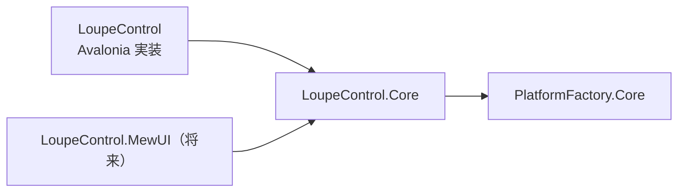
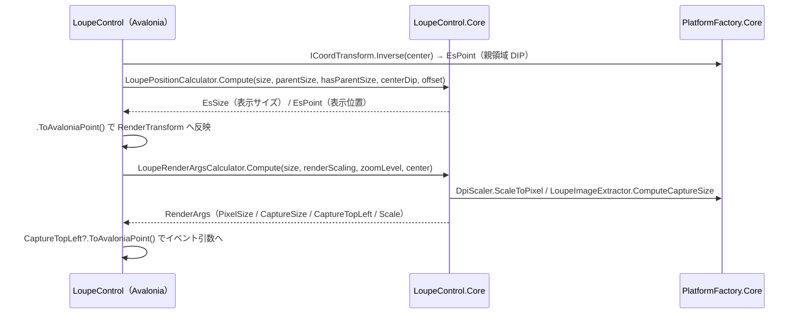

# LoupeControl.Core システム仕様書

## 概要

`LoupeControl.AvaloniaUI`（Avalonia UI 実装）と将来の MewUI 実装が共有する、UI フレームワーク非依存のルーペロジックを提供するライブラリです。SaveEvidence のマルチ UI 対応における「コントロールの Core / UI 分割」のパイロット実装（ティア E）です。

## 技術スタック

- .NET 10 / C# 14
- UI フレームワークは一切参照しない
- 外部パッケージへの直接依存なし（`PlatformFactory.Core` 経由で SkiaSharp を参照）

## アーキテクチャ

- `LoupeControl.Core` は UI フレームワークへ依存しません。依存は `PlatformFactory.Core` のみです。
- UI 実装は、コア型と自身の型（`Avalonia.Point` / `Size`）を相互変換します。変換は境界（サービス呼び出し・イベント引数の生成）の 1 行に限定し、UI 側の状態・描画は UI の型のまま維持します。
- 型はすべて `internal` とし、`InternalsVisibleTo`（`LoupeControl` / `LoupeControl.AvaloniaUI.Tests` / `LoupeControl.Core.Tests`）で UI 実装とテストへ公開します。公開 API を増やさないための方式です（`PlatformFactory.Core` の `CoordMath` と同じ）。

## コンポーネント構成

| ファイル | 内容 |
| --- | --- |
| `LoupeValueCoercer.cs` | 数値パラメータの既定値・安全域（最小 / 最大）の単一所有と、範囲外の値のクランプ |
| `LoupePositionCalculator.cs` | 表示サイズの親領域へのクランプ、表示位置（中心 + オフセット）の計算と親領域内へのクランプ |
| `LoupeRenderArgsCalculator.cs` | 描画完了イベント引数用の表示情報（ピクセルサイズ / 切り出しサイズ / 切り出し左上 / スケール）の計算と `RenderArgs` 値型 |
| `Imaging/LoupeImageExtractor.cs` | 切り出し領域の一辺・左上（ドメイン座標）の計算と、`EsBitmap` からの領域切り出し |

## データフロー

## 単一所有（Single Source of Truth）

| 計算 | 所有者 |
| --- | --- |
| 数値パラメータの安全域とクランプ | `LoupeValueCoercer` |
| 切り出し領域の一辺（ドメインピクセル） | `Imaging.LoupeImageExtractor.ComputeCaptureSize` |
| 切り出し領域の左上（中心 → 左上の変換） | `Imaging.LoupeImageExtractor.ComputeCaptureTopLeft` |
| DIP → 物理ピクセルの変換（切り上げ・最低 1） | `PlatformFactory.Core` の `DpiScaler.ScaleToPixel` |

`LoupeRenderArgsCalculator` / `LoupeImageExtractor.ExtractRegionAt` / UI 側の十字線・外枠描画はいずれも上記へ委譲し、同じ計算を二重に所有しません。

## 例外処理ポリシー

本プロジェクトは純粋計算と `EsBitmap` の操作で構成されます。例外を送出するのは `EsBitmap` の引数検証（`ArgumentOutOfRangeException`）と破棄後アクセス（`ObjectDisposedException`）のみです。`LoupeImageExtractor.ExtractRegionAt` は破棄済みソースに備え、例外の捕捉は呼び出し側（UI 実装）の責務とします。

## 可視性ポリシー

- すべての型・メンバーは `internal`（`LoupeValueCoercer` の定数も `internal const`）。
- 可視性の変更（`internal` → `public`）は破壊的な設計変更として扱います。

## テスト

- `src/LoupeControl.Core/tests`（`LoupeControl.Core.Tests`）が本プロジェクトのテストを持ちます。
- UI 初期化が不要なため、すべて `[Fact]`（`AvaloniaFact` ではない）で並列実行されます。
- UI 依存の検証（コントロール生成・描画・`StyledProperty` の coerce 経由の反映・イベント発火）は `LoupeControl.AvaloniaUI.Tests`（Avalonia ヘッドレス・直列）が担います。

## 移行の経緯

従来 `LoupeControl`（Avalonia）プロジェクト内にあった以下の型は、UI フレームワークの型（`Avalonia.Point` / `Size`）をシグネチャに持っていたため、本プロジェクトへ切り出しました。

| 型 | 移行前の依存 | 移行内容 |
| --- | --- | --- |
| `LoupeValueCoercer` | なし | そのまま移設 |
| `LoupePositionCalculator` | `Avalonia.Size` / `Point` | `EsSize` / `EsPoint` へ変更 |
| `LoupeRenderArgsCalculator` | `Avalonia.Point` | `EsPoint` へ変更 |
| `Imaging/LoupeImageExtractor` | `Avalonia.Point` | `EsPoint` へ変更（`System.Drawing.Rectangle` は維持） |

移設時に、切り出し領域の左上計算は `ExtractRegionAt` と描画完了イベント引数の 2 箇所で重複していたため、`ComputeCaptureTopLeft` に集約しました。
